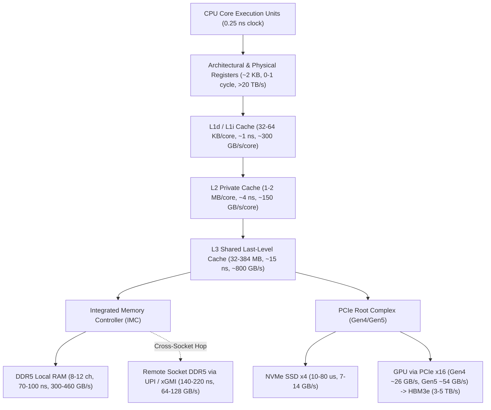
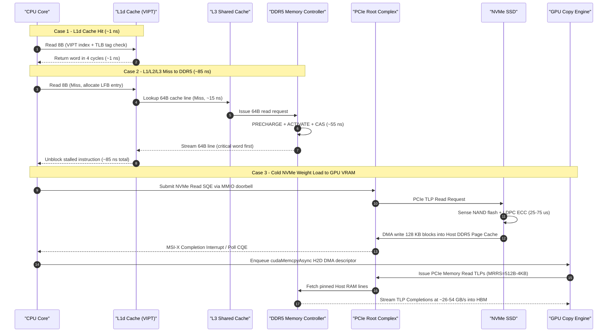

# 01 — Memory Hierarchy & Buses

[Stage 1 Index](./README.md) | [Next: 02 — Hardware Execution Models](./02-hardware-execution-models.md)

---

## 1. First Principles: Why Memory Dominates Compute

Modern silicon has evolved asymmetrically. Arithmetic Logic Units (ALUs) and Tensor Cores scale rapidly with transistor density (Moore's Law / Dennard post-scaling), whereas moving electrons off-die across package pins, PCB traces, and PCIe connectors is constrained by signal integrity, capacitance, pin count, and speed-of-light propagation (~$15\text{ cm/ns}$ in FR-4 PCB dielectric).

Consequently, **data movement costs orders of magnitude more time and energy than arithmetic**:

* A single FP16 Multiply-Accumulate (MAC) in 5nm–7nm silicon consumes **~0.2–0.9 pJ** and completes in **1 clock cycle** (~0.25–0.5 ns).
* Reading that operand from off-chip DDR5 DRAM consumes **~300–600 pJ** and takes **70–100 ns** (equivalent to ~300–400 CPU clock cycles).
* Fetching it from an NVMe SSD consumes **microjoules** and takes **10–80 $\mu$s** (~50,000–300,000 CPU clock cycles).

To bridge this 5-order-of-magnitude gap between compute speed and storage latency, computer architectures implement a strict **memory hierarchy** governed by the principles of **temporal locality** (recently accessed addresses are likely to be accessed again soon) and **spatial locality** (addresses adjacent to recently accessed addresses are likely to be accessed soon).

---

## 2. Quantitative Anatomy of the Memory Hierarchy

The table below gives concrete hardware metrics representative of modern server platforms (e.g., dual-socket AMD EPYC Genoa/Turin or Intel Xeon Emerald/Granite Rapids paired with PCIe Gen4/Gen5 GPUs and NVMe drives):

| Tier | Typical Capacity | Access Latency (Cycles / Wall Time) | Sustained Bandwidth | Management / Unit of Transfer |
| :--- | :--- | :--- | :--- | :--- |
| **CPU Architectural Registers** | ~1–4 KB (16–32 GPRs + 32 AVX-512 ZMMs = ~2.2 KB; backed by ~200–300+ physical PRF entries) | 0–1 cycle (~0.2–0.3 ns @ 3.5–4.5 GHz) | >20–50 TB/s aggregate across cores | Compiler / Hardware Register Renaming; 4–64 bytes |
| **L1 Cache (L1i + L1d)** | 32–64 KB per core (split I/D) | 3–5 cycles (~0.8–1.4 ns) | ~200–400 GB/s per core | Hardware; **64-byte cache line** |
| **L2 Cache** | 512 KB – 2 MB per core (private) | 12–16 cycles (~3.5–5 ns) | ~100–200 GB/s per core | Hardware; 64-byte cache line |
| **L3 Cache (LLC)** | 32 MB – 384+ MB (shared per CCD/socket; up to >1 GB with 3D V-Cache) | 40–80 cycles (~12–25 ns) | ~400–1,200+ GB/s aggregate | Hardware (ring/mesh interconnect); 64-byte cache line |
| **DDR5 System RAM (Local NUMA)** | 128 GB – 4+ TB per socket | ~250–350 cycles (**70–100 ns**; ~14–20 ns row-hit, ~100+ ns row-miss) | **~300–460 GB/s** (8–12 channels DDR5-4800/5600) | Hardware Memory Controller + OS Pages (4 KB / 2 MB) |
| **DDR5 System RAM (Remote NUMA)** | Remote socket capacity | ~450–750 cycles (**140–220 ns**) | **~64–128 GB/s** (limited by UPI / xGMI) | Cross-socket interconnect |
| **PCIe Gen4 x16 Bus** | Interconnect (CPU Root Complex $\leftrightarrow$ GPU/NIC) | ~0.8–1.5 $\mu$s RTT (MMIO/DMA descriptor) | **31.51 GB/s** theoretical (~25–28 GB/s sustained DMA) | TLP packets (128B–512B MPS) |
| **PCIe Gen5 x16 Bus** | Interconnect (CPU Root Complex $\leftrightarrow$ GPU/NIC) | ~0.7–1.2 $\mu$s RTT | **63.02 GB/s** theoretical (~50–56 GB/s sustained DMA) | TLP packets (128B–512B MPS) |
| **NVMe SSD (PCIe Gen4 / Gen5 x4)** | 1 TB – 61+ TB per drive | **10–80 $\mu$s** (SLC cache ~10 $\mu$s; TLC NAND read ~25–75 $\mu$s) | **~7 GB/s** (Gen4 x4) / **~14 GB/s** (Gen5 x4) | 4 KB logical blocks (LBA), 128 KB–1 MB sequential bursts |



---

## 3. CPU Caches & 64-Byte Cache Line Mechanics

Caches do **not** track individual bytes or 4-byte floats; the tag overhead would dwarf the stored data. Instead, x86-64 and server ARM64 CPUs manage memory in **64-byte cache lines** (note: Apple Silicon M-series uses 128-byte cache lines).

### 3.1 Physical Address Decomposition

For a 64-byte cache line, the lowest 6 bits of every physical address specify the byte offset within the line ($2^6 = 64$):

$$\text{Physical Address} = [\underbrace{\text{Tag}}_{\text{remaining upper bits}} \mid \underbrace{\text{Set Index}}_{\log_2(\text{Sets})\text{ bits}} \mid \underbrace{\text{Byte Offset}}_{6\text{ bits}}]$$

Consider a classic **32 KB, 8-way set-associative L1d cache** with 64-byte lines:
* Total lines: $\frac{32,768}{64} = 512$ lines.
* Number of sets: $\frac{512}{8\text{-way}} = 64$ sets $\implies 6$ bits for Set Index (bits 6–11).
* Offset bits: 6 bits (bits 0–5).
* Notice that bits 0–11 ($6 + 6 = 12$ bits = 4 KB) fit entirely inside a **4 KB virtual memory page**! This allows L1d to be **VIPT (Virtually Indexed, Physically Tagged)**: the hardware indexes the L1 sets using virtual address bits `[11:6]` *in parallel* with the TLB lookup for the physical tag `[47:12]`, hiding TLB latency on an L1 hit.

### 3.2 What Happens on a Cache Miss

1. **Coalesced Fill (Critical-Word-First):** If a core reads 4 bytes at offset 24 and misses L1/L2/L3, the memory controller fetches the **entire 64-byte aligned block** (`addr & ~0x3F`). DDR5 bursts 64 bytes per transaction (in DDR5, each sub-channel is 32 bits + 8 ECC bits wide with a burst length of 16, yielding $32\text{ bits} \times 16 / 8 = 64\text{ bytes}$ per independent sub-channel!). The requested 8-byte word is forwarded immediately to the core ("critical word first") while the remaining 56 bytes populate the Line Fill Buffer (LFB).
2. **Spatial Utilization Penalty:** If a poorly structured scheduler scans an array of 128-byte structs only reading a single 4-byte `status` flag per struct, **96.875% of the fetched DRAM bandwidth is wasted** ($4 / 64$ bytes used, or $4 / 128$ if strided).
3. **Hardware Prefetchers:** Stream and stride prefetchers monitor consecutive L1/L2 misses (e.g., `addr`, `addr+64`, `addr+128`) and speculatively issue reads ahead of execution. Linked-list / pointer-chasing data structures (such as naive Python object graphs or unbalanced trees) defeat hardware prefetchers, exposing the full ~80–100 ns DRAM latency on every hop.
4. **Coherence Protocol (MESI / MOESI):** Every core's private L1/L2 caches maintain global coherence at **64-byte granularity**. A write to a single byte on Core 0 requires invalidating that entire 64-byte line in Core 1–63 via RFO (Read-For-Ownership), causing severe latency spikes if threads share adjacent variables (**false sharing**, detailed in [04 — C/C++ and Rust on the Hot Path](./04-c-cpp-and-rust-on-the-hot-path.md)).
5. **Non-Temporal Stores:** When copying gigabytes of weights or zeroing large buffers that will not be read immediately by the CPU, standard stores pollute L1/L2/L3 caches (Read-For-Ownership pulls the old 64B line from RAM just to overwrite it). Non-temporal instructions (`MOVNTDQ` / `VMOVNTDQ`) write directly to Write-Combining (WC) buffers and flush full 64B lines to RAM without cache pollution.

---

## 4. DDR5 RAM Physics & Bandwidth Calculations

DDR5 (Double Data Rate 5) transfers data on both the rising and falling edges of the clock. The marketed speed—e.g., **DDR5-4800** or **DDR5-6400**—is measured in **MT/s (Megatransfers per second)**, not MHz (the actual I/O clock is half: 2400 MHz or 3200 MHz).

### 4.1 Theoretical Peak Bandwidth Formula

Each DDR5 DIMM channel presents a **64-bit (8-byte) data bus** (internally split into two independent 32-bit sub-channels, improving concurrency for 64-byte cache-line requests):

$$\text{Peak Bandwidth} = \text{Transfer Rate (MT/s)} \times 8\text{ bytes/channel} \times N_{\text{channels}}$$

Concrete server configurations:
* **Single DDR5-4800 channel:** $4.8 \times 10^9 \times 8\text{ B} = \mathbf{38.4\text{ GB/s}}$.
* **8-channel Intel Xeon (DDR5-5600):** $5.6 \times 10^9 \times 8 \times 8 = \mathbf{358.4\text{ GB/s}}$ theoretical (~270–300 GB/s sustained STREAM Triad).
* **12-channel AMD EPYC Genoa (DDR5-4800):** $4.8 \times 10^9 \times 8 \times 12 = \mathbf{460.8\text{ GB/s}}$ theoretical (~360–390 GB/s sustained).

### 4.2 DRAM Row-Buffer Mechanics (Why Random Access Is Slow)

A DRAM chip is organized into **Channels $\rightarrow$ Ranks $\rightarrow$ Bank Groups $\rightarrow$ Banks $\rightarrow$ 2D Rows (Pages, typically 8–16 KB) $\times$ Columns**.
1. **Row-Buffer Hit:** The target row is already open in the bank's sense amplifiers. Only `CAS` (Column Address Strobe, `tCL`) is needed: **~14–20 ns**.
2. **Row-Buffer Miss (Closed/Conflict):** The active row must be written back (`PRECHARGE`, `tRP`), the new row opened (`ACTIVATE`, `tRCD`), and then column read (`tCL`): **~45–60 ns** DRAM-internal + memory controller queueing + PHY/uncore traversal = **70–100 ns** observed by a CPU core.

---

## 5. PCIe Gen4 / Gen5 Bandwidth & Protocol Overhead

Peripheral Component Interconnect Express (PCIe) is a **point-to-point, full-duplex serial interconnect** composed of $N$ bidirectional differential pairs called **lanes** (x1, x4, x8, x16).

### 5.1 GT/s, Encoding Overhead (`128b/130b`), and Raw Link Bandwidth

Raw signaling speed is expressed in **GT/s (Gigatransfers per second)**—the number of raw bits transmitted per lane per second, *including* physical-layer line-coding overhead.

* **PCIe Gen1 / Gen2** used `8b/10b` encoding (20% overhead: 10 bits sent for 8 bits of payload).
* **PCIe Gen3, Gen4, and Gen5** use **`128b/130b` encoding**: every 128 payload bits are prefixed with a 2-bit sync header (`01` for Data Block, `10` for Ordered Set) to ensure clock recovery and DC balance.
  $$\text{Line Coding Efficiency} = \frac{128}{130} \approx \mathbf{98.46\%} \quad (\text{1.538\% overhead})$$
* *(Note: PCIe Gen6 moves to PAM4 signaling at 64 GT/s with fixed 256-byte FLITs carrying 242B payload + 6B TLP/DLP + 8B CRC/FEC, ~94.5% FLIT efficiency, yielding ~121 GB/s unidirectional x16.)*

Exact unidirectional raw payload bandwidth per lane and x16 slot:

| PCIe Generation | Signaling Rate | Encoding | Unidirectional / Lane | Unidirectional x16 Theoretical | Typical Sustained x16 DMA Payload |
| :--- | :--- | :--- | :--- | :--- | :--- |
| **PCIe Gen3** | 8.0 GT/s | 128b/130b | $0.985\text{ GB/s}$ | $15.75\text{ GB/s}$ | ~12–13 GB/s |
| **PCIe Gen4** | 16.0 GT/s | 128b/130b | $1.969\text{ GB/s}$ | **$31.51\text{ GB/s}$** | **~25–28 GB/s** |
| **PCIe Gen5** | 32.0 GT/s | 128b/130b | $3.938\text{ GB/s}$ | **$63.02\text{ GB/s}$** | **~50–56 GB/s** |

Calculation verification for PCIe Gen5 x16:
$$\text{BW}_{\text{Gen5 x16}} = 16\text{ lanes} \times \frac{32 \times 10^9\text{ bits/s}}{8\text{ bits/byte}} \times \frac{128}{130} = 64 \times 0.984615 = \mathbf{63.015\text{ GB/s}}$$

### 5.2 Why Real DMA Bandwidth Is ~85–88% of Theoretical

Even after `128b/130b` encoding, PCIe transmits data wrapped in **TLPs (Transaction Layer Packets)** and **DLLPs (Data Link Layer Packets)**:
* Every TLP adds **12–16 bytes of TLP header** (3–4 DWORDs for 32-bit/64-bit addressing) + **2-byte Sequence Number** + **4-byte LCRC** + **2-byte framing** = **20–24 bytes of packet overhead**.
* **Max Payload Size (MPS):** Negotiated during BIOS/OS enumeration between Root Complex and GPU/NVMe (commonly **256 bytes** or **512 bytes**, sometimes capped at 128B on misconfigured platforms!).
  * At `MPS = 256B` with 24B packet overhead: $\frac{256}{256 + 24} = 91.4\%$. Combined with `128b/130b` ($0.9846$), peak wire efficiency is $0.914 \times 0.9846 = 90.0\% \implies 64 \times 0.90 = 57.6\text{ GB/s}$, and flow-control ACK DLLPs + root-complex turnaround drop sustained throughput to **~50–56 GB/s**.
  * At `MPS = 128B` (a common hidden BIOS misconfiguration): $\frac{128}{128 + 24} = 84.2\%$ before DLLPs/turnaround, silently cutting real H2D bandwidth down toward ~45 GB/s on Gen5 or ~21 GB/s on Gen4.
* **PCIe Switch / Root Complex Topology:** If two GPUs or an NVMe drive and a GPU share the same upstream PCIe switch port or Root Complex link, concurrent traffic contends for the same lanes. You can inspect negotiated link speed, width, and MPS via:
  ```bash
  sudo lspci -vvv -s 0000:c1:00.0 | grep -E "LnkCap:|LnkSta:|MaxPayload|MaxReadReq"
  ```

---

## 6. NVMe Storage Physics

NVMe (Non-Volatile Memory Express) attaches directly to PCIe lanes (typically **PCIe x4**, occasionally x8 in enterprise add-in cards), replacing legacy SATA/AHCI's single queue of 32 commands with up to **64,000 submission/completion queues**, each supporting **64,000 commands** in lock-free ring buffers mapped directly to CPU cores.

* **Bandwidth Ceiling:**
  * PCIe Gen4 x4 NVMe: Theoretical $7.88\text{ GB/s}$, real sequential read **~7.0–7.4 GB/s**.
  * PCIe Gen5 x4 NVMe: Theoretical $15.75\text{ GB/s}$, real sequential read **~13.8–14.5 GB/s**.
* **Latency Profile:**
  * NAND flash cell sensing + ECC (LDPC) decoding takes **~25–75 $\mu$s** for TLC NAND (and >100 $\mu$s for QLC); controller SLC write buffers return writes in **~10–15 $\mu$s**.
  * **Queue Depth (QD) Sensitivity:** At QD=1 with 4 KB random reads, a 50 $\mu$s drive delivers only $\frac{1}{50\times 10^{-6}} = 20,000\text{ IOPS} \approx \mathbf{80\text{ MB/s}}$—less than 1% of its 14 GB/s rating! Reaching peak sequential bandwidth requires large I/O sizes (128 KB–1 MB) and deep asynchronous queues.

---

## 7. Access Latency vs. Throughput & Little's Law

Engineers frequently conflate **latency** (time for one operation to complete, $L$) and **throughput/bandwidth** (rate of bytes transferred per second, $B$). A system can have terrible latency and massive bandwidth simultaneously (a truck full of NVMe drives driving down the highway).

**Little's Law** provides the exact mathematical bridge linking bandwidth, latency, and the **concurrency (bytes in flight)** required to saturate any hardware link:

$$\text{Concurrency (Bytes in Flight)} = \text{Bandwidth (Bytes/s)} \times \text{Latency (s)}$$

To achieve 100% of a bus or memory tier's bandwidth, the requester must keep at least $B \times L$ bytes simultaneously outstanding (pipelined) in hardware queues.

### Concrete Little's Law Calculations

1. **Why 1 CPU Core Cannot Saturate DDR5:**
   * Suppose 12-channel DDR5 delivers $B = 400\text{ GB/s}$ at $L = 90\text{ ns}$:
     $$\text{In-Flight Bytes} = 400 \times 10^9\text{ B/s} \times 90 \times 10^{-9}\text{ s} = \mathbf{36,000\text{ bytes}} = \mathbf{562.5\text{ cache lines (64B)}}$$
   * A single modern x86 core typically has only **10 to 16 Line Fill Buffers (LFBs / MSHRs)** tracking outstanding cache misses. Even if all 16 LFBs are saturated simultaneously, one core's maximum DDR5 bandwidth is bounded by:
     $$B_{\text{1 core}} \le \frac{16 \times 64\text{ bytes}}{90\text{ ns}} = \frac{1024\text{ B}}{90 \times 10^{-9}\text{ s}} \approx \mathbf{11.4\text{ GB/s}}$$
   * **Takeaway:** You need **~35+ active cores** (or hardware prefetchers + non-blocking streams across cores) to saturate a 400 GB/s DDR5 subsystem!

2. **Saturating PCIe Gen5 x4 NVMe:**
   * $B = 14\text{ GB/s}$, $L = 60\text{ }\mu\text{s}$:
     $$\text{In-Flight Bytes} = 14 \times 10^9 \times 60 \times 10^{-6} = \mathbf{840\text{ KB}}$$
   * With 4 KB reads, you need a Queue Depth of $\frac{840\text{ KB}}{4\text{ KB}} = \mathbf{210\text{ concurrent I/Os}}$. With 128 KB sequential reads, you only need $\text{QD} \ge \mathbf{7}$.

3. **Saturating PCIe Gen5 x16 GPU DMA:**
   * $B = 55\text{ GB/s}$, $L = 1.2\text{ }\mu\text{s}$:
     $$\text{In-Flight Bytes} = 55 \times 10^9 \times 1.2 \times 10^{-6} = \mathbf{66\text{ KB}}$$
   * Small per-token transfers (e.g., sending a 4-byte token ID or a 4 KB activation slice via synchronous `cudaMemcpy`) never fill the 66 KB pipeline—they are **100% latency-bound** (~1–5 $\mu$s per call regardless of Gen4 vs Gen5). Bulk transfers (>1–4 MB) are **bandwidth-bound**.

---

## 8. Execution Timeline: Cache Hit vs. DDR5 Miss vs. NVMe-to-GPU Transfer

The sequence diagram below contrasts the exact hardware interactions across three regimes: an L1d hit (~1 ns), a local DDR5 miss (~85 ns), and a cold NVMe-to-GPU weight load (~100 $\mu$s+ per chunk).



---

## 9. Direct LLM Inference Implications

### 9.1 Model Weight Loading & Autoscaling Cold Starts
Consider deploying a **Llama-3 70B** model in BF16 (**140 GB** of weights):
* **From Single PCIe Gen4 x4 NVMe (7.0 GB/s):** Minimum physics floor = $\frac{140\text{ GB}}{7.0\text{ GB/s}} = \mathbf{20.0\text{ seconds}}$ just for disk reads (before tensor deserialization or H2D copies!).
* **From RAID-0 4x Gen5 NVMe (~50 GB/s) or Warm Linux Page Cache:** Disk read drops to **0–2.8 seconds**.
* **Over PCIe Gen4 x16 to GPU (~26 GB/s) vs. Gen5 x16 (~54 GB/s):** H2D transfer takes **5.4 seconds** on Gen4 vs **2.6 seconds** on Gen5—assuming **pinned memory** is used (unpinned `cudaMemcpy` stalls around ~10–14 GB/s, inflating H2D to **10–14 seconds**).
* For serverless/autoscaling GPU pods (KEDA / Ray Serve), PCIe generation, NVMe striping, and warm host caching directly dictate whether cold-start SLA is 5 seconds or 45 seconds.

### 9.2 H2D / D2H Transfers in KV-Cache Offloading & MoE
Suppose a long-context serving engine offloads KV Cache blocks for a 70B GQA model (8 KV heads, 80 layers, `head_dim=128`, BF16 $\implies$ **327.68 KB per token**):
* Offloading or restoring a **32,768-token context** moves $32,768 \times 327.68\text{ KB} = \mathbf{10.74\text{ GB}}$.
* Over **PCIe Gen4 x16 (~26 GB/s)**: takes **413 ms** (almost half a second of TTFT!).
* Over **PCIe Gen5 x16 (~54 GB/s)**: takes **199 ms**.
* If the engine accidentally uses unpinned host buffers or suffers cross-NUMA hops, effective bandwidth drops to **~10 GB/s**, turning that restore into **1.07 seconds** and stalling the GPU decode loop if not overlapped on an asynchronous CUDA copy stream.
* Similarly, **CPU-offloaded MoE** (streaming active experts from DDR5 to GPU every token) is strictly gated by PCIe bandwidth: streaming just 10 GB of active expert weights per token over PCIe Gen5 x16 limits decode speed to **<5.4 tokens/s** ($\sim 185\text{ ms/token}$), completely independent of how fast the GPU Tensor Cores are.

### 9.3 CPU-Side Hot Paths (Tokenization, Scheduling, Logit Processing)
A serving engine's Python/C++/Rust control loop runs continuously between GPU iterations:
* Vocabulary masking (e.g., 128,256-token vocabulary bitmask/logits in FP32 = **512 KB** per request) fits comfortably inside a single core's **L2/L3 cache** (512 KB–32 MB) if stored contiguously.
* However, a poorly designed grammar-constrained decoder that chases scattered pointer trees across >50 MB of heap objects falls out of L3 into **80–100 ns DDR5 misses**, multiplying per-step CPU latency by 10x–50x and creating bubbles on the GPU timeline.

---

## Navigation

* **Up:** [Stage 1 Index](./README.md)
* **Next:** [02 — Hardware Execution Models](./02-hardware-execution-models.md)
