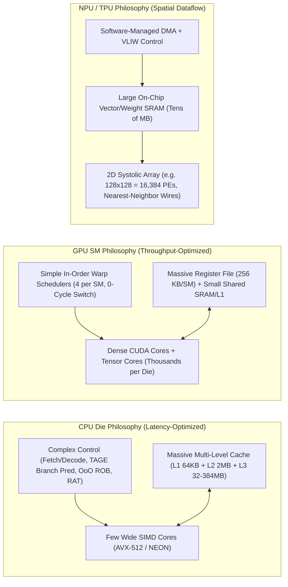
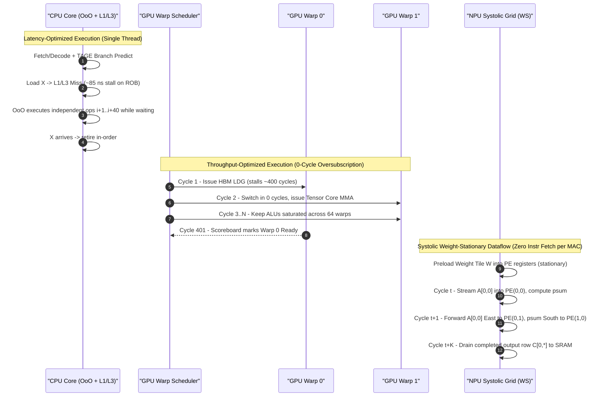

# 02 — Hardware Execution Models

[Previous: 01 — Memory Hierarchy & Buses](./01-memory-hierarchy-and-buses.md) | [Stage 1 Index](./README.md) | [Next: 03 — Linux Internals for I/O & Memory](./03-linux-internals-for-io-and-memory.md)

---

## 1. The Fundamental Silicon Trade-Off: Latency vs. Throughput

Every processor has a fixed **transistor and power budget** (e.g., ~80–208 billion transistors within a ~300–700 W TDP envelope). Architects must decide how to spend that silicon real estate across three competing consumers:

1. **Control Logic:** Instruction fetch/decode, branch predictors, out-of-order (OoO) schedulers, reorder buffers, and warp/thread dispatchers.
2. **On-Die SRAM / Caches:** L1/L2/L3 caches, register files, and scratchpad SRAMs.
3. **Arithmetic Logic Units (ALUs):** Scalar integer/FP units, SIMD vector lanes, Tensor Cores, or Systolic Processing Elements (PEs).

This single allocation choice produces three fundamentally distinct execution philosophies:

* **CPU (Latency-Optimized MIMD + SIMD):** Spends **~50–70%** of die area on giant L1/L2/L3 caches and complex OoO/speculative control logic, leaving **~15–25%** for ALUs. Goal: make *one* unpredictable, branch-heavy thread finish as fast as possible.
* **GPU (Throughput-Optimized SIMT):** Strips out branch predictors and OoO schedulers, shrinks per-thread cache, and dedicates **~75–85%** of die area to thousands of ALUs/Tensor Cores and massive register files. Goal: maximize aggregate operations per second across *tens of thousands* of parallel threads.
* **NPU / TPU (Dataflow / Systolic Array):** Eliminates per-operation instruction fetch/decode and general-purpose register-file traffic for dense linear algebra, wiring ALUs into a spatial grid backed by software-managed SRAM. Goal: achieve maximum **FLOP/s per Watt** and **FLOP/s per $\text{mm}^2$** on static tensor shapes.



---

## 2. CPU Execution Model: MIMD, Out-of-Order, and SIMD

A multi-core server CPU implements **MIMD (Multiple Instruction, Multiple Data)** across its cores—each of the 32–192 cores runs an independent Program Counter (PC), OS thread, and instruction stream—augmented by **SIMD (Single Instruction, Multiple Data)** vector pipelines inside each core.

### 2.1 Instruction Fetch, Decode, and Micro-Ops ($\mu$ops)

1. **Fetch & Variable-Length Decode:** On x86-64, instructions vary from **1 to 15 bytes**. Finding instruction boundaries is inherently sequential and expensive; modern cores cache already-decoded micro-operations ($\mu$ops) in a **Decoded Stream Buffer (DSB / $\mu$op cache)** (typically 1.5K–4K $\mu$ops) to bypass the complex x86 decoders on hot loops. ARM64 (`AArch64`) uses fixed 32-bit instructions, allowing wider, simpler parallel decoders at lower power.
2. **Branch Prediction & Speculative Execution:** Roughly 1 in every 5–7 instructions in general-purpose code (like JSON parsers, BPE tokenizers, or request schedulers) is a conditional branch. Rather than stalling the 15–20 stage pipeline, the CPU consults a **TAGE (TAgged GEometric history length)** predictor + **Branch Target Buffer (BTB)** (~97–99% accuracy) and speculatively fetches/executes down the predicted path.
   * **Misprediction Penalty:** If the branch outcome differs from the prediction, the CPU must flush the entire speculative pipeline and Reorder Buffer, losing **15–20 clock cycles** (~4–6 ns) of work.

### 2.2 Out-of-Order (OoO) Execution Engine

To extract **Instruction-Level Parallelism (ILP)** from a single sequential thread:
* **Register Renaming (RAT $\rightarrow$ Physical Register File):** Eliminates false Write-After-Read (WAR) and Write-After-Write (WAW) hazards by mapping e.g. 16 architectural GPRs onto **200–300+ physical registers**.
* **Reorder Buffer (ROB) & Reservation Stations (Scheduler):** Holds **250–600+ in-flight $\mu$ops**. Even if instruction `i` stalls for 300 cycles waiting on an L3/DDR5 load, independent instructions `i+1 ... i+200` execute out of order as soon as their operands are ready, retiring strictly in program order to preserve precise exceptions.
* **Memory Disambiguation (Load/Store Queue):** Tracks speculative loads/stores so later loads can bypass earlier stores to non-overlapping addresses.

### 2.3 SIMD Vector Lanes (AVX-512 / AMX / NEON)

Within a single core, **SIMD** executes one instruction across multiple contiguous data elements packed into wide vector registers:

| Architecture | Vector Width | FP32 Lanes | BF16 / FP16 Lanes | INT8 Lanes | Key Inference Instructions |
| :--- | :--- | :--- | :--- | :--- | :--- |
| **x86 AVX2** | 256-bit (16 `YMM`) | 8 | 16 (convert) | 32 | `VFMADD231PS` |
| **x86 AVX-512** | 512-bit (32 `ZMM`) | 16 | 32 (`AVX512_BF16`) | 64 (`VNNI`) | `VDPBF16PS`, `VPDPBUSD`, opmasks `k0-k7` |
| **Intel AMX** | 2D Tiles (8x `TMM` 1KB) | — | 16x32 $\times$ 32x16 MACs | 16x64 $\times$ 64x16 MACs | `TDPBF16PS`, `TDPBSSD` (2048 INT8 ops/cycle/core) |
| **ARM NEON** | 128-bit (32 `V` regs) | 4 | 8 (`FP16`/`BF16`) | 16 (`SDOT`) | `VFMLA`, `BFMMLA`, `SDOT` |
| **ARM SVE / SVE2** | 128–2048-bit (scalable) | 4–64 | 8–128 | 16–256 | Vector-length-agnostic predicated loops |

**Vector Lane Masking:** AVX-512 (`k0–k7`) and ARM SVE use predicate bitmasks to conditionally enable/disable individual lanes for tail elements or `if/else` inside loops without branching. However, SIMD has only **1 instruction pointer**—the programmer/compiler must explicitly vectorize loops, align/gather lanes, and handle tail cleanup.

---

## 3. GPU Execution Model: SIMT and Massive Thread Oversubscription

A GPU is organized into dozens or hundreds of **Streaming Multiprocessors (SMs)** (e.g., 132 SMs on NVIDIA H100). Each SM abandons OoO execution, branch prediction, and deep caches in favor of **SIMT (Single Instruction, Multiple Threads)**.

### 3.1 SIMT vs. SIMD: Warp Lockstep & Divergence Masking

In CPU SIMD, the *programmer* explicitly packs 16 floats into one `__m512` register inside 1 thread. In GPU SIMT, the *programmer* writes scalar-looking code for **1 logical thread**, and the hardware groups **32 consecutive threads into a Warp** (NVIDIA) or **64 threads into a Wavefront** (AMD RDNA/CDNA):

* **Individual State, Shared Fetch:** Every thread in a warp has its own private 32-bit registers and predicate state, while all 32 threads share a single instruction fetch/decode unit and execute the **same instruction in lockstep** (or via Independent Thread Scheduling on Volta+ architectures, where each thread maintains its own PC and call stack, still scheduled at warp granularity).
* **Active Execution Mask (32-bit):** Every warp maintains a 32-bit active mask. Suppose a kernel runs:
  ```cuda
  if (token_id == EOS_ID) {
      finish_sequence(); // Path A
  } else {
      sample_next();     // Path B
  }
  ```
  If 4 threads hit `EOS_ID` and 28 threads do not (**warp divergence**):
  1. The warp scheduler sets `ActiveMask = 0b...` for the 4 threads on Path A; the other 28 lanes execute **masked off (idle)**, burning execution slots.
  2. Next, the scheduler flips the mask to the 28 threads on Path B; the first 4 lanes sit idle.
  3. Execution **reconverges** after the branch (at the post-dominator or `__syncwarp()`).
  * **Cost:** Total warp execution time becomes $T_{\text{Path A}} + T_{\text{Path B}}$, cutting effective SIMD efficiency down to $1/k$ for $k$-way divergent branches!

### 3.2 Latency Hiding: Massive Oversubscription vs. Caching

A global HBM3/HBM3e memory read takes **~350–500 clock cycles** on a GPU. Why does a GPU not suffer catastrophic stalls with only a tiny ~128–256 KB L1/Shared Memory per SM?

Because of **zero-cycle hardware context switching across oversubscribed warps**:

* **Huge On-Chip Register File:** An NVIDIA H100 SM has **256 KB (65,536 $\times$ 32-bit registers)** and up to **64 resident warps (2,048 threads)** per SM. All 64 warps keep their entire architectural context *live in hardware registers simultaneously*—there is **no stack spilling or OS context-switch penalty**.
* **Scoreboarding & Zero-Cycle Warp Switch:** Each SM has 4 warp schedulers. On every single clock cycle, each scheduler inspects its pool of assigned warps (up to 16 warps):
  * If Warp 0 issued an HBM load (`LDG.E`) and is stalled waiting ~400 cycles for data, its scoreboard marks Warp 0 as *not ready*.
  * In that **very next clock cycle (0-cycle overhead)**, the scheduler issues an instruction from ready Warp 1, then Warp 2, then Warp 3, etc.
* **Little's Law Applied to Warps:** To completely hide a 400-cycle HBM latency with 4-cycle ALU instructions across 4 warp schedulers, the SM needs enough independent warps (and Instruction-Level Parallelism) in flight so that by the time the scheduler cycles back to Warp 0, its 400-cycle memory load has returned.
* **Caching vs. Oversubscription Contrast:**
  * **CPU strategy:** Prevent the miss from happening using 100+ MB of L3 cache; if a miss occurs, use an expensive OoO ROB to look ~200 instructions ahead within *one* thread.
  * **GPU strategy:** Accept the 400-cycle miss, eliminate the OoO ROB, and interleave **dozens of independent warps** so the ALUs stay 100% busy while misses resolve in the background.

---

## 4. NPU / TPU Execution Model: Systolic Arrays & Dedicated Dataflow

Even on a GPU, every scalar/vector instruction still pays an **instruction fetch + decode + register-file read + register-file write** energy tax ("von Neumann bottleneck"). Reading two FP16 operands from a large SRAM register file and writing the result back costs **~10x–30x more energy** than the FP16 MAC itself!

**Neural Processing Units (NPUs)**—such as Google TPUs (MXU), AWS Inferentia/Trainium, Apple Neural Engine, or spatial accelerators like Groq TSP—attack this energy and area overhead using **2D Systolic Arrays** and **dedicated dataflow**.

### 4.1 Anatomy of a Systolic Array

A systolic array (e.g., Google TPU v4/v5e $128 \times 128$ MXU = **16,384 MACs**, or TPU v1 $256 \times 256$ = **65,536 MACs**) is a 2D grid of simple **Processing Elements (PEs)** wired strictly to their nearest orthogonal neighbors (North/South, East/West):
* **No per-PE instruction stream:** One coarse-grained matrix instruction (`MatMul` over a $128 \times 128$ tile) drives 16,384 PEs for hundreds of cycles—amortizing fetch/decode overhead by **>10,000x**.
* **Data reuse in local wires:** Operands enter at the array edges from on-chip SRAM buffers and are **pumped rhythmically from PE to PE** on every clock tick (analogous to blood pumped by the heart—hence *systolic*), without ever returning intermediate values to a central register file.

### 4.2 Dataflow Regimes: Weight-Stationary vs. Output-Stationary

How matrices $C = A \times B$ ($M \times K$ times $K \times N$) map onto the $R \times C$ PE array defines the **dataflow**:

1. **Weight-Stationary (WS) Dataflow** *(used in Google TPU MXU)*:
   * **Mechanism:** Weight tile $W$ ($K \times N$) is preloaded into the local registers of the PEs and **held stationary**. Activation vectors (rows of $A$) stream left-to-right across rows; partial sums (`psum`) flow top-to-bottom down columns, accumulating $psum_{\text{out}} = psum_{\text{in}} + a \times w$.
   * **Skewed Timing (Wavefront):** To ensure partial sums arrive at each PE on the exact clock cycle as their matching activation element, inputs at row $r$ are delayed by $r$ clock cycles (triangular skew).
   * **Trade-off:** Zero weight movement during the $M$ activation steps! Ideal when $M$ (batch size or prefill prompt length) is large enough ($M \ge R$) to amortize the weight-preload cycles. **Weakness:** If $M=1$ (single-request LLM decode), only 1 activation row enters while the weight tile was loaded for 1 usage—weight-loading latency dominates and array utilization collapses!

2. **Output-Stationary (OS) Dataflow** *(common in edge/mobile NPUs and certain GEMM engines)*:
   * **Mechanism:** Each PE owns one output element $C_{i,j}$ in a dedicated high-precision (FP32/INT32) accumulator register **held stationary**. Activation elements $A_{i,k}$ stream horizontally and weight elements $B_{k,j}$ stream vertically across the grid; after $K$ cycles, the completed $C_{i,j}$ drains out.
   * **Trade-off:** Eliminates moving wide 32-bit partial sums between PEs every cycle (reducing wire energy and accumulator precision traffic), maximizing reuse when $K$ (inner reduction dimension, e.g. $d_{\text{model}} = 4096$ or $8192$) is large.

3. **Dedicated Spatial / Compiler-Scheduled Dataflow** *(e.g., Groq TSP, Cerebras)*:
   * Eliminates hardware caches, dynamic arbiters, and DRAM controllers in favor of massive on-chip SRAM (hundreds of MB) and **deterministic VLIW/spatial routing**. The compiler statically knows the exact cycle every byte arrives at every ALU, giving **zero-jitter tail latency**—at the cost of strict static tensor shapes and multi-chip sharding if weights exceed on-chip SRAM.

---

## 5. Execution Timeline Comparison: CPU vs. GPU vs. NPU

The diagram below traces how each architecture handles its characteristic workload: an unpredictable control/memory step on CPU, an HBM-stalled parallel kernel on GPU, and a skewed $2 \times 2$ Weight-Stationary systolic wave on NPU.



---

## 6. Comparative Summary & LLM Inference Workload Mapping

| Dimension | CPU (MIMD + SIMD) | GPU (SIMT) | NPU / Systolic Array |
| :--- | :--- | :--- | :--- |
| **Primary Optimization Goal** | Minimum single-thread latency | Maximum parallel throughput | Maximum TOPS/Watt on dense static matmuls |
| **Latency Hiding Mechanism** | Large L1/L2/L3 caches + OoO ROB | Massive thread/warp oversubscription (0-cycle switch) | Compiler-scheduled SRAM prefetch + spatial pipelining |
| **Branch Handling** | Hardware TAGE predictor (~15–20 cycle mispredict) | Predicated warp masks (serializes divergent paths) | Poor/absent; requires static shapes or host fallback |
| **Ideal LLM Inference Role** | HTTP/gRPC parsing, BPE tokenization, continuous batching scheduler, FSM grammar masking | **Prefill GEMM** (Tensor Cores) & **Decode GEMV** (high HBM bandwidth + warp parallelism) | High-batch **Prefill** & fixed-shape dense **GEMM**; struggles at $M=1$ decode without weight streaming/batching |
| **Typical Failure Mode** | Starves on dense Transformer matmuls (compute & DDR5 BW bottlenecked) | Warp divergence in irregular MoE routing/sampling; tiny grids ($M=1$) underutilize SMs | Severe array underutilization when $M \ll \text{ArrayDim}$ (e.g., 1 row active on $128 \times 128$ array = $0.78\%$ MAC utilization) |

### Concrete LLM Inference Implication: Why $128 \times 128$ Arrays Hate Batch=1 Decode
During **Prefill** of a 2,048-token prompt ($M = 2048$), a $128 \times 128$ Weight-Stationary systolic array (or Tensor Core MMA unit) processes $16$ full $128$-row tiles back-to-back, keeping all **16,384 PEs active simultaneously** (~90%+ compute utilization).

During **Autoregressive Decode** at `batch_size = 1` ($M = 1$):
* Only **1 activation vector** flows through each weight tile!
* In a $128 \times 128$ Weight-Stationary array, you spend 128 cycles loading weights and only **1 cycle** streaming the token vector—unless you batch $B \ge 64\text{--}128$ concurrent decode requests together (turning GEMV back into GEMM, which is the core motivation behind **Continuous Batching** in Stage 4) or rely on high-bandwidth **HBM3e + GPU SIMT warps** to stream weights directly into CUDA/Tensor registers.

---

## Navigation

* **Previous:** [01 — Memory Hierarchy & Buses](./01-memory-hierarchy-and-buses.md)
* **Up:** [Stage 1 Index](./README.md)
* **Next:** [03 — Linux Internals for I/O & Memory](./03-linux-internals-for-io-and-memory.md)
