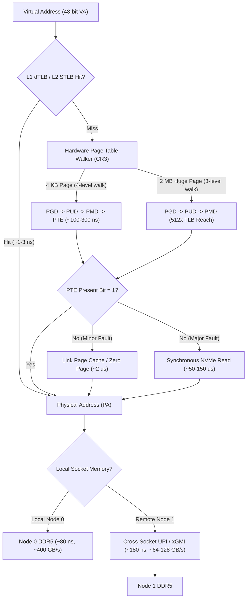
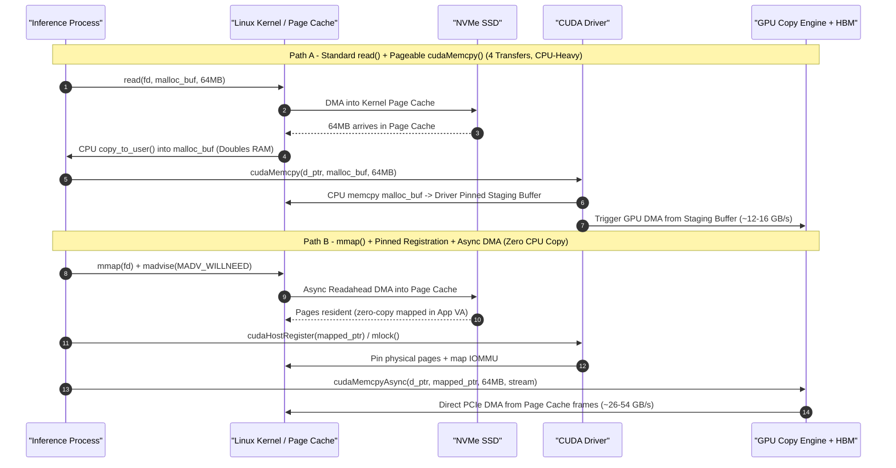

# 03 — Linux Internals for I/O & Memory

[Previous: 02 — Hardware Execution Models](./02-hardware-execution-models.md) | [Stage 1 Index](./README.md) | [Next: 04 — C/C++ and Rust on the Hot Path](./04-c-cpp-and-rust-on-the-hot-path.md)

---

This document explains how the Linux operating system maps program memory addresses to physical RAM, moves large model files from solid-state drives into GPU memory, and manages multi-socket server layouts. Every operating-system, hardware, and AI-serving term used below is defined first in plain English.

## Core Concepts & Terminology

### 1. Operating System Basics & Virtual Memory
* **User Space, Kernel Space, & Syscalls:** Programs like Python or PyTorch run in isolated **User Space**, where they cannot touch hardware directly. The **Linux Kernel** runs in privileged **Kernel Space** and manages RAM, storage, and devices. Whenever a program needs memory or disk I/O, it makes a **System Call (Syscall)**—a controlled handoff into the kernel.
* **Virtual Address (VA) vs. Physical Address (PA) & Page Frames:** Every running process sees its own private, contiguous **Virtual Address (VA)** space, even though its actual data is scattered across physical **DDR5 RAM** chips at **Physical Addresses (PAs)**. Memory is divided into fixed-size blocks called **pages** (standard size: **4 KB**); the matching physical slots in RAM are **physical page frames** (tracked in the kernel by `struct page`).
* **Page Tables (PGD, PUD, PMD, PTE, `CR3`) & Page Table Walker (PTW):** To translate a 48-bit (or 57-bit) VA to a PA, Linux maintains a 4-level (or 5-level) tree of lookup tables in RAM: **PGD** (Page Global Directory, whose address sits in CPU register **`CR3`**) $\rightarrow$ **PUD** (Page Upper Directory) $\rightarrow$ **PMD** (Page Middle Directory) $\rightarrow$ **PTE** (Page Table Entry). The lowest 12 bits of the VA are the **Page Offset** (position inside the 4 KB page). Each PTE has a **Present Bit** (`1` if in RAM, `0` if not). When a translation is needed, the CPU's hardware **Page Table Walker (PTW)** walks this tree.
* **TLB (Translation Lookaside Buffer), TLB Reach, & TLB Thrashing:** Walking 4 page-table levels in DDR5 is slow, so each CPU core caches recent VA$\rightarrow$PA translations inside a tiny hardware cache called the **TLB** (**L1 dTLB** for fast data lookups alongside **VIPT** L1 cache, and a larger **L2 STLB**, Shared TLB). **TLB Reach** is the total RAM covered by all TLB entries ($\text{entries} \times \text{page size}$). When a program's active memory exceeds TLB Reach, it suffers **TLB thrashing** (constant slow page-table walks).
* **Huge Pages (THP & `hugetlbfs`):** Using **2 MB** or **1 GB** pages instead of 4 KB stops the page-table walk early, multiplying TLB Reach by 512x to 262,144x. **THP (Transparent Huge Pages)** lets the kernel promote 4 KB pages to 2 MB automatically, though **`always`** mode can trigger **memory compaction** stalls (rearranging fragmented RAM), whereas **`madvise`** (`MADV_HUGEPAGE`) applies it selectively. **`hugetlbfs`** (`vm.nr_hugepages` / `MAP_HUGETLB`) pre-reserves permanent huge pages at boot (common in high-speed networking like **DPDK**).
* **Demand Paging, VMA, & Page Faults (Minor vs. Major):** When a program requests memory (`malloc()`) or maps a file, Linux uses **demand paging**: it only records a **Virtual Memory Area (VMA / `vm_area_struct`)** and assigns zero physical RAM until the first read/write touches an address, triggering a **Page Fault**:
  * **Minor (Soft) Page Fault:** The page is *already* in RAM (e.g., a fresh **zero page**, a **Copy-on-Write** shared page, or a file page already in the Page Cache); the kernel just links the PTE (~1–3 $\mu$s).
  * **Major (Hard) Page Fault:** The page is *not* in RAM (it is on an **NVMe SSD** or disk **swap**). The kernel must issue disk I/O, put the thread into **Uninterruptible Sleep (`D` state)**, **context-switch** to another thread, and wake it up after the read finishes (~50–200+ $\mu$s).

### 2. Linux Storage I/O, Page Cache, & Zero-Copy Paths
* **Linux Page Cache & Buffered `read()`:** Unused DDR5 RAM is automatically used by Linux as a **Page Cache** for recently read disk files. A standard **`read()`** syscall DMAs data from the NVMe SSD into the kernel Page Cache, and then the CPU runs **`copy_to_user()`** (`memcpy`) to copy it again into the program's user-space buffer—doubling RAM usage.
* **`mmap()` (Memory-Mapped Files) & `madvise()`:** **`mmap()`** (e.g., with `PROT_READ`, `MAP_SHARED`) maps the kernel Page Cache frames *directly* into the process's Virtual Address space, eliminating `copy_to_user()` and letting multiple worker processes share one physical copy in RAM. Programs hint access patterns using **`madvise()`**: `MADV_SEQUENTIAL` (double **readahead** up to `read_ahead_kb`), `MADV_WILLNEED` (trigger async readahead early), and `MADV_DONTNEED` (release mapping/cache).
* **`O_DIRECT`, `io_uring`, & GPUDirect Storage (GDS):** **`O_DIRECT`** bypasses the Linux Page Cache completely, transferring data straight between NVMe and an aligned user buffer. **`io_uring`** is a modern Linux async I/O interface using lock-free shared submission/completion **ring buffers** (and optional kernel polling **`IORING_SETUP_SQPOLL`**) to avoid per-I/O syscall overhead. **GPUDirect Storage (GDS / `cuFileRead`)** uses PCIe **DMA** to move data straight from NVMe SSDs into GPU **HBM/VRAM** without touching CPU or host DDR5 RAM.

### 3. DMA, Pinned Memory, & OOM Risk
* **DMA (Direct Memory Access), IOMMU, & IOVA:** **DMA** lets hardware devices (like an NVMe SSD or a **GPU Copy Engine**) read/write host RAM directly without CPU involvement. Because DMA hardware uses physical bus addresses (or **IOVAs**, I/O Virtual Addresses, translated by the hardware **IOMMU**), it cannot handle Linux page faults.
* **Pageable vs. Pinned Memory (`mlock`, `cudaHostAlloc`, `cudaHostRegister`):** Normal user RAM is **pageable**—the kernel's **`kswapd`** or NUMA balancer can move or swap it at any microsecond. **Pinned (page-locked) memory** (locked via Linux **`mlock()`**, `cudaHostAlloc`, `cudaHostRegister`, or PyTorch `pin_memory=True`, bounded by `ulimit -l`) forces physical frames to stay fixed in RAM so the GPU can DMA directly at full PCIe speed (**H2D** = Host-to-Device, **D2H** = Device-to-Host). Unpinned `cudaMemcpy` forces the **CUDA Driver** to copy through an internal **pinned staging buffer**, stalling asynchronous **`cudaMemcpyAsync`** calls on a **CUDA stream**.
* **`Unevictable` RAM, Slab Allocator, & OOM Killer:** Pinned memory is marked **`Unevictable`** in `/proc/meminfo`. Pinning too much RAM starves Linux's **slab allocator** (kernel object cache) and Page Cache, triggering the **Linux OOM (Out-Of-Memory) Killer** to terminate processes.

### 4. Multi-Socket Servers & NUMA Topology
* **NUMA (Non-Uniform Memory Access), Socket, & NPS4:** In dual-socket servers (two physical CPUs) or partitioned CPUs like **NPS4** (4 NUMA Nodes Per Socket), each node has its own local DDR5 memory and PCIe **Root Complex**. Reaching memory on *another* node crosses an inter-socket bus (**UPI** on Intel, **xGMI / Infinity Fabric** on AMD), doubling latency and cutting bandwidth.
* **`numactl`, `nvidia-smi topo -m`, & First-Touch Policy:** Tools like `numactl` and `nvidia-smi topo -m` show which CPUs and GPUs share a NUMA node. Linux's **first-touch policy** allocates a physical page on whichever NUMA node runs the thread that *first writes* (`memset`) to it—unless overridden by `numactl`, `mbind()`, or `numa_alloc_onnode()`. (`numabalancing` is a kernel daemon that migrates pageable pages across nodes.)

### 5. LLM Inference & Checkpoint Terms
* **Checkpoints (`.bin`/`.pt` `pickle` vs. `safetensors`):** Legacy PyTorch `.bin`/`.pt` files use Python **`pickle`** (sequential object deserialization). **`safetensors`** stores a small **UTF-8 JSON header** (mapping tensor names, data types like **BF16**, shapes, and byte offsets) followed by raw aligned **little-endian** tensor bytes, enabling instant `<1 ms` `mmap()` opening (`safe_open`).
* **Tensor Parallelism (TP), KV Cache, & LoRA:** **Tensor Parallelism** splits a large model across multiple GPUs (each GPU is a **Rank**, holding a column/row **shard**). **KV Cache** stores past attention Key/Value tensors during generation (which can be spilled to host RAM or NVMe). **LoRA (Low-Rank Adaptation)** swaps small adapter weight files on top of a frozen base model.

---

## 1. Virtual Memory, Multi-Level Page Tables, and TLB Mechanics

Every user-space process in Linux (including Python, PyTorch, and vLLM workers) operates inside an isolated **Virtual Address (VA)** space. If two Python processes both allocate a tensor at virtual address `0x7f00_1000_0000`, they never overwrite each other because the Linux kernel and CPU hardware transparently translate each process's virtual addresses into separate **Physical Addresses (PAs)** in DDR5 RAM. This abstraction also lets a process see a 100 GB tensor as a single contiguous address range even when its underlying 4 KB physical page frames are scattered across RAM. On x86-64, standard hardware uses **4-level paging** (48-bit virtual addresses = 256 TB addressable) or **5-level paging** (57-bit VA = 128 PB).

### 1.1 Anatomy of a 4-Level Page Walk (4 KB Base Pages)

Think of virtual-to-physical translation as a 4-level tree of 512-entry lookup arrays stored in system RAM. A 48-bit virtual address is partitioned into five fields:

$$\text{VA}[47:0] = [\underbrace{\text{PGD}}_{9\text{b}} \mid \underbrace{\text{PUD}}_{9\text{b}} \mid \underbrace{\text{PMD}}_{9\text{b}} \mid \underbrace{\text{PTE}}_{9\text{b}} \mid \underbrace{\text{Page Offset}}_{12\text{b}}]$$

* Bits `[11:0]` ($2^{12} = 4,096$ bytes) index inside a **4 KB physical page frame**.
* Bits `[47:12]` select 1 of 512 entries ($2^9 = 512 \times 8\text{B} = 4\text{ KB}$) at each of the four page-table levels: **PGD** (Page Global Directory, pointed to by CPU register `CR3`) $\rightarrow$ **PUD** (Page Upper Directory) $\rightarrow$ **PMD** (Page Middle Directory) $\rightarrow$ **PTE** (Page Table Entry).
* **Cost of a TLB Miss:** If the translation is not cached, the hardware Page Table Walker (PTW) must perform **4 sequential dependent DDR5 reads** before the actual data read can even begin—costing **~100–350 ns** per miss!

### 1.2 TLB Reach & Huge Pages (2 MB / 1 GB)

To avoid 4-step page walks on every load/store, each CPU core embeds a **Translation Lookaside Buffer (TLB)**:
* **L1 dTLB:** ~64 entries for 4 KB pages (~4 cycles, accessed in parallel with L1d VIPT).
* **L2 STLB (Shared TLB):** ~1,536–2,048 entries (~8–12 cycles).

With standard **4 KB pages**, a 2,048-entry STLB has a total **TLB Reach** of:
$$2,048 \times 4\text{ KB} = \mathbf{8\text{ MB}}$$

For an LLM runtime holding a **70 GB model** or **32 GB of KV-cache/pinned host buffers** in RAM, 8 MB of TLB reach covers **0.01%–0.02%** of the working set—causing near-continuous TLB thrashing!

**Huge Pages** solve this by terminating the page walk early:
* **2 MB Huge Page:** Stops at the **PMD** level (3-level walk; 21-bit offset). **TLB Reach jumps 512x** (e.g., 1,024 STLB entries = **2 GB**).
* **1 GB Huge Page:** Stops at the **PUD** level (2-level walk; 30-bit offset). **TLB Reach jumps 262,144x** (even a tiny 32-entry 1 GB TLB covers **32 GB**).

#### THP vs. `hugetlbfs` in Production
1. **Transparent Huge Pages (THP):** Kernel automatically promotes contiguous 4 KB allocations to 2 MB pages (`/sys/kernel/mm/transparent_hugepage/enabled`).
   * *Hazard (`always` mode):* When memory is fragmented, synchronous THP allocation triggers direct memory compaction stalls (**10–100+ ms latency spikes** in the serving loop!). Using `madvise` mode (`echo madvise > .../enabled`) + explicit `madvise(addr, len, MADV_HUGEPAGE)` gives huge-page TLB gains on model/KV arenas without unpredictable compaction stalls on small allocations.
2. **Explicit `hugetlbfs` (`vm.nr_hugepages` / `MAP_HUGETLB`):** Pre-reserves 2 MB or 1 GB pages at boot time. Pages are **permanently pinned** (never swapped, zero compaction stalls, guaranteed TLB coverage), widely used in DPDK, high-frequency serving arenas, and dedicated pinned DMA pools.

### 1.3 Page Faults: Minor vs. Major

Linux uses **demand paging**: `malloc()` or `mmap()` only creates a Virtual Memory Area (`vm_area_struct` / VMA) in kernel metadata—zero physical RAM is assigned until the first CPU instruction touches an address:

* **Minor (Soft) Page Fault (~1–3 $\mu$s):** The page is already in RAM (e.g., a fresh zeroed anonymous page from `malloc`, a Copy-on-Write page, or a file page already resident in the Linux Page Cache). The kernel allocates/links a `struct page`, updates the PTE, invalidates stale TLB entries, and resumes the instruction—**no disk I/O**.
* **Major (Hard) Page Fault (~50–200+ $\mu$s):** The page is *not* in RAM (must be fetched from NVMe or swap). The kernel issues an asynchronous block I/O request, puts the faulting thread to sleep (`D` / uninterruptible sleep), context-switches to another thread, and wakes the thread only when NVMe DMA completes. **A loop taking cold major page faults stalls completely on every 4 KB/readahead boundary.**

---

## 2. Virtual-to-Physical Translation & NUMA Topology Diagram



---

## 3. Linux Page Cache, `mmap`, and Zero-Copy I/O

### 3.1 Standard Buffered `read()` Path (2 Copies + 2x RAM)

When a Python or C++ program calls standard `read(fd, buf, size)` (such as `open(path, "rb").read()` or legacy `torch.load()` without `mmap=True`):
1. The NVMe controller DMAs blocks from NAND flash into the kernel **Page Cache** (`struct page` frames managed by Linux in unused DDR5).
2. The CPU executes `copy_to_user()`, copying bytes from the kernel Page Cache into the user-space heap buffer `buf`.
* **Cost:** Doubles memory consumption (loading a 140 GB model consumes 140 GB in Page Cache *plus* 140 GB in process heap), saturates CPU memory bandwidth during the `memcpy`, and incurs syscall transitions per chunk.

### 3.2 `mmap()` (Memory-Mapped Files)

Calling `mmap(NULL, file_size, PROT_READ, MAP_SHARED, fd, 0)` maps the file's kernel **Page Cache** pages directly into the process's virtual address space—letting Python/PyTorch read the file as if it were an in-memory array without copying a single byte:
* **Zero CPU `copy_to_user()`:** User space reads directly from the exact same physical DDR5 frames populated by NVMe DMA.
* **Cross-Process Sharing:** If 4 Tensor-Parallel worker processes `mmap` the same 140 GB model file, Linux maps all 4 processes' page tables to **1 shared physical copy** in the Page Cache (saving 420 GB of host RAM!).
* **Controlling Readahead & Eviction via `madvise`:**
  * `madvise(ptr, len, MADV_SEQUENTIAL)`: Doubles kernel asynchronous readahead window (up to `read_ahead_kb`, typically 128 KB–4 MB) and aggressively drops behind-cursor pages.
  * `madvise(ptr, len, MADV_WILLNEED)`: Asynchronously triggers non-blocking kernel readahead into Page Cache *before* the worker reaches those offsets, converting future major page faults into minor faults.
  * `madvise(ptr, len, MADV_DONTNEED)`: Immediately unmaps PTEs (for private anon) or signals Page Cache release when weights have finished uploading to GPU VRAM, preventing host OOM.

### 3.3 Why `mmap` Accelerates `safetensors` Loading

Legacy PyTorch `.bin` / `.pt` checkpoints wrap weights inside Python **`pickle`** streams:
* Loading `.bin` requires sequentially executing pickle opcodes in Python, allocating separate heap buffers per tensor, reading via buffered I/O (causing CPU copies), and reconstructing tensors one by one—making lazy slicing or zero-copy sharing impossible.

By contrast, **`safetensors`** uses an intentionally `mmap`-friendly binary layout:
```text
[ 8 bytes: uint64 little-endian header_length N ]
[ N bytes: UTF-8 JSON metadata { "layer.0.weight": {"dtype": "BF16", "shape": [4096, 4096], "data_offsets": [0, 33554432]}, ... } ]
[ Raw, contiguous, aligned little-endian tensor byte payloads ]
```
1. **Instantaneous Open (<1 ms):** `safe_open(..., framework="pt")` simply calls `mmap()` and parses the small JSON header (a few hundred KB). Zero tensor bytes are read upfront.
2. **Selective Tensor Parallel Sharding:** Rank $k$ in a Tensor Parallel group only touches the exact byte slice `[start:end]` for its column/row shard; untouched shards never trigger major page faults or waste RAM/disk I/O!
3. **Warm-Cache Reloads at DRAM Speed:** When an inference worker restarts or swaps LoRA/model checkpoints already warm in Linux Page Cache, `mmap` maps existing pages via minor faults (~1–3 $\mu$s per 2 MB/4 KB) and feeds `cudaMemcpy` at DDR5 bandwidth instead of NVMe speed.
4. **Important Caveat:** On a *cold* Page Cache, reading `mmap` randomly across threads can trigger synchronous 4 KB–128 KB major page faults; furthermore, `mmap` memory is **pageable**—so calling `cudaMemcpy` directly on an `mmap` pointer still forces the CUDA driver to bounce through an internal pinned staging buffer unless registered (`cudaHostRegister`) or copied via pinned pools.

### 3.4 Beyond `mmap`: `O_DIRECT`, `io_uring`, and GPUDirect Storage (GDS)

| Mechanism | Page Cache Used? | CPU Data Copy? | Best Inference Use Case |
| :--- | :--- | :--- | :--- |
| **`read()`** | Yes | Yes (`copy_to_user`) | Small config/tokenizer files |
| **`mmap()`** | Yes | **No** (shared mapping) | `safetensors` loading, multi-worker weight sharing, warm restarts |
| **`O_DIRECT`** | **No** (DMA straight to aligned user buffer) | **No** | Huge models or KV-cache SSD spilling where working set > Host RAM (prevents Page Cache from evicting active memory and triggering OOM) |
| **`io_uring`** | Optional (`O_DIRECT` or buffered) | Depends | High-QD async NVMe KV-cache spilling/prefetching via lock-free shared ring buffers (zero syscall overhead per I/O with `IORING_SETUP_SQPOLL`) |
| **GPUDirect Storage (GDS / `cuFileRead`)** | **No** | **No** (bypasses CPU & Host RAM) | Direct NVMe $\leftrightarrow$ PCIe Switch/RC $\leftrightarrow$ GPU HBM DMA for extreme-scale KV offloading or rapid cold starts without burning DDR5 bandwidth |

---

## 4. Pinned Memory (`mlock`, `cudaHostAlloc`, `cudaHostRegister`) & DMA Physics

### 4.1 Why DMA Engines Require Pinned Physical Pages

PCIe Direct Memory Access (DMA) engines inside GPUs (Copy Engines) and NVMe controllers operate on **physical bus addresses** (or IOMMU-translated IOVA $\rightarrow$ physical frame mappings). They do **not** walk CPU process page tables, nor can they pause a PCIe burst to handle a Linux page fault!

Normally, Linux treats user-space memory (`malloc`, standard `mmap`) as **pageable**: the kernel is free at any microsecond to:
* Swap pages to disk (`kswapd`),
* Migrate pages across NUMA nodes (`numabalancing`), or
* Compact/relocate physical frames for huge pages.

If a GPU DMA engine were given the physical address of a pageable buffer and Linux migrated that page mid-transfer, the GPU would silently read garbage or overwrite another process's memory!

### 4.2 Pageable `cudaMemcpy` vs. Pinned `cudaHostAlloc`

In PyTorch, this hardware distinction is controlled by `pin_memory=True` (e.g., in `DataLoader` or `tensor.pin_memory()`) paired with `tensor.to("cuda", non_blocking=True)`:

1. **Pageable Host Pointer (`pin_memory=False`):**
   * Because the user buffer isn't pinned, the CUDA driver must allocate an internal **pinned staging buffer** (ring of small ~4–16 MB chunks), have the **CPU copy** data from the pageable buffer into the pinned staging buffer, and *only then* trigger the GPU DMA Copy Engine.
   * **Penalty:** Burns 100% of one or more CPU cores doing `memcpy`, caps H2D/D2H throughput around **~10–16 GB/s** even on PCIe Gen5, and **forces `cudaMemcpyAsync` (and `non_blocking=True`) to behave synchronously** up to the staging copy!

2. **Pinned Host Memory (`cudaHostAlloc` / `cudaHostRegister` / `torch.empty(..., pin_memory=True)`):**
   * Calls Linux `mlock()` (locking virtual pages to non-swappable, non-migratable physical RAM frames) and programs the GPU driver / IOMMU page tables once at allocation time.
   * **Gain:** GPU Copy Engine DMAs **directly** from physical DDR5 frames at full wire rate (**~26 GB/s on Gen4 x16, ~54 GB/s on Gen5 x16**) with **zero CPU copy involvement**, and `cudaMemcpyAsync` on a dedicated non-default CUDA stream truly overlaps with GPU compute kernels!

> **Operational Failure Mode (Over-Pinning):** `mlock()` / `cudaHostAlloc()` removes RAM from Linux's reclaimable pool (`Unevictable` in `/proc/meminfo`). Pinning 80% of system RAM for KV-cache offloading leaves insufficient headroom for OS caches, slab allocators, and worker processes—triggering sudden **OOM Killer** termination or severe swap thrashing on remaining memory. Check limits via `ulimit -l`.

---

## 5. Standard `read()` + Pageable `cudaMemcpy()` vs. `mmap` + Pinned DMA



*(Note: For models exceeding RAM or extreme-throughput offloading, `cudaHostRegister` on `mmap` can hit kernel constraints on some filesystem/kernel combinations; the standard production pattern is either `mmap` $\rightarrow$ reusable pinned staging pool $\rightarrow$ `cudaMemcpyAsync`, `O_DIRECT` directly into a `cudaHostAlloc` buffer, or GPUDirect Storage `cuFileRead` bypassing Host RAM entirely.)*

---

## 6. NUMA Topology & Cross-Socket Penalties

Modern dual-socket servers (and high-core-count single-socket AMD EPYC processors configured in **NPS4**—4 NUMA Nodes Per Socket) are **Non-Uniform Memory Access (NUMA)** machines. Each CPU socket/die houses its own local DDR5 memory channels and its own PCIe Root Complex lanes.

### 6.1 Cross-Socket Interconnect Bottlenecks (UPI / xGMI)

* **Local Access (CPU0 $\rightarrow$ DDR5 on Node 0):** ~70–90 ns latency, ~350–460 GB/s bandwidth.
* **Remote Access (CPU0 $\rightarrow$ DDR5 on Node 1 via Intel UPI or AMD Infinity Fabric xGMI):** ~140–220 ns latency (**~2x penalty**), and bandwidth collapses to **~64–128 GB/s** shared across all cross-socket traffic.
* **GPU-to-NUMA Mismatch:** If `GPU 0` is physically wired to Socket 0's PCIe lanes, but the inference process allocates its `pin_memory=True` host buffers on Socket 1's DDR5, every H2D/D2H PCIe DMA must cross **Socket 1 DDR5 $\rightarrow$ UPI/xGMI $\rightarrow$ Socket 0 Root Complex $\rightarrow$ PCIe $\rightarrow$ GPU 0**—cutting effective H2D bandwidth by **30%–50%** and polluting inter-socket links!

### 6.2 Inspecting and Enforcing NUMA Affinity

Always verify physical topology before pinning workers in multi-GPU / multi-socket nodes:

```bash
# 1. Inspect NUMA nodes, CPU core lists, and distance matrix
numactl --hardware

# 2. Inspect which PCIe GPU belongs to which NUMA node
nvidia-smi topo -m
cat /sys/bus/pci/devices/0000:c1:00.0/numa_node
```

**Binding a worker to its GPU's local NUMA node:**
```bash
# Run worker for GPU 0 strictly on NUMA Node 0 CPUs and Node 0 DDR5
CUDA_VISIBLE_DEVICES=0 numactl --cpunodebind=0 --membind=0 python serve.py
```

### 6.3 The Linux "First-Touch" Allocation Trap

Even when `numactl` is not restricting memory, Linux allocates physical pages on whichever NUMA node runs the thread that **first writes (faults) to the page** (`first-touch policy`):
* **Classic Bug:** Thread 0 (on NUMA Node 0) allocates and zero-initializes a 32 GB KV-offload buffer (`memset` or `torch.zeros`), pinning all 32 GB onto Node 0's memory controllers. Later, worker threads on Node 1 read/write that buffer and silently suffer remote UPI/xGMI penalties for the entire lifetime of the server!
* **Fix:** Initialize/fault memory inside the exact worker thread (or NUMA-bound process) that will own it, or enforce placement explicitly via `mbind()` / `numa_alloc_onnode()`.

---

## Navigation

* **Previous:** [02 — Hardware Execution Models](./02-hardware-execution-models.md)
* **Up:** [Stage 1 Index](./README.md)
* **Next:** [04 — C/C++ and Rust on the Hot Path](./04-c-cpp-and-rust-on-the-hot-path.md)
