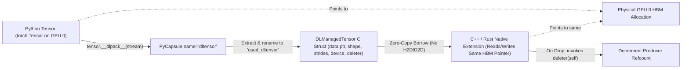
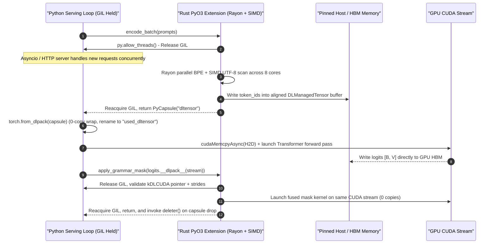

# 04 — C/C++ and Rust on the Hot Path

[Previous: 03 — Linux Internals for I/O & Memory](./03-linux-internals-for-io-and-memory.md) | [Stage 1 Index](./README.md) | [Next: 05 — Python Profiling](./05-python-profiling.md)

---

This document explains why Python becomes a bottleneck on the CPU steps between GPU operations, and how systems languages (C, C++, and Rust) eliminate that overhead through predictable memory management, cache-friendly data layouts, parallel execution, and zero-copy tensor sharing. Every systems, hardware, and AI-inference term used below is defined first in plain English.

## Core Concepts & Terminology

### 1. Python Overhead & Why Systems Languages Matter
* **Hot Path (Critical Path):** The exact sequence of code that executes on every single generated token—any delay here directly increases user-facing latency.
* **CPython, Bytecode, & Boxing:** Standard Python (**CPython**) compiles source code into **bytecode** instructions and runs them one by one inside a software **interpreter loop** (`_PyEval_EvalFrameDefault`). Every Python integer (`PyLongObject`) or float (`PyFloatObject`) is **boxed**—wrapped inside a ~28-byte heap object with a **reference count**—rather than stored as a raw 4-byte number.
* **Pointer Chasing & GIL:** A Python `list[int]` is an array of memory addresses (**pointers**) scattered across RAM. Following those random addresses (**pointer chasing**) causes slow **DDR5** memory misses. Furthermore, CPython's **GIL (Global Interpreter Lock)** allows only one thread to run Python bytecode at a time, blocking multi-core CPU parallelism.

### 2. Memory Management Paradigms (C, C++, & Rust)
* **Heap vs. Stack, `malloc`/`free`, & Allocator Contention:** Programs store temporary local variables on a fast per-thread **stack**, and dynamically sized data on the shared **heap** (via `malloc`/`free` or aligned `aligned_alloc`). General-purpose allocators like glibc's **`ptmalloc2`** use internal locks that slow down multi-threaded code. Manual `malloc`/`free` risks **memory leaks** (forgetting to free), **use-after-free** (reading freed memory), and **double-free** bugs.
* **Arena / Bump Allocator:** Instead of allocating and freeing thousands of small objects, an **arena (bump) allocator** reserves one large contiguous memory block upfront and allocates by simply adding to an offset pointer, resetting the offset to `0` at the end of a step.
* **C++ RAII, `std::unique_ptr`, `std::span`, & Sanitizers:** **RAII (Resource Acquisition Is Initialization)** ties resource cleanup (heap memory, file handles, **`mmap`** regions, **CUDA streams**, pinned buffers) to object lifetimes: the **constructor** acquires the resource and the **destructor** automatically frees it when leaving scope, avoiding **Garbage Collector (GC) pauses**. **`std::unique_ptr`** enforces single ownership; **`std::span`** is a lightweight `(pointer, length)` view (though C++ still permits **dangling views** or **iterator invalidation** if the underlying buffer resizes, caught during testing with **Sanitizers** like `-fsanitize=address,thread`).
* **Rust Ownership, Affine Types, Borrow Checker, Lifetimes, & `Send`/`Sync`:** Rust enforces memory and thread safety at compile time with zero runtime cost. Its **affine type system** gives every value a **single owner** (**moving** transfers ownership and invalidates the old variable). The **Borrow Checker** enforces the **XOR Mutability Rule**: at any time, a value can have *either* many read-only shared references (`&T`) *or* one exclusive mutable reference (`&mut T`), while **lifetimes (`'a`)** prove no reference outlives its owner. The **`Send`** (safe to move across threads) and **`Sync`** (safe to share `&T` across threads) traits eliminate **data races** at compile time.

### 3. CPU Caches, Data Layouts, & Multi-Core Concurrency
* **L1d / L2 / L3 Caches, 64-Byte Cache Lines, & Hardware Prefetcher:** CPU cores read RAM into fast on-die **L1d/L2/L3 caches** in fixed **64-byte cache lines**. A **hardware stride prefetcher** predicts sequential reads and fetches upcoming cache lines early.
* **AoS (Array of Structures) vs. SoA (Structure of Arrays):** Storing a batch of items as one struct per item (**AoS**) mixes unrelated fields together, wasting cache space when a loop only needs one field. Grouping each field into its own contiguous array (**SoA**) packs 16 four-byte values into every 64-byte cache line for peak cache and vector efficiency.
* **Cache Coherence, RFO, & False Sharing:** CPU cores keep private L1/L2 caches synchronized across a **ring/mesh interconnect** at 64-byte granularity. Writing to a single byte claims exclusive ownership of its entire 64-byte line via **RFO (Read-For-Ownership)**, invalidating other cores' copies. **False sharing** happens when two threads update *different* variables that sit in the *same* 64-byte cache line; fixing it requires padding each slot to 64 bytes (`alignas(64)` in C++, `#[repr(align(64))]` in Rust).

### 4. SIMD Vectorization & Multi-Core Threading
* **SIMD (Single Instruction, Multiple Data), AVX-512, & ARM NEON:** **SIMD** instructions perform the same math operation on an entire vector of numbers at once—for example, 16 `float`s in a 512-bit **`__m512`** register on **x86 AVX-512** (using **FMA**, Fused Multiply-Add, or gather instructions like `vpgatherdd`), or 4 `float`s in a 128-bit **`float32x4_t`** register on **ARM64 NEON**.
* **Auto-Vectorization, Intrinsics, Aliasing, & Floating-Point Associativity:** Compilers try to generate SIMD automatically (**auto-vectorization**), but often give up if pointers might overlap (**pointer aliasing**, solved by `__restrict__` in C++ or Rust's `&mut` rules) or if a loop sums sequentially (**loop-carried dependency**, since **IEEE-754 floating-point** math is non-associative: $(a+b)+c \neq a+(b+c)$ unless `-ffast-math` or **unrolling** multiple accumulators is used). **Compiler intrinsics** let programmers call SIMD instructions directly.
* **Thread Pools, Barriers, OpenMP, & Rayon:** Instead of spawning new OS threads per task, a **thread pool** reuses persistent worker threads (synchronizing at a **barrier**). **OpenMP** (C/C++) parallelizes loops via `#pragma omp parallel for` (`schedule(static)` vs. `schedule(dynamic, 1)`), tuned with `OMP_PROC_BIND`, `OMP_PLACES`, and `OMP_NUM_THREADS` to keep threads inside one **NUMA / L3 CCX (Core Complex)** domain without **oversubscription**. **Rayon** (Rust) uses **work-stealing deques** so idle threads automatically steal work from busy ones.

### 5. Zero-Copy FFI & the DLPack Protocol
* **FFI (Foreign Function Interface), C ABI, & `.so`:** **FFI** lets Python call compiled C/C++/Rust functions packaged in a shared library (**`.so`**). An **ABI (Application Binary Interface)** defines exact binary memory layouts and calling conventions (the **C ABI** is the universal standard).
* **`PyO3` / `maturin` & `nanobind`:** **`PyO3`** (with **`maturin`** and Rust's **Cargo** build tool) builds **PEP-517** Python packages from Rust, releasing the GIL via `py.allow_threads()`. **`nanobind`** (a faster, smaller successor to `pybind11`) exposes C++17 functions and **`nb::ndarray`** views to Python, releasing the GIL via `nb::gil_scoped_release`.
* **DLPack (`dlpack.h`, `DLManagedTensor`, `PyCapsule`):** **DLPack** is a zero-copy C ABI standard for sharing multi-dimensional tensors across frameworks (PyTorch, NumPy, C++, Rust) without copying bytes over **PCIe** (**H2D** = Host-to-Device) or inside **GPU HBM** (**D2D** = Device-to-Device). A `DLTensor` describes the raw `data` pointer, `DLDevice`, `DLDataType`, `shape`, **`strides`** (element spacing per dimension), and `byte_offset`. **`__dlpack__`** wraps a `DLManagedTensor` (plus a cleanup **`deleter`** callback) in a Python **`PyCapsule`** named `"dltensor"`; **`from_dlpack`** renames it to `"used_dltensor"` and synchronizes on the active **CUDA stream** so both sides share the exact same **pinned host** or GPU HBM memory.

### 6. LLM Inference Hot-Path Tasks
* **Decode Loop, ITL, SLA, & Speculative Decoding:** During token generation (**decode loop**), **ITL (Inter-Token Latency)** is the time between consecutive output tokens, governed by strict latency **SLAs**. **Speculative decoding** drafts multiple candidate tokens per step, shrinking per-step latency budgets even further.
* **Tokenization, Grammar Masking, Sampling, & Quantization:** **BPE (Byte-Pair Encoding)** tokenization (with **regex pre-tokenization** and **ASCII/UTF-8** scanning) converts text into token IDs. **Logits** (raw vocabulary scores) may be filtered by an **FSM (Finite State Machine) vocabulary bitmask** to enforce structured output, followed by **Top-$k$** and **Softmax** sampling. Other CPU hot paths include **INT4/FP8 weight dequantization**, **cosine similarity** in semantic routers, **beam search**, **Continuous Batching** schedulers, and **KV-block tables**.

---

## 1. Why Python Fails on the Inference Hot Path

While PyTorch orchestrates GPU compute via Python, **every CPU step inside the per-token decode loop sits directly on the critical path of Inter-Token Latency (ITL)**. For a fast 8B model decoding at 10 ms/token (or 2 ms/token under speculative decoding), spending 3 ms in Python destroys latency SLAs:

* **Bytecode Dispatch & Boxing:** CPython executes an interpreter loop (`_PyEval_EvalFrameDefault`) taking ~30–100 ns per bytecode opcode. Every integer (`PyLongObject`) or float (`PyFloatObject`) is heap-allocated and reference-counted (~28+ bytes instead of 4 bytes), destroying CPU L1/L2 cache density.
* **Pointer Chasing:** A Python `list[int]` of 128,256 vocabulary tokens is an array of 8-byte pointers scattered across the heap—guaranteeing DDR5 cache misses and defeating SIMD vectorization.
* **The GIL:** Prevents multi-core parallelism for CPU-bound BPE tokenization, regex pre-tokenization, JSON grammar bitmasking, and batch scheduling.

Moving these hot paths to **C/C++** or **Rust** eliminates interpreter overhead, enables cache-aligned contiguous memory, unlocks multi-core parallelism + SIMD, and interfaces cleanly with PyTorch/CUDA via **zero-copy FFI** and **DLPack**.

---

## 2. Memory Management Paradigms: Manual, RAII, and Ownership/Borrowing

### 2.1 Manual Memory Management (C) & Custom Arenas

In raw C (`malloc`/`free`, `aligned_alloc(64, size)`), allocation lifetime is completely manual:
* **Failure Modes:** Memory leaks (long-running serving processes slowly OOM over days), use-after-free (corrupting allocator metadata or logits), double-free, and general-purpose allocator lock contention (`ptmalloc2` arena locks across threads).
* **Inference Pattern — Arena / Bump Allocators:** Instead of calling `malloc`/`free` per request or token step, engines pre-allocate a contiguous slab (e.g., 64 MB aligned to 64B/2MB) and advance a single offset pointer (`offset += aligned_size`) in **1–2 CPU instructions**, resetting `offset = 0` at the end of the decode step with zero per-object `free()` calls.

### 2.2 C++ RAII (Resource Acquisition Is Initialization)

C++ binds resource lifetimes (heap memory, file descriptors, `mmap` regions, CUDA streams, pinned host buffers) to lexical object scopes:
* The constructor acquires the resource (`cudaHostAlloc` / `mmap`); the destructor (`~PinnedBuffer()`) deterministically releases it (`cudaFreeHost` / `munmap`) when the object leaves scope—even if an exception occurs, with **zero garbage collector pauses**.
* **Modern Idioms:**
  * `std::unique_ptr<T, CustomDeleter>` for exclusive ownership of raw/CUDA/MMAP handles.
  * `std::span<T>` (C++20) for non-owning, zero-overhead `(pointer, length)` slices across buffers.
* **Subtle Hazard:** C++ still permits **dangling views** (`std::span` outliving its backing `std::vector` after a reallocation) and **iterator invalidation** across threads—requiring strict engineering discipline and sanitizers (`-fsanitize=address,thread`).

### 2.3 Rust Ownership, Borrowing, and Fearless Concurrency

Rust enforces RAII **plus** aliasing/lifetime safety statically at compile time via its affine type system—with zero runtime cost:

1. **Single Owner:** Every value has exactly one owner; moving a `Vec<u32>` transfers the `(ptr, len, cap)` triple by value and invalidates the previous binding at compile time (eliminating double-free).
2. **XOR Mutability Rule (Borrow Checker):** At any point in time, a resource can have **either**:
   * **Any number of immutable shared references (`&T`)**, OR
   * **Exactly one exclusive mutable reference (`&mut T`)**.
3. **Lifetimes (`'a`):** Compiler statically proves no reference/slice (`&'a [f32]`) outlives the buffer it borrows from—making dangling spans impossible.
4. **`Send` and `Sync` Traits:**
   * `Send`: Safe to transfer ownership across threads.
   * `Sync`: Safe to share `&T` across threads concurrently.
   * **Inference Impact:** Rust catches data races in multi-threaded continuous-batch schedulers, KV-block tables, and parallel tokenizers **at compile time**, without needing a GIL or runtime locks around read-only shared vocabulary/trie tables.

---

## 3. Data-Oriented Memory Layout & Cache Mechanics

### 3.1 Array of Structures (AoS) vs. Structure of Arrays (SoA)

Consider tracking `N = 4,096` active sequence states in a scheduler or beam-search sampler (each tracking `seq_id`, `cur_len`, `max_len`, `temperature`, `top_p`, `is_finished`, plus a 64B pointer/padding):

* **AoS (`struct SeqState { ... }; SeqState states[4096];`):**
  If a hot loop only needs to check `is_finished` and increment `cur_len` across all 4,096 sequences, each stride jumps by e.g. 64 or 128 bytes—loading unused fields (`temperature`, `top_p`, prompt strings) into L1d cache and **preventing contiguous SIMD loads** (forcing expensive AVX-512 `vpgatherdd` gathers).
* **SoA (`struct SeqBatch { uint32_t* cur_len; float* temp; uint8_t* finished; ... };`):**
  All 4,096 `cur_len` values sit contiguously in `4096 * 4 = 16 KB` (**fits inside 32 KB L1d cache!**). Each 64-byte cache line packs **16 `cur_len` values simultaneously**, hardware stride prefetchers run at peak efficiency, and AVX-512 processes 16 elements per instruction.

### 3.2 False Sharing on 64-Byte Coherence Lines

Even when threads write to completely disjoint variables, CPU cache coherence operates on **64-byte cache lines** (see [01 — Memory Hierarchy & Buses](./01-memory-hierarchy-and-buses.md)):

```cpp
// BAD: Thread 0..7 increment adjacent counters inside the SAME 64-byte cache line!
uint64_t tokens_processed[8]; // 8 * 8B = 64 bytes -> 1 single cache line!
```

Every increment by Core 0 issues a Read-For-Ownership (RFO) invalidation to Cores 1–7, bouncing the single 64-byte line across the ring/mesh interconnect (**~40–100 ns stall per write**—a 20x–50x slowdown!).

**Fix — Explicit Cache-Line Alignment/Padding:**
```cpp
// C++17: Pad each per-thread slot to 64 bytes
struct alignas(64) AlignedCounter {
    uint64_t count = 0;
};
AlignedCounter tokens_processed[8];
```
```rust
// Rust: Align struct to 64 bytes so array elements never share a cache line
#[repr(align(64))]
struct AlignedCounter {
    count: u64,
}
```

---

## 4. SIMD Vector Instructions (AVX-512 & ARM NEON)

CPU hot paths like **INT4/FP8 weight dequantization on CPU**, **top-$k$ / softmax logit filtering**, **cosine similarity in semantic routers**, and **ASCII/UTF-8 scanning in tokenizers** can be accelerated **4x–16x** with SIMD.

### 4.1 Auto-Vectorization Limits vs. Explicit Intrinsics

Compilers (`gcc -O3`, `clang -O3`, `rustc -C target-cpu=native`) attempt auto-vectorization, but frequently bail out silently due to:
1. **Pointer Aliasing:** Compiler cannot prove `out` does not overlap `in_a` or `in_b` (fixed in C/C++ via `__restrict__`, or automatically guaranteed by Rust's `&mut` vs `&` rules!).
2. **Loop-Carried Dependencies:** e.g., sequential accumulation `sum += x[i]` violates IEEE-754 floating-point non-associativity unless `-ffast-math` or manual multi-accumulator unrolling is used.
3. **Control Flow / Branches:** Unpredictable branches inside the loop.

### 4.2 Concrete Example: AVX-512 vs. ARM NEON Vectorized Dot Product

Accumulating 4 independent vector sums breaks the 4-cycle FMA pipeline dependency chain:

```cpp
// C++ AVX-512 Dot Product (16 floats/lane, 4x unrolled = 64 floats/iter)
#include <immintrin.h>
#include <cstddef>

float dot_avx512(const float* __restrict__ a, const float* __restrict__ b, size_t n) {
    __m512 acc0 = _mm512_setzero_ps();
    __m512 acc1 = _mm512_setzero_ps();
    size_t i = 0;
    for (; i + 32 <= n; i += 32) {
        acc0 = _mm512_fmadd_ps(_mm512_loadu_ps(a + i),      _mm512_loadu_ps(b + i),      acc0);
        acc1 = _mm512_fmadd_ps(_mm512_loadu_ps(a + i + 16), _mm512_loadu_ps(b + i + 16), acc1);
    }
    acc0 = _mm512_add_ps(acc0, acc1);
    float sum = _mm512_reduce_add_ps(acc0);
    for (; i < n; ++i) sum += a[i] * b[i];
    return sum;
}
```

```cpp
// ARM64 NEON Equivalent (4 floats/lane, e.g. AWS Graviton3/4 or Apple Silicon)
#include <arm_neon.h>

float dot_neon(const float* __restrict__ a, const float* __restrict__ b, size_t n) {
    float32x4_t acc = vdupq_n_f32(0.0f);
    size_t i = 0;
    for (; i + 4 <= n; i += 4) {
        acc = vfmaq_f32(acc, vld1q_f32(a + i), vld1q_f32(b + i));
    }
    float sum = vaddvq_f32(acc);
    for (; i < n; ++i) sum += a[i] * b[i];
    return sum;
}
```

---

## 5. Thread Parallelism: OpenMP (C/C++) and Rayon (Rust)

Once the GIL is left behind, CPU inference tasks (batch tokenization, parallel grammar-mask construction across $B$ requests, CPU embedding lookups) scale linearly across physical cores:

### 5.1 OpenMP (C/C++)
```cpp
#pragma omp parallel for schedule(static) num_threads(8)
for (int b = 0; b < batch_size; ++b) {
    apply_grammar_bitmask(logits[b], fsm_states[b], vocab_size);
}
```
* **Under the Hood:** Reuses a persistent worker thread pool (`libgomp` / `libomp`) after first initialization (~50 $\mu$s initial spawn, ~1–3 $\mu$s per barrier).
* **Operational Tuning:** Always set `OMP_PROC_BIND=close` and `OMP_PLACES=cores` so threads stay inside the same NUMA/L3 CCX domain, and match `OMP_NUM_THREADS` to physical cores (avoiding oversubscription when PyTorch spawns its own OpenMP pool!).

### 5.2 Rayon (Rust)
```rust
use rayon::prelude::*;

pub fn batch_tokenize(tokenizer: &BpeTokenizer, prompts: &[&str]) -> Vec<Vec<u32>> {
    // Work-stealing thread pool; `&BpeTokenizer` is Sync -> zero locks, compile-time data-race free
    prompts.par_iter().map(|p| tokenizer.encode(p)).collect()
}
```
* **Work-Stealing Deques:** Crucial for LLM batch tokenization where prompt 0 might be 8,192 tokens and prompts 1–31 are 20 tokens! Static OpenMP scheduling leaves 31 cores idle waiting on core 0, whereas Rayon's work-stealing (or OpenMP `schedule(dynamic, 1)`) keeps all cores balanced.

---

## 6. Zero-Copy FFI & the DLPack Protocol

To accelerate Python serving engines without rewriting the entire stack in C++/Rust, native extensions must cross the **Python $\leftrightarrow$ Native FFI boundary** with:
1. Minimal call dispatch overhead,
2. Immediate **GIL release** during native work, and
3. **Zero data copies** when passing multi-megabyte tensors (`logits`, KV block indices, token buffers) between PyTorch, NumPy, C++, and Rust.

### 6.1 `PyO3` / `maturin` (Rust) and `nanobind` (C++)

* **`PyO3` + `maturin` (Rust):** Builds PEP-517 Python wheels directly from Cargo crates (`tokenizers`, `safetensors` are built this way).
  ```rust
  use pyo3::prelude::*;

  #[pyfunction]
  fn encode_batch_parallel(py: Python<'_>, texts: Vec<String>) -> PyResult<Vec<Vec<u32>>> {
      // Drop the GIL so asyncio / PyTorch dispatcher threads run concurrently!
      let results = py.allow_threads(|| {
          texts.par_iter().map(|t| native_bpe_encode(t)).collect()
      });
      Ok(results)
  }
  ```
* **`nanobind` (C++17):** Successor to `pybind11` (used in modern PyTorch C++ extensions and serving kernels). Stores C++ type metadata in compact tables rather than per-type Python heap objects, delivering **~3x–5x faster Python-to-C++ call dispatch**, **~2x–4x smaller `.so` binaries**, and native `nb::ndarray<nb::pytorch, float, nb::device::cuda>` zero-copy wrappers with automatic DLPack negotiation:
  ```cpp
  #include <nanobind/nanobind.h>
  #include <nanobind/ndarray.h>
  namespace nb = nanobind;

  void mask_logits_cpu(nb::ndarray<float, nb::ndim<2>, nb::c_contig, nb::device::cpu> logits,
                       nb::ndarray<const uint32_t, nb::ndim<2>, nb::device::cpu> allowed_mask) {
      float* ptr = logits.data();
      size_t B = logits.shape(0), V = logits.shape(1);
      nb::gil_scoped_release release; // Release Python GIL during native OpenMP/SIMD loop
      // Operate directly on PyTorch's backing CPU tensor memory!
  }
  ```

### 6.2 The DLPack Protocol (`DLManagedTensor`)

When passing a **GPU CUDA tensor** (or CPU tensor) between frameworks (e.g., PyTorch $\leftrightarrow$ Rust `candle`/custom CUDA $\leftrightarrow$ C++ $\leftrightarrow$ JAX/CuPy), copying data over PCIe or even device-to-device HBM `cudaMemcpy` is wasteful. **DLPack** is a minimal, stable **C ABI standard** (a single header `dlpack.h`) that shares the raw device pointer and metadata without copying a single tensor byte.

#### Exact C Struct Anatomy (`dlpack.h`)
```c
typedef struct {
    DLDeviceType device_type; // e.g., kDLCPU = 1, kDLCUDA = 2, kDLCUDAHost = 3 (pinned)
    int32_t device_id;        // GPU ordinal (0, 1, ...)
} DLDevice;

typedef struct {
    uint8_t code;  // kDLInt=0, kDLUInt=1, kDLFloat=2, kDLBfloat=4
    uint8_t bits;  // 8, 16, 32, 64
    uint16_t lanes;
} DLDataType;

typedef struct {
    void* data;          // Raw pointer to GPU HBM or Host RAM buffer
    DLDevice device;
    int32_t ndim;
    DLDataType dtype;
    int64_t* shape;      // Array of dimension sizes
    int64_t* strides;    // Element strides (NULL or array of length ndim)
    uint64_t byte_offset;
} DLTensor;

typedef struct DLManagedTensor {
    DLTensor dl_tensor;
    void* manager_ctx;                            // Producer's refcounted context (e.g., c10::TensorImpl*)
    void (*deleter)(struct DLManagedTensor* self); // Callback invoked when consumer finishes!
} DLManagedTensor;
```

#### Ownership & Lifetime Protocol Across FFI
1. **Export (`__dlpack__`):** Producer (e.g., PyTorch `tensor.__dlpack__()`) increments its internal storage refcount, wraps a heap-allocated `DLManagedTensor` inside a Python `PyCapsule` named **`"dltensor"`**, and returns the capsule.
2. **Consume (`from_dlpack`):** Consumer (Rust/C++ extension) extracts the `DLManagedTensor*` from the `PyCapsule`, validates `device_type`, `dtype`, and `strides`, and **renames the capsule from `"dltensor"` to `"used_dltensor"`** (so Python's capsule destructor does not double-free it!).
3. **Zero-Copy Compute:** Consumer reads/writes `dl_tensor.data` directly on the same GPU HBM or Host RAM address (synchronizing on `__dlpack__(stream=...)` so producer and consumer use the right CUDA stream!).
4. **Release:** When the consumer drops its tensor handle, it calls `managed_tensor->deleter(managed_tensor)`, which decrements PyTorch's underlying `StorageImpl` refcount and frees the `DLManagedTensor` wrapper.



---

## 7. End-to-End Zero-Copy Hot Path Sequence

The timeline below traces a single inference control step: batch tokenization on multi-core Rust (with GIL released), passing pinned token IDs into PyTorch via DLPack, launching GPU forward pass, and applying a zero-copy GPU/CPU logit mask back through FFI.



---

## Navigation

* **Previous:** [03 — Linux Internals for I/O & Memory](./03-linux-internals-for-io-and-memory.md)
* **Up:** [Stage 1 Index](./README.md)
* **Next:** [05 — Python Profiling](./05-python-profiling.md)
