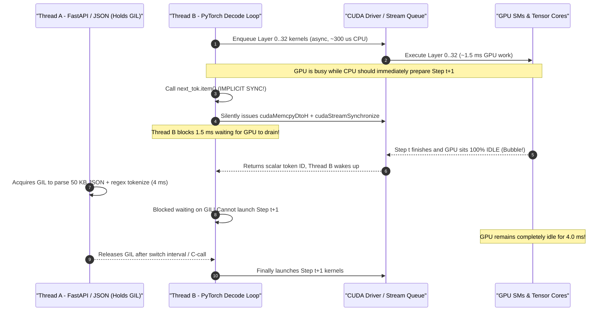
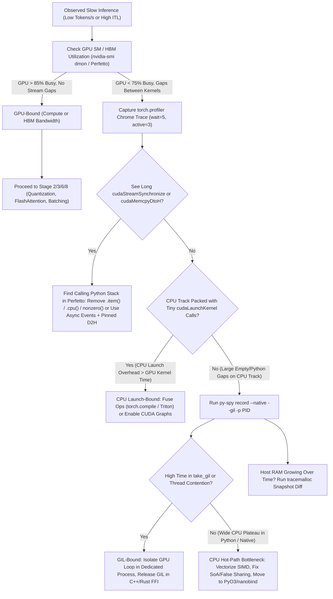

# 05 — Python Profiling

[Previous: 04 — C/C++ and Rust on the Hot Path](./04-c-cpp-and-rust-on-the-hot-path.md) | [Stage 1 Index](./README.md)

---

This document teaches how to measure and diagnose whether an AI inference server is slowed down by Python CPU overhead, memory leaks, or the GPU itself. Every Python runtime, profiling, GPU-execution, and AI-inference term used below is defined first in plain English.

## Core Concepts & Terminology

### 1. Python Runtime, Concurrency, & OS Processes
* **CPython, Bytecode, & Reference Counting:** Standard Python (**CPython**) compiles code into **bytecode** instructions and tracks object lifetimes with a **reference count** (`PyObject->ob_refcnt`) on every object.
* **OS Process, PID, Thread, RSS, & OOM-Killer:** An **OS Process** (identified by a **PID**, Process ID) is an isolated running program with its own private memory. A **Thread** is an execution stream inside a process sharing the same memory. **RSS (Resident Set Size)** is how much physical RAM a process currently occupies; if RSS grows unchecked (**memory leak**), the **Linux OOM-killer** terminates the process.
* **Mutex, Condition Variable, & the GIL (Global Interpreter Lock):** A **mutex** (mutual exclusion lock) and **condition variable** coordinate threads so two threads do not corrupt shared data simultaneously. CPython protects its non-atomic reference counts with a single global lock—the **GIL**—allowing **only one thread to execute Python bytecode at any instant** (switching roughly every `sys.getswitchinterval()` = 5 ms, unless a C extension explicitly drops the lock via `Py_BEGIN_ALLOW_THREADS`). **GIL Convoying** happens when one thread holds the GIL for heavy CPU work (like **`asyncio`/FastAPI** HTTP JSON parsing or **Pydantic** validation), starving another thread that needs the GIL just to launch the next GPU step.
* **Process Isolation & FFI (`multiprocessing`, ZeroMQ IPC, `PyO3`/`nanobind`):** To bypass the GIL, servers run separate processes (`multiprocessing`) communicating over **ZeroMQ IPC (Inter-Process Communication)**, or move CPU work into C++/Rust extensions via **FFI** (`PyO3`/`nanobind`) that release the GIL.

### 2. CPU & Memory Profiling Concepts
* **Deterministic vs. Sampling Profiling & Heisenberg Distortion:** **Deterministic profiling** hooks every single function call and return, giving exact counts at the cost of slowing down the program (**Heisenberg distortion**: the profiler changes the timing you are trying to measure). **Sampling profiling** pauses or inspects the program periodically (e.g., 250 times per second = 250 Hz) with <1–2% overhead.
* **`cProfile` (`sys.setprofile`, `ncalls`, `tottime`, `cumtime`):** Python's built-in deterministic profiler (`sys.setprofile`). It reports **`ncalls`** (call count), **`tottime`** (time spent strictly inside that function), and **`cumtime`** (time inside that function plus everything it called).
* **`tracemalloc` (`PyMem_*` / `PyObject_*`, `nframe`):** Python's built-in CPU heap allocator tracker. It records the exact source line and stack depth (**`nframe`**) of Python heap allocations (not GPU VRAM or raw C `malloc`).
* **`py-spy` & Flamegraphs:** **`py-spy`** is an external sampling profiler that reads a running process's memory (`process_vm_readv`, requiring `CAP_SYS_PTRACE` or matching user permissions) without touching the GIL, capturing Python + C/C++/Rust stacks (`--native`), GIL-holding threads (`--gil`), or sleeping threads (`--idle`). Its output is a **Flamegraph**: the **Y-axis** shows call-stack depth (caller at bottom, active leaf function at top), while the **X-axis** shows **sample proportion** sorted alphabetically (NOT chronological time!).

### 3. CUDA, GPU Execution, & `torch.profiler`
* **GPU SMs, Tensor Cores, & HBM:** A GPU contains dozens of **Streaming Multiprocessors (SMs)** packed with **Tensor Cores** (fast matrix math units) fed by high-speed **HBM (High Bandwidth Memory)**. `nvidia-smi dmon` monitors live SM and memory utilization.
* **CUDA Runtime, CUDA Driver, CUDA Stream, & Asynchronous Launches:** Programs talk to NVIDIA GPUs through the **CUDA Runtime / Driver**. A **CUDA Stream** is an in-order queue of GPU commands. Normally, CPU calls like **`cudaLaunchKernel`** or **`cudaMemcpyAsync`** are **asynchronous**: the CPU drops a command into the stream queue in microseconds and immediately moves on while the GPU executes later.
* **Implicit CUDA Synchronization & GPU Bubbles:** If Python asks for a value stored on the GPU (via `tensor.item()`, `tensor.cpu()`, `tensor.numpy()`, `print(tensor)`, or dynamic-shape ops like `torch.nonzero()` / `torch.unique()`), CUDA silently injects **`cudaMemcpyDtoH`** (Device-to-Host copy) + **`cudaStreamSynchronize`** (or `cudaDeviceSynchronize`), freezing the CPU until the entire GPU queue drains. This leaves idle empty gaps—called **GPU Bubbles**—on the GPU timeline.
* **CPU-Launch-Bound vs. GPU-Bound, Operator Fusion, & CUDA Graphs:** If the GPU finishes tiny kernels faster than the CPU can call `cudaLaunchKernel`, the workload is **CPU-launch-bound** (fixed by **Operator Fusion** via **`torch.compile` JIT** or **Triton**, or **CUDA Graphs** that replay a whole sequence of kernels in one launch). If the GPU SMs or HBM are >85% busy with no gaps, it is **GPU-bound**. (`cudaMalloc` allocates GPU VRAM; **cuBLAS heuristic tuning** picks fast matrix kernels on step 0.)
* **`torch.profiler`, CUPTI, ATen/Autograd, & Perfetto:** **`torch.profiler`** combines PyTorch's C++ **ATen/Autograd** CPU trace with **NVIDIA CUPTI (CUDA Profiling Tools Interface)** hardware GPU timestamps (matched by **`correlation_id`**) into a unified timeline viewed in **Perfetto (`ui.perfetto.dev`)** or Chrome Tracing. Using `schedule(wait, warmup, active, repeat)` skips cold-start noise, and `record_function` adds custom labels.
* **Pinned Memory, SIMD, SoA, & False Sharing:** **Pinned H2D/D2H memory** enables full-speed DMA transfers between host RAM and GPU. **SIMD** (vector CPU instructions), **SoA** (Structure of Arrays), and **False Sharing** (cache-line contention across threads) are CPU hot-path optimization concepts covered in [04 — C/C++ and Rust on the Hot Path](./04-c-cpp-and-rust-on-the-hot-path.md).

### 4. LLM Inference Metrics & Operations
* **Tokens/s, TTFT, ITL, & Roofline Model:** Inference speed is measured in output **tokens per second**, **TTFT (Time To First Token)**, and **ITL (Inter-Token Latency)**. The **Roofline model** compares achieved speed against the hardware's theoretical compute and memory-bandwidth ceilings.
* **Decode Loop, `EOS_ID`, & KV Metadata:** The **decode loop** generates one token per step until **`EOS_ID`** (End-Of-Sequence token). **KV metadata** tracks Key-Value attention cache blocks.
* **BPE Pre-Tokenizer, SSE Streaming, & Transformer Ops:** **BPE pre-tokenizers** split text with regex before encoding; **SSE (Server-Sent Events)** streams tokens as JSON over HTTP. **RMSNorm**, **RoPE** (Rotary Position Embedding), **QKV bias**, and **SiLU** are small per-layer neural network operations; **Quantization**, **FlashAttention**, and **Batching** are GPU-level optimizations.

---

## 1. The Python GIL Bottleneck in Inference Pipelines

In standard CPython (3.8–3.12, and default builds of 3.13+), every Python object tracks how many variables point to it using a non-atomic reference count (`PyObject->ob_refcnt`). Every time Python executes `x = y`, it increments that counter; when `x` leaves scope, it decrements it. If two OS threads updated those counters simultaneously without a lock, the count would corrupt and cause memory leaks or crashes. To prevent this, CPython enforces the **Global Interpreter Lock (GIL)**: a single mutex + condition variable allowing **only one thread to execute Python bytecode at any instant**.

*(Note: Python 3.13 introduced experimental free-threaded builds via PEP 703 `python3.13t`, though production CUDA/PyTorch inference ecosystems remain predominantly GIL-bound today.)*

### 1.1 How the GIL Starves GPUs

1. **Switching Interval (`sys.getswitchinterval()` = 5 ms):** A Python thread holds the GIL until it finishes 5 ms of bytecode, hits I/O, or enters a C extension that explicitly calls `Py_BEGIN_ALLOW_THREADS` (releasing the GIL).
2. **GIL Convoying:** Suppose Thread A runs an `asyncio`/FastAPI HTTP server parsing incoming JSON prompts while Thread B runs the PyTorch decode scheduler loop dispatching CUDA kernels. Even though **PyTorch releases the GIL inside its C++/CUDA kernels**, every Python line *between* kernels (looping over batch items, checking `if request.finished:`, slicing lists, Pydantic validation) requires reacquiring the GIL. If Thread A holds the GIL for 4 ms parsing JSON, Thread B stalls—and the **GPU finishes its current step and sits 100% idle** waiting for the next kernel launch!
3. **Architecture Mitigation:** Production serving engines isolate the GPU scheduler in a dedicated OS process (`multiprocessing` / ZeroMQ IPC), run HTTP/tokenization in separate worker processes or async Rust/C++ threads that drop the GIL, and profile continuously to detect hidden GIL serialization.

---

## 2. Sampling vs. Deterministic Profiling

When an LLM server is slower than expected, `nvidia-smi` showing 30% GPU utilization does **not** mean the GPU is fast—it means the GPU is sitting idle 70% of the time waiting on the CPU, the Python GIL, or synchronization stalls. Choosing the right profiler depends on whether you need to inspect Python bytecode overhead, native C++/Rust extensions, host memory leaks, or the CPU-to-GPU handoff:

| Profiler | Mechanism | Overhead | Visibility | Best Use Case |
| :--- | :--- | :--- | :--- | :--- |
| **`cProfile`** | Deterministic (`sys.setprofile` hook on every Python `call`/`return`/`c_call`) | **High (2x–10x slowdown)** on tight Python loops | Exact call counts, `tottime`, `cumtime` for Python & C-call boundaries | Micro-benchmarking pure-Python logic; **unsafe in production** and distorts async GPU timing |
| **`py-spy`** | Out-of-process sampling via Linux `process_vm_readv` (reads target stack at 100–1000 Hz) | **Negligible (<1–2%)**; zero target code changes | Python stacks + native C/C++/Rust frames (`--native`) + GIL status (`--gil`) | Production flamegraphs, finding GIL bottlenecks & hidden native CPU hotspots |
| **`tracemalloc`** | Hooks CPython `PyMem_*` / `PyObject_*` allocators | **Moderate–High** (scales with `nframe` traceback depth) | Exact source line + size of **CPU Python heap** allocations (NOT GPU VRAM!) | Catching host RAM leaks in request queues, KV metadata, or tokenizer caches |
| **`torch.profiler`** | CUPTI (CUDA Profiling Tools Interface) + PyTorch ATen/Autograd CPU trace hooks | **Moderate** during active trace window (use `schedule=`) | Unified CPU + CUDA Runtime + GPU Kernel timeline (Chrome/Perfetto JSON) | Finding GPU kernel gaps, CPU launch overhead, and implicit `.item()` / `.cpu()` sync stalls |

---

## 3. Deterministic Profiling (`cProfile`) & Allocation Tracking (`tracemalloc`)

### 3.1 `cProfile`: Interpreting `tottime` vs. `cumtime`

```python
import cProfile
import pstats

with cProfile.Profile() as pr:
    run_inference_batch(requests)

stats = pstats.Stats(pr).sort_stats("cumtime")
stats.print_stats(20)
```

* **`ncalls`:** Exact invocation count (e.g., `500000` calls to a tiny helper indicates loop overhead dominating work).
* **`tottime` (Self Time):** Time spent *strictly inside* that function, excluding sub-calls. High `tottime` in a pure-Python function signals CPU-bound bytecode work to move to vectorized NumPy/Rust/C++.
* **`cumtime` (Cumulative Time):** Time spent in that function *plus* all callees. Note: C functions that call `cudaStreamSynchronize` appear as a single high `tottime` inside `built-in method item` or `method 'cpu' of 'torch._C.TensorBase'`—masking whether the time was CPU compute or GPU wait!
* **Heisenberg Distortion:** Because `cProfile` adds ~500 ns–2 $\mu$s per Python function call, a tight loop calling a tiny Python wrapper 100,000 times slows down artificially by 5x–10x, completely masking real GPU execution ratios.

### 3.2 `tracemalloc`: Finding Host Memory Leaks

Long-running inference servers frequently suffer gradual host RSS growth until Linux OOM-kills the worker. `tracemalloc` isolates which line of Python allocated unreleased CPU objects:

```python
import tracemalloc

tracemalloc.start(10)  # Capture up to 10 stack frames per allocation
snap1 = tracemalloc.take_snapshot()

for _ in range(1000):
    serve_one_request()

snap2 = tracemalloc.take_snapshot()
for stat in snap2.compare_to(snap1, "lineno")[:10]:
    print(f"{stat.traceback.format()[0]} | +{stat.size_diff / 1024:.1f} KiB ({stat.count_diff} blocks)")
```

> **Critical Scope Boundary:** `tracemalloc` tracks allocations routed through CPython's `PyMem` API (Python dicts, strings, lists, and NumPy arrays if NumPy's `PyDataMem` hooks are active). It **does not track** `cudaMalloc` GPU VRAM (use `torch.cuda.memory_snapshot()` / `torch.cuda.max_memory_allocated()` for VRAM) or raw C++/Rust `malloc` allocations inside extensions that bypass `PyMem`.

---

## 4. Sampling Flamegraphs with `py-spy`

`py-spy` attaches externally to a running PID (requiring `CAP_SYS_PTRACE` or same-user permissions) and samples call stacks asynchronously without pausing the GIL:

```bash
# 1. Capture native C/C++/Rust + Python frames at 250 Hz for 30 seconds into an interactive SVG flamegraph
py-spy record -p $(pgrep -f serve.py) --native --rate 250 --duration 30 -o flamegraph.svg

# 2. Isolate ONLY threads actively holding the GIL (exposes GIL contention!)
py-spy top -p $(pgrep -f serve.py) --gil

# 3. Include idle/sleeping threads (shows threads blocked waiting on locks, I/O, or cudaStreamSynchronize)
py-spy record -p $(pgrep -f serve.py) --native --idle -o flamegraph_with_idle.svg
```

### 4.1 How to Read a Flamegraph Correctly

1. **Y-Axis = Call Stack Depth:** Bottom bar is the process/thread entrypoint (`_start` / `run_loop`); moving upward traces caller $\rightarrow$ callee; the **topmost edge** is the leaf function executing on CPU at the instant of sampling.
2. **X-Axis = Sample Proportion (NOT Time!):** Frames at the same depth are sorted **alphabetically**, *not chronologically*. A wide bar does **not** mean "one slow 10-second call"; it means **that function was on the call stack for X% of all captured samples** (either called once slowly, or called 1,000,000 times!).
3. **Diagnostic Shapes:**
   * **Wide Flat Plateaus at the Top:** True CPU bottlenecks! Example: `re.findall` in a BPE pre-tokenizer, `json.dumps` during streaming SSE formatting, or `libc.so` `memcpy` from unpinned H2D staging.
   * **Wide `libpthread` / `take_gil` / `cudaStreamSynchronize` Towers:** Waiting/synchronization bottlenecks (inspect with `--idle` and `--native`).
   * **Deep Narrow Spires:** Framework/Pydantic/PyTorch dispatcher overhead; optimize by batching calls or fusing ops.

---

## 5. `torch.profiler` and Interpreting Chrome / Perfetto Traces

While `py-spy` sees only the CPU, **`torch.profiler`** fuses CPU execution with **NVIDIA CUPTI** hardware timestamps into a single synchronized timeline viewed at **`ui.perfetto.dev`** (or `chrome://tracing`).

### 5.1 Proper Instrumentation Pattern

Never profile step 0 (CUDA context init + cuBLAS heuristic tuning + `torch.compile` JIT skews traces). Always use `schedule(wait, warmup, active, repeat)`:

```python
import torch
from torch.profiler import profile, ProfilerActivity, schedule

prof_sched = schedule(wait=5, warmup=2, active=3, repeat=1)

with profile(
    activities=[ProfilerActivity.CPU, ProfilerActivity.CUDA],
    schedule=prof_sched,
    record_shapes=True,
    with_stack=True,
    profile_memory=False,
    on_trace_ready=torch.profiler.tensorboard_trace_handler("./traces"),
) as prof:
    for step in range(10):
        with torch.profiler.record_function("scheduler_and_prep"):
            batch = prepare_batch()
        with torch.profiler.record_function("model_forward"):
            logits = model(batch)
        with torch.profiler.record_function("sample"):
            next_tok = torch.argmax(logits[:, -1, :], dim=-1)
        prof.step()  # Marks iteration boundary for schedule
```

### 5.2 Reading the Perfetto / Chrome Trace Timeline

Think of the CPU-to-GPU relationship like a restaurant order counter: the CPU drops kernel tickets (`cudaLaunchKernel`) onto the CUDA Stream queue in microseconds and immediately moves on to prepare the next step, while the GPU works through the queued tickets asynchronously. A healthy GPU-bound trace looks like a **solid wall of packed GPU kernels** on the CUDA Stream track, with CPU `cudaLaunchKernel` slices running **ahead** of the GPU (asynchronous queuing):

1. **CPU Thread Track (`python` / `pt_autograd_0`):**
   * Shows `record_function` labels, ATen C++ dispatchers (`aten::mm`, `aten::scaled_dot_product_attention`), and **CUDA Runtime calls** (`cudaLaunchKernel`, `cudaMemcpyAsync`, `cudaStreamSynchronize`, `cudaDeviceSynchronize`).
   * **Kernel Launch Overhead:** Every `cudaLaunchKernel` takes **~3–15 $\mu$s** on CPU. If a decode batch launches 300 tiny kernels (RMSNorm, RoPE, QKV bias, residual add, SiLU) that each take only **4 $\mu$s** on an H100, CPU dispatch takes $300 \times 8\text{ }\mu\text{s} = 2.4\text{ ms}$ while total GPU compute is only $1.2\text{ ms}$! The GPU stream shows **50% idle gaps ("bubbles")** between kernels—classic **CPU-launch-bound** execution (fixed by operator fusion and CUDA Graphs in Stage 8).
2. **Correlation Flow Arrows:** Clicking a `cudaLaunchKernel` slice on the CPU track draws a **flow arrow** down to the exact GPU kernel slice on `stream 7` (matched by CUPTI `correlation_id`). Large horizontal distance between launch and execution means the CPU is successfully staying ahead (good queue depth); zero distance means the CPU fell behind and the GPU is starving!
3. **GPU Stream Track (`stream 7` / Compute & `stream 14` / Memcpy):**
   * Inspect **gaps (white space / bubbles)** between consecutive GPU kernel rectangles. Every microsecond of gap means Tensor Cores and HBM bandwidth are sitting at **0% utilization**.
4. **Implicit CUDA Synchronization Points (The #1 Silent Performance Killer):**
   PyTorch operations are normally **asynchronous**—the CPU enqueues a kernel onto the CUDA stream and immediately moves on. However, any operation requiring a GPU value on the host CPU silently injects a **`cudaMemcpyDtoH` + `cudaStreamSynchronize`**, blocking the CPU until the *entire queued GPU pipeline drains*:
   * **`tensor.item()`** / `int(tensor)` / `float(tensor)` (e.g., checking `if next_token.item() == EOS_ID:` inside the decode loop before launching the next step!)
   * **`tensor.cpu()`** / **`tensor.numpy()`** (synchronous D2H copy on the default stream)
   * **`print(tensor)`** or Python `bool(tensor > 0)` / `if tensor:`
   * **Dynamic-shape ops like `torch.nonzero(mask)` or `torch.unique()`** (CPU cannot allocate output tensor without knowing how many elements matched on GPU $\implies$ forced sync!).

---

## 6. GPU Starvation Timeline: GIL Contention + Implicit Sync

The sequence diagram below illustrates how a seemingly innocent decode loop suffers massive GPU starvation from two combined Stage 1 issues: another thread holding the Python GIL during tokenization/JSON parsing, followed by an implicit `.item()` synchronization stall.



---

## 7. Diagnostic Decision Flowchart: CPU-Bound vs. GPU-Bound Pipelines

Use the systematic triage flow below whenever inference throughput (tokens/s) or latency (TTFT / ITL) misses hardware Roofline expectations:



---

## Navigation

* **Previous:** [04 — C/C++ and Rust on the Hot Path](./04-c-cpp-and-rust-on-the-hot-path.md)
* **Up:** [Stage 1 Index](./README.md)
