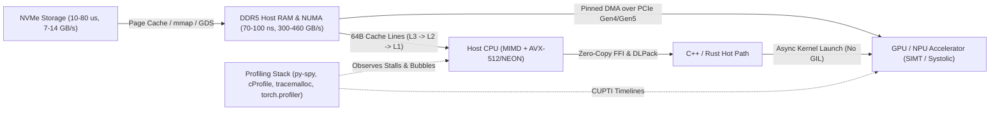

# Stage 1: Systems Foundations

[Back to Docs Overview](../../README.md) | [Complete Syllabus](../../syllabus.md)

---

## Overview

Modern Large Language Model (LLM) inference engines—whether vLLM, SGLang, TensorRT-LLM, or custom runtimes—are distributed, hardware-accelerated systems programs wrapped in a Python control plane. When an inference deployment suffers from high Time-to-First-Token (TTFT), jittery Inter-Token Latency (ITL), slow cold starts, or poor GPU utilization despite fast Tensor Cores, the root cause frequently lies **below the model architecture**: in PCIe DMA stalls, virtual memory page faults, NUMA cross-socket traffic, Python GIL contention, or uncoalesced CPU cache access on the scheduler/tokenizer hot path.

**Stage 1: Systems Foundations** builds the bare-metal mental model required to reason rigorously about every byte moved and every cycle executed across CPU, memory, storage, interconnects, OS kernel, and accelerators.

---

## Topic Index

| # | Document | Core Systems Focus | Direct LLM Inference Impact |
| :--- | :--- | :--- | :--- |
| **01** | [Memory Hierarchy & Buses](./01-memory-hierarchy-and-buses.md) | Registers, L1/L2/L3 caches, 64B cache lines, DDR5, PCIe Gen4/Gen5 (`128b/130b`), NVMe, Little's Law | Cold-start weight loading times, H2D/D2H KV offloading ceilings, single-core vs. multi-core bandwidth saturation |
| **02** | [Hardware Execution Models](./02-hardware-execution-models.md) | CPU (MIMD/SIMD, OoO, branch prediction), GPU (SIMT warps, 0-cycle oversubscription), NPU (Weight/Output-Stationary Systolic Arrays) | Why CPUs handle tokenization/scheduling, why GPUs hide HBM latency, and why NPUs shine on Prefill GEMM but underutilize on batch=1 Decode |
| **03** | [Linux Internals for I/O & Memory](./03-linux-internals-for-io-and-memory.md) | Virtual memory, TLBs, 2MB/1GB Huge Pages, Page Cache, `mmap`, zero-copy I/O, `mlock`/`cudaHostAlloc`, NUMA | Sub-millisecond `safetensors` loading, avoiding 2x–5x PCIe DMA throttling via pinned memory, eliminating cross-socket UPI/xGMI penalties |
| **04** | [C/C++ and Rust on the Hot Path](./04-c-cpp-and-rust-on-the-hot-path.md) | Manual memory, RAII, Rust ownership/borrowing, AoS vs. SoA, false sharing, AVX-512/NEON, OpenMP/Rayon, `PyO3`/`nanobind`, DLPack | Zero-copy tensor exchange (`DLManagedTensor`) across Python/Rust/C++/GPU, high-throughput sampling, grammar masking, and tokenization |
| **05** | [Python Profiling](./05-python-profiling.md) | Python GIL mechanics, `py-spy` flamegraphs, `cProfile`, `tracemalloc`, `torch.profiler` & Perfetto traces | Isolating GIL-induced GPU starvation, diagnosing CPU launch overhead, detecting memory leaks, and eliminating implicit `.item()` / `.cpu()` sync stalls |

---

## Navigation

* **Up:** [Phase 1 / Docs Overview](../../README.md) | [Complete Syllabus](../../syllabus.md)
* **Start Reading:** [01 — Memory Hierarchy & Buses](./01-memory-hierarchy-and-buses.md)
* **Next Stage:** [Stage 2: GPU Architecture & Modern Silicon →](../stage-02/README.md)
