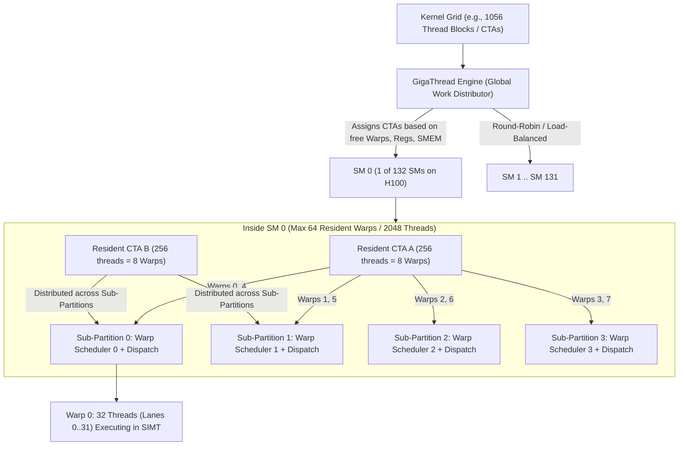
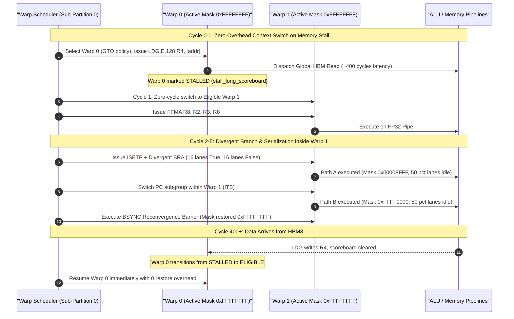

# 01 — CUDA Execution Hierarchy

[Stage 2 Index](./README.md) | [Complete Syllabus](../../syllabus.md) | Next: [02 — GPU Memory Hierarchy](./02-gpu-memory-hierarchy.md)

---

## 1. Software Abstraction vs. Hardware Topology

CUDA decouples algorithmic parallelism from fixed core counts through a three-level software hierarchy—**Grid**, **Thread Block (CTA)**, and **Thread**—which the GPU hardware maps dynamically onto **Streaming Multiprocessors (SMs)**, **SM Sub-Partitions**, and **Warps**.

| Software Concept | Hardware Mapping | Architectural Constraints (Hopper H100 / cc 9.0) |
| :--- | :--- | :--- |
| **Grid** | Entire GPU (across all GPCs and SMs) | Max grid dimensions: $(2^{31}-1, 65535, 65535)$ blocks |
| **Thread Block (CTA)** | Assigned to a single **SM** (runs to completion on that SM) | Max $1024$ threads/block; max $32$ resident blocks/SM |
| **Warp** (32 threads) | Assigned to a single **SM Sub-Partition** (Warp Scheduler) | Fixed hardware width of $32$ threads; max $64$ resident warps/SM |
| **Thread** | One **Lane** ($0 \dots 31$) inside a Warp | Max $255$ 32-bit registers per thread |

> **Note on CTA (Cooperative Thread Array):** In NVIDIA PTX ISA terminology, a Thread Block is formally called a **CTA**. All threads within a CTA can synchronize via fast hardware barriers (`__syncthreads()` / `bar.sync`) and share low-latency on-chip Shared Memory (SRAM). Threads in *different* CTAs cannot safely synchronize with each other during a kernel via global memory locks without risking deadlock unless using Hopper **Thread Block Clusters** or cooperative grid launches (`cudaLaunchCooperativeKernel`).

### Grid $\to$ Block $\to$ Warp $\to$ Thread Mapping onto SMs

When a kernel launches via `kernel<<<gridDim, blockDim, sharedMemBytes, stream>>>(...)`, the **GigaThread Engine** (the GPU's global work distributor) iterates over the Grid's CTAs and assigns them to SMs that have sufficient free hardware resources across four dimensions:
1. **Warp slots** ($\lceil \text{threads\_per\_block} / 32 \rceil$ warps available).
2. **Block slots** (1 CTA slot available).
3. **Registers** (total registers needed by the block available in the SM's 65,536-register file).
4. **Shared Memory** (dynamic + static SMEM bytes available in the SM's unified L1/SMEM pool).

Once a CTA is placed on an SM, it **never migrates** to another SM. Inside the SM, the CTA is immediately partitioned into warps of 32 consecutive threads, indexed linearly by `linear_tid`:

$$\text{linear\_tid} = t_x + t_y \cdot B_x + t_z \cdot (B_x \cdot B_y)$$

$$\text{warp\_id} = \left\lfloor \frac{\text{linear\_tid}}{32} \right\rfloor, \qquad \text{lane\_id} = \text{linear\_tid} \bmod 32$$

If `threads_per_block` is not a multiple of $32$ (e.g., $100$ threads), the SM still allocates $\lceil 100 / 32 \rceil = 4$ warps ($128$ hardware lanes), and lanes $4 \dots 31$ of the final warp are permanently masked off (`inactive`), wasting compute slots. **Rule of thumb:** always configure `blockDim.x` (or total threads per block) as a multiple of $32$—ideally $128$, $256$, or $512$.



### Physical Implications for LLM Inference

* **Wave Quantization:** An NVIDIA H100 SXM5 has **132 SMs**. If a decode kernel launches a grid of $133$ CTAs where each CTA fills an entire SM (e.g., 1 CTA/SM), the first $132$ CTAs run concurrently in **Wave 1**, and the final $1$ CTA executes alone in **Wave 2** while $131$ SMs ($99.2\%$ of the GPU) sit idle. Latency nearly doubles for $0.75\%$ extra work!
* **Tail Latency in Variable-Length Batches:** In ragged continuous batching, if CTA $k$ processes a prompt of length $4096$ while other CTAs process prompts of length $128$, the longest CTA pins its SM slot and delays kernel completion (unless work is tiled across sequence chunks, as in **FlashDecoding** / **PagedAttention** split-K).

---

## 2. SIMT Execution Model

CPUs execute **SIMD** (Single Instruction, Multiple Data): software explicitly packs $8$ or $16$ scalars into a wide vector register (`__m512`) and executes one vector instruction over one program counter (PC). GPUs execute **SIMT** (Single Instruction, Multiple Thread): software is written from the perspective of a *single scalar thread* with its own thread index (`threadIdx.x`), registers, and control flow, while hardware dynamically groups $32$ threads into a **Warp** that shares instruction fetch/decode bandwidth.

Key architectural properties of SIMT:
1. **Amortized Control Logic:** Only $1$ instruction fetch, decode, and dependency check unit is needed per $32$ execution lanes, dedicating far more silicon area to ALUs and Tensor Cores rather than branch predictors or out-of-order reorder buffers.
2. **Thread-Private Registers, Shared Instruction Stream:** Each lane $i \in [0, 31]$ has private 32-bit registers (`R0`, `R1`, ...), so `ADD R2, R0, R1` performs $32$ independent additions on $32$ distinct register sets in one issue cycle.
3. **32-bit Active Mask:** At any cycle, a warp carries a 32-bit bitmask (`active_mask`, queryable in CUDA C++ via `__activemask()`) indicating which of the $32$ threads are enabled for the issued instruction.

---

## 3. Warp Divergence, Active Masks, and Independent Thread Scheduling

### Pre-Volta SIMT Stack vs. Volta+ Independent Thread Scheduling

When threads inside a single warp evaluate a data-dependent branch (`if (cond) { A } else { B }`) differently, **warp divergence** occurs.

* **Pre-Volta (Kepler, Maxwell, Pascal — cc $\le 6.x$):** All $32$ threads in a warp shared a **single Program Counter (PC)** and a hardware **SIMT Divergence Stack** containing `(reconvergence_PC, active_mask)`. When diverging, the hardware pushed the `else` path onto the stack, ran the `if` path completely to the immediate post-dominator reconvergence point, then popped and ran the `else` path. Consequently, threads on different branches could **never interleave**—if one thread spun in a `while (atomicCAS(...))` loop waiting for another thread in the *same* warp to release a lock, the GPU **deadlocked**.
* **Volta and Newer (Volta, Turing, Ampere, Ada, Hopper, Blackwell — cc $\ge 7.0$):** NVIDIA introduced **Independent Thread Scheduling (ITS)**. The hardware maintains a **per-thread PC and per-thread call stack/state** for all $32$ lanes.
  * The warp scheduler can interleave execution of diverged subgroups at sub-warp instruction granularity (guaranteeing forward progress for intra-warp locks/mutexes).
  * Because threads can drift out of lockstep, **implicit warp-synchronous programming** (assuming threads $0..31$ are always at the same PC without barriers) is illegal on cc $\ge 7.0$. Primitives like `__shfl_sync(mask, ...)` and `__ballot_sync(mask, ...)` require an explicit `mask` and perform hardware reconvergence via the **Convergence Barrier (`BSSY` / `BSYNC`)** instructions emitted by `ptxas`.

### Predication vs. Divergence Serialization Penalties

The CUDA compiler (`nvcc` / `ptxas`) chooses between two code-generation strategies for divergent branches:

1. **Predicated Execution (Branchless Masking):**
   For short branch bodies (typically $\le 4$–$8$ instructions without nested loops or memory barriers), `ptxas` avoids branching altogether. It computes a 1-bit **predicate register** per thread (`P0`) and tags instructions with `@P0` or `@!P0`:
   ```text
   ISETP.GT.AND P0, PT, R2, 0, PT   ; P0 = (R2 > 0) per lane
   @P0  FFMA R4, R2, R3, R4         ; Executed by warp; lanes with !P0 suppress register writeback
   @!P0 FADD R4, R2, 1.0            ; Executed by warp; lanes with P0 suppress register writeback
   ```
   * **Cost:** Total cycles = $|\text{if}| + |\text{else}|$ instructions, zero branch/reconvergence overhead, no instruction-cache disruption. Even if $100\%$ of lanes take `P0`, the `@!P0` instruction still consumes an issue slot.

2. **Divergent Branch & Serialization:**
   For large branch bodies or loops with different trip counts per lane, the compiler emits conditional branch instructions (`@P0 BRA`). Hardware executes the active subgroup for Path A (`mask = 0x0000FFFF`) while Path B lanes are masked off, then switches to Path B (`mask = 0xFFFF0000`) while Path A lanes are masked off.
   * **Worst-Case Serialization Penalty:** In a 32-way `switch (threadIdx.x % 32)` where every lane executes a distinct code path of length $L$, the warp must issue $32 \times L$ instruction cycles while utilizing only $1/32 = 3.125\%$ of its execution lanes—a **$32\times$ throughput collapse**.
   * **Loop Trip-Count Divergence in LLM Inference:** Suppose a warp processes $32$ tokens in a sparse/ragged kernel where $31$ tokens finish after $10$ iterations and $1$ token iterates $1000$ times. All $32$ lane slots remain occupied on the SM for $1000$ iterations at $1/32$ efficiency!

### Practical Mitigation in LLM Kernels

* **Uniform Warp Control Flow:** Ensure branch conditions depend only on `warp_id` or `blockIdx` rather than `lane_id` (e.g., causal attention masking at **tile granularity**—skipping whole $64 \times 64$ key/value tiles above the diagonal in FlashAttention rather than branching per-thread).
* **Warp-Level Primitives:** Replace intra-warp shared memory reductions with `__shfl_down_sync(0xffffffff, val, offset)` or `__reduce_add_sync` (cc $8.0+$) so all $32$ threads follow identical control flow.

---

## 4. Zero-Overhead Context Switching & Warp Scheduling

Unlike CPU threads—where a context switch traps into the OS kernel or saves/restores dozens of architectural registers to L1/RAM (costing hundreds to thousands of nanoseconds)—an SM performs **zero-overhead warp context switching on every single clock cycle**.

### Why Context Switching Costs Zero Cycles

The SM's register file (**256 KB = 65,536 $\times$ 32-bit registers per SM**) is **statically partitioned** among all resident warps at CTA launch time. Because every resident warp's registers, predicates, and PCs sit physically wired inside the SM silicon for the CTA's entire lifetime:
* Switching from Warp $3$ to Warp $17$ requires **zero memory copies** and **zero register saves**.
* The warp scheduler simply drives a multiplexer selecting Warp $17$'s PC and register-bank base offset on the very next clock edge.

### Inside an SM Sub-Partition (Ampere / Hopper / Blackwell)

Each SM is divided into **4 identical SM Sub-Partitions** (Processing Blocks). Each sub-partition holds:
* **1 Warp Scheduler** + **1 Dispatch Unit** (can issue $1$ instruction per clock cycle from one eligible warp—or $2$ independent instructions in dual-issue architectures like Turing/Ampere under narrow rules, though Hopper/Ampere primary throughput is $1$ warp instruction per sub-partition per cycle = $4$ warp instructions/SM/cycle).
* A pool of up to $16$ resident warps (since $64\text{ warps/SM} \div 4\text{ sub-partitions} = 16\text{ warps/sub-partition}$).
* Dedicated execution units: 32 FP32 CUDA cores (on Hopper), 16 INT32 cores, 1 Tensor Core, Load/Store/SFU access.

On every clock cycle, each Warp Scheduler evaluates its $\le 16$ assigned warps in two stages:
1. **Stall Filtering (Active $\to$ Eligible):** A warp is *Active* if it belongs to a resident CTA. It becomes *Eligible* only if its next instruction has all source operands ready, no barrier pending, and its target execution pipe is not congested.
2. **Scheduling Policy (Eligible $\to$ Issued):** From the pool of eligible warps, the scheduler selects one warp using a hardware priority heuristic—typically **GTO (Greedy Then Oldest)** or **LRR (Loose Round Robin)**:
   * **GTO:** Keep issuing instructions from the *same* warp until it stalls (maximizing Instruction-Level Parallelism and L1 cache locality), then switch to the oldest ready warp.



---

## 5. Hardware Warp Stall Reasons (Nsight Compute Taxonomy)

When a Warp Scheduler cannot issue an instruction because **zero** of its warps are eligible, the SM incurs an **unhidden stall cycle**, directly reducing achieved FLOP/s or memory bandwidth. Profiling tools (`ncu` / Nsight Compute) categorize the exact reason each warp was not issued on every cycle:

| Stall Reason (`ncu` Counter) | Underlying Hardware Condition | Typical Cause in LLM Inference & Remediation |
| :--- | :--- | :--- |
| **`stall_long_scoreboard`** | Waiting on a read from **Global/Local Memory** (L1 miss $\to$ L2/HBM3) or texture pipe. | **Dominant stall in Decode.** Fix: increase occupancy/ILP, vectorize loads (`float4`), use `cp.async` / Hopper TMA prefetching, or quantize weights (FP8/FP4) to cut bytes fetched. |
| **`stall_short_scoreboard`** | Waiting on **Shared Memory (SRAM)**, Special Function Unit (`SFU` like `exp2`/`rsqrt`), or **Tensor Core** / MIO queue return. | Bank conflicts on SMEM, or long chains of `exp2f` in unfused Softmax. Fix: pad/swizzle SMEM tiles, overlap `SFU` with `FFMA` or `MMA`. |
| **`stall_wait` (Execution Dependency)** | Waiting on fixed-latency pipeline hazard (e.g., RAW dependency on FP32 `FFMA` latency of ~4 cycles). | Low ILP inside inner loop. Fix: unroll loops (`#pragma unroll`) and maintain 2–4 independent accumulators per thread. |
| **`stall_barrier`** | Warp arrived at `__syncthreads()` (`bar.sync`) or `mbarrier` and waits for slower warps in the same CTA. | Load imbalance across warps (e.g., only Warp 0 loads data or irregular branch lengths). Fix: use asynchronous producer-consumer `mbarrier` (warp specialization) instead of coarse CTA-wide barriers. |
| **`stall_math_pipe_throttle`** | Warp is ready, but the target math unit (FP32, Tensor Core, SFU) has a full input queue. | **Healthy indicator** when Tensor Cores are saturated (compute-bound Prefill). If on `SFU`, reduce transcendentals (e.g., fast approximations). |
| **`stall_mio_throttle`** | The Memory Input/Output (`MIO`) FIFO queue feeding Shared Memory / Constant / Texture / SFU is full. | Issuing too many narrow 32-bit SMEM loads/stores back-to-back. Fix: widen to 128-bit `LDS.128` / `STS.128` or `ldmatrix`. |
| **`stall_drain`** | Warp executed `EXIT` and waits for outstanding global stores or asynchronous TMA/WMMA writes to complete. | End-of-kernel tail; usually benign unless kernels are tiny. |
| **`stall_no_instruction`** | Instruction cache (`I-cache`) miss; fetching SASS opcodes from L2/HBM. | Over-unrolled loops inflating SASS binary size beyond L1 I-cache (~12–32 KB/SM). Fix: moderate `#pragma unroll` factors. |
| **`stall_not_selected`** | Warp **IS Eligible**, but the scheduler chose a different eligible warp this cycle. | **Ideal state!** Proves sufficient concurrency exists to completely hide hardware latency. |

### Interpreting Stall Ratios
If a kernel shows **60% `stall_not_selected`** and **30% `stall_math_pipe_throttle`**, the SM sub-partition is issuing at near-100% IPC and compute pipes are saturated. Conversely, if **75% of cycles are `stall_long_scoreboard`** with **0% `stall_not_selected`**, every warp in the sub-partition is simultaneously blocked waiting on HBM—meaning you must either hide that latency with higher ILP/occupancy/prefetching or reduce bytes transferred per FLOP.

---

[Stage 2 Index](./README.md) | [Complete Syllabus](../../syllabus.md) | Next: [02 — GPU Memory Hierarchy](./02-gpu-memory-hierarchy.md)
