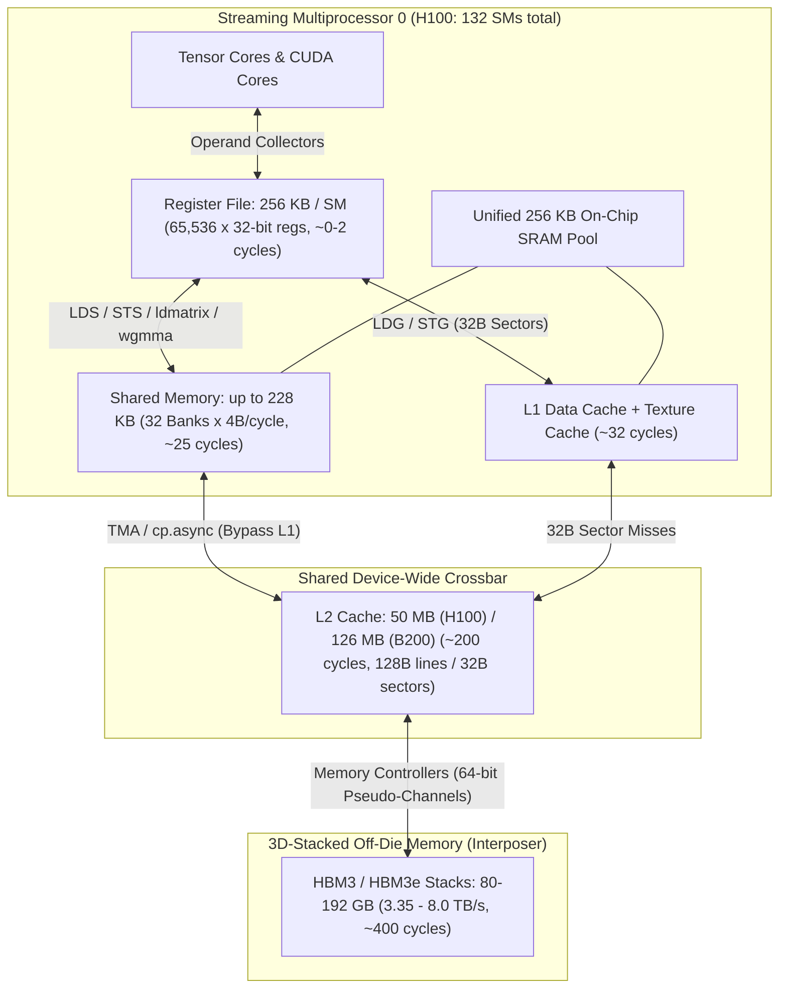
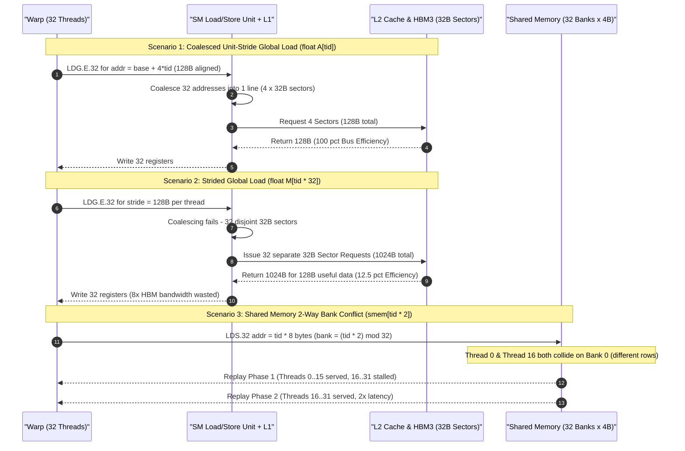

# 02 — GPU Memory Hierarchy

[Stage 2 Index](./README.md) | [Complete Syllabus](../../syllabus.md) | Previous: [01 — CUDA Execution Hierarchy](./01-cuda-execution-hierarchy.md) | Next: [03 — Compute Units: CUDA Cores vs. Tensor Cores](./03-compute-units-cuda-vs-tensor-cores.md)

---

## 1. Memory Tier Overview: Capacity, Bandwidth, and Latency

A GPU is fundamentally a **bandwidth-starved throughput engine**. While an NVIDIA H100 SXM5 delivers $989\text{ TFLOPS}$ (FP16) and an H200 delivers $4.8\text{ TB/s}$ of HBM3e bandwidth, moving a single tensor element from HBM to a Tensor Core costs roughly **$100\times$ more energy and $100\times$ more latency** than performing an FMA on data already sitting in registers or Shared Memory.

| Memory Tier | Scope | Location | Typical Capacity (A100 / H100 / B200) | Bandwidth (Per-SM or Aggregate) | Access Latency |
| :--- | :--- | :--- | :--- | :--- | :--- |
| **Register File (RF)** | Thread-private | On-SM SRAM | **256 KB / SM** ($65,536 \times 32\text{-bit}$) | $\sim 128+$ TB/s aggregate ($\sim 1+$ TB/s/SM) | $\sim 0$–$2$ cycles (operand collector) |
| **Shared Memory (SRAM)** | Block / Cluster (`DSMEM`) | On-SM Unified SRAM | Up to **164 KB** (A100) / **228 KB** (H100, B200) / SM | **128 B/cycle/SM** ($\sim 30+$ TB/s aggregate) | $\sim 20$–$30$ cycles |
| **L1 Data Cache** | SM-local | On-SM Unified SRAM | Remainder of **192 KB** (A100) / **256 KB** (H100, B200) | Shared with SMEM (128 B/cycle/SM) | $\sim 30$–$40$ cycles |
| **L2 Cache** | Device-wide (all SMs) | Shared On-Die Crossbar | **40 MB** (A100) / **50 MB** (H100) / **126 MB** (B200) | $\sim 12$ TB/s (H100) | $\sim 150$–$250$ cycles |
| **Global Memory (HBM3 / HBM3e)** | Device-wide + Host (UVA) | Off-die 3D-stacked DRAM | **80 GB** (A100/H100) / **141 GB** (H200) / **192 GB** (B200) | **2.0** (A100) / **3.35** (H100) / **4.8** (H200) / **8.0 TB/s** (B200) | $\sim 350$–$500+$ cycles ($\sim 200$–$400\text{ ns}$) |
| **Local Memory** | Thread-private (Spill) | Physically in **HBM** (cached in L1/L2) | Allocated per-thread stack | HBM-limited | $\sim 30$–$500$ cycles |

---

## 2. Per-Thread Registers & Local Memory Spilling

The **Register File (RF)** is the fastest and largest on-chip storage per SM: **$65,536$ 32-bit registers ($256\text{ KB}$)** on Volta, Ampere, Ada, Hopper, and Blackwell, divided evenly across the SM's 4 sub-partitions ($16,384$ registers per sub-partition).

### Architectural Mechanics
* **Per-Thread Cap:** An individual thread may address at most **255 32-bit registers** (`R0..R254`, with `RZ` hardwired to zero). Holding a 64-bit pointer (`uint64_t`) or `double` consumes **2 consecutive 32-bit registers** (`R4:R5`).
* **Allocation Granularity:** Registers are not allocated byte-for-byte. On Hopper/Ampere, registers are allocated per warp in multiples of **256 registers** (i.e., multiples of $8$ registers per thread across $32$ threads). Thus, using $33$ registers/thread rounds up to $40$ registers/thread at the warp level!
* **Register Bank Conflicts:** Physically, the register file is banked (e.g., 2 or 4 banks of 128-bit/64-bit ports per sub-partition). When an instruction like `FFMA R4, R0, R1, R2` needs 3 source operands in a single cycle, an **Operand Collector** buffers operands across cycles if multiple source registers sit in the same physical RF bank. The compiler schedules register assignments to minimize RF bank conflicts.

### Local Memory & Register Spilling
When a kernel uses thread-local arrays that cannot be indexed at compile time (dynamic indexing like `float acc[8]; acc[i] = ...`) or exceeds the register budget (either $> 255$ registers or capped via `__launch_bounds__(maxThreadsPerBlock, minBlocksPerSm)` / `-maxrregcount=N`), the compiler **spills** registers to **Local Memory** (`LDL` / `STL` instructions).

> **Critical Warning:** "Local" Memory is a logical scope, *not* a fast physical memory! It resides in **off-chip HBM3/HBM3e** (though cached in L1/L2). In a register-heavy FlashAttention or quantized GEMM kernel, accidental register spilling injects thousands of extra `STL`/`LDL` bytes into L1/L2/HBM, destroying both arithmetic throughput and memory bandwidth. Always inspect `ptxas --verbose` (`used N registers, M bytes lmem`) or Nsight Compute (`l1tex__t_sectors_pipe_lsu_mem_local_op_ld.sum`).

---

## 3. Shared Memory (SRAM), L1 Partitioning, and Bank Conflicts

Each SM contains a unified on-chip SRAM pool (**192 KB** on A100, **256 KB** on H100 and B200) shared dynamically between **L1 Data Cache** and programmer-managed **Shared Memory (`__shared__`)**.

### Unified L1/SMEM Partitioning
At kernel launch, CUDA configures the split via `cudaFuncSetAttribute(kernel, cudaFuncAttributePreferredSharedMemoryCarveout, carveout_pct)`:
* On **H100 (256 KB total)**: Supported Shared Memory allocations per CTA reach up to **228 KB** (the remaining 28 KB serves L1 cache/TMA/reserved metadata). Valid SMEM carveouts include `0`, `8`, `16`, `32`, `64`, `100`, `132`, `164`, `196`, `228` KB.
* Choosing a larger SMEM tile (e.g., 164 KB for FlashAttention-3 double-buffered $Q/K/V$ tiles) shrinks L1 cache to 92 KB—which is optimal when data reuse is explicitly managed in SRAM rather than relying on hardware L1 caching.

### 32-Bank Architecture & Bank Conflict Math
Shared Memory is physically organized into **32 independent SRAM banks**, each **4 bytes (32 bits) wide** and capable of servicing one 32-bit read or write per clock cycle. Successive 32-bit words map round-robin across the 32 banks:

$$\text{bank\_id}(\text{byte\_addr}) = \left\lfloor \frac{\text{byte\_addr}}{4} \right\rfloor \bmod 32$$

Total conflict-free SMEM bandwidth per SM is:

$$32 \text{ banks} \times 4 \text{ bytes/cycle} = \mathbf{128\text{ bytes/cycle per SM}}$$

At $1.83\text{ GHz}$ on an H100 (132 SMs), aggregate SMEM bandwidth across the chip exceeds **$30.9\text{ TB/s}$** ($\sim 9.2\times$ higher than HBM3!).

#### Conflict vs. Broadcast vs. Multicast Rules
When a warp issues a Shared Memory instruction (`LDS` / `STS`):
1. **Conflict-Free (1 transaction):** Every active thread accesses a **different** bank (e.g., `smem[tid]` $\to$ thread $i$ hits bank $i$).
2. **Broadcast (1 transaction, 0 penalty):** Multiple threads read the **exact same 4-byte word** address (e.g., all 32 threads read `smem[0]`). The bank serves the word once and broadcasts it across the crossbar to all requesting lanes. (A subset of threads reading the same word is a **multicast**, also conflict-free).
3. **$N$-Way Bank Conflict ($N$ serialized transactions):** Two or more threads access **different 4-byte words** that map to the **same bank** (e.g., `smem[tid * 2]` where thread $0$ hits `word 0 -> bank 0` and thread $16$ hits `word 32 -> bank 0`). Hardware splits the warp request into $N$ conflict-free replay phases, dividing effective SMEM bandwidth by $N$ and increasing `stall_short_scoreboard`.
   * **Worst Case (32-way conflict):** Stride of $32$ floats ($128$ bytes): `smem[tid * 32]`. All $32$ threads hit Bank $0$ at $32$ distinct rows $\to$ **$32\times$ serialization**!

#### Wide Accesses (`LDS.64` / `LDS.128`)
When threads load 64-bit (`float2`) or 128-bit (`float4`) vectors from SMEM, the hardware splits the warp into **two 16-thread phases** (`LDS.64`) or **four 8-thread phases** (`LDS.128`), because $16 \times 8\text{ B} = 128\text{ B}$ (full 32-bank width) and $8 \times 16\text{ B} = 128\text{ B}$. A bank conflict occurs only if two threads *within the same phase* collide on the same bank.

### Eliminating Bank Conflicts: Padding vs. XOR Swizzling
Consider transposing or reading columns of a $32 \times 32$ `float` tile `tile[row][col]` in Shared Memory:
* **Naive (`tile[32][32]`):** Row access `tile[0][tid]` is conflict-free, but column access `tile[tid][0]` hits `word_idx = tid * 32` $\to$ **32-way bank conflict**.
* **Padding (`tile[32][33]`):** Adding 1 dummy column shifts row stride to $33$ words. Now `tile[tid][0]` hits `(tid * 33) % 32 = tid` $\to$ **0 bank conflicts!** Downside: wastes ~3% SRAM and breaks 128-bit alignment for `TMA` / `cp.async.cg`.
* **XOR Swizzling (CUTLASS / FlashAttention `Swizzle<B, M, S>`):** Keeps a clean power-of-2 shape (`32 x 32` or `64 x 64` FP16) required by TMA and `ldmatrix`, and XORs upper row bits into the column bank bits:
  $$\text{phys\_col} = \text{col} \oplus (\text{row} \bmod 8)$$
  Every row permutes its bank mapping cleanly, guaranteeing **0 bank conflicts** on both row writes (from HBM/TMA) and column/tile reads (into Tensor Cores) with zero wasted SRAM.

---

## 4. L2 Cache Persistence & HBM3 / HBM3e Physics

### Device-Wide L2 Cache
Unlike L1 (private per SM), the **L2 Cache** is coherent and shared across **all SMs** via an on-chip crossbar (split into two partitions on Ampere/Hopper connected by an NVLink-speed internal bridge):
* **Capacities:** **40 MB** (A100), **50 MB** (H100/H200), **126 MB** (B200).
* **L2 Cache Residency Control (Ampere+):** Using `cudaStreamSetAttribute` with `cudaAccessPolicyWindow`, kernels can designate a hot memory region (e.g., a small embedding table, MoE router weights, or active KV prefix pages) as `cudaAccessPropertyPersisting` (up to ~30 MB on H100), preventing streaming reads of massive weight matrices from evicting hot metadata from L2.

### HBM3 and HBM3e Architecture
High Bandwidth Memory (HBM) achieves terabytes/second by replacing long off-chip PCB traces (GDDR) with **3D-stacked DRAM dies** bonded directly onto a **silicon interposer** right beside the GPU compute die via **TSVs (Through-Silicon Vias)**:

| GPU | Memory Technology | Active Stacks | Total Bus Width | Clock / Pin Speed | Peak Bandwidth | Capacity |
| :--- | :--- | :---: | :---: | :---: | :---: | :---: |
| **A100 SXM4 (80GB)** | HBM2e | $5$ stacks | $5120\text{-bit}$ | $3.2\text{ Gbps/pin}$ | **$2.039\text{ TB/s}$** | $80\text{ GB}$ |
| **H100 SXM5** | HBM3 | $5$ stacks | $5120\text{-bit}$ | $5.24\text{ Gbps/pin}$ | **$3.35\text{ TB/s}$** | $80\text{ GB}$ |
| **H200 SXM** | HBM3e | $6$ stacks | $6144\text{-bit}$ | $6.25\text{ Gbps/pin}$ | **$4.80\text{ TB/s}$** | $141\text{ GB}$ |
| **B200 SXM** | HBM3e | $8$ stacks | $8192\text{-bit}$ | $8.00\text{ Gbps/pin}$ | **$8.00\text{ TB/s}$** | $192\text{ GB}$ |

**Peak Bandwidth Formula:**

$$\text{BW}_{\text{peak}} = \frac{\text{Bus Width (bits)}}{8} \times \text{Data Rate (Transfers/sec/pin)}$$

For H100: $(5120 / 8) \times 5.24 \times 10^9 \approx 3.35\text{ TB/s}$. For B200: $(8192 / 8) \times 8.0 \times 10^9 = 8.192 \approx 8.0\text{ TB/s}$ (effective after protocol/clock calibration).

Each HBM3 stack exposes a **1024-bit interface** split into **16 independent 64-bit pseudo-channels** (or 32 32-bit pseudo-channels in HBM3). Because DRAM row activation (`tRCD` + `tCAS` + `tRP`) takes tens of nanoseconds ($\sim 100$–$400+$ GPU cycles including crossbar traversal), a single thread waiting on HBM stalls indefinitely. HBM bandwidth is only saturated when thousands of concurrent 32-byte requests keep all $5 \times 16 = 80+$ pseudo-channels continuously pipelined.

---

## 5. Memory Access Coalescing & 32B / 128B Transactions

When a warp of 32 threads executes a global memory load (`LDG`) or store (`STG`), the Load/Store Unit (LSU) inside the SM inspects all 32 per-thread addresses and **coalesces** them into the minimum number of hardware memory transactions.

### 128-Byte Cache Lines vs. 32-Byte Sectors
Modern NVIDIA GPUs (Volta through Blackwell) organize L1 and L2 caches with **128-byte cache lines** subdivided into **four 32-byte sectors**:
* **L1 Cache Behavior:** Tag allocation is 128 bytes, **sector fetch is 32 bytes**. On an L1 miss (or non-caching `.cg` load bypassing L1), the SM requests only the specific **32-byte sectors** touched by the warp from L2/HBM! (Legacy Kepler/Maxwell fetched full 128B lines even on sparse misses; Volta+ uses 32B sectors).
* **DRAM / L2 Burst Granularity:** HBM3 controllers service **32-byte** sectors (matching a 64-bit pseudo-channel burst of 4 beats $\times$ 8 bytes = 32 bytes).

### Quantitative Coalescing Scenarios (32-bit `float` Load = 4 Bytes/Thread = 128 Bytes/Warp)

1. **Case A — Aligned Unit-Stride (Optimal Coalescing):**
   `val = A[tid]` where `A` is 128-byte aligned (`addr = base + 4 * tid`).
   * Addresses span `[base, base + 127]`: **1 cache line (4 contiguous 32B sectors)**.
   * Bytes transferred from L2/HBM: **$128\text{ B}$**. Useful bytes: **$128\text{ B}$**.
   * **Bus Efficiency: $100\%$** ($1$ coalesced transaction).

2. **Case B — Unaligned Unit-Stride:**
   `val = A[tid + 1]` where `A` is 128-byte aligned (`addr = base + 4 + 4 * tid`).
   * Addresses span `[base + 4, base + 131]`: crosses a 128B boundary into the first 4 bytes of the 5th sector!
   * Sectors fetched: **$5 \times 32\text{ B} = 160\text{ B}$** transferred for $128\text{ B}$ useful data.
   * **Bus Efficiency: $128 / 160 = 80\%$**.

3. **Case C — Strided Access (`stride = 32` floats = 128B):**
   Reading a column of a row-major `[N, 32]` matrix: `val = M[tid * 32]`.
   * Thread $0$ reads `base + 0`; Thread $1$ reads `base + 128`; ... Thread $31$ reads `base + 3968`.
   * Every thread hits a **distinct 32-byte sector**!
   * Sectors fetched: **$32 \times 32\text{ B} = 1024\text{ B}$** transferred for only $128\text{ B}$ useful data.
   * **Bus Efficiency: $128 / 1024 = 12.5\%$** (**$8\times$ HBM bandwidth wasted!**).

4. **Case D — Vectorized Coalesced Loads (`float4` / `LDG.E.128`):**
   Each thread loads $16\text{ B}$ (`float4`): $32 \times 16\text{ B} = 512\text{ B}$ per warp = **16 contiguous 32B sectors** (4 cache lines).
   * Bus efficiency remains **$100\%$**, while instruction fetch/issue count and LSU queue pressure drop by **$4\times$**—vital in memory-bound RMSNorm, RoPE, and quantized dequantization kernels.

---

## 6. Direct Impact on LLM Inference

* **KV Cache Layout & Coalescing:** Storing KV cache tensors as `[num_blocks, num_heads, head_dim, block_size]` vs. `[num_blocks, num_heads, block_size, head_dim]` determines whether loading a token's `head_dim = 128` vector across 32 threads is a contiguous coalesced 128-byte/256-byte read or a strided scatter that throws away $87.5\%$ of HBM3e bandwidth.
* **PagedAttention / FlashAttention:** FlashAttention avoids writing the $O(N^2)$ attention score matrix $S = QK^T$ to HBM at all—keeping tiles in **Registers** and **Shared Memory**, cutting HBM traffic by $5\times$–$20\times$ and shifting attention from HBM-bound to Tensor-Core-bound.

---

[Stage 2 Index](./README.md) | [Complete Syllabus](../../syllabus.md) | Previous: [01 — CUDA Execution Hierarchy](./01-cuda-execution-hierarchy.md) | Next: [03 — Compute Units: CUDA Cores vs. Tensor Cores](./03-compute-units-cuda-vs-tensor-cores.md)
