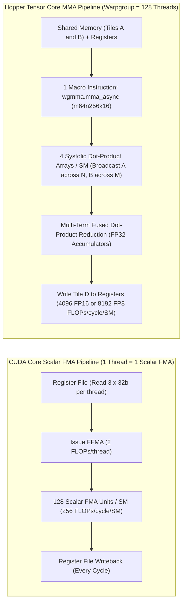
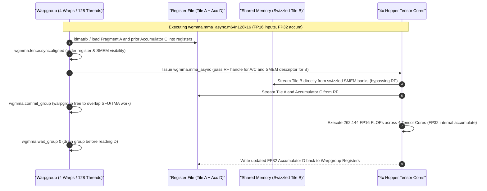

# 03 — Compute Units: CUDA Cores vs. Tensor Cores

[Stage 2 Index](./README.md) | [Complete Syllabus](../../syllabus.md) | Previous: [02 — GPU Memory Hierarchy](./02-gpu-memory-hierarchy.md) | Next: [04 — Occupancy & Modern Architectures](./04-occupancy-and-modern-architectures.md)

---

This document contrasts the two arithmetic engines inside every NVIDIA GPU—scalar CUDA Cores and matrix-oriented Tensor Cores—and explains the low-precision numeric formats that power modern LLM inference. Understanding how these units process data and accumulate partial sums is key to maximizing throughput without sacrificing model accuracy.

## Core Concepts & Terminology

Every technical term, acronym, hardware unit, and numeric format used in this guide is defined below in dependency order:

* **SM (Streaming Multiprocessor), SM Sub-Partition, Warp, & Warpgroup:** An **SM** is an independent processing complex inside a GPU (divided into 4 **SM Sub-Partitions**). A **Warp** is 32 threads executing together; a **Warpgroup** (introduced in Hopper) is 4 consecutive warps (**128 threads**) acting as a single collective unit across all 4 sub-partitions.
* **Thread Block (CTA) & Register File / Shared Memory (SMEM):** A **CTA (Cooperative Thread Array)** is a Thread Block running on an SM. The **Register File** is the fastest per-SM storage for 32-bit values; **Shared Memory (SMEM)** is fast on-chip SRAM scratchpad memory shared by threads in a CTA.
* **ALU & CUDA Core:** An **ALU (Arithmetic Logic Unit)** performs basic math and logic. **CUDA Cores** are the SM's scalar ALU pipelines, executing one instruction per thread per cycle (for example, `FFMA`, **Fused Multiply-Add / FMA**, computing $d = a \times b + c$).
* **FLOP, FLOP/s, TFLOPS, PFLOPS, & MAC:** A **FLOP** is a single floating-point operation (an FMA counts as 2 FLOPs: one multiply + one add). **TFLOPS** = $10^{12}$ FLOP/s; **PFLOPS** = $10^{15}$ FLOP/s. A **MAC (Multiply-Accumulate)** is one multiply-add pair (2 FLOPs).
* **TDP (Thermal Design Power):** The maximum sustained heat/power (in Watts) a chip is designed to dissipate, which caps sustained boost clock frequencies under heavy load.
* **Tensor Core, MMA, & GEMM:** **Tensor Cores** are dedicated matrix-math hardware engines that execute **MMA (Matrix Multiply-Accumulate)**—computing $D_{M \times N} = A_{M \times K} \times B_{K \times N} + C_{M \times N}$ ($2MNK$ FLOPs) in one macro-instruction. **GEMM** is dense matrix-matrix multiplication.
* **Von Neumann / Register-File Bottleneck & Systolic Array:** The **Von Neumann / Register-File Bottleneck** occurs when scalar cores spend more bandwidth fetching/writing register operands than doing math. Tensor Cores use **systolic-style dot-product arrays** that load matrix tiles once and broadcast them across multipliers, turning $O(MK + KN)$ bytes read into $O(MNK)$ MACs.
* **2:4 Structured Sparsity:** A hardware acceleration mode where at least 2 out of every 4 contiguous weights are zero, allowing Tensor Cores to skip zeros and double throughput.
* **PTX Matrix Instructions (`mma.sync`, `ldmatrix`, `wgmma.mma_async`, `tcgen05.mma`) & TMEM:**
  * **`mma.sync`** (Ampere): Warp-level (32 threads) synchronous MMA using general-purpose registers, typically loaded from SMEM via **`ldmatrix`** (a bank-conflict-free matrix load).
  * **`wgmma.mma_async`** (Hopper): Warpgroup-level (128 threads) asynchronous MMA that reads matrix $B$ (and optionally $A$) directly from swizzled SMEM via a 64-bit **matrix descriptor (`smem_desc`)**, managed with `wgmma.fence`, `wgmma.commit_group`, and `wgmma.wait_group`.
  * **`tcgen05.mma` & TMEM (Tensor Memory)** (Blackwell): Single-thread-issued 5th-gen MMA using **TMEM**—256 KB of dedicated matrix accumulator memory per SM separate from the register file—and supporting **2-CTA cooperative MMA** across paired SMs.
* **Floating-Point Anatomy (Sign, Exponent, Mantissa/Significand, Bias, Subnormal, Binade, `Inf`/`NaN`, ULP):**
  * A floating-point number encodes $1$ **Sign ($S$)** bit, $E$ **Exponent** bits (shifted by an **Exponent Bias** $b$), and $M$ **Mantissa (significand)** fraction bits.
  * **Subnormal** numbers represent tiny values near zero with reduced precision; a **binade** is one power-of-2 interval $[2^k, 2^{k+1})$.
  * **`Inf` / `NaN`** are special bit patterns for Infinity and Not-a-Number.
  * **ULP (Unit in the Last Place)** is the gap between two adjacent representable numbers; **Swamping (Absorption)** happens when a large running sum's ULP exceeds small incoming terms, rounding them to zero.
  * **Mixed-Precision Accumulation & Epilogue:** Multiplying low-precision inputs and summing into high-precision **FP32 accumulators**, downcasting only in the **epilogue** (final output step).
* **Low-Precision Formats (`FP32`, `FP16`, `BF16`, `INT8`, `FP8 E4M3/E5M2`, `FP4 E2M1`, `MXFP4`, `NVFP4`, `W4A4`):**
  * **FP32** `(1,8,23)` and **FP16** `(1,5,10)` are IEEE 32-bit and 16-bit floats; **BF16 (Brain Float 16)** `(1,8,7)` trades mantissa bits for FP32's wide dynamic range. **INT8** is 8-bit integer.
  * **FP8 (`E4M3` & `E5M2`, OFP8 standard):** 8-bit floats; `E4M3` omits `Inf` for extra precision (ideal for inference), while `E5M2` keeps `Inf` and wider range (for gradients/outliers).
  * **FP4 (`E2M1`), MXFP4, & NVFP4:** 4-bit float (`E2M1`) has only 16 bit patterns; **Microscaling** shares one scale factor per block of elements—**MXFP4** (OCP standard: 32 elements + 8-bit `E8M0` power-of-2 scale) and **NVFP4** (Blackwell: 16 elements + `E4M3` scale). **W4A4** means 4-bit weights and 4-bit activations.
* **LLM Inference Terms:** **Transformer Linear Layers (`QKV`, `O`, `FFN`)**, **Activations (`SiLU`, `GELU`)**, **`RMSNorm`**, **`Softmax` (`exp2`, `rcp`)**, **RoPE**, **KV Cache**, **Perplexity** (a text-prediction quality metric; lower is better), and **DeepSeek-V3** (an open-weight model whose training/inference analysis highlighted Hopper's ~14-bit FP8 intermediate accumulation width).

---

## 1. CUDA Cores vs. Tensor Cores: Architectural Divide

Every Streaming Multiprocessor (SM) contains two fundamentally distinct classes of arithmetic hardware:

1. **CUDA Cores (Scalar ALU Pipelines — FP32, INT32, FP64):**
   Execute one scalar instruction per thread lane per cycle—typically **FMA (Fused Multiply-Add)** `FFMA`:
   $$d = a \times b + c \quad (2\text{ FLOPs per instruction})$$
   Used for address calculation, loop control, elementwise activations (`SiLU`, `GELU`), `RMSNorm`, `Softmax` (`exp2`, `rcp`), RoPE trigonometry, and sampling.
   * **Hopper H100 SXM5 Counts:** $128$ FP32 cores, $64$ INT32 cores, and $64$ FP64 cores per SM ($16,896$ FP32 cores across $132$ SMs).
   * **H100 FP32 Peak:** $132\text{ SMs} \times 128\text{ cores} \times 2\text{ FLOPs/cycle} \times 1.98\text{ GHz} \approx \mathbf{67\text{ TFLOPS}}$.

2. **Tensor Cores (Matrix Multiply-Accumulate Units — MMA):**
   Dedicated hardware matrix engines executing a block **Matrix Multiply-Accumulate** operation in a single macro-instruction:
   $$D_{M \times N} = A_{M \times K} \times B_{K \times N} + C_{M \times N} \quad (2MNK\text{ FLOPs})$$
   * **Hopper H100 SXM5 Counts:** $4$ **4th-Generation Tensor Cores** per SM ($1$ per SM sub-partition = $528$ Tensor Cores total).
   * **H100 Dense Peaks:** **$989\text{ TFLOPS}$** (FP16/BF16), **$1979\text{ TFLOPS}$** (FP8/INT8); **$2\times$** higher with 2:4 structured sparsity.
   * **Blackwell B200 Dense Peaks (5th-Gen Tensor Cores):** **$2250\text{ TFLOPS}$** (BF16/FP16), **$4500\text{ TFLOPS}$** (FP8), **$9000\text{ TFLOPS}$** (FP4/MXFP4).

### Why Tensor Cores Deliver $15\times$–$30\times+$ More FLOPs than CUDA Cores

A naive scalar FP32 CUDA Core executing a $16 \times 16 \times 16$ GEMM ($2 \times 16^3 = 8192$ FLOPs) must issue $4096$ `FFMA` instructions, reading $3 \times 4096 = 12,288$ register operands and writing $4096$ results back to the register file—**saturating instruction issue bandwidth and register file read ports** before compute can scale.

Tensor Cores break this **Von Neumann / Register-File Bottleneck** via spatial hardware dataflow (dot-product trees / systolic-style array datapaths):
1. **Hardware Operand Reuse:** Matrix tiles $A_{M \times K}$ and $B_{K \times N}$ are loaded *once* into internal Tensor Core operand buffers and broadcast horizontally/vertically across an array of multiplier-adder trees. Reading $O(MK + KN)$ bytes triggers $O(MNK)$ MAC operations.
2. **Reduced Control Overhead:** A single Hopper `wgmma` instruction (`m64n256k16`) triggers $2 \times 64 \times 256 \times 16 = \mathbf{524,288\text{ FLOPs}}$ from **one** instruction fetch/decode across a warpgroup!
3. **Lower-Bitwidth Silicon Area Scaling:** Multiplying two $b$-bit mantissas requires an $O(b^2)$ integer multiplier array. Shrinking FP32 (24-bit significand) $\to$ FP16 (11-bit) $\to$ FP8 (4-bit) $\to$ FP4 (2-bit) shrinks multiplier area quadratically, packing $16\times$–$64\times$ more MACs into the same die area and power envelope.

| Metric (per SM per Clock Cycle on H100) | FP32 CUDA Cores | FP16/BF16 Tensor Cores (4th-Gen) | FP8 Tensor Cores (4th-Gen) |
| :--- | :---: | :---: | :---: |
| **Units per SM** | $128$ scalar cores | $4$ Tensor Cores | $4$ Tensor Cores |
| **FMA Ops / SM / Cycle** | $128$ | $2,048$ ($512$ per TC) | $4,096$ ($1,024$ per TC) |
| **FLOPs / SM / Cycle** | $256$ | $4,096$ | $8,192$ |
| **Per-Cycle Ratio vs. FP32 CUDA Core** | $1\times$ | **$16\times$** | **$32\times$** |
| **H100 SXM5 System Peak (Dense)** | $67\text{ TFLOPS}$ | $989\text{ TFLOPS}$ ($14.8\times$) | $1,979\text{ TFLOPS}$ ($29.5\times$) |

*(Note: System peak ratio is slightly below $16\times$/$32\times$ because Tensor Core sustained boost clock on H100 SXM5 is $\sim 1.83\text{ GHz}$ vs. $1.98\text{ GHz}$ max FP32 clock under TDP).*



---

## 2. Matrix Instructions & Operand Layouts (`mma.sync`, `wgmma`, `tcgen05`)

Programming Tensor Cores evolved across three PTX instruction generations:

### 1. Ampere Warp-Level Synchronous MMA (`mma.sync`)
* **Scope:** $1$ Warp ($32$ threads) synchronously executes a small tile such as `mma.sync.aligned.m16n8k16.f32.f16.f16.f32`.
* **Operand Layout:** All $32$ threads cooperatively hold fragments of $A$ ($16 \times 16$), $B$ ($16 \times 8$), and $C/D$ ($16 \times 8$) inside their **general-purpose registers**.
  * Thread $t \in [0, 31]$ holds specific non-contiguous elements mapped by `(groupID = t / 4, threadID_in_group = t % 4)`.
  * Software typically uses `ldmatrix.sync.aligned.m8n8.x4.shared.b16` to load $4$ $8 \times 8$ sub-tiles from Shared Memory directly into the exact distributed register layout expected by `mma.sync` without bank conflicts.
* **Limitation:** Staging both $A$ and $B$ from Shared Memory into Registers consumes massive register bandwidth and register file capacity, limiting tile size $N$ and starving occupancy.

### 2. Hopper Warpgroup Asynchronous MMA (`wgmma.mma_async`)
* **Scope:** $1$ **Warpgroup** = **$4$ consecutive warps ($128$ threads)** working as a single collective unit across all $4$ SM sub-partitions simultaneously!
* **Direct Shared Memory Operands:** `wgmma` reads matrix $B$ (and optionally matrix $A$) **directly from Shared Memory** via 64-bit matrix descriptors (`smem_desc`, specifying base address, leading dimension, and swizzle mode: `128B`, `64B`, `32B`, or `none`)—completely bypassing the register file for matrix $B$!
* **Tile Shapes:** `m64nNk16` for FP16/BF16 (where $N \in \{8, 16, \dots, 256\}$) and `m64nNk32` for FP8.
* **Asynchronous Pipelining:** `wgmma` executes asynchronously in the background via hardware groups:
  ```text
  wgmma.fence.sync.aligned;                  // Ensure prior register/SMEM writes visible
  wgmma.mma_async.sync.aligned.m64n128k16... // Issue async matrix multiply
  wgmma.commit_group.sync.aligned;           // Seal batch of issued wgmma ops
  wgmma.wait_group.sync.aligned 0;           // Wait until <= 0 groups remain in flight
  ```

### 3. Blackwell 5th-Gen MMA (`tcgen05.mma` + Tensor Memory)
* **TMEM (Tensor Memory):** Blackwell adds **$256\text{ KB}$ of dedicated Tensor Memory per SM** separate from the $256\text{ KB}$ general-purpose register file. `tcgen05.mma` writes accumulators $D$ directly to TMEM and reads $A/B$ from SMEM or TMEM, issued by a **single thread** (no 128-thread warpgroup synchronization overhead!) and even supporting **2-CTA cooperative MMA** across paired SMs in a cluster.



---

## 3. Accumulation Precision & Hardware Rounding Subtleties

In Transformer linear layers (`QKV`, `O`, `FFN`), inner dimensions $K$ range from $4096$ to $16384+$. Computing dot products of length $K$ entirely in low precision causes severe numerical failure:

1. **Swamping (Absorption):** In FP16 (10 mantissa bits, unit roundoff $\epsilon \approx 2^{-11} \approx 4.88 \times 10^{-4}$), once a running partial sum reaches $S = 2048$, its ULP (Unit in the Last Place) becomes $2048 \times 2^{-10} = 2.0$. Any subsequent product $< 1.0$ rounds completely to zero and disappears!
2. **Overflow:** FP16 saturates at $\pm 65,504$; summing thousands of positive products easily overflows to `Inf`/`NaN`.

**Hardware Solution — Mixed-Precision Accumulation:**
Tensor Cores multiply low-precision inputs ($A_{\text{FP16/BF16/FP8}} \times B_{\text{FP16/BF16/FP8}}$) and accumulate into **FP32 accumulators** (24-bit significand, max $\sim 3.4 \times 10^{38}$), returning FP32 $D$ (which is only downcast to BF16/FP8 at the epilogue after bias/residual/activation fusion).

> **Important Hopper FP8 Accumulation Caveat:** While Hopper's `wgmma` for FP8 exposes an `f32` accumulator output to software, hardware engineers (and empirical benchmarks such as DeepSeek-V3) discovered that Hopper's FP8 Tensor Core internal dot-product adder tree uses **reduced intermediate mantissa width (~14 bits / ~FP22-equivalent precision)** during the $K=32$ reduction step before promoting to FP32! Over very long $K$ accumulations, this introduces subtle ~14-bit rounding drift unless software periodically promotes intermediate partial sums to true FP32 CUDA-core registers every $K_{\text{block}} = 128$ elements. Blackwell's 5th-gen Tensor Cores restore full-precision accumulation paths.

---

## 4. Low-Precision Floating-Point Formats (FP16, BF16, FP8, FP4)

Every IEEE-like floating-point format encodes a value using $1$ Sign bit ($S$), $E$ Exponent bits (with bias $b = 2^{E-1}-1$), and $M$ Mantissa (fraction) bits:

$$\text{Normal Value} = (-1)^S \times 2^{\text{exp} - b} \times \left(1 + \frac{\text{mant}}{2^M}\right)$$

| Format | Layout `(S, E, M)` | Exp Bias | Max Finite Value | Smallest Normal | Precision (Mantissa) | Primary Role in LLM Inference |
| :--- | :---: | :---: | :---: | :---: | :--- | :--- |
| **FP32** | `(1, 8, 23)` | $127$ | $3.40 \times 10^{38}$ | $1.18 \times 10^{-38}$ | $\sim 7$ decimal digits | Master accumulators, Softmax/LayerNorm statistics, RoPE angles |
| **FP16** | `(1, 5, 10)` | $15$ | **$65,504$** | $6.10 \times 10^{-5}$ | $\sim 3.3$ decimal digits | Legacy weights/activations (prone to overflow without scaling) |
| **BF16** | `(1, 8, 7)` | $127$ | **$3.39 \times 10^{38}$** | $1.18 \times 10^{-38}$ | $\sim 2.4$ decimal digits | Default LLM weights & activations (FP32 dynamic range, 2x smaller) |
| **FP8 E4M3** | `(1, 4, 3)` | $7$ | **$448$** (no `Inf`) | $2^{-6} = 0.015625$ | $8$ steps per binade | **Forward-pass weights, activations, & KV cache** (higher precision) |
| **FP8 E5M2** | `(1, 5, 2)` | $15$ | **$57,344$** (has `Inf`) | $2^{-14} \approx 6.1 \times 10^{-5}$ | $4$ steps per binade | Gradients & extreme outlier tensors (FP16 range, low precision) |
| **FP4 (E2M1)** | `(1, 2, 1)` | $1$ | **$6.0$** (no `Inf`/`NaN`) | $1.0$ (subnormal `0.5`) | $2$ steps per binade | Weight-only or **Block-Scaled (MXFP4/NVFP4)** W4A4 inference |

### FP8: E4M3 vs. E5M2 Design Trade-offs
* **E4M3 (`1.4.3`):** To recover extra dynamic range despite having only 4 exponent bits, the OFP8 standard **omits `Inf`** and reserves only the single max code `S.1111.111` for `NaN`. Consequently, `S.1111.110` represents $\pm 2^{(15-7)} \times (1 + 6/8) = \pm 256 \times 1.75 = \mathbf{\pm 448}$! Because LLM inference does not compute gradients, avoiding `Inf` and maximizing mantissa bits ($3$ bits) makes **E4M3** the universal standard for FP8 weights, activations, and FP8 KV Cache.
* **E5M2 (`1.5.2`):** Follows standard IEEE `Inf`/`NaN` rules (`exp = 31` reserved), yielding $\pm 57,344$ max range at the cost of only $2$ mantissa bits ($25\%$ relative quantization step size). Used primarily in training gradients or rare layers with massive activation spikes.

### FP4 (E2M1) & Microscaling (MXFP4 / NVFP4)
A raw 4-bit `E2M1` value has only $16$ bit patterns total—encoding strictly the $8$ positive magnitudes:
$$\{0,\; 0.5,\; 1.0,\; 1.5,\; 2.0,\; 3.0,\; 4.0,\; 6.0\}$$
and their negatives. Applying a single per-tensor scale to FP4 destroys model perplexity because outlier channels crush 99% of weights into `0` or `0.5`.

Modern silicon solves this in hardware via **Microscaling (Block-Scaled FP4)**:
1. **MXFP4 (OCP Microscaling Standard, Blackwell 5th-Gen Tensor Core):**
   * Groups every **$32$ consecutive FP4 elements** along the $K$ reduction dimension with one shared **8-bit `E8M0` scale factor** (a pure power of two $2^{e-127}$, 0 mantissa bits).
   * Effective memory footprint: $4 + \frac{8}{32} = \mathbf{4.25\text{ bits/element}}$.
2. **NVFP4 (NVIDIA Blackwell Proprietary Microscaling):**
   * Uses a tighter **$16$-element block size** paired with an **FP8 `E4M3` scale factor** (allowing fine-grained fractional scaling rather than coarse powers of 2), plus a secondary FP32 per-tensor scale.
   * Effective memory footprint: $4 + \frac{8}{16} = \mathbf{4.5\text{ bits/element}}$.
   * The Tensor Core reads the FP4 values and their block scales directly in hardware, applying the scale *inside* the inner $K$-dot-product loop—delivering **$2\times$ the throughput of FP8 ($9\text{ PFLOPS}$ dense on B200)** and **$2\times$ HBM bandwidth compression** with near-BF16 accuracy.

---

[Stage 2 Index](./README.md) | [Complete Syllabus](../../syllabus.md) | Previous: [02 — GPU Memory Hierarchy](./02-gpu-memory-hierarchy.md) | Next: [04 — Occupancy & Modern Architectures](./04-occupancy-and-modern-architectures.md)
