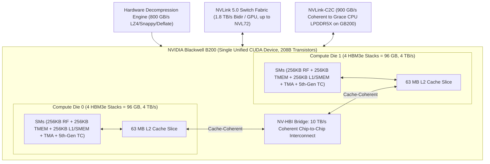
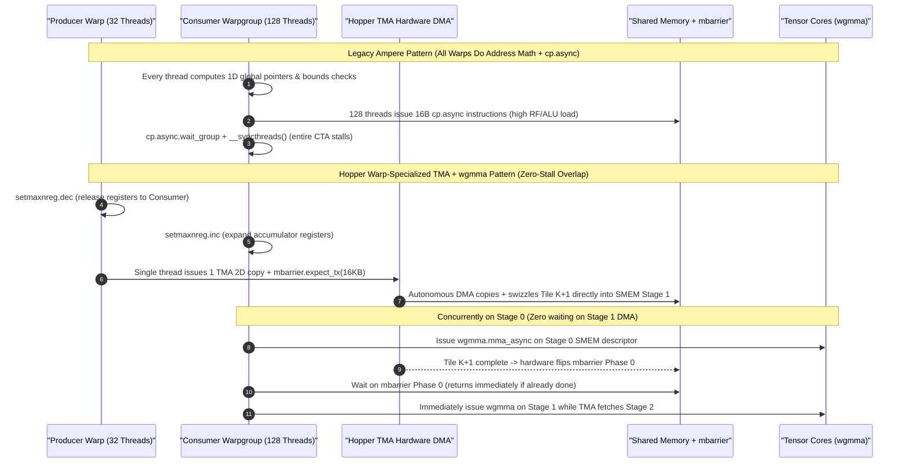

# 04 — Occupancy & Modern Architectures (Hopper & Blackwell)

[Stage 2 Index](./README.md) | [Complete Syllabus](../../syllabus.md) | Previous: [03 — Compute Units: CUDA Cores vs. Tensor Cores](./03-compute-units-cuda-vs-tensor-cores.md) | Next: [05 — Hardware Telemetry](./05-hardware-telemetry.md)

---

## 1. SM Occupancy: Theory, Limiters, and Reality

**SM Occupancy** is the ratio of active warps resident on an SM to the architectural maximum number of resident warps supported by that SM:

$$\text{Theoretical Occupancy} = \frac{\text{Resident Warps per SM}}{\text{Max Warps per SM}}$$

On Ampere (A100), Hopper (H100/H200), and Blackwell (B200), the maximum is **$64$ warps ($2048$ threads) per SM** (on Ada Lovelace L40S / cc 8.9, the maximum is **$48$ warps / $1536$ threads**).

### Hardware Resource Limiters (Theoretical Occupancy)

When the GigaThread Engine schedules Thread Blocks (CTAs) onto an SM, the maximum number of CTAs that can co-reside simultaneously on one SM is the **minimum** of four independent hardware constraints:

$$\text{CTAs/SM} = \min\!\left(\text{Max CTAs/SM},\; \left\lfloor \frac{\text{Max Warps/SM}}{\text{Warps/CTA}} \right\rfloor,\; \left\lfloor \frac{\text{Regs/SM}}{\text{Regs/CTA}} \right\rfloor,\; \left\lfloor \frac{\text{SMEM/SM}}{\text{SMEM/CTA}} \right\rfloor\right)$$

Concrete Hopper (H100) limits per SM:
1. **Block Slot Limit:** Max **$32$ CTAs/SM**. (A tiny 1-warp CTA still caps at $32$ warps/SM $= 50\%$ occupancy because block slots run out at $32$!).
2. **Warp Slot Limit:** Max **$64$ warps/SM** (e.g., if `blockDim = 256` = $8$ warps, max $8$ CTAs/SM).
3. **Register File Limit:** **$65,536$ 32-bit registers/SM**.
   * *Worked Example:* Suppose a FlashAttention kernel uses $256$ threads/CTA ($8$ warps) and compiles to $96$ registers/thread.
   * Registers per warp = $96 \times 32 = 3072$ (aligned to 256-reg granularity $\to 3072$).
   * Registers per CTA = $8 \times 3072 = 24,576$ registers.
   * $\lfloor 65536 / 24576 \rfloor = \mathbf{2\text{ CTAs/SM}} \implies 16\text{ warps/SM} \implies \mathbf{25\%\text{ Theoretical Occupancy}}$.
   * *Cliff Effect:* Using just **$129$ registers/thread** jumps CTA usage to $8 \times (136 \times 32) = 34,816$ registers $\implies$ only **$1\text{ CTA/SM}$ ($12.5\%$ occupancy)**!
4. **Shared Memory Limit:** Max **$228\text{ KB}$ ($233,472\text{ B}$) SMEM/SM** on H100.
   * *Worked Example:* A CUTLASS GEMM kernel allocates **$120\text{ KB}$** of SMEM per CTA for multi-stage double-buffered $A/B$ tiles. Even if it uses only $16$ registers/thread, $\lfloor 228 / 120 \rfloor = \mathbf{1\text{ CTA/SM}}$.

### Theoretical vs. Achieved Occupancy

**Achieved Occupancy** (measured empirically via hardware counters, e.g., DCGM `sm_occupancy` or Nsight Compute `sm__warps_active.avg.pct_of_peak_sustained_active`) is strictly $\le$ Theoretical Occupancy due to runtime dynamics:
1. **Wave Quantization / Tail Effect:** If a grid launches $150$ CTAs on $132$ SMs (with $1$ CTA/SM capacity), Wave 1 achieves $100\%$ of theoretical occupancy across all $132$ SMs, while Wave 2 runs $18$ CTAs on $18$ SMs and leaves $114$ SMs completely empty ($0\%$ occupancy), dragging time-averaged achieved occupancy down to $\sim 57\%$ of theoretical!
2. **Intra-CTA Barrier Skew (`__syncthreads()`):** Warps that reach `exit` or wait at barriers remain resident—keeping SMEM/registers locked—until the slowest warp in the CTA finishes.
3. **Small Grid Size:** Decode at `batch_size = 1` with unsplit KV heads might launch only $32$ CTAs onto $132$ SMs ($\le 24\%$ SM coverage regardless of block size).

---

## 2. Why 100% Occupancy Is NOT Required: Little's Law for Latency Hiding

A persistent myth in CUDA programming is that higher occupancy always equals higher performance. In reality, **occupancy is only a means to hide pipeline latency**, governed by **Little's Law**:

$$L = \lambda \times W$$

Where:
* $L$ = required **concurrency** (in-flight operations or bytes per SM) to keep the hardware pipeline 100% busy,
* $\lambda$ = peak hardware **issue rate / throughput** per SM,
* $W$ = hardware **pipeline latency** (cycles).

### Quantitative Proof 1: Compute-Bound Tensor Core GEMM (H100)
* Latency of a `wgmma` pipe is $\sim 16$–$32$ cycles, and each sub-partition has $1$ Tensor Core capable of accepting $1$ macro-instruction every few cycles.
* With just **$1$ warpgroup ($4$ warps = $6.25\%$ occupancy)** issuing back-to-back independent `wgmma` instructions (or **$2$ warpgroups = $8$ warps = $12.5\%$ occupancy**), the Tensor Core pipeline is $100\%$ saturated!
* High-performance CUTLASS / FlashAttention-3 kernels deliberately target **$25\%$–$50\%$ occupancy** ($16$–$32$ warps/SM) so each thread can hold large $64 \times 128$ FP32 accumulator tiles in **registers** (up to $200+$ registers/thread) and deep multi-stage pipeline buffers in **Shared Memory** (up to $228\text{ KB}$/SM) without spilling to Local Memory.

### Quantitative Proof 2: Memory-Bandwidth-Bound Decode (H100)
* H100 Peak HBM3 Bandwidth = $3.35\text{ TB/s}$ across $132$ SMs $\implies \mathbf{25.38\text{ GB/s per SM}}$.
* At $1.83\text{ GHz}$ clock, $\lambda = \frac{25.38\text{ GB/s}}{1.83\text{ GHz}} \approx \mathbf{13.9\text{ bytes/cycle per SM}}$.
* HBM3 round-trip latency $W \approx 400\text{ ns} \approx \mathbf{732\text{ cycles}}$.
* By Little's Law, bytes required in flight per SM to completely saturate HBM3:
  $$L = 13.9\text{ B/cycle} \times 732\text{ cycles} \approx \mathbf{10.17\text{ KB per SM}}$$
* If each warp issues a single vectorized `float4` (`LDG.E.128`) load, $1$ warp puts $32 \times 16\text{ B} = \mathbf{512\text{ bytes}}$ in flight. Thus, $10,170 / 512 \approx \mathbf{20\text{ warps/SM}}$ (**$31.25\%$ occupancy**) saturates HBM3! Even better, if each thread issues **$4$ independent `float4` loads** before computing (**ILP = 4** via loop unrolling), just **$5$–$8$ warps/SM ($\sim 12.5\%$ occupancy)** keeps $10+\text{ KB}$ in flight per SM!

---

## 3. NVIDIA Hopper Architecture (H100 / H200)

Hopper (Compute Capability `9.0`, TSMC 4N, $80\text{B}$ transistors) introduced four hardware primitives specifically engineered to break Transformer prefill/decode bottlenecks:

### 1. TMA (Tensor Memory Accelerator)
Prior to Hopper (Ampere `cp.async`), every thread in a warp had to compute its own 1D global pointer offset, check tensor boundary conditions (`if (row < M && col < N)`), and issue individual 16-byte `cp.async.cg` instructions—burning registers, ALU cycles, and LSU issue slots.

Hopper's **TMA** is a dedicated **hardware DMA engine inside each SM**:
* **Single-Thread Issue:** A **single thread** (leader thread of a producer warp) executes `cp.async.bulk.tensor.2d.shared::cluster.global` passing only a 64-byte **Tensor Map (`CUtensorMap`)** descriptor and $(x, y, z, \dots)$ coordinates (up to 5D tensors).
* **Autonomous Hardware Execution:** TMA autonomously computes all multi-dimensional strides, clips out-of-bounds elements to zero, applies **Shared Memory swizzling** (`128B`/`64B`/`32B`) on the fly to prevent bank conflicts, and copies an entire tile (e.g., $64 \times 128$ FP16 = $16\text{ KB}$) directly from HBM/L2 into Shared Memory with **zero register consumption**!
* **TMA Multicast:** Within a Thread Block Cluster, a single TMA read from HBM/L2 can **multicast** identical matrix tiles (e.g., weight tile $B$ reused across batch rows) to the Shared Memory of *multiple SMs simultaneously*, slashing L2/HBM read traffic.
* **Asynchronous Barriers (`mbarrier`):** Instead of blocking an entire CTA with `__syncthreads()`, TMA increments hardware **transaction bytes** on an `mbarrier` object in Shared Memory and clears the barrier phase automatically once the exact byte count lands in SRAM.

### 2. Warp Specialization (Producer-Consumer Dataflow)
Combining TMA + `mbarrier` + `wgmma`, Hopper kernels (e.g., **FlashAttention-3**, **CUTLASS 3.x**) decouple warps inside a CTA into specialized roles:
* **Producer Warpgroup (1 warp / 1 warpgroup):** Continuously issues TMA loads into a circular Shared Memory ring buffer (`Stages 0..3`) and frees register budget via `setmaxnreg.dec.sync` (down to e.g. $24$–$40$ regs/thread!).
* **Consumer Warpgroup(s) (1–2 warpgroups):** Reclaim the freed registers via `setmaxnreg.inc.sync` (up to $232$–$240$ regs/thread!), wait on `mbarrier`, execute `wgmma.mma_async` directly on SMEM tiles, and overlap Softmax/epilogue math with the next TMA load.

### 3. Thread Block Clusters & Distributed Shared Memory (DSMEM)
Hopper inserts a new level in the CUDA hierarchy between Grid and Block: the **Thread Block Cluster** (typically $2, 4, 8,$ up to $16$ CTAs).
* Hardware guarantees all CTAs in a Cluster execute **simultaneously** on SMs within the same **GPC (Graphics Processing Cluster)**, connected by a dedicated **SM-to-SM network**.
* Threads in CTA $0$ can directly load, store, and perform hardware atomics inside CTA $1$'s Shared Memory via **DSMEM** (`mapa.shared::cluster`) without ever touching L2 or HBM! Crucial for cross-SM reductions (e.g., Split-K GEMM epilogues, LayerNorm, or Ring-based FlashAttention reductions).

### 4. Transformer Engine & NVLink 4.0
* **Transformer Engine:** Hardware/software system (`amax` history tracking + dynamic scale factors) enabling seamless FP8 (`E4M3`/`E5M2`) execution with automatic fallback/rescaling per layer.
* **NVLink 4.0:** $18$ links per H100 SXM5 $\times$ $50\text{ GB/s}$ bidirectional = **$900\text{ GB/s}$** GPU-to-GPU interconnect (450 GB/s each direction), essential for low-latency Tensor Parallel `AllReduce` during decode.

---

## 4. NVIDIA Blackwell Architecture (B200 / GB200)

Blackwell (Compute Capability `10.0`, TSMC 4NP, $208\text{B}$ transistors) moves past single-die reticle limits ($\sim 858\text{ mm}^2$) via a **coherent dual-die chiplet architecture**:

### 1. Dual-Die Chiplet & 10 TB/s NV-HBI
* **Reticle-Limit Solution:** Blackwell bonds **two full-reticle compute dies** side-by-side over an ultra-dense silicon interposer bridge called **NV-HBI (NVIDIA High-Bandwidth Interface)**.
* **10 TB/s Coherent Interconnect:** NV-HBI provides **$10\text{ TB/s}$** of chip-to-chip bandwidth—exceeding the $8.0\text{ TB/s}$ HBM3e bandwidth—maintaining full **cache coherency across the unified 126 MB L2 cache**. To CUDA software, Kubernetes, and NCCL, B200 appears as **one single monolithic GPU** (zero programmer NUMA management required between the two dies).

### 2. 5th-Generation Tensor Cores, TMEM, & Native MXFP4/NVFP4
* **Native Microscaled FP4 (MXFP4 / NVFP4):** Hardware support for block-scaled FP4 (`E2M1` + per-16 `E4M3` or per-32 `E8M0` scale factors) directly inside the Tensor Core pipeline, delivering **$9\text{ PFLOPS}$ dense ($18\text{ PFLOPS}$ sparse)** per B200—$4.5\times$ Hopper's FP8 dense peak ($1.98\text{ PFLOPS}$).
* **TMEM (Tensor Memory — 256 KB/SM):** Dedicated matrix accumulator memory separate from general-purpose registers, removing register pressure during massive $128 \times 256$ MMA tiles and enabling **2-CTA cooperative `tcgen05.mma`** where two SMs share operands over DSMEM.

### 3. NVLink 5.0, NVLink-C2C, & Decompression Engine
* **NVLink 5.0:** $18$ links $\times$ $100\text{ GB/s}$ = **$1.8\text{ TB/s}$** bidirectional per GPU ($2\times$ Hopper), scaling to 72-GPU NVLink domains (**NVL72**) providing $130\text{ TB/s}$ aggregate fabric for massive MoE Expert Parallelism (`AllToAll`).
* **NVLink-C2C (Grace Blackwell GB200):** Coherent **$900\text{ GB/s}$** bidirectional chip-to-chip link connecting two Blackwell GPUs to an NVIDIA **Grace ARM CPU** (with up to $480\text{ GB}$ LPDDR5X). Allows Blackwell SMs to access CPU memory at high bandwidth over unified virtual addressing—transforming CPU-offloaded KV cache and cold-start weight streaming.
* **Hardware Decompression Engine:** Dedicated silicon unit decompressing LZ4, Snappy, and Deflate formats at up to **$800\text{ GB/s}$** directly into HBM/L2, accelerating checkpoint loading and compressed KV/RAG data pipelines.

---

## 5. `cp.async` (Ampere) vs. Hopper TMA Warp-Specialized Data Movement

---

[Stage 2 Index](./README.md) | [Complete Syllabus](../../syllabus.md) | Previous: [03 — Compute Units: CUDA Cores vs. Tensor Cores](./03-compute-units-cuda-vs-tensor-cores.md) | Next: [05 — Hardware Telemetry](./05-hardware-telemetry.md)
