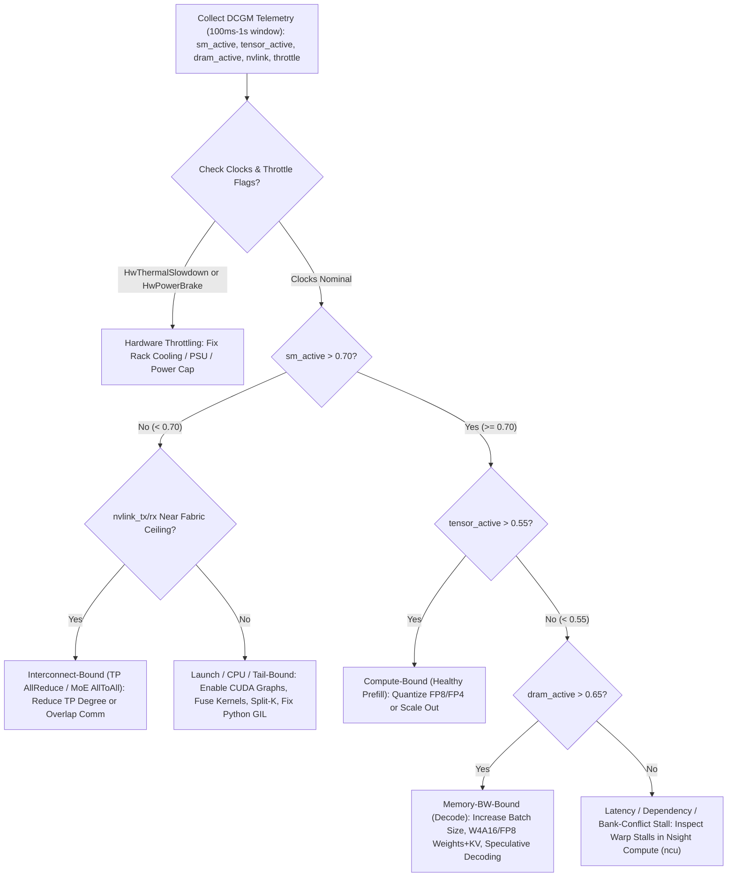
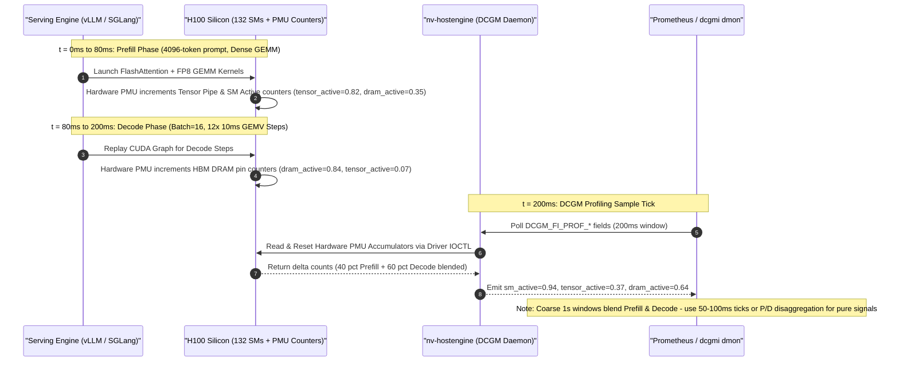

# 05 — Hardware Telemetry (`nvidia-smi` & DCGM)

[Stage 2 Index](./README.md) | [Complete Syllabus](../../syllabus.md) | Previous: [04 — Occupancy & Modern Architectures](./04-occupancy-and-modern-architectures.md)

---

This document explains how to measure what a GPU is actually doing in production, why common surface-level metrics can be deeply misleading, and how to diagnose LLM serving bottlenecks from hardware counters. Mastering these telemetry layers prevents wasted GPU capacity and misconfigured autoscaling.

## Core Concepts & Terminology

Every technical term, acronym, hardware counter, and inference concept used in this guide is defined below in dependency order:

* **Telemetry & Monitoring Tiers (`nvidia-smi`, NVML, DCGM, `ncu`):**
  * **NVML (NVIDIA Management Library) & `nvidia-smi`:** A lightweight driver API and CLI (`nvidia-smi dmon`) that polls coarse OS/driver state such as temperature, power, clocks, and whether a kernel is present.
  * **DCGM (Data Center GPU Manager) & `nv-hostengine`:** NVIDIA's production telemetry daemon (`nv-hostengine`) and CLI (`dcgmi dmon`) that samples true silicon activity counters at low overhead (~0.2%–1%), often exported to **Prometheus** (an open-source time-series monitoring system).
  * **Nsight Compute (`ncu`):** An offline kernel profiler that replays kernels to inspect warp stalls, cache hit rates, and **Roofline** (compute vs. memory-bandwidth ceiling) behavior—too slow ($10\times$–$50\times$ slowdown) for live traffic.
* **PMC (Performance Monitoring Counter) / PMU & Driver IOCTL:** Dedicated hardware counters inside SMs, L2, HBM, and NVLink—collectively the **PMU (Performance Monitoring Unit)**—that DCGM reads and resets via an OS **IOCTL** (Input/Output Control system call to the GPU driver).
* **`GPU-Util` (`sm`) vs. DCGM Profiling Fields (`DCP` / `DCGM_FI_PROF_*`):** `GPU-Util` only measures the percentage of time *at least one* kernel is active on the GPU (even a single thread!). True silicon utilization requires DCGM Profiling (`DCP`) counters:
  * **`sm_active`:** Fraction of cycles where $\ge 1$ warp is resident on an SM, averaged across all SMs.
  * **`sm_occupancy`:** Fraction of total warp slots (e.g., 64/SM) occupied across all SMs and cycles.
  * **`tensor_active`:** Fraction of cycles Tensor Core matrix pipes are active.
  * **`dram_active`:** Fraction of theoretical peak HBM read/write bus cycles actively transferring data.
  * **`fp16/fp32/fp64_active`:** Fraction of cycles non-Tensor scalar CUDA Core ALU pipes are active.
* **PCIe Root Complex, H2D, & P2P NVLink:** **PCIe** (Peripheral Component Interconnect Express) is the motherboard bus connecting CPU and GPUs; **H2D** means Host-to-Device memory copy; **P2P (Peer-to-Peer) NVLink** is direct high-speed GPU-to-GPU interconnect bypassing PCIe.
* **TDP, Clocks (`pclk`, `mclk`), Temperatures (`gtemp`, `mtemp`), & Throttling (`nvmlClocksThrottleReasons`):** **TDP** (Thermal Design Power) is the max power budget (700 W on H100 SXM5). `pclk` is SM processor clock; `mclk` is HBM memory clock; `gtemp`/`mtemp` are GPU and HBM temperatures. **Clock Throttling** automatically lowers clocks on power cap (`SwPowerCap`), overheating (`HwThermalSlowdown`), or external **PSU** (Power Supply Unit) emergency signals (`HwPowerBrakeSlowdown`), whereas `SyncBoost` / `ApplicationsClocksSetting` (`nvidia-smi -ac`) locks clocks manually.
* **ECC, SECDED, SBE/DBE, `Xid`, Row Remapping, & RMA:** **ECC (Error-Correcting Code)** protects HBM3/HBM3e against bit flips using **SECDED (Single Error Correction, Double Error Detection)**. An **SBE** (Single-Bit Error) is corrected automatically; a **DBE** (Double-Bit Error) is uncorrectable and triggers fatal **`Xid`** driver errors. **Row Remapping** permanently retires faulty HBM rows at GPU reset; if hardware spares run out, the GPU requires **RMA** (hardware replacement).
* **LLM Inference & Systems Terms:**
  * **Prefill vs. Decode, Chunked Prefill, & P/D Disaggregation:** **Prefill** processes prompt tokens in parallel (**GEMM**: dense matrix-matrix multiply, compute-bound); **Decode** generates one token per step (**GEMV**: matrix-vector multiply at low batch size, memory-bandwidth-bound). **Chunked Prefill** mixes prefill chunks with decode; **P/D Disaggregation** separates prefill and decode onto different GPUs.
  * **TTFT & ITL:** **TTFT** (Time To First Token) is prefill latency; **ITL** (Inter-Token Latency) is time between consecutive decode tokens.
  * **Continuous Batching, Speculative Decoding, & W4A16:** **Continuous Batching** packs active requests dynamically; **Speculative Decoding** verifies multiple draft tokens in one step; **W4A16** uses 4-bit weights with 16-bit activations.
  * **CUDA Graphs, Python GIL, Operator Fusion, & NCCL Collectives:** **CUDA Graphs** replay recorded kernel sequences with minimal CPU overhead; the **Python GIL** (Global Interpreter Lock) can bottleneck CPU-side dispatch; **Operator Fusion** merges small kernels; **NCCL** executes **`AllReduce`** (for **Tensor Parallelism / TP**) and **`AllToAll`** (for **MoE Expert Parallelism / EP**).
  * **Serving Engines & Kernels:** **vLLM / SGLang** (LLM serving frameworks), **FlashAttention**, **RoPE**, **Softmax**, and **Local Memory / 32B sector waste** (covered in Doc 02).

---

## 1. Telemetry Tiers: NVML (`nvidia-smi`) vs. DCGM Profiling Counters

Diagnosing LLM serving bottlenecks in production requires distinguishing **coarse OS/driver presence metrics** from **cycle-accurate silicon Performance Monitoring Counters (PMCs)**:

| Tool / Layer | Underlying Mechanism | Overhead | Key Signals | Blind Spots |
| :--- | :--- | :--- | :--- | :--- |
| **`nvidia-smi dmon`** | NVML (NVIDIA Management Library) polling driver state | Negligible ($\ll 0.1\%$) | `sm` (`GPU-Util`), `mem`, `pwr`, `gtemp`, `mtemp`, `pclk`, `mclk`, `fb`, `rxpci`, `txpci`, `sbecc`, `dbecc` | `GPU-Util` measures *kernel presence*, NOT SM or Tensor saturation; cannot distinguish Prefill vs. Decode saturation. |
| **DCGM (`dcgmi dmon`)** | Hardware PMCs (Performance Monitoring Unit inside SMs, L2, HBM, NVLink) | Very low ($\sim 0.2$–$1\%$ at 100ms–1s sampling) | `sm_active`, `sm_occupancy`, `tensor_active`, `dram_active`, `fp16/fp32`, `nvlink_tx/rx`, `throttle_reasons` | Aggregates across the sampling window (e.g., 100ms–1s); mixes kernels if prefill & decode run back-to-back within one sample. |
| **Nsight Compute (`ncu`)** | Full hardware PMC replay per kernel launch | High ($10\times$–$50\times$ slowdown during capture) | Per-kernel warp stall reasons, L1/L2 hit rates, bank conflicts, Roofline FLOPs/Byte | Offline kernel debugging only; never run in live production traffic. |

---

## 2. The `GPU-Util` Pitfall in `nvidia-smi`

Running `nvidia-smi dmon -s pucvmet -d 1` produces a live table:

```text
# gpu    pwr  gtemp  mtemp     sm    mem    enc    dec   mclk   pclk     fb   rxpci  txpci  sbecc  dbecc
# Idx      W      C      C      %      %      %      %    MHz    MHz     MB    MB/s   MB/s    err    err
    0    310     54     60    100     42      0      0   2619   1830  74210     120     45      0      0
```

**Why `sm = 100%` (`GPU-Util`) Is Dangerous for LLM Engineers:**
In NVML, `GPU-Util` (`sm` column in `dmon`) is defined strictly as:

$$\text{GPU-Util} = \frac{\text{Time during sample window with } \ge 1 \text{ active kernel on GPU}}{\text{Total sample window duration}} \times 100\%$$

* **Pathological Example:** Suppose you launch an unoptimized Python decode loop executing a kernel with `gridDim = 1, blockDim = 1` ($1$ single thread on $1$ of $132$ SMs — **$0.0004\%$ of GPU capacity!**) continuously in a `while` loop. `nvidia-smi` will proudly report **`GPU-Util = 100%`**!
* Conversely, in real LLM Decode at `batch_size = 1`, memory-bound kernels keep at least one kernel active on the GPU $98\%$ of the time (`GPU-Util = 98%`) while Tensor Cores sit $97\%$ idle and power draw hovers at $280\text{ W}$ out of a $700\text{ W}$ TDP!
* Similarly, `mem` (`DCGM_FI_DEV_MEM_COPY_UTIL`) reports the percentage of time a memory read/write transaction occurred—**not** percentage of peak TB/s bandwidth!

**Never autoscale or claim compute efficiency using `nvidia-smi` `GPU-Util`.** Use DCGM hardware profiling counters (`DCP` fields) instead.

---

## 3. Exact Definitions of DCGM Profiling Metrics (`dcgmi dmon`)

Data Center GPU Manager (DCGM) exposes true silicon activity through **Profiling Field IDs** (`1001+`), sampled directly from GPU hardware performance counters via `dcgmi dmon -e 1001,1002,1003,1004,1005,1009,1010,1011,1012 -d 500`:

| Metric Name | DCGM Field ID & Symbol | Exact Hardware Formula | Physical Meaning & Diagnostic Range |
| :--- | :--- | :--- | :--- |
| **`sm_active`** | `1002` (`DCGM_FI_PROF_SM_ACTIVE`) | $\frac{\sum_{i=1}^{N_{\text{SM}}} \text{Cycles}(\ge 1 \text{ warp resident on SM}_i)}{N_{\text{SM}} \times \text{Total Elapsed Cycles}}$ | **Spatial & Temporal SM Coverage.** $< 0.5$ indicates tiny grid sizes (low batch size, wave quantization) or CPU/Python kernel-launch gaps between kernels. |
| **`sm_occupancy`** | `1003` (`DCGM_FI_PROF_SM_OCCUPANCY`) | $\frac{\sum_{i=1}^{N_{\text{SM}}} \text{Sum of Resident Warps on SM}_i}{N_{\text{SM}} \times \text{Max Warps/SM} \times \text{Total Elapsed Cycles}}$ | **Warp Slot Utilization** (normalized to e.g. $64$ warps/SM). Low occupancy ($0.20$–$0.40$) is **healthy** for register-heavy FlashAttention/GEMM, but bad if paired with `stall_long_scoreboard` in simple elementwise kernels. |
| **`tensor_active`** | `1004` (`DCGM_FI_PROF_PIPE_TENSOR_ACTIVE`) | $\frac{\sum_{i=1}^{N_{\text{SM}}} \text{Cycles Tensor Core Pipe Active on SM}_i}{N_{\text{SM}} \times \text{Total Elapsed Cycles}}$ | **Tensor Core Compute Saturation.** $> 0.60$–$0.85$ = Compute-Bound Prefill / Large GEMM. $< 0.15$ during Decode = Memory-Bandwidth-Bound or non-MMA overhead. |
| **`dram_active`** | `1005` (`DCGM_FI_PROF_DRAM_ACTIVE`) | $\frac{\text{Active HBM Read+Write Bus Cycles}}{\text{Theoretical Peak HBM Data Pin Cycles}}$ | **True HBM Bandwidth Utilization.** `0.80` on H100 $= 0.80 \times 3.35\text{ TB/s} \approx 2.68\text{ TB/s}$ sustained! $> 0.65$ with low `tensor_active` = Memory-Bandwidth-Bound Decode. |
| **`fp16/fp32/fp64_active`** | `1006`–`1008` | Ratio of cycles non-Tensor CUDA Core ALU pipes (`FP32`/`FP16`/`FP64`) execute instructions | High `fp32_active` ($>0.30$) alongside low `tensor_active` signals heavy unfused Softmax, RoPE, dequantization, or scalar fallback! |
| **`pcie_tx` / `pcie_rx`** | `1009` / `1010` (`DCGM_FI_PROF_PCIE_*_BYTES`) | Bytes/sec transmitted/received across PCIe Root Complex | Spikes during H2D weight loading, CPU KV-cache offloading, or missing P2P NVLink (falling back to PCIe). |
| **`nvlink_tx` / `nvlink_rx`** | `1011` / `1012` (`DCGM_FI_PROF_NVLINK_*_BYTES`) | Bytes/sec transmitted/received across all active NVLink lanes | Measures Tensor Parallelism (`AllReduce`) and MoE Expert Parallelism (`AllToAll`) fabric saturation (H100 ceiling: $450\text{ GB/s}$ uni / $900\text{ GB/s}$ bi). |

> **Important Normalization Detail:** Notice `sm_active` is $1.0$ if *even 1 warp* is active on every SM, whereas `sm_occupancy` is $1.0$ only if all $64$ warp slots are occupied on every SM for 100% of elapsed cycles. Therefore, **`sm_occupancy` $\le$ `sm_active`** always holds!

---

## 4. Throttling, Clocks, and ECC Reliability Counters

Silicon counters mean nothing if clocks are secretly clamped or HBM is silently retrying bit errors:

### 1. Thermal & Power Throttling (`DCGM_FI_DEV_CLOCK_THROTTLE_REASONS`)
An H100 SXM5 runs at up to **$700\text{ W}$ TDP** ($1830$–$1980\text{ MHz}$ SM boost clock) and throttles around **$83$–$85^\circ\text{C}$** GPU temperature (`gtemp`) or **$95^\circ\text{C}$** HBM junction temperature (`mtemp`). Key bitmask flags (`nvmlClocksThrottleReasons`):
* **`SwPowerCap` (`0x0004`):** Normal dynamic frequency scaling when hitting the $700\text{ W}$ power limit during dense FP8/BF16 Prefill. If `pclk` drops sharply below rated boost, compare power cap (`nvidia-smi -q -d POWER`) against max TDP.
* **`HwThermalSlowdown` (`0x0040`):** **Critical Data Center Alert.** Fan/liquid-cooling failure or blocked airflow caused silicon to exceed thermal limit, cutting clocks by $30\%$–$50\%$ and spiking TTFT/ITL across the entire TP group!
* **`HwPowerBrakeSlowdown` (`0x0080`):** External PSU/rack power shelf asserted an emergency power-brake signal; clocks clamp to minimum safe frequency.
* **`SyncBoost` (`0x0010`) / `ApplicationsClocksSetting`:** Clocks locked manually via `nvidia-smi -ac` (often used in benchmarking to prevent thermal drift variance).

### 2. ECC Error Counters (HBM3/HBM3e Health)
HBM3/HBM3e implements **SECDED (Single Error Correction, Double Error Detection)** plus on-die ECC:
* **SBE (`DCGM_FI_DEV_ECC_SBE_VOL_TOTAL` / `AGG_TOTAL`):** Hardware automatically corrects single-bit flips with negligible latency. A sudden surge in SBE rate (e.g., $>100$/hour on a specific HBM stack) is a leading indicator of impending HBM hardware failure.
* **DBE (`DCGM_FI_DEV_ECC_DBE_VOL_TOTAL`):** **Uncorrectable Double-Bit Error.** Immediately corrupts tensor memory or triggers a fatal CUDA exception (`Xid 48` / `Xid 63` / `Xid 95`). Modern Ampere/Hopper/Blackwell GPUs trigger **Row Remapping** (`DCGM_FI_DEV_ROW_REMAP_PENDING`) at next GPU reset to permanently retire the faulty HBM row; if remapped rows exhaust hardware spares, the GPU must be drained and RMA'd.

---

## 5. Diagnosing LLM Inference Workloads from Telemetry Signatures

By correlating `sm_active`, `sm_occupancy`, `tensor_active`, `dram_active`, `nvlink_tx/rx`, and `power`, every LLM bottleneck produces an unmistakable hardware signature:

| Workload Regime | `sm_active` | `sm_occupancy` | `tensor_active` | `dram_active` | `nvlink_tx/rx` | Root Cause & Actionable Remediation |
| :--- | :---: | :---: | :---: | :---: | :---: | :--- |
| **1. Compute-Bound (Healthy Prefill)** | $0.95$–$1.00$ | $0.25$–$0.60$ | **$0.65$–$0.90$** | $0.20$–$0.50$ | Low–Med | **Optimal Prefill.** Tensor Cores saturated; power near TDP ($650$–$700\text{ W}$). To go faster: quantize to FP8/FP4 (`2x` FLOPs) or add GPUs. |
| **2. Memory-BW-Bound (Healthy Decode)** | $0.85$–$0.99$ | $0.30$–$0.70$ | **$0.02$–$0.15$** | **$0.70$–$0.92$** | Low–Med | **Classic GEMV Decode Physics.** HBM3/e bus saturated streaming weights & KV cache. Fix: increase batch size (Continuous Batching), quantize weights/KV (W4A16/FP8), or Speculative Decoding. |
| **3. Launch / CPU / GIL-Bound** | **$0.10$–$0.45$** | $0.05$–$0.25$ | $< 0.05$ | $< 0.20$ | Low | **GPU Starving!** Tiny un-batched kernels, Python overhead, or host `.cpu()` sync points causing empty gaps between kernels. Fix: **CUDA Graphs**, operator fusion, C++/Rust tokenizer. |
| **4. Interconnect-Bound (TP / MoE EP)** | $0.40$–$0.75$ | $0.20$–$0.50$ | $0.15$–$0.40$ | $0.20$–$0.45$ | **Near Ceiling** | SMs idling inside NCCL `AllReduce` / `AllToAll` barriers. Fix: reduce TP degree to intra-node NVLink, overlap comm/compute, or use FP8/INT8 collectives. |
| **5. Uncoalesced / Register-Spill Stall** | $0.90$–$0.99$ | **$0.08$–$0.18$** | $< 0.10$ | $0.50$–$0.80$ | Low | High `dram_active` achieved with *low useful throughput* due to strided 32B sector waste or Local Memory register spills. Fix: audit kernel in `ncu`, transpose tensor layouts, cut register pressure. |
| **6. Thermal / Power Throttled** | High | Normal | Drops $20$–$40\%$ | Drops $20$–$40\%$ | Normal | `pclk` clamped below boost; `throttle_reasons` reports `HwThermalSlowdown`. Fix: inspect rack cooling / liquid loop / fan curve immediately. |



---

## 6. DCGM Sampling Sequence Across Prefill and Decode

In production LLM serving engines (vLLM / SGLang), a single GPU alternates rapidly between compute-bound **Prefill** batches and memory-bandwidth-bound **Decode** steps (or mixes them via Chunked Prefill). Understanding how DCGM samples hardware PMCs explains why sub-second sampling intervals (e.g., `100 ms`) or phase-disaggregated metrics are critical:



### Practical CLI Reference for Live Inspection

```bash
# 1. Inspect available DCGM profiling metrics on GPU 0
dcgmi dmon -l

# 2. Stream true hardware counters at 500ms resolution (SM Active, Occupancy, Tensor, DRAM, PCIe, NVLink)
dcgmi dmon -i 0 -e 1002,1003,1004,1005,1009,1010,1011,1012 -d 500

# 3. Check clock speeds, power draw, thermal throttling reasons, and ECC errors
dcgmi dmon -i 0 -e 100,101,112,140,150,155,310,311 -d 1000
# (100=SM Clock, 101=Mem Clock, 112=Throttle Reasons, 140=Temp, 150=Power, 155=Total Energy, 310/311=SBE/DBE)
```

---

[Stage 2 Index](./README.md) | [Complete Syllabus](../../syllabus.md) | Previous: [04 — Occupancy & Modern Architectures](./04-occupancy-and-modern-architectures.md)
