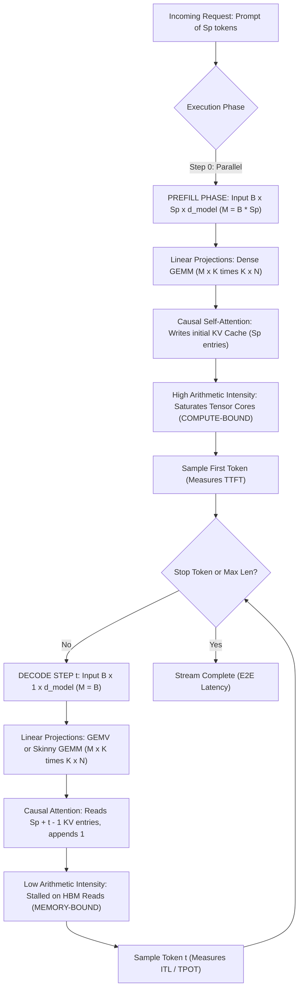
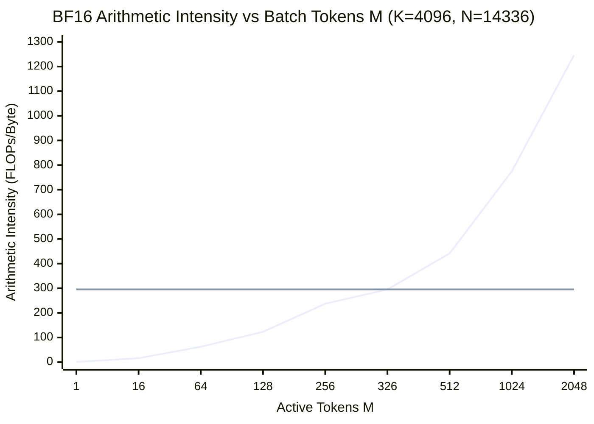
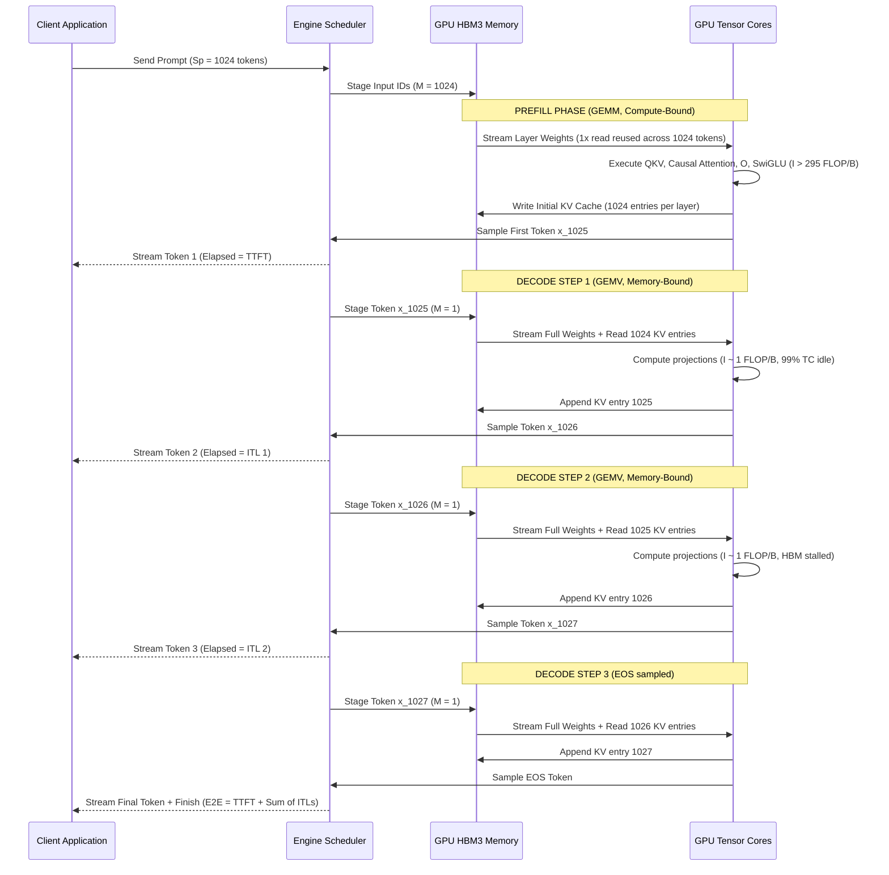

# 01. Inference Phase Anatomy: Prefill vs. Decode

[← Stage 3 Overview](./README.md) | [Complete Syllabus](../../syllabus.md) | [Next: 02. KV Cache Mathematics →](./02-kv-cache-mathematics.md)

Every request to a modern language model splits into two physically opposite stages: an initial stage that reads your entire prompt at once, and a slower loop that generates your answer one piece at a time. Understanding why the same GPU runs at near-100% compute capacity in the first stage and stalls at under 1% in the second requires starting from the exact building blocks of hardware and matrix math.

---

## Core Concepts & Terminology

Each term below is ordered so that later definitions build only on earlier ones:

* **Token:** The basic unit of text (a word, sub-word, or punctuation mark) that a language model reads and writes. Internally, each token is mapped to a vector of numbers.
* **Large Language Model (LLM) & Transformer:** A neural network architecture (the *Transformer*) used by modern LLMs that processes a sequence of tokens through stacked layers of *Self-Attention* (comparing tokens with one another) and *Feed-Forward Networks* (transforming each token's vector independently).
* **Forward Pass:** One complete pass of input token vectors through all layers of the neural network to compute output probabilities for the next token.
* **Autoregressive Generation:** Producing text one token at a time, where each newly chosen token is appended to the sequence and fed back into the next forward pass to predict the token after it.
* **Causal Masking:** A rule inside decoder-only Transformers guaranteeing that token position $i$ can only read information from positions $1 \dots i$, never from future positions $> i$.
* **Linear Projection, Weights, and Activations:** A linear projection multiplies a matrix of *activations* (temporary per-token vectors flowing through the model) by a learned *weight* matrix (fixed model parameters). In a Transformer, $W_Q, W_K, W_V, W_O$ are the Attention projection weights, and $W_{\text{gate}}, W_{\text{up}}, W_{\text{down}}$ are the weights of a **SwiGLU MLP / FFN** (a gated Feed-Forward Network block).
* **KV (Key-Value) Cache:** Intermediate *Key* and *Value* vectors computed for every processed token and saved in GPU memory so they do not need to be recomputed on future generation steps.
* **Prefill (Prompt Processing Phase):** The first phase of inference, where all $S_p$ tokens of the user's prompt are processed together in parallel in one forward pass to populate the initial KV Cache and produce the first output token.
* **Decode (Token Generation Phase):** The second phase of inference, where the model runs one forward pass per step to generate **1 new token** per active request, reading all prior Keys and Values from the KV Cache and appending the new token's Key and Value.
* **TTFT, ITL, TPOT, and E2E Latency:** User-facing speed metrics:
  * **TTFT (Time to First Token):** Elapsed time from when a request starts executing (after queuing) until the first output token is produced.
  * **ITL (Inter-Token Latency):** Elapsed time between consecutive output tokens during Decode.
  * **TPOT (Time Per Output Token):** Average time spent generating each subsequent output token.
  * **E2E (End-to-End) Latency:** Total time from request arrival until the **EOS (End-of-Sequence)** stop token or length limit finishes the stream.
* **GEMM vs. GEMV:** **GEMM (General Matrix-Matrix Multiplication)** multiplies two 2D matrices ($M \times K$ by $K \times N$) with $M > 1$, allowing each weight to be reused across $M$ tokens. **GEMV (General Matrix-Vector Multiplication)** is the degenerate case $M = 1$ (a single vector times a matrix), where weights are read once for a single token with no reuse.
* **Numerical Precision (BF16, FP16, FP8, INT4):** Formats for storing numbers in memory. **BF16** (Brain Float 16) and **FP16** (IEEE Half-Precision) use $b = 2$ bytes per number. **FP8** (8-bit float, $b = 1$ byte) and **INT4** (4-bit integer, $b = 0.5$ bytes) are compressed (*quantized*) formats. **Weight-only quantization** stores weights in compact FP8/INT4 while keeping activations in BF16/FP16.
* **HBM (High Bandwidth Memory, e.g., HBM3 / HBM3e) & VRAM:** The large, off-chip main memory stacked next to a GPU (often called VRAM; e.g., 80 GB on an NVIDIA H100 SXM5 with $3.35\text{ TB/s}$ peak transfer rate). Weights, KV Caches, and activations are stored here.
* **SRAM (On-Chip Shared Memory) & Tiling:** Tiny, ultra-fast memory built directly inside the GPU's compute cores. **Tiling** loads small rectangular blocks of matrices from HBM into SRAM so the GPU can reuse them repeatedly without re-reading HBM. (Cache misses or *split-$K$ writebacks* occur when partial results must be written back to HBM.)
* **Tensor Cores & MMA:** Specialized hardware units inside NVIDIA GPUs built specifically to execute **MMA (Matrix Multiply-Accumulate)** operations at extreme speed.
* **FLOP, FLOPs, FLOP/s, and FMA:** A **FLOP** is one floating-point arithmetic operation (add or multiply); **FLOPs** is a total count of operations; **FLOP/s** (e.g., $\text{TFLOP/s} = 10^{12}\text{ FLOP/s}$) is execution speed. An **FMA (Fused Multiply-Add)** computes $a \times b + c$ in one hardware instruction, equaling $2\text{ FLOPs}$.
* **Arithmetic Intensity ($I$):** The ratio of math operations performed to HBM bytes transferred: $I = \text{FLOPs} / \text{Bytes}_{\text{HBM}}$ (in $\text{FLOPs/Byte}$).
* **Roofline Model, Ridge Point ($I^*$), Compute-Bound vs. Memory-Bandwidth-Bound:** The **Roofline model** states that achieved compute speed cannot exceed either the GPU's peak math rate ($F_{\text{peak}}$) or its memory bandwidth ceiling ($I \times \text{BW}_{\text{peak}}$). The **Ridge Point** ($I^* = F_{\text{peak}} / \text{BW}_{\text{peak}}$) is the arithmetic intensity where both ceilings intersect:
  * **Memory-Bandwidth-Bound ($I < I^*$):** Compute units sit partially idle waiting for data from HBM.
  * **Compute-Bound ($I \ge I^*$):** HBM feeds data fast enough to saturate the Tensor Cores.
* **GQA, Continuous Batching, Speculative Decoding, and SLA:**
  * **GQA (Grouped-Query Attention):** An attention design where multiple Query heads share fewer Key/Value heads, shrinking KV projection and cache size.
  * **Continuous Batching:** An engine scheduling policy that adds new requests and removes completed ones on every decode step rather than waiting for an entire static batch to finish.
  * **Speculative Decoding:** Guessing multiple future tokens cheaply and verifying them in parallel in one forward pass to increase $M$ during Decode.
  * **SLA (Service Level Agreement):** Latency or throughput targets (e.g., maximum allowed TTFT or TPOT) promised to users.

---

## 1. The Two Physical Phases of Autoregressive Inference

An autoregressive decoder-only Transformer models the joint probability of a sequence $x = (x_1, x_2, \dots, x_T)$ via the chain rule:

$$P(x_1, \dots, x_T) = \prod_{t=1}^{T} P(x_t \mid x_1, \dots, x_{t-1})$$

Because every generated token $x_t$ depends strictly on the token sampled at step $t-1$, generation cannot be parallelized across future output positions. However, the user prompt $(x_1, \dots, x_{S_p})$ is already completely known at request arrival. This structural asymmetry splits every LLM request into two distinct execution phases with opposite hardware bottlenecks:

1. **Prefill (Prompt Processing Phase):**
   * All $S_p$ prompt tokens are processed simultaneously in a single forward pass.
   * Causal masking guarantees that token $i$ only attends to tokens $1 \dots i$, allowing all $S_p$ positions to execute in parallel across the sequence dimension.
   * **User-facing latency metric:** **TTFT (Time to First Token)** — elapsed time from request arrival (after queuing) until the first output token $x_{S_p+1}$ is produced.
   * **Hardware regime:** Dominated by large Matrix-Matrix Multiplications (**GEMM**), yielding high arithmetic intensity and saturating Tensor Cores (**compute-bound**).

2. **Decode (Autoregressive Token Generation Phase):**
   * Each request generates **1 token per forward pass** ($x_{S_p+1}, x_{S_p+2}, \dots$), feeding the newly sampled token back as the sole input token for the next step while reading prior Keys and Values from the **KV Cache**.
   * **User-facing latency metric:** **ITL (Inter-Token Latency)** or **TPOT (Time Per Output Token)** — elapsed time between consecutive emitted tokens. Total request latency is:
     $$\text{E2E Latency} = \text{TTFT} + (S_g - 1) \times \text{TPOT}$$
     where $S_g$ is the number of generated tokens.
   * **Hardware regime:** For a single request ($B=1$), linear projections degenerate into Matrix-Vector Multiplications (**GEMV**). Almost no data reuse occurs across weights, stalling Tensor Cores while waiting for HBM3/HBM3e reads (**memory-bandwidth-bound**).



---

## 2. Exact Linear Layer Physics: FLOPs, Bytes Moved, and Arithmetic Intensity

Over 90% of the parameters and operations in a standard Transformer reside in dense linear projections: $W_Q, W_K, W_V, W_O$ inside Attention, and $W_{\text{gate}}, W_{\text{up}}, W_{\text{down}}$ inside the Feed-Forward Network (SwiGLU MLP). Every linear layer computes:

$$Y = X W, \quad X \in \mathbb{R}^{M \times K}, \quad W \in \mathbb{R}^{K \times N}, \quad Y \in \mathbb{R}^{M \times N}$$

where:
* **$M$**: Total tokens processed concurrently in the batch ($M = B \cdot S_p$ in Prefill; $M = B \cdot 1 = B$ in Decode).
* **$K$**: Input feature dimension (e.g., $d_{\text{model}} = 4096$ or $d_{\text{ffn}} = 14336$).
* **$N$**: Output feature dimension (e.g., $d_{\text{ffn}} = 14336$ or $d_{\text{model}} = 4096$).

### 2.1 Exact FLOP Count

Computing each scalar output entry $Y_{i,j} = \sum_{k=1}^{K} X_{i,k} W_{k,j}$ requires $K$ multiplications and $K-1 \approx K$ additions (fused as $K$ Multiply-Accumulate or FMA instructions, where $1\text{ FMA} = 2\text{ FLOPs}$). Across all $M \cdot N$ output elements:

$$\text{FLOPs}(M, N, K) = 2 \cdot M \cdot N \cdot K$$

*(Note: Strictly, summation takes $K-1$ adds, giving $M N (2K - 1)$ FLOPs; for Transformer dimensions $K \ge 1024$, the discrepancy is $< 0.05\%$ and $2MNK$ is the universal analytical standard.)*

### 2.2 Exact HBM Bytes Transferred

Assume activations and weights are stored in **BF16 or FP16** ($b = 2\text{ bytes/parameter}$), and ignore on-chip cache misses or split-$K$ writebacks (the theoretical minimum off-chip HBM traffic assuming perfect SRAM tiling):
* Read input activation matrix $X$: $b \cdot M \cdot K$ bytes
* Read weight matrix $W$: $b \cdot K \cdot N$ bytes
* Write output matrix $Y$: $b \cdot M \cdot N$ bytes

Total minimum HBM traffic in general $b$-byte precision (and specifically for BF16/FP16 where $b = 2$):

$$\text{Bytes}_{\text{HBM}}(M, N, K) = b \cdot (M K + K N + M N)$$

$$\text{Bytes}_{\text{HBM, BF16}}(M, N, K) = 2 \cdot (M K + K N + M N)$$

*(Caveat for FP8/INT4 weight-only quantization: If weights $W$ use $b_W = 0.5\text{ B}$ or $1\text{ B}$ while activations $X, Y$ remain $b_A = 2\text{ B}$, total traffic becomes $b_A (MK + MN) + b_W KN$. This asymmetry is why weight-only quantization accelerates Decode without changing compute FLOPs.)*

### 2.3 Exact Arithmetic Intensity Derivation

Arithmetic Intensity $I$ (in $\text{FLOPs/Byte}$) is the ratio of floating-point operations performed to total bytes moved between HBM and the GPU's compute units:

$$I(M, N, K) = \frac{\text{FLOPs}}{\text{Bytes}_{\text{HBM}}} = \frac{2 M N K}{b \cdot (M K + K N + M N)}$$

For **BF16 / FP16** ($b = 2$), the factor of $2$ cancels cleanly:

$$I_{\text{BF16}}(M, N, K) = \frac{M \cdot N \cdot K}{M K + K N + M N}$$

Dividing numerator and denominator by $M N K$ reveals the exact harmonic structure:

$$I_{\text{BF16}}(M, N, K) = \frac{1}{\frac{1}{N} + \frac{1}{M} + \frac{1}{K}}$$

This single equation explains the entire physics of LLM inference phase behavior:
* $I_{\text{BF16}}$ is bounded above by the **smallest** of the three matrix dimensions: $I_{\text{BF16}} < \min(M, N, K)$.
* Because $N$ and $K$ are fixed architectural constants of the model (typically $4096$ to $32768$), **$M$ is the single runtime variable that determines whether the GPU runs at peak compute or starves on HBM bandwidth**.

---

## 3. Why $M = 1$ Hits the Memory Wall (And How Batching Recovers Intensity)

Consider an **NVIDIA H100 SXM5 (80 GB HBM3)** running a **Llama-3 8B** SwiGLU FFN layer ($K = 4096, N = 14336$) in BF16 ($b = 2$):
* **H100 BF16 Tensor Core Peak:** $F_{\text{peak}} = 989.4\text{ TFLOP/s} = 9.894 \times 10^{14}\text{ FLOP/s}$ *(dense, non-sparse)*.
* **H100 HBM3 Peak Bandwidth:** $\text{BW}_{\text{peak}} = 3.35\text{ TB/s} = 3.35 \times 10^{12}\text{ B/s}$.
* **H100 BF16 Ridge Point ($I^*$):**
  $$I^*_{\text{H100, BF16}} = \frac{F_{\text{peak}}}{\text{BW}_{\text{peak}}} = \frac{989.4 \times 10^{12}\text{ FLOP/s}}{3.35 \times 10^{12}\text{ B/s}} \approx 295.3\text{ FLOPs/Byte}$$

An operation must exhibit $I \ge 295.3\text{ FLOPs/Byte}$ to keep all Tensor Cores busy; anything below $295.3$ is strictly **memory-bandwidth-bound**.

### Case A: Single-Request Decode ($M = 1$, GEMV)

Plug $M = 1, K = 4096, N = 14336$ into our BF16 equations:
* **FLOPs:** $2 \times 1 \times 14336 \times 4096 = 117,440,512\text{ FLOPs} \approx 117.4\text{ MFLOPs}$.
* **Bytes Read/Written:** $2 \times (4096 + 4096 \times 14336 + 14336) = 117,477,376\text{ B} \approx 117.5\text{ MB}$.
* **Arithmetic Intensity:**
  $$I_{\text{BF16}}(1) = \frac{1}{\frac{1}{14336} + \frac{1}{1} + \frac{1}{4096}} = \frac{1}{1.000314} \approx 0.9997\text{ FLOPs/Byte}$$

Look at the Roofline gap:
* Attainable compute throughput = $I \times \text{BW}_{\text{peak}} = 0.9997 \times 3.35\text{ TB/s} = 3.35\text{ TFLOP/s}$.
* **Tensor Core Utilization:** $\frac{3.35}{989.4} = \mathbf{0.34\%}$! **99.66% of the GPU's Tensor Core capacity sits idle** waiting for the $117.4\text{ MB}$ weight matrix $W$ to stream from HBM3 for a single token.
* In general, for $M = 1$ in precision $b$:
  $$I(1) \approx \frac{2 N K}{b \cdot N K} = \frac{2}{b} \quad \Longrightarrow \quad 1.0\text{ FLOP/B (BF16)}, \; 2.0\text{ FLOP/B (FP8)}, \; 4.0\text{ FLOP/B (INT4)}$$

### Case B: Prefill ($S_p = 2048, B = 1 \implies M = 2048$, GEMM)

Now plug $M = 2048, K = 4096, N = 14336$:
* **FLOPs:** $2 \times 2048 \times 14336 \times 4096 \approx 240.5\text{ GFLOPs}$.
* **Bytes Read/Written:** $2 \times (2048 \times 4096 + 4096 \times 14336 + 2048 \times 14336) \approx 192.9\text{ MB}$.
* **Arithmetic Intensity:**
  $$I_{\text{BF16}}(2048) = \frac{1}{\frac{1}{14336} + \frac{1}{2048} + \frac{1}{4096}} \approx \mathbf{1246.5\text{ FLOPs/Byte}}$$

Because $1246.5 \gg 295.3\text{ FLOPs/Byte}$, Prefill sits **4.2x past the ridge point**, cleanly **compute-bound**.

### Case C: Critical Batch Size $M^*$ to Reach the Ridge Point

During Decode, $M = B$ (with 1 token per sequence). How large must the batch size $B$ be for linear layers to reach the GPU's ridge point $I^*$? Solving $I_{\text{BF16}}(M^*) = I^*$:

$$\frac{1}{\frac{1}{M^*} + \frac{1}{N} + \frac{1}{K}} = I^* \implies M^* = \frac{1}{\frac{1}{I^*} - \frac{1}{N} - \frac{1}{K}}$$

For H100 ($I^* = 295.3$) and Llama-3 8B FFN ($K = 4096, N = 14336$):

$$M^* = \frac{1}{\frac{1}{295.3} - \frac{1}{14336} - \frac{1}{4096}} = \frac{1}{0.003386 - 0.000070 - 0.000244} = \frac{1}{0.003072} \approx \mathbf{325.5\text{ tokens}}$$

Notice an important hardware consequence:
* On an **H100** ($I^* = 295.3$), a dense Llama-3 8B FFN needs **$M \ge 326$ tokens in the batch** just to break even on the BF16 Roofline!
* For smaller projections like $W_Q$ ($K=4096, N=4096$), $M^* = \frac{1}{1/295.3 - 2/4096} \approx \mathbf{345}$, and for GQA $W_K/W_V$ ($K=4096, N=1024$), $M^* = \frac{1}{1/295.3 - 1/1024 - 1/4096} \approx \mathbf{462}$.
* Even more critically, moving to **FP8** on H100 doubles peak Tensor Core FLOP/s ($1979\text{ TFLOP/s}$) while keeping HBM3 bandwidth fixed ($3.35\text{ TB/s}$), pushing $I^*_{\text{FP8}} \approx \mathbf{591\text{ FLOPs/Byte}}$—meaning if both weights and activations are FP8 ($b=1$), $I_{\text{FP8}}(M) = \frac{2MNK}{MK+KN+MN}$, so the break-even $M^*$ remains roughly $\sim 320\text{--}450$ tokens! On **Blackwell B200** (FP4 / FP8 with higher FLOP-to-bandwidth ratio), the required critical batch size grows even larger unless weight quantization or speculative decoding is used.

| Batch / Token Count $M$ | $I_{\text{BF16}}$ (FLOP/B) on $4096 \times 14336$ | H100 Regime | Roofline Ceiling Attained | Bottleneck |
| :---: | :---: | :--- | :--- | :--- |
| **1** (Single Decode) | $1.00$ | Memory-Bound | $3.35\text{ TFLOP/s}$ ($0.34\%$) | Weight Reads from HBM |
| **16** (Small Batch Decode) | $15.9$ | Memory-Bound | $53.3\text{ TFLOP/s}$ ($5.4\%$) | Weight Reads from HBM |
| **64** (Medium Batch Decode) | $62.7$ | Memory-Bound | $210.0\text{ TFLOP/s}$ ($21.2\%$) | Weight Reads from HBM |
| **256** (Large Batch Decode) | $237.0$ | Memory-Bound (Near Ridge) | $794.0\text{ TFLOP/s}$ ($80.2\%$) | Weight + Activation Traffic |
| **326** (Critical $M^*$) | $295.3$ | **Ridge Point** | $989.4\text{ TFLOP/s}$ ($100\%$) | Balanced |
| **2048** (Prefill, $S_p=2048$) | $1246.5$ | Compute-Bound | $989.4\text{ TFLOP/s}$ ($100\%$) | Tensor Core MMA Throughput |



*(In the chart above, the rising curve tracks $I_{\text{BF16}}(M)$ and the flat horizontal line marks the H100 BF16 ridge point at $295.3\text{ FLOPs/Byte}$.)*

### Why Decode Cannot Simply Batch to $M = 512$ Without Constraints

If batching to $M \ge 326$ restores compute efficiency, why don't all inference servers simply batch 512 decode requests together? Three physical constraints prevent unbounded decode batching:
1. **KV Cache Capacity Wall:** Each active sequence in the batch carries its own KV Cache across all layers and context tokens (Topic 02). At long context lengths (32k–128k), VRAM fills up at $B = 4\text{ to }32$ long before reaching $M^* = 326$.
2. **Attention Core Stays Memory-Bound Regardless of $B$:** Unlike linear projection weights $W$ (which are **shared** across all $B$ requests in a batch, allowing weight reuse), every request in the batch has its **own distinct KV Cache**. Therefore, batching $B$ requests multiplies attention KV reads by $B$ alongside attention FLOPs by $B$—keeping Decode Attention locked at an arithmetic intensity of $\approx 1\text{ FLOP/Byte}$ (in BF16, 1 query token per KV entry) regardless of batch size!
3. **ITL Latency Degradation:** Even while memory-bound, once activation traffic and KV Cache reads grow with $B$, total bytes read per decode step increases ($\text{Bytes}_{\text{weights}} + B \cdot \text{Bytes}_{\text{KV\_per\_seq}}$), increasing TPOT and risking SLA violations.

---

## 4. End-to-End Request Lifecycle: TTFT Followed by Autoregressive Decode

To tie phase physics to serving telemetry, consider a client sending a 1,024-token prompt and receiving a 4-token completion. Notice how the GPU transitions sharply from a single high-intensity Prefill pass (which sets **TTFT**) into sequential low-intensity Decode steps (each setting **ITL/TPOT**).



---

## 5. Analytical Verification in Python

The following self-contained script calculates exact FLOPs, HBM bytes, arithmetic intensity, and Roofline utilization for a linear layer across varying $M$ on an H100 SXM5:

```python
def analyze_linear_layer(
    M: int,
    K: int = 4096,
    N: int = 14336,
    bytes_per_elem: int = 2,      # 2 for BF16/FP16, 1 for FP8
    peak_tflops: float = 989.4,   # H100 SXM5 BF16 dense
    peak_bw_tbs: float = 3.35,    # H100 SXM5 HBM3
) -> dict:
    flops = 2 * M * N * K
    bytes_moved = bytes_per_elem * (M * K + K * N + M * N)
    arith_intensity = flops / bytes_moved
    ridge_point = (peak_tflops * 1e12) / (peak_bw_tbs * 1e12)

    # Roofline attainable performance (FLOP/s) and minimum theoretical latency
    attainable_tflops = min(peak_tflops, arith_intensity * peak_bw_tbs)
    min_time_us = (flops / (attainable_tflops * 1e12)) * 1e6
    regime = "Compute-Bound" if arith_intensity >= ridge_point else "Memory-Bound"

    return {
        "M": M,
        "GFLOPs": round(flops / 1e9, 3),
        "MB_moved": round(bytes_moved / 1e6, 2),
        "AI_FLOPs_per_B": round(arith_intensity, 2),
        "ridge_point": round(ridge_point, 1),
        "attainable_TFLOPs": round(attainable_tflops, 2),
        "tc_utilization_pct": round(100.0 * attainable_tflops / peak_tflops, 2),
        "min_time_us": round(min_time_us, 2),
        "regime": regime,
    }

for m in [1, 16, 64, 256, 326, 2048]:
    print(analyze_linear_layer(M=m))
```

Notice what happens to `min_time_us` in the memory-bound regime ($M = 1$ vs. $M = 64$):
* At $M = 1$: $\text{Bytes} \approx 117.5\text{ MB} \implies t_{\min} = \frac{117.5\text{ MB}}{3.35\text{ TB/s}} \approx 35.1\ \mu\text{s}$.
* At $M = 64$: $\text{Bytes} \approx 119.8\text{ MB} \implies t_{\min} = \frac{119.8\text{ MB}}{3.35\text{ TB/s}} \approx 35.8\ \mu\text{s}$.

Increasing batch size from $1$ to $64$ computes **64x as many tokens** in virtually the **exact same physical execution time ($35.1\ \mu\text{s} \to 35.8\ \mu\text{s}$)** because the weight matrix read ($117.4\text{ MB}$) is amortized across all 64 tokens. This physical invariance is the mathematical foundation of **Continuous Batching** and inference throughput scaling.

---

**Navigation:** [← Stage 3 Overview](./README.md) | [Complete Syllabus](../../syllabus.md) | [Next: 02. KV Cache Mathematics →](./02-kv-cache-mathematics.md)
