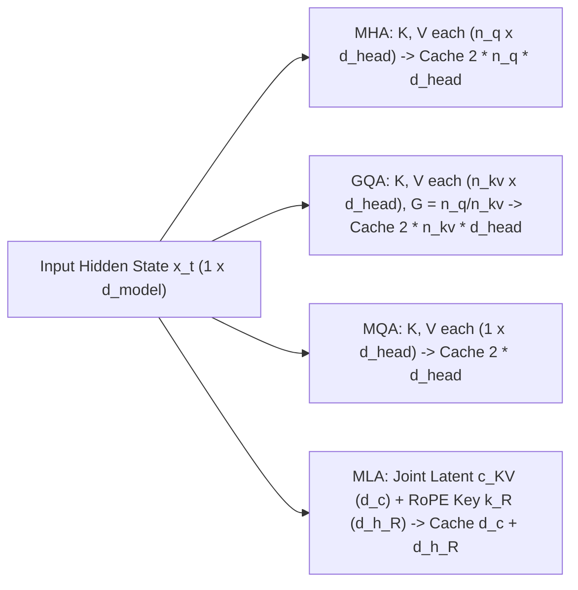
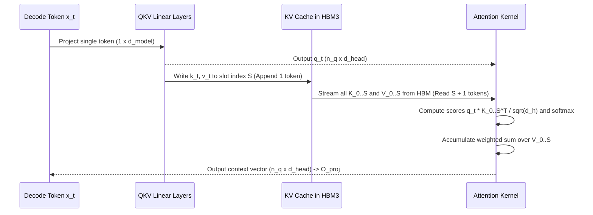

# 02. KV Cache Mathematics

[← 01. Inference Phase Anatomy](./01-inference-phase-anatomy-prefill-vs-decode.md) | [Stage 3 Overview](./README.md) | [Next: 03. Attention Memory & Long Contexts →](./03-attention-memory-and-long-contexts.md)

---

## 1. Why the KV Cache Exists: Trading Memory for Quadratic Compute

In causal self-attention, a sequence of length $t$ requires each query vector $q_t$ to attend over all past and current keys $k_1, \dots, k_t$ and values $v_1, \dots, v_t$:

$$\text{Attention}(q_t, K_{1:t}, V_{1:t}) = \text{softmax}\!\left(\frac{q_t K_{1:t}^T}{\sqrt{d_{\text{head}}}}\right) V_{1:t}$$

Without caching, generating token $t+1$ would force the model to re-run linear projections $K_{1:t} = X_{1:t} W_K$ and $V_{1:t} = X_{1:t} W_V$ across all $t$ preceding tokens at every single decode step, turning an $O(S^2)$ total generation process into $O(S^3)$ compute.

Because causal masking ensures that the hidden state $x_i$ (for $i < t$) never depends on future tokens $x_{i+1}, \dots, x_t$, its projected Key vector $k_i$ and Value vector $v_i$ are **mathematically immutable** once computed during Prefill or an earlier Decode step. Storing $(k_i, v_i)$ in GPU HBM—the **KV Cache**—reduces per-step projection work from $O(t)$ tokens to $O(1)$ token, trading **VRAM capacity and HBM read bandwidth** for massive FLOP savings.

---

## 2. Exact KV Cache Memory Equation

For a standard decoder-only Transformer with $n_{\text{layers}}$ blocks, $n_{\text{kv\_heads}}$ Key-Value attention heads per layer, head dimension $d_{\text{head}}$, and numerical precision of $b$ bytes per parameter ($\text{bytes\_per\_param}$), the exact KV Cache memory required per token is:

$$\text{Bytes per Token} = 2 \times n_{\text{layers}} \times n_{\text{kv\_heads}} \times d_{\text{head}} \times \text{bytes\_per\_param}$$

Each factor has an exact physical meaning:
* **$2$**: Stores two distinct tensors per token per layer—one **Key ($K$)** tensor and one **Value ($V$)** tensor.
* **$n_{\text{layers}}$**: Every Transformer layer maintains its own independent attention projection matrices ($W_K^{(l)}, W_V^{(l)}$) and therefore its own KV state.
* **$n_{\text{kv\_heads}} \times d_{\text{head}}$**: Total hidden width of the $K$ (or $V$) projection per token per layer. Crucially, this depends on $n_{\text{kv\_heads}}$, **not** $n_{\text{q\_heads}}$ or $d_{\text{model}}$.
* **$\text{bytes\_per\_param}$ ($b$)**: $2$ bytes for BF16/FP16, $1$ byte for FP8 (E4M3/E5M2) or INT8 (ignoring small per-head/per-token scaling factors), or $4$ bytes for FP32.

For a batch of $B$ active sequences, each of total context length $S = S_{\text{prompt}} + S_{\text{generated}}$, total KV Cache allocation is:

$$\text{Total KV Cache Bytes} = B \times S \times 2 \times n_{\text{layers}} \times n_{\text{kv\_heads}} \times d_{\text{head}} \times \text{bytes\_per\_param}$$

*(Engineering note on units: Hardware memory capacities like "80 GB H100" are marketed in decimal GB ($10^9$ B) or actually equal $80\text{ GiB}$ on SXM5 ($80 \times 2^{30} \approx 85.9\text{ GB}$, though ~79.1–79.6 GiB is usable after ECC/driver reservation). Because token lengths are powers of two ($8\text{k} = 8{,}192$, $32\text{k} = 32{,}768$, $128\text{k} = 131{,}072$), we report both exact binary **GiB** ($2^{30}$ B) and decimal **GB** ($10^9$ B) in worked examples.)*

---

## 3. Architectural Evolution: MHA, MQA, GQA, and MLA

Because KV Cache size scales linearly with $n_{\text{kv\_heads}} \times d_{\text{head}}$, modern LLM architectures aggressively compress the KV dimension while keeping the Query dimension rich.

### 3.1 Multi-Head Attention (MHA)
* **Design:** Used in GPT-3, Llama-1, and Llama-2 7B/13B. Every Query head has its own dedicated Key and Value head:
  $$n_{\text{kv\_heads}} = n_{\text{q\_heads}}, \quad d_{\text{kv}} = n_{\text{q\_heads}} \cdot d_{\text{head}} = d_{\text{model}}$$
* **Impact:** Maximum representational flexibility, but catastrophically large KV Cache per token. For a 70B-class model ($n_{\text{layers}}=80, n_h=64, d_h=128$), MHA consumes **$2.5\text{ MiB}$ per token**, limiting concurrency to just a few requests per GPU.

### 3.2 Multi-Query Attention (MQA)
* **Design:** Introduced by Shazeer (2019) and used in Falcon-40B/180B and PaLM. All $n_{\text{q\_heads}}$ Query heads share a **single** Key head and a **single** Value head:
  $$n_{\text{kv\_heads}} = 1$$
* **Impact:** Shrinks KV Cache size and decode attention HBM bandwidth by a factor of $n_{\text{q\_heads}}$ (e.g., **32x to 64x reduction**).
* **Trade-off:** Can exhibit slight quality degradation or training instability at frontier scale compared to MHA, and restricts Tensor Parallelism (if $\text{TP} > n_{\text{kv\_heads}}$, the single KV head must be replicated across TP ranks instead of sharded).

### 3.3 Grouped-Query Attention (GQA)
* **Design:** Introduced by Ainslie et al. (2023) and adopted across Llama-2 70B, Llama-3 (8B/70B/405B), Mistral, and Qwen2.5. Query heads are partitioned into $n_{\text{kv\_heads}}$ groups, where each KV head serves a group of $G = n_{\text{q\_heads}} / n_{\text{kv\_heads}}$ Query heads:
  $$1 < n_{\text{kv\_heads}} < n_{\text{q\_heads}}, \quad \text{Compression Factor} = G = \frac{n_{\text{q\_heads}}}{n_{\text{kv\_heads}}}$$
* **Impact:** Achieves near-MHA model quality while shrinking KV Cache by $4\times$ to $8\times$ (e.g., $n_{\text{kv\_heads}} = 8$ allows clean sharding up to $\text{TP}=8$ without replicating KV caches across GPUs).

### 3.4 Multi-Head Latent Attention (MLA — DeepSeek-V2 / V3 / R1)
* **Design:** Introduced in DeepSeek-V2 and scaled in DeepSeek-V3/R1 (671B MoE). Instead of projecting separate $K$ and $V$ tensors per head and caching them, MLA performs **joint low-rank KV compression** into a single compact latent vector $c_t^{KV} \in \mathbb{R}^{d_c}$ (where $d_c \ll n_h d_h$, e.g., $d_c = 512$ vs. $128 \times 128 = 16{,}384$):
  $$c_t^{KV} = x_t W^{DKV}, \quad K_t^C = c_t^{KV} W^{UK}, \quad V_t^C = c_t^{KV} W^{UV}$$
* **Decoupled RoPE:** Because Rotary Position Embeddings (RoPE) inject a position-dependent rotation matrix $R_t$ between $q_t$ and $k_t$, applying RoPE inside $W^{UK}$ prevents algebraic matrix absorption during decode. MLA solves this by allocating a separate, shared low-dimensional RoPE key $k_t^R = \text{RoPE}(x_t W^{KR}) \in \mathbb{R}^{d_h^R}$ (e.g., $d_h^R = 64$, broadcast across all query heads), and concatenating content + position dimensions:
  $$q_t = [q_t^C;\; q_t^R], \quad k_t = [K_t^C;\; k_t^R]$$
* **Exact MLA KV Cache Bytes per Token:** During inference, we cache **only** the compressed latent vector $c_t^{KV}$ and the decoupled RoPE key $k_t^R$ (never the decompressed $K_t^C, V_t^C$!):
  $$\text{Bytes per Token}_{\text{MLA}} = n_{\text{layers}} \times (d_c + d_h^R) \times \text{bytes\_per\_param}$$
  *(Notice there is **no factor of 2** because $c_t^{KV}$ jointly generates both $K^C$ and $V^C$!)*
* **Inference Matrix Absorption Trick:** During Decode, MLA avoids materializing $K^C = c^{KV} W^{UK}$ and $V^C = c^{KV} W^{UV}$ in HBM by exploiting associativity of matrix multiplication:
  $$(q_t^C) (c_j^{KV} W^{UK})^T = \underbrace{(q_t^C (W^{UK})^T)}_{\text{absorbed into Query}} (c_j^{KV})^T$$
  and similarly absorbing $W^{UV}$ into the output projection $W^O$. Consequently, the decode attention kernel reads **only $d_c + d_h^R = 576$ scalars per token per layer** from HBM—achieving lower KV Cache footprint than GQA while matching or exceeding full 128-head MHA quality.

---

## 4. Autoregressive KV Cache Read/Append Mechanics

During Decode step $t$ (when the sequence already has $S = S_p + t - 1$ tokens cached), every Transformer layer performs a strict **append-then-read** lifecycle on its KV Cache buffer:

Notice the asymmetry: at step $t$, only **1 token** is written to the KV Cache, while **$S + 1$ tokens** must be read from HBM across every layer. When $S$ reaches $32\text{k}\text{--}128\text{k}$, streaming the KV Cache dominates HBM bandwidth.

---

## 5. Worked Numerical Comparisons (8k, 32k, 128k Contexts)

Let us compute exact BF16 ($b = 2$ bytes) KV Cache footprints across four reference configurations:

1. **Llama-3 8B (GQA):** $n_{\text{layers}}=32,\; n_{\text{q}}=32,\; n_{\text{kv}}=8,\; d_{\text{head}}=128$, static BF16 weights $\approx 16.06\text{ GB}$ ($14.96\text{ GiB}$).
2. **Llama-3 8B (Hypothetical MHA):** Same architecture with $n_{\text{kv}}=32$ (for comparison).
3. **Llama-3 70B (GQA):** $n_{\text{layers}}=80,\; n_{\text{q}}=64,\; n_{\text{kv}}=8,\; d_{\text{head}}=128$, static BF16 weights $\approx 141.1\text{ GB}$ ($131.4\text{ GiB}$).
4. **Llama-3 70B (Hypothetical MHA):** Same architecture with $n_{\text{kv}}=64$ (for comparison).
5. **DeepSeek-V3 / R1 (MLA):** $n_{\text{layers}}=61,\; n_{\text{q}}=128,\; d_c=512,\; d_h^R=64$, total weights $671\text{B}$ ($\sim 1{,}342\text{ GB}$ BF16 / $671\text{ GB}$ FP8).

### 5.1 Exact Bytes per Token (BF16, $b = 2$)

* **Llama-3 8B (Hypothetical MHA):**
  $$2 \times 32 \times 32 \times 128 \times 2 = 524{,}288\text{ B/tok} = 512.0\text{ KiB/tok} = 0.524\text{ MB/tok}$$
* **Llama-3 8B (Actual GQA, $G=4$):**
  $$2 \times 32 \times 8 \times 128 \times 2 = 131{,}072\text{ B/tok} = 128.0\text{ KiB/tok} = 0.131\text{ MB/tok}$$
* **Llama-3 70B (Hypothetical MHA):**
  $$2 \times 80 \times 64 \times 128 \times 2 = 2{,}621{,}440\text{ B/tok} = 2{,}560.0\text{ KiB/tok} = 2.50\text{ MiB/tok}\; (2.621\text{ MB/tok})$$
* **Llama-3 70B (Actual GQA, $G=8$):**
  $$2 \times 80 \times 8 \times 128 \times 2 = 327{,}680\text{ B/tok} = 320.0\text{ KiB/tok} = 0.328\text{ MB/tok}$$
* **DeepSeek-V3 (MLA):**
  $$61 \times (512 + 64) \times 2 = 70{,}272\text{ B/tok} = 68.625\text{ KiB/tok} = 0.0703\text{ MB/tok}$$

*(Compare DeepSeek-V3 MLA against an equivalent 61-layer, 128-head MHA model with $d_h=128$: $2 \times 61 \times 128 \times 128 \times 2 = 3{,}997{,}696\text{ B/tok} \approx 3.81\text{ MiB/tok}$. MLA reduces KV Cache by **56.9x**—or **98.2%**—relative to 128-head MHA!)*

### 5.2 Footprint Across Context Lengths ($B = 1$)

| Model & Attention Type | Bytes / Token (BF16) | 8k ($8{,}192$) | 32k ($32{,}768$) | 128k ($131{,}072$) |
| :--- | :---: | :---: | :---: | :---: |
| **Llama-3 8B (MHA)** | $512.0\text{ KiB}$ | $4.00\text{ GiB}$ ($4.29\text{ GB}$) | $16.00\text{ GiB}$ ($17.18\text{ GB}$) | $64.00\text{ GiB}$ ($68.72\text{ GB}$) |
| **Llama-3 8B (GQA-8)** | $128.0\text{ KiB}$ | $1.00\text{ GiB}$ ($1.07\text{ GB}$) | $4.00\text{ GiB}$ ($4.29\text{ GB}$) | $16.00\text{ GiB}$ ($17.18\text{ GB}$) |
| **Llama-3 70B (MHA)** | $2{,}560.0\text{ KiB}$ | $20.00\text{ GiB}$ ($21.47\text{ GB}$) | $80.00\text{ GiB}$ ($85.90\text{ GB}$) | $320.00\text{ GiB}$ ($343.60\text{ GB}$) |
| **Llama-3 70B (GQA-8)** | $320.0\text{ KiB}$ | $2.50\text{ GiB}$ ($2.68\text{ GB}$) | $10.00\text{ GiB}$ ($10.74\text{ GB}$) | $40.00\text{ GiB}$ ($42.95\text{ GB}$) |
| **DeepSeek-V3 (MLA)** | $68.625\text{ KiB}$ | $0.536\text{ GiB}$ ($0.58\text{ GB}$) | $2.145\text{ GiB}$ ($2.30\text{ GB}$) | $8.578\text{ GiB}$ ($9.21\text{ GB}$) |

### 5.3 Multi-Batch Scaling ($B = 1, 8, 32, 64$)

Multiplying by batch size $B$ exposes why **KV Cache capacity—not model weights—dictates cluster sizing** for long-context workloads:

| Model (BF16 KV) | Context $S$ | $B = 1$ | $B = 8$ | $B = 32$ | $B = 64$ |
| :--- | :---: | :---: | :---: | :---: | :---: |
| **Llama-3 8B (GQA)** | **8k** | $1.00\text{ GiB}$ ($1.07\text{ GB}$) | $8.00\text{ GiB}$ ($8.59\text{ GB}$) | $32.00\text{ GiB}$ ($34.36\text{ GB}$) | $64.00\text{ GiB}$ ($68.72\text{ GB}$) |
| **Llama-3 8B (GQA)** | **32k** | $4.00\text{ GiB}$ ($4.29\text{ GB}$) | $32.00\text{ GiB}$ ($34.36\text{ GB}$) | $128.00\text{ GiB}$ ($137.44\text{ GB}$) | $256.00\text{ GiB}$ ($274.88\text{ GB}$) |
| **Llama-3 8B (GQA)** | **128k** | $16.00\text{ GiB}$ ($17.18\text{ GB}$) | $128.00\text{ GiB}$ ($137.44\text{ GB}$) | $512.00\text{ GiB}$ ($549.76\text{ GB}$) | $1{,}024.0\text{ GiB}$ ($1.10\text{ TB}$) |
| **Llama-3 70B (GQA)** | **8k** | $2.50\text{ GiB}$ ($2.68\text{ GB}$) | $20.00\text{ GiB}$ ($21.47\text{ GB}$) | $80.00\text{ GiB}$ ($85.90\text{ GB}$) | $160.00\text{ GiB}$ ($171.80\text{ GB}$) |
| **Llama-3 70B (GQA)** | **32k** | $10.00\text{ GiB}$ ($10.74\text{ GB}$) | $80.00\text{ GiB}$ ($85.90\text{ GB}$) | $320.00\text{ GiB}$ ($343.60\text{ GB}$) | $640.00\text{ GiB}$ ($687.19\text{ GB}$) |
| **Llama-3 70B (GQA)** | **128k** | $40.00\text{ GiB}$ ($42.95\text{ GB}$) | $320.00\text{ GiB}$ ($343.60\text{ GB}$) | $1{,}280.0\text{ GiB}$ ($1.37\text{ TB}$) | $2{,}560.0\text{ GiB}$ ($2.75\text{ TB}$) |
| **DeepSeek-V3 (MLA)** | **32k** | $2.15\text{ GiB}$ ($2.30\text{ GB}$) | $17.16\text{ GiB}$ ($18.42\text{ GB}$) | $68.63\text{ GiB}$ ($73.69\text{ GB}$) | $137.25\text{ GiB}$ ($147.37\text{ GB}$) |
| **DeepSeek-V3 (MLA)** | **128k** | $8.58\text{ GiB}$ ($9.21\text{ GB}$) | $68.63\text{ GiB}$ ($73.69\text{ GB}$) | $274.50\text{ GiB}$ ($294.74\text{ GB}$) | $549.00\text{ GiB}$ ($589.48\text{ GB}$) |

### 5.4 Practical Capacity Consequence on an 80 GB H100

Suppose we deploy **Llama-3 8B (BF16)** on a single **H100 80 GB** GPU ($\approx 79.2\text{ GiB}$ usable):
* Static model weights occupy $\approx 14.96\text{ GiB}$, and CUDA context + activation workspace take $\approx 4.24\text{ GiB}$, leaving **$\mathbf{60.0\text{ GiB}}$** for the KV Cache pool.
* **Maximum Concurrent Requests ($B_{\max}$):**
  * At $S = 8\text{k}$ ($1.0\text{ GiB/req}$): $B_{\max} = \mathbf{60\text{ requests}}$.
  * At $S = 32\text{k}$ ($4.0\text{ GiB/req}$): $B_{\max} = \mathbf{15\text{ requests}}$.
  * At $S = 128\text{k}$ ($16.0\text{ GiB/req}$): $B_{\max} = \mathbf{3\text{ requests}}$!
* Without GQA (if Llama-3 8B used MHA at $16.0\text{ GiB}$ per $32\text{k}$ request), a single 80 GB H100 could hold only **3 requests at 32k** and **zero 128k requests** ($64\text{ GiB} > 60\text{ GiB}$).

---

**Navigation:** [← 01. Inference Phase Anatomy](./01-inference-phase-anatomy-prefill-vs-decode.md) | [Stage 3 Overview](./README.md) | [Next: 03. Attention Memory & Long Contexts →](./03-attention-memory-and-long-contexts.md)
