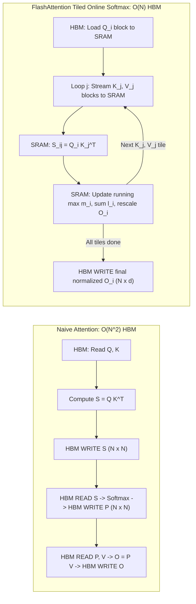
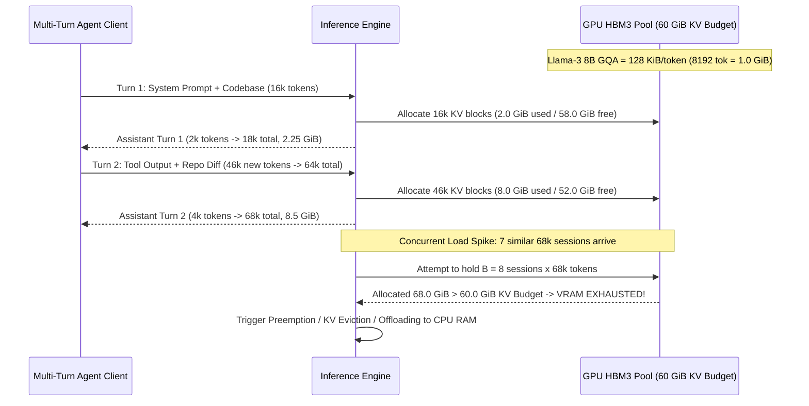

# 03. Attention Memory & Long Contexts

[← 02. KV Cache Mathematics](./02-kv-cache-mathematics.md) | [Stage 3 Overview](./README.md) | [Next: 04. Mixture-of-Experts Architectures →](./04-mixture-of-experts-architectures.md)

Handling prompts of tens or hundreds of thousands of tokens hits two distinct memory walls: the temporary score tables created inside Attention during prompt processing, and the ever-growing history buffer during token generation. This document explains the exact math behind both bottlenecks and the algorithms—tiling, online softmax, position scaling, and sliding windows—that keep long-context inference feasible.

---

## Core Concepts & Terminology

Each concept below is ordered so later definitions build only on earlier ones:

* **Token, Sequence Length ($N$ or $S$), and Batch Size ($B$):** A **token** is the basic unit of text; $N$ (or $S$) is the number of tokens in a sequence; $B$ is the number of sequences processed together.
* **Self-Attention ($Q, K, V$, $d_{\text{head}}$), Causal Mask ($M_{\text{causal}}$), and Softmax:** Each attention head multiplies Query ($Q$) and Key ($K$) matrices to get raw scores $S = QK^T / \sqrt{d_{\text{head}}}$, applies a **causal mask** $M_{\text{causal}}$ (setting future positions $j > i$ to $-\infty$), applies **softmax** (converting scores into positive weights summing to $1$), and multiplies by Value ($V$) to produce output $O = PV$.
* **Asymptotic Notation ($O(\cdot)$, $\Theta(\cdot)$) & Quadratic ($O(N^2)$) Complexity:** $O(N^2)$ means memory or compute grows with the square of sequence length $N$ (doubling $N$ quadruples cost); $\Theta(\cdot)$ denotes tight upper and lower growth bounds.
* **HBM (High Bandwidth Memory, e.g., HBM3), VRAM, and OOM:** **HBM** is the GPU's main off-chip memory (**VRAM**, e.g., 80 GB on an H100). Exceeding it causes an **OOM (Out-of-Memory)** crash.
* **SRAM (On-Chip Shared Memory) & SM (Streaming Multiprocessor):** Tiny, ultra-fast memory built directly inside each GPU compute block (**SM**, e.g., ~228 KB per SM on H100).
* **GPU Kernel, GEMM, and Kernel Fusion:** A **kernel** is a function launched on the GPU. **GEMM** is General Matrix-Matrix Multiplication. **Kernel fusion** merges multiple consecutive steps into one kernel so intermediate results stay in SRAM instead of traveling back and forth to HBM.
* **Tiling & FlashAttention:** **Tiling** splits $Q, K, V$ into small blocks ($B_r, B_c$) that fit inside SRAM. **FlashAttention** uses tiling to compute exact attention using only $O(N)$ HBM memory instead of $O(N^2)$.
* **Online Softmax:** A streaming method that computes exact softmax in one pass over $K, V$ blocks by tracking a running row maximum $m_i$ and rescaling earlier partial sums with $\alpha = \exp(m_i^{(j-1)} - m_i^{(j)})$.
* **RoPE (Rotary Position Embedding), Frequency ($\theta_i$), Wavelength ($\lambda_i$), and Perplexity:** **RoPE** encodes token position $m$ by rotating pairs of vector dimensions by angle $m\theta_i$, where $\theta_i$ is the rotation **frequency** and $\lambda_i = 2\pi / \theta_i$ is its **wavelength** (tokens per full $2\pi$ rotation). **Perplexity** measures model prediction error on text (lower is better; a sudden spike means quality has collapsed).
* **RoPE Scaling ($L_{\text{train}}$, $s = L_{\text{target}} / L_{\text{train}}$): Linear PI, NTK-Aware, and YaRN:** Methods to extend a model beyond its training length $L_{\text{train}}$ by factor $s$:
  * **Linear Position Interpolation (PI):** Divides positions by $s$ to squeeze them into $[0, L_{\text{train}}]$.
  * **NTK-Aware Scaling:** Increases the RoPE base $\theta_{\text{base}}$ so fast-rotating (local) dimensions stay intact while slow-rotating (long-range) dimensions stretch.
  * **YaRN (Yet another RoPE extensioN):** Blends scaling across frequency bands by wavelength ("NTK-by-parts") and adjusts attention **temperature** $t$ to keep scores sharp over long contexts.
* **Prefill, Decode, TTFT, KV Cache, and Activations:** **Prefill** processes all $N$ prompt tokens in parallel (setting **TTFT**, Time to First Token); **Decode** generates 1 token per step while reading the **KV Cache** (saved $K, V$ vectors for past tokens). **Activations** are temporary per-layer tensors (such as **SwiGLU MLP** $d_{\text{ffn}}$ buffers) discarded after each layer.
* **Preemption, KV Eviction, and CPU Offloading:** Engine fallback actions when concurrent KV Caches exceed VRAM: pausing requests (**preemption**), discarding their cached KV blocks (**eviction**), or copying them to slower CPU RAM (**offloading**).
* **Sliding Window Attention (SWA), Ring Buffer, and Receptive Field:** **SWA** restricts each token to attend only to the most recent $W$ tokens using a fixed-size circular **ring buffer**. Across $L$ stacked layers, information still propagates across a **receptive field** of $L \times W$ tokens.
* **Attention Sinks (StreamingLLM) & `<bos>` Token:** Because softmax weights must sum to $1$, heads dump unused probability mass onto the first few tokens (like `<bos>`, the beginning-of-sequence token), termed **attention sinks**. Pinning $k_{\text{sink}}$ initial tokens alongside the sliding window prevents quality collapse in long streams.

---

## 1. Quadratic $O(N^2)$ Attention Complexity vs. Memory Linearization

During Prefill (or training), Self-Attention takes matrices $Q, K, V \in \mathbb{R}^{N \times d_{\text{head}}}$ per head (for sequence length $N$) and computes:

$$S = \frac{Q K^T}{\sqrt{d_{\text{head}}}} \in \mathbb{R}^{N \times N}, \qquad P = \text{softmax}(S + M_{\text{causal}}) \in \mathbb{R}^{N \times N}, \qquad O = P V \in \mathbb{R}^{N \times d_{\text{head}}}$$

In standard PyTorch (`scores = (Q @ K.transpose(-2, -1)) / math.sqrt(d_h); P = torch.softmax(scores + mask, dim=-1); O = P @ V`), each line launches a separate GPU kernel that reads inputs from **HBM** (off-chip VRAM) and writes the full intermediate tensor back to HBM. This creates **two distinct quadratic bottlenecks** as sequence length $N$ grows:

1. **Quadratic Compute ($O(N^2 d)$ FLOPs):**
   * $Q K^T$ requires $2 N^2 d_{\text{head}}$ FLOPs per head.
   * $P V$ requires $2 N^2 d_{\text{head}}$ FLOPs per head.
   * With causal masking (skipping the upper triangle where $j > i$), exact attention FLOPs across $B$ sequences and $n_q$ heads are:
     $$\text{FLOPs}_{\text{causal\_attn}} \approx 2 \cdot B \cdot n_q \cdot N^2 \cdot d_{\text{head}}$$
   * Even with $O(N)$ memory algorithms, exact attention **compute remains $O(N^2)$** (which is why Prefill TTFT scales quadratically once $N$ becomes very large, e.g., $128\text{k}\to 1\text{M}$).

2. **Quadratic HBM Memory Materialization ($O(N^2)$ Bytes):**
   * Standard ("naive") attention executes three separate kernels, forcing the GPU to allocate and write two massive `[B, n_q, N, N]` score matrices in HBM even though the final output $O$ is only `[B, n_q, N, d_head]`:
     1. GEMM writes $S \in \mathbb{R}^{B \times n_q \times N \times N}$ to HBM.
     2. Softmax reads $S$ from HBM and writes $P \in \mathbb{R}^{B \times n_q \times N \times N}$ to HBM.
     3. GEMM reads $P$ and $V$ from HBM and writes $O$ to HBM.
   * Look at the HBM memory footprint of materializing $S$ and $P$ for **a single layer** of Llama-3 8B ($n_q = 32$, BF16 = 2 bytes, $B = 1$):
     $$\text{Bytes}(S) = 1 \times 32 \times N^2 \times 2 = 64 N^2\text{ bytes}$$
     * At $N = 8{,}192$: $64 \times 8192^2 = 4.00\text{ GiB}$ ($4.29\text{ GB}$) just for $S$ (plus $4.00\text{ GiB}$ for $P$ = **$8.0\text{ GiB}$**)!
     * At $N = 32{,}768$: $64 \times 32768^2 = 64.00\text{ GiB}$ ($68.72\text{ GB}$) for $S$ alone (**instant OOM on an 80 GB H100**)!
     * At $N = 131{,}072$: $64 \times 131072^2 = \mathbf{1{,}024\text{ GiB}\ (1.10\text{ TB})}$ per layer!

### 1.1 Memory Linearization ($O(N)$) via Tiling and Online Softmax

**FlashAttention** (Dao et al., 2022/2023) eliminates the $O(N^2)$ HBM allocation completely, reducing HBM attention memory to **$O(N)$** while computing the **exact** mathematical attention output (zero approximation).

It accomplishes this by fusing $QK^T$, masking, softmax, and $PV$ into a **single GPU kernel** that partitions $Q$ into row blocks of size $B_r$ and $K, V$ into column blocks of size $B_c$ inside fast on-chip **SRAM (Shared Memory, ~228 KB/SM on H100)**—never writing $S$ or $P$ to HBM.

Why couldn't we just tile `torch.softmax` naively? Because standard softmax requires two passes over an entire row of length $N$: first to find the global row maximum $m = \max_j(s_j)$ (for numerical stability so `exp` never overflows) and the global denominator $\ell = \sum_j e^{s_j - m}$, and second to divide every $e^{s_j - m}$ by $\ell$ before multiplying by $V_j$. **Online Softmax** (Milakov & Gimelshein, 2018) solves this by turning softmax into a streaming one-pass recurrence over $K, V$ blocks $j = 1, \dots, T_c$: whenever a new tile produces a larger maximum $m_i^{(j)}$, we simply multiply our previously accumulated sum $\ell_i^{(j-1)}$ and output $O_i^{(j-1)}$ by the exact correction factor $\alpha = \exp(m_i^{(j-1)} - m_i^{(j)})$ to rescale them into the new maximum's frame.

For a given $Q$-tile $Q_i \in \mathbb{R}^{B_r \times d_h}$, initialize running state in registers/SRAM:
$$m_i^{(0)} = -\infty, \qquad \ell_i^{(0)} = 0, \qquad O_i^{(0)} = 0$$

For each $K_j, V_j \in \mathbb{R}^{B_c \times d_h}$ block loaded into SRAM:
1. Compute local score tile in SRAM/Tensor Cores: $S_{i,j} = Q_i K_j^T / \sqrt{d_h}$ (apply causal mask).
2. Compute block-local row maximum: $\tilde{m}_{i,j} = \text{rowmax}(S_{i,j})$.
3. Update global running maximum: $m_i^{(j)} = \max\!\left(m_i^{(j-1)},\; \tilde{m}_{i,j}\right)$.
4. Compute unnormalized local exponentials: $\tilde{P}_{i,j} = \exp\!\left(S_{i,j} - m_i^{(j)}\right)$ and local row sum $\tilde{\ell}_{i,j} = \text{rowsum}(\tilde{P}_{i,j})$.
5. Rescale previous denominator and accumulator using correction factor $\alpha = \exp\!\left(m_i^{(j-1)} - m_i^{(j)}\right)$:
   $$\ell_i^{(j)} = \alpha \cdot \ell_i^{(j-1)} + \tilde{\ell}_{i,j}$$
   $$O_i^{(j)} = \text{diag}(\alpha) \cdot O_i^{(j-1)} + \tilde{P}_{i,j} V_j$$

After the final $K_{T_c}, V_{T_c}$ block, normalize once and write $O_i = \text{diag}(\ell_i^{(T_c)})^{-1} O_i^{(T_c)}$ back to HBM.

**Resulting Complexity:**
* **HBM Memory Footprint:** $O(N \cdot d_{\text{head}})$ for $Q, K, V, O$ plus $O(N)$ for log-sum-exp statistics if needed—completely independent of $N^2$!
* **HBM IO Traffic:** Drops from $\Theta(N d + N^2)$ reads/writes down to $\Theta\!\left(\frac{N^2 d^2}{M_{\text{SRAM}}}\right)$ reads (since $K, V$ tiles are streamed through SRAM without round-tripping $S, P$ through HBM), delivering $3\times\text{--}9\times$ wall-clock speedups alongside $O(N)$ memory.

---

## 2. RoPE Scaling for Long-Context Extrapolation

Modern LLMs (Llama, Mistral, Qwen, DeepSeek) encode token positions via **Rotary Position Embeddings (RoPE)** rather than learned absolute position tables. For a 2D subspace $(x_{2i}, x_{2i+1})$ at token position $m$, RoPE rotates the vector by angle $m \theta_i$:

$$R_{\Theta, m}^{(i)} \begin{pmatrix} x_{2i} \\ x_{2i+1} \end{pmatrix} = \begin{pmatrix} \cos(m \theta_i) & -\sin(m \theta_i) \\ \sin(m \theta_i) & \cos(m \theta_i) \end{pmatrix} \begin{pmatrix} x_{2i} \\ x_{2i+1} \end{pmatrix}, \qquad \theta_i = \theta_{\text{base}}^{-2i / d_{\text{head}}}$$

where $i \in \{0, 1, \dots, d_{\text{head}}/2 - 1\}$ and $\theta_{\text{base}}$ is typically $10{,}000$ (Llama-2) or $500{,}000$ (Llama-3) or $1{,}000{,}000$ (Qwen2.5).

### Why Extrapolation Fails Beyond $L_{\text{train}}$
Think of each 2D pair $(x_{2i}, x_{2i+1})$ in RoPE as a clock hand spinning at angular speed $\theta_i$. Low-index dimensions ($i = 0, 1, \dots$) spin rapidly like a second hand, completing many full $2\pi$ rotations within a short prompt so the model can tell adjacent tokens apart.
* High-index dimensions ($i \approx d_{\text{head}}/2$) have very small frequencies $\theta_i$ (long wavelengths $\lambda_i = 2\pi / \theta_i \gg L_{\text{train}}$)—they spin like an hour hand. During pretraining up to $L_{\text{train}}$ (e.g., $4{,}096$), those dimensions only rotated through a narrow arc $[0, L_{\text{train}} \theta_i]$—they never experienced full $2\pi$ cycles.
* Evaluating at $m > L_{\text{train}}$ pushes those slow-moving dimensions into unseen phase angles, causing attention dot products to diverge and perplexity to explode immediately past $L_{\text{train}}$.

Three mathematical scaling methods extend context length by factor $s = L_{\text{target}} / L_{\text{train}}$:

| Method | Mathematical Transformation | Physical Intuition & Trade-offs |
| :--- | :--- | :--- |
| **Linear Position Interpolation (PI)** | $m' = \frac{m}{s} \iff \theta'_i = \frac{\theta_i}{s}$ | Compresses all positions uniformly into $[0, L_{\text{train}}]$. Fixes low-frequency extrapolation, **but** shrinks phase separation of high-frequency dimensions ($i \approx 0$), crowding adjacent tokens and degrading local fine-grained attention unless heavily fine-tuned. |
| **NTK-Aware Scaling** | $\theta'_{\text{base}} = \theta_{\text{base}} \cdot s^{\frac{d}{d - 2}}$ | Increases the RoPE base instead of scaling $m$ linearly. High-frequency components ($i=0, \theta'_0 = 1$) remain **untouched**, preserving local token order, while low-frequency components ($i \approx d/2$) scale down by $\approx s^{-1}$, avoiding extrapolation. |
| **YaRN (Yet another RoPE extensioN)** | Frequency-band interpolation $\gamma(r_i)$ + Attention Temperature $t$ | Recognizes that NTK still slightly over-compresses mid frequencies. Splits dimensions by wavelength ratio $r_i = L_{\text{train}} / \lambda_i$ ("NTK-by-parts"): leaves high frequencies unscaled ($\gamma=1$), linearly interpolates low frequencies ($\gamma=0$), and smoothly blends mid frequencies. Adds logit temperature scaling $\sqrt{1/t} = 0.1 \ln(s) + 1$ before softmax to counteract entropy dispersion over longer contexts. |

*(In Llama-3.1, Meta uses a variant of YaRN/NTK-by-parts with $\theta_{\text{base}} = 500{,}000$, $s = 8$ to extend $8\text{k} \to 128\text{k}$ cleanly; DeepSeek-V3 applies YaRN on its decoupled RoPE keys $k_t^R$ with $m_{\text{scale}}$ logit temperature adjustment.)*

---

## 3. Why KV Cache Dominates Activation Memory During Long-Context Decode

During **Prefill** of $N$ tokens, transient activations ($X, \text{MLP intermediates } 3 \times N \times d_{\text{ffn}}$) are large because $M = N$, though FlashAttention keeps attention intermediates at $O(N)$.

During **Decode**, however, the model processes only $M = B$ tokens per step ($1$ token per sequence). Compare the two memory consumers in VRAM during Decode for **Llama-3 8B ($B = 8, S = 65{,}536$, BF16)**:
1. **Instantaneous Layer Activation Memory:**
   * Input/output hidden state: $8 \times 1 \times 4096 \times 2\text{ B} = 64\text{ KiB}$.
   * Largest transient tensor (SwiGLU intermediate $d_{\text{ffn}} = 14336$): $8 \times 1 \times 14336 \times 2\text{ B} = 224\text{ KiB}$.
   * Total instantaneous decode activation buffer: **$< 5\text{ MiB}$** (reused layer-by-layer).
2. **Persistent KV Cache Memory:**
   * $8 \times 65{,}536 \times 128\text{ KiB/tok} = \mathbf{64.00\text{ GiB}\ (68.72\text{ GB})}$!

The KV Cache is over **13,000x larger** than the instantaneous activation tensors during long-context decode, growing strictly linearly as **$O(B \cdot S)$**. Even on a single request ($B=1$), every turn of a multi-turn agentic or coding session appends thousands of tool outputs and code files to the KV Cache until HBM saturates.

---

## 4. Bounding Long-Context Growth: Sliding Window Attention & Attention Sinks

To prevent unbounded $O(B \cdot S)$ KV Cache growth in streaming or ultra-long-context workloads, two complementary mechanisms are used:

### 4.1 Sliding Window Attention (SWA)
* **Mechanism:** Used in Mistral 7B ($W = 4096$), Gemma-2/3 (alternating local SWA and global layers), and Longformer. Each token at position $t$ attends **only** to the most recent $W$ tokens $[t - W + 1, t]$.
* **Memory Bound:** Because tokens older than $t - W$ are never queried again by subsequent layers or steps, the KV Cache per SWA layer is implemented as a fixed-size **ring buffer** of length $W$:
  $$\text{KV Cache per SWA Layer} = O(B \cdot W) \quad (\text{constant with respect to } S \text{ for } S > W)$$
* **Stacked Receptive Field:** Across $L$ stacked Transformer layers, information still propagates backward at a rate of $W$ tokens per layer, yielding a theoretical effective receptive field of **$L \times W$** tokens (e.g., $32 \times 4096 = 131{,}072$ tokens for Mistral 7B), though fidelity decays for exact verbatim retrieval beyond $W$.
* **Hybrid Global + SWA Pattern:** Models like Gemma-2/3 and Command-A alternate e.g. 5 local SWA layers ($W = 512\text{--}4096$) with 1 global full-context layer, slashing total KV Cache footprint by $4\times\text{--}6\times$ while retaining exact needle-in-a-haystack retrieval.

### 4.2 Attention Sinks (StreamingLLM)
A naive sliding-window eviction policy on a model trained with full causal attention fails catastrophically as soon as token $0$ (typically `<bos>` or the first few tokens) is evicted from the window: perplexity spikes from $\sim 5$ to $> 1000$.

**Why Attention Sinks Occur (Xiao et al., 2023):**
Softmax requires attention weights over keys $1 \dots t$ to sum strictly to $1.0$: $\sum_{j=1}^t P_{t,j} = 1$. Whenever a head has no relevant semantic match in the current context (a "no-op" head), it must still dump its probability mass somewhere. Because the initial tokens ($j \in \{0, 1, 2, 3\}$) are visible to **every** subsequent token in causal pretraining, the model learns to push massive bias scores onto those initial tokens to act as a probability garbage collector—often receiving $>50\%\text{--}90\%$ of total softmax attention weight despite carrying minimal semantic content.

* **Failure Mode of Naive Eviction:** If token $0$ is evicted once $t > W$, the denominator $\sum e^{s_j}$ drops sharply, redistributing the "no-op" mass across random content tokens inside the window and corrupting every layer's residual stream.
* **The Attention Sink Solution:** Keep the first $k_{\text{sink}}$ initial tokens (typically $k_{\text{sink}} = 4$) pinned permanently in the KV Cache, plus the most recent sliding window of $W$ tokens (assigning relative RoPE positions $[0, 1, \dots, k_{\text{sink}}+W-1]$ to the cached entries rather than their absolute stream positions, so RoPE never extrapolates):
  $$\text{Cached KV Indices at step } t = \{0, 1, \dots, k_{\text{sink}}-1\} \;\cup\; \{t - W + 1, \dots, t\}$$
  This holds memory strictly constant at $O(B \cdot (k_{\text{sink}} + W))$ while maintaining stable perplexity across $4\text{M}+$ streaming tokens.

---

**Navigation:** [← 02. KV Cache Mathematics](./02-kv-cache-mathematics.md) | [Stage 3 Overview](./README.md) | [Next: 04. Mixture-of-Experts Architectures →](./04-mixture-of-experts-architectures.md)
