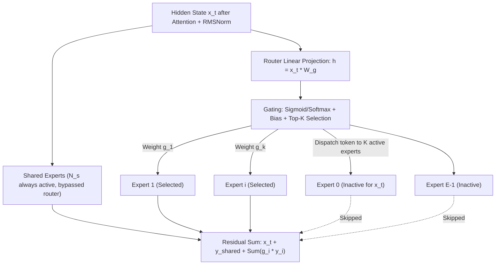
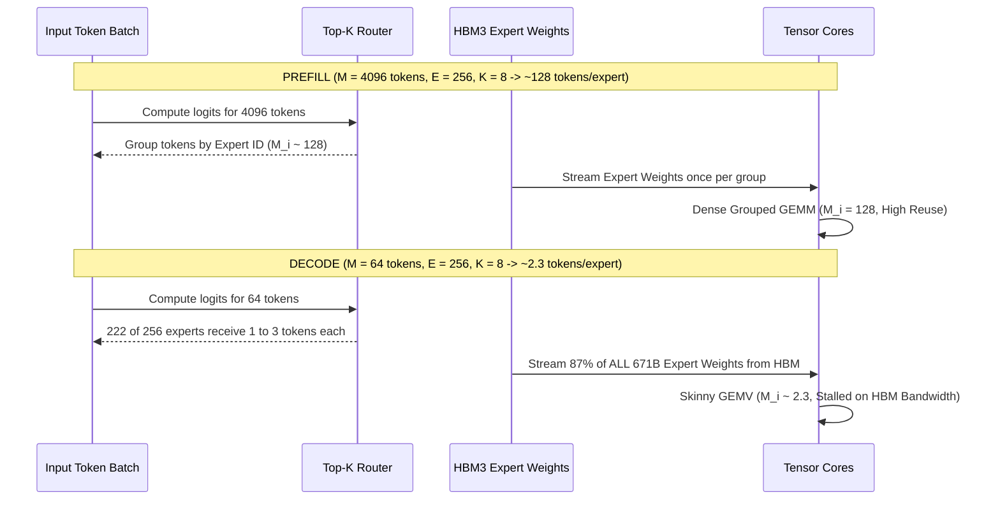

# 04. Mixture-of-Experts (MoE) Architectures

[← 03. Attention Memory & Long Contexts](./03-attention-memory-and-long-contexts.md) | [Stage 3 Overview](./README.md) | [Next: 05. Efficiency Metrics: MFU and MBU →](./05-efficiency-metrics-mfu-and-mbu.md)

---

## 1. Sparse Scaling: Total Parameters vs. Active Parameters per Token

In a dense Transformer, every token traverses the entire parameter graph of every layer, coupling model capacity (knowledge stored in weights) rigidly to per-token compute FLOPs ($\text{FLOPs} \approx 2 \cdot P_{\text{total}}$ per token). **Mixture-of-Experts (MoE)** breaks this coupling by replacing the monolithic dense Feed-Forward Network (FFN) in each Transformer block with $E$ parallel FFN **experts** plus a lightweight **gating (router) network** that activates only $K \ll E$ experts per token.

This creates a sharp distinction between two parameter counts:
* **Total Parameters ($P_{\text{total}}$):** Every weight residing in HBM (embeddings, attention projections, norms, routers, shared experts, and all $E$ routed experts). Determines **static VRAM capacity** and minimum GPU count.
* **Active Parameters per Token ($P_{\text{active}}$):** Parameters actually executed for a single token's forward pass (attention projections, shared experts, and the $K$ selected routed experts per layer). Determines **per-token FLOPs**.

$$P_{\text{total}} = P_{\text{shared\_backbone}} + L_{\text{moe}} \cdot E \cdot P_{\text{expert}}, \qquad P_{\text{active}} = P_{\text{shared\_backbone}} + L_{\text{moe}} \cdot K \cdot P_{\text{expert}}$$

*(Note: Attention projections and embeddings are always active for every token, so $P_{\text{shared\_backbone}}$ includes all attention layers, shared experts if present, norms, routers, and unshared embeddings/LM head.)*

### Concrete Frontier MoE Architectures

| Model | Total Params ($P_{\text{total}}$) | Active Params / Token ($P_{\text{active}}$) | Routed Experts ($E$) | Top-$K$ | Shared Experts ($N_s$) | BF16 Weight VRAM |
| :--- | :---: | :---: | :---: | :---: | :---: | :---: |
| **Mixtral 8x7B** | $46.7\text{B}$ | $12.9\text{B}$ | $8$ | $2$ | $0$ | $\sim 93.4\text{ GB}$ |
| **Mixtral 8x22B** | $141\text{B}$ | $39\text{B}$ | $8$ | $2$ | $0$ | $\sim 282\text{ GB}$ |
| **Qwen2.5 / Qwen3-235B-A22B** | $235\text{B}$ | $22\text{B}$ | $128$ | $8$ | $0$ | $\sim 470\text{ GB}$ |
| **DeepSeek-V3 / R1** | $671\text{B}$ | $37\text{B}$ | $256$ | $8$ | $1$ | $\sim 1{,}342\text{ GB}$ ($671\text{ GB}$ FP8) |

Notice the scaling leverage: DeepSeek-V3 holds **671B parameters** of model knowledge while executing only **37B active parameters** per token (~5.5% of total weights), giving it the FLOP profile of a ~37B dense model during compute-bound training and Prefill.

---

## 2. Gating Networks, Routing Functions, and Load Balancing

Given an input token hidden state $x_t \in \mathbb{R}^{d_{\text{model}}}$ exiting the Attention + Post-Attention RMSNorm sub-layer, the router computes scalar affinity logits $h_t \in \mathbb{R}^E$ via a small linear projection $W_g \in \mathbb{R}^{d_{\text{model}} \times E}$ (almost always kept in FP32 for numerical stability):

$$h_t = x_t W_g$$

### 2.1 Top-$K$ Softmax vs. Sigmoid Gating

Two primary normalization schemes convert raw logits $h_{t,i}$ into expert mixing weights $g_{t,i}$:

1. **Top-$K$ Softmax Gating (Switch Transformer, Mixtral):**
   * *Pre-TopK Softmax* computes $p_t = \text{softmax}(h_t)$ across all $E$ experts, then selects Top-$K$ (and optionally renormalizes).
   * *Top-$K$-then-Softmax* (Mixtral 8x7B) selects the $K$ highest logits first, then applies softmax strictly over those $K$ winners:
     $$g_{t,i} = \begin{cases} \dfrac{\exp(h_{t,i})}{\sum_{j \in \text{TopK}(h_t)} \exp(h_{t,j})} & \text{if } i \in \text{TopK}(h_t) \\ 0 & \text{otherwise} \end{cases}$$
   * **Behavior:** Softmax forces competition among experts ($\sum g_{t,i} = 1$). When $E$ is huge (e.g., $E = 256$), competitive softmax across all $E$ experts can suffer from vanishing gradients and probability dilution.

2. **Sigmoid Gating with Top-$K$ Normalization (DeepSeek-V3):**
   * Each expert's affinity is computed independently via logistic sigmoid:
     $$s_{t,i} = \sigma(h_{t,i}) = \frac{1}{1 + e^{-h_{t,i}}}$$
   * Select $\mathcal{T}_t = \text{TopK}(s_t, K)$, then normalize only across the $K$ chosen weights:
     $$g_{t,i} = \frac{s_{t,i}}{\sum_{j \in \mathcal{T}_t} s_{t,j}} \quad \text{for } i \in \mathcal{T}_t$$

The routed FFN output is the weighted sum of the selected expert outputs:

$$y_{\text{routed}}(x_t) = \sum_{i \in \mathcal{T}_t} g_{t,i} \cdot \text{FFN}_i(x_t)$$

### 2.2 Load Balancing: Auxiliary Loss vs. Auxiliary-Loss-Free Bias Balancing

Without explicit regularization, routers undergo **routing collapse**: a positive feedback loop where a few early-trained experts receive slightly more tokens, improve faster, earn higher router logits, and rapidly capture 99% of all tokens—leaving the remaining experts dead weight and creating severe GPU stragglers under Expert Parallelism.

1. **Classic Auxiliary Load-Balancing Loss (Switch / GShard / Mixtral):**
   Adds a differentiable penalty to the training loss over a batch of $T$ tokens:
   $$\mathcal{L}_{\text{aux}} = \alpha \cdot E \sum_{i=1}^{E} f_i \cdot P_i$$
   where $f_i = \frac{1}{T K} \sum_{t=1}^{T} \mathbb{I}(i \in \mathcal{T}_t)$ is the actual fraction of selections routed to expert $i$, and $P_i = \frac{1}{T} \sum_{t=1}^{T} p_{t,i}$ is the mean router probability assigned to expert $i$ (often paired with a small **router z-loss** $\mathcal{L}_z = \frac{1}{T} \sum_t (\log \sum_i e^{h_{t,i}})^2$ to prevent logit explosion).
   * **Drawback:** Tuning $\alpha$ creates an adversarial trade-off: too small causes routing collapse; too large forces the router to push tokens to suboptimal experts purely to satisfy uniform load, directly degrading perplexity.

2. **Auxiliary-Loss-Free Bias Balancing (DeepSeek-V3):**
   Completely removes $\mathcal{L}_{\text{aux}}$ from the gradient objective ($\alpha = 0$) and instead introduces a non-differentiable per-expert dynamic bias term $b_i$ used **only during Top-$K$ index selection**:
   $$\mathcal{T}_t = \text{TopK}\!\left(\{s_{t,i} + b_i\}_{i=1}^E,\; K\right), \qquad g_{t,i} = \frac{s_{t,i}}{\sum_{j \in \mathcal{T}_t} s_{t,j}}$$
   Notice that the bias $b_i$ shifts *which* expert wins the Top-$K$ slot, while the output scaling weight $g_{t,i}$ still uses the **pure, unbiased** affinity $s_{t,i}$. After each training step, if expert $i$ received more tokens than average, $b_i \leftarrow b_i - \gamma$; if underloaded, $b_i \leftarrow b_i + \gamma$ (with update rate $\gamma \approx 10^{-3}$). At inference time, $b_i$ is frozen as a static router bias vector, achieving near-perfect load balance without compromising language modeling quality.

---

## 3. Shared Experts vs. Routed Experts (DeepSeekMoE)

Traditional coarse-grained MoEs (like Mixtral $E=8, K=2$) suffer from **knowledge redundancy**: common syntactic and foundational capabilities (e.g., punctuation, basic grammar, common entities) must be duplicated independently across multiple routed experts because no single expert sees every token.

**DeepSeekMoE** solves this via two architectural mechanisms:
1. **Shared Experts ($N_s$):** A dedicated set of $N_s$ experts (e.g., $N_s = 1$ or $2$) that **every token unconditionally executes** with weight $1.0$, bypassing the router. These capture universal cross-domain representations.
2. **Fine-Grained Expert Segmentation ($N_r$):** Instead of 8 huge experts, the remaining FFN intermediate width is sliced into $N_r$ narrow experts (e.g., $N_r = 64$ or $256$, each with $d_{\text{ffn}}^{\text{expert}} = 2048$ in DeepSeek-V3 vs. $14336$ in Mixtral), activating $K = 8$ of them.
   * Combinatorial combinations jump from $\binom{8}{2} = 28$ to $\binom{256}{8} \approx 4.2 \times 10^{14}$, dramatically boosting specialization.

$$y_{\text{MoE}}(x_t) = x_t + \sum_{s=1}^{N_s} \text{FFN}_s^{\text{shared}}(x_t) + \sum_{i \in \mathcal{T}_t} g_{t,i} \cdot \text{FFN}_i^{\text{routed}}(x_t)$$

---

## 4. Expert Capacity, Token Dropping, and Grouped GEMM Execution

Because GPUs achieve peak efficiency on uniform tensor shapes, early MoE frameworks (GShard, Switch Transformer) enforced a fixed **Expert Capacity ($C$)** buffer per expert for a batch of $T$ tokens:

$$C = \left\lceil \frac{T \cdot K}{E} \cdot \text{CF} \right\rceil$$

where $\text{CF} \ge 1.0$ is the **Capacity Factor** (typically $1.0\text{--}1.5$).
* **Buffer Allocation:** Each expert receives a static input tensor of shape $[C, d_{\text{model}}]$.
* **Token Dropping:** If more than $C$ tokens route to a popular ("hot") expert, the excess tokens beyond capacity $C$ are **dropped**—bypassing the expert FFN entirely and propagating only through the residual connection ($x_t + 0$). Conversely, underloaded experts waste compute on zero-padded slots.
* **Dropless MoE Inference (MegaBlocks / Grouped GEMM):** Modern inference engines (vLLM, SGLang, TensorRT-LLM) avoid token dropping entirely during serving ($\text{CF} = \infty$) by permuting tokens into contiguous expert-grouped buckets in SRAM/HBM and launching a single **Grouped GEMM** (variable-$M_i$ batched matrix multiplication where each expert $i$ executes $M_i \times K \times N$ without padding zeros or discarding tokens).

---

## 5. The HBM Weight-Reading Bottleneck During Decode

A pervasive misconception is that an MoE model with $37\text{B}$ active parameters runs as fast as a $37\text{B}$ dense model during Decode. In reality, **at small-to-moderate batch sizes, MoE loses its active-parameter speedup to HBM weight-reading bandwidth.**

### 5.1 Mathematical Proof: Expected Active Experts vs. Batch Size $B$

During Decode, a batch of $B$ independent requests supplies $M = B$ tokens per step (1 token per sequence). Suppose the router distributes tokens approximately uniformly across $E$ experts, selecting $K$ distinct experts per token. The probability that any **single** expert $i$ is **not** picked by a given token is $1 - \frac{K}{E}$. Across $B$ independent tokens, the probability that expert $i$ is selected by **at least one** token in the batch is:

$$P(\text{expert } i \text{ hit}) = 1 - \left(1 - \frac{K}{E}\right)^B$$

By linearity of expectation, the expected number of distinct experts that must be loaded from HBM and executed in a single Decode step is:

$$\mathbb{E}[E_{\text{active}}(B)] = E \cdot \left[1 - \left(1 - \frac{K}{E}\right)^B\right]$$

Meanwhile, the average number of tokens processed **per active expert** is only:

$$\bar{M}_{\text{expert}}(B) = \frac{B \cdot K}{\mathbb{E}[E_{\text{active}}(B)]} \xrightarrow{\text{large } B} \frac{B \cdot K}{E}$$

### 5.2 Concrete Numerical Collapse: Mixtral 8x7B vs. DeepSeek-V3

Evaluate both models on an H100 (BF16 ridge point $I^* = 295.3\text{ FLOPs/B}$, or FP8 $I^* = 591\text{ FLOPs/B}$):

| Batch Size $B$ | Mixtral 8x7B ($E=8, K=2$): $\mathbb{E}[E_{\text{active}}]$ | Mixtral: Avg Tokens / Expert | DeepSeek-V3 ($E=256, K=8$): $\mathbb{E}[E_{\text{active}}]$ | DeepSeek-V3: Avg Tokens / Expert | Arithmetic Intensity Regime |
| :---: | :---: | :---: | :---: | :---: | :--- |
| **$B = 1$** | $2.0$ ($25\%$) | $1.00$ | $8.0$ ($3.1\%$) | $1.00$ | **Severe GEMV** ($I \approx 1$ FLOP/B) |
| **$B = 4$** | $5.47$ ($68.4\%$) | $1.46$ | $30.5$ ($11.9\%$) | $1.05$ | **GEMV** ($I \approx 1\text{--}1.5$ FLOP/B) |
| **$B = 16$** | $7.92$ ($99.0\%$) | $4.04$ | $102.0$ ($39.8\%$) | $1.25$ | **Memory-Bound** ($I \approx 1.3\text{--}4$ FLOP/B) |
| **$B = 64$** | $8.00$ ($100\%$) | $16.0$ | $222.5$ ($86.9\%$) | $2.30$ | **Memory-Bound** ($I \approx 2.3\text{--}16$ FLOP/B) |
| **$B = 256$** | $8.00$ ($100\%$) | $64.0$ | $255.9$ ($99.97\%$) | $8.00$ | **Still Memory-Bound!** ($I \approx 8\text{--}63$ FLOP/B) |

Look closely at **$B = 64$** for DeepSeek-V3 ($671\text{B}$ total / $37\text{B}$ active):
* A **Dense 37B** model at $B = 64$ reads **$37\text{B}$ weights once** from HBM ($M = 64 \implies I_{\text{BF16}} \approx 62\text{ FLOPs/B}$).
* **DeepSeek-V3** at $B = 64$ hits **$222.5$ out of $256$ experts** per layer, forcing the GPU cluster to stream **$\sim 585\text{B}$ parameters** from HBM every single decode step—**15.8x more HBM weight traffic** than a 37B dense model—while each expert executes an ultra-skinny GEMM with an average of **only $2.3$ tokens** ($I_{\text{BF16}} \approx 2.3\text{ FLOPs/B}$)!

To push each routed expert on DeepSeek-V3 ($E=256, K=8$) up to an H100 BF16 ridge point of $M^*_{\text{expert}} \approx 326$ tokens per expert, the total decode batch size would have to reach:

$$B^*_{\text{MoE}} \approx \frac{E}{K} \cdot M^* = \frac{256}{8} \times 326 = \mathbf{10{,}432\text{ concurrent tokens}}$$

Even at $B = 1$ (single-user decode), while MoE only reads $P_{\text{active}}$ ($37\text{B}$) rather than $P_{\text{total}}$ ($671\text{B}$), **Prefill vs. Decode diverges sharply**:

### Engineering Consequences for MoE Serving
1. **Batch-Size Amplification via Data Parallel Attention + Expert Parallelism (EP):** Because each GPU rank cannot hold 671B weights alone (or 10,432 KV caches), frontier MoEs run **Attention with Data Parallelism** across e.g. 32–64 GPUs (each holding a small local decode batch $B_{\text{local}}$) and **All-to-All dispatch** all tokens into a shared **Expert Parallel** pool so $B_{\text{global}} = 64 \times B_{\text{local}}$ aggregates enough tokens per expert to amortize HBM weight reads.
2. **Weight Quantization (FP8 / FP4) Is Doubly Valuable for MoE Decode:** Halving expert weights from BF16 to FP8 or FP4 cuts the HBM weight-streaming wall in half directly proportional to ITL.
3. **Prefill/Decode Disaggregation:** Separating Prefill ($M_{\text{expert}} \gg 100$) from Decode prevents large Prefill batches from stalling latency-sensitive Decode steps while allowing Decode pools to scale batching and EP independently.

---

**Navigation:** [← 03. Attention Memory & Long Contexts](./03-attention-memory-and-long-contexts.md) | [Stage 3 Overview](./README.md) | [Next: 05. Efficiency Metrics: MFU and MBU →](./05-efficiency-metrics-mfu-and-mbu.md)
