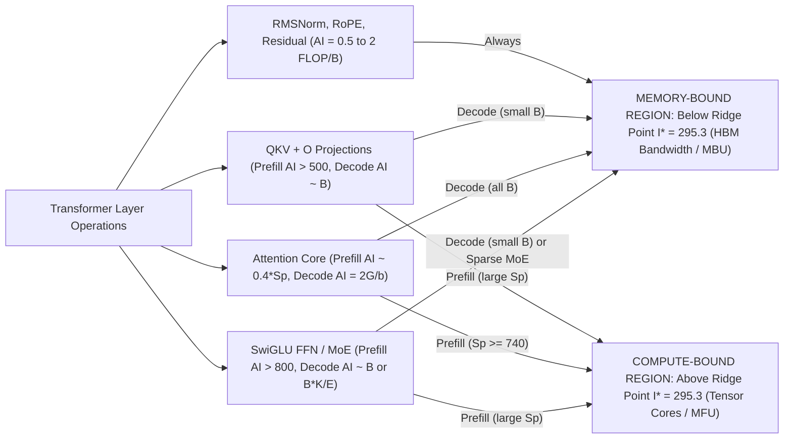
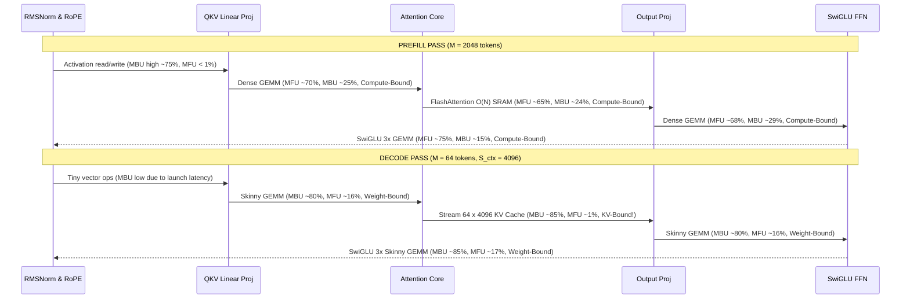

# 05. Efficiency Metrics: MFU and MBU

[← 04. Mixture-of-Experts Architectures](./04-mixture-of-experts-architectures.md) | [Stage 3 Overview](./README.md) | [Complete Syllabus](../../syllabus.md)

Measuring whether an inference engine is actually fast requires different yardsticks for prompt processing and token generation. This document breaks down every sub-operation inside a Transformer layer, defines **MFU** and **MBU** rigorously, and walks through a complete end-to-end hardware audit on an NVIDIA H100.

---

## Core Concepts & Terminology

Each concept below is ordered so later definitions build only on earlier ones:

* **Token, Batch Size ($B$), Context Lengths ($S_p, S_{\text{ctx}}$), and Active Tokens ($M$):** A **token** is the basic unit of text. $B$ is the number of concurrent requests; $S_p$ is prompt length in tokens; $S_{\text{ctx}}$ is cached context length; $M$ is total active tokens in one forward pass ($M = B \cdot S_p$ in Prefill, $M = B$ in Decode).
* **Transformer Decoder Layer & Dimensions ($d, n_q, n_{kv}, d_h, d_{\text{ffn}}, V$):** A layer with hidden width $d$ ($d_{\text{model}} = n_q \cdot d_h$), $n_q$ Query heads, $n_{kv}$ Key/Value heads (under **GQA** or **MQA**, with group ratio $G = n_q / n_{kv}$), head width $d_h$, **SwiGLU FFN** (gated Feed-Forward Network using the **SiLU** activation and elementwise product $\odot$) intermediate width $d_{\text{ffn}}$, and vocabulary size $V$ for the final **LM Head** output projection.
* **Prefill, Decode, TTFT, and ITL:** **Prefill** processes all prompt tokens in parallel (setting **TTFT**, Time to First Token); **Decode** generates 1 token per request per step (measured by **ITL**, Inter-Token Latency).
* **HBM (High Bandwidth Memory, e.g., HBM3 / HBM3e) & SRAM:** **HBM** is off-chip GPU main memory ($3.35\text{ TB/s}$ on H100; $4.8\text{ TB/s}$ on H200); **SRAM** is fast on-chip memory inside GPU compute units.
* **KV Cache & FlashAttention:** The **KV Cache** stores past Key and Value vectors in HBM. **FlashAttention** uses SRAM tiling to compute exact attention ($QK^T$, causal mask, softmax, $PV$) without writing the $O(S_p^2)$ score matrix to HBM.
* **Elementwise & Reduction Ops (RMSNorm, RoPE, Residual Adds, SiLU) & Operator Fusion:** Lightweight non-matrix steps—**RMSNorm** (normalization), **RoPE** (rotary position encoding), **Residual Adds** (skip connections), and **SiLU**. **Operator fusion** merges these into neighboring kernels so activations stay in SRAM/registers rather than round-tripping to HBM.
* **Numerical Precision ($b$ bytes/elem: BF16, FP16, FP8, FP4, W4A16) & 2:4 Sparsity:** **BF16/FP16** use 2 bytes; **FP8** uses 1 byte; **FP4 / W4A16** store weights in 4 bits ($0.5\text{ B}$) with 16-bit activations. **2:4 structured sparsity** is a hardware mode that zeroes 2 of every 4 weights to double nominal peak math rate.
* **FLOP, FLOPs, FLOP/s, Tensor Cores (MMA), GEMM, and Skinny GEMM:** A **FLOP** is one floating-point operation; **FLOPs** is total operations; **FLOP/s** is execution rate. **Tensor Cores** execute **MMA** (Matrix Multiply-Accumulate) instructions. **GEMM** is dense matrix-matrix multiplication; **skinny GEMM** has small $M$.
* **Arithmetic Intensity ($I$), Roofline Model, Ridge Point ($I^*$), Compute-Bound vs. Memory-Bound:** $I = \text{FLOPs}/\text{Bytes}_{\text{HBM}}$. The **Roofline model** caps speed at $\min(F_{\text{peak}}, I \cdot \text{BW}_{\text{peak}})$, meeting at the **ridge point** $I^* = F_{\text{peak}}/\text{BW}_{\text{peak}}$ ($295.3\text{ FLOPs/B}$ on H100 BF16). Operations with $I < I^*$ are **memory-bound**; $I \ge I^*$ are **compute-bound**.
* **MoE (Mixture-of-Experts: $N_s, K, E, d_{\text{ffn}}^{\text{exp}}$):** Sparse FFN layers with $N_s$ shared experts and $K$ active routed experts out of $E$ total, where HBM weight reads scale with the expected number of distinct hit experts $\mathbb{E}[E_{\text{active}}(M)]$.
* **MFU (Model FLOPs Utilization) vs. HFU (Hardware FLOPs Utilization):** **MFU** is achieved *useful minimum model FLOP/s* divided by peak hardware FLOP/s ($F_{\text{peak}}$). **HFU** also counts wasted hardware FLOPs (e.g., zero-padding **ragged batches** of unequal lengths or computing masked upper-triangular attention).
* **MBU (Model Bandwidth Utilization):** Achieved minimum required HBM bytes/s (weights + KV Cache + boundary activations) divided by peak HBM bandwidth ($\text{BW}_{\text{peak}}$).
* **Serving Optimization Levers:** **Chunked Prefill** (splitting long prompts into fixed-size chunks), **CUDA Graphs** (replaying captured kernel sequences to eliminate CPU launch latency), **Speculative Decoding** (verifying multiple draft tokens in parallel), **PagedAttention** (storing KV Cache in non-contiguous memory pages), and **Prefill/Decode Disaggregation** (isolating Prefill and Decode on separate GPU pools).

---

## 1. Per-Layer Operation Anatomy: Exact FLOPs and HBM Bytes Moved

A single Transformer decoder layer is not a uniform matrix multiply; it is a pipeline of five structurally distinct stages whose arithmetic intensities differ by **three orders of magnitude**. From a PyTorch perspective, even though `QKV`, `Attention`, `Out`, and `FFN` all execute inside the same `forward()` method, some stages perform heavy matrix multiplications that reuse loaded data hundreds of times, while others (like `RMSNorm`, `RoPE`, and Decode Attention) stream huge tensors from HBM just to perform a few arithmetic operations per element. Let:
* $B$: Batch size; $S_p$: Prefill tokens per sequence; $S_{\text{ctx}}$: Cached KV context length per sequence during Decode.
* $M$: Active tokens in the forward pass ($M = B \cdot S_p$ in Prefill; $M = B$ in Decode).
* $d$: Model hidden dimension ($d_{\text{model}} = n_q \cdot d_h$).
* $n_q, n_{kv}, d_h$: Query heads, KV heads (GQA/MQA), and head dimension.
* $d_{\text{ffn}}$: Intermediate MLP dimension (for SwiGLU, typically $\sim 2.67 d$ to $3.5 d$).
* $b$: Precision in bytes per element ($b = 2$ for BF16/FP16).

### 1.1 Per-Layer Component Equations

1. **QKV Linear Projection ($W_Q \in \mathbb{R}^{d \times n_q d_h}$, $W_K, W_V \in \mathbb{R}^{d \times n_{kv} d_h}$):**
   * **FLOPs:** $2 M d \cdot (n_q + 2 n_{kv}) d_h$
   * **Bytes Moved:** $b \cdot \big[d(n_q + 2n_{kv})d_h + M d + M(n_q + 2n_{kv})d_h\big]$ *(assuming fused QKV read of $X$ once; unfused reads $X$ 3 times)*.
   * **Regime:** Compute-bound in Prefill ($M \gg M^*$); Weight-bandwidth-bound in Decode ($M \ll M^*$).

2. **Attention Core ($QK^T$, Causal Mask + Softmax, $PV$) with FlashAttention:**
   * **Prefill ($M = B \cdot S_p$):**
     * **Causal FLOPs:** $2 \cdot B \cdot n_q \cdot S_p^2 \cdot d_h$ *(half of $4 B n_q S_p^2 d_h$ due to lower-triangular causal masking)*.
     * **HBM Bytes (FlashAttention):** Reads $Q, K, V$ and writes $O$, avoiding $O(S_p^2)$ HBM materialization:
       $\text{Bytes} = b \cdot B \cdot S_p \cdot d_h \cdot (2 n_q + 2 n_{kv})$.
     * **Arithmetic Intensity:**
       $$I_{\text{Attn, Prefill}} = \frac{2 B n_q S_p^2 d_h}{b \cdot B S_p d_h (2n_q + 2n_{kv})} = \frac{n_q}{b(n_q + n_{kv})} S_p$$
       Because $I \propto S_p$, long-prompt Prefill Attention rapidly becomes **compute-bound** (e.g., for Llama-3 8B with $n_q=32, n_{kv}=8, b=2, S_p=2048$: $I = \frac{32}{80} \times 2048 = \mathbf{819.2\text{ FLOPs/B}} > 295.3$).
   * **Decode ($M = B$, attending over $S_{\text{ctx}}$ cached tokens per sequence):**
     * **FLOPs:** $4 \cdot B \cdot n_q \cdot S_{\text{ctx}} \cdot d_h$ *(no causal sparsity needed since all $S_{\text{ctx}}$ tokens precede the current token)*.
     * **HBM Bytes:** Reads $Q$ ($B n_q d_h$), reads entire KV Cache ($2 B S_{\text{ctx}} n_{kv} d_h$), writes $O$ ($B n_q d_h$):
       $\text{Bytes} \approx 2 b \cdot B \cdot S_{\text{ctx}} \cdot n_{kv} \cdot d_h$ (for $S_{\text{ctx}} \gg 1$).
     * **Arithmetic Intensity:**
       $$I_{\text{Attn, Decode}} \approx \frac{4 B n_q S_{\text{ctx}} d_h}{2 b B S_{\text{ctx}} n_{kv} d_h} = \frac{2}{b} \cdot \frac{n_q}{n_{kv}} = \frac{2 G}{b}$$
       **Critical Invariance:** Batch size $B$ and context length $S_{\text{ctx}}$ **cancel out completely**! In BF16 ($b=2$), MHA ($G=1$) is locked at $I = \mathbf{1.0\text{ FLOP/B}}$, and Llama-3 8B GQA ($G=4$) is locked at $I = \mathbf{4.0\text{ FLOPs/B}}$—meaning **Decode Attention is permanently memory-bandwidth-bound at EVERY batch size**!

3. **Output Projection ($W_O \in \mathbb{R}^{n_q d_h \times d}$):**
   * **FLOPs:** $2 M d^2$
   * **Bytes Moved:** $b \cdot (d^2 + 2 M d)$
   * **Regime:** Compute-bound in Prefill; Weight-bandwidth-bound in Decode.

4. **SwiGLU Feed-Forward Network ($W_{\text{gate}}, W_{\text{up}} \in \mathbb{R}^{d \times d_{\text{ffn}}}$, $W_{\text{down}} \in \mathbb{R}^{d_{\text{ffn}} \times d}$):**
   * **FLOPs:** $3 \times (2 M d \cdot d_{\text{ffn}}) = 6 M d \cdot d_{\text{ffn}}$ *(plus negligible $O(M d_{\text{ffn}})$ for $\text{SiLU}(\cdot) \odot (\cdot)$)*.
   * **Bytes Moved (BF16, unfused vs. fused gate+up):** $\approx b \cdot (3 d \cdot d_{\text{ffn}} + 2 M d + 2 M d_{\text{ffn}})$.
   * **MoE Variant:** FLOPs scale by active experts $(N_s + K) \cdot 6 M d \cdot d_{\text{ffn}}^{\text{exp}}$; Bytes moved scale by the number of **distinct hit experts** $\mathbb{E}[E_{\text{active}}(M)] \cdot 3 b d \cdot d_{\text{ffn}}^{\text{exp}}$.

5. **Elementwise & Reduction Ops (RMSNorm, RoPE, Residual Adds, SiLU):**
   * **FLOPs:** $\sim 4\text{--}8$ ops per scalar element ($O(M d)$).
   * **Bytes Moved:** Reads and writes full activation tensors ($2 b M d$ per unfused kernel).
   * **Arithmetic Intensity:** **$I \approx 0.5\text{ to }2.0\text{ FLOPs/B}$ in BOTH Prefill and Decode!** Even during massive Prefills, unfused RMSNorm/RoPE/Residual kernels hit the HBM bandwidth wall because they read an entire activation tensor from HBM, perform only a handful of elementwise operations on each number, and write it right back—which is why operator fusion (Stage 8) merges them into adjacent kernels so the data never leaves fast SRAM.

---

## 2. Exact Definitions: MFU vs. MBU

### 2.1 Model FLOPs Utilization (MFU)

**MFU** (Chowdhery et al., PaLM 2022; adapted for inference) measures the fraction of the hardware's theoretical peak compute throughput actually delivered toward **useful model FLOPs**:

$$\text{MFU} = \frac{\text{Achieved Model FLOP/s}}{\text{Peak Hardware FLOP/s}} = \frac{\text{FLOPs}_{\text{model\_forward}}}{\Delta t_{\text{measured}} \times F_{\text{peak}}}$$

* **Why "Model FLOPs" instead of "Hardware FLOPs" (HFU)?** If you pad a batch of unequal-length prompts to a uniform rectangular tensor (`torch.nn.utils.rnn.pad_sequence`), the GPU's Tensor Cores will dutifully multiply all those zero-padded tokens. Similarly, a naive attention kernel computes the entire $N \times N$ score matrix and only masks out the upper triangle afterward. **Hardware FLOPs Utilization (HFU)** counts all of that wasted math as "productive," whereas **MFU** credits strictly the minimum mathematical FLOPs required by the actual unpadded tokens and causal triangle.
* **$F_{\text{peak}}$ Precision Matching:** Always match $F_{\text{peak}}$ to the active Tensor Core datatype (e.g., on H100 SXM5: $989.4\text{ TFLOP/s}$ for BF16/FP16; $1{,}978.9\text{ TFLOP/s}$ for FP8—excluding 2:4 structured sparsity unless sparsity is actually enabled).

### 2.2 Model Bandwidth Utilization (MBU)

**MBU** measures the fraction of the GPU's theoretical peak HBM bandwidth actually utilized to transfer the minimum required model weights, KV Cache entries, and boundary activations:

$$\text{MBU} = \frac{\text{Achieved HBM Bytes/s}}{\text{Peak HBM Bandwidth}} = \frac{\text{Bytes}_{\text{weights}} + \text{Bytes}_{\text{KV\_cache}} + \text{Bytes}_{\text{activations}}}{\Delta t_{\text{measured}} \times \text{BW}_{\text{peak}}}$$

* For H100 SXM5, $\text{BW}_{\text{peak}} = 3.35\text{ TB/s}$ (for H200 with HBM3e, $\text{BW}_{\text{peak}} = 4.8\text{ TB/s}$).
* Note that in a single memory-bound Decode step ($\Delta t_{\text{measured}}$), reading a 14 GB weight + KV footprint in $5.2\text{ ms}$ yields $\text{Achieved BW} = 14\text{ GB} / 0.0052\text{ s} = 2.69\text{ TB/s} \implies \text{MBU} = 2.69 / 3.35 = \mathbf{80.3\%}$.

### 2.3 Why MFU Governs Prefill While MBU Governs Decode

By the Roofline bound, the minimum possible execution time $\Delta t_{\min}$ is dictated by whichever ceiling is hit first:

$$\Delta t_{\min} = \max\!\left(\frac{\text{FLOPs}_{\text{model}}}{F_{\text{peak}}},\;\; \frac{\text{Bytes}_{\text{HBM}}}{\text{BW}_{\text{peak}}}\right)$$

* **During Prefill:** $\frac{\text{FLOPs}_{\text{model}}}{F_{\text{peak}}} \gg \frac{\text{Bytes}_{\text{HBM}}}{\text{BW}_{\text{peak}}}$. Ideal $\text{MFU} \to 100\%$ (well-tuned engines achieve **55%–75% MFU**; remaining losses come from non-matmul ops, causal tile imbalance, and kernel launch gaps), while ideal MBU sits well below $25\%$. **MFU directly measures Prefill efficiency.**
* **During Decode:** $\frac{\text{Bytes}_{\text{HBM}}}{\text{BW}_{\text{peak}}} \gg \frac{\text{FLOPs}_{\text{model}}}{F_{\text{peak}}}$. Even on theoretically infinitely fast silicon running at $100\%$ MBU, Decode MFU is physically capped at:
  $$\text{MFU}_{\text{ceiling}} = \frac{I_{\text{decode}}}{I^*} = \frac{\text{FLOPs}_{\text{model}} / \text{Bytes}_{\text{HBM}}}{F_{\text{peak}} / \text{BW}_{\text{peak}}}$$
  At $B = 1$ BF16, $I_{\text{decode}} \approx 1.1\text{ FLOP/B}$ vs. $I^* = 295.3\text{ FLOP/B}$, hard-capping MFU at **$0.37\%$**! Optimizing a single-user decode kernel for MFU is meaningless; **MBU (targeting 70%–85%+)** is the true engineering north star for Decode.

---

## 3. Complete Worked Audit: Llama-3 8B on H100 SXM5

Let us perform an exact end-to-end analytical audit of **Llama-3 8B (BF16, $b=2$)** on one **H100 SXM5** ($F_{\text{peak}} = 989.4\text{ TFLOP/s}$, $\text{BW}_{\text{peak}} = 3.35\text{ TB/s}$, $I^* = 295.3\text{ FLOPs/B}$):
* **Architecture constants:** $L = 32$ layers, $d = 4096$, $n_q = 32$, $n_{kv} = 8$, $d_h = 128$, $d_{\text{ffn}} = 14336$, $V = 128{,}256$ vocab.
* **Per-layer linear weight count:**
  * $W_Q + W_O$: $2 \times 4096^2 = 33{,}554{,}432$ params ($67.11\text{ MB}$).
  * $W_K + W_V$: $2 \times 4096 \times 1024 = 8{,}388{,}608$ params ($16.78\text{ MB}$).
  * SwiGLU ($W_{\text{gate}}, W_{\text{up}}, W_{\text{down}}$): $3 \times 4096 \times 14336 = 176{,}160{,}768$ params ($352.32\text{ MB}$).
  * **Total per layer:** $218{,}103{,}808$ params = **$436.21\text{ MB}$** in BF16.
* **LM Head:** $4096 \times 128{,}256 = 525{,}336{,}576$ params = **$1{,}050.67\text{ MB}$** in BF16 (plus $525.3\text{M}$ embedding lookup table, which only reads $M$ rows of size $d$, negligible bandwidth).

### Scenario A: Prefill ($B = 1, S_p = 2048 \implies M = 2048$)

| Layer Component (x32) | FLOPs / Layer | Min HBM Bytes / Layer | Arithmetic Intensity | Regime |
| :--- | :---: | :---: | :---: | :--- |
| **QKV Projection** | $103.08\text{ GFLOPs}$ | $125.83\text{ MB}$ | $819.2\text{ FLOP/B}$ | Compute-Bound |
| **Causal Attention (Flash)** | $34.36\text{ GFLOPs}$ | $41.94\text{ MB}$ | $819.2\text{ FLOP/B}$ | Compute-Bound |
| **Output Projection** | $68.72\text{ GFLOPs}$ | $100.66\text{ MB}$ | $682.7\text{ FLOP/B}$ | Compute-Bound |
| **SwiGLU FFN** | $721.55\text{ GFLOPs}$ | $486.54\text{ MB}$ | $1{,}483.0\text{ FLOP/B}$ | Compute-Bound |
| **RMSNorm + RoPE + Res** | $\sim 0.12\text{ GFLOPs}$ | $\sim 117.44\text{ MB}$ | $\sim 1.0\text{ FLOP/B}$ | Memory-Bound |
| **Single Layer Total** | **$927.83\text{ GFLOPs}$** | **$872.41\text{ MB}$** | **$1{,}063.5\text{ FLOP/B}$** | **Compute-Bound** |

* **Full 32-Layer + LM Head Totals:**
  * $\text{FLOPs}_{\text{total}} = 32 \times 927.83\text{ GFLOPs} + (2 \times 2048 \times 4096 \times 128256) = 29.69 + 2.15 = \mathbf{31.84\text{ TFLOPs}}$.
  * $\text{Bytes}_{\text{total}} = 32 \times 872.41\text{ MB} + 2.12\text{ GB (LM head)} \approx \mathbf{30.0\text{ GB}}$.
  * Roofline lower bound: $\max\!\left(\frac{31.84\text{ TFLOPs}}{989.4\text{ TFLOP/s}},\; \frac{30.0\text{ GB}}{3.35\text{ TB/s}}\right) = \max(32.18\text{ ms},\; 8.96\text{ ms}) = \mathbf{32.18\text{ ms}}$.
* **If measured TTFT = $46.0\text{ ms}$:**
  * $\text{MFU} = \frac{31.84\text{ TFLOPs}}{0.046\text{ s} \times 989.4\text{ TFLOP/s}} = \mathbf{69.96\%}$ *(Primary KPI: high compute utilization)*.
  * $\text{MBU} = \frac{30.0\text{ GB}}{0.046\text{ s} \times 3.35\text{ TB/s}} = \mathbf{19.47\%}$.

### Scenario B: Single-Request Decode ($B = 1, M = 1, S_{\text{ctx}} = 4096$)

| Layer Component (x32) | FLOPs / Layer | Min HBM Bytes / Layer | Arithmetic Intensity | Regime |
| :--- | :---: | :---: | :---: | :--- |
| **QKV Projection** | $50.33\text{ MFLOPs}$ | $50.35\text{ MB}$ | $1.00\text{ FLOP/B}$ | Memory-Bound |
| **Decode Attention ($S_{\text{ctx}}=4096$)** | $67.11\text{ MFLOPs}$ | $16.80\text{ MB}$ (KV read) | $4.00\text{ FLOP/B}$ | Memory-Bound |
| **Output Projection** | $33.55\text{ MFLOPs}$ | $33.57\text{ MB}$ | $1.00\text{ FLOP/B}$ | Memory-Bound |
| **SwiGLU FFN** | $352.32\text{ MFLOPs}$ | $352.38\text{ MB}$ | $1.00\text{ FLOP/B}$ | Memory-Bound |
| **RMSNorm + RoPE + Res** | $\sim 0.06\text{ MFLOPs}$ | $\sim 0.06\text{ MB}$ | $\sim 1.00\text{ FLOP/B}$ | Memory-Bound |
| **Single Layer Total** | **$503.37\text{ MFLOPs}$** | **$453.16\text{ MB}$** | **$1.11\text{ FLOP/B}$** | **Memory-Bound** |

* **Full 32-Layer + LM Head Totals:**
  * $\text{FLOPs}_{\text{total}} = 32 \times 503.37\text{ MFLOPs} + 1.051\text{ GFLOPs} = \mathbf{17.16\text{ GFLOPs}}$.
  * $\text{Bytes}_{\text{total}} = 32 \times 453.16\text{ MB} + 1.051\text{ GB} = \mathbf{15.55\text{ GB}}$.
  * Roofline lower bound: $\max\!\left(\frac{17.16\text{ GFLOPs}}{989.4\text{ TFLOP/s}},\; \frac{15.55\text{ GB}}{3.35\text{ TB/s}}\right) = \max(0.017\text{ ms},\; 4.64\text{ ms}) = \mathbf{4.64\text{ ms}}$.
* **If measured ITL = $5.80\text{ ms}$:**
  * $\text{MBU} = \frac{15.55\text{ GB}}{0.0058\text{ s} \times 3.35\text{ TB/s}} = \mathbf{80.0\%}$ *(Primary KPI: near-optimal bandwidth saturation)*.
  * $\text{MFU} = \frac{17.16\text{ GFLOPs}}{0.0058\text{ s} \times 989.4\text{ TFLOP/s}} = \mathbf{0.30\%}$ *(Physically capped at $0.37\%$ even at 100% MBU)*.

### Scenario C: Batched Decode ($B = 64, M = 64, S_{\text{ctx}} = 4096$)

* Linear weights ($15.01\text{ GB}$ total) are read **once**, while KV Cache reads grow **64x** ($32 \times 64 \times 16.78\text{ MB} = \mathbf{34.36\text{ GB}}$)!
* $\text{FLOPs}_{\text{total}} = 64 \times 17.16\text{ GFLOPs} = \mathbf{1.098\text{ TFLOPs}}$; $\text{Bytes}_{\text{total}} \approx \mathbf{50.0\text{ GB}}$ ($I = \mathbf{21.96\text{ FLOPs/B}}$).
* Roofline lower bound: $\frac{50.0\text{ GB}}{3.35\text{ TB/s}} = \mathbf{14.93\text{ ms}}$ ($\implies 64 / 0.01493 = 4{,}287\text{ tok/s}$ peak throughput).
* At $18.0\text{ ms}$ measured ITL: **$\text{MBU} = 82.9\%$**, **$\text{MFU} = 6.17\%$**. Notice that even at $B=64$, **KV Cache bandwidth is 2.3x larger than weight bandwidth**, keeping the step firmly memory-bound and MBU the primary metric.

---

## 4. Intra-Pass MFU and MBU Dynamics Across a Single Layer

The sequence diagram below traces how hardware utilization flips dynamically within a single forward pass across the five sub-operations of a Transformer layer during **Prefill ($M=2048$)** versus **Decode ($M=64, S_{\text{ctx}}=4096$)**:

---

## 5. Summary Decision Matrix for Inference Engineers

| Phase / Workload | Primary Bottleneck | Target Metric | Typical Well-Tuned Value | Primary Optimization Levers |
| :--- | :--- | :---: | :---: | :--- |
| **Prefill** (Long prompts) | Tensor Core MMA FLOP/s | **MFU** | $55\%\text{--}75\%$ | FP8 Tensor Cores, FlashAttention-3, Chunked Prefill sizing, Operator Fusion |
| **Decode** (Low batch $B \le 16$) | HBM Weight Read BW | **MBU** | $70\%\text{--}85\%$ | Weight-only quantization (FP4/W4A16/FP8), CUDA Graphs, Speculative Decoding |
| **Decode** (Large batch / Long ctx) | HBM KV Cache Read BW | **MBU** | $75\%\text{--}88\%$ | GQA/MLA, FP8 KV Cache quantization, PagedAttention, Prefill/Decode Disaggregation |

---

**Navigation:** [← 04. Mixture-of-Experts Architectures](./04-mixture-of-experts-architectures.md) | [Stage 3 Overview](./README.md) | [Complete Syllabus](../../syllabus.md)
