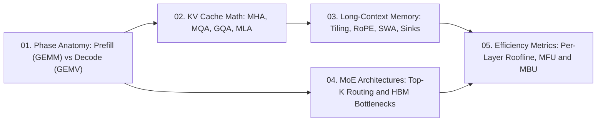

# Stage 3: Transformer & MoE Inference Anatomy

[Back to Documentation Overview](../../README.md) | [Back to Complete Syllabus](../../syllabus.md)

---

## Stage Overview

Stages 1 and 2 established how CPUs, OS memory subsystems, CUDA Streaming Multiprocessors, Tensor Cores, and HBM3/HBM3e memory hierarchies operate at the silicon level. **Stage 3** maps those physical hardware constraints directly onto the mathematics and tensor dataflow of modern autoregressive **Transformer** and **Mixture-of-Experts (MoE)** models.

Large Language Model inference is not a uniform workload. A single generation request passes through two physically opposite regimes—**Prefill** and **Decode**—whose bottlenecks sit on opposite sides of the GPU Roofline ridge point. Simultaneously, the autoregressive **KV Cache** transforms stateless neural network execution into a stateful, memory-capacity- and memory-bandwidth-dominated problem, while **MoE** architectures decouple active FLOPs from total HBM parameter capacity.

Mastering Stage 3 provides the analytical equations required to predict exact VRAM capacity, minimum achievable latency, optimal batch sizes, and hardware efficiency (**MFU** vs. **MBU**) from first principles before a single kernel is launched.

---

## Topic Index

| # | Document | Core Technical Focus | Primary Governing Equations |
| :---: | :--- | :--- | :--- |
| **01** | [**Inference Phase Anatomy: Prefill vs. Decode**](./01-inference-phase-anatomy-prefill-vs-decode.md) | GEMM vs. GEMV physics, arithmetic intensity derivation, batching up to the Roofline ridge point, TTFT vs. ITL/TPOT | $I = \frac{M N K}{M K + K N + M N}$ (BF16) |
| **02** | [**KV Cache Mathematics**](./02-kv-cache-mathematics.md) | Exact bytes-per-token state sizing across MHA, MQA, GQA, and DeepSeek MLA; numerical footprints up to 128k context | $2 \cdot n_{\text{layers}} \cdot n_{\text{kv}} \cdot d_{\text{head}} \cdot b$ |
| **03** | [**Attention Memory & Long Contexts**](./03-attention-memory-and-long-contexts.md) | $O(N^2)$ naive attention vs. $O(N)$ tiled online softmax, RoPE scaling (Linear, NTK, YaRN), SWA, and attention sinks | $m^{(j)}, \ell^{(j)}, O^{(j)}$ online recurrence |
| **04** | [**Mixture-of-Experts (MoE) Architectures**](./04-mixture-of-experts-architectures.md) | Total vs. active parameters, Top-$K$ softmax/sigmoid routing, load balancing, shared experts, and decode HBM bottlenecks | $P(\text{hit}) = 1 - \left(1 - \frac{K}{E}\right)^B$ |
| **05** | [**Efficiency Metrics: MFU and MBU**](./05-efficiency-metrics-mfu-and-mbu.md) | Per-layer FLOPs and byte movement across QKV, Attention, Output, FFN/MoE; MFU for Prefill vs. MBU for Decode | $\text{MFU} = \frac{\text{FLOP/s}}{\text{Peak FLOP/s}}$, $\text{MBU} = \frac{\text{B/s}}{\text{Peak BW}}$ |

---

## Key Architectural Takeaways

1. **Two Opposite Physical Regimes:** Prefill processes $M = B \cdot S_{\text{prompt}}$ tokens simultaneously via dense Matrix-Matrix Multiplication (**GEMM**), achieving high arithmetic intensity and saturating Tensor Cores (*compute-bound*). Decode processes $M = B$ tokens one step at a time via Matrix-Vector-like Multiplication (**GEMV**), reading the entire weight matrix and KV Cache from HBM for negligible arithmetic work (*memory-bandwidth-bound*).
2. **Statefulness Dominates Memory at Scale:** For long contexts and high concurrency, the KV Cache grows linearly as $O(B \cdot S)$ and routinely exceeds static model weights in VRAM. Architectural innovations—**GQA** and **MLA**—exist specifically to shrink the bytes-per-token multiplier while preserving representational capacity.
3. **Online Softmax Eliminates $O(N^2)$ HBM Allocation:** Attention compute remains quadratic in sequence length ($O(N^2 d)$ FLOPs), but SRAM tiling and the online softmax rescaling invariant reduce attention's HBM activation footprint from $O(N^2)$ to $O(N)$.
4. **Sparsity Saves FLOPs, Not Always Decode Latency:** MoE reduces active FLOPs per token, yet at low batch sizes a small batch of tokens triggers a disproportionately large fraction of experts—forcing HBM to stream nearly all active and semi-active expert weights at low arithmetic intensity.
5. **Phase-Aligned Efficiency Metrics:** Evaluating a Decode engine by **MFU** is misleading because physics caps Decode MFU in the low single digits at small batch sizes; **MBU** measures how effectively the engine saturates the true bottleneck (HBM bandwidth). Conversely, **MFU** directly measures Prefill efficiency.

---

## Navigation

* **Up:** [Documentation Overview](../../README.md) | [Complete Syllabus](../../syllabus.md)
* **Previous Stage:** [← Stage 2: GPU Architecture & Modern Silicon](../stage-02/README.md)
* **Start Reading:** [01 — Inference Phase Anatomy: Prefill vs. Decode](./01-inference-phase-anatomy-prefill-vs-decode.md)
* **Next Stage:** [Stage 4: Serving Engines & Constrained Decoding →](../../phase-2/stage-04/README.md)
