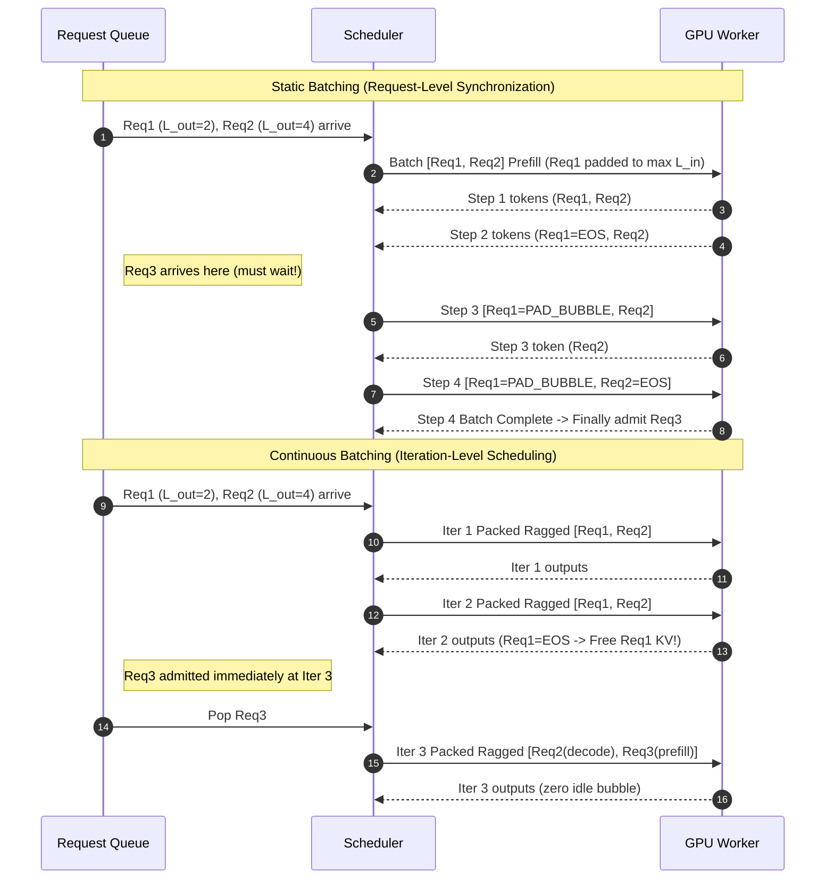
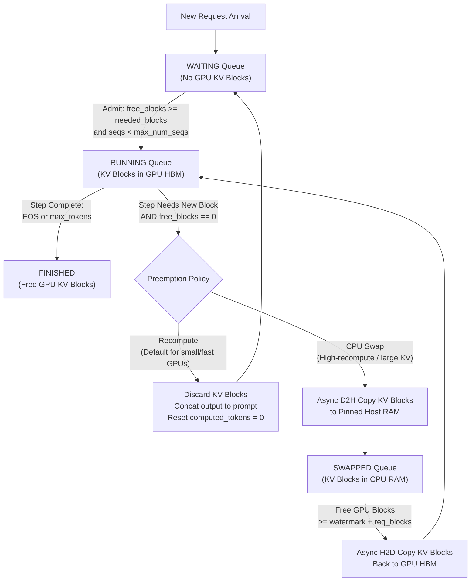

# 01 — Dynamic Scheduling & Continuous Batching

[Stage 4 Overview](./README.md) | [Next: 02 — Paged Memory Management & PagedAttention](./02-paged-memory-management-pagedattention.md)

---

Modern language model servers handle thousands of user requests that arrive unpredictably and produce responses of wildly different lengths. This module explains how serving systems group those requests together on graphics hardware without wasting memory or leaving fast processors sitting idle.

## Core Concepts & Terminology

Every technical term, hardware unit, and scheduling mechanism used in this module is defined below in dependency order:

* **Token & Vocabulary:** A **token** is the basic unit of text (a word, subword, or punctuation mark) mapped to an integer ID in the model's dictionary (**vocabulary**).
* **Forward Pass & Autoregressive Generation:** A **forward pass** is one complete execution of the neural network's layers from input tokens to output probabilities. **Autoregressive** Transformer inference generates text one token at a time, feeding each newly produced token back in to predict the next.
* **Tensor:** A multi-dimensional array of numbers (e.g., a 1D vector, 2D matrix, or 3D `[batch, sequence, hidden_dim]` array) processed by the GPU.
* **FP16 / BF16:** 16-bit floating-point number formats (*Half Precision* and *Brain Float 16*). Each number takes **2 bytes** of memory and is standard for storing model weights and activations.
* **FLOP, FLOPs, & TFLOP/s:** A **FLOP** is a single floating-point arithmetic operation (such as multiplying or adding two decimal numbers). **FLOPs** is the total operation count, and **TFLOP/s** is trillions of operations per second.
* **HBM (High Bandwidth Memory) / VRAM:** High-speed memory (Video RAM, e.g., HBM3 on an NVIDIA H100 SXM) mounted directly on the GPU package to store model weights, intermediate activations, and cached attention state.
* **Tensor Cores:** Specialized matrix-math hardware units inside modern GPUs that execute matrix multiplications far faster than general-purpose cores.
* **GEMM vs. GEMV:** **GEMM** (*General Matrix-Matrix Multiplication*) multiplies two 2D matrices; **GEMV** (*General Matrix-Vector Multiplication*) multiplies a 2D matrix by a single 1D vector.
* **Arithmetic Intensity ($I$), Ridge Point, & Memory-Bound vs. Compute-Bound:** **Arithmetic intensity** is the ratio of math operations performed to bytes moved from HBM ($\text{FLOPs/byte}$). A workload is **memory-bandwidth-bound** if HBM transfer speed limits performance, and **compute-bound** if Tensor Core math speed limits performance. The **ridge point** is the exact arithmetic intensity where compute speed and HBM bandwidth balance.
* **MFU (Model FLOPs Utilization):** The fraction of a GPU's peak theoretical FLOP/s actually spent on useful model math rather than waiting on memory or overhead.
* **KV Cache (Key-Value Cache):** Stored intermediate **Key** and **Value** vectors from earlier tokens in Attention layers, preventing the model from recomputing them at every new token step.
* **Prefill vs. Decode:** **Prefill** is the first phase of a request, processing all $L_{\text{in}}$ prompt tokens in parallel via compute-bound GEMMs. **Decode** is the second phase, generating 1 output token per step via memory-bandwidth-bound GEMVs.
* **Transformer Linear & Normalization Layers:** Standard operations inside each layer—**`Embedding`** (token ID $\to$ vector), **`RMSNorm`** (vector magnitude normalization), **`QKV` / `O`** (Query, Key, Value, and Output Attention projections), **`RoPE`** (*Rotary Position Embedding*, encoding token order), **`SwiGLU` MLP** (gated feed-forward network), and **`LM Head`** (final projection scoring every vocabulary token).
* **Batch Size ($B$) & Effective Batch Size ($B_{\text{eff}}$):** The number of independent requests processed together in a single GPU forward pass.
* **Throughput & SLOs (TTFT, ITL / TPOT, Tail Latency):** **Throughput** is total generated tokens per second across all users. A **Service Level Objective (SLO)** is a performance target: **TTFT** (*Time To First Token*) is the wait from request arrival to the first output token; **ITL** (*Inter-Token Latency*) or **TPOT** (*Time Per Output Token*) is the gap between consecutive output tokens; **$P95$/$P99$ tail latency** measures the slowest 5% or 1% of requests.
* **`<EOS>`, `<PAD>`, `max_tokens`, & `max_model_len`:** **`<EOS>`** (*End-of-Sequence*) is a special token signaling generation is complete; **`<PAD>`** is a dummy filler token used to equalize tensor lengths; **`max_tokens`** caps a request's output length; **`max_model_len`** is the model's maximum total context window.
* **Static Batching vs. Continuous Batching (Orca-Style):** **Static batching** groups requests into a fixed rectangular tensor and waits until *every* request finishes before admitting new ones. **Continuous (iteration-level) batching** re-evaluates the batch before every single forward pass, immediately freeing finished requests and admitting waiting ones.
* **Selective Batching & Ragged Tensors:** Packing active tokens from requests at different lengths/phases into a single zero-padding 2D **ragged tensor** (`[total_scheduled_tokens, d_model]`) for token-independent layers, while passing sequence boundary metadata (`cu_seqlens_q`, `seq_lens`, `block_tables`) only to sequence-aware Attention kernels (**FlashAttention `varlen`**, **PagedAttention**, **FlashInfer**).
* **Physical KV Blocks, Chunked Prefill, & Watermark:** Fixed-size chunks of HBM (e.g., 16 tokens/block) allocated on demand to hold KV Cache data. **Chunked prefill** splits long prompts into smaller token budgets ($C$ tokens/step) so decodes are not stalled. A **watermark** keeps a small percentage of blocks free so running requests can grow without immediate eviction.
* **Host CPU RAM, Pinned Memory, PCIe, & DMA (`cudaMemcpyAsync`):** Main system memory attached to the CPU; **pinned memory** is locked in physical RAM so the OS cannot swap it to disk, enabling **DMA** (*Direct Memory Access*) to copy data asynchronously over the **PCIe** bus between CPU Host and GPU Device (**H2D** / **D2H**) via `cudaMemcpyAsync`.
* **Preemption (LIFO, Recomputation vs. CPU Swap, Thrashing):** Evicting an active request when free GPU KV blocks hit zero—typically picking the newest (**LIFO**, *Last-In, First-Out*) request—either by discarding its KV cache and re-running prefill later (**recomputation**) or copying its blocks to CPU RAM (**CPU swap**). **Thrashing** occurs when requests repeatedly evict and re-admit each other without making progress.
* **GQA, MLA, TP, & OOM:** **GQA** (*Grouped-Query Attention*) and **MLA** (*Multi-Head Latent Attention*) compress Key/Value representations to shrink per-token KV size. **TP** (*Tensor Parallelism*) splits model layers across multiple GPUs. **OOM** (*Out-of-Memory*) is a crash caused by exhausting GPU HBM.

---

## 1. First-Principles Motivation: Why Batching Governs Decode Economics

Recall from Phase 1 (Stage 3) that autoregressive Transformer inference has two physically distinct phases:

* **Prefill:** Processes all $L_{\text{in}}$ prompt tokens in parallel. A single sequence of $L_{\text{in}} = 1024$ tokens performs matrix-matrix multiplications (GEMMs) with arithmetic intensity $I \approx 1024$ FLOPs/element (for BF16, $\approx 512$ FLOPs/byte), saturating Tensor Cores (*compute-bound*).
* **Decode:** Generates 1 token per forward pass per sequence. At batch size $B = 1$, every linear layer (`QKV`, `O`, `Gate/Up/Down` MLP, `LM Head`) performs a matrix-vector multiplication (GEMV), reading $W$ bytes of model weights from HBM to perform $\approx 2P$ FLOPs:
  $$I_{\text{decode}}(B=1) \approx \frac{2P}{2P} = 1 \text{ FLOP/byte (in BF16/FP16)}$$
  On an NVIDIA H100 SXM ($989\text{ TFLOP/s}$ BF16, $3.35\text{ TB/s}$ HBM3), the ridge point is $\frac{989 \times 10^{12}}{3.35 \times 10^{12}} \approx 295\text{ FLOPs/byte}$. At $B=1$, the GPU achieves $<0.4\%$ Model FLOPs Utilization (MFU) because Tensor Cores spend >99% of every step stalled waiting for weights to stream out of HBM.

Batching $B$ independent decode requests together loads the model weights from HBM **once** per step and multiplies them against $B$ activation vectors simultaneously:

$$I_{\text{decode}}(B) \approx \frac{2PB}{2P + 2 \cdot B \cdot d_{\text{act}} + S_{\text{KV\_read}}} \approx B \text{ FLOPs/byte (for small } B\text{)}$$

Up to the memory-capacity wall (KV Cache exhaustion) or the compute ridge point, increasing effective batch size $B_{\text{eff}}$ increases total system throughput ($\text{tokens/sec}$) almost linearly while barely changing per-step latency ($\text{ITL}$).

The central systems challenge of LLM serving is **maintaining high effective batch size $B_{\text{eff}}$ when requests arrive stochastically and have wildly heterogeneous prompt lengths ($L_{\text{in}}$) and unpredictable output lengths ($L_{\text{out}}$)**.

---

## 2. Static Batching vs. Continuous (Iteration-Level) Batching

### 2.1 Static Batching (Request-Level Scheduling)

In classical deep-learning inference (e.g., ResNet image classification or early FasterTransformer/Triton static batching), the scheduler groups $B$ requests into a fixed rectangular tensor `[B, L_max]` and **cannot admit new requests or release finished requests until every request in the batch has emitted `<EOS>` or reached `max_tokens`**.

This creates two severe sources of hardware waste:

#### A. Prompt Padding Waste
Because a dense batched prefill tensor requires a uniform sequence dimension, shorter prompts are right- or left-padded with `<PAD>` tokens up to $L_{\max}^{\text{in}} = \max_{i=1..B} L_i^{\text{in}}$:

$$\text{Padding Tokens} = B \cdot \max_{i=1..B} L_i^{\text{in}} - \sum_{i=1}^{B} L_i^{\text{in}}$$

Every `<PAD>` token participates in QKV projections, Attention matrix multiplications (masked out post-score), MLP projections, and consumes KV Cache slots unless explicitly stripped.

#### B. EOS Bubble Waste (Straggler Problem)
During decode, requests finish at completely different steps. Suppose $B = 4$ requests enter together, and their true output lengths are $L_{\text{out}} = [12, 25, 40, 512]$.
* Request 1 finishes at step 12, but its batch slot remains occupied and masked for the next **500 steps**!
* Request 2 sits idle for **487 steps**; Request 3 sits idle for **472 steps**.
* Meanwhile, new requests sitting in the ingress queue are blocked from entering the GPU until step 512 completes.

#### Concrete Efficiency Calculation
For a static batch of $B$ requests, define effective token utilization $\eta_{\text{static}}$ as the ratio of useful computed tokens to total slot-iterations consumed across prefill and decode:

$$\eta_{\text{static}} = \frac{\sum_{i=1}^{B} (L_i^{\text{in}} + L_i^{\text{out}})}{B \cdot \left(\max_{i} L_i^{\text{in}} + \max_{i} L_i^{\text{out}}\right)}$$

Consider $B = 4$ requests with $(L_i^{\text{in}}, L_i^{\text{out}}) = \{(50, 10), (100, 30), (80, 50), (500, 400)\}$:
* Useful tokens: $(50+10) + (100+30) + (80+50) + (500+400) = 60 + 130 + 130 + 900 = 1{,}220$ tokens.
* Static slot-iterations: $4 \times (500 + 400) = 3{,}600$ slot-iterations.
* $\eta_{\text{static}} = \frac{1{,}220}{3{,}600} = 33.9\%$. Two-thirds of the GPU's batch capacity is burned on padding and post-EOS bubbles!

---

### 2.2 Continuous Batching (Iteration-Level / Orca-Style Scheduling)

Introduced by **Orca** (Yu et al., OSDI 2022) and refined by **vLLM** and **SGLang**, **Continuous Batching** changes the scheduling granularity from **request-level** to **iteration-level** (a single forward pass producing 1 token per active sequence):

1. **Immediate Exit:** The instant Request $i$ emits `<EOS>` (or a stop sequence / `max_tokens`), its KV Cache blocks are freed at the end of that exact iteration, and its slot is immediately reclaimed.
2. **Immediate Admission:** At the start of the very next iteration, the scheduler packs newly arrived requests from the `waiting` queue into the active batch alongside ongoing decode requests.
3. **Zero Padding via Selective Batching & Ragged Tensors:**
   Why can requests at completely different sequence positions (e.g., Req A at decode step 42, Req B at decode step 310, Req C prefilling 128 tokens) run in a **single forward pass**?
   Because of a structural property of the Transformer architecture:
   * **Token-Independent Operators (95%+ of FLOPs & weights):** `Embedding`, `RMSNorm`, `QKV Projection`, `RoPE` (using an explicit per-token `position_ids` vector), `Output Projection`, `SwiGLU MLP`, and `LM Head` treat every token independently. They operate on a **flattened, zero-padding 2D ragged tensor** of shape `[total_scheduled_tokens, d_model]`, where `total_scheduled_tokens` is simply the sum of tokens across all active requests in this iteration!
   * **Sequence-Dependent Operator (Attention only):** Only Attention needs to know which tokens belong to which request and where each request's KV Cache resides. Modern attention kernels (FlashAttention `varlen`, PagedAttention, FlashInfer) accept ragged metadata (`cu_seqlens_q`, `seq_lens`, `block_tables`) so they execute attention per sequence without rectangular padding.

In our earlier example, once Req 1 finishes at step 10, a new request enters at step 11. Effective slot utilization $\eta_{\text{continuous}}$ approaches **95%–100%** whenever the queue has pending work, typically yielding **2x to 10x higher throughput** under realistic ShareGPT/chat length distributions (which follow heavy-tailed log-normal or Pareto distributions).

---

### 2.3 Static Batching vs. Continuous Batching Execution Timeline



---

## 3. Scheduler Queues and Request State Machine

A production continuous-batching scheduler (exemplified by vLLM's `Scheduler`, SGLang's `Scheduler`, and TensorRT-LLM's `BatchManager`) partitions all non-terminal requests across three logical queues based on **where their KV Cache state currently lives**:

| Queue | KV Cache Location | Execution Status | Transition Triggers |
| :--- | :--- | :--- | :--- |
| **`waiting`** | None allocated (or discarded on recompute preemption) | Queued for Prefill | Enters on HTTP arrival; moves to `running` when KV blocks and token budget allow; returns here if preempted via **recomputation**. |
| **`running`** | Allocated in **GPU HBM** (VRAM) | Active in current/next iteration batch | Advances 1 token (decode) or $C$ tokens (chunked prefill) per step; moves to `finished` on EOS/`max_tokens`, or evicted to `waiting`/`swapped` if GPU KV blocks exhaust. |
| **`swapped`** | Offloaded to **Host CPU RAM** (pinned memory) | Suspended (paused) | Enters when evicted from `running` via **CPU swap**; prioritized to swap back into `running` once sufficient free GPU blocks accumulate. |

### 3.1 Scheduler State Transitions & Preemption Flow



---

## 4. Step-by-Step Iteration Scheduling Loop

Unlike static batching, the scheduler executes a deterministic decision loop **before every single GPU forward pass** (typically taking $50\text{–}500\,\mu\text{s}$ on the CPU, or overlapped asynchronously with GPU step $t-1$).

Let the engine enforce three hard capacity limits:
1. $B_{\max}$ (`max_num_seqs`): Maximum concurrent sequences in `running` (caps KV block-table metadata and CUDA kernel grid limits).
2. $T_{\max}$ (`max_num_batched_tokens`): Maximum total tokens (prefill + decode) packed into one forward pass (bounds peak activation VRAM and per-step latency).
3. $N_{\text{free}}$ (`num_free_gpu_blocks`): Available physical KV blocks in the GPU block pool.

### 4.1 Exact Per-Iteration `schedule()` Algorithm

```python
def schedule_iteration(waiting, running, swapped, kv_pool, max_num_seqs, max_num_batched_tokens):
    scheduled_prefills = []
    scheduled_decodes = []
    preempted = []
    token_budget = max_num_batched_tokens

    # Phase 1: Schedule currently RUNNING sequences (decode-prioritizing)
    # Process in arrival order (oldest first) so newest arrivals are preemption victims
    new_running = []
    for req in running:
        if len(new_running) >= max_num_seqs or token_budget < 1:
            break

        # Check if appending 1 new token crosses a block boundary (pos % block_size == 0)
        while not kv_pool.can_append_slot(req):
            # GPU KV memory exhausted! Must preempt a victim.
            if len(running) > 1 and running[-1] != req:
                victim = running.pop()  # LIFO victim: newest request
                preempt_request(victim, kv_pool, waiting, swapped)
                preempted.append(victim)
            else:
                # Self-preemption if req itself cannot fit even alone
                preempt_request(req, kv_pool, waiting, swapped)
                preempted.append(req)
                req = None
                break

        if req is not None:
            kv_pool.append_slot(req)
            new_running.append(req)
            scheduled_decodes.append(req)
            token_budget -= 1

    # Phase 2: Resume SWAPPED requests (only if no preemptions occurred this step)
    if not preempted:
        while swapped and len(new_running) < max_num_seqs:
            req = swapped[0]
            if kv_pool.can_swap_in(req) and token_budget >= 1:
                swapped.popleft()
                kv_pool.swap_in(req)  # Enqueue cudaMemcpyAsync H2D
                kv_pool.append_slot(req)
                new_running.append(req)
                scheduled_decodes.append(req)
                token_budget -= 1
            else:
                break

    # Phase 3: Admit WAITING requests (Prefill) if blocks & token budget remain
    if not preempted and not swapped:
        while waiting and len(new_running) < max_num_seqs and token_budget > 0:
            req = waiting[0]
            num_prompt_tokens = len(req.prompt_token_ids)
            if num_prompt_tokens > token_budget:
                # Without chunked prefill, wait until enough budget is free
                break
            if kv_pool.can_allocate_prefill(req):
                waiting.popleft()
                kv_pool.allocate(req)
                new_running.append(req)
                scheduled_prefills.append(req)
                token_budget -= num_prompt_tokens
            else:
                break

    running[:] = new_running
    return scheduled_prefills, scheduled_decodes
```

Notice the strict invariant enforced in **Phase 2 & Phase 3**:
* If `preempted` is non-empty (meaning GPU KV blocks hit 100% saturation during Phase 1), **neither `swapped` nor `waiting` requests can be admitted**, preventing thrashing/ping-ponging where Request A is evicted so Request B can immediately take its blocks and get evicted on the next step.
* Furthermore, engines typically enforce a **watermark** (e.g., keep $10\%$ of GPU blocks free before allowing `waiting` admissions) so `running` decode sequences have headroom to grow for several steps without triggering immediate preemption.

---

## 5. Request Preemption Mechanics: Recomputation vs. CPU Swapping

Because output lengths $L_{\text{out}}$ are unknown at admission time, a scheduler cannot reserve `max_model_len` KV blocks upfront without recreating static memory waste. Consequently, when many long-output requests grow simultaneously, `num_free_gpu_blocks` can hit **0** mid-generation.

When a running request needs a new KV block and none are free, the scheduler must **preempt** a victim sequence (typically LIFO—the most recently admitted sequence, which has accumulated the least sunk work and preserves fairness for older requests). There are two recovery mechanisms:

### 5.1 Recomputation (Discard & Re-Prefill)
1. Free all physical GPU KV blocks held by the victim request.
2. Append the tokens generated so far ($y_1, \dots, y_t$) onto the victim's prompt:
   $$\text{new\_prompt} = [x_1, \dots, x_{L_{\text{in}}}, y_1, \dots, y_t]$$
3. Reset `num_computed_tokens = 0` and push the victim back to the **front** of `waiting` (so it resumes before newer queued requests once space clears).
4. When re-admitted, the engine runs a single parallel **prefill** over all $L_{\text{in}} + t$ tokens to regenerate the KV Cache, then continues decoding token $y_{t+1}$.

### 5.2 CPU Swapping (Offload & Reload)
1. Allocate matching pinned-RAM blocks in Host CPU memory.
2. Issue asynchronous GPU $\rightarrow$ CPU DMA copies (`cudaMemcpyAsync(..., cudaMemcpyDeviceToHost)`) on a dedicated copy stream for every KV block of the victim.
3. Free the GPU physical blocks and move the request to `swapped`.
4. When GPU blocks free up later, issue `cudaMemcpyAsync(..., cudaMemcpyHostToDevice)` to restore the KV blocks and resume decoding from token $t+1$ without re-running the Transformer layers.

### 5.3 Quantitative Break-Even Analysis: Recomputation vs. Swap

Which strategy is faster? Compare the **PCIe round-trip transfer latency** (swap-out + swap-in) against **Prefill recomputation latency**.

Let:
* $S_{\text{KV\_tok}}$ = KV Cache bytes per token (e.g., Llama-3-8B with GQA-8, 32 layers, $d_{\text{head}}=128$, BF16: $2 \times 32 \times 8 \times 128 \times 2 = 131{,}072\text{ bytes} = 128\text{ KB/tok}$).
* $L$ = total sequence length at preemption ($L_{\text{in}} + t$).
* $\text{BW}_{\text{PCIe}}$ = effective bidirectional/unidirectional PCIe DMA throughput (e.g., PCIe Gen4 x16 $\approx 25\text{ GB/s}$, PCIe Gen5 x16 $\approx 50\text{ GB/s}$).
* $P_{\text{active}}$ = active model parameters (e.g., $8\times 10^9$ for Llama-3-8B).
* $F_{\text{eff}}$ = effective GPU prefill compute throughput (e.g., H100 at 60% MFU $\approx 600\text{ TFLOP/s}$).

**1. Total Swap Latency (D2H + H2D):**

$$T_{\text{swap}}(L) = \frac{2 \cdot L \cdot S_{\text{KV\_tok}}}{\text{BW}_{\text{PCIe}}}$$

For Llama-3-8B at $L = 4{,}096$ tokens on PCIe Gen4 ($25\text{ GB/s}$):
* KV size $= 4{,}096 \times 128\text{ KB} = 512\text{ MB} = 0.5\text{ GB}$.
* $T_{\text{swap}} = \frac{2 \times 0.5\text{ GB}}{25\text{ GB/s}} = 40\text{ ms}$.

**2. Total Recomputation Latency (Compute-Bound Prefill):**

$$T_{\text{recompute}}(L) \approx \frac{2 \cdot P_{\text{active}} \cdot L}{F_{\text{eff}}}$$

For Llama-3-8B on H100 ($600\text{ TFLOP/s}$):
* Prefill FLOPs $= 2 \times 8\times 10^9 \times 4{,}096 = 65.5\text{ TFLOPs}$.
* $T_{\text{recompute}} = \frac{65.5\text{ TFLOPs}}{600\text{ TFLOP/s}} \approx 109\text{ ms}$. (On an A100 at $200\text{ TFLOP/s}$ effective, $T_{\text{recompute}} \approx 328\text{ ms}$.)

Wait—why does **vLLM V1** (and SGLang) default to **Recomputation** rather than CPU Swap?
1. **Attention dominates only at ultra-long contexts; linear layers scale linearly with $L$**, AND if GPU compute has spare capacity or **Chunked Prefill** interleaves recomputation into decode batches, recomputation requires **zero pinned host RAM reservation**, **zero PCIe bus contention** (which otherwise stalls tensor loading/networking/other requests), and **zero synchronization complexity**.
2. **GQA / MLA shrinks $S_{\text{KV\_tok}}$ dramatically, OR conversely on smaller GPUs / older PCIe Gen3 ($12\text{ GB/s}$) / huge 70B models:** Notice for **Llama-3-70B** ($80$ layers, GQA-8 $\implies 320\text{ KB/tok}$) on a single H100 (or TP=4):
   * Recomputation FLOPs scale by $9\times$ ($70\text{B}$ vs $8\text{B}$), whereas KV size scales by only $2.5\times$ ($80$ layers vs $32$ layers)!
   * Even more critically: during `recompute`, the sequence stays in `waiting` and consumes compute FLOPs from other running requests, whereas `swap` consumes PCIe bandwidth in parallel with GPU compute (if asynchronous)—*unless* host RAM itself saturates or multiple victims contend on the single PCIe root complex.
3. **Failure Mode — Swapping Deadlock / Thrashing:** If the CPU swap pool fills up or if `swap_in` + `swap_out` happen back-to-back under oscillating memory pressure ("preemption oscillation"), PCIe bandwidth becomes the bottleneck and ITL spikes across the entire batch. Production schedulers guard against this with **admission watermarks** and **recomputation fallback**.

---

## 6. Scheduling Policy Trade-Offs: TTFT vs. ITL

Two primary latency Service Level Objectives (SLOs) govern interactive LLM serving:
* **TTFT (Time To First Token):** Latency from request arrival to emission of token $y_1$ (dominated by queue wait time + prefill compute).
* **ITL (Inter-Token Latency) / TPOT (Time Per Output Token):** Latency between consecutive generated tokens $y_k \to y_{k+1}$ during decode.

Scheduling policy directly trades these two metrics off against each other:

### 6.1 FCFS (First-Come, First-Served) / Prefill-Prioritizing
* **Behavior:** Newly arrived prompts are admitted to prefill immediately ahead of queued decode iterations whenever KV memory allows (or batched as whole prompts).
* **Impact on TTFT:** Minimizes TTFT for incoming requests—no waiting behind long running decodes if memory exists.
* **Impact on ITL (Generation Stalls):** Catastrophic for ITL tail latency ($P99$). If a 4,096-token prompt arrives and runs a monolithic prefill on the GPU for $150\text{ ms}$, every single active decode request in the batch pauses for $150\text{ ms}$, causing an instantaneous ITL spike from $15\text{ ms} \to 165\text{ ms}$ (visible "stuttering" in streaming UIs).

### 6.2 Decode-Prioritizing (vLLM V0 Default)
* **Behavior:** Existing `running` decode requests are always scheduled first (Phase 1); `waiting` prefills only run when spare KV blocks and batch slots exist, and prefills are bounded by `max_num_batched_tokens`.
* **Impact on ITL:** Protects running decodes from premature eviction and minimizes generation interruptions once a request has started streaming.
* **Impact on TTFT:** Under high arrival load ($\rho \to 1$), newly arrived requests sit in `waiting` until existing decodes finish and free slots/blocks, inflating TTFT tail latency ($P95/P99$). Moreover, if a monolithic prefill *does* run, it still stalls the decode step unless sliced.

### 6.3 Summary Matrix of Scheduler Policies

| Policy | TTFT ($P99$) | ITL ($P99$) | Throughput | Key Failure Mode |
| :--- | :--- | :--- | :--- | :--- |
| **Static Batching** | Very High (waits for batch formation + tail) | Low inside batch, huge bubbles at boundaries | Low (20%–40% utilization) | Padding + EOS straggler bubbles |
| **FCFS / Prefill-First** | Low (fast admission) | **High / Spiky** (prefill stalls active decodes) | High | Generation stalls; KV exhaustion forces frequent preemption |
| **Decode-First (No Chunking)** | Moderate–High under load | Moderate (still stalls on huge single prefills) | High | Head-of-line blocking for long prompts; TTFT starvation |
| **Decode-First + Chunked Prefill** *(Stage 5)* | Balanced & Predictable | **Low & Smooth** (step time capped by chunk budget) | Highest (piggybacks memory-bound decodes onto compute-bound prefills) | Slight prefill overhead from repeated KV reads across chunks |

> **System Design Takeaway:** Continuous batching solves EOS bubbles and padding waste, while queue state transitions (`waiting` / `running` / `swapped`) prevent OOM crashes under unknown output lengths. However, **monolithic prefills still couple TTFT and ITL**—the exact motivation for **Chunked Prefill** and **Prefill/Decode Disaggregation** covered in Stages 5 and 9.

---

## Navigation

* [Stage 4 Overview](./README.md)
* **Next:** [02 — Paged Memory Management & PagedAttention](./02-paged-memory-management-pagedattention.md)
