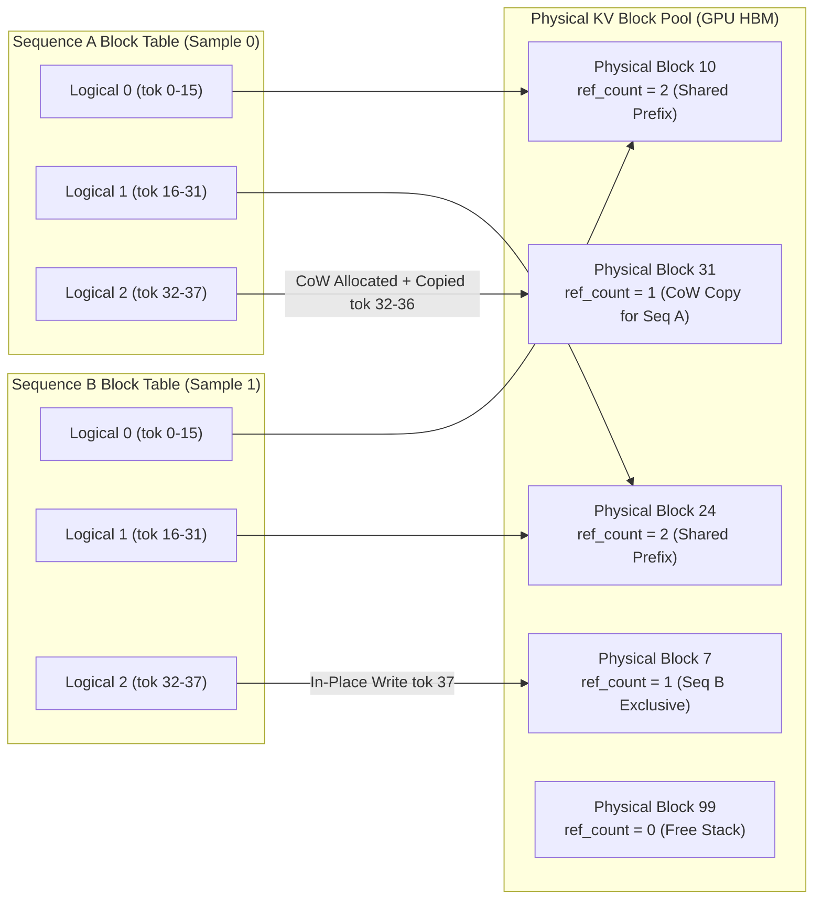
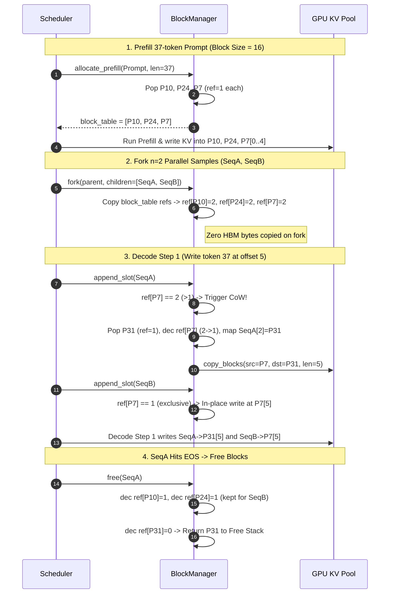

# 02 — Paged Memory Management & PagedAttention

[Previous: 01 — Dynamic Scheduling & Continuous Batching](./01-dynamic-scheduling-continuous-batching.md) | [Stage 4 Overview](./README.md) | [Next: 03 — Engine Architectures](./03-engine-architectures.md)

---

Continuous batching keeps GPU compute busy, but storing each request's attention history in a single unbroken memory buffer wastes most of the GPU's memory. This module explains how serving engines borrow virtual memory paging from operating systems to eliminate memory fragmentation and share prompt prefixes with zero copying.

## Core Concepts & Terminology

Every hardware, operating-system, and GPU kernel concept used in this module is defined below in dependency order:

* **Continuous Batching & KV Cache:** **Continuous batching** schedules requests at every single token generation step. The **KV Cache** stores the intermediate Key and Value vectors computed by Attention layers for all prior tokens in a sequence.
* **HBM / VRAM & OOM:** **HBM** (*High Bandwidth Memory*, also called **VRAM**) is the fast on-package GPU memory holding weights and KV caches. **OOM** (*Out-of-Memory*) is a fatal crash when an allocation exceeds available VRAM.
* **Contiguous Buffer, `cudaMalloc`, & Caching Allocator:** A **contiguous buffer** is an unbroken, adjacent range of memory addresses. **`cudaMalloc`** is CUDA's low-level GPU memory allocator, and PyTorch's **caching allocator** manages a pool of contiguous GPU allocations.
* **`max_model_len`, `max_tokens`, & `<EOS>`:** **`max_model_len`** is the model's maximum supported context length; **`max_tokens`** is a request's output cap; **`<EOS>`** (*End-of-Sequence*) is the stop token ending generation.
* **Reservation Waste, Internal Fragmentation, & External Fragmentation:** **Reservation waste** is pre-allocating `max_model_len` slots for a request that finishes early. **Internal fragmentation** is unused space trapped *inside* an allocated chunk. **External fragmentation** occurs when free memory is split into non-adjacent gaps between active allocations so large new requests fail even when total free memory is sufficient.
* **OS Virtual Memory Paging (Virtual Address Space, Page, Frame, Page Table, Page Fault):** Operating systems give each process a contiguous **virtual address space** divided into fixed-size **virtual pages** (e.g., 4 KB), mapped via a **page table** (`VPN -> PFN`) to non-adjacent **physical page frames** in CPU **DRAM** (main memory). A **page fault / lazy allocation** assigns a physical frame only when the program first writes to a virtual page.
* **PagedAttention (Logical KV Block, Physical KV Block, Block Table):** **PagedAttention** applies OS paging to KV caches: a sequence's tokens are split into fixed-size **logical KV blocks** ($B$ tokens each) and mapped by a per-request **block table** to non-adjacent **physical KV blocks** in a pre-allocated HBM slab.
* **Model & Dtype Parameters (`n_layers`, `n_kv_heads`, `d_head`, GQA, FP16/BF16/FP8/INT8):** Transformer depth (**`n_layers`**), Key/Value head count (**`n_kv_heads`**, reduced via **GQA** / *Grouped-Query Attention*), per-head vector size (**`d_head`**), and number formats (**FP16/BF16** = 2 bytes; **FP8/INT8** = 1 byte).
* **GPU Execution Hierarchy (CUDA Kernel, SM, Thread Block, Warp, Registers, Shared Memory, Global/L2):** A **CUDA kernel** is a parallel GPU function. An **SM** (*Streaming Multiprocessor*) is an independent GPU core cluster (e.g., 132 SMs on H100). A **thread block** runs on one SM, sharing fast on-chip **Shared Memory (`__shared__`)** and private **registers**, while **warps** (32 lockstep threads) read from **Global Memory (HBM)** through the **L2 cache**.
* **Coalesced Loads (`LDG.E.128`, `int4`/`uint4`) & Tensor Core MMA Tiles (`NHD`/`HND`):** **Coalesced loads** merge adjacent warp thread reads into wide 128-bit (16-byte) HBM bursts (`LDG.E.128`). **`NHD`/`HND`** are tensor dimension orderings (`[num_blocks, block_size, heads, dim]` vs. `[..., heads, block_size, dim]`) aligned to **Tensor Core MMA** (*Matrix Multiply-Accumulate*) hardware tiles.
* **Parallel Sampling (`n > 1`), Beam Search (`beam_width > 1`), Reference Counting, & Copy-on-Write (CoW):** **Parallel sampling** generates $n$ independent completions from one prompt; **beam search** tracks top-$k$ candidate paths. **Reference counting (`ref_count`)** tracks how many sequences share a physical block; **Copy-on-Write (`fork()`, CoW)** shares read-only blocks (`ref_count > 1`) with zero copying until a sequence writes to one, copying only that block on demand.
* **Online Softmax, Split-KV (PagedAttention v2), `reshape_and_cache`, `slot_mapping`, & 32-bit Overflow:** **Online Softmax** computes exact attention probabilities incrementally in registers (`max_logit`, `exp_sum`) without storing the $O(L)$ score matrix. **Split-KV** splits long contexts across multiple thread blocks and merges partial outputs via log-sum-exp rescaling. **`reshape_and_cache`** writes new K/V vectors to HBM using **`slot_mapping`**. **32-bit index overflow** is integer wraparound when byte/element offsets exceed $2^{31}$ on large-VRAM GPUs.

---

## 1. The Contiguous KV Cache Fragmentation Problem

Continuous batching eliminates compute bubbles, but without virtualized memory management it hits an immediate **VRAM capacity wall**.

In pre-PagedAttention serving engines (e.g., FasterTransformer, Orca, early HuggingFace TGI), each sequence's Key and Value tensors were stored as a **single contiguous buffer** in GPU HBM:

```text
Key Cache Tensor:   [batch_slot, num_kv_heads, max_model_len, head_dim]
Value Cache Tensor: [batch_slot, num_kv_heads, max_model_len, head_dim]
```

Because GPU allocators (`cudaMalloc` / PyTorch caching allocator) require contiguous virtual/physical address ranges for fixed-stride tensor indexing—just like `torch.empty((B, n_kv_heads, max_model_len, head_dim))` assumes every element sits at `base + b * stride_b + h * stride_h + t * stride_t`—you cannot dynamically grow a sequence's buffer in place without either pre-allocating `max_model_len` or allocating a larger tensor and copying the entire history (`torch.cat`). Because a sequence's true output length $L_{\text{out}}$ is unknown at admission time, contiguous engines suffer from **three distinct forms of memory waste**:

1. **Reservation Waste (Future Slot Over-Allocation):** The allocator must pre-reserve `max_model_len` (e.g., $4{,}096$ or $32{,}768$ tokens) for every active request, even if the request actually terminates after $120$ tokens. For a 120-token sequence in a 4,096-slot buffer, **97.1% of its reserved VRAM sits empty**.
2. **Internal Fragmentation:** Even if a request specifies a tighter `max_tokens` bound (say 512), any unused slots between the actual `<EOS>` position and `max_tokens` remain trapped inside that sequence's contiguous allocation until completion.
3. **External Fragmentation:** As requests of different `max_tokens` sizes enter and exit continuously, free VRAM splits into non-contiguous holes (`[free 256] [used 1024] [free 512] [used 512]`). Even though $768$ token slots are free in aggregate, a new request asking for a contiguous $600$-token buffer fails with Out-of-Memory (`OOM`) or triggers expensive defragmentation copies.

Empirical measurements from the vLLM paper (Kwon et al., SOSP 2023) showed that in contiguous systems, **only 20.4% to 38.2% of allocated KV Cache memory actually held active tokens**—meaning $60\%\text{–}80\%$ of expensive HBM was wasted, directly capping maximum batch size $B_{\max}$ and decode throughput.

---

## 2. PagedAttention: Virtual Memory for KV Caches

**PagedAttention** adapts the classic operating-system **virtual memory paging** mechanism to Transformer KV caches.

### 2.1 OS Virtual Memory $\leftrightarrow$ PagedAttention Mapping

| OS Virtual Memory Concept | PagedAttention Equivalent |
| :--- | :--- |
| **Process Virtual Address Space** | Logical token sequence of a request ($0, 1, \dots, L-1$) |
| **Virtual Page** (e.g., 4 KB) | **Logical KV Block** holding a fixed $B$ tokens (e.g., $B = 16$ or $32$) |
| **Physical Page Frame** in DRAM | **Physical KV Block** pre-allocated in a contiguous GPU HBM slab |
| **Page Table** (`VPN -> PFN`) | **Block Table** (`block_table[seq_id][logical_idx] -> physical_block_id`) |
| **Page Fault / Lazy Allocation** | On-demand physical block allocation when `seq_len % B == 0` |
| **Copy-on-Write (`fork()`)** | Reference-counted shared KV blocks for `n > 1` sampling, beam search, & shared prefixes |

### 2.2 Pre-Allocated Physical KV Slab Layout

At engine startup (after loading model weights and running a worst-case dummy forward pass to measure the peak temporary activation memory needed by intermediate layers), the engine allocates the remaining GPU HBM (e.g., `gpu_memory_utilization = 0.90`) as **one giant pre-allocated KV pool** divided into $N_{\text{blocks}}$ identical fixed-size physical blocks:

$$\text{Bytes per Physical Block} = 2 \times n_{\text{layers}} \times n_{\text{kv\_heads}} \times B \times d_{\text{head}} \times \text{sizeof(dtype)}$$

#### Worked Memory Sizing Example (Llama-3-8B, BF16, H100 80 GB)
* Parameters: $n_{\text{layers}} = 32$, $n_{\text{kv\_heads}} = 8$ (GQA), $d_{\text{head}} = 128$, $\text{dtype} = \text{BF16}$ ($2\text{ bytes}$), $B = 16\text{ tokens/block}$.
* Per-token KV bytes $= 2 \times 32 \times 8 \times 128 \times 2 = 131{,}072\text{ bytes} = 128\text{ KB/token}$.
* Per-block KV bytes ($B=16$) $= 16 \times 128\text{ KB} = 2\text{ MB/block}$.
* If $16\text{ GB}$ holds weights + activations and $56\text{ GB}$ is dedicated to the KV pool:
  $$N_{\text{blocks}} = \frac{56\text{ GB}}{2\text{ MB/block}} = 28{,}672\text{ physical blocks} \implies 458{,}752\text{ total cached tokens.}$$

Inside HBM, the Key and Value caches are typically laid out for **128-bit coalesced CUDA loads** (`LDG.E.128`, 16 bytes per thread). A GPU warp (32 threads executing in lockstep) achieves peak HBM bandwidth when adjacent threads read adjacent addresses in a single wide 16-byte burst (`x = 8` BF16 values per thread) rather than scattered small reads:

```text
Key Cache Pool:   [num_layers, num_physical_blocks, num_kv_heads, head_dim // x, block_size, x]
                  where x = 16 / sizeof(dtype)   (x = 8 for FP16/BF16, x = 16 for FP8/INT8)
Value Cache Pool: [num_layers, num_physical_blocks, num_kv_heads, head_dim, block_size]
```

*(Note: FlashAttention / FlashInfer paged layouts often use `[num_physical_blocks, block_size, num_kv_heads, head_dim]` (`NHD` or `HND`) so a single tensor slice aligns directly with Tensor Core MMA tile fragments.)*

---

## 3. Fragmentation Elimination & Block Size Trade-Offs

### 3.1 Exact Fragmentation Bounds

Because physical blocks are allocated **one block at a time on demand** as the sequence grows—and physical blocks for a single logical sequence **do not need to be adjacent in HBM**:

* **External Fragmentation $= 0$:** Any free physical block anywhere in the pool can serve any request at any logical block offset. A simple stack/queue of free block IDs (`free_blocks: deque[int]`) handles all allocations in $O(1)$ time with zero compaction needed.
* **Reservation Waste $= 0$:** A sequence at length $L$ holds only $\lceil L / B \rceil$ physical blocks—never `max_model_len`.
* **Internal Fragmentation $\le B - 1$ tokens:** Waste is strictly confined to the unfilled tail slots of the **final** logical block:
  $$\text{Wasted Slots} = \left(B - (L \bmod B)\right) \bmod B \in [0, B - 1]$$
  For a uniform distribution of sequence lengths with $B = 16$, expected internal waste is $\frac{15}{2} = 7.5\text{ tokens/sequence}$. At an average context length of $L = 1{,}000$, internal fragmentation is just $\mathbf{0.75\%}$.

### 3.2 Engineering Trade-Offs in Choosing Block Size $B$

| Block Size $B$ | Internal Waste (Avg) | `block_table` Lookup & Kernel Overhead | CoW / Prefix Sharing Granularity | HBM Coalescing & Tensor Core Alignment |
| :--- | :--- | :--- | :--- | :--- |
| **$B = 1$** (Token-level, e.g., SGLang `TokenToKVPool`) | **0 tokens** (0%) | High: `block_table` is length $L$; every token requires indirect lookup unless batched into ranges | Exact 1-token sharing | Poor burst coalescing across tokens unless gathered into FlashInfer `page_size=1` or contiguous slabs |
| **$B = 16$** (vLLM default) | $7.5$ tokens | Low: $16\times$ smaller `block_table` | 16-token chunks | Good: 16 tokens $\times 128\text{ dims} \times 2\text{B}$ aligns cleanly with warp-level memory transactions |
| **$B = 32$ / $64$** | $15.5$ / $31.5$ tokens | Very Low | Coarser 32/64-token boundaries | Optimal for FlashAttention-2/3 `BlockN = 64` or `128` tile sizes (fewer block-table indirections inside the inner loop) |

**Rule of Thumb:** $B = 16$ or $B = 32$ is the sweet spot for general PagedAttention kernels; TensorRT-LLM and FlashAttention-3 paged kernels often favor $B = 32$ or $B = 64$ to match Hopper Tensor Core MMA tile widths (`64x128`) and minimize pointer-chasing instructions per attention tile.

---

## 4. Reference Counting & Copy-on-Write (CoW)

Many LLM workloads share identical prefixes across multiple active output trajectories:
1. **Parallel Sampling (`n > 1`):** Generating $n=4$ candidate completions from a single 2,000-token prompt.
2. **Beam Search (`beam_width > 1`):** Maintaining top-$k$ candidate paths that fork from common prefixes and prune losing branches at every step.
3. **Shared System Prompts / Few-Shot Templates:** Multiple requests sharing an identical system instruction prefix.

### 4.1 Physical Block Reference Counting

Instead of calling `.clone()` on a shared prompt's KV cache for $n$ parallel samples—which would immediately duplicate gigabytes of HBM—all $n$ sequences point to the exact same physical block IDs. Each physical block $P_k$ maintains an integer reference count `ref_count[P_k]`:
* `ref_count == 0`: Block is free and resides in `free_block_queue`.
* `ref_count == 1`: Block is exclusively owned by a single logical sequence slot; **in-place append writes are safe**.
* `ref_count > 1`: Block is **shared** across multiple sequences (read-only invariant!). Any write to this block **must trigger Copy-on-Write (CoW)**.

### 4.2 Exact Copy-on-Write (CoW) Fork & Divergence Mechanics

Consider a prompt of $L = 37$ tokens with block size $B = 16$, forked into $n = 2$ parallel sampling sequences (`Seq A` and `Seq B`):

1. **Prefill (Prompt = 37 tokens):**
   * Requires $\lceil 37 / 16 \rceil = 3$ logical blocks:
     * Logical Block 0 (tokens $0\dots 15$, full: 16/16) $\to P_{10}$
     * Logical Block 1 (tokens $16\dots 31$, full: 16/16) $\to P_{24}$
     * Logical Block 2 (tokens $32\dots 36$, partial: 5/16) $\to P_{7}$
2. **Fork (`n = 2`):**
   * `Seq A` and `Seq B` initialize identical block tables `[P10, P24, P7]`.
   * Reference counts become: `ref[P10] = 2`, `ref[P24] = 2`, `ref[P7] = 2`.
   * **Zero extra KV memory was copied during fork!**
3. **First Decode Step (Position 37 $\to$ Logical Block 2, Offset 5):**
   * **`Seq A` appends token $y_{A,0}$:** It targets Logical Block 2, currently mapped to $P_7$.
     * Check `ref[P7]`: it is $2 > 1$ (shared!). Writing directly into $P_7[5]$ would corrupt `Seq B`'s future attention!
     * **CoW Triggered:**
       1. Pop free block $P_{31}$ (`ref[P31] = 1`).
       2. Issue GPU device-to-device copy of the existing 5 tokens from $P_7[0..4] \to P_{31}[0..4]$ (batched via `copy_blocks` kernel).
       3. Decrement `ref[P7]` ($2 \to 1$).
       4. Update `Seq A`'s block table: `block_table[SeqA][2] = P31`.
       5. Write $y_{A,0}$'s K/V into $P_{31}[5]$.
   * **`Seq B` appends token $y_{B,0}$:** It targets Logical Block 2, still mapped to $P_7$.
     * Check `ref[P7]`: it is now **$1$** (exclusive!).
     * **No copy needed!** `Seq B` writes $y_{B,0}$ directly in-place into $P_7[5]$!
4. **Subsequent Decode Steps (Positions $38\dots 47$):**
   * Both `Seq A` (`P31`, `ref=1`) and `Seq B` (`P7`, `ref=1`) append in-place until position $48$, when each allocates its own fresh block (`P42`, `P45`).
   * Throughout the entire generation, `P10` and `P24` (the 32 prefix tokens) remain **shared read-only with `ref=2`**, cutting prefix KV VRAM by 50% (or $\frac{n-1}{n}$ in general).
5. **Completion / Beam Pruning:**
   * When `Seq A` hits `<EOS>`, the engine decrements `ref_count` on every block in `Seq A`'s block table:
     * `ref[P10]: 2 -> 1` (stays alive for `Seq B`!)
     * `ref[P24]: 2 -> 1` (stays alive for `Seq B`!)
     * `ref[P31]: 1 -> 0` $\implies$ pushed immediately to `free_block_queue`.
     * `ref[P42]: 1 -> 0` $\implies$ pushed immediately to `free_block_queue`.

### 4.3 Logical-to-Physical Block Tables & CoW Structural Diagram



### 4.4 Block Lifecycle Sequence Diagram (Prefill, CoW Fork, EOS Free)



---

## 5. Virtual-to-Physical Block Mapping Inside the Attention Kernel

How does the GPU compute attention over non-contiguous physical blocks without copying them into a contiguous temporary buffer?

**The attention kernel performs the virtual-to-physical translation directly in registers.**

### 5.1 Address Translation Formula inside the CUDA Kernel

During decode, each CUDA **Thread Block** (or Warp Group) computes the attention output for a single `(seq_idx, query_head_idx)` pair (or a GQA group sharing `kv_head_idx = query_head_idx / group_size`).

Given:
* `seq_idx`: index of the sequence in the current batch
* `seq_len`: current total sequence length ($L$) of `seq_idx`
* `block_size`: fixed constant $B$ (compile-time template parameter, e.g. `16`)
* `block_tables`: 2D `int32` tensor on GPU of shape `[num_seqs, max_num_blocks_per_seq]`

To read the Key and Value vectors for historical token position $t \in [0, L - 1]$ (for example, token $t = 37$ with `BLOCK_SIZE = 16` maps to `logical_block_idx = 37 // 16 = 2` and `block_offset = 37 % 16 = 5`):

```cpp
// 1. Virtual address decomposition (compile-time bitshift when B is power of 2)
const int logical_block_idx = t / BLOCK_SIZE;   // t >> 4 for B=16
const int block_offset      = t % BLOCK_SIZE;   // t & 15 for B=16

// 2. Page table lookup in Global/Shared Memory
const int physical_block_id = block_tables[seq_idx * max_num_blocks_per_seq + logical_block_idx];

// 3. Physical HBM pointer arithmetic for K and V
// K layout: [num_blocks, num_kv_heads, head_dim / x, block_size, x]
// V layout: [num_blocks, num_kv_heads, head_dim, block_size]
const int64_t k_offset = (int64_t)physical_block_id * k_block_stride
                       + (int64_t)kv_head_idx * k_head_stride
                       + (int64_t)block_offset * x;

const int64_t v_offset = (int64_t)physical_block_id * v_block_stride
                       + (int64_t)kv_head_idx * v_head_stride
                       + (int64_t)block_offset;
```

### 5.2 Kernel Execution Flow (PagedAttention v1 vs. v2)

Inside the kernel's inner loop over `logical_block_idx`:
1. **Prefetch `block_table`:** A warp loads `block_tables[seq_idx, 0 ... num_blocks - 1]` into **Shared Memory (`__shared__`)**—a tiny (~228 KB/SM), ultra-fast on-chip scratchpad shared by all threads in a thread block—once at the start of the kernel so inner-loop iterations do not pay repeated slow HBM latency for the page table.
2. **Coalesced Vectorized Loads:** Every thread in a warp reads consecutive `x` elements (`16 bytes` via `int4` / `uint4`) along `head_dim` for a given `block_offset` inside `physical_block_id`. Because tokens within a single block *are* contiguous in HBM, memory transactions remain **100% coalesced within each block**.
3. **Dot Product $q \cdot K_j^T$ & Online Softmax:** Threads compute $\frac{q \cdot K_j}{\sqrt{d}}$, maintain running `max_logit` and `exp_sum` (Online Softmax), and immediately accumulate $p_j \cdot V_j$ in registers without ever materializing the $O(L)$ attention matrix in HBM.
4. **PagedAttention v2 (Split-KV / FlashDecoding Partitioning):**
   When $B_{\text{batch}}$ is small (e.g., 4) and context length $L$ is huge (e.g., 32,768), launching only `batch_size * num_heads` thread blocks under-occupies an H100's 132 SMs!
   PagedAttention v2 partitions the sequence's logical blocks into chunks of size `PARTITION_SIZE` (e.g., 512 tokens):
   * **Kernel 1 (Parallel Partition Attention):** Launches `batch_size * num_heads * num_partitions` thread blocks, writing partial outputs `tmp_out[seq, head, part]`, `max_logits[seq, head, part]`, and `exp_sums[seq, head, part]`.
   * **Kernel 2 (Cross-Partition Reduction):** Merges the `num_partitions` partial results via exact log-sum-exp rescaling into the final `[batch_size, num_heads, head_dim]` output.

### 5.3 Subtle Edge Cases & Failure Modes

1. **KV Cache Write Kernel (`reshape_and_cache`):** Before Attention runs at each step, a tiny fused kernel writes the newly computed `key[tok]` and `value[tok]` vectors into their designated physical slots using a `slot_mapping[total_tokens]` vector (`slot_id = physical_block_id * block_size + block_offset`). A single off-by-one bug in `slot_mapping` silently overwrites neighboring tokens or neighboring requests' KV caches!
2. **Pointer-Chasing Latency on Tiny Blocks:** If $B$ is too small (e.g., $B=1$) at 128k context, `block_table` itself grows to $128\text{K} \times 4\text{B} = 512\text{ KB}$ per sequence—exceeding per-SM Shared Memory ($228\text{ KB}$ on H100)—forcing repeated global/L2 loads for block IDs. Using $B=16$ or $32$ shrinks the 128k page table to just $16\text{–}32\text{ KB}$, fitting easily in L1/Shared Memory.
3. **32-bit Index Overflow:** Notice `(int64_t)physical_block_id * k_block_stride` in the C++ snippet above! On 80 GB or 141 GB GPUs (H200) or 192 GB (B200), the KV cache pool exceeds $2^{31}$ elements ($>8\text{ GB}$ of FP16/BF16 elements). Using 32-bit `int` for offset multiplication causes silent integer wraparound and illegal memory access crashes at high VRAM utilization.

---

## Navigation

* **Previous:** [01 — Dynamic Scheduling & Continuous Batching](./01-dynamic-scheduling-continuous-batching.md)
* [Stage 4 Overview](./README.md)
* **Next:** [03 — Engine Architectures](./03-engine-architectures.md)
