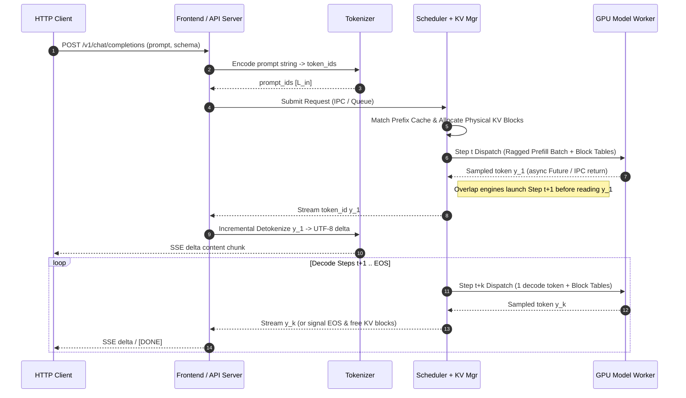

# 03 — Engine Architectures: vLLM, SGLang, TensorRT-LLM & TGI

[Previous: 02 — Paged Memory Management & PagedAttention](./02-paged-memory-management-pagedattention.md) | [Stage 4 Overview](./README.md) | [Next: 04 — Constrained Decoding & Structured Outputs](./04-constrained-decoding-structured-outputs.md)

---

Fast GPU math kernels alone do not guarantee a fast language model server. Because the CPU must parse network requests, manage memory tables, and launch GPU work before every single token step, **how a serving engine structures its CPU control plane** often determines real-world throughput and latency.

## Core Concepts & Terminology

Every runtime, systems, and serving-engine term used in this module is defined below in dependency order:

* **CPU Control Plane vs. GPU Hot Path:** The **CPU control plane** handles HTTP networking, tokenization, scheduling decisions, and kernel launches; the **GPU hot path** is the sequence of matrix and attention kernels executing on the GPU.
* **CUDA Kernels & Libraries (`FlashAttention`, `FlashInfer`, `Triton`, `CUTLASS`, `cuBLASLt`, `Marlin`, `EETQ`, `ContextFMHA`, `XQA`, `SASS`):** **CUDA kernels** are parallel GPU functions. `FlashAttention`, `FlashInfer`, and `ContextFMHA` are fused attention kernels; `Triton` compiles Python-like kernel code to GPU instructions; `CUTLASS` and `cuBLASLt` are NVIDIA matrix-math libraries; `Marlin` and `EETQ` are quantized weight kernels; **`XQA`** is NVIDIA's warp-specialized decode attention kernel written in **`SASS`** (raw GPU machine assembly).
* **Quantization & Weight Formats (`Safetensors`, `mmap`, `FP8`, `INT4-AWQ`, `W4A8`):** **`Safetensors`** is a safe binary weight format often loaded via **`mmap`** (memory-mapping files directly from disk into virtual memory). **`FP8`**, **`INT4-AWQ`**, and **`W4A8`** compress weights/activations to 8-bit or 4-bit numbers to reduce HBM traffic.
* **Multi-GPU Parallelism (`TP`, `PP`, `NCCL`, `MPI`, `torch.distributed`):** **TP** (*Tensor Parallelism*) splits each layer's matrices across GPUs; **PP** (*Pipeline Parallelism*) places different layers on different GPUs. **`NCCL`** (*NVIDIA Collective Communications Library*, e.g., `AllReduce`), **`MPI`**, and **`torch.distributed`** synchronize tensors across GPUs.
* **Python GIL, `asyncio`, HTTP/JSON, & SSE:** The **GIL** (*Global Interpreter Lock*) is Python's mutex allowing only one thread to run Python bytecode at a time. **`asyncio`** is Python's cooperative event loop. **SSE** (*Server-Sent Events*) streams generated tokens incrementally over an open HTTP connection.
* **Tokenization, Detokenization, & UTF-8 Delta:** **Tokenization** converts prompt text into integer token IDs; **detokenization** converts output token IDs back into incremental **UTF-8** text chunks.
* **Compilation Models (Eager, JIT, `torch.compile`, CUDA Graphs, AoT):** **Eager** mode runs PyTorch ops one by one; **JIT** (*Just-in-Time*, e.g., `torch.compile`) fuses ops dynamically at runtime; **CUDA Graphs** record a fixed sequence of GPU kernel launches so the CPU can replay them in one call. **AoT** (*Ahead-of-Time*) compiles and auto-tunes an entire static binary plan (`.engine`) before serving begins.
* **IPC, ZeroMQ (`ZMQ`), gRPC (`tonic`/`grpcio`), & UDS:** **IPC** (*Inter-Process Communication*) exchanges data between OS processes using **ZeroMQ (`ZMQ`)** message sockets, shared memory, or **gRPC** (a binary remote-procedure-call protocol) over **UDS** (*Unix Domain Sockets*, fast local OS pipes).
* **Rust, `tokio`, & `axum`:** **Rust** is a compiled systems language with no GIL; **`tokio`** is its async runtime and **`axum`** is its HTTP web framework.
* **Automatic Prefix Caching (APC) vs. RadixAttention (Radix Tree, LPM, LRU):** **APC** caches KV blocks by hashing fixed-size block contents. **RadixAttention** stores all active and historical KV slots in a **Radix Tree** (a compressed prefix trie) for token-level reuse, using **LPM** (*Longest-Prefix-Match*) scheduling and **LRU** (*Least-Recently-Used*) eviction of unreferenced (`lock_ref == 0`) leaves.
* **Overlap Scheduling & `FutureIndices`:** **Overlap scheduling** prepares step $t+1$'s batch on CPU while step $t$ executes on GPU, using **`FutureIndices`** (device-side GPU memory placeholders) so step $t+1$ can launch without waiting for a CPU-GPU sync (`cudaStreamSynchronize`).
* **Inflight Batching, DSL, & Constrained Decoding (`XGrammar`, `Outlines`, `llguidance`, Jump-Forward):** **Inflight Batching** is TensorRT-LLM's term for continuous batching. A **DSL** (*Domain-Specific Language*) is an embedded programming interface for multi-step LLM workflows. **Constrained decoding** engines (`XGrammar`, `Outlines`, `llguidance`) enforce grammars on sampled tokens, and **Jump-Forward Decoding** fast-forwards deterministic schema boilerplate.

---

## 1. Why Control-Plane Architecture Dictates GPU Efficiency

A common misconception is that LLM serving speed is determined solely by GPU CUDA kernels (FlashAttention, FP8 GEMMs). In practice, **the CPU control plane often becomes the primary bottleneck** when running small-to-medium models (e.g., 8B on H100) or high-tensor-parallelism setups (e.g., 70B on TP=8).

Consider Llama-3-8B in FP8 on an H100 SXM ($3.35\text{ TB/s}$ HBM3):
* Weight size $\approx 8\text{ GB}$.
* Ideal memory-bandwidth-bound decode step time at low batch size:
  $$T_{\text{GPU\_step}} \approx \frac{8\text{ GB}}{3.35\text{ TB/s}} \approx 2.4\text{ ms}$$
* If the CPU spends $1.2\text{ ms}$ per step inside Python's Global Interpreter Lock (GIL), JSON/HTTP serialization, tokenizer/detokenizer calls, scheduler queue scanning, and PyTorch kernel-dispatch overhead (where each `nn.Module` op triggers a separate CPU-to-GPU `cudaLaunchKernel` driver call across hundreds of ops per forward pass), **the GPU sits idle 33% of the time** between steps!

Production serving engines differ fundamentally in **how they isolate the CPU control plane from the GPU hot path**, **how they manage KV memory**, and **whether they compile execution graphs Ahead-of-Time (AoT) or Just-in-Time (JIT)**.

---

## 2. vLLM Architecture (V0 vs. V1 Multiprocess Engine)

### 2.1 Classic vLLM V0 Execution Loop

vLLM V0 established the blueprint for PagedAttention-based serving through five modular abstractions:

1. **`AsyncLLMEngine` (Ingress & Event Loop):** Wraps `LLMEngine` in an asynchronous `asyncio` loop behind a FastAPI/OpenAI-compatible server. Receives HTTP requests, tokenizes prompts, pushes `SequenceGroup` objects into the engine, and streams detokenized deltas back via `asyncio.Queue`.
2. **`Scheduler`:** Executes the per-iteration continuous batching loop over `waiting`, `running`, and `swapped` deques (detailed in [Module 01](./01-dynamic-scheduling-continuous-batching.md)), outputting `SchedulerOutputs` (which sequences to prefill/decode, blocks to copy-on-write, blocks to swap).
3. **`BlockSpaceManager` (v1/v2):** Owns the logical-to-physical `BlockTable` mappings, `FreeBlockQueue`, `ref_count` tracking, and optional block-hash-based Automatic Prefix Caching (APC). Returns physical block IDs and CoW copy pairs to the scheduler.
4. **`Executor` (`GPUExecutor` / `MultiprocessingGPUExecutor` / `RayGPUExecutor`):** Broadcasts `ExecuteModelRequest` metadata from the driver process to all Tensor-Parallel / Pipeline-Parallel worker processes.
5. **`Worker` & `ModelRunner`:** Each GPU rank runs a `Worker` containing a `ModelRunner`. On every step, `ModelRunner`:
   * Converts scheduler metadata into GPU tensors (`input_ids`, `positions`, `slot_mapping`, `block_tables`, `seq_lens`, `AttentionMetadata`).
   * Runs the forward pass (replaying captured **CUDA Graphs** for pure decode batches—recording the entire sequence of ~300+ GPU kernel launches once per batch size so the CPU replays them in a single call with zero Python/CUDA dispatch overhead—or eager PyTorch + FlashAttention/FlashInfer for prefills).
   * Runs the `Sampler` (logits $\to$ penalties $\to$ temperature/top-$k$/top-$p$ $\to$ token IDs) and returns sampled tokens to the driver.

**V0 Bottlenecks Exposed at Scale:**
* **Shared Event Loop & GIL Contention:** HTTP parsing, detokenization, and `LLMEngine.step()` competed inside the same Python process, causing jitter when large concurrent streams hit the API.
* **Redundant Step Metadata Reconstruction:** On every single iteration, the CPU rebuilt full `AttentionMetadata` and `block_tables` arrays from scratch and serialized them across workers, consuming $1\text{–}3\text{ ms}$/step on CPU.
* **Separate Prefill/Decode Code Paths:** Early V0 scheduled prefills and decodes separately, leaving gaps when mixing workloads.

### 2.2 vLLM V1 Multiprocess Engine Redesign

vLLM V1 overhauled the architecture to minimize CPU overhead and isolate I/O from GPU scheduling:

* **Strict Process Isolation via ZeroMQ (`ZMQ`):**
  * **`APIServer` Process(es):** Stateless frontends handling HTTP/OpenAI parsing, **fast Rust-backed tokenization/detokenization**, and SSE streaming. Communicates asynchronously over ZMQ IPC sockets.
  * **`EngineCore` Process:** A dedicated, tight-loop CPU process owning the **Unified Scheduler** (treating prefill and decode uniformly via chunked token budgets) and **KV Cache Manager** (prefix-cached block tables).
  * **`Worker` Processes (1 per GPU):** Listen to `EngineCore` over ZMQ/shared memory and drive `ModelRunner`.
* **Persistent Input Batch State (Delta-Only Updates):** Instead of reconstructing the entire batch tensor (`input_ids`, `block_tables`) every step, `Worker` maintains a persistent `InputBatch` buffer in CPU/pinned memory and applies **only incremental diffs** (newly added/removed requests and newly appended block IDs).
* **Piecewise `torch.compile` + CUDA Graphs:** Uses `torch.compile` to fuse elementwise ops (RMSNorm, RoPE, SiLU*Mul) while splitting out Attention into custom CUDA kernels (`FlashAttention-3` / `FlashInfer`), capturing piecewise CUDA Graphs across varying batch sizes/token counts.
* **Async Scheduling Overlap:** Overlaps CPU scheduling for step $t+1$ with GPU forward execution of step $t$ (eliminating inter-step GPU bubbles).

---

## 3. SGLang Architecture

**SGLang** (Structured Generation Language) was engineered from the ground up around **KV prefix reuse**, **zero-overhead CPU scheduling**, and **tightly integrated structured output execution**.

### 3.1 Component Pipeline
1. **Frontend DSL & HTTP Server (`TokenizerManager`):** Handles HTTP/OpenAI requests or compiled SGLang DSL programs, performs async tokenization/detokenization, and communicates with the backend via ZMQ.
2. **Backend `Scheduler` (Single-Process Event Loop):** Owns three tightly coupled components:
   * **`RadixCache`:** Prefix tree mapping token sequences to KV slots.
   * **Continuous Batching & Chunked Prefill Scheduler:** Longest-Prefix-Match (LPM) scheduling order (prioritizing waiting requests that hit the longest cached prefix in the Radix Tree, maximizing cache hits before eviction).
   * **Constrained Decoding Engine:** Integrated XGrammar / Outlines / llguidance FSMs supporting **Jump-Forward Decoding**.
3. **`TpModelWorker` / `ModelRunner`:** Executes model layers via **FlashInfer** / Triton / custom CUDA kernels + CUDA Graphs, using `ReqToTokenPool` (mapping request index $\to$ token KV indices) and `TokenToKVPool` (paged KV storage with page size $B=1$ or $B=16/64$).

### 3.2 RadixAttention (Dynamic Radix Tree KV Cache)
Unlike vLLM V0's fixed-block hash table (which only matched exact multiples of `block_size` = 16 tokens), **RadixAttention** manages all cached KV states (both active and historical completed requests!) in a **Radix Tree (compressed prefix trie)**:
* **Edges:** Variable-length sequences of token IDs mapped directly to slices of physical KV cache slots.
* **Automatic Multi-Pattern Reuse:** Automatically handles multi-turn conversation history, few-shot example sharing, Tree-of-Thoughts branching, and multi-agent sub-call forks without explicit user annotations.
* **LRU Leaf Eviction:** Completed request paths remain in the Radix Tree with `lock_ref = 0` until VRAM is needed; when free KV space runs low, leaf nodes are evicted in Least-Recently-Used (LRU) order (`lock_ref == 0`).

### 3.3 Zero-Overhead CPU Scheduler (Overlap Scheduling)
In standard engines, the CPU runs: `Schedule(t) -> Launch GPU(t) -> Wait/Sync -> Sample(t) -> Schedule(t+1)`. Normally, Python must read the sampled token back to the host (e.g., `next_token.item()`, which triggers an implicit `cudaStreamSynchronize` barrier) to know the token IDs and `<EOS>` status before building step $t+1$—stalling the CPU while the GPU works, and then stalling the GPU while the CPU schedules.

SGLang's **Zero-Overhead Scheduler** runs a **one-step lookahead pipeline** on a separate CPU thread/stream:
1. While the GPU executes forward pass $t$ on CUDA Stream `compute`, the CPU immediately constructs the batch metadata for step $t+1$ **assuming none of the running requests hit EOS at step $t$**!
2. Because token $y_t$ hasn't finished sampling yet, `input_ids` for step $t+1$ references **device-side placeholder indices (`FutureIndices`)** pointing into GPU memory where the step-$t$ sampler is writing the output tokens.
3. A tiny GPU kernel resolves `FutureIndices -> input_ids` on-device without a CPU synchronization barrier (`cudaStreamSynchronize`), and step $t+1$ kernels are queued into the CUDA stream **before step $t$ even finishes on the GPU**!
4. When step $t$'s sampled tokens asynchronously arrive on the CPU one step later, if a request *did* hit `<EOS>`, the scheduler simply discards its redundant 1-token step-$t+1$ compute and frees its KV slot on step $t+2$.

**Result:** CPU scheduling overhead drops from $\sim 1\text{–}3\text{ ms}$/step to **effectively $0\text{ ms}$ exposed on the critical path**, yielding dramatic speedups on fast models (8B–32B) and speculative/constrained loops.

### 3.4 Frontend DSL
SGLang provides an embedded Python DSL (`@sgl.function`, `sgl.gen()`, `sgl.select()`, `sgl.fork()`, `sgl.join()`):
* Compiles complex multi-turn LLM workflows (e.g., Chain-of-Thought + JSON extraction + parallel verification branches) into an **asynchronous dataflow graph**.
* Automatically exploits **fork/join KV prefix sharing** in `RadixCache` and **batch parallelism** across independent `fork()` branches without manual HTTP orchestration.

---

## 4. TensorRT-LLM Architecture

**TensorRT-LLM** (NVIDIA) represents the **Ahead-of-Time (AoT) compiled C++ runtime** paradigm, trading Python flexibility for maximum bare-metal silicon efficiency. Instead of interpreting PyTorch `nn.Module` layers dynamically at serving time, it compiles the entire model into a static, hardware-tuned C++ execution plan before the server starts.

### 4.1 Ahead-of-Time (AoT) Graph Compilation (`trtllm-build`)
Unlike vLLM/SGLang (which load HuggingFace Safetensors directly at startup and execute PyTorch/CUDA Graph modules dynamically), classic TensorRT-LLM uses a two-stage build-then-serve workflow:
1. **Model Definition & Weight Conversion:** A model is defined in TensorRT-LLM's declarative Python Graph API (`tensorrt_llm.models`, building an `INetworkDefinition` symbolic compute graph) and weights are converted/quantized (FP8, INT4-AWQ, W4A8) into a TensorRT-LLM checkpoint.
2. **Compiler Optimization & `.engine` Serialization (`trtllm-build`):** The TensorRT builder performs:
   * **Aggressive Graph-Level Pattern Fusion:** Fuses `QKV` projections into single wide GEMMs, fuses `RoPE + Quantize + KV Cache Write` into one kernel, fuses `NCCL AllReduce + Residual Add + RMSNorm` (reducing NCCL latency + HBM round-trips), and replaces attention with custom **XQA / FMHA plugins**.
   * **Hardware-Specific Kernel Auto-Tuning:** Benchmarks hundreds of CUTLASS/cuBLASLt GEMM tile configurations across expected `(M, N, K)` shapes on the exact target GPU SKU (e.g., H100 `sm_90`) and statically allocates shared scratchpad workspace buffers.
   * **Output:** Produces a serialized binary **TensorRT Engine Plan (`.engine`)** locked to the target GPU architecture, TP/PP rank count, `max_batch_size`, and `max_num_tokens`.

*(Note: Newer TensorRT-LLM releases also introduce a PyTorch-backend runtime path alongside the AoT `.engine` pipeline to reduce build friction for rapid model iteration, while preserving custom TRT-LLM C++ kernels and Inflight Batching.)*

### 4.2 C++ Inflight Batching Runtime (`Executor`)
At serving time, the `.engine` plans are loaded by a **pure C++ multi-threaded runtime** (`tensorrt_llm::executor::Executor` / `TrtGptModelInflightBatching`), with **zero Python interpreter or GIL** anywhere in the scheduling or forward-pass loop:
* **`BatchManager` (C++):** Implements continuous batching ("Inflight Batching"), chunked context (chunked prefill), micro-batching for Pipeline Parallelism, and KV Cache block reuse (`KvCacheManager` with paged blocks + Radix/hash prefix reuse).
* **Zero-Copy C++ Kernel Execution:** Enqueues TensorRT execution contexts (`IExecutionContext::enqueueV3`) directly onto CUDA streams, orchestrating multi-GPU TP/PP via C++ MPI/NCCL threads.
* **Custom Attention Kernels:** Uses **ContextFMHA** (fused multi-head attention for prefill) and **XQA** (extremely optimized paged GQA/MQA warp-specialized decode kernel written in SASS/CUDA).

---

## 5. TGI (Text Generation Inference) Architecture

**TGI** (Hugging Face) pioneered a **hybrid Rust Control Plane + Python GPU Shard** architecture—combining Rust's lock-free concurrency at the HTTP/network boundary with PyTorch's rapid model ecosystem support.

### 5.1 Three-Layer Process Architecture
1. **`router` (Rust / `axum` / `tokio`):**
   * Exposes the HTTP/SSE OpenAI-compatible ingress.
   * Performs **native Rust tokenization and streaming detokenization** via HuggingFace `tokenizers` (avoiding Python's GIL completely during string decoding and regex/JSON validation via `outlines-core` in Rust).
   * Runs the **Continuous Batching Queue & Scheduler** in Rust (`Queue` tracking waiting requests, token budgets, and active batch state).
2. **gRPC over Unix Domain Sockets (`tonic` $\leftrightarrow$ `grpcio`):**
   * Instead of sending full request histories every step, the Rust router sends lightweight **batch state deltas** over local UDS gRPC to the Python backend:
     * `Prefill(new_batch)` — initialize KV slots for new requests and run prefill + 1st token.
     * `Decode(cached_batch_ids)` — advance all active cached batches by 1 token.
     * `FilterBatch(keep_request_ids)` — drop finished requests and free their KV blocks.
     * `ClearCache` — purge state on reset.
3. **`text-generation-server` (Python Model Shards, 1 process per GPU):**
   * Loads HuggingFace weights via `safetensors` (`mmap`) and shards across GPUs using `torch.distributed` / NCCL.
   * Executes FlashAttention-2 / PagedAttention / Marlin / EETQ kernels, maintains the GPU KV Cache block tables locally inside the Python shard process, samples next token IDs, and streams `(token_id, logprob, stop_reason)` back over gRPC to the Rust router.

**Architectural Trade-off:** Offloading HTTP, tokenization, and batch queuing to Rust makes TGI extremely resilient under high connection concurrency (10,000+ SSE clients). However, maintaining a synchronous **gRPC round-trip boundary per decode iteration** between Rust (`router`) and Python (`model_shard`) adds $\sim 0.3\text{–}1.0\text{ ms}$ of IPC + Python shard dispatch overhead per step unless overlapping is implemented.

---

## 6. Architectural Comparison Across All Four Engines

### 6.1 Structural Pipeline Comparison

```mermaid
flowchart TD
    subgraph VLLM["vLLM V1 (Python + ZMQ Multiprocess)"]
        V_API["APIServer Process\n(HTTP + Fast Tokenizer)"] -->|"ZMQ IPC"| V_Core["EngineCore Process\n(Unified Scheduler + KV Mgr)"]
        V_Core -->|"ZMQ Delta Updates"| V_Work["Worker Process\n(torch.compile + CUDA Graphs)"]
    end

    subgraph SGL["SGLang (Python + Overlap + Radix)"]
        S_API["TokenizerManager / DSL\n(HTTP + Async Detok)"] -->|"ZMQ IPC"| S_Sched["Scheduler Process\n(RadixCache + Zero-Overhead Overlap)"]
        S_Sched -->|"FutureIndices Stream"| S_Work["TpModelWorker\n(FlashInfer + CUDA Graphs)"]
    end

    subgraph TRT["TensorRT-LLM (AoT C++ Runtime)"]
        T_Build["AoT Build: trtllm-build\n(Graph Fusion + .engine Plan)"] -.->|"Loaded at Startup"| T_Exec
        T_API["C++ / Triton Frontend\n(HTTP/gRPC + Tokenizer)"] --> T_Exec["C++ Executor Runtime\n(BatchManager + KvCacheManager)"]
        T_Exec -->|"Zero-GIL C++ enqueueV3"| T_GPU["TensorRT Engine + XQA\n(Fused NCCL + FP8/FP4 Kernels)"]
    end

    subgraph TGI["Hugging Face TGI (Rust + Python Hybrid)"]
        H_Router["Rust Router (tokio/axum)\n(HTTP + Rust Tokenizers + Queue)"] -->|"UDS gRPC (Prefill/Decode Deltas)"| H_Shard["Python Model Shards\n(PyTorch + FlashAttn/PagedAttn)"]
    end
```

### 6.2 HTTP Request End-to-End Execution Timeline

### 6.3 Comprehensive Engineering Trade-Off Matrix

| Dimension | **vLLM (V1)** | **SGLang** | **TensorRT-LLM** | **TGI** |
| :--- | :--- | :--- | :--- | :--- |
| **Compilation Model** | JIT: `torch.compile` (piecewise) + CUDA Graphs | JIT: Torch + FlashInfer/Triton + CUDA Graphs | **AoT:** `trtllm-build` compiles static `.engine` plans *(PyTorch backend also emerging)* | JIT / Eager PyTorch + CUDA Graphs + FlashAttn/Marlin |
| **Hot-Path Language** | Python (`EngineCore` + `Worker`) + C++/CUDA kernels | Python (overlapped scheduler) + C++/CUDA/Triton | **Pure C++ Runtime** (`Executor`) + CUDA/SASS | **Rust** (`router`) + gRPC + **Python** (`model_shard`) |
| **CPU Scheduler Overhead** | Very Low in V1 (isolated `EngineCore` + persistent diff batch) | **Near-Zero Exposed** (1-step async overlap scheduler) | **Minimal** (native multi-threaded C++, zero GIL) | Low-Moderate (fast Rust router, but per-step gRPC UDS hop) |
| **KV Prefix Reuse** | Block-hash APC (`block_size` granularity, e.g., 16) | **RadixAttention** (token-level compressed Radix Tree + LPM) | Paged KV Block Reuse (hash-based in C++ `KvCacheManager`) | Block-level prefix cache (in newer versions) |
| **Startup / Time-to-Deploy** | Fast (seconds–minutes; loads Safetensors directly) | Fast (seconds–minutes; loads Safetensors directly) | **Slow** (minutes–hours to compile & auto-tune `.engine` per GPU/TP) | Fast (seconds–minutes via `mmap` Safetensors) |
| **Constrained Decoding** | Pluggable (XGrammar, Outlines, Guidance) | **First-class** (XGrammar/Outlines + Jump-Forward + DSL) | Native XGrammar / `llguidance` C++ integration | Native `outlines-core` inside Rust router |
| **Best-Fit Production Scenario** | Broadest model/hardware support (AMD/TPU/CUDA), LoRA, general serving | Agentic workflows, multi-turn prefix reuse, structured JSON, high RPS small/medium models | Peak raw throughput/latency on fixed NVIDIA SKUs (H100/B200) with stable model configs | High-concurrency HTTP/SSE ingress tightly integrated with Hugging Face Hub |

---

## Navigation

* **Previous:** [02 — Paged Memory Management & PagedAttention](./02-paged-memory-management-pagedattention.md)
* [Stage 4 Overview](./README.md)
* **Next:** [04 — Constrained Decoding & Structured Outputs](./04-constrained-decoding-structured-outputs.md)
