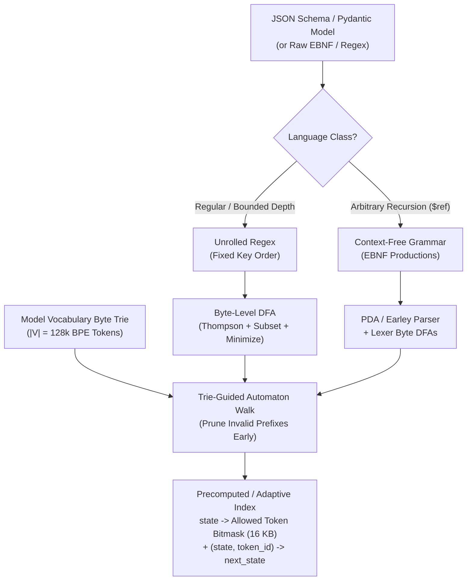
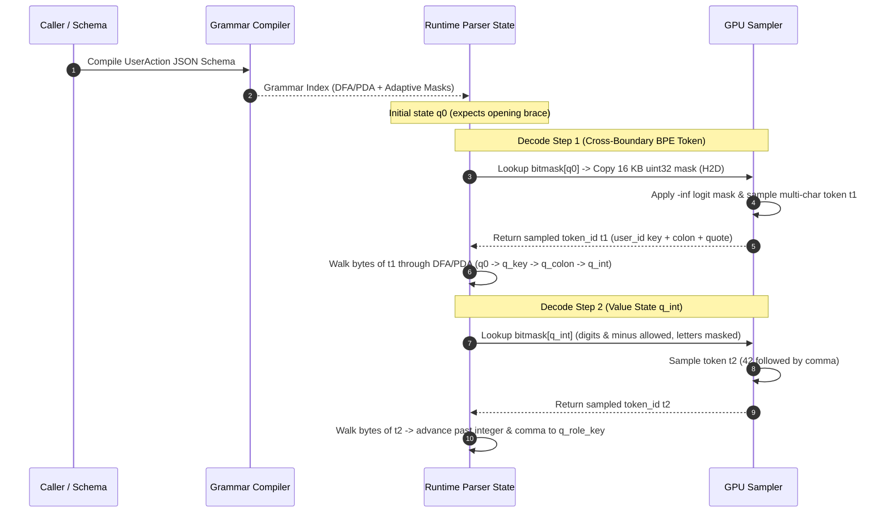

# 04 — Constrained Decoding & Structured Outputs

[Previous: 03 — Engine Architectures](./03-engine-architectures.md) | [Stage 4 Overview](./README.md) | [Next: 05 — Logit Masking & Jump-Forward Decoding](./05-logit-masking-and-jump-forward-decoding.md)

---

Prompting a language model to "output only valid JSON" always leaves a small chance of syntax errors that break downstream software pipelines. This module explains how serving engines embed formal grammar recognizers directly into token generation to guarantee 100% valid structured outputs.

## Core Concepts & Terminology

Every formal-language, tokenization, and constrained-decoding term used in this module is defined below in dependency order:

* **Vocabulary ($V$) & Token ($t \in V$):** The **vocabulary** is the fixed dictionary of all text pieces (**tokens**, typically $|V| \approx 32{,}000\text{–}152{,}000$) a model can output.
* **BPE (Byte-Pair Encoding), SentencePiece, & Byte-Fallback UTF-8:** **BPE** and **SentencePiece** are subword tokenization methods that merge frequent character sequences into single multi-character tokens ($s_t = c_1 \dots c_m$). **Byte-fallback BPE** represents rare or multi-byte **UTF-8** characters (e.g., `é` = `0xC3 0xA9`) as individual raw byte tokens (`0x00..0xFF`).
* **TTFT, KV Cache, & `<EOS>` (`EOS_TOKEN_ID`):** **TTFT** (*Time To First Token*) is the wait until the first output token; the **KV Cache** stores attention history; **`<EOS>`** (*End-of-Sequence*) is the stop token ending generation.
* **Structured Contracts (Pydantic, JSON Schema, `$ref`, SQL, XML, DSL, AST):** **Pydantic** and **JSON Schema** define exact data types and fields (with **`$ref`** enabling recursive nested objects). **SQL**, **XML**, and **DSLs** (*Domain-Specific Languages*) are formal syntax languages; an **AST** (*Abstract Syntax Tree*) is the hierarchical tree structure of parsed code/data.
* **Constrained Decoding & Logit Masking ($-\infty$):** **Constrained decoding** restricts which tokens $V_{\text{valid}} \subseteq V$ the model is allowed to pick at each step by setting invalid tokens' raw scores (**logits**) to $-\infty$ before sampling.
* **Chomsky Hierarchy (Type 3 Regular vs. Type 2 Context-Free):** A formal classification of languages by the memory required to recognize them. **Type 3 (Regular)** needs only finite memory; **Type 2 (Context-Free)** allows unbounded nested recursion.
* **Regex, Thompson's Construction, NFA, Subset Construction, & DFA ($M = (Q, \Sigma, \delta, q_0, F)$):** A **Regex** (*Regular Expression*) defines a regular pattern. **Thompson's Construction** converts a Regex into an **NFA** (*Nondeterministic Finite Automaton*), and **Subset Construction** converts that into a **DFA** (*Deterministic Finite Automaton*): a finite state machine with states $Q$, alphabet $\Sigma$, deterministic transition function $\delta: Q \times \Sigma \to Q$, start state $q_0$, and accepting states $F$ (where `<EOS>` is allowed).
* **Pumping Lemma:** A mathematical theorem proving that finite-state DFAs cannot track unbounded nesting depth (such as arbitrary `{{{...}}}` JSON objects).
* **CFG, EBNF, Production Rules, Non-Terminals, & Left-Recursion:** A **CFG** (*Context-Free Grammar*, often written in **EBNF**, *Extended Backus-Naur Form*) is a tuple $G = (V_{\text{nt}}, \Sigma, R, S)$ of **non-terminal** placeholders ($V_{\text{nt}}$), terminal characters ($\Sigma$), **production rules** ($A \to \alpha$), and start symbol ($S$). **Left-recursion** is a rule whose leftmost symbol is itself ($A \to A b$).
* **PDA (Pushdown Automaton) & Persistent Stack:** A **PDA** is a finite state machine augmented with an unbounded **stack** of active grammar rules to handle recursion. A **persistent (copy-on-push) stack** shares parent stack frames across branching hypotheses without full copies.
* **Lexing vs. Parsing & Earley Parser:** **Lexing** groups raw bytes into terminal tokens via DFAs; **parsing** checks structural CFG rules. An **Earley parser** is a general CFG chart parser tracking `(rule, dot_pos, origin)` items in $O(n^3)$ worst-case ($O(n)$ on unambiguous grammars).
* **Token-Boundary Alignment Problem:** The hazard where a single multi-character BPE token spans across multiple byte-level grammar states (or crosses a rule boundary), requiring full multi-byte validation $\delta^*(q, s_t)$ rather than checking only the first character.
* **Vocabulary Prefix Trie & Pruning:** A tree organizing all $|V|$ token byte strings by shared prefix so rejecting an invalid byte prefix immediately prunes entire subtrees of thousands of tokens.
* **Bitmask (`uint32`) & H2D Copy:** A compact array of 1-bit validity flags (`1` = allowed, `0` = masked) packed into 32-bit unsigned integers (`uint32`) and copied from CPU Host to GPU Device (**H2D**).
* **Outlines, XGrammar (Context-Independent vs. Context-Dependent Tokens), & `llguidance` (LRU Cache):** **Outlines** precomputes full DFA bitmasks; **XGrammar** precomputes masks for ~99% **context-independent** tokens (staying inside the current PDA rule) and simulates the stack only for <1% **context-dependent** tokens (crossing rule boundaries); **`llguidance`** walks the token trie on demand with an Earley parser and caches bitmasks in an **LRU** (*Least-Recently-Used*) cache.

---

## 1. Why Prompt Engineering Fails for Deterministic Contracts

In agentic pipelines, function calling, and structured data extraction, an LLM must emit machine-parseable syntax (JSON conforming to a Pydantic schema, SQL, XML, or a custom DSL). Relying solely on prompting ("Return ONLY valid JSON") fails mathematically at scale:

* Even if a single output has only a $\epsilon = 0.5\%$ probability of a structural error (a stray markdown fence ```` ```json ````, a trailing comma, an unescaped quote, or a hallucinated enum key), over a 20-step multi-agent workflow the probability of at least one parse failure is:
  $$P(\text{failure}) = 1 - (1 - 0.005)^{20} \approx 9.54\%$$
* Retry loops multiply TTFT, waste KV Cache compute, and degrade user experience.

**Constrained Decoding (Grammar-Guided Generation)** eliminates structural errors completely by embedding a **formal language recognizer** (DFA or PDA/Earley parser) inside the token-sampling loop. Before sampling each token, the recognizer computes the exact subset of vocabulary tokens $V_{\text{valid}} \subseteq V$ that keep the output prefix in a valid partial derivation of the target grammar, guaranteeing **100% syntactic validity by construction**.

---

## 2. Formal Language Hierarchy: Regex/DFA vs. CFG/PDA

From formal language theory (the Chomsky Hierarchy), two language classes govern structured LLM generation:

### 2.1 Regular Languages (Type 3): Regex $\to$ NFA $\to$ DFA

A **Regular Expression (Regex)** defines a regular language, convertible via Thompson's Construction into a Nondeterministic Finite Automaton (NFA) and via Subset Construction into a **Deterministic Finite Automaton (DFA)** $M = (Q, \Sigma, \delta, q_0, F)$:
* $Q$: Finite set of states.
* $\Sigma$: Input alphabet (ASCII/UTF-8 bytes or Unicode characters).
* $\delta: Q \times \Sigma \to Q$: Deterministic transition function ($O(1)$ array/hash lookup per character).
* $q_0 \in Q$: Initial state; $F \subseteq Q$: Accepting states (where `<EOS>` is permitted).

**Strengths:**
* Bounded finite state $Q$ enables **$O(1)$ per-token runtime advancement** and **full ahead-of-time mask precomputation** (`state_id -> allowed_token_ids`).
* Sufficient for enums, dates, phone numbers, identifiers, and **non-recursive (or depth-bounded) JSON Schemas**.

**Fundamental Limitation (Pumping Lemma):**
A DFA has fixed finite memory—at runtime it tracks only a single integer `state_id` from a fixed set of $|Q|$ states. To match arbitrary-depth balanced delimiters such as nested JSON objects `{"a": {"b": ...}}`, nested arrays `[[[1]]]`, arithmetic expressions `((1+2)*3)`, or recursive ASTs (`$ref` in JSON Schema), a recognizer would need a distinct state for every possible nesting depth (`depth_1`, `depth_2`, ..., `depth_N`). Because $|Q|$ is finite, a DFA **cannot** track unbounded nesting depth; doing so requires an explicit counter or stack.

### 2.2 Context-Free Languages (Type 2): CFG / EBNF $\to$ PDA / Earley Parser

A **Context-Free Grammar (CFG)**—typically expressed in **Extended Backus-Naur Form (EBNF)**—is a 4-tuple $G = (V_{\text{nt}}, \Sigma, R, S)$ where production rules $A \to \alpha$ allow self-embedding recursion ($A \Rightarrow^* \dots A \dots$).

Recognizing arbitrary CFGs requires a **Pushdown Automaton (PDA)** (a finite state machine augmented with an explicit **stack** of grammar symbols) or general CFG chart/parsing algorithms:
* **Earley Parser (e.g., Lark, `llguidance`):** Maintains a dynamic set of Earley items `(rule, dot_pos, origin)` at each input position. Handles **all** CFGs—including ambiguous grammars and left-recursion—in $O(n^3)$ worst-case and $O(n)$ for unambiguous deterministic grammars.
* **Persistent Stack PDA (e.g., XGrammar):** Maintains an explicit call stack of active non-terminals with copy-on-push persistent stack nodes so branching token hypotheses share stack prefixes without copying the entire stack.

| Property | Regex / DFA | CFG (EBNF) / PDA / Earley |
| :--- | :--- | :--- |
| **Expressive Power** | Regular languages (flat / bounded-depth JSON) | Arbitrary recursive nesting (full JSON, SQL, Python, XML) |
| **State Representation** | Single integer `state_id` $\in Q$ | Unbounded stack / Earley chart state |
| **Per-Character Step Cost** | $O(1)$ table lookup | $O(1)$ amortized (LL/LR/PDA) to $O(|R|)$ (Earley) |
| **Full Mask Precomputation** | Feasible for moderate $|Q|$ ($|Q| \times |V|$) | Impossible in general (infinite reachable stack states) |

---

## 3. Compiling JSON / Pydantic Schemas into Grammars

When a user supplies a Pydantic model or OpenAPI JSON Schema, the constrained-decoding compiler translates schema constraints into production rules (either an EBNF CFG or an unrolled Regex).

### 3.1 Concrete Schema-to-EBNF Translation Example

Consider this Pydantic model:

```python
from typing import Literal
from pydantic import BaseModel

class UserAction(BaseModel):
    user_id: int
    role: Literal["admin", "viewer"]
    tags: list[str]
```

Its corresponding JSON Schema enforces:
* `type: "object"` with exact required key order (canonical ordering eliminates combinatorial $k!$ key-permutation state blowup!),
* `user_id`: integer matching `-?(0|[1-9][0-9]*)`,
* `role`: closed enum `"admin"` or `"viewer"`,
* `tags`: recursive JSON array of escaped JSON strings.

The compiler emits an EBNF CFG:

```ebnf
root      ::= "{" ws "\"user_id\"" ws ":" ws integer "," ws
              "\"role\"" ws ":" ws role_enum "," ws
              "\"tags\"" ws ":" ws string_array ws "}"
role_enum ::= "\"admin\"" | "\"viewer\""
integer   ::= "-"? ("0" | [1-9] [0-9]*)
string_array ::= "[" ws (string (ws "," ws string)*)? ws "]"
string    ::= "\"" ([^"\\] | "\\" (["\\/bfnrt] | "u" [0-9a-fA-F]{4}))* "\""
ws        ::= [ \t\n\r]*
```

**Engineering Optimization — Fixed Key Ordering:**
Because JSON objects formally allow keys in any order, supporting arbitrary permutations of $K$ keys creates $K!$ states in a DFA (for $K=10$, $10! = 3{,}628{,}800$ states!). Production compilers (Outlines, XGrammar, OpenAI Structured Outputs) enforce the schema's declared property order (with optional presence flags for non-required fields), keeping state growth $O(K)$ linear instead of $O(K!)$.

---

## 4. The Token-Boundary Alignment Problem (The Core Systems Hazard)

A naïve developer implementing constrained decoding asks: *"At grammar state $q$, which characters are valid? Allow all tokens starting with those characters."* **This is fatally broken.**

### 4.1 Why Character Grammars and BPE Tokens Mismatch

Formal grammars define transitions over **single characters or UTF-8 bytes** ($c \in \Sigma_{\text{char}}$), whereas LLMs generate **variable-length subword tokens** $t \in V$ ($|V| \approx 32{,}000\text{–}152{,}000$) produced by Byte-Pair Encoding (BPE) or SentencePiece. In PyTorch, the `LM Head` scores integer token IDs `0..|V|-1`, and each token ID $t$ decodes (`tokenizer.decode([t])`) to a multi-character string $s_t = c_1 c_2 \dots c_m$ ($m \ge 1$).

Three concrete failure modes occur when tokens cross grammar state boundaries:

1. **Multi-Character Structural Tokens Spanning Multiple States:**
   Suppose the JSON output so far is `{"role` and the grammar next expects `"`, then `:`, then whitespace, then `"`.
   In Llama-3 / GPT-4o BPE vocabularies, `": "` is a **single token** (`m = 3` characters).
   * If you only checked single-character transitions, `"` is valid, so `"` alone would pass—but `": "` advances across **three grammar states** at once (`expect_quote` $\to$ `expect_colon` $\to$ `expect_ws` $\to$ `expect_value`).
   * Conversely, a token like `": null` starts with valid `": `, yet violates the schema because `role` must be `"admin"` or `"viewer"`, not `null`! You must validate the **entire string $s_t$** sequentially through the automaton: $\delta^*(q, s_t) = \delta(\dots\delta(\delta(q, c_1), c_2)\dots, c_m)$.
2. **Literal Boundary Splits:**
   If the schema expects `"admin"`, the model might choose to emit `"` + `admin` + `"` (3 tokens), OR `"` + `adm` + `in"` (where `in"` crosses the string-literal end and closing quote!), OR `"` + `admin",` (crossing into the comma separating the next field!).
   Every single one of these tokenizations must remain valid so the model isn't forced onto unnatural, low-probability token splits that corrupt output quality.
3. **Partial UTF-8 Byte Sequences (Byte-Fallback BPE):**
   Multi-byte UTF-8 characters (e.g., `é` = `0xC3 0xA9`, or emojis = 4 bytes) can be split across 2–4 byte-level tokens (`<0xC3>`, `<0xA9>`). A character-level regex fails if fed `<0xC3>` alone; modern engines (XGrammar, `llguidance`, Outlines) compile automata over **raw UTF-8 bytes** (`0x00..0xFF`), ensuring intermediate UTF-8 continuation states are cleanly represented inside the DFA/PDA.

---

## 5. Precomputing Token Index Tables & Engine Implementations

Checking all $|V| = 128{,}256$ token strings sequentially against a parser at every single decode step would take $5\text{–}50\text{ ms}$ on CPU—completely destroying GPU decode latency! Modern constrained-decoding engines solve this using **vocabulary tries** and **precomputed state-to-token index tables**.

### 5.1 Outlines (FSM / DFA Full Index Precomputation)

Introduced by Willard & Louf (2023), **Outlines** converts a Regex (or bounded JSON schema) into a minimal DFA $M = (Q, \Sigma_{\text{byte}}, \delta, q_0, F)$ and precomputes the **Token Transition Index** once per schema:

```python
# Conceptual Outlines Index Construction (Accelerated via Vocabulary Prefix Trie)
# state_to_allowed_tokens[q] -> List[int] (or uint32 bitmask)
# transition_map[(q, token_id)] -> next_state q'

for q in dfa.states:
    allowed = []
    for token_id, token_bytes in vocab.items():
        curr_q = q
        valid = True
        for b in token_bytes:
            if (curr_q, b) not in dfa.transitions:
                valid = False
                break
            curr_q = dfa.transitions[(curr_q, b)]
        if valid and curr_q in dfa.states_reaching_accept:
            allowed.append(token_id)
            transition_map[(q, token_id)] = curr_q
    if q in dfa.accepting_states:
        allowed.append(EOS_TOKEN_ID)
    state_to_allowed_tokens[q] = pack_bitmask(allowed)
```

* **Trie Acceleration:** Walking each of $|V| = 128\text{k}$ tokens independently repeats shared prefixes (e.g., `"a"`, `"ab"`, `"abc"`). Outlines organizes $V$ into a **byte-level Prefix Trie** so shared prefixes are traversed only once per state $q$—the moment a prefix byte like `"a"` fails a transition, the entire subtree beneath it is pruned in one step, cutting index compilation time by $5\text{–}10\times$.
* **Runtime Cost:** **$O(1)$ per step!** At decode step $t$, the CPU looks up `state_to_allowed_tokens[q_curr]` (a pre-packed 16 KB bitmask), copies it to GPU, and after sampling $t^*$, updates `q_curr = transition_map[(q_curr, t*)]`.
* **Limitation:** Does not natively handle unbounded recursion (full CFGs), and for massive schemas ($|Q| > 10^4$), precomputing $|Q| \times |V|$ consumes hundreds of milliseconds to seconds of compilation latency and large RAM.

### 5.2 XGrammar (Context-Independent vs. Context-Dependent Split for CFGs)

**XGrammar** (Dong et al., 2024—default engine in vLLM and SGLang) generalizes fast precomputation to **arbitrary Context-Free Grammars (PDAs)** without paying $O(|V|)$ runtime parsing cost:

1. **Key Insight — Vocabulary Partitioning:**
   For any PDA grammar state $s$ (defined by the current top-of-stack rule position, ignoring deeper stack frames), XGrammar classifies every token $t \in V$ into two disjoint sets:
   * **Context-Independent Tokens (~99% of $V$):** Whether $t$ is valid depends **only** on the local rule state $s$ (never pops past the current stack frame). Example: inside the `string` rule, `"hello"` or `"123"` stays purely inside `string` without touching the closing `"`!
   * **Context-Dependent Tokens (<1% of $V$, typically a few hundred tokens):** Tokens whose string crosses out of the current rule (e.g., `"` or `", "` which pop the `string` rule and inspect the parent PDA stack to decide if `,` or `}` or `]` is valid next!).
2. **Adaptive Token Mask Cache:**
   * At grammar compile time, XGrammar precomputes a compact **Adaptive Token Mask** over the ~99% context-independent tokens for each local PDA rule state $s$.
   * At decode step $t$, XGrammar fetches the precomputed mask in $O(1)$ and **only simulates the PDA stack for the ~100–500 context-dependent tokens** (using a persistent zero-copy stack with fast rollback), ORs their validity bits into the bitmask, and emits the complete 16 KB bitmask in **$< 40\,\mu\text{s}$** per request!

### 5.3 `llguidance` (Earley Parser + Lexer DFA + Token Trie Pruning)

**`llguidance`** (Microsoft Guidance) targets ultra-fast compilation (~$1\text{–}5\text{ ms}$ schema startup) and full CFG/regex support:
* Separates **Lexing** (tokens/terminals via byte-level DFAs) from **Parsing** (structural CFG rules via an optimized **Earley parser**).
* Instead of precomputing a giant $|Q| \times |V|$ matrix upfront, `llguidance` walks the **Vocabulary Byte Trie** on demand at runtime, querying the lexer DFA/Earley state at each trie node:
  * The moment a byte prefix (e.g., `"{` when an integer is expected) fails the Earley/DFA check, **the entire trie subtree beneath that prefix** (thousands of tokens!) is pruned immediately without ever inspecting its leaves!
* Caches computed bitmasks by `(parser_state_hash)` in an LRU cache across requests and steps, achieving $< 50\,\mu\text{s}$ per-token mask generation with negligible compile-time latency.

---

## 6. Compilation & Execution Diagrams

### 6.1 Compilation Pipeline: Schema $\to$ Automaton $\to$ Vocabulary Bitmask



### 6.2 Runtime Sequence: Incremental Parser Advancement Across BPE Boundaries



---

## Navigation

* **Previous:** [03 — Engine Architectures](./03-engine-architectures.md)
* [Stage 4 Overview](./README.md)
* **Next:** [05 — Logit Masking & Jump-Forward Decoding](./05-logit-masking-and-jump-forward-decoding.md)
