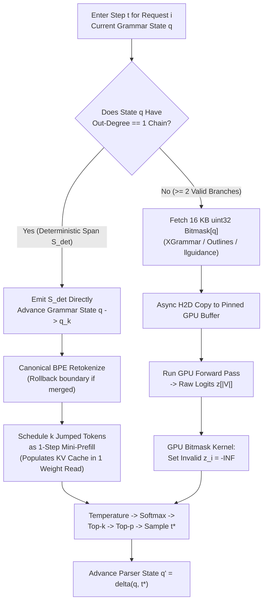
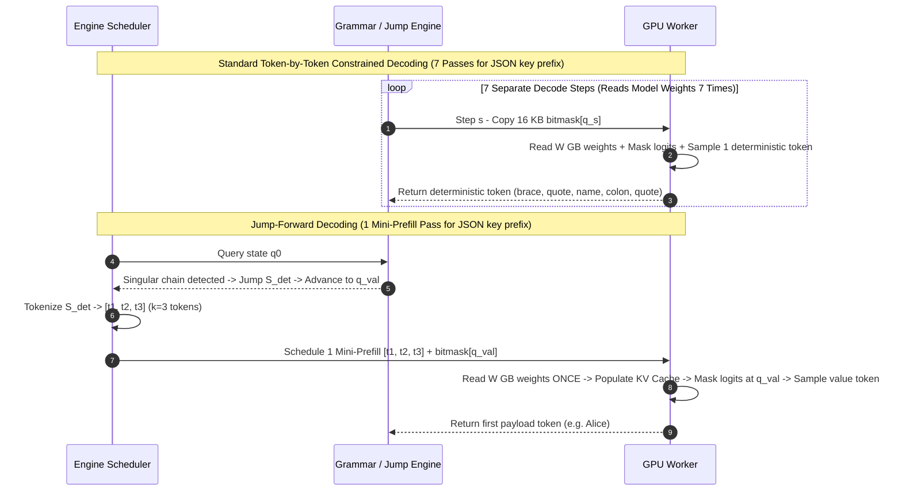

# 05 — Logit Masking & Jump-Forward Decoding

[Previous: 04 — Constrained Decoding & Structured Outputs](./04-constrained-decoding-structured-outputs.md) | [Stage 4 Overview](./README.md)

---

Once a grammar recognizer knows which tokens are valid at the current step, the GPU must enforce that rule without stalling on CPU-GPU transfers or wasting forward passes on predictable syntax. This module explains how bitmasks are applied in GPU memory, how sampling order prevents crashes, and how deterministic schema boilerplate is skipped via Jump-Forward Decoding.

## Core Concepts & Terminology

Every math, GPU-kernel, and decoding concept used in this module is defined below in dependency order:

* **Vocabulary ($V$, $|V|$), `LM Head`, & Logits ($\mathbf{z}$):** The **vocabulary** is the full set of $|V|$ tokens a model can generate (e.g., $128{,}256$ in Llama-3). The **`LM Head`** is the final linear layer producing raw, unnormalized scores called **logits** ($\mathbf{z} \in \mathbb{R}^{|V|}$).
* **Grammar Engine, Parser State ($q$), & Validity Mask ($\mathbf{m}$):** The grammar recognizer (DFA/PDA from Module 04) tracks the current syntax state $q$ and outputs a binary **validity mask** $\mathbf{m} \in \{0, 1\}^{|V|}$ (`1` = allowed, `0` = forbidden).
* **Temperature ($T$), Softmax, Greedy `argmax`, & Multinomial Sampling (`torch.multinomial`):** **Softmax** converts logits into probabilities summing to $1.0$. **Temperature ($T > 0$)** scales logits before Softmax to control randomness. **Greedy `argmax`** picks the single highest-probability token, while **multinomial sampling** draws a random token weighted by those probabilities.
* **IEEE-754 `-INFINITY`, FP16/BF16, & `NaN` Dead State:** **`-INFINITY`** is standard IEEE-754 negative infinity ($\exp(-\infty) = 0$). **FP16/BF16** are 16-bit floats (FP16's finite minimum is $-65{,}504$). If all tokens are masked ($\sum m_j = 0$, a **dead state**), Softmax produces **`NaN`** (*Not a Number*), crashing GPU sampling.
* **Bit-Packed `uint32` Bitmask vs. Dense Mask:** A **bitmask** packs 32 token validity flags (1 bit each) into one 32-bit unsigned integer (`uint32`), making it $32\times$ smaller than a dense `float32` mask.
* **HBM, PCIe, Pinned Host Memory (`cudaHostAlloc`), `cudaMemcpyAsync`, & `cudaStreamSynchronize()`:** **HBM** is GPU memory; **PCIe** is the CPU-GPU bus; **pinned memory** is page-locked CPU RAM enabling non-blocking **H2D** (*Host-to-Device*) transfers via **`cudaMemcpyAsync`**. **`cudaStreamSynchronize()`** forces the CPU to halt until the GPU finishes, destroying overlap and inflating **ITL** (*Inter-Token Latency*).
* **CUDA Kernel, Grid, Block, Thread, & `__restrict__`:** A **CUDA kernel** launches a **grid** of thread **blocks**; each **thread** processes one `uint32` word (32 tokens) directly in HBM (`__restrict__` promises pointers do not overlap).
* **Sampling Pipeline (Penalties, Top-$k$, Top-$p$ / Nucleus, Non-Commutativity):** **Presence/frequency/repetition penalties** down-weight already-generated tokens; **Top-$k$** keeps only the $k$ most likely tokens; **Top-$p$ (nucleus)** keeps the smallest top prefix whose probabilities sum to $\ge p$. Because these steps are **non-commutative** (order matters), grammar masking must run *before* Top-$k$/Top-$p$.
* **Entropy ($H = 0$) & Jump-Forward Decoding (Singular-Transition Compression):** **Entropy ($H$)** measures uncertainty; $H = 0$ means only one valid next string exists (e.g., `", "currency": "`). **Jump-Forward Decoding** compresses chains of **out-degree = 1** DFA/CFG states (no branching, no early `<EOS>`) into a single deterministic string $S_{\text{det}}$ emitted without sampling.
* **KV Cache, `RoPE`, `BlockManager`, & Mini-Prefill (GEMM):** Even when skipping sampling, later tokens must attend to $S_{\text{det}}$ with accurate **`RoPE`** (*Rotary Position Embedding*) positions. A **mini-prefill** allocates KV blocks in **`BlockManager`** and processes all $k$ jumped tokens in **1 parallel GEMM forward pass** (1 HBM weight read) instead of $k$ sequential decode steps.
* **BPE Retokenization, Token Healing, `logprobs`, & Ragged Attention (`FlashInfer`/`FlashAttention varlen`):** Because **BPE** (*Byte-Pair Encoding*) is not homomorphic ($\text{encode}(A) + \text{encode}(B) \neq \text{encode}(A+B)$), **suffix retokenization / token healing** re-merges tokens across the jump boundary (rolling back 1–2 KV tokens if needed) to avoid out-of-distribution splits. **`logprobs`** are per-token log-probabilities, and **ragged attention** mixes a $k$-token mini-prefill with 1-token decodes in the same continuous batch.

---

## 1. Pre-Softmax Logit Masking Mathematics

Once the grammar engine determines the binary validity mask $\mathbf{m} \in \{0, 1\}^{|V|}$ for the current parser state $q$, the sampler enforces the constraint directly on the raw unnormalized logit vector $\mathbf{z} \in \mathbb{R}^{|V|}$ produced by the `LM Head`:

$$\tilde{z}_i = \begin{cases} z_i & \text{if } m_i = 1 \\ -\infty & \text{if } m_i = 0 \end{cases}$$

Passing $\tilde{\mathbf{z}}$ through temperature-scaled Softmax ($T > 0$):

$$p_i = \frac{\exp(\tilde{z}_i / T)}{\sum_{j=1}^{|V|} \exp(\tilde{z}_j / T)} = \frac{m_i \cdot \exp(z_i / T)}{\sum_{j : m_j = 1} \exp(z_j / T)}$$

Because $\exp(-\infty) = 0$, every invalid token receives **exact probability $0$** and can never be drawn by multinomial sampling or greedy `argmax`. Crucially, for any two *valid* tokens $a, b$ ($m_a = m_b = 1$), their relative probability ratio is preserved untouched:

$$\frac{p_a}{p_b} = \exp\left(\frac{z_a - z_b}{T}\right)$$

### Numerical Edge Cases & Precision Hazards
1. **Why $-\infty$ instead of `-1e4` or `-1e9`?**
   * Using `-1e4` in FP16/BF16 leaves $\exp(-10000) = 0$ *unless* valid logits are unusually negative or temperature $T$ is very large (e.g., $T = 10 \implies -1000$). Worse, in FP16 the maximum finite negative number is $-65{,}504$, so `-1e9` overflows to `-inf` anyway (or raises overflow warnings in some kernels). Always assign exact IEEE-754 `-INFINITY` (`-math.inf` / `-INFINITY` in CUDA).
2. **All-Masked Dead State (`NaN` Crash):**
   * If $\sum_{j} m_j = 0$ (all tokens masked to $-\infty$, caused by a malformed regex, an unreachable accepting state, or hitting `max_tokens` mid-rule), numerically stable Softmax (`logits - logits.max()`) computes $\max_j \tilde{z}_j = -\infty$, then $\exp(-\infty - (-\infty)) = \exp(\text{NaN}) = \text{NaN}$, crashing `torch.multinomial` with a CUDA device-side assert! Production samplers explicitly assert `bitmask.any()` or fall back to forcing `<EOS>` if a dead state is detected.

---

## 2. Bitmask Representation & Application Overhead (CPU vs. GPU Kernel)

Applying a vocabulary mask across a continuous batch of size $B$ with $|V| = 128{,}256$ (Llama-3) or $|V| = 151{,}936$ (Qwen-2.5) introduces non-trivial memory and PCIe bandwidth if implemented naïvely.

### 2.1 Dense Float/Bool Masks vs. Bit-Packed `uint32` Bitmasks

| Representation (`B = 64, |V| = 128,256`) | Bytes per Sequence | Total Batch Payload per Step | PCIe Gen4 (25 GB/s) Transfer Time |
| :--- | :--- | :--- | :--- |
| Dense `float32` additive mask (`0.0` / `-inf`) | $513.0\text{ KB}$ | $32.83\text{ MB}$ | $\sim 1.31\text{ ms}$ + huge CPU allocation |
| Dense `bool` mask (`1 byte/token`) | $128.3\text{ KB}$ | $8.21\text{ MB}$ | $\sim 0.33\text{ ms}$ |
| **Bit-packed `int32`/`uint32` bitmask** (`1 bit/token`) | **$16.03\text{ KB}$** | **$1.03\text{ MB}$** | **$\sim 41\,\mu\text{s}$** ($32\times$ smaller!) |

### 2.2 CPU Masking Antipattern vs. GPU Bitmask Kernel

**The CPU Masking Pitfall:**
If an engine copies logits from GPU $\to$ CPU (e.g., `logits.cpu()` in PyTorch), masks them in Python/NumPy, and copies them back CPU $\to$ GPU, it forces an immediate **`cudaStreamSynchronize()`** stall—halting the CPU until every queued GPU kernel finishes—transfers $B \times |V| \times 4\text{ bytes}$ (~$33\text{ MB}$ at $B=64$) twice across PCIe, and blocks all asynchronous CPU-GPU overlap, often adding $3\text{–}10\text{ ms}$ per decode step (doubling ITL!).

**The Production Solution — Fused GPU Bitmask Kernel (XGrammar / FlashInfer / vLLM):**
1. Instead of storing 1 `bool` (1 byte) or 1 `float32` (4 bytes) per token, the CPU grammar engine packs 32 boolean flags into the 32 bits of a single `uint32` integer—shrinking a 128,256-token mask from $513\text{ KB}$ (`float32`) to **$16.03\text{ KB}$**. It writes this compact `[batch_size, ceil(|V| / 32)]` array into **pinned host memory** (`cudaHostAlloc`), then issues a single non-blocking `cudaMemcpyAsync` H2D (~$1\text{ MB}$ for $B=64$).
2. A lightweight CUDA kernel launches with `grid = (batch_size, ceil(|V| / (32 * BLOCK_THREADS)))`, where each CUDA thread unpacks 1 bit (or 1 `uint32` word = 32 tokens per thread) directly in HBM:

```cpp
// Fused GPU Bitmask Application Kernel (1 thread processes 32 vocab logits via 1 uint32 word)
__global__ void apply_token_bitmask_kernel(
    float* __restrict__ logits,          // [batch_size, vocab_size]
    const uint32_t* __restrict__ bitmask, // [batch_size, ceil_div(vocab_size, 32)]
    const int vocab_size,
    const int bitmask_stride)
{
    const int seq_idx = blockIdx.x;
    const int word_idx = blockIdx.y * blockDim.x + threadIdx.x;
    const int base_token = word_idx * 32;
    if (base_token >= vocab_size) return;

    const uint32_t mask_word = bitmask[seq_idx * bitmask_stride + word_idx];
    // Fast-path: if all 32 tokens are valid (0xFFFFFFFF), skip HBM writes completely!
    if (mask_word == 0xFFFFFFFFu) return;

    float* row_logits = logits + seq_idx * vocab_size;
    #pragma unroll
    for (int b = 0; b < 32; ++b) {
        const int tok = base_token + b;
        if (tok < vocab_size && !((mask_word >> b) & 1u)) {
            row_logits[tok] = -INFINITY;
        }
    }
}
```

On an H100 ($3.35\text{ TB/s}$ HBM3), reading/writing `[64, 128256]` float32 logits ($32.8\text{ MB}$) takes:

$$T_{\text{mask\_kernel}} \approx \frac{32.8\text{ MB}}{3.35\text{ TB/s}} \approx 9.8\,\mu\text{s}$$

With a $0\text{ ms}$ GPU-CPU sync penalty! (And `if (mask_word == 0xFFFFFFFFu) return;` skips writing altogether for unconstrained sequences in the same mixed batch.)

---

## 3. Interaction with Sampling Parameters (Temperature, Top-$k$, Top-$p$, Penalties)

The **order of operations** inside the `Sampler` pipeline is mathematically non-commutative. Placing the grammar bitmask after Top-$k$ or Top-$p$ causes silent quality degradation and crashes.

### 3.1 Proof of Why Grammar Masking Must Precede Top-$k$ and Top-$p$

Suppose the grammar is at a state expecting a JSON opening brace `{` (so `m['{'] = 1` and all conversational tokens have `m = 0`), and the model's unmasked top-5 logits are:
`[("Sure": 12.1), ("Here": 11.8), ("\n": 10.4), ("```": 9.9), ("The": 9.1), ..., ("{": 4.2)]`.

* **Incorrect Order (`Top-k=5` $\to$ `Grammar Mask`):**
  1. `Top-k=5` keeps only `{"Sure", "Here", "\n", "```", "The"}` and sets `"{": 4.2` to $-\infty$.
  2. `Grammar Mask` then sets all 5 remaining tokens to $-\infty$.
  3. **Result:** Every token in $V$ is now $-\infty$ $\implies$ **`NaN` crash!**
* **Incorrect Order (`Top-p=0.9` $\to$ `Grammar Mask`):**
  1. Unmasked probabilities give `"{": 4.2` a probability of $0.0003$, outside the $0.90$ cumulative probability nucleus.
  2. `Top-p` prunes `"{"` to $-\infty$.
  3. `Grammar Mask` prunes everything else $\implies$ **`NaN` crash!**

### 3.2 Canonical Correct Sampling Pipeline Order

1. **Presence / Frequency / Repetition Penalties:** Applied first to raw logits $z_i$ (so repeated valid tokens are penalized proportionally before hard constraints).
2. **Grammar / FSM Bitmasking:** Sets $\tilde{z}_i = -\infty$ for all $m_i = 0$.
3. **Temperature Scaling:** $\tilde{z}_i \leftarrow \tilde{z}_i / T$ for $T > 0$ (invariant on $-\infty$, since $-\infty / T = -\infty$). If $T = 0$, immediately take `argmax` over $\tilde{\mathbf{z}}$ and exit.
4. **Softmax:** Computes normalized valid probability distribution $\mathbf{p}$ strictly over $m_i = 1$.
5. **Top-$k$ Filtering:** Retains only the top $k$ highest-probability **valid** tokens (automatically bounded by $\min(k, |V_{\text{valid}}|)$, so if only 2 valid tokens exist, both survive).
6. **Top-$p$ (Nucleus) Filtering:** Sorts remaining valid tokens descending, keeps the smallest prefix whose cumulative probability $\ge p$ (always keeping at least the top-1 valid token so the set is never empty!), and renormalizes.
7. **Multinomial Draw:** Samples $t^* \sim \mathbf{p}_{\text{filtered}}$.

---

## 4. Jump-Forward Decoding (Deterministic Fast-Forwarding)

### 4.1 The Overhead of Generating Predictable Boilerplate

Consider generating a JSON object matching a fixed schema:

```json
{"transaction_id": "tx_98412", "currency": "USD", "status": "approved"}
```

Look closely at the character/token stream:
* `{"transaction_id": "` $\to$ **100% deterministic** from the schema alone (entropy $H = 0$!).
* `tx_98412` $\to$ stochastic payload (model must actually compute).
* `", "currency": "` $\to$ **100% deterministic**!
* `USD` $\to$ stochastic enum choice.
* `", "status": "` $\to$ **100% deterministic**!
* `approved` $\to$ stochastic enum choice.
* `"}` $\to$ **100% deterministic**!

In standard token-by-token constrained decoding, **every single structural token**—`{"`, `transaction`, `_id`, `":`, ` "`, `",`, ` currency`, `":`, ` "`, ...—triggers a **separate memory-bandwidth-bound GPU decode forward pass** reading all $W$ gigabytes of model weights from HBM just to sample a token whose probability after masking is $p = 1.0$! Often **40% to 60%** of all decode steps in structured JSON generation have zero entropy under the grammar.

### 4.2 Compressed FSM Fast-Forwarding Mechanism

**Jump-Forward Decoding** (pioneered in SGLang and Guidance) collapses deterministic chains inside the DFA/CFG into zero-sampling jumps:

1. **Singular-Transition Compression (Offline / At Compile Time):**
   In the byte-level DFA $M = (Q, \Sigma, \delta, q_0, F)$, identify any maximal chain of states $q_0 \xrightarrow{c_1} q_1 \xrightarrow{c_2} \dots \xrightarrow{c_k} q_k$ where every intermediate state $q_0, \dots, q_{k-1}$ has **out-degree exactly 1** (only one valid next byte, and none of $q_0 \dots q_{k-1}$ is an accepting state that permits early `<EOS>`).
   Replace the entire chain with a single **compressed jump edge**:
   $$q_0 \xrightarrow{S_{\text{det}} = c_1 c_2 \dots c_k} q_k$$
2. **Runtime Fast-Forward:**
   The instant the parser enters $q_0$:
   * It emits $S_{\text{det}}$ directly into the request's output buffer **without running a decode step or sampling**!
   * The parser state jumps immediately to $q_k$ (the next branching point where the model actually has $\ge 2$ valid choices).
3. **Speedup Impact:**
   If a response requires 40 payload tokens and 35 deterministic structural tokens across 5 fields:
   * Standard constrained decoding: **75 GPU forward passes** (reading model weights 75 times).
   * Jump-forward decoding: **~40 GPU forward passes** ($\approx 1.88\times$ fewer decode steps and nearly $2\times$ lower end-to-end latency for structured records!).

---

## 5. KV Cache Consistency & Retokenization Hazards During Jumps

Skipping forward passes for $S_{\text{det}}$ creates a critical mathematical requirement: **subsequent Attention layers still need the exact Key and Value vectors for every jumped token $t_1, \dots, t_k$ inside the KV Cache!**

If you omit $S_{\text{det}}$ from the KV Cache, the model loses positional awareness (`RoPE` positions shift) and cannot attend to the field name `"currency": "` when generating `"USD"`.

### 5.1 Resolving KV Consistency: Batched Mini-Prefill vs. Sequential Decode

Instead of skipping the Transformer computation altogether (which would omit the Key/Value vectors of `", "currency": "` from the KV Cache and break attention for later tokens), Jump-Forward Decoding transforms **$k$ sequential memory-bound decode steps** into **1 parallel mini-prefill pass**:

1. Tokenize $S_{\text{det}}$ into $k$ token IDs $[t_1, t_2, \dots, t_k]$.
2. Allocate KV slots for all $k$ tokens at once in `BlockManager`.
3. Schedule all $k$ tokens together in the **next single iteration** (`num_scheduled_tokens = k`, alongside other decode/chunked-prefill requests in the continuous batch!).
4. The GPU reads model weights from HBM **once** (computing QKV, RoPE, Attention, and MLP for all $k$ jumped tokens in parallel via GEMM, populating their exact K/V vectors in the paged KV pool, and returning logits only for the final token $t_k$ to sample $t_{k+1}$!).

$$\text{Decode Cost: } k \times T_{\text{weight\_read}} \quad \Longrightarrow \quad \text{Jump-Forward Mini-Prefill: } 1 \times T_{\text{weight\_read}}$$

### 5.2 The BPE Retokenization ("Token Healing") Hazard

There is one subtle edge case when jumping string $S_{\text{det}}$ across BPE token boundaries: **BPE encoding is not homomorphic**:

$$\text{encode}(A) + \text{encode}(B) \neq \text{encode}(A + B)$$

**Concrete Failure Example:**
* Suppose the model just generated `{"user` and jumped `": "`.
* If you naïvely tokenize `S_det = '": "'` in isolation, BPE produces `[token('":'), token(' "')]`.
* Wait—what if the model's canonical BPE merge over the full string `'{"user": "Alice'` merges `'": "'` into one token `token('": "')` or merges `' "' + 'Alice'` into `token(' "Alice')`?
* Feeding `[token('":'), token(' "')]` puts **unnatural, out-of-distribution BPE split tokens** into the KV Cache, slightly altering attention activations and hurting downstream generation quality!

**How Production Engines Fix This:**
1. **Suffix Retokenization (SGLang):** Append $S_{\text{det}}$ to the accumulated string, re-run the BPE tokenizer over the recent suffix boundary (rolling back 1–2 trailing tokens in the KV Cache if a cross-boundary merge occurred), and schedule those canonical re-merged tokens as the mini-prefill chunk.
2. **Wait-for-Merge / Safe Prefix Boundary:** Only jump up to a whitespace/punctuation boundary guaranteed not to merge into the next unknown payload token, OR allow the model itself to sample the boundary token via Token Healing masks.

### 5.3 Caveat: `logprobs` & Batch Synchronization
* If the caller requests `logprobs=True` for every output token, a mini-prefill computes the exact log-probabilities of all $k$ jumped tokens simultaneously from the causal prefix shift—zero information is lost!
* In a heterogeneous continuous batch, mixing a request jumping $k=8$ tokens with 63 requests decoding 1 token requires **Chunked Prefill / ragged attention kernels** (`FlashInfer` / `FlashAttention varlen`) capable of processing `q_len = 8` for Req A and `q_len = 1` for Reqs B..Z in the same forward pass.

---

## 6. Logit Masking & Jump-Forward Control Flow

### 6.1 Decision Logic Flowchart



### 6.2 Standard Constrained Decoding vs. Jump-Forward Timeline



---

## Navigation

* **Previous:** [04 — Constrained Decoding & Structured Outputs](./04-constrained-decoding-structured-outputs.md)
* [Stage 4 Overview](./README.md)
