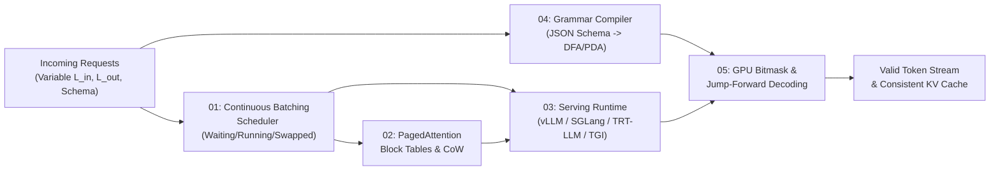

# Stage 4: Serving Engines & Constrained Decoding

[Back to Documentation Overview](../../README.md) | [Complete Syllabus](../../syllabus.md)

---

## Stage Overview

Stage 4 transitions from single-request Transformer physics (Phase 1) to **multi-tenant, production LLM serving systems**. Running an LLM efficiently in production requires solving two coupled systems problems:

1. **Maximizing GPU utilization under stochastic, variable-length workloads:** Requests arrive asynchronously with widely varying prompt lengths ($L_{\text{in}}$) and unpredictable generation lengths ($L_{\text{out}}$). Because autoregressive decoding is strictly memory-bandwidth-bound, serving engines must batch dozens or hundreds of concurrent sequences together without stalling on padding, idle completion slots, or contiguous memory exhaustion.
2. **Enforcing deterministic structural contracts without breaking batching efficiency:** Production agents, tool-calling pipelines, and extraction systems require 100% syntactically valid outputs (JSON, SQL, EBNF grammars) compiled from formal schemas down to per-step GPU logit bitmasks—and accelerated by fast-forwarding deterministic structural tokens while keeping the KV Cache mathematically consistent.

---

## Topic Modules

| # | Topic Document | Core Technical Scope |
| :---: | :--- | :--- |
| **01** | [Dynamic Scheduling & Continuous Batching](./01-dynamic-scheduling-continuous-batching.md) | Static vs. iteration-level (Orca) scheduling, selective batching, `waiting`/`running`/`swapped` queues, preemption (recomputation vs. CPU swap), and TTFT vs. ITL trade-offs. |
| **02** | [Paged Memory Management & PagedAttention](./02-paged-memory-management-pagedattention.md) | Contiguous KV fragmentation physics, logical-to-physical block tables, fixed-size KV blocks, reference counting, Copy-on-Write (CoW), and virtual address translation inside the CUDA attention kernel. |
| **03** | [Engine Architectures](./03-engine-architectures.md) | Deep architectural dissection of **vLLM** (V0 & V1 multiprocess engine), **SGLang** (RadixAttention, zero-overhead overlap scheduler, DSL), **TensorRT-LLM** (AoT `.engine` plans, C++ inflight batching), and **TGI** (Rust router + gRPC + Python shards). |
| **04** | [Constrained Decoding & Structured Outputs](./04-constrained-decoding-structured-outputs.md) | Chomsky hierarchy (Regex/DFA vs. CFG/PDA), JSON Schema compilation, BPE token-boundary alignment hazards, and precomputed token-mask indexes in Outlines, XGrammar, and llguidance. |
| **05** | [Logit Masking & Jump-Forward Decoding](./05-logit-masking-and-jump-forward-decoding.md) | Pre-softmax $-\infty$ masking math, CPU vs. GPU bitmask kernels, sampling pipeline ordering (temperature/top-$k$/top-$p$), deterministic jump-forward fast-forwarding, and KV cache + BPE consistency. |

---

## Systems Coupling Across Stage 4

---

## Navigation

* **Up:** [Documentation Overview](../../README.md) | [Complete Syllabus](../../syllabus.md)
* **Previous Stage:** [← Stage 3: Transformer & MoE Inference Anatomy](../../phase-1/stage-03/README.md)
* **Start Reading:** [01 — Dynamic Scheduling & Continuous Batching](./01-dynamic-scheduling-continuous-batching.md)
* **Next Stage:** [Stage 5: KV Cache & Memory Hierarchies →](../stage-05/README.md)
