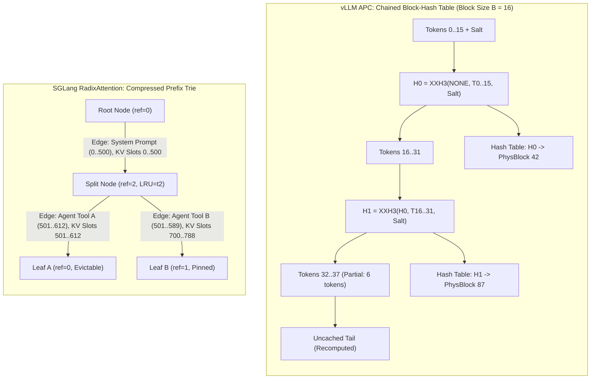
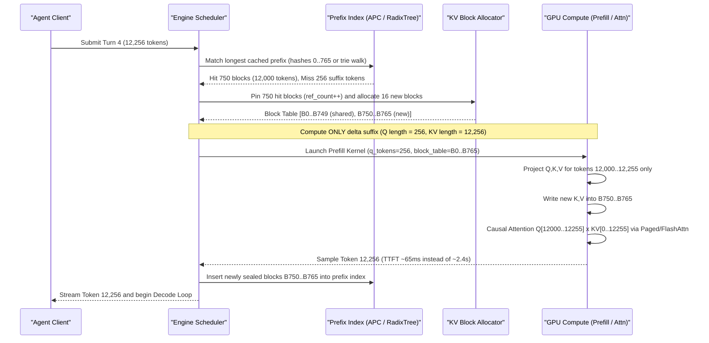

# 01 — Context Reuse: Automatic Prefix Caching & RadixAttention

[← Stage 5 Overview](./README.md) · [Main Docs](../../README.md) · [Syllabus](../../syllabus.md) · [Next: Chunked Prefill →](./02-hybrid-scheduling-chunked-prefill.md)

---

## 1. The Physics of Redundant Prefill in Multi-Turn & Agentic Workloads

During autoregressive LLM serving, request execution splits into two phases with opposite hardware bottlenecks:

1. **Prefill:** Processes all $N_{\text{prompt}}$ input tokens in parallel. Because all tokens are known upfront, linear projections ($Q, K, V, O$, and MLP up/gate/down) execute as large GEMMs (`[N_prompt, d_model] x [d_model, d_out]`). Prefill is **compute-bound** on Tensor Cores; its latency scales roughly linearly with $N_{\text{prompt}}$ (and quadratically $O(N_{\text{prompt}}^2)$ in the attention score matrix $QK^\top$ at ultra-long contexts).
2. **Decode:** Generates 1 token per sequence per forward pass, reading all model weights and all cached KV blocks from HBM. Decode is **memory-bandwidth-bound**.

In real production traffic, requests rarely start from an empty, unique context:

* **System Prompts & Tool Schemas:** Enterprise agents prepend $2\text{K}$–$16\text{K}$ tokens of instructions, JSON schemas, and safety policies to *every* API call.
* **Few-Shot / In-Context Learning:** Static exemplars ($1\text{K}$–$8\text{K}$ tokens) precede variable user queries.
* **Multi-Turn Conversations & Tool-Calling Loops:** A 10-turn agent trajectory sends $[P_0, U_1, A_1, T_1, U_2, A_2, \dots, U_{10}]$. Without prefix caching, Turn 10 recomputes the KV tensors of turns $1\dots 9$ from scratch.
* **Tree-of-Thoughts / Best-of-$N$ / Beam Search:** Multiple candidate continuations branch from an identical root prompt.

Because Transformer attention is **causal** (token $t$ depends only on tokens $0 \dots t$), the Key and Value tensors $K_l[0:P], V_l[0:P]$ at every layer $l \in [0, L-1]$ for a prefix of length $P$ are **pure, deterministic functions of the prefix tokens $[t_0, t_1, \dots, t_{P-1}]$** (plus model weights and active LoRA adapter ID). If those KV tensors are retained in memory and keyed by the exact prefix identity, any subsequent request sharing the first $P$ tokens skips prefill computation for $[0, P)$ entirely and computes only the **delta suffix** $[P, N_{\text{prompt}})$.

### Quantitative TTFT Collapse

Let $\text{FLOP}_{\text{prefill}}(N) \approx 2 \cdot P_{\text{active}} \cdot N + 4 \cdot L \cdot d_{\text{model}} \cdot N^2$ (for dense models with $P_{\text{active}}$ parameters, $L$ layers, and attention term when $N$ is large). On an NVIDIA H100 SXM5 ($989\text{ TFLOPS}$ BF16 peak, ~70% Model FLOPs Utilization during prefill $\approx 692\text{ TFLOPS}$ effective) running a 70B dense model:

* **No Prefix Caching ($N = 16{,}384$ tokens):**
  $$\text{Compute} \approx 2 \times 70 \times 10^9 \times 16{,}384 \approx 2.29 \times 10^{15}\text{ FLOPs} \implies \text{TTFT} \approx \frac{2.29 \times 10^{15}}{6.92 \times 10^{14}} \approx 3.31\text{ s}$$
* **With Prefix Caching ($P = 16{,}000$ cached, $\Delta = 384$ new tokens):**
  $$\text{Compute} \approx 2 \times 70 \times 10^9 \times 384 + \text{attention}(\Delta \times 16{,}384) \approx 5.4 \times 10^{13}\text{ FLOPs} \implies \text{TTFT} \approx 78\text{ ms}$$

Prefix reuse achieves a **$\sim 42\times$ reduction in TTFT** and frees $3.23\text{ s}$ of Tensor Core occupancy for other requests.

---

## 2. Paradigm A: Block-Hash Automatic Prefix Caching (vLLM APC)

vLLM builds prefix reuse directly atop **PagedAttention**, where KV memory is partitioned into fixed-size physical blocks of $B$ tokens (typically $B = 16$ or $B = 32$ tokens per block). A sequence's logical KV cache is an ordered array of physical block IDs (`block_table`).

### 2.1 Why Naive Block Hashing Fails (The False-Match Hazard)

Suppose block size $B = 16$ and two requests contain the same 16 tokens `"def solve(x): ..."` at block index 1 (tokens $16\dots 31$), but **different** tokens at block index 0 (tokens $0\dots 15$).

* **Request A:** `[System_Prompt_Math (0..15)] [def solve(x): ... (16..31)]`
* **Request B:** `[System_Prompt_SQL  (0..15)] [def solve(x): ... (16..31)]`

Because self-attention is contextual, the hidden states—and thus the Key/Value projections—at positions $16\dots 31$ depend heavily on positions $0\dots 15$. If block 1 were hashed solely from its local 16 token IDs `H(tokens[16:32])`, Request B would falsely hit Request A's block 1 and attend over corrupted KV states conditioned on `[System_Prompt_Math]`!

### 2.2 Chained (Merkle-Style) Block Hashing

To enforce **exact causal prefix equivalence**, vLLM APC computes each block's cache key as a **cryptographic or high-entropy chained hash** incorporating the hash of the preceding block:

$$\text{hash}_0 = H\big(\text{NONE},\ \text{tokens}[0:B],\ \text{extra\_keys}\big)$$
$$\text{hash}_i = H\big(\text{hash}_{i-1},\ \text{tokens}[iB : (i+1)B],\ \text{extra\_keys}\big)$$

Where `extra_keys` (the **namespace salt**) prevents cross-contamination across non-equivalent execution contexts:
* **LoRA Adapter ID / Hash:** Different LoRA weights produce different $K/V$ projections for identical tokens.
* **Multimodal Image/Audio Content Hashes:** Placeholder image tokens (e.g., `<image>`) share identical token IDs across different images; the perceptual/content digest of the multimodal embedding patch falling inside block $i$ must be hashed into `extra_keys`.
* **Cache Salt / Tenant Isolation:** Optional per-tenant cryptographic salt (`cache_salt`) to prevent cross-tenant timing side-channel attacks (where an attacker probes TTFT to infer whether another user queried a sensitive prefix).
* **Prompt Embedding / Soft Prompt Hash:** Any non-token input embeddings overlapping the block.

> [!IMPORTANT]
> **Full-Block Granularity Requirement:** In vLLM APC, a block can only be inserted into the prefix hash table (`cached_blocks: Dict[BlockHash, PhysicalBlock]`) once it is **completely filled** with $B$ tokens. A partially filled tail block of $r \in [1, B-1]$ tokens has variable length and continues mutating during decode; hashing partial blocks would either create unbounded unaligned fragments or mutate keys in-place. Thus, if a prompt is $100$ tokens with $B = 16$, blocks $0\dots 5$ ($96$ tokens) are cached and matched, while the remaining $4$ tokens sit in an uncached tail block and are recomputed on the next turn (until enough tokens accumulate to seal block $6$).

### 2.3 Hash Function Choice: SHA-256 vs. XXH3

Earlier vLLM versions used `hash()` (Python's SipHash, unstable across processes and slow for large blocks) or `SHA-256`. At 100K+ tokens/sec, hashing every 16-token block with SHA-256 creates measurable CPU scheduler overhead. Modern vLLM uses **XXH3 (64-bit or 128-bit)** or **SHA-256** (configurable via `--prefix-caching-hash-algo`):

* **XXH3-128:** Vectorized (AVX2/NEON), runs at $>30\text{ GB/s}$ per CPU core (~$5\text{ ns}$ per 16-token block), collision probability $\approx 2^{-128}$ (negligible).
* **SHA-256:** Cryptographically collision-resistant ($2^{-256}$) when untrusted tenants could theoretically craft hash-collision inputs to poison shared caches, though slower (~$100$–$300\text{ ns}$ per block).

### 2.4 Lookup & Allocation Mechanics in vLLM

1. **Sequential Prefix Walk:** When a request arrives with tokens $T[0:N]$, the scheduler slices $T$ into $\lfloor N/B \rfloor$ full blocks and computes `hash_0, hash_1, ...` sequentially.
2. **Contiguous Prefix Hit Rule:** Lookup stops at the **first miss** at block index $k$. Even if `hash_{k+1}` somehow existed in the table (impossible unless a collision occurred), you cannot reuse block $k+1$ without block $k$'s prefix intact—Wait: actually, if block $k$ misses, every subsequent chained hash `hash_{k+1}` differs from any previously cached block unless `hash_k` itself matched, OR unless an earlier prefix `[0..k]` was evicted while `[0..k+1]` stayed! Because LRU eviction removes **leaf** blocks before parent blocks (or tracks dependency), a contiguous prefix walk from $i = 0$ guarantees that if block $k$ is missing, we stop immediately at $k$ and mark `[kB : N]` for prefill computation.
3. **Copy-on-Write / Refcount Pinning:** Hit blocks $[0 \dots k-1]$ have their `ref_count` incremented and are appended directly to the request's `block_table`. Their physical VRAM frames are shared zero-copy across all concurrent requests using that prefix.
4. **Edge Case — Last Token Logit Requirement:** If **100%** of the prompt hits in cache ($N = kB$, all blocks cached), the attention kernel still needs to produce the logits for token $N-1$ to sample the *first* generated token! Therefore, vLLM (and SGLang) intentionally recomputes at least the **final 1 token** (or final partial block) if the entire prompt is an exact cached match, ensuring the model executes one forward pass to emit `logits[N-1]`.

---

## 3. Paradigm B: Dynamic Prefix Trees (SGLang RadixAttention)

While vLLM treats the KV cache as an unordered hash map of fixed-size $B$-token blocks, **SGLang's RadixAttention** maintains an explicit **compressed prefix trie (Radix Tree)** directly over token sequences.

### 3.1 Compressed Trie Structure (Path Compression)

In a standard trie, each edge represents 1 token, creating $N$ pointer-chasing hops for a prompt of length $N$. A **Radix Tree (Patricia Trie)** compresses any unbranched chain of single-child nodes into a single edge labeled with a variable-length **token span** $T[a:b]$ and its corresponding array of KV cache slot/page indices:

* **Node (`TreeNode`):**
  * `children: Dict[TokenID, TreeNode]` (keyed by the *first* token of the child's edge span, or a sub-block tuple)
  * `parent: TreeNode`
  * `edge_tokens: List[int]` (the sequence of tokens on the incoming edge from `parent`)
  * `kv_indices: Tensor[int32]` (physical KV pool slot/page IDs corresponding to `edge_tokens`)
  * `lock_ref: int` (reference count of currently executing requests pinning this subtree)
  * `last_access_time: float` (monotonic timestamp for LRU eviction)

### 3.2 Dynamic Operations: Match, Split, Insert, and Evict

Unlike fixed-block APC, a RadixTree operates at **token-level (or page-aligned sub-span) granularity**, eliminating internal fragmentation on partial tail blocks:

1. **Longest-Prefix Match (`match_prefix(tokens)`):**
   Starting at `root`, look up `children[tokens[pos]]`. Compare `edge_tokens` against `tokens[pos:]` to find the longest common prefix length $m$:
   * If $m == \text{len}(\text{edge\_tokens})$: consume the entire edge, collect `node.kv_indices`, advance `pos += m`, and descend into `node`.
   * If $0 < m < \text{len}(\text{edge\_tokens})$: **Edge Split!** A new request diverges mid-edge (e.g., two agents share 513 tokens of a 600-token edge and diverge at token 514). The tree splits `node` into:
     * `new_mid_node` with `edge_tokens[:m]` and `kv_indices[:m]`
     * `node` updated to `edge_tokens[m:]` and `kv_indices[m:]` as a child of `new_mid_node`.
     The request hits all $m$ tokens without waiting for $B$-token block alignment!
2. **Insertion (`insert(tokens, kv_indices)`):**
   After a request completes prefill/decode for the delta suffix, the newly computed `(tokens[pos:], kv_indices[pos:])` are attached as a new leaf node under the last matched/split node.
3. **Tree-Structured LRU Eviction:**
   Because a RadixTree explicitly encodes parent-child dependencies, eviction **only targets unlocked leaf nodes (`len(children) == 0` and `lock_ref == 0`)** ordered by oldest `last_access_time`. Evicting a leaf cleanly reclaims its `kv_indices` back to the free memory pool, and if its parent now has 0 children and `lock_ref == 0`, the parent becomes an evictable leaf. This structurally guarantees that a parent prefix is never evicted before its descendants.

### 3.3 Cache-Aware Request Scheduling (Longest-Prefix-First)

In a flat FIFO queue, if Request 1 (prefix `A`) and Request 3 (prefix `A`) are separated by Request 2 (prefix `B`), executing `[1, 2, 3]` may force `A` to be evicted during `2` and recomputed for `3`.

Because SGLang maintains the global RadixTree in the scheduler, it implements **Cache-Aware Scheduling (Longest-Shared-Prefix / LPM Scheduling)**:
1. For every waiting request in the queue, compute `matched_len = radix_tree.match_prefix(req.tokens)` (read-only traversal without modifying the tree).
2. Sort or prioritize waiting requests by descending `matched_len` (subject to starvation-prevention aging bounds so short/uncached requests are not starved indefinitely).
3. **Result:** Requests sharing common prefixes (e.g., batch evaluation prompts, multi-agent trees, system-prompt cohorts) naturally coalesce into the same execution wave *while their shared prefix is hot in VRAM*, maximizing cache hit rate and minimizing thrashing.

---

## 4. Architectural Comparison: vLLM APC vs. SGLang RadixTree

| Dimension | vLLM Automatic Prefix Caching (APC) | SGLang RadixAttention (RadixTree) |
| :--- | :--- | :--- |
| **Index Structure** | Flat hash table (`Dict[ChainedBlockHash, PhysicalBlock]`) | Compressed prefix trie (`RadixTree` of variable-length spans) |
| **Granularity** | Fixed block size $B$ (e.g., 16 or 32 tokens); partial tail block uncached | Token-level (or sub-block page) granularity via dynamic edge splitting |
| **Prefix Identity Guarantee** | Chained Merkle-style hash `H(prev_hash, tokens, salt)` | Explicit tree path from `root` to `node` |
| **Memory Fragmentation** | Up to $B - 1$ uncached prefix tokens per divergence point | Zero prefix-boundary waste (down to 1 token, or FlashInfer page size) |
| **Lookup Complexity** | $O(\lceil N / B \rceil)$ hash computations + $O(1)$ hash lookups | $O(\text{tree depth} + \text{matched tokens})$ span comparisons |
| **Eviction Ordering** | Refcount = 0 + LRU heap (must track leaf-first or block timestamps) | Structural leaf-only LRU (`children == 0 && lock_ref == 0`) |
| **Scheduler Synergy** | Typically FCFS / priority; hash lookup happens at block allocation | Native Longest-Prefix-Match (LPM) scheduling across waiting queue |
| **Best Workload Fit** | Fixed/aligned system prompts, large multi-turn blocks, simple PagedAttention integration | Tree-of-Thoughts, branching agents, structured SGLang programs, arbitrary divergence points |

### Structural Comparison Diagram

---

## 5. End-to-End Execution Timeline: Multi-Turn Agent Prefix Hit

Consider a multi-turn coding agent on Turn 4:
* **Turn 1–3 Cached Prefix:** $12{,}000$ tokens (`System + Tools + Repo Context + Turns 1-3`).
* **Turn 4 Delta Suffix:** $256$ tokens (`Tool Output + User Follow-up`).
* Assume block size $B = 16$: $12{,}000 / 16 = 750$ full blocks hit in VRAM; $256 / 16 = 16$ new blocks allocated for the delta suffix.

### Critical Edge Cases & Failure Modes

1. **Non-Deterministic Numeric Divergence Across Hit vs. Recompute:**
   Floating-point addition is not strictly associative. Computing KV tensors for tokens `[0..12000]` in a single batch vs. reusing cached KV tensors computed in an earlier batch of different size (or different Tensor Core tile split) can produce $10^{-3}$ BF16 rounding differences, occasionally flipping greedy/near-tie token choices. Systems requiring bitwise reproducibility must keep batch-invariant kernels or disable cross-batch prefix reuse.
2. **Sliding Window Attention (SWA) & Hybrid State (Mamba/SSM/Linear Attention):**
   * For **SWA** (e.g., Mistral), tokens beyond window $W$ do not attend to older tokens, *however* layer $l$ still depends on layer $l-1$ across $L \cdot W$ effective receptive field; chained hashing still holds, though evicted older blocks outside the window may not be needed if a sequence only decodes forward.
   * For **Hybrid SSM/Transformer models** (e.g., Jamba, Qwen3-Next/Linear Attention), the recurrent SSM state $S_t$ is a fixed-size matrix overwritten in-place at each token rather than an append-only KV sequence. Unless periodic **state checkpoints** are snapshotted at block boundaries, prefix reuse cannot roll back an in-place mutated SSM state to an earlier branch point!
3. **Cache Pollution by Single-Use Long Prompts:**
   Inserting every 100K-token one-off document immediately evicts heavily reused 4K system prompts unless governed by **admission policies and cost-aware eviction** (covered in [05 — Management Policies & Eviction](./05-management-policies-eviction.md)).

---

## Navigation

* [← Stage 5 Overview](./README.md)
* **Next:** [02 — Hybrid Scheduling: Chunked Prefill →](./02-hybrid-scheduling-chunked-prefill.md)
