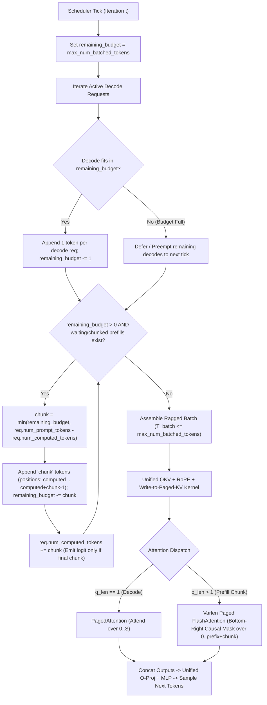
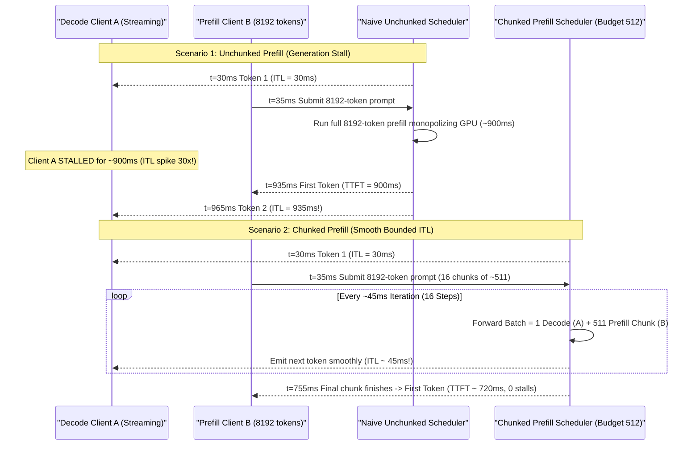

# 02 — Hybrid Scheduling: Chunked Prefill & Mixed Batching

[← Previous: Prefix Caching](./01-context-reuse-prefix-caching.md) · [Stage 5 Overview](./README.md) · [Next: KV Quantization →](./03-state-compression-kv-quantization.md)

---

When an LLM server handles many users at once, a single huge incoming prompt can freeze the GPU for seconds and cause every other streaming user's text to stutter. This lesson explains how slicing long prompts into small pieces and mixing them with ongoing token generation keeps streaming smooth for everyone.

## Core Concepts & Terminology

* **Prefill, Decode, & `<EOS>`:** **Prefill** processes all input tokens of a new prompt in parallel. **Decode** generates one output token at a time per active request until the model emits a special stop token called **`<EOS>` (End-of-Sequence)**.
* **Continuous Batching (Iteration-Level Scheduling):** A scheduling method where the server re-evaluates which requests are active on *every single forward-pass step (iteration)*, allowing new requests to join and finished requests to leave immediately without waiting for an entire batch to hit `<EOS>`.
* **TTFT, ITL, $P_{99}$ ITL, & SLA:** **TTFT (Time-to-First-Token)** is how long a user waits for the first output token. **ITL (Inter-Token Latency)** is the gap between consecutive streamed tokens. **$P_{99}$ ITL** is the 99th-percentile (worst-case tail) gap, which must stay below a service's guaranteed **SLA (Service Level Agreement)** target.
* **HBM3, SRAM, Registers, & Tensor Cores:** **HBM3 (High Bandwidth Memory 3)** is the GPU's main off-chip memory (e.g., $3.35\text{ TB/s}$ on an NVIDIA H100 SXM5). **SRAM** and **registers** are tiny, ultra-fast on-chip memories right next to the **Tensor Cores** (the GPU's dedicated matrix-multiplication hardware units).
* **BF16, FP8, TFLOPS, MFU, & Tensor Parallelism (TP):** **BF16** (2 bytes/number) and **FP8** (1 byte/number) are compact floating-point formats. **TFLOPS** measures trillions of floating-point operations per second; **MFU (Model FLOPs Utilization)** is the fraction of peak TFLOPS achieved by useful model math. **Tensor Parallelism (TP=2)** splits a model's weight matrices across 2 GPUs so both compute each step together.
* **GEMM, MMA Tiles, RMSNorm, Residual Add, & MLP ($d_{\text{ffn}}$):** A **GEMM** is a dense matrix multiplication executed in hardware blocks called **MMA (Matrix Multiply-Accumulate) tiles**. Inside each Transformer layer, tokens pass through **RMSNorm** (a lightweight normalization step), **QKV** and **Output ($O$) projections**, a **Residual Add** (adding the layer input back to its output), and an **MLP** feed-forward block whose intermediate width is $d_{\text{ffn}}$.
* **Roofline Model, Arithmetic Intensity, & Ridge Point ($I_{\text{ridge}}$):** **Arithmetic intensity** is the ratio of math operations performed per byte of data read from HBM ($\text{FLOPs/byte}$). The **Roofline Model** plots performance against arithmetic intensity: below the hardware **ridge point** ($I_{\text{ridge}} = \text{Peak FLOP/s} \div \text{Peak HBM BW}$), the GPU is starved waiting on HBM reads; at or above $I_{\text{ridge}}$, Tensor Cores run at full speed.
* **Chunked Prefill, `max_num_batched_tokens`, & Speculative Decoding:** **Chunked Prefill** splits a long prompt into smaller slices capped by a per-step token budget (**`max_num_batched_tokens`**) so decode steps are never blocked for seconds. **Speculative decoding** is an optional speedup where a small draft model guesses $k$ future tokens and the main model verifies $k+1$ tokens in one step. **Pareto Point** refers to an optimal trade-off where neither TTFT nor ITL can be improved without worsening the other.
* **Ragged Tensor & RoPE (`position_id`):** A **ragged (1D flattened) tensor** packs tokens from different requests of unequal lengths end-to-end into one contiguous array without padding zeros. **RoPE (Rotary Position Embeddings)** encodes each token's order in its sequence using its integer **`position_id`**.
* **PagedAttention, `block_table`, `slot_mapping`, & `reshape_and_cache`:** **PagedAttention** stores KV cache in fixed-size physical memory blocks mapped by a per-request **`block_table`**. Before attention runs, a fused GPU kernel (**`reshape_and_cache`**) uses a **`slot_mapping`** index array to scatter newly computed $K$ and $V$ vectors into their assigned physical blocks.
* **Causal Mask (Top-Left vs. Bottom-Right Aligned):** A **causal mask** prevents a token from attending to future tokens. When a query chunk of length `q_len` attends to a longer KV history of length `kv_len`, **bottom-right alignment** shifts the diagonal by `kv_len - q_len` so new query tokens still see all earlier cached tokens.
* **Warp, Split-K, CTA, CSR Indexing, FlashAttention Varlen, & FlashInfer:** A **warp** is a group of 32 GPU threads executing together; a **CTA (Cooperative Thread Array / thread block)** is a larger group of warps sharing on-chip SRAM. **Split-K** parallelizes a single decode attention query across multiple warps along the sequence length and reduces the partial results. **CSR (Compressed Sparse Row)** uses offset arrays (`qo_indptr`, `kv_indptr`, `kv_page_indices`, `kv_last_page_len`) to describe variable-length (**varlen**) sequences in a ragged batch for kernels like **FlashAttention-2/3** (`flash_attn_varlen_func`) and **FlashInfer**, avoiding extra split/concat copies and **CUDA kernel launch overhead** (the CPU/driver cost of starting each GPU kernel).
* **Activation Memory & KV Read Amplification:** **Activation memory** is temporary VRAM used to hold intermediate layer outputs during a forward pass. **KV read amplification** is the extra HBM read traffic caused when later prefill chunks repeatedly re-read earlier chunks' KV cache blocks. **Adaptive chunk sizing** dynamically enlarges chunks when no decode requests are waiting to reduce those repeated reads.

---

## 1. The Prefill–Decode Interference Problem

Continuous batching (iteration-level scheduling) eliminates waiting until every request in a batch hits `<EOS>`, allowing new requests to join mid-generation. In a standard PyTorch `model(input_ids)` call, every sequence in the batch must finish the forward pass before sampling can emit the next token. Because prefill and decode have fundamentally incompatible compute durations, naive continuous batching still suffers from **prefill-decode interference**.

### 1.1 Why Unchunked Prefill Causes "Generation Stalls" (ITL Spikes)

Consider an LLM serving engine running on an H100 SXM5 (BF16 peak $989\text{ TFLOPS}$, HBM3 bandwidth $3.35\text{ TB/s}$) serving a 70B dense model ($140\text{ GB}$ weights in BF16 across 2×H100 TP=2, or FP8 across 1×H100):

* **Steady-State Decode Batch ($B = 64$ active sequences):**
  Each forward pass processes $64$ tokens (1 token per sequence). Arithmetic intensity is $\approx 64\text{ FLOPs/byte}$—far below the H100 ridge point ($\frac{989\text{ TFLOPS}}{3.35\text{ TB/s}} \approx 295\text{ FLOPs/byte}$).
  Reading $70\text{ GB}$ of FP8 weights plus KV cache takes roughly $25$–$35\text{ ms}$ per iteration. Thus, active streaming users observe a smooth **Inter-Token Latency (ITL)** of $\sim 30\text{ ms}$ ($\sim 33\text{ tokens/s}$).
* **Arrival of a Long Prompt ($N_{\text{prompt}} = 16{,}384$ tokens):**
  In a **prefill-prioritizing** or **non-chunked** scheduler (e.g., Sarathi's baseline / early Orca / vLLM v0 without chunked prefill), the scheduler either:
  1. **Pauses all running decodes** to run the $16{,}384$-token prefill solo, OR
  2. **Bundles the entire $16{,}384$-token prefill** into one giant batch with the 64 decode tokens.

In either case, executing $16{,}384$ prompt tokens requires $\sim 2 \times 70\times 10^9 \times 16{,}384 \approx 2.29 \times 10^{15}\text{ FLOPs}$. Even at $70\%$ MFU, that single forward step takes **$1.65$–$3.3\text{ seconds}$**!

Every single decode client currently streaming tokens experiences a **generation stall**: their ITL jumps from $30\text{ ms}$ to $2{,}000+\text{ ms}$ ($P_{99}\text{ ITL}$ explodes by $60\times$–$100\times$), causing severe UI stutter and SLA violations.

Conversely, if the scheduler strictly prioritizes decode over waiting prefills (**decode-prioritizing**), waiting requests starve indefinitely under sustained decode load, blowing up **Time-to-First-Token (TTFT)**.

---

## 2. Chunked Prefill: Token-Budgeted Hybrid Batching

**Chunked Prefill** (introduced in **Sarathi / Sarathi-Serve** and adopted across **vLLM**, **SGLang**, and **TensorRT-LLM**) resolves the TTFT–ITL dilemma by decoupling *prompt length* from *iteration compute duration*.

### 2.1 Core Mechanism: Fixed `max_num_batched_tokens` Budget

Instead of treating a prefill of length $N_{\text{prompt}}$ as an indivisible atomic step, the scheduler slices any prompt longer than a configured token budget $T_{\text{budget}}$ (e.g., `max_num_batched_tokens = 512` or `2048`) into sequential chunks of size $c \le T_{\text{budget}}$.

In **every scheduler tick (iteration $t$)**:
1. **Reserve Decode Slots First (Decode-Priority Allocation):**
   Each of the $B_{\text{dec}}$ currently running decode sequences consumes exactly **1 token** from the iteration's token budget (or $k+1$ tokens if speculative decoding is active).
   $$T_{\text{rem}} = T_{\text{budget}} - B_{\text{dec}}$$
2. **Piggyback Prefill Chunks into Remaining Budget:**
   If $T_{\text{rem}} > 0$, the scheduler pulls tokens from the next queued prefill request(s):
   $$\text{chunk\_size} = \min\big(T_{\text{rem}},\ \text{req.remaining\_prefill\_tokens}\big)$$
   Multiple short prefills can fill $T_{\text{rem}}$, or one long prefill takes a slice of size $T_{\text{rem}}$ and yields until iteration $t+1$.
3. **Construct One Unified Forward Batch:**
   The engine concatenates all $B_{\text{dec}}$ decode tokens and all $M$ prefill-chunk tokens into a **single flattened 1D ragged token tensor** of length $T_{\text{batch}} = B_{\text{dec}} + \sum \text{chunk\_size} \le T_{\text{budget}}$.

### 2.2 Roofline Physics: "Free" Compute Piggybacking

Why does piggybacking prefill chunks onto a decode batch barely increase decode ITL? Look at the **GPU Roofline Model**:

* **Ridge Point ($I_{\text{ridge}}$):**
  $$I_{\text{ridge}} = \frac{\text{Peak Compute (FLOP/s)}}{\text{Peak HBM Bandwidth (Byte/s)}}$$
  For an H100 SXM5:
  * BF16: $\frac{989 \times 10^{12}}{3.35 \times 10^{12}} \approx 295\text{ FLOPs/byte}$
  * FP8: $\frac{1979 \times 10^{12}}{3.35 \times 10^{12}} \approx 590\text{ FLOPs/byte}$
* **Linear Layer Arithmetic Intensity ($I_{\text{GEMM}}$):**
  For a GEMM $Y = XW$ with $T_{\text{batch}}$ tokens and weight matrix $W \in \mathbb{R}^{d_{\text{in}} \times d_{\text{out}}}$ in $b_{\text{w}}$ bytes/element:
  $$I_{\text{GEMM}} = \frac{2 \cdot T_{\text{batch}} \cdot d_{\text{in}} \cdot d_{\text{out}}}{b_{\text{w}} \cdot d_{\text{in}} \cdot d_{\text{out}} + b_{\text{act}} \cdot T_{\text{batch}} (d_{\text{in}} + d_{\text{out}})} \approx \frac{2 \cdot T_{\text{batch}}}{b_{\text{w}}}\quad (\text{when } d \gg T_{\text{batch}})$$

In BF16 ($b_{\text{w}} = 2$ bytes):
* **Pure Decode ($B_{\text{dec}} = 32$):** $I_{\text{GEMM}} \approx 32\text{ FLOPs/byte}$. Tensor Cores sit at **$\sim 10.8\%$ utilization** ($32 / 295$); the GPU spends ~89% of its cycle budget stalled waiting on HBM weight fetches!
* **Mixed Batch ($32\text{ decode} + 256\text{ prefill chunk} = 288\text{ tokens}$):** $I_{\text{GEMM}} \approx 288\text{ FLOPs/byte} \approx I_{\text{ridge}}$.

Because weight matrices $W$ of shape `[d_in, d_out]` are already streamed from HBM into on-chip SRAM/registers once per forward step for the 32 decode tokens, processing an extra $256$ prefill tokens **reuses those exact same fetched weights in SRAM/registers**. Conceptually, once `W` is loaded onto the chip, multiplying `[288, d_in] @ [d_in, d_out]` takes nearly the same wall-clock time as `[32, d_in] @ [d_in, d_out]` until the GPU hits its compute ceiling (`I_ridge`). Therefore, adding $256$ prefill tokens saturates otherwise idle Tensor Cores while adding minimal marginal latency to the step—creating a **compute-saturated ("stall-free") schedule** where ITL stays bounded (e.g., $30$–$55\text{ ms}$) across all iterations!

> [!TIP]
> **Tuning `max_num_batched_tokens`:**
> * Setting `max_num_batched_tokens` near the hardware ridge point ($256$–$512$ for BF16, $512$–$1024$ for FP8 on H100) yields the best **ITL vs. TTFT Pareto point** for latency-sensitive interactive serving.
> * Setting larger budgets ($2048$–$8192$) increases prefill throughput (fewer weight-read passes over a long prompt) at the expense of higher steady-state ITL per chunk step.

---

## 3. Memory & Attention-Kernel Implications

Mixing decode tokens (which each attend to 1 query against $S_i$ past KV tokens) and partial prefill chunks (which attend to $c$ queries against $S_{\text{prefix}} + c$ KV tokens) inside a **single forward pass** introduces non-trivial tensor-shape and kernel constraints.

### 3.1 Linear Projections vs. Attention Splitting

1. **QKV, Output Projection, MLP, RMSNorm, Residual Add (Token-Independent):**
   These operators act identically on every token regardless of whether it came from a prefill chunk or a decode sequence. Instead of padding sequences into a 3D `[B, max_seq_len, d_model]` PyTorch tensor (which wastes compute and memory on `<pad>` zeros), the engine packs all active tokens end-to-end into a 2D ragged matrix of shape `[T_batch, d_model]` and executes **one fused GEMM**—maximizing Tensor Core tile efficiency (`128x256` MMA tiles).
2. **RoPE (Rotary Position Embeddings):**
   RoPE depends on each token's exact `position_id` (e.g., a decode token at position $4{,}091$, or a 3rd prefill chunk covering positions $[1024, 1535]$). Because tokens are flattened into `[T_batch, d_model]`, the fused RoPE kernel indexes a parallel 1D `positions[T_batch]` metadata array to apply the right rotation angle to each row.
3. **Self-Attention (Sequence-Dependent — Must Handle Asymmetric $L_q \neq L_{kv}$):**
   Unlike initial unchunked prefill (where $L_q = L_{kv}$) or pure decode (where $L_q = 1, L_{kv} = S$), a **chunked prefill step** has:
   $$L_q = c \quad \text{and} \quad L_{kv} = S_{\text{prefix}} + c \quad (\text{with } S_{\text{prefix}} > 0\text{ for chunk } \ge 2)$$

### 3.2 Causal Mask Offset with `q_seqlen < kv_seqlen`

In Chunk 2 of a 2048-token prompt with chunk size $512$:
* Tokens $[0, 511]$ were already written into physical KV blocks during Chunk 1.
* Chunk 2 passes query tokens $[512, 1023]$ ($L_q = 512$) and attends over KV positions $[0, 1023]$ ($L_{kv} = 1024$).
* Query index $q_{\text{local}} \in [0, 511]$ corresponds to absolute sequence position $p = S_{\text{prefix}} + q_{\text{local}} = 512 + q_{\text{local}}$.
* In standard PyTorch, `torch.tril(torch.ones(512, 1024))` aligns the diagonal at the **top-left** (`k <= q_local`), which would restrict Chunk 2's first token ($q_{\text{local}} = 0$) to see only KV position `0` and blind it to `[1..511]`! Instead, the **causal mask** must allow query $q_{\text{local}}$ to attend to all KV positions $k \in [0, S_{\text{prefix}} + q_{\text{local}}]$—i.e., **bottom-right aligned causal masking** (standard in FlashAttention-2/3 via `causal=True` when `q_len <= kv_len`, where the diagonal shifts right by `kv_len - q_len`).

### 3.3 Write-Before-Read KV Cache Semantics & Kernel Dispatch

Before attention executes at layer $l$, the newly projected $K_{\text{new}}, V_{\text{new}}$ for both the decode tokens and the prefill chunk tokens are scattered into their pre-allocated PagedAttention physical blocks via a fused `reshape_and_cache` kernel (using `slot_mapping[T_batch]`).

For the attention phase itself, engines use one of two kernel strategies:
* **Strategy A — Split Attention Dispatch (vLLM v0 / TensorRT-LLM):**
  Split the output of the QKV projection along the token dimension into `prefill_qkv` and `decode_qkv`:
  * Route `decode_qkv` ($L_q = 1$) to **PagedAttention** (optimized for split-K / Warp-level reduction over high $L_{kv}$ with $L_q = 1$).
  * Route `prefill_qkv` ($L_q > 1$) to **FlashAttention Varlen (`flash_attn_varlen_func` with `block_table`)** or **Chunked Paged FlashAttention**, reading prior chunks directly from paged KV blocks.
  * Concatenate the outputs back into $[T_{\text{batch}}, d_{\text{model}}]$ before the $O$-projection GEMM.
* **Strategy B — Unified Ragged Paged Attention (FlashInfer / FlashAttention-3 Unified Kernel):**
  Treat decode ($L_q = 1$) and prefill chunks ($L_q = c$) uniformly via a **CSR-indexed ragged query descriptor** (`qo_indptr`, `kv_indptr`, `kv_page_indices`, `kv_last_page_len`). A single unified kernel (or persistent CTA scheduler in FlashInfer) groups small-$L_q$ decode tiles and large-$L_q$ prefill tiles cleanly, avoiding extra split/concat memory copies and CUDA kernel launch overhead.

### 3.4 Memory Overhead & Trade-offs of Chunked Prefill

1. **Activation Memory Reduction:**
   An unchunked $32\text{K}$-token prefill materializes intermediate MLP/norm/residual activations of shape $[32768, d_{\text{ffn}}]$—which for Llama-3-70B ($d_{\text{ffn}} = 28{,}672$, BF16) consumes $\sim 1.88\text{ GB}$ per activation buffer (multiple GBs peak!). Chunking at $T_{\text{budget}} = 512$ caps peak activation memory at $[512, 28672] \approx 29\text{ MB}$ (**$64\times$ smaller activation footprint**), freeing VRAM for more KV cache blocks.
2. **KV Read Amplification (Repeated Prefix Reads):**
   Notice the subtle cost of chunking a long prompt of $N$ tokens into $K = N / c$ chunks:
   * Chunk 1 writes $c$ KV tokens and reads $c$ KV tokens.
   * Chunk 2 reads $2c$ KV tokens (re-reading Chunk 1's KV from HBM!).
   * Chunk $K$ reads $K \cdot c = N$ KV tokens.
   Total KV cache bytes read from HBM across all $K$ chunks is:
   $$\text{KV\_Bytes\_Read} \propto \sum_{k=1}^{K} k \cdot c = \frac{K(K+1)}{2} c = \frac{N(N+c)}{2c}$$
   With $N = 32{,}768$ and $c = 512$ ($K = 64$), the attention kernel reads Chunk 1's KV blocks $64$ times instead of $1$ time! At extreme contexts ($>64\text{K}$), small chunk sizes ($c = 256$) shift attention from compute-bound to HBM-bandwidth-bound. Production schedulers counter this by dynamically scaling chunk sizes upward when no decode requests are waiting or when $S_{\text{prefix}}$ is large (**Adaptive Chunk Sizing**).
3. **First-Token Delay (Chunked Prefill TTFT Trade-off):**
   A $16\text{K}$-token prompt cannot emit its first token until its *last* chunk completes. If decode concurrency $B_{\text{dec}}$ is high and $T_{\text{budget}}$ is small, $T_{\text{rem}}$ shrinks, stretching the prompt's TTFT across more iterations.

---

## 4. Mixed Batch Assembly Flowchart

---

## 5. Timeline Comparison: Unchunked Prefill vs. Chunked Prefill

The diagram below contrasts two concurrent clients: **Client A** (already decoding tokens $t_1, t_2, t_3, \dots$ smoothly at $30\text{ ms}$ ITL) and **Client B** (submitting a heavy $8{,}192$-token prompt at $t = 30\text{ ms}$).

---

## Navigation

* [← Previous: Prefix Caching](./01-context-reuse-prefix-caching.md)
* [Stage 5 Overview](./README.md)
* [Next: KV Cache Quantization →](./03-state-compression-kv-quantization.md)
