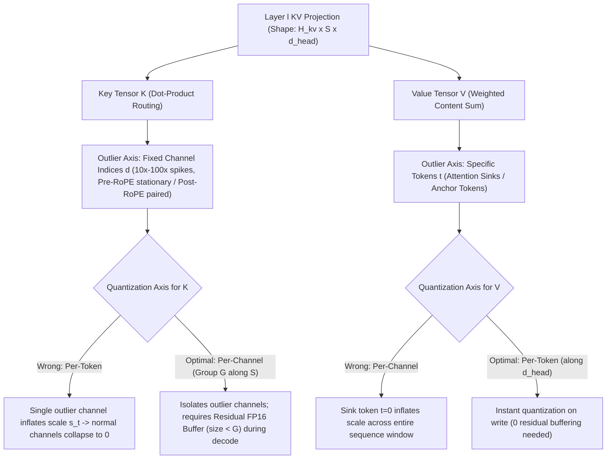
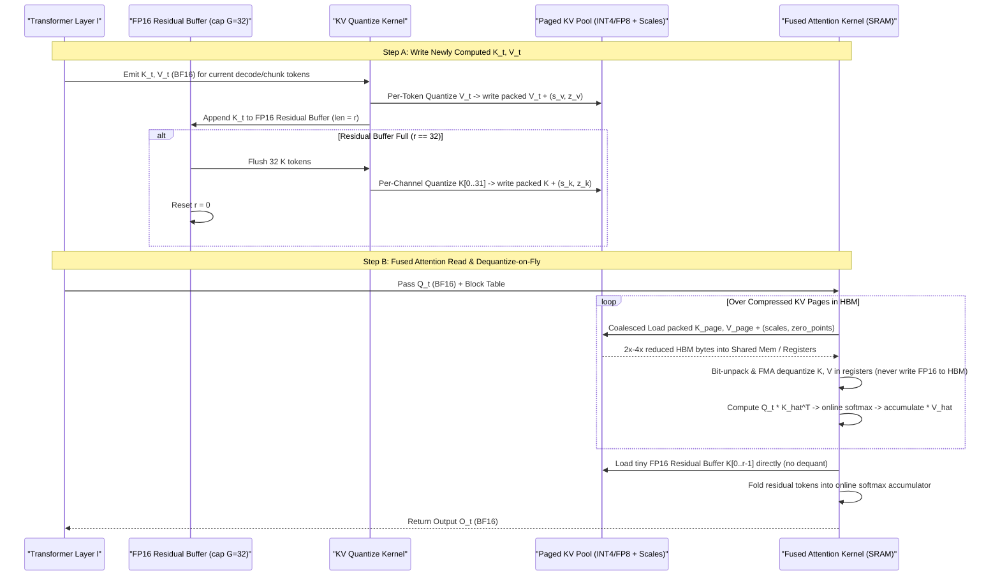

# 03 — State Compression: KV Cache Quantization & Outlier Physics

[← Previous: Chunked Prefill](./02-hybrid-scheduling-chunked-prefill.md) · [Stage 5 Overview](./README.md) · [Next: Offloading Hierarchy →](./04-offloading-hierarchy.md)

---

## 1. Why Compress the KV Cache?

Even with Grouped-Query Attention (GQA), the KV cache grows linearly with batch size $B$ and sequence length $S$:

$$\text{KV Bytes} = 2 \cdot L \cdot H_{\text{kv}} \cdot d_{\text{head}} \cdot S \cdot B \cdot b_{\text{elem}}$$

Where $2$ accounts for Key + Value, $L$ is layer count, $H_{\text{kv}}$ is KV head count, $d_{\text{head}}$ is head dimension, and $b_{\text{elem}}$ is bytes per stored element ($2$ for FP16/BF16, $1$ for FP8/INT8, $0.5$ for INT4).

### Exact Footprint & Bandwidth Impact (Worked Example: Llama-3.1-70B)

Parameters: $L = 80$, $H_{\text{kv}} = 8$ (GQA $8\times$), $d_{\text{head}} = 128$, context $S = 32{,}768$ tokens, batch $B = 32$:

| KV Precision | Bits/Elem ($b_{\text{elem}}$) | Bytes / Token | Total KV ($B=32, S=32\text{K}$) | Decode KV Read / Step ($B=32, S=32\text{K}$) | Savings vs. BF16 |
| :--- | :--- | :--- | :--- | :--- | :--- |
| **BF16 / FP16** | 16 bits ($2.0\text{ B}$) | $327{,}680\text{ B}$ ($320\text{ KiB}$) | **$320.0\text{ GiB}$** | $320.0\text{ GiB}$ | $1.0\times$ (Baseline) |
| **FP8 E4M3 / INT8** | 8 bits ($1.0\text{ B}$) | $163{,}840\text{ B}$ ($160\text{ KiB}$) | **$160.0\text{ GiB}$** (+~1–3% scale meta) | $160.0\text{ GiB}$ | **$\sim 2.0\times$** |
| **INT4 (Group 128, FP16 scale+zp)** | 4 bits ($0.5\text{ B}$ + meta) | $81{,}920\text{ B} + 5{,}120\text{ B}$ ($85\text{ KiB}$) | **$85.0\text{ GiB}$** ($4.25\text{ bits eff.}$) | $85.0\text{ GiB}$ | **$\sim 3.76\times$** |
| **INT2 (Group 64, FP16 scale+zp)** | 2 bits ($0.25\text{ B}$ + meta) | $40{,}960\text{ B} + 10{,}240\text{ B}$ ($50\text{ KiB}$) | **$50.0\text{ GiB}$** ($2.5\text{ bits eff.}$) | $50.0\text{ GiB}$ | **$\sim 6.40\times$** |

Because decode is strictly HBM-bandwidth-bound, compressing KV from BF16 to FP8 or INT4 doesn't merely allow $2\times$–$3.8\times$ larger batches ($B$) or contexts ($S$); at long contexts where KV cache reads dominate weight reads, it **directly accelerates decode Inter-Token Latency (ITL)** by cutting HBM traffic in half (or by $3.8\times$).

---

## 2. Numerical Formats & Scaling Granularities

### 2.1 Candidate Data Types

1. **FP8 E4M3 (`1 sign, 4 exponent, 3 mantissa`):**
   Dynamic range $\pm 448$ (no `Inf`; `0x7F`/`0xFF` reserved for `NaN`), precision varies smoothly with magnitude (logarithmic spacing). Ideal for Key/Value tensors whose magnitudes vary by $10\times$–$50\times$ across tokens or channels, as small values retain 3 bits of mantissa precision while large outliers fit without severe clipping. (FP8 **E5M2** has wider range $\pm 57344$ but only 2 mantissa bits—too coarse for sensitive KV attention scores; E4M3 is standard for KV cache.)
2. **Symmetric / Asymmetric Uniform Integer (INT8 / INT4):**
   * **Symmetric Quantization (used for INT8 / FP8):**
     $$q = \text{clamp}\left(\text{round}\left(\frac{x}{s}\right), -Q_{\max}, Q_{\max}\right), \quad s = \frac{\max(|X|)}{Q_{\max}}, \quad \hat{x} = q \cdot s$$
     For INT8, $Q_{\max} = 127$. Fast (`x_fp = q * s`), requires only 1 FP16/FP32 scale $s$ per group.
   * **Asymmetric (Affine) Quantization (essential for INT4):**
     $$q = \text{clamp}\left(\text{round}\left(\frac{x - z}{s}\right), 0, 2^b - 1\right), \quad s = \frac{\max(X) - \min(X)}{2^b - 1}, \quad z = \min(X), \quad \hat{x} = q \cdot s + z$$
     (Alternatively, integer zero-point $z_{\text{int}} = \text{round}(-\min(X)/s)$.) Asymmetric quantization prevents wasting half of the 16 discrete INT4 bins when a channel's distribution is heavily skewed positive or negative (common in Key channels!).

### 2.2 Static vs. Dynamic Scaling

* **Static Quantization (`k_scale`, `v_scale` calibrated offline):**
  Using a calibration dataset (e.g., 512 samples from Pile/WikiText), record running per-layer or per-head `absmax` (or MSE-optimal percentile, e.g., $99.9\%$) to precompute fixed FP32 scales `k_scale[L, H_kv]`, `v_scale[L, H_kv]`.
  * *Pros:* Zero runtime reduction (`max/min`) overhead during write; works seamlessly with `FP8 E4M3` per-tensor/per-head scaling in vLLM (`--kv-cache-dtype fp8`).
  * *Cons:* Cannot adapt to out-of-distribution prompts or sharp per-token/per-channel spikes without excessive clipping. Fails badly at INT4!
* **Dynamic Quantization (Online Scale Computation):**
  Computes `s` (and `z`) on-the-fly during KV cache write over each vector/tile as tokens are produced.
  * *Pros:* Tracks exact dynamic range of every token/channel at runtime; mandatory for INT4 and high-accuracy INT8.
  * *Cons:* Requires online reduction (`warp reduce max/min`) and extra VRAM metadata storage for scales/zero-points.

### 2.3 Scaling Granularity Hierarchy

Let a KV cache tensor for one layer have shape `[H_kv, S, d_head]`:

1. **Per-Tensor:** 1 scalar scale `s` for all heads, tokens, and channels in the layer. (Fastest metadata, worst accuracy if any head/channel has outliers.)
2. **Per-Head:** `[H_kv]` scales (1 scale per KV head). Used by vLLM FP8 static KV quantization (`k_scale`, `v_scale` per layer/head).
3. **Per-Token (Row-wise along `d_head`, or Group-wise along `d_head`):**
   Scale computed across the $d_{\text{head}}$ (or sub-group $g=64/128$) channels of a *single* token $t$: `s[H_kv, S, d_head / g]`. Captures token-to-token amplitude changes immediately as each new token arrives!
4. **Per-Channel (Column-wise along sequence `S`, or Group-wise along `S`):**
   Scale computed across a window of tokens $G_s$ (e.g., $G_s = 32$ or $64$ tokens) for a *single* feature channel $d \in [0, d_{\text{head}}-1]$: `s[H_kv, S / G_s, d_head]`.

---

## 3. Why Keys and Values Have Orthogonal Outlier Geometries

Empirical profiling across Llama, Mistral, Qwen, and Gemma families reveals a striking structural asymmetry between $K$ and $V$ matrices—discovered and exploited by **KIVI** (Liu et al., 2024) and **KVQuant** (Hooper et al., 2024):

### 3.1 Key Matrix ($K$): Sharp, Persistent Channel-Wise Outliers (and the RoPE Twist!)

In Transformer attention, certain fixed feature dimensions $d \in [0, d_{\text{head}}-1]$ of the Key projection systematically carry magnitudes $10\times$–$100\times$ larger than neighboring channels across **almost all tokens** (acting as massive structural biases or sink-token anchors for dot-product routing $QK^\top$).

* **Consequence for Per-Token Key Quantization:**
  If you quantize Key vectors *per-token* (computing one scale $s_t$ across all $d_{\text{head}} = 128$ channels of token $t$), a single outlier channel with magnitude $40.0$ forces $s_t = 40.0 / 7.5 \approx 5.3$ in INT4. Every normal channel in $[ -0.5, 0.5 ]$ collapses to **zero** (`round(0.3 / 5.3) = 0`), destroying attention precision!
* **Consequence for Per-Channel Key Quantization:**
  If you quantize Key *per-channel* (computing $s_d$ along the sequence axis $S$ for channel $d$), the outlier channel gets its own large scale $s_{d_{\text{out}}}$, while normal channels keep tight scales $s_{d_{\text{norm}}} \approx 0.05$, preserving full 4-bit resolution everywhere!

#### Pre-RoPE vs. Post-RoPE Key Quantization

There is a subtle interaction with **Rotary Position Embeddings (RoPE)**:
RoPE pairs channels $(2i, 2i+1)$ and rotates them by token-position-dependent angle $\theta_i(t) = t \cdot \text{base}^{-2i/d}$:

$$\begin{pmatrix} k'_{2i}(t) \\ k'_{2i+1}(t) \end{pmatrix} = \begin{pmatrix} \cos\theta_i(t) & -\sin\theta_i(t) \\ \sin\theta_i(t) & \cos\theta_i(t) \end{pmatrix} \begin{pmatrix} k_{2i}(t) \\ k_{2i+1}(t) \end{pmatrix}$$

1. **Before RoPE (Pre-RoPE):** Channel $2i$ may have a massive constant outlier ($+40$) while channel $2i+1$ is tiny ($\pm 0.2$). Pre-RoPE channel variance is strictly stationary along $S$. However, caching **Pre-RoPE** Keys means the attention kernel must apply RoPE *on-the-fly* to every cached $K$ block during every decode step—adding trigonometric compute and preventing direct reuse of fused standard PagedAttention!
2. **After RoPE (Post-RoPE):** Rotating $(k_{2i}, k_{2i+1})$ mixes the outlier between the two paired channels as $\cos(t \cdot \omega_i)$ and $\sin(t \cdot \omega_i)$ oscillate across $t$!
   * **High-frequency pairs ($i \approx 0$):** $\theta_0(t) = t\text{ rad}$ rotates rapidly every token, so the outlier oscillates wildly between $-40$ and $+40$ within a short window of tokens—still manageable via **per-channel symmetric/asymmetric grouping over small token chunks ($G_s = 32$ or $64$)** because both channels of the pair simply adopt the envelope $\sqrt{k_{2i}^2 + k_{2i+1}^2}$, though dynamic range doubles for the non-outlier partner.
   * **Low-frequency pairs ($i \approx d/2 - 1$):** $\theta_i(t)$ changes slowly over thousands of tokens, so channel outliers remain nearly constant within a $64$-token group.
   * **Nuance (KVQuant vs. KIVI):** **KVQuant** explicitly quantizes Keys **pre-RoPE** per-channel to isolate the unmixed outlier completely (and fuses RoPE into dequantization), whereas **KIVI** quantizes Keys **post-RoPE** per-channel across residual groups of size $G$ (e.g., $G=32$) to avoid runtime RoPE overhead while still isolating channel pairs from the other 126 channels.

### 3.2 Value Matrix ($V$): Token-Wise Variance, Minimal Channel Outliers

Unlike Keys—which are matched via dot products against Queries and develop fixed channel anchors—Values represent weighted-sum content payloads ($\sum \alpha_{ij} V_j$). Empirically:
* Values exhibit **no strong persistent channel-wise outliers**, **but** they exhibit sharp **token-wise magnitude spikes** (e.g., attention sink token $0$, punctuation, or key entity tokens have $5\times$–$15\times$ larger overall L2 norm than filler tokens).
* **Optimal Strategy:** Quantize Values **per-token** (along `d_head` or sub-groups of `d_head`). Additionally, because each decode step immediately produces one complete $V_t \in \mathbb{R}^{d_{\text{head}}}$ vector, per-token quantization requires **zero waiting** for future tokens!

---

## 4. Asymmetric K/V Quantization Architecture (KIVI & Streaming Residual Buffers)

Putting the physics together yields the **asymmetric K/V scheme** (exemplified by **KIVI**):

* **Keys (`K`):** Quantized **per-channel** along a group of $G$ tokens (e.g., $G = 32$ or $64$).
  * *The Streaming Problem:* During autoregressive decode, tokens arrive **1 at a time**. You cannot compute a per-channel scale over $32$ tokens when only $1$ new token exists!
  * *Solution — Residual Unquantized Buffer:* Maintain a small FP16/BF16 **streaming residual buffer** of capacity $R = G$ tokens (at most $31$ tokens per active sequence—negligible memory, $<0.1\%$ of a $32\text{K}$ context!). Once the residual buffer accumulates $G$ tokens, a background/step kernel packs all $G$ Key tokens together per-channel into INT4/INT2 and flushes them into the compressed KV pool, resetting the residual buffer to $0$.
* **Values (`V`):** Quantized **per-token** (along `d_head`, or groups of `d_head`). Since all $d_{\text{head}}$ elements of $V_t$ are ready immediately at token $t$, $V_t$ can be quantized right away (or batched alongside $K$'s residual flush for uniform kernel scheduling).

### Architecture Flowchart: Outlier Axes & Asymmetric Granularities



---

## 5. Kernel Mechanics: Quantize-on-Write & Dequantize-on-Attention

Storing packed INT4 or FP8 KV values saves HBM capacity and bandwidth, **but GPU Tensor Cores in standard attention cannot directly multiply BF16 Queries by INT4 Keys** (especially with per-channel/asymmetric zero-points). Therefore, kernels must execute **on-the-fly dequantization in registers/SRAM** right before the dot product.

### 5.1 Memory Layout & Bit-Packing (INT4)

In CUDA/Triton, two INT4 elements are packed into a single `uint8` byte (or eight INT4 elements into one `uint32` word):

```c
// Packing 8 x 4-bit unsigned ints into one uint32 word in registers
uint32_t packed = (q0) | (q1 << 4) | (q2 << 8) | (q3 << 12)
                | (q4 << 16) | (q5 << 20) | (q6 << 24) | (q7 << 28);
```

For **per-channel Key layout** inside a PagedAttention block of $B = 32$ tokens (`G = 32`), storing `[H_kv, d_head, B/8]` (`uint32`) rather than `[H_kv, B, d_head/8]` ensures coalesced 128-bit memory transactions when threads load all $32$ tokens of a channel group simultaneously.

### 5.2 Fast Register Dequantization Overhead

Inside a FlashAttention / PagedAttention tile loop:
1. **Load Compressed Tile:** Warp loads packed `uint8`/`uint32` weights + FP16 `scale` and `zero_point` from HBM/shared memory into registers (**2x–4x fewer HBM bytes transferred**).
2. **In-Register Unpack & Dequantize:**
   * **For FP8 E4M3 -> BF16/FP16:** On Hopper (SM90) / Ada (SM89), PTX `cvt.rn.f16x2.e4m3x2` converts 2 FP8 values into `half2` in a single fast ALU instruction, or FP8 Tensor Cores (`wgmma.mma_async` with `e4m3`) can consume FP8 directly if $Q$ is dynamically cast to FP8!
   * **For INT4 -> FP16:** Using bit-manipulation tricks (e.g., `lop3` + `fma` magic-bias trick from FasterTransformer / Marlin / FlashInfer, converting 4-bit integers directly into IEEE FP16 mantissa bits without integer-to-float cast stalls) costs ~2–4 ALU instructions per 4 elements:
     ```c
     // Dequantize in registers: x_fp16 = fma(q_fp16, scale_fp16, -zp_times_scale_fp16)
     ```
3. **Compute $QK^\top$ and $PV$:** Execute standard FP16/BF16 MMA/FMA instructions in SRAM/registers. Never materialize the dequantized FP16 $K/V$ tensor back to HBM!

### 5.3 End-to-End Inference Sequence Diagram



### 5.4 Failure Modes & Overhead Bounds

* **Register Pressure & Occupancy Drop:** Unpacking 8× INT4 values per `uint32` alongside `scale`, `zero_point`, and FP32 attention accumulators increases per-thread register count. If register count exceeds $64$–$128$ per thread on an SM, warp occupancy drops—meaning you must keep dequantized tiles narrow (e.g., `BLOCK_N = 32` or `64`) so math stays hidden behind HBM latency.
* **Short-Context Overhead:** When $S$ is small ($S < 512$) and $B = 1$, HBM KV read time is tiny compared to model weight reads; INT4 bit-unpacking ALU latency can actually make decode slightly *slower* than BF16, whereas **FP8 E4M3** on Hopper/Ada has near-zero conversion overhead and stays parity-or-faster at all lengths.
* **Precision Collapse on Needle-in-a-Haystack / Math Reasoning:** Aggressive INT4 per-tensor or ungrouped INT2 quantization degrades exact long-range retrieval and multi-digit arithmetic. Best practice is **FP8 E4M3** as the safe default ($2\times$ savings, $<0.1\%$ perplexity delta) and **KIVI-style grouped INT4 + FP16 residual buffer** when pushing $3.5\times+$ compression under tight VRAM budgets.

---

## Navigation

* [← Previous: Chunked Prefill](./02-hybrid-scheduling-chunked-prefill.md)
* [Stage 5 Overview](./README.md)
* [Next: Offloading Hierarchy →](./04-offloading-hierarchy.md)
