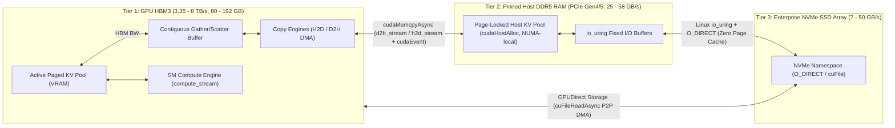
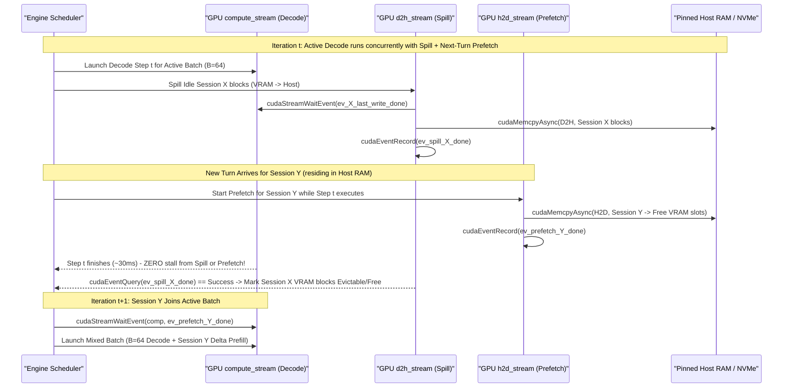

# 04 — Offloading Hierarchy: Asynchronous Movement Across VRAM, Pinned RAM & NVMe

[← Previous: KV Quantization](./03-state-compression-kv-quantization.md) · [Stage 5 Overview](./README.md) · [Next: Management Policies & Eviction →](./05-management-policies-eviction.md)

---

## 1. The Bandwidth & Capacity Wall: Why Three Memory Tiers?

Even with PagedAttention, GQA, and FP8 quantization, GPU HBM capacity remains fundamentally scarce relative to multi-tenant agentic sessions:

* An NVIDIA H100 80 GB allocates ~$70\text{ GB}$ to FP8 weights (for a 70B model) or ~$40\text{ GB}$ per GPU on TP=2, leaving $30\text{–}40\text{ GB}$ for KV blocks.
* A single 128K-token session on Llama-3.1-70B in FP8 consumes $160\text{ KiB/token} \times 131{,}072 \approx \mathbf{20.0\text{ GiB}}$. Just **two** idle user sessions waiting for their next chat turn exhaust an entire GPU's KV pool!
* Recomputing $128\text{K}$ tokens on the next turn burns $\sim 18\text{ seconds}$ of Tensor Core time; keeping it in VRAM bankrupts concurrency.

The solution is a **3-tier hierarchical KV memory fabric** spanning **GPU HBM (Tier 1)**, **Pinned Host DRAM (Tier 2)**, and **NVMe SSD Storage (Tier 3)**.

### Hardware Physics Comparison

| Tier | Medium | Typical Capacity (per Node) | Peak Bandwidth | Random Access Latency | Relative BW vs. HBM3 |
| :--- | :--- | :--- | :--- | :--- | :--- |
| **Tier 1** | GPU HBM3 / HBM3e | $80\text{–}192\text{ GB/GPU}$ | **$3.35\text{–}8.0\text{ TB/s}$** | $\sim 100\text{ ns}$ | $1\times$ |
| **Tier 2** | Host DDR5 DRAM (via PCIe Gen4/5 x16) | $512\text{ GB–}4\text{ TB}$ | PCIe 4.0 x16: **$\sim 25\text{–}28\text{ GB/s}$** eff.<br>PCIe 5.0 x16: **$\sim 52\text{–}58\text{ GB/s}$** eff.<br>(NVLink-C2C Grace-Hopper: $\sim 450\text{ GB/s}$) | $\sim 1\text{–}3\ \mu\text{s}$ (DMA setup) | **$\sim 60\times\text{–}250\times$ slower** |
| **Tier 3** | Enterprise NVMe SSD Array (RAID-0 / Gen5) | $4\text{–}64\text{ TB}$ | Single Gen4 NVMe: $\sim 7\text{ GB/s}$<br>4× Gen5 RAID-0: **$\sim 28\text{–}50\text{ GB/s}$** | $\sim 10\text{–}80\ \mu\text{s}$ | **$\sim 100\times\text{–}500\times$ slower** |

### The Core Mathematical Consequence: Compute–Transfer Overlap Is Mandatory

Suppose we swap a $20\text{ GiB}$ KV cache synchronously over PCIe Gen4 x16 ($\sim 25\text{ GB/s}$ effective):
$$t_{\text{sync\_swap}} = \frac{20\text{ GiB}}{25\text{ GB/s}} \approx 859\text{ ms}$$
If the GPU's compute stream blocks for $859\text{ ms}$ while `cudaMemcpy` transfers KV blocks, decode ITL spikes by $30\times$!

Even more critically, notice the **crossover point** between **KV Reloading** vs. **KV Recomputation**:
* **Reload time per token** (Llama-3.1-70B FP8: $160\text{ KiB/token}$) over PCIe Gen5 x16 ($55\text{ GB/s}$):
  $$t_{\text{reload/tok}} = \frac{160\text{ KiB}}{55\text{ GB/s}} \approx 2.9\ \mu\text{s/token} \implies 32\text{K tokens in } \sim 95\text{ ms}$$
* **Recompute time per token** (H100 FP8 Tensor Cores at $1{,}200\text{ TFLOPS}$ eff.):
  $$t_{\text{recomp/tok}} \approx \frac{2 \times 70\times 10^9}{1.2\times 10^{15}} \approx 117\ \mu\text{s/token} \implies 32\text{K tokens in } \sim 3{,}830\text{ ms}$$

Offloading/reloading over PCIe is **$\sim 40\times$ faster than recomputing** for 70B models—**provided** transfers happen **asynchronously in the background** without stalling the active compute stream! (Note: for very small models like 1B–3B dense with no GQA compression, recompute can approach PCIe reload speed; cost-aware policies weigh this exact ratio.)

---

## 2. Tier 1 ↔ Tier 2: VRAM and Pinned Host RAM Mechanics

### 2.1 Why Pageable Host Memory Kills Async Overlap (`malloc` vs. `cudaHostAlloc`)

Standard host allocations (`malloc` / `new` / standard PyTorch CPU tensors) reside in **pageable virtual memory**. The Linux kernel may page them out to swap or migrate physical frames at any moment, and their physical RAM pages are scattered (non-pinned).

If you call `cudaMemcpyAsync(dst_gpu, src_pageable_cpu, ..., stream)`:
1. The GPU's **Copy Engine (CE) DMA controller** cannot safely read/write pageable virtual addresses directly because physical pages could move mid-DMA.
2. Therefore, the CUDA driver silently **blocks the CPU thread**, allocates a temporary **pinned staging buffer**, performs a CPU `memcpy` into the staging buffer, executes DMA from staging to GPU, and only then returns—destroying both PCIe throughput (extra CPU memory copy) and stream asynchronicity!

To achieve true zero-CPU-copy, non-blocking DMA at full PCIe line rate, Tier 2 host KV pools **must** be allocated as **page-locked (pinned) memory**:
```cpp
// Allocate 64 GiB pinned host KV pool (locked in physical DRAM, DMA-accessible)
cudaHostAlloc(&host_kv_pool, 64ULL << 30, cudaHostAllocDefault);
// Or register an existing mmap'd / aligned buffer:
cudaHostRegister(ptr, size, cudaHostRegisterDefault);
```

> [!WARNING]
> **NUMA & PCIe Root Complex Topology Trap:** On dual-socket servers (e.g., 2× AMD EPYC / Intel Xeon CPUs), GPUs 0–3 attach to NUMA Node 0 while GPUs 4–7 attach to NUMA Node 1. If a Tier 2 pinned KV pool for GPU 0 is allocated on NUMA Node 1, every DMA transfer traverses the cross-socket UPI/Infinity Fabric link—cutting bandwidth in half and adding latency. Always bind pinned pool allocation (`numa_alloc_onnode` / `mbind` + `cudaHostRegister`) to the **exact NUMA node matching the GPU's PCIe Root Complex** (`nvidia-smi topo -m`).

### 2.2 Dual-Stream Execution & `cudaEvent` Synchronization

GPU hardware contains **independent execution engines**:
* **SM Compute Engine:** Executes GEMMs, RoPE, Softmax, Attention.
* **Copy Engines (CE — typically 1 H2D and 1 D2H DMA engine on A100/H100):** Execute PCIe transfers independently in full duplex (simultaneous Host-to-Device and Device-to-Host!) without consuming SM warps.

To overlap KV spilling (D2H) and prefetching (H2D) with active forward passes, the engine creates **dedicated non-blocking CUDA streams** (`cudaStreamNonBlocking`):
* `compute_stream`: Runs Transformer layers $0 \dots L-1$ and sampling.
* `d2h_stream` (Spill stream): Copies inactive/evictable VRAM blocks → Pinned Host RAM.
* `h2d_stream` (Prefetch stream): Copies predicted/scheduled Host RAM blocks → VRAM.

#### Exact Synchronization Rules (`cudaEvent_t`)

Never use `cudaDeviceSynchronize()` or `cudaStreamSynchronize()` on the hot path—that stalls the host scheduler and drains the GPU pipeline. Instead, enforce fine-grained GPU-side dependency edges using **`cudaEventRecord`** and **`cudaStreamWaitEvent`**:

1. **Spill Safety (RAW Hazard — Do Not Overwrite Before Copy Finishes):**
   * Suppose block `B_phys` finishes being written on `compute_stream`. Record `ev_compute_done` on `compute_stream`.
   * `d2h_stream` executes `cudaStreamWaitEvent(d2h_stream, ev_compute_done, 0)`, then launches `cudaMemcpyAsync(host_dst, vram_src, block_bytes, cudaMemcpyDeviceToHost, d2h_stream)`, then records `ev_spill_done`.
   * **Crucial Invariant:** The VRAM allocator **must not reallocate `B_phys`** to another request until `cudaEventQuery(ev_spill_done) == cudaSuccess`! Otherwise a new prefill overwrites `B_phys` mid-DMA, corrupting the spilled block.
2. **Prefetch Readiness (Do Not Read Before Load Finishes):**
   * `h2d_stream` launches `cudaMemcpyAsync(vram_dst, host_src, block_bytes, cudaMemcpyHostToDevice, h2d_stream)` and records `ev_prefetch_done`.
   * Before launching attention (either whole-request or **layer-by-layer**), `compute_stream` calls `cudaStreamWaitEvent(compute_stream, ev_prefetch_done, 0)`.

### 2.3 Granularity of Transfer: Contiguous Layout vs. Scatter-Gather Overhead

A single PagedAttention block for 1 layer (e.g., $B=16$ tokens, $H_{\text{kv}}=8$, $d_{\text{head}}=128$, FP8, K+V) is:
$$16 \times 8 \times 128 \times 2 \times 1\text{ B} = 32\text{ KiB}$$
Issuing $80$ separate $32\text{ KiB}$ `cudaMemcpyAsync` calls per block across $80$ layers incurs huge **CUDA driver launch + PCIe TLP header overhead** (~$5\text{–}10\ \mu\text{s}$ per call $\implies 400\text{–}800\ \mu\text{s}$ CPU overhead per block, achieving $<10\%$ PCIe bandwidth!).

Production offload engines (e.g., **LMCache**, **Mooncake**, **vLLM CPU Offload / KVCache-Connector**) eliminate tiny transfers via two techniques:
1. **Batching / `cudaMemcpyBatchAsync` / Scatter-Gather Copy Kernel:** Pack multiple discontiguous paged blocks on the GPU into a contiguous **staging buffer** in VRAM via a fast HBM-to-HBM GPU gather kernel ($3.35\text{ TB/s}$, takes microseconds), then execute **one large multi-megabyte `cudaMemcpyAsync`** across PCIe!
2. **Layer-Major Block Grouping:** Store a logical block of $B$ tokens across all $L$ layers contiguously when offloading (e.g., $80 \times 32\text{ KiB} = 2.56\text{ MiB}$ per transfer chunk), saturating PCIe Gen5 x16 at $>90\%$ efficiency.

---

## 3. Tier 2 ↔ Tier 3 & Tier 1 ↔ Tier 3: NVMe SSD Storage Mechanics

When Pinned Host RAM fills up—or when persisting long-lived multi-day session/corpus KV caches across server restarts—KV blocks spill down to **NVMe SSDs**. Traditional buffered POSIX `read()` / `write()` is catastrophically slow for LLM KV caches because it passes through the OS **Page Cache** (consuming double RAM, triggering kernel locks, and causing CPU `memcpy` stalls). Instead, inference engines use three zero-page-cache I/O paths:

### 3.1 POSIX `O_DIRECT` + Aligned Buffers
* Opening the NVMe block device or file with `O_DIRECT` bypasses the Linux OS Page Cache entirely, enabling DMA directly between the NVMe controller and user-space memory.
* **Alignment Constraint:** Buffer pointer, file offset, and transfer length must be aligned to the SSD physical block size (typically $512\text{ B}$ or $4\text{ KiB}$). Because KV blocks are powers of 2 ($32\text{ KiB}$–$4\text{ MiB}$), alignment is naturally satisfied.

### 3.2 Linux `io_uring` (Asynchronous Ring-Buffer Syscall-Free I/O)
Standard `pread`/`pwrite` requires 1 blocking syscall per chunk. **`io_uring`** establishes two lock-free ring buffers shared between user space and the Linux kernel:
* **Submission Queue (SQ):** The KV offload worker pushes hundreds of `IORING_OP_READ` / `IORING_OP_WRITE` SQEs (`O_DIRECT` + `IORING_REGISTER_BUFFERS` fixed pre-pinned buffers!) with a single `io_uring_enter()` syscall—or zero syscalls when `IORING_SETUP_SQPOLL` is enabled.
* **Completion Queue (CQ):** The worker polls completed NVMe DMA operations asynchronously.
* **Why it matters:** A single CPU core driving `io_uring` can saturate $4$–$8\times$ NVMe Gen5 drives ($>50\text{ GB/s}$) at $<15\%$ CPU utilization, keeping Tier 2 ↔ Tier 3 spills completely decoupled from the Python/C++ inference scheduler.

### 3.3 NVIDIA GPUDirect Storage (GDS / `cuFile`) — Direct NVMe ↔ VRAM
Normally, moving a KV block from NVMe SSD to GPU VRAM requires **two PCIe traversals** via a CPU bounce buffer:
$$\text{NVMe} \xrightarrow{\text{PCIe DMA}} \text{Host RAM Bounce Buffer} \xrightarrow{\text{PCIe DMA}} \text{GPU VRAM}$$
**GPUDirect Storage (GDS)** via `libcufile` (`cuFileRead` / `cuFileWrite` / `cuFileReadAsync`) configures the NVMe controller's DMA engine to target **GPU BAR1 P2P memory addresses directly**, eliminating Host DRAM and CPU involvement:
$$\text{NVMe} \xrightarrow{\text{Direct P2P PCIe DMA (or PCIe Switch)}} \text{GPU VRAM}$$

* **When GDS shines:** On DGX/HGX systems with PCIe switches linking NVMe drives directly to GPUs on the same root complex, GDS halves host memory bandwidth pressure and cuts reload latency by $30\text{–}50\%$.
* **When Host-Staged `io_uring` + Pinned RAM wins:** If the KV block will also be shared across multiple requests in Tier 2 RAM, or if the motherboard topology lacks direct P2P PCIe switch paths (forcing traffic through the CPU root complex anyway, where P2P can suffer ACS/IOMMU penalties), staging through a pinned Tier 2 RAM cache via `io_uring` + `cudaMemcpyAsync` often matches or beats GDS while giving you a free Tier 2 hit layer!

---

## 4. Prefetching & Overlap Strategies: Hiding the PCIe Tax

To prevent the user from waiting on PCIe/NVMe reload latency during interactive generation, engines employ **two levels of predictive prefetching**:

1. **Request-Level Turn Prefetch (Lookahead on Queue / Session Wakeup):**
   When an HTTP request arrives (or hits the API gateway / scheduler waiting queue) with `session_id` or matching prefix hashes residing in Tier 2 RAM / Tier 3 NVMe, the scheduler **immediately enqueues H2D prefetch** onto `h2d_stream` while the request is still in tokenization / waiting queue behind the current batch! By the time the request enters the active batch $20$–$100\text{ ms}$ later, its KV prefix is already resident in VRAM.
2. **Layer-by-Layer Pipelined Prefetch (Intra-Step Streaming):**
   For ultra-long contexts ($128\text{K}$+) that do not fully fit in VRAM simultaneously, compute for Layer $l$ takes $t_{\text{layer}}$ while H2D copy loads Layer $l+1$'s KV blocks into a **double-buffered (ping-pong) VRAM staging slot**:
   * While `compute_stream` runs Attention on Layer $l$ (Buffer A), `h2d_stream` transfers Layer $l+1$ KV into Buffer B.
   * `compute_stream` waits on `ev_layer_l_plus_1`, swaps buffers, and proceeds without stalling!

---

## 5. Architecture & Execution Diagrams

### 5.1 3-Tier Offloading Architecture



### 5.2 Asynchronous Dual-Stream Spill & Prefetch Overlapping Decode



---

## Navigation

* [← Previous: KV Cache Quantization](./03-state-compression-kv-quantization.md)
* [Stage 5 Overview](./README.md)
* [Next: Management Policies & Eviction →](./05-management-policies-eviction.md)
