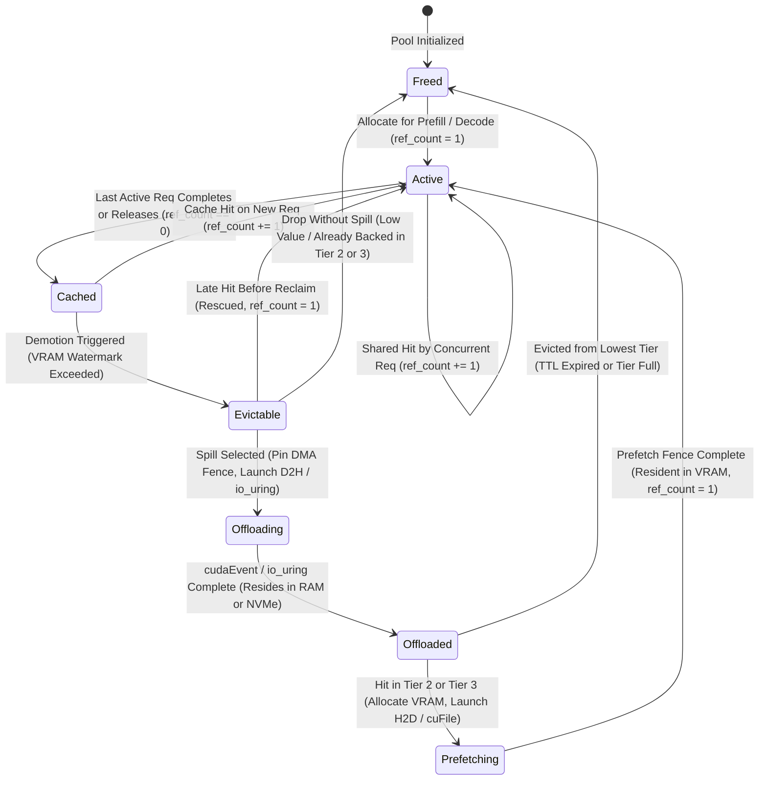
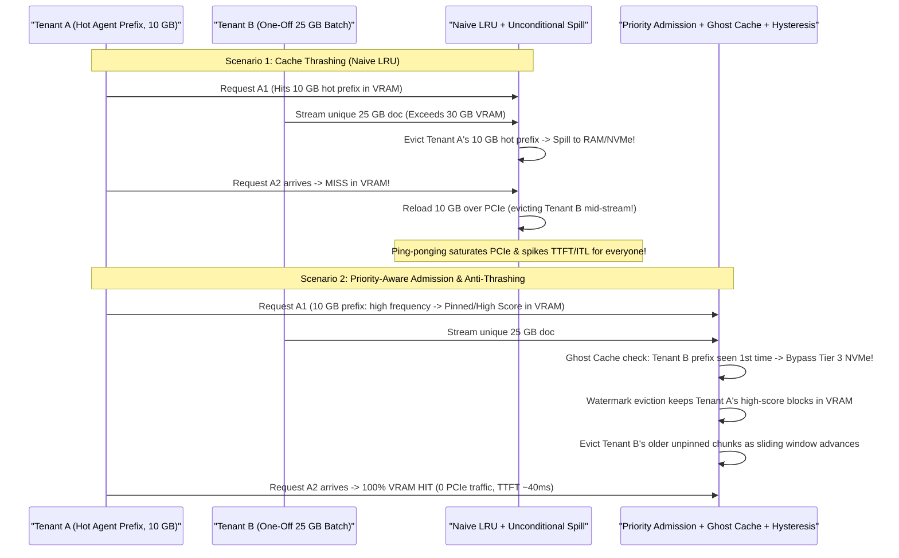

# 05 — Management Policies: Pinning, Admission, Eviction & Anti-Thrashing

[← Previous: Offloading Hierarchy](./04-offloading-hierarchy.md) · [Stage 5 Overview](./README.md) · [Main Docs](../../README.md) · [Syllabus](../../syllabus.md)

---

## 1. Why Naive Cache Replacement Fails in Hierarchical LLM Serving

In traditional CPU/web caching (e.g., Redis, Linux Page Cache), every cache miss incurs a relatively uniform penalty, objects are independent, and objects are immutable once inserted. **KV cache management violates all three assumptions**:

1. **In-Flight Mutability & Pinning:** Blocks belonging to currently running requests or active async DMA transfers (`d2h_stream` / `h2d_stream`) **cannot** be evicted regardless of age.
2. **Structural Prefix Dependencies:** In chained-hash APC or RadixTrees, evicting an early block (`[0..15]`) renders every descendant block (`[16..16000]`) mathematically unreachable or orphaned unless leaf-first invariants hold.
3. **Heterogeneous Miss Cost:** Recomputing a deep $32\text{K}$-token prefix costs $\sim 3\text{–}6\text{ s}$ of Tensor Core compute, whereas recomputing a $64$-token suffix costs $<2\text{ ms}$. Similarly, reloading a block from Pinned RAM takes $\sim 3\ \mu\text{s/token}$ vs. recomputing at $\sim 120\ \mu\text{s/token}$.
4. **Severe Thrashing & SSD Wear:** Under oversubscribed multi-tenant load, naive LRU promotes every single-use prompt into every tier, evicting hot shared system prompts and burning NVMe write endurance.

---

## 2. Reference-Counted Pinning of In-Flight Blocks

Every physical KV block descriptor (`BlockMeta`) maintains an explicit reference counter (`ref_count`) and state flags before it is ever eligible for eviction or tier migration:

```text
struct BlockMeta {
    uint32_t phys_id;
    uint64_t prefix_hash;
    uint32_t ref_count;       // Active sequences + active DMA operations pinning this block
    uint32_t prefix_depth;    // Token offset / block index in sequence (cost proxy)
    uint64_t last_access_ns;  // Monotonic timestamp of last hit/creation
    uint32_t hit_frequency;   // Decaying access count (for LFU / TinyLFU)
    Tier     tier;            // VRAM | PINNED_RAM | NVME | FREED
    bool     dirty_in_vram;   // True if not yet backed up to RAM/NVMe
    cudaEvent_t dma_fence;    // Non-null while async H2D/D2H copy is in flight
};
```

### Pinning Invariants

* **Sequence Execution Pin (`ref_count >= 1`):**
  When a request matches 500 cached prefix blocks and allocates 10 new blocks, all 510 blocks have `ref_count += 1`. Even if a sequence takes 15 seconds to stream 500 output tokens, its blocks are **strictly pinned** (`ref_count > 0`) and excluded from the eviction queue.
* **Async DMA Pin (`dma_fence` / `dma_pin`):**
  While `d2h_stream` is copying a block from VRAM to Pinned RAM—or while `h2d_stream` is prefetching into a VRAM slot—the block's `ref_count` remains $\ge 1$ (or `dma_in_flight = true`). Only after `cudaEventQuery(dma_fence) == cudaSuccess` does the background manager decrement the pin and transition the block to `Evictable` (or `Offloaded`).
* **Preemption Exception:**
  If VRAM becomes 100% pinned by active running sequences (e.g., all sequences grew longer via decode and hit `free_blocks == 0`), **eviction cannot free any `ref_count == 0` blocks**. The scheduler must trigger **sequence preemption** (swapping out or recomputing the lowest-priority *running* request, releasing its `ref_count`, and returning its blocks to the free pool).

---

## 3. Block Lifecycle State Machine

A physical KV block transitions through well-defined states governed by `ref_count`, cache residency, and DMA completion fences:



---

## 4. Eviction Policies: From Classic LRU/LFU to Cost-Aware Policies

When a tier's free block count drops below its low-watermark threshold, the eviction engine selects victim blocks from the `ref_count == 0` pool (enforcing **leaf-first ordering** in prefix trees/chains so parent blocks outlive their children).

### 4.1 Least Recently Used (LRU)
* **Rule:** Evict the unpinned leaf block with the smallest `last_access_ns`.
* **Strength:** $O(1)$ using a doubly-linked list + hash map; naturally adapts to recency shifts in multi-turn conversations.
* **Weakness:** Completely blind to frequency and recomputation cost. A single-use $64\text{K}$-token batch summarization job flushes $4{,}000$ blocks through VRAM and **evicts a $4\text{K}$ system prompt used by 500 QPS of interactive traffic** ("scan resistance failure").

### 4.2 Least Frequently Used (LFU) & Windowed TinyLFU (W-TinyLFU)
* **Rule:** Evict blocks with the lowest access frequency `hit_frequency` (with exponential decay or periodic halving so stale old spikes don't stick forever).
* **Strength:** Immune to one-off long-prompt scans; pins shared system prompts and popular RAG documents in Tier 1 VRAM.
* **Weakness:** Slow to react when a hot workload shifts, and pure LFU ignores *how expensive* a block is to regenerate.

### 4.3 Priority-Aware / Cost-Aware Eviction (GDSF / Depth- & Tier-Aware Scoring)

Modern LLM serving caches (inspired by **Greedy-Dual-Size-Frequency**, **SGLang HiCache**, and **LMCache**) score each candidate victim block $b$ by its **expected net utility per byte**—balancing hit probability, recomputation/reload savings, and session liveness:

$$\text{Score}(b) = \text{TierPriority}(b) \times \frac{f_{\text{decay}}(b) \cdot \big(C_{\text{recompute}}(b) - C_{\text{reload}}(b)\big)}{\text{Size}(b)} + \alpha \cdot \text{SessionTTL}(b)$$

Key domain-specific factors inside $\text{Score}(b)$:

1. **Prefix Depth & Leaf-First Penalty:**
   In causal Transformers, prefix block $0$ has **higher fan-out value** than block $500$ (thousands of branches share `[0..15]`, whereas `[8000..8015]` may belong to one branch). Even more practically, if block $i$ is missing, blocks $> i$ cannot be used as a prefix! Thus, eviction **strictly evicts deeper leaf blocks first**, naturally keeping shallow shared roots hot.
2. **Recompute Cost vs. Reload Latency:**
   * A block belonging to a compute-heavy MoE/large-dense model ($C_{\text{recompute}}$ high) or already backed up in Pinned RAM ($C_{\text{reload}}$ tiny, already `dirty_in_vram == false`) has lower marginal loss if evicted from VRAM to RAM, compared to a clean drop where no RAM/NVMe backup exists.
   * **Clean-First Eviction:** Prefer evicting VRAM blocks that **already have an identical copy in Tier 2 RAM** (`dirty_in_vram == false`), because freeing them requires **0 PCIe write bandwidth**!
3. **Active Session TTL / Multi-Turn Lease:**
   Interactive chat/agent users exhibit **bimodal inter-turn gaps** (human reading time $5\text{–}60\text{ s}$, or tool execution time $0.5\text{–}10\text{ s}$). Assigning an explicit **Session TTL lease** (or tenant SLA tier: e.g., `realtime-agent` vs. `batch-eval`) protects an active user's recent conversation state in Tier 2 RAM while aggressively demoting expired or batch-only sessions to Tier 3 / Freed.

---

## 5. Admission Policies: Stopping Pollution at the Gate

Eviction decides *what leaves*; **admission control** decides *whether a newly computed block deserves to enter a tier at all*. Unconditional "write-all-to-all-tiers" causes **PCIe saturation and NVMe write amplification**.

1. **Two-Hit / Probationary Admission (Bloom Filter / Ghost Cache):**
   * Do **not** spill newly computed single-turn blocks to NVMe (or even Tier 2 RAM) on first sight.
   * Maintain a tiny in-memory **Ghost Cache** (storing only 64-bit `prefix_hash` + timestamp, $\sim 8\text{ B}$ per block instead of $32\text{ KiB}$–$2.5\text{ MiB}$ of KV tensors!).
   * Only when a prefix hash is seen a **second time** (a "ghost hit", proving reuse!) is it admitted into the persistent NVMe SSD tier (**Write-on-Second-Hit**). This cuts NVMe write traffic by **$50\%\text{–}80\%$**, preserving SSD endurance (DWPD) and PCIe bandwidth for hot prefetches.
2. **Decode-Tail Filtering:**
   * During decode, generated output tokens are rarely shared across different users unless it's a multi-turn session continuing the exact transcript. Batch/stateless completions (`n_turns == 1`, `stream_complete`) can mark generated output blocks as **non-cacheable (`no_admit`)** or bypass Tier 3 persistence unless a multi-turn `session_id` is declared.
3. **Minimum Prefix Length / Compute-Ratio Gate:**
   * Avoid offloading tiny $16$-token tails to NVMe where SSD random IOPS + metadata overhead exceeds the $<1\text{ ms}$ cost of recomputing $16$ tokens. Only offload contiguous chunks $\ge N_{\min}$ (e.g., $\ge 256$ tokens / $\ge 4\text{ MB}$).

---

## 6. Preventing Cache Thrashing Across Memory Tiers

**Cache thrashing** occurs when the active working set $W_{\text{active}}$ exceeds a tier's capacity $C_{\text{tier}}$, causing blocks to continuously ping-pong (`VRAM → RAM → VRAM` or `RAM → NVMe → RAM`) so the system spends more PCIe/I/O bandwidth moving blocks than doing useful inference.

### Four Engineering Defenses Against Multi-Tier Thrashing

1. **High/Low Watermark Hysteresis:**
   Never run eviction synchronously one block at a time at $100\%$ utilization. Configure two thresholds per tier—for example:
   * `VRAM_HIGH_WATERMARK = 90%` (background async spill starts demoting coldest unpinned blocks)
   * `VRAM_LOW_WATERMARK = 80%` (background spill stops, leaving a $10\%$ headroom buffer for incoming burst prefills).
   Hysteresis batches DMA spills into large contiguous sweeps and absorbs sudden allocation spikes without blocking the scheduler.
2. **Bandwidth-Budgeted Offloading (PCIe Admission Throttling):**
   Cap background D2H spill throughput (e.g., $\le 30\%$ of available PCIe bandwidth) and give **H2D Prefetch strict priority** over D2H Spill. If PCIe is saturated by prefetches, drop lowest-value unpinned VRAM blocks cleanly (`Evictable -> Freed`) rather than queueing an unbounded backlog of D2H spills that steals PCIe bandwidth from active requests!
3. **Thrash Detection via Reload-Before-Cooldown (Anti-Oscillation):**
   If a block is demoted from VRAM to RAM and then immediately prefetched back into VRAM within a short cooldown window $\Delta t_{\text{osc}}$ (e.g., $< 500\text{ ms}$), flag it as **thrashing-hot** (`pin_boost`) and pause offloading of its cohort, OR shrink admitted batch concurrency ($B_{\max}$) via scheduler backpressure so the active working set fits inside Tier 1 VRAM.
4. **Cache-Aware Request Routing / Sticky Sessions:**
   Across multiple GPU replicas, consistent hashing on `(prefix_hash[:k], session_id)` routes turn $t+1$ back to the **same GPU node** whose Tier 1/Tier 2 already holds the prefix—preventing $N$ replicas from duplicating and thrashing the same $W_{\text{active}}$ independently.

---

## 7. Oversubscribed Multi-Tenant Load: Thrashing vs. Priority-Aware Management

Consider an oversubscribed GPU ($30\text{ GB}$ KV VRAM) serving two concurrent workloads:
* **Tenant A (Interactive Agent Cohort):** $10\text{ GB}$ shared system/tool prefix + active multi-turn sessions (`high frequency`, `strict ITL/TTFT SLA`).
* **Tenant B (One-Off Batch Summarizer):** Streams unique $25\text{ GB}$ documents once (`zero reuse`, `low priority`).



---

## Navigation

* [← Previous: Offloading Hierarchy](./04-offloading-hierarchy.md)
* [Stage 5 Overview](./README.md)
* [Main Documentation Index](../../README.md) · [Complete Syllabus](../../syllabus.md)
