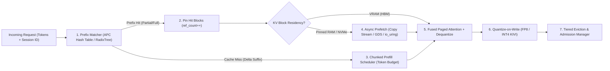

# Stage 5: KV Cache & Memory Hierarchies

[Inference Engineering Docs](../../README.md) · [Complete Syllabus](../../syllabus.md) · **Stage 5**

---

## Overview

In modern autoregressive Large Language Model (LLM) serving, the Key-Value (KV) cache is simultaneously the primary enabler of $O(1)$ per-step token generation and the dominant consumer of GPU High-Bandwidth Memory (HBM). As context windows scale from $8\text{K}$ to $128\text{K}$–$1\text{M}$ tokens and multi-turn agentic workflows repeatedly share massive system prompts, tool definitions, and retrieval corpora, naive per-request KV allocation collapses under two failure modes:

1. **Redundant Prefill Compute:** Recomputing identical KV projections for shared prompt prefixes wastes Tensor Core FLOPs and inflates Time-to-First-Token (TTFT).
2. **VRAM Capacity & Interference Bottlenecks:** Unbounded KV state exhausts GPU HBM, caps maximum concurrency ($B_{\max}$), and forces long prefills to stall active decode iterations—spiking Inter-Token Latency (ITL).

Stage 5 dissects the five architectural pillars that transform the KV cache from a flat, ephemeral GPU buffer into a **content-addressed, compressed, scheduled, and tiered memory hierarchy**.

## Stage 5 Curriculum Index

| # | Topic | Core Systems Mechanics |
| :--- | :--- | :--- |
| 01 | [**Context Reuse: Prefix Caching**](./01-context-reuse-prefix-caching.md) | Block-hash Automatic Prefix Caching (vLLM chained XXH3/SHA-256 hashing) vs. dynamic compressed prefix trees (SGLang RadixAttention), longest-prefix matching, cache-aware scheduling, and TTFT collapse. |
| 02 | [**Hybrid Scheduling: Chunked Prefill**](./02-hybrid-scheduling-chunked-prefill.md) | Prefill-decode interference, token-budget batching (`max_num_batched_tokens`), roofline saturation of Tensor Cores during decode, ITL tail-latency bounding, and varlen/paged attention over partial KV prefixes. |
| 03 | [**State Compression: KV Cache Quantization**](./03-state-compression-kv-quantization.md) | Dynamic/static quantization (FP8 E4M3, INT8, INT4), scaling granularities, Key channel-wise outliers (pre-RoPE vs. post-RoPE) vs. Value token-wise variance, asymmetric KIVI-style layouts, and fused dequantization kernels. |
| 04 | [**Offloading Hierarchy: VRAM → RAM → NVMe**](./04-offloading-hierarchy.md) | PCIe vs. HBM bandwidth physics, pinned host memory, dual-stream `cudaMemcpyAsync` + `cudaEvent` overlap, GPUDirect Storage (`cuFile`), Linux `io_uring`, `O_DIRECT`, and asynchronous prefetching. |
| 05 | [**Management Policies & Eviction**](./05-management-policies-eviction.md) | Reference-counted block pinning, LRU/LFU vs. cost- and depth-aware eviction, admission filters, watermark hysteresis, and preventing multi-tier cache thrashing and NVMe write amplification. |

---

## How These Mechanisms Compose in a Production Serving Engine

---

## Navigation

* **Up:** [Main Documentation Index](../../README.md) | [Complete Syllabus](../../syllabus.md)
* **Previous Stage:** [← Stage 4: Serving Engines & Constrained Decoding](../stage-04/README.md)
* **Start Reading:** [01 — Context Reuse: Prefix Caching](./01-context-reuse-prefix-caching.md)
* **Next Stage:** [Stage 6: Quantization & Compression at Scale →](../stage-06/README.md)
