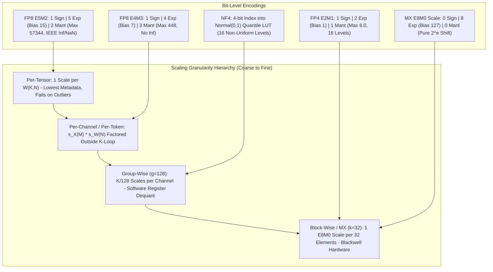
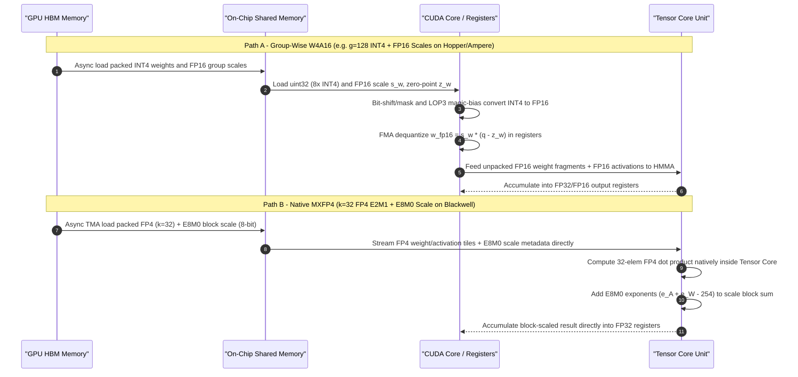

# 01 — Numerical Representation

[← Stage 6 Index](./README.md) · **Next:** [02 — Outliers & Calibration →](./02-outliers-and-calibration.md)

---

Large language models store billions of numbers and move them repeatedly from slow off-chip memory into fast compute units every time they generate a word. Choosing how each number is encoded in bits—and how groups of numbers share scaling factors—determines both how much memory a model needs and how accurately it preserves its behavior.

## Core Concepts & Terminology

Every technical term, numerical format, and hardware concept used in this document is defined below in dependency order:

1. **Model Building Blocks & Inference Terms:**
   * **Weights ($W$) and Activations ($X$):** Weights are the fixed, learned numbers stored inside a neural network; activations are the temporary numbers computed as input text passes through each layer.
   * **Dense Transformer:** A Transformer neural network in which every weight parameter participates in every forward pass (as opposed to sparsely activated Mixture-of-Experts models).
   * **Autoregressive Decode & Batch-1 Decode:** Generating output text one token (word piece) at a time, where each new token depends on all prior tokens. "Batch-1" means serving a single user request at a time.
   * **KV Cache (Key-Value Cache):** GPU memory that stores intermediate Key and Value vectors from earlier tokens so they do not need to be recomputed on every decode step.
   * **Logits & Perplexity (PPL):** Logits are the raw, unnormalized scores a model outputs for every token in its vocabulary before converting them into probabilities. Perplexity is a standard metric measuring how uncertain a language model is when predicting text (lower is better).
   * **Quantization & Dequantization:** Quantization maps high-precision numbers (such as 16-bit) onto compact lower-precision representations (such as 8-bit or 4-bit) to save memory and bandwidth; dequantization converts them back into higher-precision numbers before arithmetic.
   * **Quantization Noise:** The small rounding error introduced between an original number and its quantized-then-dequantized value.
   * **Activation Outliers, `LayerNorm`, & `RMSNorm`:** Activation outliers are a tiny fraction of feature channels whose magnitudes are $10\times$–$100\times$ larger than typical channels. `LayerNorm` and `RMSNorm` are normalization layers that rescale activations between Transformer blocks to keep magnitudes stable.

2. **GPU Memory & Compute Hardware:**
   * **VRAM & HBM (High Bandwidth Memory):** The GPU's main off-chip memory (e.g., 80 GB on an NVIDIA A100 or H100) where model weights and the KV Cache reside.
   * **On-Chip SRAM, Shared Memory (`SMEM`), & Registers:** Small, ultra-fast memory pools located directly inside the GPU's compute cores, used to stage data immediately before math execution.
   * **CUDA Core:** A general-purpose programmable arithmetic unit on an NVIDIA GPU used for elementwise math, bit manipulation, and control flow.
   * **Tensor Core (`HMMA`, `IMMA`, `wgmma`) & `TMA`:** Specialized matrix-multiply-accumulate hardware units on NVIDIA GPUs. `HMMA` executes 16-bit floating-point matrix math; `IMMA` executes integer matrix math; `wgmma` (Warp Group Matrix Multiply-Accumulate) is the Hopper-generation asynchronous Tensor Core instruction; `TMA` (Tensor Memory Accelerator) is Hopper hardware that copies multi-dimensional data tiles asynchronously between HBM and Shared Memory.
   * **Ampere, Hopper, & Blackwell:** Successive NVIDIA data-center GPU architectures (A100 = Ampere, H100 = Hopper, B200 = Blackwell).
   * **MAC, `FMA` (`fma.rn.f16`), & `LOP3`:** A Multiply-Accumulate (MAC) computes $a \times b + c$. `FMA` (Fused Multiply-Add) performs this in one hardware instruction (`rn` = round-to-nearest-even). `LOP3` is a 3-input bitwise lookup instruction used to unpack 4-bit integers inside registers.
   * **GEMM, Reduction Dimension ($K$), & Epilogue:** General Matrix Multiply ($Y = XW$), where $X \in \mathbb{R}^{M \times K}$ and $W \in \mathbb{R}^{K \times N}$ are summed along their shared inner dimension $K$ (the reduction dimension). The epilogue is the final step after the $K$-sum finishes, where scaling factors are applied and results are written out.
   * **`W4A16`, `W8A8`, & `W4A4`:** Precision shorthand specifying Weight bit-width (`W`) and Activation bit-width (`A`)—for example, `W4A16` uses 4-bit weights and 16-bit activations.

3. **Floating-Point & Bit-Level Numerical Formats:**
   * **IEEE-754, Sign ($S$), Exponent ($E$), Mantissa ($M$), & Bias ($B$):** IEEE-754 is the standard specification for binary floating-point numbers. A float splits its bits into 1 sign bit $S$ (positive/negative), $E$ exponent bits (power-of-two scale, shifted by a constant bias $B = 2^{E-1}-1$), and $M$ mantissa/significand bits (fractional precision within that power of two).
   * **Binade & ULP (Unit in the Last Place):** A binade is the interval between two consecutive powers of two, $[2^k, 2^{k+1})$. ULP is the spacing between two adjacent representable floating-point numbers in that binade.
   * **Normal vs. Subnormal Numbers & Gradual Underflow:** Normal numbers have an implicit leading `1.` before the mantissa; subnormal numbers (when exponent bits are all zeros) replace it with `0.` so values near zero shrink smoothly ("gradual underflow") instead of dropping straight to zero.
   * **`Inf` & `NaN`:** Special floating-point bit patterns representing Infinity ($\pm\infty$) and Not-a-Number (invalid results).
   * **`FP32`, `FP16`, & `BF16`:** Standard 32-bit (`1|8|23`) and 16-bit floating-point formats. `FP16` (`1|5|10`) prioritizes precision; `BF16` (`1|8|7`, Brain Float 16) matches `FP32`'s 8-bit exponent for wide dynamic range.
   * **`FP8` (`E4M3` & `E5M2`) & OCP:** 8-bit floating-point formats standardized by NVIDIA, ARM, Intel, and the Open Compute Project (OCP). `E4M3` (4 exponent, 3 mantissa bits) favors precision for forward-pass weights and activations; `E5M2` (5 exponent, 2 mantissa bits) matches `FP16`'s exponent range for high-dynamic-range tensors or training gradients.
   * **`FP4` (`E2M1`):** A 4-bit floating-point format (1 sign, 2 exponent, 1 mantissa bit) encoding 16 finite values in $[-6.0, +6.0]$.
   * **`NF4` (NormalFloat4), QLoRA, `bitsandbytes`, & Double Quantization:** A 4-bit non-uniform lookup-table format introduced in QLoRA (Quantized Low-Rank Adaptation, implemented in the `bitsandbytes` library). Its 16 values are placed at equal-probability quantiles of a standard normal distribution $\mathcal{N}(0,1)$ using its cumulative distribution function (CDF $\Phi$) and inverse CDF ($Q_X$). Double Quantization further compresses the group scale factors themselves into `FP8` to reduce metadata memory.
   * **OCP Microscaling (`MXFP4`, `MXFP8`, `E8M0`) & `NVFP4`:** Block-scaled formats standardized by OCP (v1.0) and accelerated natively on Blackwell. Every 32 elements along $K$ share one 8-bit power-of-two scale in `E8M0` format (0 sign, 8 exponent, 0 mantissa bits). `NVFP4` is NVIDIA's 16-element block variant using `FP8 E4M3` scales.

4. **Integer Formats, Scaling Granularities, & Algorithms:**
   * **`INT8`, `INT4`, `UINT8`, `UINT4`:** Signed (`INT`, centered near zero via two's complement) and unsigned (`UINT`, non-negative) 8-bit and 4-bit integer formats.
   * **`DP4A` & `TensorRT`:** `DP4A` is an NVIDIA instruction performing a 4-element 8-bit integer dot product; `TensorRT` is NVIDIA's high-performance inference compiler.
   * **Scale ($s$) & Zero-Point ($z$):** Parameters mapping integers $q$ to real values $\hat{x} = s \cdot (q - z)$, where $s$ sets the step size and $z$ is the integer code representing real `0.0`.
   * **Symmetric vs. Asymmetric (Affine) Quantization:** Symmetric quantization fixes $z = 0$ over $[-\alpha, +\alpha]$; asymmetric quantization allows $z \neq 0$ so skewed ranges $[x_{\min}, x_{\max}]$ use all integer codes efficiently.
   * **Per-Tensor, Per-Channel, Per-Token, & Group-Wise Scaling:** Granularities at which scales $s$ are shared: one scale per matrix (per-tensor), one per output column (per-channel), one per input token row (per-token), or one per $g$-element contiguous slice along $K$ (group-wise, e.g., $g = 128, 64, 32$).
   * **`SmoothQuant`, `AWQ`, `GPTQ`, & `DeepSeek-V3`:** `SmoothQuant`, `AWQ`, and `GPTQ` are post-training calibration algorithms (detailed in Doc 02) that preserve accuracy under low-bit quantization; `DeepSeek-V3` is a frontier Mixture-of-Experts LLM that uses `1x128` block-wise `FP8` GEMMs.

---

## 1. Why Bit-Level Representation Governs LLM Inference

In PyTorch, a standard `nn.Linear(K, N)` layer stores its weight tensor `W` in `torch.bfloat16` or `torch.float16`, where every parameter consumes **2 bytes**. A 70B-parameter dense Transformer requires $70 \times 10^9 \times 2 = 140\text{ GB}$ just for static weights—triggering an immediate out-of-memory failure on a single 80 GB H100/A100 GPU before allocating a single byte of KV Cache or activations. Furthermore, during batch-1 autoregressive decode, each generated token executes a vector-matrix multiply (`[1, K] @ [K, N]`): the GPU performs only two floating-point operations per weight, yet must stream the entire weight matrix from slow off-chip HBM (VRAM) into on-chip SRAM/registers for every single token. In this regime, inference latency is governed almost entirely by **bytes moved from HBM**, not arithmetic speed.

Reducing weight representation from 16 bits to 8 bits or 4 bits cuts static VRAM footprint and decode HBM traffic by **2× to 4×**. Yet not all 4-bit or 8-bit encodings allocate their bit budgets equally:

* **Integer formats (`INT8`, `INT4`)** space representable values **uniformly** across a linear range (like `torch.linspace(-alpha, alpha, 2**b)`), maximizing precision near the outer bounds of a clamped interval while relying on external scale factors for dynamic range.
* **Floating-point formats (`FP8`, `FP4`, `MXFP4`)** split bits between an **exponent** (geometric dynamic range across orders of magnitude, acting like a power-of-two zoom level) and a **mantissa/significand** (uniformly spaced tick marks within each exponent bin).
* **Information-theoretic quantile formats (`NF4`)** place representable levels nonuniformly at the exact quantiles of a standard normal distribution $\mathcal{N}(0, 1)$, matching the bell-shaped empirical distribution of trained neural network weights so dense regions near zero receive finer resolution than rare tails.

Choosing the wrong bit format or scaling granularity shifts quantization noise into catastrophic logit distortion or forces expensive software fallbacks that break hardware Tensor Core pipelines.

---

## 2. Low-Precision Floating-Point Formats

A floating-point format encodes a real number using scientific notation in base 2: a **sign bit** $S$ sets positive or negative, an **exponent** $E$ selects the power-of-two interval (called a *binade*, $[2^k, 2^{k+1})$), and a **mantissa** $M$ subdivides that interval into $2^M$ evenly spaced steps. Because the exponent is stored as an unsigned integer $e_{\text{uint}}$, a constant **bias** $B = 2^{E-1} - 1$ is subtracted so the format can represent both tiny fractions (negative powers of 2) and large numbers (positive powers of 2).

For a standard $b$-bit IEEE-like floating-point encoding with 1 sign bit $S$, $E$ exponent bits (with bias $B = 2^{E-1} - 1$), and $M$ mantissa bits ($b = 1 + E + M$):

* **Normal numbers** ($1 \le e_{\text{uint}} \le e_{\max}$):
  $$x = (-1)^S \cdot 2^{e_{\text{uint}} - B} \cdot \left(1 + \frac{m_{\text{uint}}}{2^M}\right)$$
  Here, the leading `1.` is implicit—saving one bit of storage because every normalized binary number starts with `1`.
* **Subnormal numbers** ($e_{\text{uint}} = 0$):
  $$x = (-1)^S \cdot 2^{1 - B} \cdot \left(0 + \frac{m_{\text{uint}}}{2^M}\right)$$
  When $e_{\text{uint}} = 0$, the implicit leading digit switches from `1.` to `0.` and the exponent stays pinned at $2^{1-B}$. Subnormals provide **gradual underflow** down to $2^{1 - B - M}$, filling the gap around zero uniformly instead of dropping abruptly from the smallest normal number straight to `0.0`.

### 2.1 FP8: `E4M3` vs. `E5M2` (OFM / OCP / IEEE-Style)

Two 8-bit floating-point encodings standardized by NVIDIA/ARM/Intel (and later Open Compute Project FP8) split the 7 non-sign bits differently:

| Property | `FP8 E4M3` | `FP8 E5M2` | `FP16` (Reference) | `BF16` (Reference) |
| :--- | :---: | :---: | :---: | :---: |
| **Bit Layout (`S \| E \| M`)** | `1 \| 4 \| 3` | `1 \| 5 \| 2` | `1 \| 5 \| 10` | `1 \| 8 \| 7` |
| **Exponent Bias ($B$)** | $7$ | $15$ | $15$ | $127$ |
| **Infinity Representation** | **None** | `S.11111.00` ($\pm\infty$) | Yes | Yes |
| **NaN Representation** | `S.1111.111` (only 2 bit patterns) | `S.11111.{01,10,11}` (6 bit patterns) | Yes | Yes |
| **Max Finite Value** | $\pm 448$ ($2^{8} \times 1.75$) | $\pm 57{,}344$ ($2^{15} \times 1.75$) | $\pm 65{,}504$ | $\pm 3.39 \times 10^{38}$ |
| **Min Positive Normal** | $2^{-6} = 0.015625$ | $2^{-14} \approx 6.10 \times 10^{-5}$ | $2^{-14}$ | $2^{-126}$ |
| **Min Positive Subnormal** | $2^{-9} \approx 0.001953$ | $2^{-16} \approx 1.53 \times 10^{-5}$ | $2^{-24}$ | $2^{-133}$ |
| **Relative Precision (ULP at 1.0)** | $2^{-3} = 0.125$ (8 steps/binade) | $2^{-2} = 0.25$ (4 steps/binade) | $2^{-10} \approx 9.77 \times 10^{-4}$ | $2^{-7} \approx 7.81 \times 10^{-3}$ |
| **Primary Inference Role** | Forward **weights & activations** | **High-dynamic-range** tensors / gradients | Reference / Accumulator | Reference / Accumulator |

#### Critical Bit-Level Detail: Why `E4M3` Drops Infinity

In standard IEEE-754, reserving the entire all-ones exponent (`e_uint == 1111_2 = 15`) for `Inf` and `NaN` would waste 16 of the 256 available 8-bit encodings (6.25% of the entire codebook). Because forward-pass LLM weights and activations are scaled into a bounded range and never legitimately produce $\pm\infty$, `FP8 E4M3` reclaims `e_uint = 15` (`1111_2`) for finite numbers (`m_uint = 000..110`), reserving **only** `S.1111.111` for `NaN`. That single design decision extends the maximum representable magnitude from $240$ to **$448$** ($2^{15-7} \times (1 + 6/8) = 256 \times 1.75 = 448$).

#### Dynamic Range vs. Precision Trade-Off

* **`E4M3`** has **3 mantissa bits** (8 uniformly spaced values within each power-of-2 binade $[2^k, 2^{k+1})$), yielding half the quantization step size ($\text{ULP} = 2^{-3} \cdot 2^k$) of `E5M2`, at the cost of a smaller dynamic range ($[2^{-9}, 448] \approx 17.8$ binades). For inference forward passes—where per-tensor or per-block scaling aligns tensor peaks to $\sim 448$—`E4M3` strictly outperforms `E5M2` in perplexity and downstream task accuracy.
* **`E5M2`** shares the exact 5-bit exponent range of `FP16` ($\sim 31.8$ binades, up to $57{,}344$), allowing lossless exponent casting from `FP16` by simply truncating/rounding the 10-bit mantissa down to 2 bits. Its coarse 2-bit mantissa (only 4 steps per power of two: $1.0, 1.25, 1.5, 1.75$) introduces higher rounding noise on weights, so `E5M2` is primarily used in training gradients or rare inference tensors with extreme dynamic range (e.g., unscaled attention logits or certain KV Cache outliers).

---

### 2.2 `FP4 E2M1`: 4-Bit Floating Point

At 4 bits per element, there are only $2^4 = 16$ distinct bit patterns: 1 sign bit, 2 exponent bits (bias $B = 1$), and 1 mantissa bit. Neither `Inf` nor `NaN` exists; all 16 codes represent finite values (with both `+0.0` and `-0.0`).

Let $S \in \{0, 1\}$, $e \in \{0, 1, 2, 3\}$, $m \in \{0, 1\}$:
* If $e = 0$ (subnormal): $x = (-1)^S \cdot 2^{1 - 1} \cdot (0 + 0.5 \cdot m) = (-1)^S \cdot 0.5 \cdot m$
* If $e \ge 1$ (normal): $x = (-1)^S \cdot 2^{e - 1} \cdot (1 + 0.5 \cdot m)$

The complete, exact 16-value `FP4 E2M1` codebook is:

| Bit Pattern (`S E1 E0 M0`) | Unsigned `uint4` | Exponent ($e$) | Mantissa ($m$) | Exact Value |
| :---: | :---: | :---: | :---: | :---: |
| `0 00 0` | `0` | `0` (subnormal) | `0` | `+0.0` |
| `0 00 1` | `1` | `0` (subnormal) | `1` | `+0.5` |
| `0 01 0` | `2` | `1` ($2^0$) | `0` | `+1.0` |
| `0 01 1` | `3` | `1` ($2^0$) | `1` | `+1.5` |
| `0 10 0` | `4` | `2` ($2^1$) | `0` | `+2.0` |
| `0 10 1` | `5` | `2` ($2^1$) | `1` | `+3.0` |
| `0 11 0` | `6` | `3` ($2^2$) | `0` | `+4.0` |
| `0 11 1` | `7` | `3` ($2^2$) | `1` | `+6.0` |
| `1 00 0` .. `1 11 1` | `8..15` | Mirror of `0..7` | Mirror | `-0.0, -0.5, -1.0, -1.5, -2.0, -3.0, -4.0, -6.0` |

**Key Structural Property:** Notice the step sizes: $0 \to 0.5 \to 1.0 \to 1.5 \to 2.0$ have step `0.5`, then $2.0 \to 3.0 \to 4.0$ have step `1.0`, and $4.0 \to 6.0$ jumps by `2.0`. Because `E2M1` concentrates 10 of its 16 levels inside $[-2.0, +2.0]$ while preserving peak magnitude $\pm 6.0$, it matches Gaussian-like weight distributions far better than uniform `INT4` when combined with fine-grained scaling (such as `MXFP4` or `NVFP4` with block size 16/32).

---

### 2.3 `NF4` (NormalFloat4): Quantile-Optimal 4-Bit Representation

Introduced in **QLoRA** (Dettmers et al., 2023), **NormalFloat4 (`NF4`)** is an information-theoretically optimal 4-bit data type for zero-mean normally distributed weights $W \sim \mathcal{N}(0, \sigma^2)$.

#### Mathematical Construction

A $k$-bit quantile data type allocates equal probability mass ($1/2^k$) to each quantization bin under the standard normal CDF $\Phi(x)$ (equivalently inverse CDF / quantile function $Q_X(p) = \Phi^{-1}(p)$):

$$q_i = \frac{1}{2} \left( Q_X\left(\frac{i}{2^k + 1}\right) + Q_X\left(\frac{i + 1}{2^k + 1}\right) \right)$$

However, a symmetric 16-level grid derived directly from $2^4 = 16$ quantiles would lack an **exact zero** (`0.0`), which is critical for sparse/padded weights and zero-valued parameters. `NF4` resolves this by constructing an **asymmetric** positive/negative split:
* **7 negative values** using $2^{k-1} = 8$ quantiles (yielding 7 nonzero negative midpoints + 0),
* **8 positive values** using $2^{k-1} + 1 = 9$ quantiles (yielding 8 nonzero positive midpoints + 0),
* Merging the shared `0.0` and normalizing the entire 16-entry codebook by its maximum absolute value so all entries lie strictly in $[-1.0, +1.0]$.

The resulting exact 16-level `NF4` codebook (rounded to 8 decimal places as implemented in `bitsandbytes`) is:

```text
NF4 Codebook (index 0..15):
[ -1.00000000, -0.69619280, -0.52507305, -0.39491749,
  -0.28444138, -0.18477343, -0.09105004,  0.00000000,
   0.07958030,  0.16093020,  0.24611230,  0.33791524,
   0.44070983,  0.56261700,  0.72295684,  1.00000000 ]
```

* **Quantization:** Normalize a weight block $W_b$ by its absolute maximum $s_b = \max(|W_b|)$ (just as `w / w.abs().max()` maps a PyTorch tensor into $[-1, 1]$), then map each normalized value $w / s_b \in [-1, 1]$ to the nearest index $i \in \{0, \dots, 15\}$ in the `NF4` table.
* **Dequantization:** Look up `NF4_LUT[i]` in registers/shared memory and multiply by $s_b$.
* **Why `NF4` is software-only:** Unlike `FP4 E2M1`, whose values follow exact powers of two that hardware multipliers can decode with simple bit-shifts, `NF4`'s irregular floating-point constants (such as `0.24611230`) cannot be executed directly by hardware `FP4` Tensor Core multipliers. `NF4` requires **table-lookup dequantization into `FP16`/`BF16`** prior to `HMMA`, making it ideal for memory-bound `W4A16` inference or QLoRA fine-tuning, but incompatible with native `W4A4` Tensor Core math.

---

### 2.4 OCP Microscaling Formats: `MXFP4` and `MXFP8` (`E8M0` Block Exponents)

Standardized by the **Open Compute Project (OCP) Microscaling Formats (MX) Specification v1.0** (AMD, Arm, Intel, Meta, Microsoft, NVIDIA, Qualcomm) and natively accelerated in hardware on **NVIDIA Blackwell (5th-Gen Tensor Cores)**, microscaling bridges the gap between coarse per-tensor scaling and high-overhead software group-wise scales.

#### Block Architecture

An MX tensor partitions a contiguous vector of **$k = 32$ elements** along the reduction ($K$) dimension into a single **MX block** sharing one **8-bit unsigned scale factor** $X_{\text{scale}}$ in **`E8M0`** format:

* **`E8M0` Scale Format (8 bits):**
  * **0 sign bits, 8 exponent bits, 0 mantissa bits** (bias = $127$, identical to IEEE `FP32` exponent).
  * Encodes an **exact power of two**:
    $$s = 2^{e_{\text{uint}} - 127}, \quad e_{\text{uint}} \in \{0, 1, \dots, 254\}$$
  * `e_uint = 255` (`11111111_2`) is reserved for `NaN` (if the block scale is `NaN`, all 32 elements in the block evaluate to `NaN`).
  * Dynamic range of $s$: from $2^{-127} \approx 5.877 \times 10^{-39}$ up to $2^{+127} \approx 1.701 \times 10^{38}$!

#### Exact Effective Bits per Element & Hardware Advantage

| Format | Element Type | Block Size ($k$) | Shared Scale Format | Bits per Element (Effective) | Memory vs. `BF16` |
| :--- | :---: | :---: | :---: | :---: | :---: |
| **`MXFP8 (E4M3)`** | `FP8 E4M3` (8 bits) | 32 | `E8M0` (8 bits) | $8 + \frac{8}{32} = \mathbf{8.25}$ bits | $1.94\times$ reduction |
| **`MXFP8 (E5M2)`** | `FP8 E5M2` (8 bits) | 32 | `E8M0` (8 bits) | $8 + \frac{8}{32} = \mathbf{8.25}$ bits | $1.94\times$ reduction |
| **`MXFP4 (E2M1)`** | `FP4 E2M1` (4 bits) | 32 | `E8M0` (8 bits) | $4 + \frac{8}{32} = \mathbf{4.25}$ bits | $3.76\times$ reduction |
| **`NVFP4` (NVIDIA Variant)** | `FP4 E2M1` (4 bits) | **16** | `FP8 E4M3` (8 bits) + per-tensor `FP32` | $4 + \frac{8}{16} = \mathbf{4.50}$ bits | $3.56\times$ reduction |

Why does OCP MX mandate **`E8M0`** (power-of-two scales) instead of `FP16` or `FP8` scales?
1. **Zero Mantissa Multiplication in the Inner Loop:** Multiplying an `FP4`/`FP8` element by $2^{e - 127}$ is an **integer exponent addition** (bit shift) rather than a floating-point multiplier, drastically shrinking Tensor Core silicon area and energy per MAC.
2. **Hardware Dot-Product Scaling:** During matrix multiplication $C_{mn} = \sum_{b=0}^{K/32 - 1} \left( s_A[m, b] \cdot s_W[b, n] \right) \sum_{i=0}^{31} \tilde{A}_{m, 32b+i} \tilde{W}_{32b+i, n}$, the Tensor Core accumulates the 32-element inner dot product in high precision, adds the two `E8M0` exponents $e_A + e_W - 254$ in integer logic, and accumulates across blocks directly into `FP32`!
3. **Quantization Scale Selection (OCP Rule):** Given block max $m_b = \max_{i \in [0, 31]} |x_i|$ and format max $M_{\text{fmt}}$ (e.g., $6.0$ for `E2M1`, $448.0$ for `E4M3`), compute:
   $$e_{\text{uint}} = \left\lfloor \log_2(m_b) \right\rfloor - \left\lfloor \log_2(M_{\text{fmt}}) \right\rfloor + 127$$
   (clamped to $[0, 254]$). Note the trade-off: because $s$ can only step by factors of **2×**, the largest element in a 32-element block may utilize as little as $50\%$ of the `FP4` dynamic range (e.g., if $\max |x_i| = 6.1$, $s$ jumps from $1$ to $2$, mapping $6.1 \to 3.05$ and leaving `4.0` and `6.0` unused). That is why NVIDIA introduced **`NVFP4`** with block size $k=16$ and **`FP8 E4M3`** scales (which include a 3-bit mantissa) to preserve tighter dynamic range utilization at 4.50 effective bits/element.

---

## 3. Symmetric vs. Asymmetric Integer Quantization (`INT8`, `INT4`)

Integer quantization maps real tensors $X \in \mathbb{R}$ onto signed or unsigned $b$-bit integer grids $Q \in [q_{\min}, q_{\max}] \cap \mathbb{Z}$.

### 3.1 Symmetric Quantization

Symmetric quantization anchors real zero $0.0$ strictly to integer zero ($z = 0$), mapping a symmetric real interval $[-\alpha, +\alpha]$ around zero.

* **Grid Range:**
  * Full two's complement range: $[-2^{b-1}, 2^{b-1}-1]$ (e.g., `INT8`: $[-128, 127]$, `INT4`: $[-8, 7]$).
  * **Symmetric clipped range** (standard in `TensorRT`, `SmoothQuant`, and NVIDIA `IMMA` / `DP4A` kernels): $[-(2^{b-1}-1), 2^{b-1}-1]$ (e.g., `INT8`: $[-127, 127]$, `INT4`: $[-7, 7]$), ensuring identical positive and negative saturation thresholds and avoiding asymmetric overflow on negation (`-(-128)` overflows `int8`).
* **Scale Computation:**
  $$\alpha = \max(|X|), \qquad s = \frac{\alpha}{2^{b-1} - 1}$$
* **Quantize & Dequantize Equations:**
  $$q = \text{clamp}\!\left(\left\lfloor \frac{x}{s} \right\rceil, \, q_{\min}, \, q_{\max}\right), \qquad \hat{x} = s \cdot q$$
  where $\lfloor \cdot \rceil$ denotes round-to-nearest-even.

### 3.2 Asymmetric (Affine) Quantization

When distributions are heavily skewed (for example, post-ReLU activations in $[0, \alpha]$, or small weight groups $g=32$ whose min/max are not centered at zero), symmetric quantization wastes up to **50% of the integer codes**. Asymmetric quantization introduces an integer **zero-point** $z$:

* **Grid Range:**
  * Unsigned: $[0, 2^b - 1]$ (`UINT8`: $[0, 255]$, `UINT4`: $[0, 15]$, widely used in `AWQ` and `GPTQ` `W4A16` kernels).
  * Signed: $[-2^{b-1}, 2^{b-1}-1]$.
* **Scale & Zero-Point Equations:**
  $$s = \frac{x_{\max} - x_{\min}}{q_{\max} - q_{\min}}, \qquad z = \text{clamp}\!\left(\left\lfloor q_{\min} - \frac{x_{\min}}{s} \right\rceil, \, q_{\min}, \, q_{\max}\right)$$
  (Practically, $x_{\min}$ is clamped $\le 0$ and $x_{\max} \ge 0$ so exact `0.0` is always representable without bias drift).
* **Quantize & Dequantize Equations:**
  $$q = \text{clamp}\!\left(\left\lfloor \frac{x}{s} \right\rceil + z, \, q_{\min}, \, q_{\max}\right), \qquad \hat{x} = s \cdot (q - z)$$

### 3.3 Why Symmetric vs. Asymmetric Matters in GEMM Inner Loops

Consider a matrix multiplication $Y_{mn} = \sum_{k=1}^{K} \hat{X}_{mk} \hat{W}_{kn}$ using quantized integers:

$$\hat{Y}_{mn} = \sum_{k=1}^{K} s_x (Q_{x, mk} - z_x) \cdot s_w (Q_{w, kn} - z_w)$$

Expanding the product yields **four terms**:

$$\hat{Y}_{mn} = s_x s_w \left( \underbrace{\sum_{k=1}^{K} Q_{x, mk} Q_{w, kn}}_{\text{Hardware INT8/INT4 GEMM}} - \underbrace{z_w \sum_{k=1}^{K} Q_{x, mk}}_{\text{Row-sum of } X} - \underbrace{z_x \sum_{k=1}^{K} Q_{w, kn}}_{\text{Offline col-sum of } W} + \underbrace{K \cdot z_x z_w}_{\text{Constant}} \right)$$

* **If both weights and activations are symmetric ($z_x = 0, z_w = 0$):** All three correction terms vanish! The hardware executes a pure integer Tensor Core MMA and multiplies the `INT32` accumulator once by $s_x s_w$ in the epilogue.
* **If weights are asymmetric ($z_w \neq 0$) in `W4A16`:** Because weights are dequantized into `FP16` in registers before `HMMA`, the kernel computes $\hat{w} = s_w \cdot q_w - (s_w z_w)$ using a single `FMA` instruction (`fma.rn.f16`)—or even cheaper, folds $-s_w z_w$ into the FMA bias during bit unpacking. Thus asymmetric `UINT4` is nearly **free** for `W4A16` weight-only inference while giving better precision than symmetric `INT4` (16 useful levels vs. 15).

---

## 4. Scaling Granularities

The granularity at which scale factors ($s$, and optionally $z$) are shared across a weight tensor $W \in \mathbb{R}^{K \times N}$ or activation tensor $X \in \mathbb{R}^{M \times K}$ directly trades **metadata memory + inner-loop synchronization overhead** against **quantization error**.

### 4.1 Per-Tensor Scaling

A single scalar $s_W \in \mathbb{R}$ covers the entire $K \times N$ matrix.
* **Metadata overhead:** $\approx 0$ bytes (32 bits total).
* **Failure mode:** In LLMs, output channels $n \in [0, N)$ and input channels $k \in [0, K)$ frequently span $10\times\text{--}100\times$ different magnitude ranges. One large weight or activation channel forces $s$ upward for all millions of other parameters, collapsing small channels to `0`.

### 4.2 Per-Channel (Weights) & Per-Token (Activations) Scaling

Because matrix multiplication reduces along $K$ ($Y_{mn} = \sum_{k=1}^{K} X_{mk} W_{kn}$), any scale factor that depends **only on the non-reduction indices** ($m$ for activations $X$, $n$ for weights $W$) can be factored completely **outside** the $K$-dimension dot product—analogous to computing `(Q_X @ Q_W)` first in PyTorch and broadcasting `s_X[:, None] * acc * s_W[None, :]` afterward:

$$Y_{mn} = \sum_{k=1}^{K} \left(s_{X}[m] \, Q_{X}[m, k]\right) \left(Q_{W}[k, n] \, s_{W}[n]\right) = s_{X}[m] \, s_{W}[n] \sum_{k=1}^{K} Q_{X}[m, k] \, Q_{W}[k, n]$$

* **Per-channel weights:** One scale per output column $n$ ($s_W \in \mathbb{R}^N$). Negligible overhead: for `K=4096, N=4096`, $4096 \times 2\text{ bytes} = 8\text{ KB}$ vs $8\text{ MB}$ (`INT4`) or $16\text{ MB}$ (`INT8`), i.e., **< 0.1% overhead**.
* **Per-token activations:** One dynamic scale per token row $m$ ($s_X \in \mathbb{R}^M$), computed on-the-fly during the preceding RMSNorm/LayerNorm or activation epilogue.
* **Limitation:** Still vulnerable if outliers occur along the **reduction dimension $K$** (which is exactly where emergent activation outliers reside!). Because $K$ is summed inside the hardware matrix-multiply loop, a scale $s_X[k]$ indexed by $k$ cannot be factored outside the `matmul`.

### 4.3 Group-Wise (Block-Wise / Sub-Channel) Scaling

To isolate variance along the reduction dimension $K$, each column of $W$ is sliced into contiguous groups of size $g$ (typically $g = 128$, $g = 64$, or $g = 32$):

$$Y_{mn} = \sum_{b=0}^{K/g - 1} s_{W}[b, n] \left( \sum_{i=0}^{g-1} X[m, bg + i] \cdot \left(Q_{W}[bg + i, n] - z_{W}[b, n]\right) \right)$$

Notice the architectural consequence: **you can no longer pull $s_W[b, n]$ outside the entire $K$ loop!**
* In **`W4A16`**, the GPU dequantizes each group of $g$ weights in registers using $s_W[b, n]$ *before* feeding the `FP16` Tensor Core MMA.
* In **`W8A8` / `FP8`**, standard Hopper `wgmma` Tensor Cores require either a single per-tensor/per-channel scale outside the inner loop, OR software CUDA-Core promotion every $g = 128$ steps (as used in DeepSeek-V3's `1x128` blockwise FP8 GEMM), OR Blackwell's native hardware microscaling (`MXFP8`/`MXFP4` at $g = 32$).

#### Exact Memory Footprint Comparison (Llama-3-70B Linear Weights)

For $70 \times 10^9$ parameters (ignoring embeddings/norms for clarity) with `FP16` scales (16 bits) and `UINT4` asymmetric zero-points (4 bits):

| Quantization Scheme | Payload Bits/Param | Scale Overhead ($s$) | Zero-Point Overhead ($z$) | Total Bits/Param | Total Weight VRAM |
| :--- | :---: | :---: | :---: | :---: | :---: |
| **`FP16 / BF16` Baseline** | $16.0$ | $0$ | $0$ | **$16.000$** | **$140.0\text{ GB}$** |
| **`INT8` Per-Channel** | $8.0$ | $\sim 0.002$ | $0$ | **$8.002$** | **$70.0\text{ GB}$** |
| **`MXFP8` ($k=32$, `E8M0`)** | $8.0$ | $8/32 = 0.25$ | $0$ | **$8.250$** | **$72.2\text{ GB}$** |
| **`INT4` Sym (`g=128`, `FP16` scale)** | $4.0$ | $16/128 = 0.125$ | $0$ | **$4.125$** | **$36.1\text{ GB}$** |
| **`UINT4` Asym (`g=128`, `FP16` $s$, `UINT4` $z$)** | $4.0$ | $16/128 = 0.125$ | $4/128 = 0.03125$ | **$4.156$** | **$36.4\text{ GB}$** |
| **`MXFP4` ($k=32$, `E8M0`)** | $4.0$ | $8/32 = 0.25$ | $0$ | **$4.250$** | **$37.2\text{ GB}$** |
| **`INT4` Sym (`g=32`, `FP16` scale)** | $4.0$ | $16/32 = 0.50$ | $0$ | **$4.500$** | **$39.4\text{ GB}$** |
| **`NF4` (`g=64` + QLoRA Double Quant)** | $4.0$ | $8/64 + 32/(64 \cdot 256) \approx 0.127$ | $0$ | **$4.127$** | **$36.1\text{ GB}$** |

*(QLoRA Double Quantization quantizes the 32-bit group scales themselves into `FP8` over groups of 256 scales, cutting `g=64` scale overhead from `0.50` bits/param down to `0.127` bits/param.)*

---

## 5. Bit Layouts, Scaling Hierarchies & Hardware vs. Software Scaling Flows

### 5.1 Bit Layouts & Scaling Hierarchies



### 5.2 Group-Wise Software Dequantization (`W4A16`) vs. `MXFP4` Hardware Microscaling



---

[← Stage 6 Index](./README.md) · **Next:** [02 — Outliers & Calibration →](./02-outliers-and-calibration.md)
