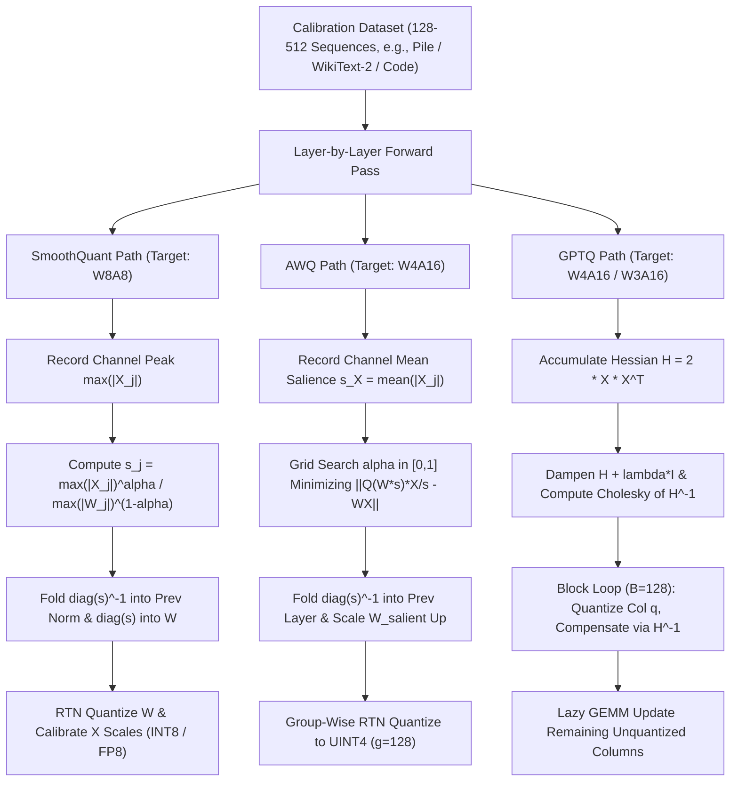
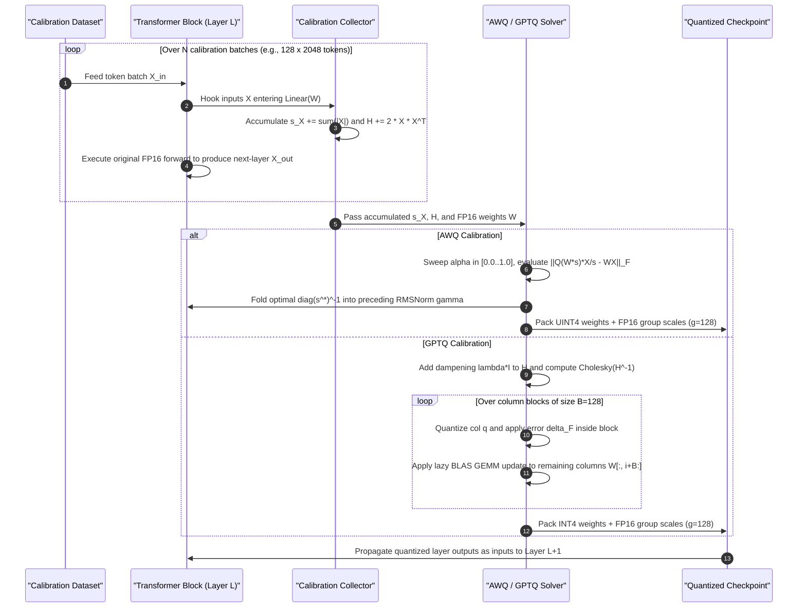

# 02 — Outliers & Calibration

[← 01 — Numerical Representation](./01-numerical-representation.md) · [Stage 6 Index](./README.md) · **Next:** [03 — Hardware Execution (W4A16 vs. W8A8) →](./03-hardware-execution-w4a16-vs-w8a8.md)

---

## 1. The Activation Outliers Phenomenon in Large Transformers

If Transformer weights and activations were clean, isotropic Gaussian tensors, naive round-to-nearest (`RTN`) quantization to `INT8` or `FP8` would preserve accuracy effortlessly. In reality, once autoregressive Transformers scale beyond **~6.7 billion parameters**, a sharp phase transition occurs in their internal hidden states—first characterized systematically by Dettmers et al. (`LLM.int8()`, 2022).

### 1.1 Anatomy of Emergent Feature Outliers

1. **Extreme Magnitude Disparity ($20\times\text{--}100\times$):** While the vast majority (>99.9%) of activation values in $X \in \mathbb{R}^{M \times K}$ fall within $[-3.0, +3.0]$, a tiny subset of **fixed hidden-dimension channels** (typically $\le 0.1\%$ of $K$, e.g., 4 to 20 specific indices out of $K = 4096$ or $8192$) consistently exhibit magnitudes of **$20$ to $100+$**.
2. **Channel-Systematic, Not Token-Random:** These outliers are **not** isolated spikes on single tokens. Once a model crosses the ~6.7B emergence threshold, the **exact same channel indices $j \in \mathcal{O}$** fire with high magnitude across **every token in the sequence** and across **most Transformer layers** (driven by residual stream accumulation through `LayerNorm`/`RMSNorm` and attention sink / variance-encoding mechanisms).
3. **Asymmetry Between Weights and Activations:**
   * **Weights $W$** are regular, smooth, and well-behaved across channels (rarely exceeding $\pm 0.5$ to $\pm 2.0$), making `INT8` or `FP8` weight quantization straightforward.
   * **Activations $X$** exhibit severe **inter-channel variance** (up to $100\times$ across columns $k$), while remaining relatively uniform within any given channel $k$ across tokens $m$.

### 1.2 Why Outliers Break Standard Activation Quantization

Consider **per-token dynamic `INT8` quantization** on a single token row $x_m \in \mathbb{R}^{K}$ where channel $j^* = 1024$ has value $x_{m, 1024} = 64.0$ and all other 4095 channels lie in $[-1.0, +1.0]$:

$$s_x[m] = \frac{\max_k |x_{m, k}|}{127} = \frac{64.0}{127} \approx 0.504$$

Every normal channel with $|x_{m, k}| < 0.252$ rounds identically to **`0`**, and the remaining normal values in $[-1.0, +1.0]$ are compressed into just **5 integer levels** (`{-2, -1, 0, +1, +2}`)—an effective precision of **~2.3 bits**!

```text
Channel Index k:      0       1       2   ...   1024 (Outlier)  ...  4095
True Activation x: [ 0.21,  -0.48,   0.11, ... ,   64.00,       ..., -0.35 ]
Per-Token Scale s:  64.0 / 127 = 0.5039
Quantized INT8 q:  [   0,     -1,      0,  ... ,    127,        ...,   -1  ]
Dequantized x_hat: [ 0.00,  -0.50,   0.00, ... ,   64.00,       ..., -0.50 ] -> Normal features obliterated!
```

* **Why per-channel activation scaling ($s_x[k]$) cannot be used directly in GEMM:** Because $k$ is the **reduction dimension** of $Y_{mn} = \sum_{k=1}^K X_{mk} W_{kn}$, a scale $s_x[k]$ depending on $k$ cannot be factored outside the Tensor Core `IMMA`/`FP8` dot product without dequantizing inside the inner loop (unless using fine-grained hardware block scaling like `MXFP8` at $k=32$).
* **Why `LLM.int8()` mixed-precision decomposition is too slow:** Splitting $X$ and $W$ into `FP16` outlier columns ($\mathcal{O}$) and `INT8` normal columns ($[K] \setminus \mathcal{O}$) requires scattered indexing, two separate GEMMs, and synchronization, making `LLM.int8()` **slower than pure `FP16`** on modern GPUs.

To keep **pure, dense, fast integer/FP8/INT4 GEMMs**, calibration algorithms transform the weights and scales offline using a small calibration dataset (typically 128–512 sequences from Pile/C4/WikiText-2).

---

## 2. SmoothQuant: Migrating Difficulty from Activations to Weights

Introduced by Xiao et al. (2023), **SmoothQuant** solves the `W8A8` activation outlier bottleneck with **zero runtime mixed-precision overhead** by observing that activations are hard to quantize across channels while weights are easy to quantize across those same channels.

### 2.1 Mathematical Equivalence via Diagonal Scaling Migration

For any linear projection $Y = X W$ ($X \in \mathbb{R}^{M \times K}, W \in \mathbb{R}^{K \times N}$), introduce an arbitrary positive per-channel smoothing vector $s \in \mathbb{R}_{>0}^{K}$:

$$Y = X W = \left( X \, \text{diag}(s)^{-1} \right) \cdot \left( \text{diag}(s) \, W \right) = \widehat{X} \, \widehat{W}$$

Dividing column $j$ of $X$ by $s_j$ shrinks the outlier activation channel $j$ into the normal range, while multiplying row $j$ of $W$ by $s_j$ increases the magnitude of the corresponding input-channel weight row—**migrating the quantization difficulty from $X$ into $W$**.

### 2.2 Balancing Factor $\alpha$

How large should $s_j$ be?
* If $s_j$ is too small, $\widehat{X}_{:, j}$ still has outliers.
* If $s_j$ is too large, $\widehat{W}_{j, :}$ develops weight outliers that degrade per-tensor/per-channel weight quantization.

SmoothQuant defines the optimal migration strength using a hyperparameter $\alpha \in [0, 1]$ calibrated from per-channel activation maxima over a calibration set:

$$s_j = \frac{\left( \max(|X_{:, j}|) \right)^{\alpha}}{\left( \max(|W_{j, :}|) \right)^{1 - \alpha}}$$

* **$\alpha = 0.5$** (default for OPT, BLOOM, LLaMA-1/2): Splits dynamic range difficulty evenly so $\max(|\widehat{X}_{:, j}|)$ and $\max(|\widehat{W}_{j, :}|)$ have balanced scale.
* **$\alpha \in [0.75, 0.85]$** (e.g., GLM-130B or models with extreme activation spikes): Shifts more dynamic range into weights, which tolerate higher variance better when quantized per-channel.

### 2.3 Offline Weight Folding & Runtime Fusion

Where does $\text{diag}(s)^{-1}$ execute during inference?
1. **Attention `QKV` and MLP `Gate/Up` projections:** These layers are immediately preceded by `LayerNorm` or `RMSNorm`:
   $$\text{Norm}(x) = \frac{x - \mu}{\sigma} \odot \gamma + \beta$$
   We fuse $\text{diag}(s)^{-1}$ directly into the normalization affine parameters offline:
   $$\gamma' = \gamma \oslash s, \qquad \beta' = \beta \oslash s$$
   Result: **literally zero extra FLOPs or memory reads at runtime!**
2. **Attention `Out_proj` and MLP `Down_proj`:** No normalization layer sits between `V` $\to$ `O_proj` or `SwiGLU` $\to$ `Down_proj`. Here, either:
   * $s^{-1}$ is fused into the preceding `V_proj` / `Up_proj` output weights (for linear paths like `V` $\to$ `O_proj` across heads), OR
   * For non-linear activations (`SwiGLU`), a lightweight elementwise multiplication by $s^{-1}$ is fused into the SiLU/quantization epilogue kernel before `Down_proj`.

### 2.4 Failure Modes of SmoothQuant

* **Sub-4-bit collapse:** Migrating an $80\times$ activation outlier into weights forces weight rows up by $\sim 9\times\text{--}30\times$. In `INT8` (255 levels), weights absorb this easily; in `INT4` (15 levels), scaling up one row ruins precision for the rest of the tensor unless group-wise scaling is used.
* **Calibration-set peak sensitivity:** Because $s_j$ uses $\max(|X_{:, j}|)$, a misrepresentative calibration set (e.g., short dummy prompts missing code or multilingual tokens) underestimates $s_j$ for certain channels, causing runtime clipping.

---

## 3. AWQ: Activation-Aware Weight Quantization

Whereas SmoothQuant targets `W8A8` (quantizing both weights and activations), **AWQ** (Lin et al., 2023) targets **`W4A16`** (4-bit weights, 16-bit activations).

### 3.1 Core Insight: Weight Salience Lives in the Activations

In `W4A16`, activations stay in `FP16`/`BF16`, so activation outliers do **not** suffer quantization clipping. Yet uniform `RTN` `INT4` quantization of weights still degrades perplexity heavily. Why?

Consider one term of the dot product $y = \sum_{j=1}^K x_j w_j$. A weight rounding error $\Delta w_j = \hat{w}_j - w_j$ is amplified linearly by the **input activation magnitude** $|x_j|$:

$$|\hat{y} - y| = \left| \sum_{j=1}^K x_j (\hat{w}_j - w_j) \right|$$

If channel $j^*$ has $|x_{j^*}| = 40.0$ while normal channels have $|x_j| = 0.4$, a small rounding error in $w_{j^*}$ causes **$100\times$ larger output perturbation** than the same error in $w_j$! Empirically, protecting just the **top 0.1%–1% salient weight channels** (selected by average activation magnitude $\frac{1}{M}\sum_m |X_{m, j}|$, *not* weight magnitude $|W_{j,:}|$) recovers nearly full `FP16` accuracy.

### 3.2 Protecting Salient Weights Without Mixed Precision

Keeping 1% of weight columns in `FP16` and 99% in `INT4` creates irregular sparse-dense hardware layouts that stall GPU warps. AWQ eliminates mixed precision using **equivalent per-channel scaling** $s_j \ge 1$ on weights, derived via error analysis:

Let a weight group $w$ have group scale $\Delta = \frac{\max(|w|)}{2^{b-1}-1}$ (symmetric) or range/15 (asymmetric), and quantization error $\text{Err}(Q(w)) = \Delta \cdot \text{RoundErr}(w/\Delta)$, where $|\text{RoundErr}(\cdot)| \le 0.5$. Now scale salient channel $j$ up by $s_j > 1$ before quantizing, and divide activation $x_j$ by $s_j$:

$$Q(w_j \cdot s_j) \cdot \frac{x_j}{s_j} = \Delta' \cdot \left( \frac{w_j s_j}{\Delta'} + \text{RoundErr}\!\left(\frac{w_j s_j}{\Delta'}\right) \right) \cdot \frac{x_j}{s_j}$$

Assuming $w_j s_j$ does not become the dominant maximum of the entire group (or increases $\Delta' \approx \Delta$ moderately while reducing the relative step on channel $j$):

$$\text{Output Error on Channel } j = \left( \frac{\Delta'}{\Delta} \cdot \frac{1}{s_j} \right) \cdot \Delta \cdot \text{RoundErr}(\cdot) \cdot x_j$$

As long as $\Delta' / \Delta < s_j$, scaling up salient channel $j$ shrinks its output reconstruction error by up to **$1/s_j$**! However, making $s_j$ arbitrarily large inflates the group scale $\Delta'$ and harms all *non-salient* channels in the same group.

### 3.3 Grid-Search Calibration Objective

AWQ solves this trade-off cleanly without backpropagation or Hessian inversion. For each layer/block:
1. Compute per-channel mean activation magnitude vector $\mathbf{s}_X \in \mathbb{R}^K$, where $s_{X, j} = \frac{1}{M}\sum_{m=1}^{M} |X_{m, j}|$.
2. Parameterize candidate scale vector as $\mathbf{s} = \mathbf{s}_X^{\alpha}$ with $\alpha \in [0, 1]$ searched over a fast 20-point grid ($\alpha \in \{0.00, 0.05, \dots, 1.00\}$):
   $$\alpha^* = \arg\min_{\alpha \in [0, 1]} \left\| Q\!\left(W \cdot \text{diag}(\mathbf{s}_X^\alpha)\right) \left(\text{diag}(\mathbf{s}_X^\alpha)^{-1} X\right) - W X \right\|_F$$
3. Fold $\text{diag}(\mathbf{s}^*)^{-1}$ into the preceding `LayerNorm`/`RMSNorm` or preceding linear layer (or store as an `FP16` pre-scale vector if adjacent to a non-linear activation).

**Why AWQ Generalizes Exceptionally Well:** Because AWQ relies only on the **first-order average magnitude** $\mathbf{s}_X$ and searches a single scalar $\alpha$ per layer, it cannot overfit weights to the calibration text—making AWQ remarkably robust on out-of-distribution domains (code, multilingual, reasoning) even with just 128 calibration sequences.

---

## 4. GPTQ: Second-Order Optimal Brain Quantization

While AWQ optimizes a diagonal channel scale before rounding, **GPTQ** (Frantar et al., 2023) modifies the **quantized integer values themselves**, using second-order curvature to compensate quantization error in one weight by adjusting *subsequent unquantized weights* in the same row.

### 4.1 Layer-Wise Reconstruction & Hessian Derivation

Consider a single linear layer $W \in \mathbb{R}^{K \times N}$ (note: in row-major notation per output neuron $w \in \mathbb{R}^K$, we quantize each row independently; here $X \in \mathbb{R}^{K \times M}$ denotes stacked calibration inputs):

$$\min_{\widehat{W}} \| W X - \widehat{W} X \|_2^2 = \sum_{n=1}^{N} \| w_n^\top X - \hat{w}_n^\top X \|_2^2$$

Taking a second-order Taylor expansion of the loss $L(w) = \| w^\top X - \hat{w}^\top X \|_2^2$ around the unquantized optimal $w$ (where gradient $\nabla L(w) = 0$):

$$\delta L \approx \frac{1}{2} \delta w^\top H \, \delta w, \qquad \text{where } H = 2 X X^\top \in \mathbb{R}^{K \times K}$$

Crucially, **$H = 2 X X^\top$ depends only on the layer inputs $X$ and is shared identically across all $N$ output channels** of that linear layer!

### 4.2 Optimal Brain Quantization (OBQ) Update Formula

Suppose we quantize weight index $q$ from $w_q$ to $\text{quant}(w_q)$, introducing constraint $\delta w_q = \text{quant}(w_q) - w_q$. Solving the constrained quadratic minimization $\min_{\delta w} \frac{1}{2}\delta w^\top H \delta w \text{ s.t. } e_q^\top \delta w = \text{quant}(w_q) - w_q$ via Lagrange multipliers yields the exact minimum loss increase and optimal compensating update $\delta_F$ for all remaining unquantized weights:

$$\Delta L_q = \frac{\left(\text{quant}(w_q) - w_q\right)^2}{2 [H^{-1}]_{qq}}, \qquad \delta_F = - \frac{w_q - \text{quant}(w_q)}{[H^{-1}]_{qq}} \cdot H^{-1}_{:, q}$$

In words: if quantizing $w_q$ rounds it *up* by $+0.02$, GPTQ adjusts the remaining unquantized weights $w_{j > q}$ along column $q$ of $H^{-1}$ so that correlated input features cancel out the $+0.02 \cdot x_q$ perturbation in the final output $Y$!

### 4.3 Three Breakthroughs That Scaled OBQ to 175B Models

Classic OBQ took hours for a small ResNet because it greedily picked a *different* optimal weight order $q$ for every single row $n$, forcing $O(N \cdot K^3)$ separate Hessian inversions ($O(d_{\text{row}} \cdot d_{\text{col}}^3)$). GPTQ makes this $O(K^3 + N K^2)$ (minutes/hours for 70B–175B models) through three insights:

1. **Arbitrary Fixed Column Order:** For large $K$ (4096+), greedy per-row ordering yields negligible accuracy gain over quantizing columns in a **single shared order** across all $N$ rows simultaneously. Because all rows share the exact same $H^{-1}$ sequence, updates vectorize across all $N$ rows at once!
2. **Lazy Batch-Updates ($B = 128$):** Updating the entire remaining matrix $W_{:, q+1:}$ on every single column $q$ is severely HBM-bandwidth-bound. GPTQ partitions columns into blocks of $B = 128$:
   * Inside block $[i, i+B)$, apply error compensation immediately to columns within the block using the Cholesky factor of $H^{-1}$.
   * Accumulate the normalized errors $E = (W_{\text{block}} - Q_{\text{block}}) / \text{diag}(H^{-1}_{\text{block}})$ and update **all remaining columns** $W_{:, i+B:}$ with a **single dense matrix multiply (BLAS `GEMM`)** at the end of the 128-column block:
     $$W_{:, i+B:} \leftarrow W_{:, i+B:} - E \cdot H^{-1}_{i:i+B, \, i+B:}$$
3. **Cholesky Decomposition with Dampening:** Repeated rank-1 Gaussian elimination of $H^{-1}$ accumulates floating-point rounding drift that can flip eigenvalues negative and explode weight updates. GPTQ stabilizes $H$ by adding **dampening** proportional to average diagonal energy (typically $p = 0.01$):
   $$H_{\text{damp}} = H + \lambda I, \qquad \lambda = p \cdot \frac{\text{Tr}(H)}{K}$$
   and precomputing the upper-triangular Cholesky factor $L = \text{cholesky}(H_{\text{damp}}^{-1})^\top$ in a single pass, completely avoiding iterative matrix inversions.

### 4.4 `actorder` (`desc_act`) Trade-Off

Enabling `desc_act=True` sorts columns in **descending order of $\text{diag}(H)$** (largest input activation energy quantized first, while all remaining columns are still available to compensate!). This consistently improves `INT4` perplexity, especially on `g=128` or per-channel models, **but creates a major runtime penalty**: because group-wise scale indices now follow permuted column order rather than contiguous $K$-order, naive `W4A16` kernels must perform non-coalesced activation gathers (`X[:, perm]`), slowing decode by 15%–40% unless repacked carefully (e.g., Marlin's `g_idx` shuffle support).

---

## 5. Head-to-Head Comparison: SmoothQuant vs. AWQ vs. GPTQ

| Dimension | **SmoothQuant** | **AWQ** | **GPTQ** |
| :--- | :--- | :--- | :--- |
| **Target Regime** | **`W8A8`** (`INT8`/`FP8` prefill & large-batch) | **`W4A16`** (`INT4`/`UINT4` memory-bound decode) | **`W4A16`** / `W3A16` / `W2A16` |
| **Core Mechanism** | Diagonal scale migration $s = \frac{\max(\|X\|)^\alpha}{\max(\|W\|)^{1-\alpha}}$ | Activation-salience protection $\mathbf{s} = \mathbf{s}_X^\alpha$ + grid search | Second-order Hessian error compensation $\delta_F \propto H^{-1}_{:,q}$ |
| **Modifies Quantized Grid Values?** | No (scales $X$ and $W$ equivalently, then RTN) | No (scales $X$ and $W$ equivalently, then RTN) | **Yes** (actively shifts unquantized weights) |
| **Calibration Statistic** | Channel maxima $\max(\|X_j\|)$ | Channel mean abs $\text{mean}(\|X_j\|)$ | Second-order input covariance $H = 2XX^\top$ |
| **Calibration Compute Cost** | Seconds–Minutes (forward pass only) | Minutes (forward pass + 20-pt $\alpha$ grid) | Tens of minutes–Hours (Cholesky + block updates) |
| **Overfitting Risk to Calibration Set** | Low (sensitive mainly to peak outliers) | **Very Low** (only 1 scalar $\alpha$/layer) | **Moderate** (can overfit $H$ on small/biased calibration sets) |
| **Runtime Kernel Impact** | Zero overhead if folded into Norm; requires W8A8 GEMM | Zero overhead if folded; uses standard Marlin/AWQ W4A16 | Standard Marlin W4A16 (`desc_act=False`); gather penalty if `desc_act=True` |

---

## 6. Calibration Pipelines & Execution Trace

### 6.1 Calibration Pipeline Comparison



### 6.2 Calibration Dataset Pass: Hessian / Activation Statistics & Weight Update



*(Note the crucial final step: sequential layer-by-layer calibration feeds the **quantized** output of Layer $L$ as the input $X$ to Layer $L+1$, allowing Layer $L+1$ to adapt to upstream quantization noise!)*

---

[← 01 — Numerical Representation](./01-numerical-representation.md) · [Stage 6 Index](./README.md) · **Next:** [03 — Hardware Execution (W4A16 vs. W8A8) →](./03-hardware-execution-w4a16-vs-w8a8.md)
