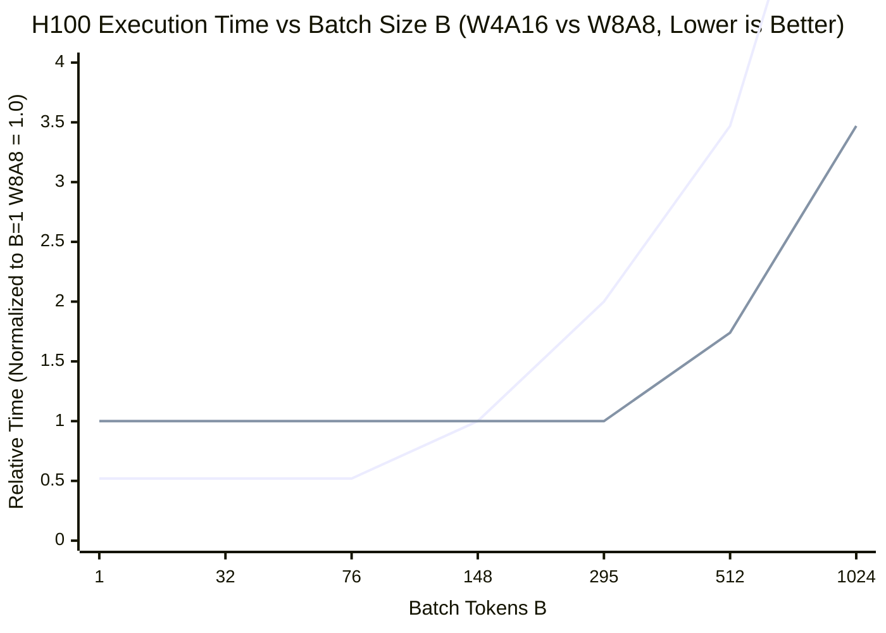
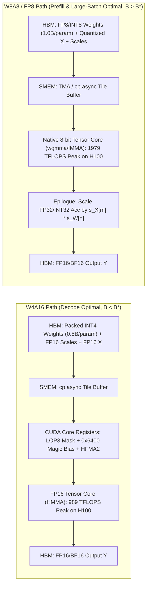
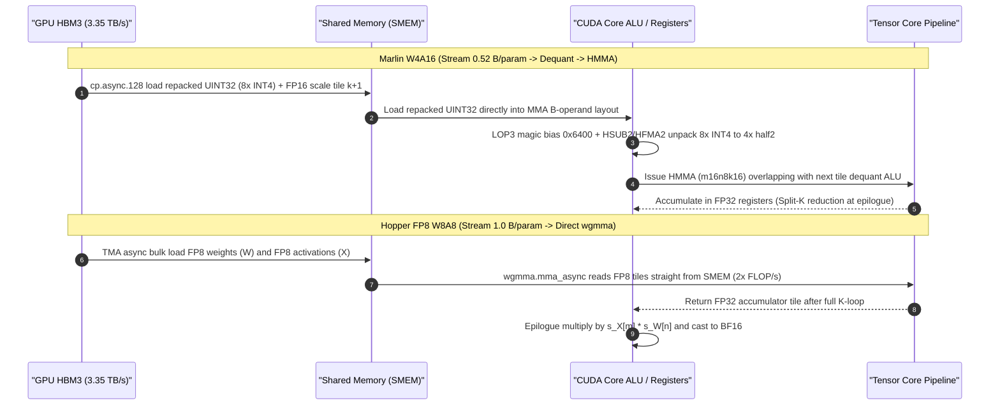

# 03 — Hardware Execution: `W4A16` vs. `W8A8`

[← 02 — Outliers & Calibration](./02-outliers-and-calibration.md) · [Stage 6 Index](./README.md) · **Next:** [04 — Sparsity & Pruning →](./04-sparsity-and-pruning.md)

---

Choosing between 4-bit and 8-bit quantization is not just an accuracy trade-off—it depends on whether the GPU is bottlenecked by moving model weights from memory or by doing math. This document derives the exact batch-size threshold where 8-bit native math overtakes 4-bit weight compression and explains how specialized GPU kernels execute both at near-hardware limits.

## Core Concepts & Terminology

Every technical term, numerical format, Roofline metric, and GPU kernel mechanism used in this document is defined below in dependency order:

1. **Inference Regimes & Serving Systems:**
   * **Prefill, Decode, & Continuous Batching:** Prefill processes all prompt tokens in parallel; decode generates one output token per step per active user. Continuous batching packs tokens from multiple concurrent requests into a single matrix-multiply batch of size $B$.
   * **`vLLM`, `SGLang`, `TensorRT-LLM`, `DeepSeek-V3`, & `MoE`:** Widely used LLM serving engines (`vLLM`, `SGLang`, `TensorRT-LLM`), and `DeepSeek-V3`, a frontier Mixture-of-Experts (`MoE`) model that routes tokens to specialized sub-networks.
   * **GEMM, Reduction Dimension ($K$), & Epilogue:** General Matrix Multiply ($Y = XW$ for $X \in \mathbb{R}^{B \times K}, W \in \mathbb{R}^{K \times N}$) summing along inner dimension $K$. The epilogue is the final step after the $K$-loop finishes where scales are applied and outputs are written.

2. **Precision Schemes & Quantization Operations:**
   * **`FP32`, `FP16`, `BF16`, `FP8` (`E4M3`), `INT8`, `INT4`, `UINT4`, `FP4`, `MXFP8`, & `MXFP4`:** 32-bit, 16-bit, 8-bit, and 4-bit floating-point and integer number formats (`MXFP8`/`MXFP4` use 32-element hardware block scales).
   * **`W4A16` vs. `W8A8`:** Weight/activation bit-width schemes (`W4A16` = 4-bit weights, 16-bit activations; `W8A8` = 8-bit weights, 8-bit activations).
   * **Group Size ($g=128$), Scale ($s_X, s_W$), Zero-Point ($z_w$), `RMSNorm`, & `SwiGLU`:** Group-wise scaling shares one scale/zero-point per $g$ weights along $K$; `RMSNorm` (normalization) and `SwiGLU` (gated MLP activation) are Transformer layers immediately preceding linear projections.
   * **Dequantization vs. Online Activation Quantization (Static vs. Dynamic):** Dequantization unpacks 4-bit weights to `FP16`/`BF16` before math; online activation quantization converts activations $X$ to 8-bit at runtime using either a pre-calibrated fixed scale (`static per-tensor`) or a scale computed per token row on-the-fly (`dynamic per-token`).

3. **GPU Architecture & Roofline Performance Model:**
   * **HBM Bandwidth ($BW$), L2 Cache, Shared Memory (`SMEM`), & Registers:** The GPU memory hierarchy from off-chip main memory (HBM/HBM3) to on-chip L2 cache, per-block `SMEM`, and per-thread registers.
   * **FLOPs, TFLOPS, TOPS, & Peak Compute ($P_{16}, P_8$):** Floating-point operations (FLOPs), trillions of FLOPs/sec (TFLOPS), and trillions of integer ops/sec (TOPS). $P_{16}$ and $P_8$ denote peak 16-bit and 8-bit Tensor Core throughput.
   * **Arithmetic Intensity ($I$), Ridge Point ($I_{\text{ridge}}$), & Roofline Model:** Arithmetic intensity is FLOPs per byte moved from HBM. The Ridge Point ($P/BW$) separates memory-bound execution from compute-bound execution; the Roofline model bounds kernel time by $\max(\text{Memory Time}, \text{Compute Time})$.
   * **Compute Knee ($B_{\text{knee}}$) & Crossover Batch Size ($B^*$):** $B_{\text{knee}}$ is the batch size where a kernel hits its compute ceiling; $B^*$ is the batch size where `W8A8` becomes faster than `W4A16`.
   * **NVIDIA A100, H100 (Hopper), & B200 (Blackwell):** Successive NVIDIA data-center GPU architectures.

4. **GPU Kernel & Low-Level Instruction Mechanics:**
   * **SM, Threadblock, Warp, Lane, & Occupancy:** A Streaming Multiprocessor (SM) is an independent GPU compute cluster (132 on H100); a threadblock runs on one SM; a warp is 32 threads (each thread is a "lane") executing in lockstep; occupancy measures how well active warps keep SMs busy.
   * **`cublasGemmEx` & Marlin Kernel:** `cublasGemmEx` is NVIDIA's standard matrix-multiply library call. Marlin is a fused `W4A16` kernel that dequantizes `INT4` weights inside registers without writing temporary `FP16` tensors to HBM.
   * **Tensor Core Fragments, `HMMA` (`m16n8k16`), `IMMA` (`m16n8k32`), & `wgmma`:** Hardware matrix-multiply instructions: `HMMA` (16-bit float), `IMMA` (8-bit integer), and `wgmma` (Hopper warp-group asynchronous MMA reading operands straight from `SMEM`).
   * **`LDG.E.128`, `ld.shared.v4.u32`, `shfl.sync` (`__shfl_xor_sync`), & Bank Conflicts:** 128-bit vectorized memory loads (`LDG`/`ld.shared`), intra-warp register shuffles (`shfl.sync`), and `SMEM` bank conflicts (access collisions that serialize threads).
   * **ALU, `I2F.F16.S32`, `LOP3.B32` Magic-Bias (`0x6400`), `HSUB2`, `HFMA2`, `half2`, & `ULP`:** CUDA-core arithmetic logic units (ALU); `I2F` is the slow integer-to-float instruction. `LOP3.B32` is a 3-input bitwise logic instruction that packs `INT4` nibbles into `FP16` (`1024.0 + q` via hex `0x6400`, where ULP = `1.0`), followed by 2-way packed `FP16` subtraction (`HSUB2`) and fused multiply-add (`HFMA2`) on `half2` registers.
   * **`cp.async` Double-Buffering, `TMA`, & Split-K:** Asynchronous HBM-to-`SMEM` copies (`cp.async` and Hopper's hardware `TMA` engine) that overlap data movement with math; Split-K partitions the $K$ dimension across multiple threadblocks so small batches saturate all SMs.
   * **`FP22` Internal Accumulation:** Hopper `FP8` Tensor Cores truncate intermediate dot-product mantissas to 14 bits (`FP22`) inside each step, requiring periodic `FP32` CUDA-core promotion on long reductions.

---

## 1. Two Regimes, Two Quantization Paradigms

A single quantization scheme cannot simultaneously optimize **low-batch decode** and **high-batch prefill**. To understand why, examine how a linear projection $Y = X W$ ($X \in \mathbb{R}^{B \times K}$, $W \in \mathbb{R}^{K \times N}$, where $B$ is the total tokens in the GEMM batch—either prompt tokens in prefill or concurrent requests in continuous-batching decode) maps onto GPU silicon:

* **`W4A16` (Weight-Only Quantization):** Weights are stored in HBM as 4-bit integers/floats (`INT4`/`UINT4`/`FP4`), streamed into on-chip registers, unpacked and dequantized **on-the-fly** to `FP16`/`BF16` using CUDA cores, and multiplied by `FP16`/`BF16` activations inside **16-bit Tensor Cores** (`HMMA`).
  * **Benefit:** Halves HBM weight traffic relative to 8-bit (`~0.5` B/param vs `1.0` B/param) and quadruples it relative to `FP16`.
  * **Ceiling:** Compute throughput remains capped at **`FP16` Tensor Core peak** (plus register dequantization ALU cycles).
* **`W8A8` (`FP8` / `INT8` Weight-Activation Quantization):** Both weights and activations are stored/quantized to 8-bit (`FP8 E4M3` or `INT8`) and fed directly into **native 8-bit Tensor Cores** (`IMMA` / `FP8 wgmma`), which deliver **2× the peak math FLOP/s** of `FP16` Tensor Cores.
  * **Benefit:** Doubles Tensor Core compute ceiling (ideal for compute-bound prefill and large-batch decode).
  * **Floor:** Reads **2× more weight bytes** from HBM than `W4A16` (`1.0` B/param vs `~0.516` B/param).

---

## 2. Roofline Derivation: Crossover Batch Size $B^*$

Let's derive from first principles the exact token batch size $B^*$ where `W8A8` overtakes `W4A16` on a modern data-center GPU.

### 2.1 Reference Hardware Specifications

| GPU Architecture | HBM Bandwidth ($BW$) | `FP16` Tensor Core Peak ($P_{16}$) | `FP8 / INT8` Tensor Core Peak ($P_8$) | `FP16` Ridge Point ($I_{\text{ridge}, 16} = P_{16}/BW$) | `FP8/INT8` Ridge Point ($I_{\text{ridge}, 8} = P_8/BW$) |
| :--- | :---: | :---: | :---: | :---: | :---: |
| **NVIDIA A100-80GB SXM** | $2.039\text{ TB/s}$ | $312\text{ TFLOPS}$ | $624\text{ TOPS}$ (`INT8`) | **$153.0\text{ FLOP/B}$** | **$306.0\text{ OP/B}$** |
| **NVIDIA H100 SXM5** | $3.350\text{ TB/s}$ | $989\text{ TFLOPS}$ | $1{,}979\text{ TFLOPS}$ (`FP8/INT8`) | **$295.2\text{ FLOP/B}$** | **$590.7\text{ FLOP/B}$** |
| **NVIDIA B200 SXM** | $8.000\text{ TB/s}$ | $2{,}250\text{ TFLOPS}$ | $4{,}500\text{ TFLOPS}$ (`FP8/INT8`) | **$281.3\text{ FLOP/B}$** | **$562.5\text{ FLOP/B}$** |

*(All Tensor Core numbers are dense non-sparse peaks; $P_8 = 2 P_{16}$.)*

### 2.2 Arithmetic Intensity & Execution Time Equations

For $Y = X W$ with $X \in \mathbb{R}^{B \times K}$ and $W \in \mathbb{R}^{K \times N}$ (matching PyTorch `torch.matmul(X, W)`), computing each of the $B \times N$ output elements requires $K$ multiplications and $K$ additions:

$$\text{Total FLOPs} = 2 B K N$$

To understand whether this matrix multiply is limited by HBM memory bandwidth or Tensor Core math speed, we count the exact HBM bytes transferred for each precision (assuming group size $g=128$ with `FP16` scales for `W4A16`, and `BF16` output $Y$ for both):

* **`W4A16` ($g=128$, symmetric `INT4`):**
  $$\text{Bytes}_{\text{W4A16}} = \underbrace{2 B K}_{X\text{ (FP16)}} + \underbrace{\left(0.5 + \frac{2}{128}\right) K N}_{W\text{ (0.5156 B/param)}} + \underbrace{2 B N}_{Y\text{ (FP16)}}$$
* **`W8A8` (`FP8` / `INT8`, per-token/per-channel scales):**
  $$\text{Bytes}_{\text{W8A8}} = \underbrace{1 B K}_{X\text{ (8-bit)}} + \underbrace{1.0 K N}_{W\text{ (8-bit)}} + \underbrace{2 B N}_{Y\text{ (FP16/BF16)}} + \underbrace{4(B + N)}_{\text{scales (negligible)}}$$

Under the standard Roofline model, the GPU overlaps memory transfers and arithmetic, so ideal kernel latency $T(B)$ is bounded by whichever bottleneck takes longer—HBM memory time or Tensor Core compute time (where the **Ridge Point** $I_{\text{ridge}} = P / BW$ is the exact FLOPs-per-byte ratio where both times are equal):

$$T_{\text{W4A16}}(B) = \max\!\left( \frac{\text{Bytes}_{\text{W4A16}}}{BW}, \; \frac{2 B K N}{P_{16}} \right), \qquad T_{\text{W8A8}}(B) = \max\!\left( \frac{\text{Bytes}_{\text{W8A8}}}{BW}, \; \frac{2 B K N}{P_{8}} \right)$$

### 2.3 Deriving the Exact Crossover $B^*$

First, look at the asymptotic regime where $B \ll K, N$ (typical LLM dimensions $K, N \in [4096, 28672]$, so $2BK$ and $2BN$ are tiny compared to $KN$ when $B < 500$):

1. **At $B = 1$ (Single-Request Decode):**
   Both kernels are strictly memory-bandwidth-bound:
   $$\frac{T_{\text{W8A8}}(1)}{T_{\text{W4A16}}(1)} \approx \frac{1.0 \, K N}{0.5156 \, K N} \approx \mathbf{1.94\times}$$
   **`W4A16` is nearly 2× faster than `W8A8`!**

2. **Compute Knee for `W4A16` ($B_{\text{knee, W4A16}}$):**
   `W4A16` transitions from memory-bound to compute-bound (`FP16` Tensor Core ceiling) when:
   $$\frac{2 B K N}{P_{16}} = \frac{0.5156 \, K N}{BW} \implies B_{\text{knee, W4A16}} = 0.2578 \cdot \frac{P_{16}}{BW} = 0.2578 \cdot I_{\text{ridge}, 16}$$
   * On **H100**: $B_{\text{knee, W4A16}} \approx 0.2578 \times 295.2 \approx \mathbf{76\text{ tokens}}$.
   * On **A100**: $B_{\text{knee, W4A16}} \approx 0.2578 \times 153.0 \approx \mathbf{39\text{ tokens}}$.

3. **Compute Knee for `W8A8` ($B_{\text{knee, W8A8}}$):**
   `W8A8` stays memory-bound much longer because it reads ~2× more weight bytes AND has 2× higher compute peak $P_8 = 2 P_{16}$:
   $$\frac{2 B K N}{2 P_{16}} = \frac{1.0 \, K N}{BW} \implies B_{\text{knee, W8A8}} = \frac{P_{16}}{BW} = I_{\text{ridge}, 16}$$
   * On **H100**: $B_{\text{knee, W8A8}} \approx \mathbf{295\text{ tokens}}$.
   * On **A100**: $B_{\text{knee, W8A8}} \approx \mathbf{153\text{ tokens}}$.

4. **The Crossover Batch Size $B^*$:**
   Between $B_{\text{knee, W4A16}}$ and $B_{\text{knee, W8A8}}$, `W4A16` latency is growing linearly ($\frac{2BKN}{P_{16}}$) while `W8A8` latency is still flat on the HBM ceiling ($\frac{1.0 KN}{BW}$). Equating them yields the exact crossover:
   $$\frac{2 B^* K N}{P_{16}} = \frac{1.0 \, K N}{BW} \implies \boxed{B^* = \frac{P_{16}}{2 \cdot BW} = \frac{1}{2} I_{\text{ridge}, 16}}$$

   Plugging in concrete hardware numbers (and refining with activation bytes $X, Y$ for $K = N = 8192$):
   * **Refined formula including $X, Y$ traffic:**
     $$\frac{2 B^* K N}{P_{16}} = \frac{K N + B^*(K + 2N)}{BW} \implies B^* = \frac{K N}{\frac{2 K N}{I_{\text{ridge}, 16}} - (K + 2N)}$$
   * **On NVIDIA H100 SXM5 ($I_{\text{ridge}, 16} = 295.2$):**
     * Idealized asymptotic: $B^* \approx \frac{295.2}{2} \approx \mathbf{148\text{ tokens}}$.
     * Refined ($K=N=8192$): $B^* \approx \mathbf{158\text{ tokens}}$.
     * Accounting for `W4A16` register-dequantization overhead (~10%–20% lower achieved `HMMA` utilization at medium $B$) and `FP8` dynamic quantization overhead: **empirical crossover on H100 typically falls around $B^* \in [96, 160]$ tokens**.
   * **On NVIDIA A100-80GB ($I_{\text{ridge}, 16} = 153.0$):**
     * Idealized asymptotic: $B^* \approx \frac{153.0}{2} \approx \mathbf{76\text{ tokens}}$.

5. **Beyond $B_{\text{knee, W8A8}}$ (Prefill & Large Batches, e.g., $B = 2048$):**
   Both kernels are strictly compute-bound:
   $$\frac{T_{\text{W4A16}}(B)}{T_{\text{W8A8}}(B)} = \frac{P_8}{P_{16}} = \mathbf{2.0\times}$$
   **`W8A8` is 2× faster than `W4A16`!**

### 2.4 Roofline Latency Comparison (`H100 SXM5`, $K=N=8192$)



*(Series 1 (rising earlier): `W4A16 (Marlin)` hits the `FP16` compute roof at $B \approx 76$. Series 2 (flat longer): `W8A8 (FP8)` stays memory-bound until $B \approx 295$. The curves cross at $B^* \approx 148$; beyond $B = 295$, `W8A8` maintains a permanent 2.0× speed advantage.)*

---

## 3. Inside `W4A16` Register Dequantization: The Marlin Kernel

A naive PyTorch implementation of `W4A16` (`w_fp16 = dequantize(w_int4); y = x @ w_fp16`) unpacks `INT4` weights into a temporary `FP16` tensor in HBM and then invokes `cublasGemmEx`. That is catastrophic for performance: writing $2KN$ bytes of unpacked weights to HBM and immediately reading $2KN$ bytes back **increases** total HBM traffic to $4.5\text{ B/param}$—more than twice the traffic of native `FP16`!

Production `W4A16` engines (`vLLM`, `SGLang`, `TensorRT-LLM`) eliminate that HBM round-trip using **fused register-dequantization kernels**, exemplified by **Marlin** (Frantar et al., 2024), which unpacks weights directly inside on-chip GPU registers and achieves near-ideal ~3.8×–3.9× speedup over `FP16` on small batches.

### 3.1 Four Architectural Pillars of Marlin

#### 1. Offline Weight Repacking into Tensor Core Fragment Layout
Standard row-major `INT4` weights force threads in a warp to unpack strided nibbles and shuffle values across lanes via shared memory before issuing `mma.sync.aligned.m16n8k16.row.col.f16`.
* **Marlin's solution:** Offline at model load time, Marlin permutes and interleaves every `16 × 64` weight tile into the **exact register-lane ownership order** required by NVIDIA's `m16n8k16` `HMMA` instruction!
* When a thread executes a vectorized `128-bit` global/shared load (`LDG.E.128` / `ld.shared.v4.u32`), the 32 `INT4` weights it receives are *already positioned* for its own `HMMA` `B`-matrix operand registers—**zero intra-warp shuffles (`shfl.sync`) and zero shared-memory bank conflicts**.

#### 2. Bitwise Register Unpacking Without `i2f` (`LOP3` Magic-Bias Trick)
Converting an `INT4` value $q \in [0, 15]$ to `FP16` using standard integer-to-float hardware instructions (`I2F.F16.S32`) stalls on the GPU's limited conversion pipeline. Instead, fast `W4A16` kernels (originating from Kim et al. / FasterTransformer / Marlin) exploit the **IEEE-754 `FP16` bit representation**:

Recall `FP16` has 1 sign bit, 5 exponent bits (bias = 15), and 10 mantissa bits. The number `1024.0` in `FP16` has exponent $15 + 10 = 25$ (`11001_2`) and zero mantissa: hex **`0x6400`**. Its ULP (value of the least significant mantissa bit) is exactly **$2^{10 - 10} = 1.0$**!

Therefore, placing any 4-bit integer $q \in [0, 15]$ directly into the lowest 4 bits of `0x6400` yields the exact `FP16` value $1024.0 + q$:
1. Extract 2 `UINT4` weights packed in a `uint32` into two 16-bit lanes of a `half2` register using **`LOP3.B32`** (single 3-input bitwise LUT instruction combining mask + OR with magic constant `0x64006400`):
   ```text
   // Input reg_u32 contains 8 packed 4-bit weights: [w7 w6 w5 w4 w3 w2 w1 w0]
   // Using LOP3 (a & 0x000F000F) | 0x64006400 produces two FP16 values: [1024 + w4, 1024 + w0]
   ```
2. Subtract `1024.0` (or `1024.0 + z_w` to fuse asymmetric zero-point removal for free!) via **`HSUB2`** (`sub.f16x2`), or directly fuse scale & zero-point in one **`HFMA2`**:
   $$\hat{w} = s_w \cdot (1024 + q) - s_w \cdot (1024 + z_w)$$
3. Unpack all 8 `INT4` weights per `uint32` into 4 `half2` registers (`8 × FP16`) in **~6–8 fast ALU/FMA instructions**—and crucially, execute these CUDA-core `LOP3`/`HFMA2` instructions **concurrently** while the Tensor Core pipeline executes the previous `HMMA` tile!

#### 3. Asynchronous `cp.async` Double-Buffering & Group Scale Prefetch
Using Ampere/Hopper asynchronous global-to-shared copies (`cp.async.ca.shared.global`), Marlin maintains a multi-stage circular buffer in Shared Memory (`SMEM`), overlapping HBM weight streaming of tile $t+2$, `SMEM` $\to$ register unpacking of tile $t+1$, and `HMMA` Tensor Core math of tile $t$.

#### 4. Global Split-K Reduction for Low-Batch Decode
At $B = 1 \dots 16$, a `4096 × 4096` GEMM only has $4096 / 64 = 64$ output $N$-tiles—too few threadblocks to saturate all `132` SMs on an H100! Marlin partitions the reduction dimension $K$ across multiple threadblocks (**Split-K**), allowing all 132 SMs to stream distinct $K$-slices of the weight matrix concurrently and perform a deterministic parallel reduction in L2/SMEM at the epilogue.

---

## 4. Native `W8A8` (`FP8` / `INT8`) Tensor Core Execution

When batch size $B > B^*$, native `W8A8` eliminates register dequantization entirely and unlocks **2× Tensor Core math throughput**.

### 4.1 Activation Quantization Fusion

Unlike weights (quantized offline), activations $X$ must be quantized to `FP8`/`INT8` **online** before entering the GEMM:
* **Static per-tensor (`FP8`/`INT8`):** Uses a fixed scale $s_X$ calibrated offline; the preceding RMSNorm/SwiGLU epilogue simply multiplies by $1/s_X$ and emits `FP8`/`INT8` directly to HBM. Zero extra kernel launches, zero reduction sync, slightly higher quantization error on outliers.
* **Dynamic per-token (`FP8`/`INT8`):** A fused RMSNorm/SwiGLU kernel computes $\max_k |x_{m, k}|$ across the hidden row in registers/warp-shuffle (`__shfl_xor_sync`), derives $s_X[m] = \max_k |x_{m,k}| / M_{\text{fmt}}$, quantizes the row, and writes both the 8-bit activation tensor and the `FP32` scale vector $s_X \in \mathbb{R}^M$ in a **single HBM pass**.

### 4.2 Tensor Core Instruction & Accumulator Precision Nuances

#### `INT8` (`IMMA` / `mma.sync.aligned.m16n8k32.s32.s8.s8.s32`)
* Multiplies `INT8 × INT8` natively and accumulates exact sums into **`INT32`** registers (zero rounding error during the $K$-reduction!).
* At the epilogue (after the full $K$-loop finishes), converts `INT32` $\to$ `FP32` and multiplies by the outer-product scale $s_X[m] \cdot s_W[n]$, casting to `BF16`/`FP16`.

#### `FP8` (Hopper `wgmma.mma_async.m64nNk32.f32.e4m3.e4m3` + TMA)
* Hopper's **Tensor Memory Accelerator (TMA)** copies 8-bit `FP8` tiles from HBM directly into Shared Memory asynchronously without burning register bandwidth.
* Warp-group MMA (`wgmma`) reads operands straight from `SMEM` (saving register file pressure!) and multiplies `E4M3 × E4M3` at **1979 TFLOPS** on H100.
* **Important Hopper Silicon Detail (`FP22` internal accumulation):** While the architectural output register of Hopper `FP8 wgmma` is `FP32`, NVIDIA's Hopper `FP8` Tensor Core internal dot-product accumulators actually truncate intermediate mantissas to **14 bits (`FP22`: 1 sign, 8 exp, 13+1 mantissa bits)** inside each 32-element MMA step. For standard per-tensor/per-channel `FP8`, this is benign; however, for sensitive long reductions or MoE layers (e.g., DeepSeek-V3), kernels periodically promote partial `FP8` accumulators out to **CUDA-core `FP32` registers** every $K_{\text{block}} = 128$ elements to perform exact `FP32` block-scale accumulation. (Blackwell 5th-Gen Tensor Cores fix this with full-precision `FP32` accumulation and native `MXFP8`/`MXFP4` block scaling.)

---

## 5. Execution Flowcharts & Kernel Timelines

### 5.1 `W4A16` Register Dequantization vs. `W8A8` Native Tensor Core MMA



### 5.2 Silicon Pipeline Timeline: Marlin `W4A16` vs. Hopper `FP8 W8A8`



---

[← 02 — Outliers & Calibration](./02-outliers-and-calibration.md) · [Stage 6 Index](./README.md) · **Next:** [04 — Sparsity & Pruning →](./04-sparsity-and-pruning.md)
