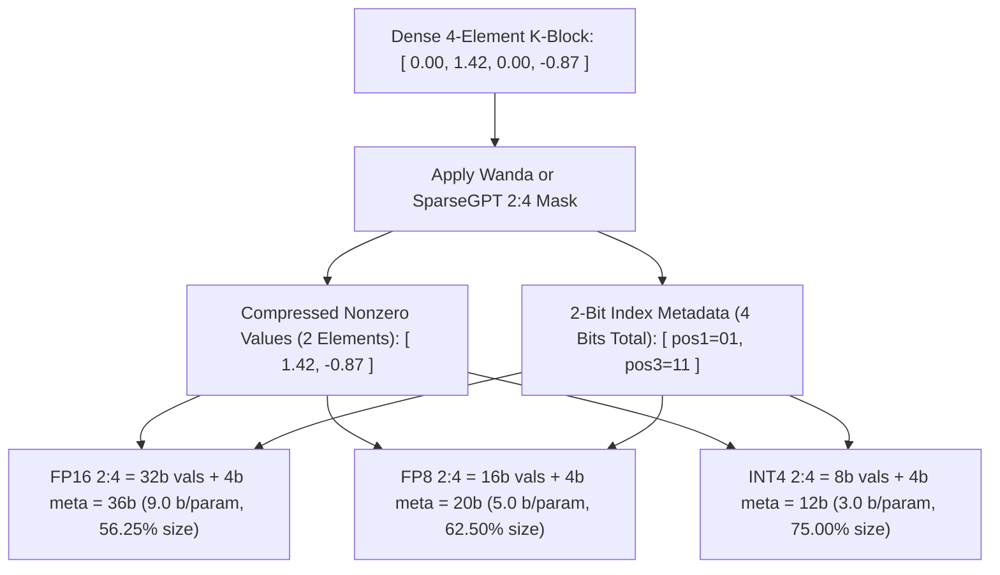
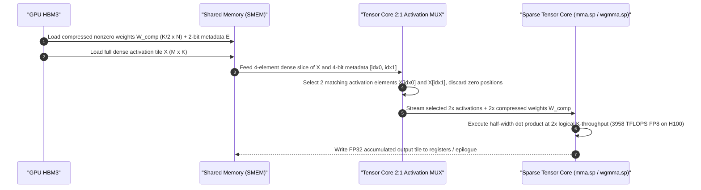

# 04 — Sparsity & Pruning

[← 03 — Hardware Execution (W4A16 vs. W8A8)](./03-hardware-execution-w4a16-vs-w8a8.md) · [Stage 6 Index](./README.md) · **Next:** [05 — Scientific Quality Evaluation →](./05-scientific-quality-evaluation.md)

---

Pruning shrinks a neural network by setting redundant weights to exact zero, but GPUs can only turn those zeros into real speedups when they follow a rigid, hardware-friendly pattern. This document explains how NVIDIA's `2:4` structured sparsity works in silicon, why it must be paired with quantization to speed up token generation, and how modern algorithms prune 70B-parameter models in minutes.

## Core Concepts & Terminology

Every technical term, hardware mechanism, numerical format, and pruning algorithm used in this document is defined below in dependency order:

1. **GPU Execution & Sparsity Taxonomy:**
   * **Pruning & Sparsity:** Pruning sets selected model weights $W \in \mathbb{R}^{K \times N}$ to exact `0.0`; sparsity is the fraction of zeroed entries.
   * **Warp, `SIMT`, & Warp Divergence:** A warp is 32 GPU threads executing the same instruction in lockstep (`SIMT`: Single Instruction, Multiple Threads). Warp divergence occurs when threads take different `if/else` branches, forcing serialized execution.
   * **Uncoalesced Reads & `CSR` / `CSC` / `COO`:** Uncoalesced reads occur when threads fetch scattered memory addresses. `CSR` (Compressed Sparse Row), `CSC` (Compressed Sparse Column), and `COO` (Coordinate list) are general sparse formats storing 16- to 32-bit coordinate indices per nonzero value.
   * **Coarse Structured Pruning:** Removing entire attention heads, MLP channels, or Transformer layers to produce a smaller dense matrix.
   * **Semi-Structured (`2:4`) Sparsity:** A hardware-enforced pattern where every contiguous 4-element block along the reduction dimension $K$ contains at most 2 nonzero values (at least 2 zeros).
   * **2-Bit Metadata Indices (`E`) & Nibble:** In `2:4` compression, each of the 2 surviving nonzeros in a 4-element block is tagged by a 2-bit position index (`00`, `01`, `10`, `11`), forming one 4-bit nibble per 4-element block.

2. **GPU Hardware, Memory, & Precision Formats:**
   * **HBM / HBM3, `SMEM`, Registers, & SM Occupancy:** Off-chip main GPU memory (HBM/HBM3), on-chip Shared Memory (`SMEM`), per-thread registers, and SM occupancy (how fully active warps keep Streaming Multiprocessors busy).
   * **MAC, FLOPs, TFLOPS, & ISA:** Multiply-Accumulate (`a * b + c`), floating-point operations (FLOPs), trillions of FLOPs/sec (TFLOPS), and Instruction Set Architecture (ISA, the GPU's native instruction set).
   * **Tensor Cores, Sparse Tensor Cores (`mma.sp.sync`, `wgmma.mma_async.sp`), `MUX`, & `cusparseLt`:** Hardware matrix-multiply units operating on fixed tiles. Sparse Tensor Cores (exposed via NVIDIA's `cusparseLt` library) use hardware 2:1 multiplexers (`MUX`) driven by the 2-bit metadata indices to skip zeroed activations and double logical $K$-throughput.
   * **`FP16`, `BF16`, `FP8`, `INT8`, `INT4`, `FP4`, `FP32`, `W4A16`, & `W8A8`:** 16-bit, 8-bit, 4-bit, and 32-bit numerical formats and weight/activation precision schemes (`W4A16` = 4-bit weights, 16-bit activations; `W8A8` = 8-bit weights, 8-bit activations).
   * **Prefill, Decode, TTFT, & `Marlin` / `Sparse-Marlin`:** Prefill processes prompt tokens in parallel (compute-bound, governing Time to First Token or `TTFT`); decode generates output tokens one step at a time (memory-bound). `Marlin` is a fast fused `W4A16` kernel; `Sparse-Marlin` extends it to `2:4` compressed `INT4` weights.

3. **Pruning & Recovery Algorithms:**
   * **Post-Training Pruning (PTP) vs. `LoRA` / `Sparse-QAT`:** PTP prunes a trained model in minutes/hours using ~128 calibration sequences without full retraining; `LoRA` (Low-Rank Adaptation) and `Sparse-QAT` (Sparse Quantization-Aware Training) perform lightweight recovery fine-tuning on surviving weights.
   * **Naive Magnitude Pruning, `RTN`, & Activation Outliers:** Zeroing the smallest $|W_{ij}|$ (like naive Round-to-Nearest `RTN` quantization) fails because tiny weights multiplied by huge activation outliers ($X_j$) still strongly affect outputs.
   * **`Wanda` & $\ell_2$ Norm ($\|X_j\|_2$):** A zero-update pruning method scoring each weight by $S_{j,n} = |W_{j,n}| \cdot \|X_j\|_2$, where $\|X_j\|_2$ is the Euclidean ($\ell_2$) norm of input channel $j$ across calibration tokens.
   * **`SparseGPT`, `OBS` (Optimal Brain Surgeon), `GPTQ`, Hessian ($H$), $H^{-1}$, & Cholesky Decomposition:** `SparseGPT` adapts OBS/GPTQ second-order curvature compensation (using a dampened input Hessian $H = 2XX^\top + \lambda I$, Cholesky-inverted $H^{-1}$, and lazy $B=128$ block updates) to analytically adjust surviving weights so they absorb the signal lost from zeroed weights—and can jointly prune and quantize.

---

## 1. Taxonomy of Sparsity on GPU Silicon

Pruning removes redundant parameters from weight matrices $W \in \mathbb{R}^{K \times N}$ by setting selected entries to exact zero (`0.0`). In PyTorch, zeroing out 50% of a tensor (`W[mask] = 0`) leaves `X @ W` running at the exact same speed because dense `matmul` kernels still load and multiply every zero. Switching to general sparse formats like `CSR` or `COO` helps on CPUs with branchy loops, but on massively parallel GPUs—where 32 threads in a warp execute in lockstep (`SIMT`) and Tensor Cores operate strictly on rigid matrix tiles (`16×8×16`, `64×N×32`)—irregular indices scatter memory reads and stall warps. Consequently, the **geometric structure** of zeros determines whether pruning speeds up inference or actually *slows it down*:

| Sparsity Type | Pattern Constraint | Storage Overhead | GPU Tensor Core Support? | Typical Inference Impact |
| :--- | :--- | :--- | :---: | :--- |
| **Unstructured Sparsity** | Arbitrary individual weights zeroed | High (`CSR`/`CSC`/`COO` indices: 16–32 bits per nonzero) | **No** | Slower than dense until >90%–95% sparsity (uncoalesced reads + warp divergence) |
| **Coarse Structured Pruning** | Entire attention heads, MLP channels, or Transformer layers removed | **Zero** (produces a smaller dense matrix) | **Yes** (standard dense Tensor Cores) | Immediate speedup, but severe accuracy drop above ~15%–25% pruning without retraining |
| **Semi-Structured (`2:4`) Sparsity** | At least **2 zeros in every contiguous 4-element block** along $K$ | **Low** (2 bits per stored nonzero = 4 bits per 4-element block) | **Yes** (NVIDIA Ampere / Hopper / Blackwell Sparse Tensor Cores) | **50% weight value reduction + 2× peak Tensor Core math FLOP/s** |

---

## 2. NVIDIA `2:4` Structured Sparsity: Silicon & Memory Mechanics

Introduced in NVIDIA Ampere (A100) and carried forward through Hopper (H100) and Blackwell (B200), **2:4 structured sparsity** enforces a strict hardware invariant along the reduction ($K$) dimension of a weight matrix (or operand $A$ in `cusparseLt` / `mma.sp` conventions):

> **2:4 Invariant:** Every contiguous vector of 4 elements along the reduction dimension $K$ contains **at most 2 nonzero values** (i.e., at least 2 zeros).

### 2.1 Compressed Storage Layout & Exact Bit-Budget Math

Suppose a 4-element group in $K$ is `[0.0, 1.42, 0.0, -0.87]`:
1. **Values Array (`W_compressed`):** Stores only the 2 nonzero elements contiguously: `[1.42, -0.87]`, reducing value storage by exactly **50%** (from $K \times N$ to $(K/2) \times N$).
2. **Metadata Index Array (`E`):** Must encode which 2 positions out of `{0, 1, 2, 3}` the two nonzeros came from. There are $\binom{4}{2} = 6$ valid combinations, each uniquely identified by **two 2-bit indices**:
   * In our example `[0.0, 1.42, 0.0, -0.87]`:
     * Nonzero #0 (`1.42`) is at position **`1` (`01_2`)**.
     * Nonzero #1 (`-0.87`) is at position **`3` (`11_2`)**.
   * Packed 4-bit metadata nibble for the group: **`[11 | 01]_2`**.
   * Notice that **2 bits per stored nonzero value** equals **4 bits per 4-element original block** = **1 bit per original parameter**.

#### Crucial Nuance: True Memory Savings Depend on Element Bit-Width!

A widespread misconception is that `2:4` sparsity cuts memory footprint by 50%. In reality, the fixed **4-bit metadata per 4-element block (1 bit/original param)** consumes an increasingly large fraction of total bytes as element precision drops:

| Base Format | Uncompressed 4-Element Block | Compressed Values (2 Nonzeros) | Metadata (2 × 2-bit) | Total Compressed Block | Effective Bits / Original Param | **True Size vs. Dense** |
| :--- | :---: | :---: | :---: | :---: | :---: | :---: |
| **`FP16 / BF16`** (16-bit) | $64\text{ bits}$ | $32\text{ bits}$ | $4\text{ bits}$ | **$36\text{ bits}$** | **$9.0\text{ bits}$** | **$56.25\%$** (43.75% saved) |
| **`FP8 / INT8`** (8-bit) | $32\text{ bits}$ | $16\text{ bits}$ | $4\text{ bits}$ | **$20\text{ bits}$** | **$5.0\text{ bits}$** | **$62.50\%$** (37.50% saved) |
| **`INT4 / FP4`** (4-bit) | $16\text{ bits}$ | $8\text{ bits}$ | $4\text{ bits}$ | **$12\text{ bits}$** | **$3.0\text{ bits}$** | **$75.00\%$** (25.00% saved) |

*(Note: For `INT4`, NVIDIA's Ampere/Hopper `mma.sp` hardware handles 4-bit metadata per 2-element pair or 4-bit group rules differently depending on ISA generation—e.g. Hopper `wgmma.sp` natively supports `FP16`/`BF16`/`FP8`/`INT8`, whereas `INT4` 2:4 kernels often unpack to `FP16`/`INT8` or use Blackwell `FP4` sparse instructions. Even in software-packed `INT4` 2:4, 4-bit values + 4-bit metadata per 4 weights yields $12 / 4 = 3.0$ bits/param minimum before scale factors!)*

### 2.2 How Sparse Tensor Cores Achieve 2× Compute Throughput

Inside a Sparse Tensor Core instruction (`mma.sp.sync` on Ampere/Ada, `wgmma.mma_async.sp` on Hopper), the hardware pairs a compressed weight matrix with a dense activation matrix without wasting multipliers on zeros:
1. The hardware loads the **compressed** weight operand ($K/2$ nonzero elements) alongside its **2-bit metadata indices**, and loads the **full dense** activation tile ($K$ elements) into on-chip memory.
2. Hardware **2:1 multiplexers** (`MUX`—fast digital selector switches) built directly into the Tensor Core datapath read each 2-bit index and route *only* the matching 2 activation elements from every 4-element slice of $X$ into the multipliers, discarding the 2 positions where the weight is zero.
3. Because each multiplier performs only **half the MAC operations** per unit silicon area, twice as many logical $K$-elements complete per clock cycle—doubling peak Tensor Core math throughput:
   * **H100 SXM5 `FP16` Sparse Peak:** $1{,}979\text{ TFLOPS}$ (vs. $989\text{ TFLOPS}$ dense).
   * **H100 SXM5 `FP8` Sparse Peak:** $3{,}958\text{ TFLOPS}$ (vs. $1{,}979\text{ TFLOPS}$ dense).

---

## 3. Post-Training Pruning Algorithms for LLMs

Traditional `2:4` pruning required expensive **Quantization/Pruning-Aware Retraining** (e.g., 50B+ tokens of fine-tuning). Modern post-training pruning (PTP) achieves `2:4` sparsity in **minutes to hours** on a single GPU using only 128 calibration sequences.

### 3.1 Why Naive Magnitude Pruning Fails

Pruning the smallest weights $|W_{ij}|$ within each 4-element group fails on LLMs for the exact same reason naive `RTN` quantization fails: **activation outliers**. A small weight $W_{ij} = 0.01$ multiplied by an outlier activation $X_j = 50.0$ contributes $|0.50|$ to the output, whereas a larger weight $W_{ik} = 0.10$ multiplied by $X_k = 0.1$ contributes only $|0.01|$.

### 3.2 `Wanda`: Pruning by Weights AND Activations

Introduced by Sun et al. (2023), **Wanda** requires **zero weight updates, zero Hessian inversions, and zero backpropagation**.

#### Importance Metric & Per-Row Comparison
Given weight matrix $W \in \mathbb{R}^{K \times N}$ (or $W_{\text{out} \times \text{in}}$) and calibration activations $X \in \mathbb{R}^{M \times K}$, compute the $\ell_2$ norm of each input feature channel $j$ across all $M$ calibration tokens:

$$\| X_j \|_2 = \sqrt{\sum_{m=1}^{M} X_{m, j}^2}$$

The Wanda importance score for weight $W_{j, n}$ (connecting input feature $j$ to output neuron $n$) is:

$$S_{j, n} = |W_{j, n}| \cdot \| X_j \|_2$$

For **2:4 structured pruning**, partition every row of output neuron $n$ into contiguous 4-element blocks along input dimension $j$, and **zero out the 2 weights with the lowest $S_{j, n}$ in every block of 4**!

* **Why it works:** $S_{j, n}$ directly measures the $\ell_2$ output perturbation caused by zeroing weight $W_{j, n}$ in isolation: $\| W_{j, n} X_j \|_2 = |W_{j, n}| \cdot \| X_j \|_2$.
* **Execution speed:** Computing $\|X_j\|_2$ takes a single calibration forward pass (~1–5 minutes for a 70B model).

### 3.3 `SparseGPT`: Second-Order Pruning + Error Compensation

Introduced by Frantar & Alistarh (2023), **SparseGPT** adapts the Optimal Brain Surgeon (OBS) / GPTQ Hessian framework to pruning: **when 2 weights in a 4-element group are forced to zero, the remaining 2 surviving weights (and later columns) are analytically adjusted to absorb the lost signal!**

#### Algorithm Mechanics
1. Accumulate the shared layer input Hessian $H = 2 X X^\top + \lambda I$ from calibration sequences and compute $H^{-1}$ via Cholesky decomposition.
2. Process columns in lazy blocks of $B = 128$ (just like GPTQ):
   * Compute the **OBS saliency score** for every weight in the block:
     $$\epsilon_{j, n} = \frac{W_{j, n}^2}{[H^{-1}]_{jj}}$$
     *(Note: $[H^{-1}]_{jj}$ captures both the input activation energy AND cross-channel correlations!)*
   * Within each 4-element $K$-group, select the 2 weights with the lowest $\epsilon_{j, n}$ to form the binary pruning mask $M_{j, n} = 0$.
   * For every pruned weight ($M_{j, n} = 0$), compute the pruning error $E_{j, n} = W_{j, n} - 0$ and update all **unpruned remaining weights** in the block and subsequent blocks via:
     $$\delta_F = -\frac{W_{j, n}}{[H^{-1}]_{jj}} \cdot H^{-1}_{:, j}$$
3. **Joint Sparsity + Quantization (`SparseGPT + INT4/FP8`):** During the same block loop, surviving nonzero weights (`M == 1`) are immediately quantized (`quant(W_{j, n})`), and the *combined* pruning + quantization error is compensated into all remaining columns simultaneously!

#### Wanda vs. SparseGPT Comparison

| Property | **Wanda (`2:4`)** | **SparseGPT (`2:4`)** |
| :--- | :--- | :--- |
| **Mathematical Basis** | First-order output norm $|W_{j,n}| \cdot \|X_j\|_2$ | Second-order Hessian $W_{j,n}^2 / [H^{-1}]_{jj}$ + OBS reconstruction |
| **Updates Surviving Weights?** | **No** (pure masking) | **Yes** (compensates pruned error into unmasked weights) |
| **Compute Cost (70B Model)** | ~2 minutes (no matrix inversion) | ~30–60 minutes (Cholesky + block GEMMs) |
| **Accuracy at 2:4 (7B–70B)** | Strong on large models (70B), noticeable gap on smaller 7B/8B models | **Strictly higher accuracy** on 2:4, especially for 7B–13B and joint 2:4 + INT4 |

---

## 4. Combining `2:4` Sparsity with `INT4`/`FP8` & The Decode Roofline Reality Check

A critical systems engineering question: **Does `2:4` sparsity accelerate LLM decode?**

### 4.1 Why `2:4` FP16 Sparsity Fails to Beat Dense `W4A16` in Decode

Consider batch-1 memory-bandwidth-bound decode on an H100 (`3.35 TB/s`):
* **Dense `FP16`**: Streams $16\text{ bits/param}$. Baseline `1.0×` decode speed.
* **`2:4 Sparse FP16`**: Streams $9\text{ bits/param}$ (`56.25%` of FP16) + uses 2× Sparse Tensor Core math. Since batch-1 decode is 100% HBM-bandwidth-bound, theoretical max speedup is only $16 / 9 = \mathbf{1.78\times}$ (empirically **~1.3×–1.5×** due to metadata loading and lower SM occupancy).
* **Dense `W4A16` (`Marlin`)**: Streams $4.125\text{ bits/param}$ (`25.8%` of FP16)! Theoretical speedup is $16 / 4.125 = \mathbf{3.88\times}$!

**Key takeaway:** For memory-bound decode, **`2:4 FP16` sparsity is >2× slower than dense `W4A16`**, while also losing more accuracy! `2:4` sparsity **only** makes sense for LLM inference when **stacked with quantization** or during **compute-bound prefill / massive-batch decode**:

### 4.2 Stacking `2:4` + `FP8`/`INT8` (`W8A8-2:4`) vs. `2:4` + `INT4` (`W4A16-2:4`)

1. **`W8A8-2:4` (`FP8` or `INT8` + `2:4` Sparse Tensor Cores):**
   * **HBM footprint:** $5.0\text{ bits/param}$ (62.5% of dense `FP8`, only slightly larger than dense `INT4`).
   * **Compute ceiling (H100):** **$3{,}958\text{ TFLOPS}$** (4× `FP16` dense, 2× `FP8` dense!).
   * **Sweet spot:** **Compute-bound prefill** and **very high-batch continuous serving** ($B > 300$), where `FP8 2:4` achieves up to ~1.6×–1.8× faster TTFT than dense `FP8` with minimal perplexity loss when calibrated via `SparseGPT` or `FP8` + light QAT recovery.
2. **`W4A16-2:4` (e.g., `Sparse-Marlin`: `INT4` + `2:4`):**
   * **HBM footprint:** $3.0\text{ bits/param}$ payload + $\sim 0.25$ bits/param group scales ($g=128$ across compressed $K/2$) $\approx \mathbf{3.25\text{ bits/param}}$—cutting HBM traffic by another **~21%–25%** below dense `W4A16`!
   * **Decode reality:** `Sparse-Marlin` unpacks `2:4` compressed `INT4` weights and 2-bit metadata in registers, using `FP16` Sparse Tensor Core `mma.sp` (or expanding in SMEM/registers) to achieve **~1.2×–1.35× faster batch-1 decode** than dense `Marlin W4A16` AND fitting larger models in tight VRAM.
   * **Accuracy caveat:** Dropping 50% of weights (`2:4`) *and* quantizing survivors to 4 bits compounds two non-linear error sources. On <13B models, `W4A16-2:4` post-training frequently causes sharp reasoning/coding degradation unless paired with `SparseGPT` joint compensation or lightweight post-pruning LoRA recovery (`Sparse-QAT`), or restricted to less sensitive MLP layers while keeping Attention dense.

---

## 5. `2:4` Compression Layout & Sparse Tensor Core Execution

### 5.1 `2:4` Compression Layout & Bit-Budget Comparison

### 5.2 Sparse Metadata Lookup & Compressed Tensor Core `mma.sp` Execution

---

[← 03 — Hardware Execution (W4A16 vs. W8A8)](./03-hardware-execution-w4a16-vs-w8a8.md) · [Stage 6 Index](./README.md) · **Next:** [05 — Scientific Quality Evaluation →](./05-scientific-quality-evaluation.md)
