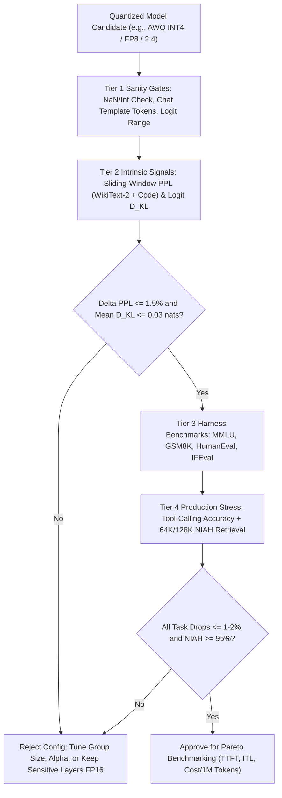
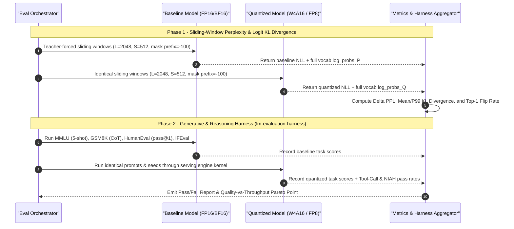

# 05 — Scientific Quality Evaluation

[← 04 — Sparsity & Pruning](./04-sparsity-and-pruning.md) · [Stage 6 Index](./README.md)

---

A compressed language model can still write fluent English while silently failing at math, code generation, tool calling, or long-context retrieval. Evaluating compression scientifically requires measuring both subtle probability shifts and concrete task accuracy against the uncompressed baseline.

## Core Concepts & Terminology

Every technical term, evaluation metric, benchmark suite, and model mechanism used in this document is defined below in dependency order:

1. **Model Formats, Architecture, & Inference Mechanisms:**
   * **`FP16`, `BF16`, `FP32`, `FP8`, `FP4`, `INT4`, `W4A16`, `W8A8`, & `2:4`:** Numerical precision formats (16-bit, 8-bit, 4-bit, 32-bit), weight/activation bit-width schemes (`W4A16`, `W8A8`), and `2:4` structured sparsity (50% hardware-patterned zeros).
   * **KV Cache, `Q`/`K`/`V` Projections, `RoPE`, & Attention Sink:** The KV Cache stores past Key and Value vectors; `Q`/`K`/`V` are Query, Key, and Value linear projections; `RoPE` (Rotary Position Embeddings) encodes token positions via vector rotations; attention sinks are early/anchor tokens that draw high attention mass.
   * **`GPTQ`, `AWQ`, `SmoothQuant`, Group Size, $\alpha$, & Hessian ($H$):** Post-training calibration algorithms, their hyperparameters (group size, smoothing $\alpha$), and calibration statistics ($s_X, H$).
   * **`SFT`, `RLHF`, `DPO`, & Chat Template Tokens (`<|start_header_id|>`, `<|eot_id|>`):** Post-training alignment methods—Supervised Fine-Tuning (`SFT`), Reinforcement Learning from Human Feedback (`RLHF`), and Direct Preference Optimization (`DPO`)—that rely on special chat-delimiter tokens.
   * **Grammar-Constrained Decoding (`FSM` / `XGrammar`):** Finite-State Machine (`FSM`) decoding engines (such as `XGrammar`) that mask invalid tokens at each step so outputs strictly match a JSON or API schema.
   * **Speculative Decoding:** An acceleration technique where a small draft model proposes multiple tokens that a larger target model verifies in parallel.
   * **Pareto Benchmarking (`TTFT`, `ITL`):** Mapping the trade-off frontier between model quality and serving speed—specifically Time to First Token (`TTFT`) and Inter-Token Latency (`ITL`).

2. **Probability, Loss, & Distributional Metrics:**
   * **Logits, `softmax`, `argmax`, `temperature`, `top_p`, & Beam Search:** Logits are raw, unnormalized scores over vocabulary $V$; `softmax` turns logits into probabilities. Greedy `argmax` picks the top token, whereas `temperature > 0` / `top_p` (nucleus) sampling and beam search depend on the full probability distribution.
   * **Negative Log-Likelihood (`NLL`), `CrossEntropyLoss` (`-100` mask), & Perplexity (`PPL`):** NLL is $-\log P(x_t \mid x_{<t})$; PyTorch's `CrossEntropyLoss` averages NLL while ignoring masked labels set to `-100`. Perplexity (`PPL`) is $\exp(\text{mean NLL})$ (lower is better).
   * **Sliding-Window Protocol (`max_length` $L$, `stride` $S$, Teacher Forcing):** Evaluating long text in overlapping windows of length $L$ advancing by $S$, masking prefix context so each token is scored once. Teacher forcing feeds ground-truth prefixes $x_{<t}$ rather than generated tokens.
   * **`WikiText-2`, `C4`, `PG-19`, & `The Stack`:** Standard evaluation corpora—Wikipedia prose (`WikiText-2`), web text (`C4`), long books (`PG-19`), and source code (`The Stack`).
   * **KL Divergence ($D_{\text{KL}}$), `nats`, `P99` $D_{\text{KL}}$, & Top-1 Flip Rate:** Kullback–Leibler divergence ($D_{\text{KL}}$) measures how much a quantized probability distribution $Q$ diverges from the `FP16` baseline $P$ (in `nats` for natural logs). `P99` is the 99th-percentile spike across tokens; Top-1 Flip Rate is how often $\arg\max P \neq \arg\max Q$.
   * **Total Variation Distance (`TVD`) & Pinsker's Inequality:** $\text{TVD}(P, Q) = \frac{1}{2}\sum_v |P(v)-Q(v)|$ governs speculative decoding acceptance and is bounded by $\sqrt{\frac{1}{2} D_{\text{KL}}(P \| Q)}$ via Pinsker's inequality.

3. **Downstream & Long-Context Benchmarks:**
   * **`lm-evaluation-harness` & `evalplus`:** Standard open-source LLM evaluation suites.
   * **`MMLU` (5-shot):** Massive Multitask Language Understanding—multiple-choice questions across 57 subjects scored by log-likelihood over `{A, B, C, D}` given 5 examples ("5-shot").
   * **`GSM8K` (CoT):** Grade School Math 8K—multi-step math problems scored via generative Chain-of-Thought (`CoT`) reasoning and exact numerical match.
   * **`HumanEval` / `MBPP` (`pass@1`):** Python coding benchmarks scored by running generated functions against unit tests (`pass@1` = solved on first attempt).
   * **`IFEval`:** Instruction-Following Evaluation—checks verifiable formatting rules (word limits, valid JSON, forbidden characters).
   * **Needle-in-a-Haystack (`NIAH`) & `RULER`:** Long-context retrieval tests that hide target facts ("needles") inside 32K–128K tokens of distractor text ("haystack").

---

## 1. Why Compression Evaluation Must Be Scientific, Not Anecdotal

Chatting with a quantized model for three prompts ("Write a haiku about GPUs") is **not** quality validation. Compression artifacts are insidious: a broken `INT4` or `FP8` checkpoint can write fluent English prose while silently failing on multi-step math, emitting malformed tool-call arguments, ignoring negative constraints, or losing needle retrieval past 16K tokens.

Rigorous inference engineering treats quantization as a controlled scientific experiment comparing a **Quantized Treatment ($Q$)** against the **Unquantized Reference ($P_{\text{fp16/bf16}}$)** across four orthogonal signal tiers:
1. **Intrinsic language modeling density:** Sliding-window **Perplexity (PPL)** on WikiText-2 / C4.
2. **Distributional fidelity:** Full-vocabulary **KL Divergence** ($D_{\text{KL}}$) on output logit distributions.
3. **Downstream capability suites (`lm-evaluation-harness`):** Knowledge (`MMLU`), arithmetic reasoning (`GSM8K`), syntax-strict coding (`HumanEval`), and constraint adherence (`IFEval`).
4. **Long-context & agentic stress tests:** Needle-in-a-Haystack (`NIAH`), `RULER`, and structured tool-calling accuracy.

---

## 2. Perplexity (PPL): Exact Mathematics & Sliding-Window Protocol

### 2.1 Definition

Given a tokenized sequence $X = (x_1, x_2, \dots, x_N)$ of length $N$, an autoregressive language model factorizes the sequence probability as $\prod_{t=1}^N P_\theta(x_t \mid x_{<t})$. **Perplexity** is the exponentiated average negative log-likelihood (cross-entropy) per token:

$$\text{PPL}(X) = \exp\!\left( -\frac{1}{N} \sum_{t=1}^{N} \log P_\theta(x_t \mid x_{<t}) \right)$$

Intuitively, $\text{PPL} = 5.60$ means the model is, on average, as uncertain as if it were choosing uniformly among $5.60$ equally likely next tokens. Lower is better.

### 2.2 Why Non-Overlapping Chunks Corrupt Perplexity (And How Sliding Windows Fix It)

Standard corpora like **WikiText-2 test split** (~280K–340K tokens concatenated) or **C4 validation slices** are far longer than a model's evaluation window $L$ (e.g. $L = 2048$ or $4096$). Two evaluation bugs invalidate comparisons:

* **Bug 1 — Non-overlapping chunks (`stride = L`):** Chopping the text into disjoint blocks $[0, L), [L, 2L), \dots$ forces the first tokens of every chunk (`t = 0, 1, 2, ...` inside the chunk) to be predicted with almost zero preceding context! That artificially inflates perplexity and introduces arbitrary boundary noise.
* **Bug 2 — Unmasked overlapping sliding windows:** If you advance a window of length $L$ by `stride` $S < L$ (e.g. $L = 2048, S = 512$) and average the loss over *all* $L$ tokens in every window, interior tokens get scored up to $L/S = 4\times$ while edge tokens get scored once—violating the mathematical definition of $\frac{1}{N}\sum_{t=1}^N$.

#### The Exact Sliding-Window Protocol (`stride = S`, Label Masking)

For every window starting at `begin_loc`, feed `input_ids[:, begin_loc : end_loc]` (up to length $L$) in a single teacher-forced forward pass, **mask the prefix context tokens (`target_ids[:, :-trg_len] = -100`)** so PyTorch's `nn.CrossEntropyLoss(ignore_index=-100)` excludes them from both the numerator and denominator, and accumulate the exact negative log-likelihood **only over the final `trg_len` newly revealed tokens** (ensuring every token in the corpus is scored once with at least $L - S$ tokens of preceding context):

```python
import math, torch

def compute_sliding_window_ppl(model, encodings, max_length=2048, stride=512):
    input_ids = encodings.input_ids  # shape: [1, seq_len]
    seq_len = input_ids.size(1)
    nlls = []
    total_eval_tokens = 0
    prev_end_loc = 0

    for begin_loc in range(0, seq_len, stride):
        end_loc = min(begin_loc + max_length, seq_len)
        trg_len = end_loc - prev_end_loc  # exact number of unseen tokens to score
        window_ids = input_ids[:, begin_loc:end_loc].to(model.device)
        target_ids = window_ids.clone()
        target_ids[:, :-trg_len] = -100  # mask context prefix from NLL loss

        with torch.no_grad():
            outputs = model(window_ids, labels=target_ids)
            # outputs.loss is mean NLL over non-(-100) tokens; note HF shifts logits by 1 internally
            num_valid = (target_ids[:, 1:] != -100).sum().item()
            nlls.append(outputs.loss.float() * num_valid)
            total_eval_tokens += num_valid

        prev_end_loc = end_loc
        if end_loc == seq_len:
            break

    return math.exp(torch.stack(nlls).sum().item() / total_eval_tokens)
```

**Critical Experimental Hygiene:**
* Always report `(dataset, split, max_length, stride, tokenizer)` together—comparing `WikiText-2 (L=2048, S=512)` against `L=4096, S=4096` is apples-to-oranges!
* **Beware calibration leakage:** If you calibrated GPTQ/AWQ on `WikiText-2 train` or `C4`, evaluate PPL on *both* `WikiText-2 test` AND an uncalibrated held-out domain (e.g., `PG-19` or `The Stack` code) to detect calibration overfitting!

---

## 3. KL Divergence on Output Logit Distributions

Even when WikiText-2 PPL shifts by only `+0.04` (e.g., `5.62` $\to$ `5.66`) and greedy `argmax` agrees on 97% of tokens, quantization can still severely warp the **probability mass distribution** over the vocabulary $V$ (e.g., $|V| = 128{,}256$ in Llama-3).

### 3.1 Exact Formulation

At each token position $t$, capture the full pre-softmax logits $z^{(P)}_t, z^{(Q)}_t \in \mathbb{R}^{|V|}$ from the `FP16` baseline and quantized model (using identical `FP16` teacher-forced input prefixes $x_{<t}$ so errors do not compound across steps during distributional comparison):

$$P(v \mid x_{<t}) = \text{softmax}(z^{(P)}_t)_v, \qquad Q(v \mid x_{<t}) = \text{softmax}(z^{(Q)}_t)_v$$

The **forward Kullback–Leibler (KL) Divergence** from baseline $P$ to quantized $Q$ measures the expected extra information (in `nats`) lost when approximating $P$ with $Q$:

$$D_{\text{KL}}\!\left(P_{\text{fp16}} \,\|\, Q_{\text{quant}}\right) = \sum_{v \in V} P_{\text{fp16}}(v \mid x_{<t}) \log \frac{P_{\text{fp16}}(v \mid x_{<t})}{Q_{\text{quant}}(v \mid x_{<t})}$$

In PyTorch, this is computed numerically stably in `FP32` via `F.kl_div(log_probs_Q, log_probs_P, log_target=True, reduction="batchmean")`, where both tensors are `F.log_softmax(logits.float(), dim=-1)` so tiny tail probabilities never underflow to `0.0` before taking logarithms.

### 3.2 What KL Divergence Catches That `argmax` & Aggregate PPL Miss

1. **Runner-Up Inversion & Sampling Collapse:** Suppose `FP16` assigns `[0.51, 0.45, 0.04]` to tokens `(A, B, C)`, and quantization shifts it to `[0.52, 0.10, 0.38]`. Greedy `argmax` still picks `A` (`0%` Top-1 flip!), and the probability of the true token `A` barely moved (`PPL` looks identical!). Yet `D_KL` immediately spikes because mass shifted catastrophically from `B` to `C`, ruining `temperature > 0` / `top_p` sampling, beam search, and logprob-based calibration.
2. **Speculative Decoding Acceptance Degradation:** In Stage 7 (Speculative Decoding), the acceptance probability of draft token $x$ is governed by Total Variation Distance $\text{TVD}(P, Q) = \frac{1}{2}\sum_v |P(v) - Q(v)|$ (bounded via Pinsker's inequality: $\text{TVD}(P, Q) \le \sqrt{\frac{1}{2} D_{\text{KL}}(P \| Q)}$). If a quantized draft or target shifts distributions even slightly, `D_KL` predicts the drop in token acceptance rate $\alpha$ before running full serving benchmarks.
3. **Top-1 Flip Rate & Softmax Temperature Sensitivity:** Pair `mean D_KL` with **Top-1 Flip Rate** ($\mathbb{P}[\arg\max P \neq \arg\max Q]$) and **99th-percentile (P99) $D_{\text{KL}}$** across tokens. Often mean $D_{\text{KL}}$ is small (`0.015 nats`), while P99 $D_{\text{KL}}$ spikes to `1.8 nats` specifically on numeric digits, JSON syntax tokens, or attention-sink positions!

---

## 4. Downstream Reasoning, Coding & Instruction Suites (`lm-evaluation-harness`)

Open-source evaluation standards (primarily EleutherAI's `lm-evaluation-harness` and `evalplus`) measure concrete task accuracy across distinct cognitive modes of the Transformer:

| Benchmark | Task Category | Scoring Mechanism | Why Quantization Breaks It |
| :--- | :--- | :--- | :--- |
| **`MMLU`** (5-shot) | Broad factual & STEM knowledge (57 subjects) | **Log-likelihood** over choices `{A, B, C, D}` (or generative CoT) | Sensitive to probability margin narrowing between top-2 multiple-choice letters (`log P(A) - log P(B)`). |
| **`GSM8K`** (5-shot / 8-shot CoT) | Grade-school multi-step math reasoning | **Generative** greedy decode + regex exact numerical match | **Autoregressive error compounding:** a single quantized digit flip in Step 2 of Chain-of-Thought invalidates the final answer even if PPL is flat! |
| **`HumanEval` / `MBPP`** | Python function synthesis | **Generative** + sandboxed unit-test execution (`pass@1`) | **Zero syntax tolerance:** 1 wrong indentation space, missing colon, or flipped variable name causes `0%` pass on that problem. |
| **`IFEval`** | Verifiable Instruction Following | **Generative** + deterministic programmatic constraint checkers | Tests rigid structural constraints ("respond in valid JSON", "use <= 300 words", "no letter 'e'")—heavily degraded by aggressive `<4-bit` or poorly calibrated `W8A8`. |

### Critical Evaluation Pitfall: Log-Likelihood vs. Generative Scoring

In `lm-evaluation-harness`, standard `MMLU` evaluates only **1 forward pass** to compare the log-probabilities of tokens `A, B, C, D`—it never generates multi-token chains! Consequently, a quantized model with broken autoregressive KV Cache quantization or late-layer drift can still score within `0.5%` of `FP16` on log-likelihood `MMLU` while crashing by **`-8%` to `-20%` on generative `GSM8K`, `HumanEval`, and `IFEval`**! Always include **generative** benchmarks in your gate.

---

## 5. Why Perplexity Alone Masks Catastrophic Failures

Consider an industry reality observed repeatedly when deploying `W4A16`, `FP8`, or `2:4` models: **WikiText-2 PPL increases by less than 1% (e.g., `5.12 -> 5.17`), yet production error rates skyrocket.** Four specific mechanisms explain why PPL is blind to catastrophic failures:

### 5.1 Instruction-Following & Formatting Collapse
WikiText-2 consists of Wikipedia prose, where natural continuation syntax is forgiving and redundant. Instruction tuning (`SFT` / `RLHF` / `DPO`) concentrates alignment behavior in delicate, high-precision decision boundaries across chat template special tokens (`<|start_header_id|>`, `<|eot_id|>`) and constraint-tracking attention heads. Aggressive quantization (especially `2:4 + INT4` or uncalibrated `FP4`) blurs these narrow margin boundaries, causing models to ignore system prompts, leak refusal boilerplate, or violate JSON/Markdown delimiters (`IFEval` drops while Wikipedia PPL stays flat).

### 5.2 Tool Calling & Structured Output Semantic Drift
Even when paired with **Stage 4 Grammar-Constrained Decoding (FSM/XGrammar)**—which guarantees syntactically valid JSON—quantization degrades **semantic argument selection** inside tool schemas (wrong enum choice, hallucinated parameter IDs, truncated numeric precision in SQL/API payloads). A single wrong token inside a `tool_call` JSON payload triggers a failed API call in production, whereas in a 100K-token PPL average, 1 wrong token out of 100,000 shifts NLL by $0.00001$—completely invisible!

### 5.3 Long-Context Retrieval Failure (`Needle-in-a-Haystack` & `RULER`)
Standard PPL evaluated at `L = 2048` or `4096` tests only **local** short-range fluency. When serving 32K–128K contexts:
* Quantizing `Q`/`K`/`V` projections (and/or KV Cache) introduces small angular perturbations in **Rotary Position Embeddings (RoPE)** and **attention sink** magnitudes.
* Over 64K tokens, softmax scores across 64,000 keys become extraordinarily sharp/competitive: a `0.05` logit error on a distractor key can cause attention weights to miss the exact needle chunk!
* Result: `WikiText-2 PPL` changes by `+0.03`, while `NIAH` / `RULER` retrieval accuracy at 64K–128K context collapses from `98%` to `<60%`.

### 5.4 Calibration Dataset Mismatch (Domain Blindness)
If GPTQ or SmoothQuant is calibrated exclusively on **English Wikipedia/C4**, activation outlier statistics ($s_X, H$) reflect English prose syntax. When that quantized checkpoint subsequently encounters **Python/Rust code**, **CJK/Portuguese text**, or **LaTeX math**, unseen feature channels activate strongly without calibrated protection—causing severe localized perplexity spikes on code/non-English tokens that never show up on an English WikiText-2 test!

---

## 6. Multi-Tier Quantization Evaluation Pipeline & Execution Flow

### 6.1 Production Acceptance Gate Pipeline



### 6.2 Baseline vs. Quantized Evaluation Sequence



---

[← 04 — Sparsity & Pruning](./04-sparsity-and-pruning.md) · [Stage 6 Index](./README.md)
