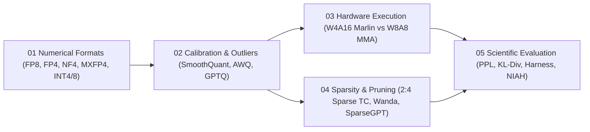

# Stage 6: Quantization & Compression at Scale

**Phase 2 — Serving Engines, Memory & Compression**

[← Back to Documentation Index](../../README.md) · [Complete Syllabus](../../syllabus.md)

---

## Stage Overview

Large Language Model inference operates across two fundamentally distinct physical regimes: **memory-bandwidth-bound autoregressive decode** (where every generated token forces the GPU to stream gigabytes of weights from HBM into SRAM/registers for minimal arithmetic) and **compute-bound prefill** (where long input prompts saturate Tensor Core matrix multiply-accumulate throughput).

**Quantization and compression** directly attack both bottlenecks—and reduce total VRAM footprint so larger models fit onto fewer, cheaper GPUs—by lowering the bit-width and structural density of weights and activations. However, naive rounding destroys LLM accuracy due to emergent channel-wise activation outliers, uneven weight salience, and hardware-format mismatches.

Stage 6 covers the end-to-end physics, algorithms, silicon execution paths, and scientific validation of model compression at scale:

1. **Bit-Level Formats & Scaling Mathematics:** How low-precision floating-point (`FP8`, `FP4`, `NF4`, `MXFP4`/`MXFP8`) and integer (`INT8`, `INT4`) formats trade dynamic range for mantissa precision, and how scaling granularities govern metadata overhead and GEMM inner-loop fusion.
2. **Outliers & Post-Training Calibration:** Why models above ~6.7B parameters exhibit extreme channel-wise activation outliers, and how `SmoothQuant`, `AWQ`, and `GPTQ` solve this mathematically via scale migration, salience protection, and second-order Hessian error compensation.
3. **Silicon Execution Physics (`W4A16` vs. `W8A8`):** Why weight-only register dequantization (`Marlin`) dominates small-batch decode while native 8-bit Tensor Core execution (`FP8`/`INT8`) dominates prefill and large batches—including an exact Roofline crossover derivation.
4. **Structured Sparsity & Pruning:** How NVIDIA `2:4` Sparse Tensor Cores store compressed nonzero blocks with 2-bit metadata indices, how `Wanda` and `SparseGPT` prune without retraining, and why sparsity interacts non-trivially with low-bit quantization on the Roofline.
5. **Scientific Quality Evaluation:** Why sliding-window perplexity is necessary but insufficient, how logit KL divergence exposes distribution shifts invisible to `argmax`, and how `lm-evaluation-harness`, tool-calling, and Needle-in-a-Haystack tests prevent silent catastrophic degradation.

---

## Topic Index

| # | Topic | Core Concepts |
| :--- | :--- | :--- |
| **01** | [**Numerical Representation**](./01-numerical-representation.md) | FP8 (E4M3/E5M2), FP4 (E2M1), NF4, OCP MXFP4/MXFP8 (E8M0), Symmetric/Asymmetric INT8/INT4, Scaling Granularities |
| **02** | [**Outliers & Calibration**](./02-outliers-and-calibration.md) | Emergent Activation Outliers (>6.7B), SmoothQuant Scale Migration, AWQ Salience Scaling, GPTQ Inverse Hessian Compensation |
| **03** | [**Hardware Execution**](./03-hardware-execution-w4a16-vs-w8a8.md) | W4A16 On-the-Fly Register Dequantization (Marlin) vs. W8A8 Native Tensor Core MMA, Roofline Crossover Batch Size $B^*$ |
| **04** | [**Sparsity & Pruning**](./04-sparsity-and-pruning.md) | NVIDIA 2:4 Structured Sparsity, 2-bit Metadata Overhead, Wanda & SparseGPT, Combining 2:4 with INT4/FP8 |
| **05** | [**Scientific Quality Evaluation**](./05-scientific-quality-evaluation.md) | Sliding-Window Perplexity (WikiText-2/C4), Logit KL Divergence, `lm-evaluation-harness` (MMLU/GSM8K/HumanEval/IFEval), Hidden Failure Modes |

---

## Stage Architecture Map

---

## Navigation

* **Up:** [Documentation Index](../../README.md) | [Complete Syllabus](../../syllabus.md)
* **Previous Stage:** [← Stage 5: KV Cache & Memory Hierarchies](../stage-05/README.md)
* **Start Reading:** [01 — Numerical Representation](./01-numerical-representation.md)
* **Next Stage:** [Stage 7: Speculative Decoding & Advanced Parallelism →](../../phase-3/stage-07/README.md)
