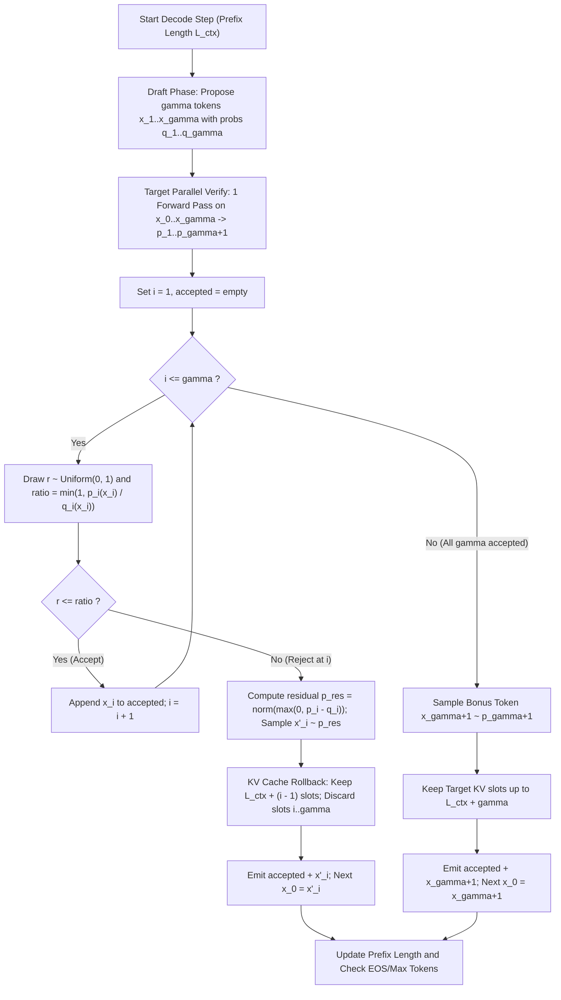
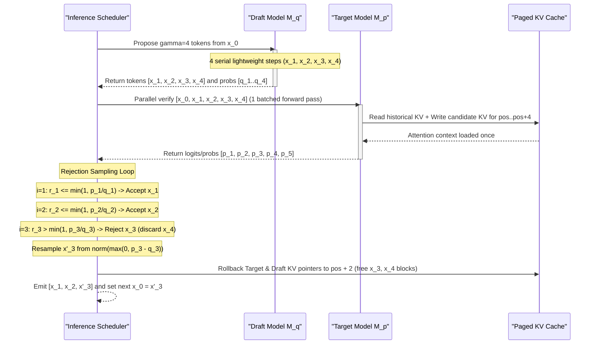

# 01. Speculative Decoding Foundations

[Stage 7 Index](./README.md) | [Next: Drafting Architectures](./02-drafting-architectures.md) | [Complete Syllabus](../../syllabus.md)

Generating text one word-piece at a time leaves modern AI chips mostly idle waiting on memory, rather than doing math. This guide explains how a fast "guessing" step paired with a single parallel "checking" step speeds up generation without changing the output's exact mathematical behavior.

---

## Core Concepts & Terminology

Before diving into equations and algorithms, here is every term, hardware concept, and mathematical primitive used in this document, ordered from foundational building blocks to speculative decoding specifics:

* **Token & Vocabulary ($\mathcal{V}$):** A **token** is a small unit of text (a word, subword, or punctuation mark) processed by a language model. The **vocabulary** $\mathcal{V}$ is the fixed, finite dictionary of all possible tokens the model recognizes.
* **Large Language Model (LLM) & Transformer Layers ($L$):** A neural network trained to predict the next token in a sequence, built as a stack of $L$ sequential processing blocks called **Transformer layers**.
* **Parameters & Model Weights ($W$):** The learned numerical values inside a neural network (e.g., 70B = 70 billion numbers) that govern how input tokens are transformed into predictions.
* **Floating-Point Formats (FP32, FP16, BF16):** Standard ways of representing decimal numbers in computer memory. **FP32** (32-bit, 4 bytes per number) offers high numerical precision. **FP16** (16-bit, 2 bytes) and **BF16** (Brain Float 16, 2 bytes) use half the memory and execute faster on AI chips, though with lower precision.
* **GPU, High-Bandwidth Memory (HBM / HBM3), & Bandwidth:** A **GPU** (Graphics Processing Unit) is a chip built for massively parallel math (such as NVIDIA's H100 SXM5). **HBM** (e.g., HBM3) is ultra-fast memory stacked directly next to the GPU processor; **bandwidth** (measured in TB/s, terabytes per second) is the maximum rate at which data can travel from HBM into the compute cores.
* **FLOPs & Tensor Cores (TFLOP/s):** A **FLOP** (Floating-Point Operation) is one arithmetic calculation (e.g., one multiplication or addition). **Tensor Cores** are specialized hardware circuits on modern GPUs that execute thousands of matrix operations simultaneously, measured in **TFLOP/s** (trillions of FLOPs per second).
* **Batch Size ($B$) & Activations:** **Batch size** $B$ is the number of independent user requests processed together in a single GPU pass. **Activations** are the temporary intermediate vectors computed for each token as it passes through the model's layers.
* **GEMV vs. GEMM:** **GEMV** (General Matrix-Vector Multiplication) multiplies a 2D weight matrix by a single 1D vector (happens when processing 1 token per request). **GEMM** (General Matrix-Matrix Multiplication) multiplies two 2D matrices together (happens when processing multiple tokens in parallel).
* **Arithmetic Intensity ($I$), Roofline Model, & Ridge Point ($I_{\text{ridge}}$):** **Arithmetic intensity** is the number of math operations performed per byte of data fetched from memory ($\text{FLOPs/byte}$). The **Roofline model** is an analytical framework showing whether an operation is **memory-bandwidth-bound** (cores sit idle waiting for HBM data) or **compute-bound** (limited by peak Tensor Core speed). The **ridge point** ($I_{\text{ridge}}$) is the exact arithmetic intensity where memory bandwidth and compute capacity balance.
* **Autoregressive Decoding (Decode) & Wall-Clock Latency:** **Autoregressive decoding** generates text one token at a time: each newly produced token is appended to the input to predict the next token. **Wall-clock latency** is the actual elapsed real-world time required to complete an operation.
* **Logits, Softmax, & Probability Distribution ($p(x)$):** **Logits** are the raw, unnormalized scores a model outputs for every token in $\mathcal{V}$. The **softmax** function converts logits into a valid **probability distribution** (values between $0$ and $1$ that sum to $1$).
* **KV Cache, Causal Attention Mask, FlashAttention, & PagedAttention:** In Transformer attention, each token produces Key ($K$) and Value ($V$) vectors. The **KV cache** stores past $K$ and $V$ vectors in GPU memory so they are not recomputed on every step. A **causal attention mask** prevents a token from attending to future tokens. **FlashAttention** and **PagedAttention** are GPU attention algorithms that tile math for speed and manage KV cache memory in fixed-size blocks (pages), enabling clean rollback when draft tokens are discarded.
* **Greedy Decoding vs. Stochastic Sampling (Temperature $T$, Top-$k$, Top-$p$):** **Greedy decoding** ($T = 0$) deterministically selects the single highest-probability token ($\arg\max$). **Stochastic sampling** randomly draws a token from the probability distribution, optionally reshaped by **temperature** $T$ (controls randomness), **top-$k$** (keeps only the $k$ most probable tokens), **top-$p$ / nucleus sampling** (keeps the smallest set of top tokens whose probabilities sum to $p$), or grammar masks.
* **Speculative Decoding, Draft Model ($M_q$), Target Model ($M_p$), & Speculation Length ($\gamma$):** **Speculative decoding** uses a fast, small **draft model** ($M_q$) to propose $\gamma$ (**speculation length**) candidate future tokens, then runs the large **target model** ($M_p$) once in parallel over all $\gamma + 1$ positions—converting $\gamma$ slow GEMVs into 1 fast GEMM without changing the final output distribution.
* **Modified Rejection Sampling, Acceptance Rate ($\alpha$), Residual Distribution, & Bonus Token:** **Modified rejection sampling** accepts each draft token $x_i$ with probability $\min(1, p_i(x_i)/q_i(x_i))$. On rejection, all later draft tokens and their KV cache entries are discarded, and a replacement token is drawn from the **residual distribution** $\text{norm}(\max(0, p_i - q_i))$. If all $\gamma$ draft tokens are accepted, the target pass yields a free **bonus token** from $p_{\gamma+1}$. The **acceptance rate** ($\alpha$) is the average probability that a draft step is accepted.
* **Total Variation Distance ($\text{TV}(p, q)$), Bernoulli Trials, & Geometric Series:** **Total Variation Distance** ($\frac{1}{2}\sum_y |p(y) - q(y)|$) measures the divergence between two probability distributions $p$ and $q$. Treating step acceptances as independent **i.i.d. Bernoulli($\alpha$) trials** (independent coin flips with success probability $\alpha$) yields a **truncated geometric series** for expected tokens per round.
* **Draft-to-Target Cost Ratio ($c$) & Concurrency / Throughput:** $c = T_{\text{draft}}(1) / T_{\text{target}}(1)$ is the wall-clock time of one draft step divided by one target step. **Concurrency** is the number of simultaneous requests (higher batch size $B$), and **throughput** is total tokens generated per second across all requests.

---

## 1. The Memory-Bound Decode Bottleneck and Parallel Verification

### 1.1 Why Autoregressive Decode Underutilizes Silicon

During autoregressive generation with batch size $B = 1$ (or small $B$), generating a single token requires executing a full forward pass across all $L$ Transformer layers for $1$ query vector per sequence. Every linear projection $W \in \mathbb{R}^{d_{\text{in}} \times d_{\text{out}}}$ becomes a **matrix-vector multiplication (GEMV)** rather than a matrix-matrix multiplication (GEMM).

Consider an H100 SXM5 GPU serving a dense 70B parameter model in BF16 ($2\text{ bytes/param}$):
* **H100 Peak BF16 Tensor Core Compute:** $989\text{ TFLOP/s}$ ($9.89 \times 10^{14}\text{ FLOP/s}$)
* **H100 Peak HBM3 Bandwidth:** $3.35\text{ TB/s}$ ($3.35 \times 10^{12}\text{ bytes/s}$)
* **Hardware Ridge Point:**
  $$I_{\text{ridge}} = \frac{989 \times 10^{12}\text{ FLOP/s}}{3.35 \times 10^{12}\text{ bytes/s}} \approx 295.2\text{ FLOPs/byte}$$

For a single linear layer at batch size $B$:
* **Bytes moved from HBM (assuming $W$ dominates activations):** $2 \cdot d_{\text{in}} \cdot d_{\text{out}}\text{ bytes}$
* **FLOPs executed:** $2 \cdot B \cdot d_{\text{in}} \cdot d_{\text{out}}\text{ FLOPs}$
* **Arithmetic Intensity ($I$):**
  $$I(B) = \frac{2 \cdot B \cdot d_{\text{in}} \cdot d_{\text{out}}}{2 \cdot d_{\text{in}} \cdot d_{\text{out}}} = B\text{ FLOPs/byte}$$

At $B = 1$, $I(1) = 1\text{ FLOP/byte}$, which is **295x below** the H100 ridge point. More than **99.6% of the Tensor Core compute capacity sits completely idle** waiting on HBM weight fetches. Even at $B = 16$, $I(16) = 16\text{ FLOPs/byte}$, remaining deeply memory-bandwidth-bound.

### 1.2 Turning $K$ Serial GEMVs into 1 Parallel Verification Pass

The core insight of **Speculative Decoding** (Leviathan et al., 2023; Chen et al., 2023) is that **verifying** $K = \gamma + 1$ tokens in parallel has nearly the **exact same wall-clock latency** as **generating** $1$ token, provided $B \cdot (\gamma + 1) \ll I_{\text{ridge}}$.

Suppose a fast mechanism (the **draft** model $M_q$) proposes $\gamma$ candidate future tokens $x_1, x_2, \dots, x_\gamma$ given prefix $x_{\le 0}$. Instead of calling the heavy **target** model $M_p$ $\gamma$ times serially, we concatenate the last accepted token $x_0$ and the $\gamma$ draft tokens into a single input sequence of length $\gamma + 1$:
$$[x_0, x_1, x_2, \dots, x_\gamma]$$

Using a **causal attention mask** over these $\gamma + 1$ query tokens attending to the existing KV cache $x_{<0}$ plus each other causally:
1. The target model reads its weights $W$ from HBM **once** (not $\gamma + 1$ times).
2. All $\gamma + 1$ token representations travel through the layers as a tiny matrix of shape $[B(\gamma + 1), d_{\text{model}}]$.
3. In a single forward pass, the target model produces $\gamma + 1$ logit vectors and probability distributions simultaneously:
   $$p_1(\cdot) = P_{M_p}(\cdot \mid x_{\le 0}), \quad p_2(\cdot) = P_{M_p}(\cdot \mid x_{\le 0}, x_1), \quad \dots, \quad p_{\gamma+1}(\cdot) = P_{M_p}(\cdot \mid x_{\le 0}, x_1, \dots, x_\gamma)$$

Because the HBM weight traffic is invariant ($W$ is loaded once) and the extra activation GEMM compute is absorbed by otherwise-idle Tensor Cores, the target verification pass time $T_{\text{verify}}(\gamma + 1)$ satisfies:
$$T_{\text{verify}}(\gamma + 1) \approx T_{\text{target}}(1) \quad \text{for } B(\gamma + 1) \lesssim 64\text{--}128$$

> [!NOTE]
> **Why Verification Time Is Not Strictly Constant:** Two components scale linearly with $\gamma + 1$: (1) **KV cache reads** inside attention (minimal impact for $\gamma \le 8$ when context length $S \gg \gamma$, since the same historical KV cache is read once per head and reused across the $\gamma + 1$ queries via FlashAttention/PagedAttention tiling), and (2) **GEMM FLOPs**, which eventually hit the Roofline ridge point when $B(\gamma + 1)$ grows large.

---

## 2. Modified Rejection Sampling Algorithm

### 2.1 Why Greedy Verification Fails for Stochastic Sampling

If decoding is strictly **greedy** ($T = 0$), verification is trivial: accept the longest prefix where $x_i = \arg\max p_i(\cdot)$, and replace the first mismatch with $\arg\max p_i(\cdot)$.

However, production LLM inference frequently uses **stochastic sampling** (temperature $T > 0$, top-$k$, top-$p$ / nucleus sampling). Requiring exact token equality $x_i = \text{sample}(p_i)$ would reject valid high-probability tokens and collapse throughput, while naively accepting draft tokens whenever $q(x) > 0$ would corrupt the target distribution $p(x)$ into $q(x)$.

Speculative decoding solves this via **modified rejection sampling** (also known as speculative sampling), which guarantees **exact, lossless preservation** of the target distribution $p(x)$ for every token position.

### 2.2 Step-by-Step Algorithm

Given current prefix $c$, draft sequence $(x_1, \dots, x_\gamma)$ generated autoregressively with draft distributions $q_1, \dots, q_\gamma$, and parallel target distributions $p_1, \dots, p_{\gamma+1}$:

For step $i = 1, \dots, \gamma$:
1. **Compute acceptance ratio:** Let $p_i(x_i)$ and $q_i(x_i)$ be the target and draft probabilities assigned to proposed token $x_i$ over vocabulary $\mathcal{V}$.
2. **Draw uniform sample:** Sample $r_i \sim \text{Uniform}(0, 1)$.
3. **Accept or Reject:**
   * **If $r_i \le \min\left(1, \frac{p_i(x_i)}{q_i(x_i)}\right)$:** **Accept** $x_i$. Append $x_i$ to the output and proceed to $i + 1$.
   * **Else ($r_i > \frac{p_i(x_i)}{q_i(x_i)}$):** **Reject** $x_i$ (and discard all subsequent draft tokens $x_{i+1}, \dots, x_\gamma$ as well as their uncommitted target KV cache entries).
     * Construct the **residual distribution** $p'_i(x)$ over $\mathcal{V}$:
       $$p'_i(x) = \text{norm}\left(\max\big(0,\, p_i(x) - q_i(x)\big)\right) = \frac{\max\big(0,\, p_i(x) - q_i(x)\big)}{\sum_{y \in \mathcal{V}} \max\big(0,\, p_i(y) - q_i(y)\big)}$$
     * Resample a replacement token $x'_i \sim p'_i(\cdot)$, append $x'_i$, and **terminate** verification for this round.
4. **All $\gamma$ tokens accepted (Bonus Token):**
   * If all $x_1, \dots, x_\gamma$ are accepted, the target model has *already* computed $p_{\gamma+1}(\cdot) = P_{M_p}(\cdot \mid c, x_1, \dots, x_\gamma)$ in the same verification pass!
   * Sample a **bonus token** $x_{\gamma+1} \sim p_{\gamma+1}(\cdot)$ directly, yielding $\gamma + 1$ accepted tokens in a single round.

### 2.3 Exact Reference Implementation

```python
import torch
import torch.nn.functional as F

def speculative_verify_step(
    draft_tokens: torch.Tensor,   # [gamma], int64
    draft_probs: torch.Tensor,    # [gamma, V], float32 (after temp/top-k/top-p)
    target_probs: torch.Tensor,   # [gamma + 1, V], float32 (after same transforms)
) -> tuple[list[int], int]:
    """
    Executes lossless modified rejection sampling for one batch element.
    Returns (accepted_tokens, num_draft_accepted).
    """
    gamma = draft_tokens.shape[0]
    accepted: list[int] = []
    num_draft_accepted = 0

    for i in range(gamma):
        tok = int(draft_tokens[i].item())
        p_x = target_probs[i, tok].item()
        q_x = draft_probs[i, tok].item()

        # Acceptance probability: min(1, p(x)/q(x)); safe if q_x == 0
        accept_prob = 1.0 if q_x == 0.0 else min(1.0, p_x / q_x)
        r = torch.rand((), device=target_probs.device).item()

        if r <= accept_prob:
            accepted.append(tok)
            num_draft_accepted += 1
        else:
            # Residual distribution: norm(max(0, p - q))
            residual = torch.clamp(target_probs[i] - draft_probs[i], min=0.0)
            res_sum = residual.sum()
            if res_sum > 0.0:
                residual = residual / res_sum
                resampled = int(torch.multinomial(residual, num_samples=1).item())
            else:
                # Numerical fallback when p == q everywhere under fp rounding
                resampled = int(torch.multinomial(target_probs[i], num_samples=1).item())
            accepted.append(resampled)
            return accepted, num_draft_accepted

    # All gamma tokens accepted -> sample free (gamma + 1)-th bonus token
    bonus_tok = int(torch.multinomial(target_probs[gamma], num_samples=1).item())
    accepted.append(bonus_tok)
    return accepted, num_draft_accepted
```

### 2.4 Critical Nuances & Edge Cases

1. **Logit Processing Symmetry:** If temperature $T$, `top_k`, `top_p`, or grammar masks are applied to $M_p$, the **exact transformed target distribution** $p_i(x)$ must be used in rejection sampling. Applying temperature/top-$p$ to $q_i(x)$ as well increases alignment (higher $\alpha$) without ever compromising exactness—because exactness depends *only* on $p_i(x)$ being the desired target distribution.
2. **Numerical Stability ($q_i(x) = 0$):** If $x_i$ was genuinely sampled from $q_i$, then $q_i(x_i) > 0$. However, in FP16/BF16 arithmetic or after top-$p$ truncation bugs, $q_i(x_i)$ can underflow to $0$. Always compute probabilities and `residual = max(0, p - q)` in **FP32**.
3. **Guaranteed Forward Progress:** Every round emits **at least 1 token** (even if $x_1$ is rejected immediately, $x'_1$ is resampled from $p'_1$ and emitted) and **at most $\gamma + 1$ tokens**.
4. **KV Cache Rollback:** During verification of $[x_0, x_1, \dots, x_\gamma]$, the target model writes KV entries for positions $\text{pos}_0, \text{pos}_0 + 1, \dots, \text{pos}_0 + \gamma$. If $x_k$ is the first rejected token ($1 \le k \le \gamma$), only $x_0, \dots, x_{k-1}$ are valid prefix tokens; KV entries for $x_k, \dots, x_\gamma$ must be discarded (by rolling back the sequence length pointer / freeing physical PagedAttention blocks), and $x'_k$ will be fed as the next round's $x_0$. Note that even if all $\gamma$ tokens are accepted, the KV entry for $x_\gamma$ *was* computed during verification, while the bonus token $x_{\gamma+1}$ has not yet had its KV entry computed—so $x_{\gamma+1}$ becomes the next round's $x_0$!

---

## 3. Mathematical Proof of Lossless Distribution Preservation

**Theorem:** Let $p(x)$ and $q(x)$ be arbitrary discrete probability distributions over finite vocabulary $\mathcal{V}$. Under the modified rejection sampling procedure, the marginal probability $P(X = x)$ of emitting token $x \in \mathcal{V}$ at position $i$ is **identically equal to $p(x)$**.

### Proof

A token $x \in \mathcal{V}$ can be emitted at position $i$ through **two mutually exclusive events**:
* **Event $A_x$:** The draft model proposes $x$ (probability $q(x)$), and the verifier **accepts** it (probability $\min\left(1, \frac{p(x)}{q(x)}\right)$).
* **Event $R_x$:** The draft model proposes *some* token $y \in \mathcal{V}$, the verifier **rejects** $y$, and the subsequent resample from $p'(x) = \text{norm}(\max(0, p(x) - q(x)))$ outputs $x$.

Therefore, by the law of total probability:
$$P(X = x) = P(A_x) + P(R_x) = P(\text{accepted } x) + P(\text{rejected}) \cdot P(\text{resampled } x \mid \text{rejected})$$

#### Step 1: Probability of Acceptance $P(A_x)$
If $q(x) = 0$, the draft never proposes $x$, so $P(A_x) = 0 = \min(p(x), q(x))$.
If $q(x) > 0$:
$$P(A_x) = q(x) \cdot \min\left(1, \frac{p(x)}{q(x)}\right) = \min\big(q(x),\, p(x)\big)$$

#### Step 2: Total Probability of Rejection $\beta_{\text{rej}}$
The probability that the draft proposal $y \sim q$ is accepted across all $y \in \mathcal{V}$ is:
$$P(\text{accepted}) = \sum_{y \in \mathcal{V}} P(A_y) = \sum_{y \in \mathcal{V}} \min\big(p(y),\, q(y)\big)$$

Thus, the total rejection probability is:
$$P(\text{rejected}) = 1 - \sum_{y \in \mathcal{V}} \min\big(p(y),\, q(y)\big)$$

Notice the algebraic identity for any real numbers $p(y), q(y)$:
$$p(y) - \min\big(p(y),\, q(y)\big) = \max\big(0,\, p(y) - q(y)\big)$$

Since $\sum_{y \in \mathcal{V}} p(y) = 1$, we can substitute $1 = \sum_{y \in \mathcal{V}} p(y)$:
$$P(\text{rejected}) = \sum_{y \in \mathcal{V}} p(y) - \sum_{y \in \mathcal{V}} \min\big(p(y),\, q(y)\big) = \sum_{y \in \mathcal{V}} \max\big(0,\, p(y) - q(y)\big)$$

This proves that the normalizing denominator $Z = \sum_{y \in \mathcal{V}} \max(0, p(y) - q(y))$ of the residual distribution $p'(x)$ is **identically equal to $P(\text{rejected})$** (which equals the Total Variation Distance $\text{TV}(p, q) = \frac{1}{2}\sum_y |p(y) - q(y)|$).

#### Step 3: Probability of Rejection + Resampling $P(R_x)$
If $P(\text{rejected}) = 0$, then $p(y) = q(y)$ everywhere, no rejection ever occurs, and $P(X = x) = \min(p(x), q(x)) = p(x)$.

If $P(\text{rejected}) > 0$:
$$P(R_x) = P(\text{rejected}) \cdot p'(x) = P(\text{rejected}) \cdot \frac{\max\big(0,\, p(x) - q(x)\big)}{P(\text{rejected})} = \max\big(0,\, p(x) - q(x)\big)$$

#### Step 4: Combining Both Cases
Summing the two mutually exclusive events:
$$P(X = x) = \min\big(p(x),\, q(x)\big) + \max\big(0,\, p(x) - q(x)\big)$$

Consider the two exhaustive cases for any $x \in \mathcal{V}$:
* **Case 1 ($p(x) \le q(x)$):**
  $$\min\big(p(x),\, q(x)\big) = p(x), \qquad \max\big(0,\, p(x) - q(x)\big) = 0 \implies P(X = x) = p(x)$$
* **Case 2 ($p(x) > q(x)$):**
  $$\min\big(p(x),\, q(x)\big) = q(x), \qquad \max\big(0,\, p(x) - q(x)\big) = p(x) - q(x) \implies P(X = x) = q(x) + p(x) - q(x) = p(x)$$

In both cases, $P(X = x) = p(x)$ for every $x \in \mathcal{V}$. Furthermore, if all $\gamma$ draft tokens are accepted, the bonus token is sampled directly from $p_{\gamma+1}(\cdot)$, which trivially has distribution $p_{\gamma+1}$. By induction over token positions $t = 1, 2, \dots, T$, the joint distribution over the entire generated sequence $P(x_1, \dots, x_T)$ matches the autoregressive target model **exactly**. $\blacksquare$

---

## 4. Expected Speedup & Optimal Speculation Length $\gamma^*$

### 4.1 Expected Acceptance Rate $\alpha$

Define the **single-step acceptance probability** $\alpha$ (averaged over prefixes $c$):
$$\alpha = \mathbb{E}_{c}\Big[ P(\text{accept at step } i \mid c) \Big] = \mathbb{E}_{c}\left[ \sum_{x \in \mathcal{V}} \min\big(p(x \mid c),\, q(x \mid c)\big) \right] = 1 - \mathbb{E}_c\big[\text{TV}(p, q)\big]$$

Notice that $\alpha \in [0, 1]$ is strictly determined by the Total Variation distance between the draft and target distributions. For well-aligned draft models (e.g., Llama-3.2-1B drafting for Llama-3.1-70B, or EAGLE-2), $\alpha$ typically ranges from $0.65$ to $0.88$ depending on task entropy (highest on code/structured text/summarization, lower on creative writing).

### 4.2 Expected Tokens Generated per Verification Round

Make the standard simplifying assumption (Leviathan et al., 2023) that token acceptance events $A_1, A_2, \dots, A_\gamma$ within a round are i.i.d. Bernoulli($\alpha$) trials. Let $N \in \{1, 2, \dots, \gamma + 1\}$ be the number of tokens emitted in one speculative round:
* $N = 1$ if $x_1$ is rejected (prob $1 - \alpha$).
* $N = k$ (for $1 \le k \le \gamma$) if $x_1, \dots, x_{k-1}$ are accepted and $x_k$ is rejected (prob $\alpha^{k-1}(1 - \alpha)$).
* $N = \gamma + 1$ if all $\gamma$ draft tokens are accepted, yielding $\gamma$ draft tokens plus $1$ bonus token (prob $\alpha^\gamma$).

The expected number of emitted tokens per round is a truncated geometric series:
$$\mathbb{E}[N] = \sum_{k=1}^{\gamma} k \cdot \alpha^{k-1}(1 - \alpha) + (\gamma + 1)\alpha^\gamma$$

Expanding the sum using $P(N \ge k) = \alpha^{k-1}$ for $k = 1, \dots, \gamma + 1$:
$$\mathbb{E}[N] = \sum_{k=1}^{\gamma+1} P(N \ge k) = \sum_{k=0}^{\gamma} \alpha^k = \frac{1 - \alpha^{\gamma+1}}{1 - \alpha} \quad (\text{for } \alpha < 1)$$
(And $\mathbb{E}[N] = \gamma + 1$ when $\alpha = 1$.)

**Sanity check with numbers:**
* If $\alpha = 0.8$ and $\gamma = 5$: $\mathbb{E}[N] = \frac{1 - 0.8^6}{1 - 0.8} = \frac{1 - 0.262144}{0.2} \approx 3.69\text{ tokens/round}$.
* As $\gamma \to \infty$, $\mathbb{E}[N] \to \frac{1}{1 - \alpha}$ (e.g., at most $5.0$ tokens/round for $\alpha = 0.8$, because an eventual rejection terminates the chain).

### 4.3 Wall-Clock Cost Model and Expected Speedup

Let $T_{\text{target}}(1)$ be the wall-clock time of one standard autoregressive target forward pass. Define the **draft-to-target cost ratio** $c$:
$$c = \frac{T_{\text{draft}}(1)}{T_{\text{target}}(1)}$$
(For example, a 1B draft model vs. a 70B target model gives $c \approx \frac{1}{70} \approx 0.014$ theoretically, or $c \approx 0.03\text{--}0.08$ in practice after Python/kernel launch overhead.)

One speculative round performs:
1. $\gamma$ serial draft forward passes: $\gamma \cdot c \cdot T_{\text{target}}(1)$.
2. $1$ parallel target verification pass of $\gamma + 1$ tokens: $T_{\text{verify}}(\gamma + 1) = \tau(\gamma) \cdot T_{\text{target}}(1)$, where $\tau(\gamma) \approx 1$ in the memory-bound regime.

Thus, the wall-clock time of one round is:
$$T_{\text{round}} = \big(\gamma c + \tau(\gamma)\big) \cdot T_{\text{target}}(1)$$

In standard memory-bound decoding ($\tau(\gamma) \approx 1$), the **expected wall-clock speedup** $S(\alpha, \gamma, c)$ over baseline target decoding is:
$$S(\alpha, \gamma, c) = \frac{\mathbb{E}[N] \cdot T_{\text{target}}(1)}{T_{\text{round}}} = \frac{1 - \alpha^{\gamma+1}}{(1 - \alpha)(\gamma c + 1)}$$

#### Numerical Example
Suppose $\alpha = 0.80$, $c = 0.05$, and $\gamma = 5$:
$$S = \frac{1 - 0.8^6}{(1 - 0.8)(5 \times 0.05 + 1)} = \frac{3.689}{1.25} \approx \mathbf{2.95\times}$$

If instead we over-speculate with $\gamma = 20$ (same $\alpha = 0.80, c = 0.05$):
$$S = \frac{1 - 0.8^{21}}{0.2 \times (20 \times 0.05 + 1)} = \frac{4.954}{2.00} \approx 2.48\times \quad (\text{slower!})$$

### 4.4 Deriving Optimal Speculation Length $\gamma^*$ and Batch-Size Collapse

Why did $\gamma = 20$ perform worse than $\gamma = 5$? Because the numerator $1 - \alpha^{\gamma+1}$ saturates exponentially toward $1$, whereas the denominator $\gamma c + 1$ grows linearly without bound.

Treating $\gamma$ as continuous and differentiating $\ln S(\gamma)$ with respect to $\gamma$:
$$\frac{d}{d\gamma} \ln S(\gamma) = \frac{-\alpha^{\gamma+1} \ln \alpha}{1 - \alpha^{\gamma+1}} - \frac{c}{\gamma c + 1} = 0$$

At the optimum $\gamma^*$:
$$\alpha^{\gamma^* + 1} \left( c - (\gamma^* c + 1)\ln \alpha \right) = c$$

In practice, since $\gamma \in \mathbb{Z}^+$ is small ($2 \le \gamma \le 12$), serving engines evaluate $S(\alpha, \gamma, c)$ directly or adapt $\gamma$ dynamically based on rolling acceptance rates (e.g., increasing $\gamma$ by $1$ when all $\gamma$ tokens are accepted, and decreasing $\gamma$ when rejections happen early).

#### Why High Batch Size $B$ Shrinks Speculative Speedup
When serving at large batch size $B$ (e.g., $B = 64$ or $128$), $\tau(\gamma)$ is **no longer $\approx 1$**:
* At $B = 64$ and $\gamma = 5$, the target verification pass processes $B(\gamma + 1) = 384$ tokens simultaneously—pushing the target model past the GPU Roofline ridge point ($295\text{ FLOPs/byte}$ on H100) into the **compute-bound regime**!
* Once compute-bound, $\tau(\gamma)$ scales linearly with $\gamma + 1$: $\tau(\gamma) \approx \frac{B(\gamma+1)}{I_{\text{ridge}}}$.
* Worse, every rejected token wastes FLOPs that could have computed useful tokens for other requests. Consequently, speculative decoding delivers **maximum speedup ($2\times\text{--}3.5\times$) at low-to-medium batch sizes ($B \le 16\text{--}32$)** and diminishes—or even degrades throughput—at saturated compute-bound batch sizes unless $c \ll 1$ and $\alpha > 0.85$.

---

## 5. Control Flow & Execution Timeline

### 5.1 Speculative Verify-and-Rollback Decision Loop



### 5.2 Draft-Verify-Rollback Interaction Sequence



---

## 6. Key Takeaways & Failure Modes

| Failure Mode / Pitfall | Root Cause | Mitigation |
| :--- | :--- | :--- |
| **Silent distribution shift** | Computing $p_i(x)$ before temperature/top-$p$ masking, or mismatched random state / FP16 underflow in $p_i - q_i$ | Apply identical logit processors before computing $p_i$; cast probabilities to **FP32** before subtraction and normalization |
| **Speculation slowdown at high concurrency** | Target pass hits compute-bound regime when $B(\gamma + 1) > I_{\text{ridge}}$ | Dynamically disable or shrink $\gamma \to 0$ when batch token count exceeds hardware ridge threshold |
| **Draft KV cache divergence** | Draft model misses resampled token $x'_k$ or skips rejected tokens without rewinding its own KV state | Synchronize draft KV rollback to `L_ctx + num_accepted` and feed accepted + resampled tokens as draft catch-up inputs |
| **Vocabulary / tokenizer mismatch** | Draft and target tokenizers split strings differently (e.g., byte fallback differences) | Require exact shared vocabulary/tokenizer (or use same-family drafting / EAGLE / Medusa heads; see Topic 2) |

---

[Stage 7 Index](./README.md) | [Next: Drafting Architectures](./02-drafting-architectures.md) | [Complete Syllabus](../../syllabus.md)
