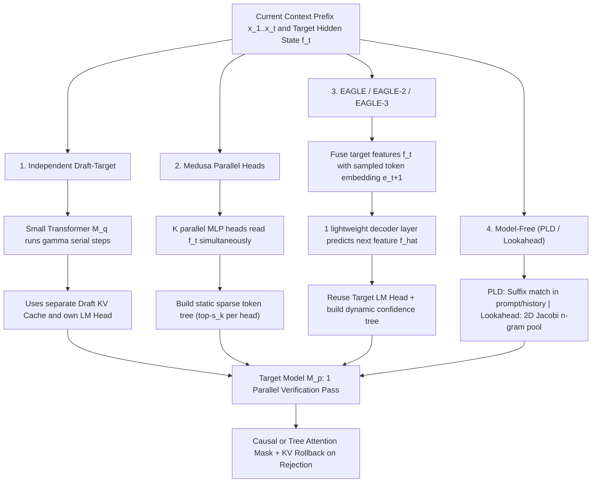
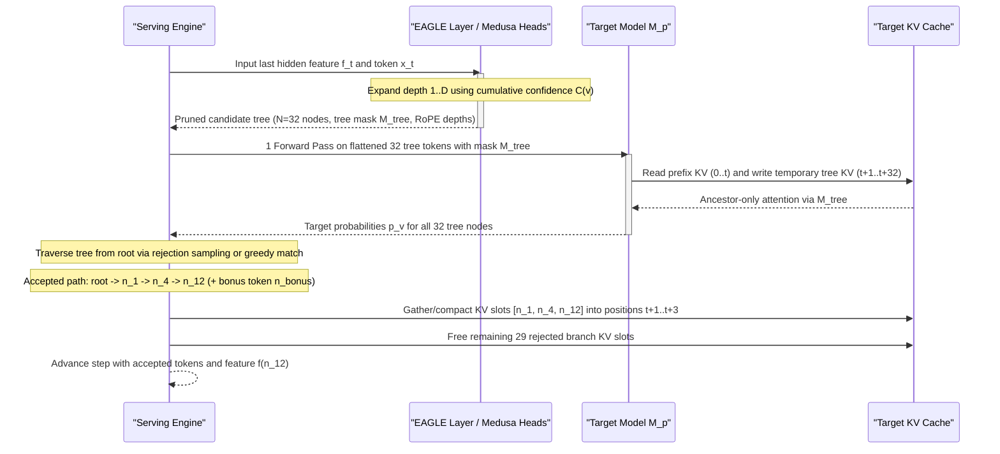

# 02. Drafting Architectures

[Previous: Speculative Decoding Foundations](./01-speculative-decoding-foundations.md) | [Stage 7 Index](./README.md) | [Next: Intra-Layer & Inter-Layer Parallelism](./03-intra-and-inter-layer-parallelism.md)

While speculative verification guarantees exact output quality, its real-world speedup depends entirely on how candidate tokens are proposed. This guide compares the four main ways inference engines generate draft tokens—ranging from standalone small models to zero-parameter text matching.

---

## Core Concepts & Terminology

Every technical term, model component, and drafting mechanism referenced in this document is defined below in dependency order:

* **Token, Vocabulary ($\mathcal{V}$), Logits, & Softmax:** A **token** is a unit of text; the **vocabulary** $\mathcal{V}$ is the finite dictionary of all tokens a model knows. **Logits** are raw unnormalized scores per token, converted into a probability distribution by the **softmax** function.
* **Speculative Decoding, Target Model ($M_p$), Draft Model ($M_q$), $\gamma$, $\alpha$, & $c$:** **Speculative decoding** uses a fast **draft** mechanism ($M_q$) to propose $\gamma$ candidate tokens, which the large **target model** ($M_p$) verifies in one parallel pass. Performance is governed by the single-step **acceptance rate** ($\alpha$), **mean accepted tokens per round** ($\tau$), and **draft-to-target cost ratio** ($c = T_{\text{draft}} / T_{\text{target}}$).
* **Transformer, Hidden State ($h_t, f_t$), Embedding Table ($E$), & LM Head ($W_{\text{lm}}$):** A **Transformer** processes tokens through sequential layers, producing internal vectors called **hidden states** ($h_t$ or $f_t \in \mathbb{R}^d$, where $d$ is the model's hidden dimension). The **embedding table** ($E$) maps token IDs into vectors; the **LM head** ($W_{\text{lm}}$) is the final linear layer mapping the top hidden state to vocabulary logits.
* **Prefill, Decode, TTFT, KV Cache, & VRAM:** **Prefill** processes the prompt in parallel to populate the **KV cache** (saved Key/Value attention vectors); **TTFT** (Time-To-First-Token) is the latency to emit the first output token; **Decode** generates subsequent tokens sequentially; **VRAM** (Video RAM) is GPU memory.
* **Tokenizer (Byte-Level BPE / SentencePiece) & BOS/EOS:** A **tokenizer** converts raw text into integer token IDs using algorithms such as **Byte-Level BPE** (Byte-Pair Encoding) or **SentencePiece**. **BOS** and **EOS** are special control tokens marking the Beginning and End of a Sequence.
* **CUDA Stream, Tensor Parallelism (TP), `AllReduce`, GEMV, & Tensor Cores:** A **CUDA stream** is an independent GPU execution queue allowing operations to overlap. **Tensor Parallelism (TP)** splits model weights across multiple GPUs (requiring **`AllReduce`** synchronization barriers to sum partial results). **GEMV** is Matrix-Vector Multiplication; **Tensor Cores** are specialized GPU matrix-math circuits.
* **MLP, Residual Connection, & SiLU:** A **Multi-Layer Perceptron (MLP)** is a feedforward neural network block. A **residual connection** adds a block's input directly to its output ($h + f(h)$). **SiLU** (Sigmoid Linear Unit) is a smooth nonlinear activation function.
* **Autoregressive Factorization vs. Conditional Independence:** **Autoregressive factorization** predicts each token conditioned on all prior tokens ($p(x_{t+3} \mid x_{\le t+2})$). **Conditional independence** assumes multiple future positions are predicted from the same shared state $h_t$ without seeing each other's sampled tokens.
* **Tree Attention Verification, Tree Mask ($M_{\text{tree}}$), & RoPE Position IDs:** **Tree attention** verifies multiple branching draft paths in one target pass by flattening tree nodes into a 1D sequence. A **tree attention mask** ($M_{\text{tree}}$) ensures each node attends only to its ancestors (never sibling branches), while **RoPE** (Rotary Position Embedding) position IDs match each node's depth in the tree.
* **Medusa (Medusa-1 / Medusa-2), Cross-Entropy Loss, & KL Divergence:** **Medusa** attaches $K$ parallel MLP prediction heads to the target's final hidden state. **Medusa-1** freezes the target model and trains only the heads using **cross-entropy loss** (standard next-token classification loss). **Medusa-2** jointly tunes the backbone and heads using **KL divergence** (Kullback-Leibler divergence, measuring how one probability distribution differs from another) for **knowledge distillation**.
* **EAGLE / EAGLE-2 / EAGLE-3, $L_2$ Loss, & Training-Time Test (TTT):** **EAGLE** (*Extrapolation Algorithm for Greater Language-model Efficiency*) trains a single lightweight Transformer layer to predict the target's next hidden feature $\hat{f}_{t+1}$ from $[f_t; e_{t+1}]$, reusing the frozen target LM head. **EAGLE-2** dynamically prunes the draft tree using cumulative path confidence $C(v)$. **EAGLE-3** fuses features from low, middle, and high target layers, removes the **$L_2$ regression loss** ($\|\hat{f} - f\|_2^2$), and uses **Training-Time Test (TTT)** (feeding its own predicted features back as input during training) with multi-step KL distillation.
* **Model-Free Drafting, N-gram, Prompt Lookup Decoding (PLD), Suffix Automaton, Trie, & Hash Index:** **Model-free** methods draft without extra neural weights. **Prompt Lookup Decoding (PLD)** searches the prompt and history for matching **$n$-grams** (sequences of $n$ consecutive tokens) using fast CPU structures (**Suffix Automaton**, **Trie**, or **Hash Index**) to propose verbatim continuations—ideal for **RAG** (Retrieval-Augmented Generation) and document QA.
* **Lookahead Decoding & Jacobi Fixed-Point Iteration:** **Lookahead Decoding** treats sequential token generation as **Jacobi fixed-point iteration**—guessing a window of $W$ future tokens and refining all $W$ positions simultaneously in one forward pass, harvesting valid $n$-grams into a pool for parallel verification.

---

## 1. The Drafting Design Space

In Topic 1 we proved that speculative decoding speedup is governed by:
$$S(\alpha, \gamma, c) = \frac{1 - \alpha^{\gamma+1}}{(1 - \alpha)(\gamma c + 1)}$$

Maximizing $S$ requires pulling in two opposing directions simultaneously:
1. **Minimize draft-to-target cost ratio $c = T_{\text{draft}} / T_{\text{target}}$:** The drafter must be orders of magnitude faster than the target model (or completely zero-compute).
2. **Maximize single-step acceptance rate $\alpha$ (and tree acceptance depth):** The drafter must closely approximate the target model's conditional distribution $p(x_{t+k} \mid x_{\le t+k-1})$.

Modern LLM inference systems resolve this tension across four distinct architectural paradigms:
1. **Independent Draft Models (Draft-Target)**
2. **Auxiliary Multi-Token Decoding Heads (Medusa)**
3. **Feature-Level Autoregressive Extrapolation (EAGLE / EAGLE-2 / EAGLE-3)**
4. **Model-Free & Jacobi Drafting (Prompt Lookup / N-gram / Lookahead Decoding)**

---

## 2. Independent Draft Models (Draft-Target)

### 2.1 Architecture & Execution Mechanics

The classic Draft-Target setup pairs a small standalone Transformer $M_q$ (e.g., `Llama-3.2-1B`, `Qwen2.5-0.5B`, or a 160M–680M distilled model) with a large target Transformer $M_p$ (e.g., `70B` or `405B`) from the **same model family**.

During each round:
1. $M_q$ runs $\gamma$ tiny autoregressive decode steps, maintaining **its own separate KV cache** (much smaller because $M_q$ has fewer layers and narrower KV dimensions).
2. $M_p$ verifies $[x_0, x_1, \dots, x_\gamma]$ in a single parallel pass.
3. On rejection at position $k$, both $M_p$'s KV cache and $M_q$'s KV cache must rewind to `L_ctx + (k - 1)`, and the resampled replacement token $x'_k$ is fed into $M_q$ at the start of the next draft round.

### 2.2 Tokenizer, Vocabulary, and Alignment Constraints

Modified rejection sampling compares $p(x)$ and $q(x)$ token-by-token over an identical discrete vocabulary $\mathcal{V}$. Consequently, **exact tokenizer and vocabulary alignment** is strictly required:
* **Byte-Level BPE / SentencePiece Equivalence:** Both models must share the exact same merge rules, special token IDs (`<|eot_id|>`, `<|im_end|>`, BOS/EOS), and vocabulary size $|\mathcal{V}|$ (e.g., $128{,}256$ for Llama-3). Even a single mismatched token ID causes silent rejection cascades or corrupted text.
* **Cross-Tokenizer Workarounds (Rare):** When vocabularies differ, systems must align at character/byte boundaries or translate token IDs via byte-string intersection, adding CPU synchronization overhead and lowering $\alpha$.
* **Embedding/LM-Head Weight Cost:** Even a "tiny" 0.5B draft model with $|\mathcal{V}| = 151{,}936$ and $d = 896$ spends $2 \times 151{,}936 \times 896 \times 2\text{ bytes} \approx 544\text{ MB}$ just on embedding + untied LM head weights—and every draft step still performs a $[1, d] \times [d, |\mathcal{V}|]$ GEMV!

### 2.3 Systems Tradeoffs

* **Prefill Synchronization Overhead:** Before $M_q$ can draft, $M_q$ must also prefill the user's prompt to populate its own KV cache. On long prompts ($32\text{k}$ tokens), draft prefill adds non-trivial TTFT unless overlapped on a separate CUDA stream or pipelined.
* **Tensor Parallelism Mismatch:** A 70B target model often runs with $\text{TP}=4$ or $\text{TP}=8$, whereas a 1B draft model runs faster on $\text{TP}=1$ (since sharding a 1B model across 8 GPUs wastes latency on `AllReduce` synchronization barriers). Production engines (vLLM, TensorRT-LLM) replicate the 1B draft model on rank 0 or all ranks rather than tensor-sharding it.

---

## 3. Auxiliary Multi-Token Decoding Heads (Medusa)

### 3.1 Parallel MLP Heads on Top of Last Hidden State

**Medusa** (Cai et al., 2024) eliminates the separate draft model—and its separate KV cache, tokenizer alignment issues, and serial $\gamma$-step draft loop—by attaching $K$ lightweight **prediction heads** directly onto the target model's final hidden state $h_t \in \mathbb{R}^d$ (just before the original LM head $W_{\text{lm}}$).

Each Medusa head $k \in \{1, \dots, K\}$ predicts the token at future offset $t + 1 + k$ **in parallel** using a single residual MLP block followed by a vocabulary projection:
$$\tilde{h}_t^{(k)} = h_t + \text{SiLU}\!\left(W_1^{(k)} h_t + b_1^{(k)}\right), \qquad q_{t+1+k}(\cdot) = \text{softmax}\!\left(W_2^{(k)} \tilde{h}_t^{(k)}\right)$$
where head $0$ is the original target LM head predicting $x_{t+1}$, head $1$ predicts $x_{t+2}$, and head $K$ predicts $x_{t+1+K}$ (typically $K = 4$ or $5$).

Because all $K$ heads execute **simultaneously in one batched kernel** from $h_t$, drafting cost is near-zero ($c \approx 0.01\text{--}0.03$), and there is **no draft KV cache**.

### 3.2 Why Conditional Independence Hurts Single-Path Accuracy — and Tree Attention Fixes It

Medusa heads share a fundamental statistical limitation: head $2$ predicts $x_{t+3}$ conditioned *only* on $h_t$, **without seeing which token $x_{t+2}$ was chosen by head $1$**! Formally, Medusa models:
$$q(x_{t+2}, x_{t+3} \mid x_{\le t}) = q^{(1)}(x_{t+2} \mid h_t) \cdot q^{(2)}(x_{t+3} \mid h_t)$$
rather than the true autoregressive factorization $p(x_{t+2} \mid x_{\le t}) \cdot p(x_{t+3} \mid x_{\le t}, x_{t+2})$.

If position $t+2$ has two plausible tokens (e.g., `"the"` at $45\%$ and `"a"` at $40\%$), a single greedy chain would guess wrong roughly half the time. Medusa overcomes this via **Tree-Based Attention Verification**:
1. From each head $k$, take the top-$s_k$ candidate tokens (e.g., top-$2$ from head 1, top-$3$ from head 2, etc.) and form a **sparse candidate tree** of paths (typically pruned to $N_{\text{tree}} \approx 32\text{--}64$ total nodes based on empirical head accuracy).
2. Flatten all $N_{\text{tree}}$ tree nodes into a single 1D token sequence of length $N_{\text{tree}}$ and construct a custom **tree attention mask** $M_{\text{tree}} \in \{0, -\infty\}^{N_{\text{tree}} \times N_{\text{tree}}}$ (plus matching RoPE position IDs equal to each node's depth in the tree).
3. In $M_{\text{tree}}$, node $u$ can attend **only to its ancestors** on the root-to-$u$ path (and all prefix KV tokens), **never to sibling branches**.
4. The target model verifies the entire tree of $64$ nodes in **one single forward pass**! Even though $64$ nodes are verified, the memory-bound target model still loads weights once, and the longest accepted root-to-leaf path is committed to the KV cache.

### 3.3 Medusa-1 vs. Medusa-2 Training

* **Medusa-1:** Target backbone weights are **frozen**; only the $K$ Medusa heads are trained via cross-entropy loss on future tokens (preserving 100% of original model behavior, usable as a drop-in adapter). Requires only a few hours on a single node, yielding ~2.2x speedup.
* **Medusa-2:** Jointly fine-tunes the **entire target backbone + Medusa heads** using a differential learning rate and a knowledge-distillation loss (KL divergence against original frozen target logits) so the backbone learns to pack future-token information into $h_t$. Boosts acceptance rate and speedup to ~2.3x–2.8x, but modifies the target model weights.

---

## 4. Feature-Level Autoregressive Extrapolation (EAGLE / EAGLE-2 / EAGLE-3)

### 4.1 Why EAGLE Beats Both Draft-Target and Medusa

Medusa fails to condition head $k$ on the sampled token $x_{t+k}$, while Draft-Target models discard all rich contextual representations computed by the 70B target model and start drafting from raw token IDs alone.

**EAGLE** (*Extrapolation Algorithm for Greater Language-model Efficiency*, Li et al., 2024) combines the best of both worlds:
1. **Autoregressive at the Feature Level:** Instead of predicting tokens independently in parallel, EAGLE uses a single lightweight autoregressive Transformer layer (1 decoder layer, ~0.2B–0.3B params for a 70B target) that predicts the **target model's next top-layer hidden feature vector** $\hat{f}_{t+1} \in \mathbb{R}^d$.
2. **Resolving Sampling Uncertainty via Token Embedding Injection:** Hidden features $f_t$ alone have high variance because the next token $x_{t+1}$ hasn't been chosen yet (e.g., `"I"` vs `"We"` lead to completely different hidden states). EAGLE feeds the **concatenation** of the previous feature vector $f_t$ and the **embedding of the sampled token** $e_{t+1} = E(x_{t+1})$ into its single Transformer layer:
   $$\hat{f}_{t+1} = \text{EAGLE\_Layer}\Big(\text{Linear}\big([f_t \,;\, e_{t+1}]\big)\Big)$$
3. **Reusing the Target LM Head (Zero Extra Vocabulary Parameters):** To obtain draft logits $q_{t+2}$, EAGLE passes $\hat{f}_{t+1}$ directly through the **target model's frozen LM head** $W_{\text{lm}}$! It does not duplicate the embedding table or LM head.

Because $\hat{f}_{t+1}$ incorporates the exact token $x_{t+1}$ that was actually sampled, conditional uncertainty collapses, achieving far higher acceptance rates ($\alpha \approx 0.75\text{--}0.88$) than Medusa with a tiny fraction of the parameters of an independent draft model.

### 4.2 EAGLE-2: Context-Aware Dynamic Draft Trees

Original EAGLE (and Medusa) used a **static, fixed-topology draft tree** regardless of whether the current context was deterministic (e.g., boilerplate Python syntax) or high-entropy (creative brainstorming).

**EAGLE-2** exploits the empirical observation that the EAGLE draft layer's output probabilities are **well-calibrated** proxies for target acceptance probability:
1. At each tree expansion depth $d$, keep the top-$k$ children per active node and compute **cumulative path confidence**:
   $$C(v) = \prod_{u \in \text{path}(\text{root} \to v)} q(u \mid \text{ancestors}(u))$$
2. Maintain a global priority queue across candidate nodes; at each depth, expand only the **highest-confidence paths** (e.g., top-$m$ beams).
3. After reaching depth $D$, select the **top-$N_{\text{tree}}$ nodes globally** across all depths by cumulative score $C(v)$ to form the verification batch.
   * On easy/predictable tokens, the dynamic tree automatically stretches **deep and narrow** (accepting 6–10 tokens in one pass).
   * On uncertain tokens, the dynamic tree automatically spreads **shallow and wide** (covering alternative high-probability branches).

### 4.3 EAGLE-3: Multi-Layer Feature Fusion & Training-Time Test

EAGLE-1/2 trained its single draft layer with a **feature-level regression loss** ($\mathcal{L}_{\text{reg}} = \| \hat{f}_{t+1} - f_{t+1} \|_2^2$) plus logit distillation, forcing the draft layer to mimic the target's *top-layer* features $f_t$. Two bottlenecks remained:
1. Predicting exact continuous feature vectors $f_{t+1}$ wastes capacity on hidden dimensions that do not affect the next-token logits.
2. Top-layer features $f_t$ already discard lower/mid-layer syntactic and lexical cues useful for predicting multiple tokens ahead.

**EAGLE-3** (2025) introduces two key architectural upgrades:
1. **Multi-Layer Feature Fusion (Low + Mid + High):** Instead of feeding only the last target layer's hidden state $f_t^{(L)}$, EAGLE-3 concatenates hidden states from early, middle, and final target layers (e.g., layers $\{2, L/2, L-3\}$) and projects them down to $d$ via a linear fusion layer.
2. **Removal of Feature Regression Loss + Training-Time Test (TTT):** EAGLE-3 drops the $L_2$ feature prediction constraint entirely and trains solely with **next-token KL distillation** against the target logits across multi-step unrolled predictions (*Training-Time Test*: feeding its own predicted hidden features $\hat{f}_{t+k}$ back as input during training so the drafter adapts to compounding rollout drift). This yields **4x–6x** speedups on reasoning/coding workloads (often averaging 3.5–4.5 accepted tokens per verification pass).

---

## 5. Model-Free Drafting (Zero Extra Parameters)

When modifying model weights, training draft heads, or hosting a second model is operationally infeasible, **model-free** techniques generate draft tokens purely from context matching or parallel Jacobi decoding.

### 5.1 N-gram / Prompt Lookup Decoding (PLD)

In RAG, summarization, code editing, multi-turn chat, and document QA, large spans of the output are **copied verbatim** from the prompt or prior turns.

**Prompt Lookup Decoding** (Saxena, 2023) works as follows:
1. Take the last $n$ generated tokens (e.g., $n$-gram window $n \in \{1, 2, 3, 4\}$) as a query suffix.
2. Scan the prompt + generated history (or maintain an $O(1)$-lookup **Suffix Automaton / Trie / Hash Index**) for the most recent matching $n$-gram occurrence.
3. If a match ends at index $j$, immediately propose the subsequent $\gamma$ tokens $[x_{j+1}, \dots, x_{j+\gamma}]$ as draft candidates!
4. Verify in 1 target pass (exact greedy or rejection sampling with $q(x) = \mathbb{1}[x = x_{\text{match}}]$, note: for deterministic $q(x) = 1$, rejection sampling accepts if $r \le p(x)$—which matches exact target probability $p(x)$ *only* if we also allow resampling from $\max(0, p(x) - \mathbb{1}[x = x_{\text{match}}])$!).

* **Overhead:** **0 bytes** of extra GPU VRAM, **0 GPU FLOPs** for drafting ($c \approx 0.001$), **0 training**.
* **Limitation:** Acceptance rate collapses ($\alpha \to 0.1$) on open-ended reasoning or creative generation with little lexical overlap, but achieves **2x–4x speedup** on code editing, document extraction, and tool-use JSON repetition.

### 5.2 Lookahead Decoding (Jacobi Iteration + N-gram Pool)

**Lookahead Decoding** (Fu et al., 2024) converts autoregressive decoding into parallel **Jacobi fixed-point iteration** within a single forward pass—with no draft model and no training:

1. **Jacobi Iteration Principle:** Autoregressive generation of $W$ future tokens $(x_{t+1}, \dots, x_{t+W})$ is equivalent to solving a system of $W$ coupled nonlinear equations $x_{t+k} = \arg\max P(\cdot \mid x_{\le t}, x_{t+1}, \dots, x_{t+k-1})$. Starting from random/guessed tokens and iteratively feeding all $W$ positions in parallel converges in $\le W$ steps (and faster whenever tokens don't depend strongly on immediate predecessors).
2. **2D Lookahead Window + Verification Branch:** Lookahead Decoding splits the target model's single forward pass into two parallel attention-masked regions:
   * **Lookahead Branch (size $(N-1) \times W$):** Maintains a sliding 2D trajectory buffer of the last $N-1$ Jacobi steps over a window of length $W$, harvesting newly formed candidate $N$-grams into a local **n-gram pool** keyed by the first token.
   * **Verification Branch (size $G \times N$):** Looks up up to $G$ candidate $N$-grams matching the current last token $x_t$ and verifies all of them in parallel in the **exact same forward pass**!
3. **Tradeoff:** Unlike Draft-Target, Lookahead Decoding increases the number of query tokens per target forward pass significantly (e.g., $W=5, N=4, G=15 \implies \sim 60$ extra query tokens per step), which consumes spare Tensor Core FLOPs aggressively—making it effective only at **very small batch sizes ($B \le 4$)** where the GPU has abundant unused compute headroom.

---

## 6. Comparative Architecture Analysis & Diagrams

### 6.1 Quantitative Comparison Table

| Dimension | Draft-Target (Independent) | Medusa (1 / 2) | EAGLE / EAGLE-2 / EAGLE-3 | Prompt Lookup / Suffix Automaton | Lookahead Decoding |
| :--- | :--- | :--- | :--- | :--- | :--- |
| **Extra VRAM (70B Target)** | 1–4 GB (weights + draft KV cache) | 0.5–1.5 GB (MLP heads + LM projections) | ~0.5–1.0 GB (1 layer + tiny draft KV; reuses LM head) | **0 GB** (CPU hash / suffix automaton) | **0 GB** (tiny token buffer) |
| **Training Required?** | Optional (use off-the-shelf 0.5B–1B model from same family) | **Yes** (train $K$ heads; Medusa-2 tunes backbone) | **Yes** (distill 1-layer feature predictor on target outputs) | **No** | **No** |
| **Draft Cost Ratio $c$** | Moderate ($0.03\text{--}0.10$, $\gamma$ serial steps) | Very Low ($0.01\text{--}0.03$, 1 parallel head pass) | Low ($0.02\text{--}0.05$, $\gamma$ 1-layer steps) | Near Zero ($<0.002$, CPU lookup) | Amortized in Target Verify Pass (adds $\sim 40\text{--}80$ query tokens) |
| **Typical Mean Accepted Tokens ($\tau$)** | $2.5\text{--}3.5$ | $2.2\text{--}3.0$ | **$3.0\text{--}4.5$** (EAGLE-3) | $1.2\text{--}4.0$ (highly workload-dependent) | $1.5\text{--}2.3$ |
| **Lossless Sampling Support?** | Yes (exact modified rejection sampling) | Primarily greedy / typical acceptance (exact tree rejection possible but complex) | Yes (exact tree rejection sampling supported in EAGLE-2/3) | Yes (exact when $q$ is one-hot/smoothed) | Greedy only (exact Jacobi fixed point) |
| **Best Operating Regime** | General-purpose, zero training, medium-low batch | Fixed model family where fine-tuning heads is acceptable | Peak single-request & low-batch speedup ($B \le 16$) | Code editing, RAG, summarization, agent tool calls | Greedy decoding at $B=1$ when no draft/training exists |

### 6.2 Comparison of All 4 Drafting Architectures

### 6.3 Tree-Structured Verification Sequence (Medusa / EAGLE-2)

---

[Previous: Speculative Decoding Foundations](./01-speculative-decoding-foundations.md) | [Stage 7 Index](./README.md) | [Next: Intra-Layer & Inter-Layer Parallelism](./03-intra-and-inter-layer-parallelism.md)
