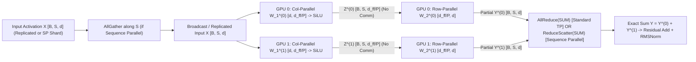
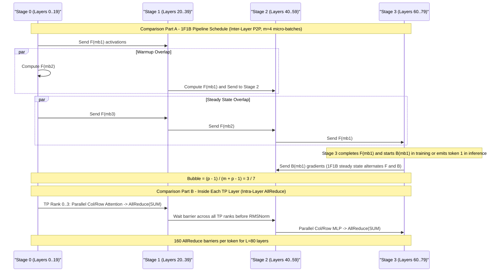

# 03. Intra-Layer & Inter-Layer Parallelism

[Previous: Drafting Architectures](./02-drafting-architectures.md) | [Stage 7 Index](./README.md) | [Next: Specialized Parallelism (EP & SP)](./04-specialized-parallelism-ep-and-sp.md)

When a language model's weights or memory demands exceed what a single chip can hold or read quickly, the model must be split across multiple GPUs. This guide explains the two primary ways to partition Transformer layers—splitting *inside* each layer to cut latency, or splitting *across* layers to scale capacity and throughput.

---

## Core Concepts & Terminology

Every hardware, model, and distributed systems term used in this document is defined below in logical dependency order:

* **Weights, Activations, & KV Cache:** **Weights** are the model's learned parameters; **activations** are the intermediate token vectors flowing between layers; the **KV cache** stores past Key and Value attention vectors to avoid recomputing them during generation.
* **BF16, FP8, HBM, & VRAM:** **BF16** (2 bytes/number) and **FP8** (8-bit floating point, 1 byte/number) are compact numeric formats. **HBM** (High-Bandwidth Memory) is the GPU's ultra-fast on-package memory, also referred to as **VRAM** (Video RAM).
* **Transformer Layer, Attention, MLP, SwiGLU, GeLU/SiLU, & RMSNorm:** Each **Transformer layer** contains a **Self-Attention** block (four linear projections: $W_Q, W_K, W_V, W_O$) and an **MLP** (Multi-Layer Perceptron) feedforward block ($W_1, W_2$, or gated **SwiGLU** with $W_{\text{gate}}, W_{\text{up}}, W_{\text{down}}$). **GeLU** and **SiLU** are element-wise nonlinear activation functions; **RMSNorm** (Root Mean Square Normalization) normalizes activation vectors; a **residual connection** adds a block's input directly to its output ($X + Y$).
* **MHA, GQA, MQA, FlashAttention, & PagedAttention:** In **Multi-Head Attention (MHA)**, every query head ($H$) has its own Key/Value head ($H_{\text{kv}} = H$). **Grouped-Query Attention (GQA)** shares fewer KV heads ($H_{\text{kv}} < H$) across query head groups to save KV cache memory; **Multi-Query Attention (MQA)** uses $H_{\text{kv}} = 1$. **FlashAttention** and **PagedAttention** are fast, memory-tiled GPU attention kernels.
* **Prefill, Decode, Continuous Batching, Chunked Prefill, TTFT, & ITL:** **Prefill** processes the prompt in parallel (**TTFT** = Time-To-First-Token); **Decode** generates tokens sequentially (**ITL** = Inter-Token Latency). **Continuous batching** dynamically swaps finished requests out of a running batch; **chunked prefill** splits long prompts into fixed-size chunks so prefill does not stall decode.
* **NCCL & Collective Primitives (`AllReduce`, `ReduceScatter`, `AllGather`, `Send/Recv`):** **NCCL** (NVIDIA Collective Communications Library) orchestrates multi-GPU communication across **ranks** (individual GPU IDs $0 \dots P-1$). **`AllReduce(SUM)`** sums tensors across all GPUs and returns the full sum to every GPU; **`ReduceScatter(SUM)`** sums and splits the result so each GPU keeps a unique $1/P$ slice; **`AllGather`** reassembles $1/P$ slices into the full tensor on every GPU; **`Send/Recv`** performs point-to-point (**P2P**) transfers between two specific GPUs.
* **Interconnects (NVLink, NVSwitch, PCIe, InfiniBand, RoCEv2):** **NVLink** and **NVSwitch** are ultra-fast, low-latency GPU-to-GPU fabrics inside a single server node. **PCIe** is the standard motherboard bus (much slower for frequent GPU syncs). **InfiniBand** and **RoCEv2** (RDMA over Converged Ethernet) are high-speed network fabrics linking *separate* server nodes.
* **Tensor Parallelism (TP, Megatron-LM Column-Parallel & Row-Parallel):** **Intra-layer parallelism** that splits individual weight matrices *inside* every layer across $P$ GPUs. **Column-Parallel** splits a matrix vertically along its output columns; **Row-Parallel** splits the following matrix horizontally along its input rows so partial results can be summed with a single `AllReduce`, cutting both VRAM per GPU and single-request ITL.
* **Sequence Parallelism (SP):** An extension of TP that shards replicated activations along the sequence length $S$ during `RMSNorm` and residual-add steps by decomposing `AllReduce` into `ReduceScatter` + local norm + `AllGather`, reducing activation memory by $P\times$ with zero extra communication bytes.
* **Pipeline Parallelism (PP), Stages ($p$), Micro-Batches ($m$), & Pipeline Bubble:** **Inter-layer parallelism** that assigns contiguous groups of layers to $p$ GPU **stages**, forwarding hidden states via P2P `Send/Recv`. Splitting a batch into $m$ **micro-batches** lets stages overlap work, while idle waiting slots during pipeline fill/drain form the **pipeline bubble** ($\frac{p-1}{m+p-1}$).
* **GPipe, 1F1B, & Interleaved 1F1B (Virtual Stages):** **GPipe** executes all $m$ forward passes ($F$) before any backward pass ($B$), requiring $O(m)$ activation memory in training. **1F1B** (One-Forward-One-Backward) alternates $F$ and $B$ in steady state, cutting activation memory to $O(p)$. **Interleaved 1F1B** assigns each GPU $v$ non-contiguous layer chunks (**virtual stages**), shrinking the bubble by $v\times$ at the cost of $v\times$ more P2P transfers.

---

## 1. Why Single-GPU Serving Hits Hard Limits

A dense 70B parameter model in BF16 requires $140\text{ GB}$ just for static weights (before KV cache or activations), exceeding an $80\text{ GB}$ H100. A 405B model in BF16 requires $810\text{ GB}$ ($11+$ H100s). Even when a model *fits* on one GPU (e.g., 70B FP8 on an $80\text{ GB}$ H100), a single GPU's $3.35\text{ TB/s}$ HBM bandwidth caps minimum BF16/FP8 decode latency at $\frac{\text{Weight Bytes}}{\text{Bandwidth}}$.

Splitting a Transformer across $P$ GPUs requires choosing *which dimension* to partition:
* **Intra-Layer Parallelism (Tensor Parallelism, TP):** Splits individual weight matrices *within* every layer across $P$ GPUs, aggregating partial results at every layer boundary via high-speed collectives (`AllReduce`). Reduces **both VRAM per GPU and single-request latency (ITL)**.
* **Inter-Layer Parallelism (Pipeline Parallelism, PP):** Assigns contiguous groups of Transformer layers to different GPUs, passing activations point-to-point between stages. Increases **total cluster throughput and VRAM capacity**, but **does not reduce single-request latency**.

---

## 2. Tensor Parallelism (Megatron-LM Style)

### 2.1 Column-Parallel Followed by Row-Parallel Linear Layers

Naively splitting a single matrix multiplication $Y = XW$ across $P$ GPUs requires an `AllReduce` or `AllGather` after *every* linear layer. In a standard Transformer layer (4 linear layers in Attention + 2 or 3 in MLP/SwiGLU), naive sharding would require **4 to 7 collectives per layer**!

**Megatron-LM Tensor Parallelism** (Shoeybi et al., 2019) pairs a **Column-Parallel Linear** layer directly with a **Row-Parallel Linear** layer so that intermediate activations remain partitioned across GPUs without communication, reducing synchronization to **just 2 `AllReduce` calls per Transformer layer** (one after Attention, one after MLP).

#### Mathematical Proof for the MLP Block
Consider a standard two-layer MLP (or gated SwiGLU MLP) with input $X \in \mathbb{R}^{S \times d}$ (replicated on all $P$ ranks), first weight $W_1 \in \mathbb{R}^{d \times d_{\text{ff}}}$, element-wise nonlinearity $\sigma(\cdot)$ (GeLU or SiLU), and second weight $W_2 \in \mathbb{R}^{d_{\text{ff}} \times d}$:

1. **Column-Parallel Partitioning of $W_1$:** Split $W_1$ along its *columns* (output dimension $d_{\text{ff}}$) into $P$ slices:
   $$W_1 = \big[\, W_1^{(0)} \;\big|\; W_1^{(1)} \;\big|\; \dots \;\big|\; W_1^{(P-1)} \,\big], \qquad W_1^{(r)} \in \mathbb{R}^{d \times (d_{\text{ff}}/P)}$$
   Each GPU rank $r$ computes its local slice independently using the replicated input $X$:
   $$Z^{(r)} = \sigma\!\left(X W_1^{(r)}\right) \in \mathbb{R}^{S \times (d_{\text{ff}}/P)}$$
   Because $\sigma(\cdot)$ is **strictly element-wise**, $\sigma([A_0 \mid A_1]) = [\sigma(A_0) \mid \sigma(A_1)]$. Thus, **zero communication is required** between $W_1$ and $W_2$! (For SwiGLU, both $W_{\text{gate}}$ and $W_{\text{up}}$ are column-parallel along $d_{\text{ff}}$, and the element-wise product $\text{SiLU}(X W_{\text{gate}}^{(r)}) \odot (X W_{\text{up}}^{(r)})$ also requires zero communication.)

2. **Row-Parallel Partitioning of $W_2$:** Split $W_2$ along its *rows* (input dimension $d_{\text{ff}}$) to match the column slices of $Z$:
   $$W_2 = \begin{bmatrix} W_2^{(0)} \\ W_2^{(1)} \\ \vdots \\ W_2^{(P-1)} \end{bmatrix}, \qquad W_2^{(r)} \in \mathbb{R}^{(d_{\text{ff}}/P) \times d}$$
   Each GPU rank $r$ computes a partial output matrix of full shape $[S, d]$:
   $$Y^{(r)} = Z^{(r)} W_2^{(r)} \in \mathbb{R}^{S \times d}$$

3. **Exact Summation via Single `AllReduce`:** By block-matrix multiplication:
   $$Y = Z W_2 = \big[\, Z^{(0)} \;\big|\; \dots \;\big|\; Z^{(P-1)} \,\big] \begin{bmatrix} W_2^{(0)} \\ \vdots \\ W_2^{(P-1)} \end{bmatrix} = \sum_{r=0}^{P-1} Z^{(r)} W_2^{(r)} = \sum_{r=0}^{P-1} Y^{(r)}$$
   A single `AllReduce(SUM)` across the $P$ GPUs sums $Y^{(r)}$ and returns the exact full tensor $Y \in \mathbb{R}^{S \times d}$ to every rank (before adding the residual connection $X + Y$, note: bias addition on $W_2$, if present, is performed *after* the `AllReduce` or on rank $0$ only so it is not multiplied by $P$).

### 2.2 Multi-Head & Grouped-Query Attention (MHA / GQA) Partitioning

Self-attention exhibits natural column parallelism across **attention heads**:
* **Column-Parallel Q, K, V Projections:** Split $W_Q, W_K, W_V$ by attention heads so rank $r$ holds $H / P$ query heads and $H_{\text{kv}} / P$ KV heads.
* **Zero-Communication Attention Computation:** Since each attention head computes $\text{softmax}\!\left(\frac{Q_h K_h^\top}{\sqrt{d_h}}\right) V_h$ completely independently of all other heads, each GPU executes FlashAttention/PagedAttention **locally on its $H/P$ heads** and stores only $1/P$ of the KV cache!
* **Row-Parallel Output Projection $W_O$:** Split $W_O$ along its rows (corresponding to the concatenated heads) so rank $r$ computes $Y_{\text{attn}}^{(r)} = \text{Concat}(O_{\text{local}}) W_O^{(r)}$, followed by **1 `AllReduce(SUM)`**.

#### Critical Edge Case: GQA / MQA When $H_{\text{kv}} < \text{TP}$
In modern LLMs (e.g., Llama-3-70B has $H_Q = 64$ query heads and $H_{\text{kv}} = 8$ KV heads; Mistral-7B has $H_{\text{kv}} = 8$):
* If $\text{TP} = 8$, each GPU gets $64 / 8 = 8$ query heads and $8 / 8 = 1$ KV head—cleanly divisible.
* If $\text{TP} = 16$ (or a model with $H_{\text{kv}} = 4$ running at $\text{TP} = 8$), $H_{\text{kv}} < \text{TP}$. You **cannot** split a single KV head's $d_{\text{head}}$ dimension without cross-GPU softmax reduction. Instead, engines must **replicate** each KV head across $\text{TP} / H_{\text{kv}}$ GPUs (losing KV cache memory savings beyond $H_{\text{kv}}$ GPUs), or switch to Context/Pipeline Parallelism.

### 2.3 Sequence-Parallel (SP) LayerNorm / RMSNorm

In standard Megatron-LM TP, the input/output of `AllReduce` (shape $[B, S, d]$) and the subsequent `RMSNorm` + residual add are **replicated identically** across all $P$ GPUs. During long-context prefill (e.g., $S = 128{,}000$), storing replicated activations wastes $P\times$ activation memory and duplicates `RMSNorm` compute across all GPUs.

**Megatron Sequence Parallelism** (Korthikanti et al., 2023) eliminates this redundancy without increasing communication bytes:
* Decompose `AllReduce(SUM)` (cost: $2\frac{P-1}{P} M$ bytes) into its two constituent halves:
  1. **`ReduceScatter(SUM)`** at the end of Row-Parallel Linear ($W_O$ or $W_2$), summing partial results and scattering **along the sequence dimension $S$** so each rank $r$ receives shape $[B, S/P, d]$ (cost: $\frac{P-1}{P} M$ bytes).
  2. **Local Residual Add + `RMSNorm` / Dropout** on each rank's $[B, S/P, d]$ shard ($P\times$ less activation memory and $P\times$ fewer norm FLOPs).
  3. **`AllGather`** right before the next Column-Parallel Linear ($W_{QKV}$ or $W_1$) to reconstruct the full $[B, S, d]$ input (cost: $\frac{P-1}{P} M$ bytes).

Total communication volume is **mathematically identical** to `AllReduce` ($1\times$ `ReduceScatter` + $1\times$ `AllGather` = $2\frac{P-1}{P}M$), while activation memory in the non-TP regions drops by $P\times$.

### 2.4 Why TP Accelerates Single-Request Latency

Because every rank loads only $1/P$ of the weights ($W_{\text{total}} / P$ bytes) and reads $1/P$ of the KV cache from its own HBM in parallel, ideal decode compute+HBM time drops by $P\times$:
$$T_{\text{TP}}(P) = \frac{T_{\text{single}}}{P} + 2 L \cdot T_{\text{AllReduce}}\!\left(\text{bytes} = 2 \cdot B \cdot S_{\text{step}} \cdot d\right)$$
For Llama-3-70B ($L = 80$ layers), there are $2 \times 80 = 160$ `AllReduce` barriers per generated token! Because each decode `AllReduce` moves tiny payloads ($B \cdot d \cdot 2\text{ bytes} \approx 16\text{ KB}$ at $B=1, d=8192$), **communication is strictly latency-bound**. Consequently, TP scales efficiently **only over ultra-low-latency intra-node NVLink/NVSwitch** ($\sim 1\text{--}5\,\mu\text{s}$ per `AllReduce`, totaling $\sim 0.2\text{--}0.8\text{ ms}$ across 160 calls), and collapses over PCIe or cross-node InfiniBand (see Topic 5).

---

## 3. Pipeline Parallelism (PP)

### 3.1 Layer-Wise Partitioning and the Pipeline Bubble

**Pipeline Parallelism** splits the $L$ Transformer layers sequentially into $p$ stages (e.g., for $L = 80$ layers across $p = 4$ GPUs: GPU 0 holds layers $0\text{--}19$, GPU 1 holds $20\text{--}39$, GPU 2 holds $40\text{--}59$, GPU 3 holds $60\text{--}79$).

Instead of `AllReduce` barriers inside layers, stage $s$ sends only the **hidden state tensor** $H \in \mathbb{R}^{B \times S_{\text{step}} \times d}$ to stage $s+1$ via point-to-point `NCCL Send/Recv` ($p - 1$ hops total per forward pass).

* **Naive Execution (No Micro-Batching):** If a single batch runs through GPU 0 $\to$ 1 $\to$ 2 $\to$ 3 sequentially, only 1 GPU is active at any instant! Hardware utilization is $\frac{1}{p}$ ($25\%$ on 4 GPUs), and the **pipeline bubble** (idle time) is $\frac{p - 1}{p} = 75\%$.
* **Micro-Batching ($m$ micro-batches):** Split a global batch $B$ into $m$ smaller micro-batches of size $B / m$. As soon as GPU 0 finishes micro-batch 1, it passes activations to GPU 1 and immediately starts micro-batch 2.

### 3.2 GPipe vs. 1F1B (and Interleaved 1F1B) Schedules

While **inference** only executes forward passes (where micro-batches flow continuously through stages without backward passes, though prefill chunks vs. decode batches still create stage imbalance bubbles), **Pipeline Parallelism schedules** were formalized for both training and mixed forward/backward workloads (and govern how engines analyze bubble overhead):

1. **GPipe Schedule (All-Forward, All-Backward):**
   * Stage 0 runs forward passes for all $m$ micro-batches ($F_1, F_2, \dots, F_m$) before any backward pass starts, then runs all $m$ backward passes ($B_m, \dots, B_1$).
   * **Bubble Fraction:** Each step spends $m$ time slots in useful forward work (or $2m$ forward+backward in training) and $p - 1$ idle slots filling/draining the pipeline:
     $$\text{Bubble Fraction} = \frac{p - 1}{m + p - 1}$$
   * **Memory Weakness:** In training, every stage must retain activations for *all $m$ in-flight micro-batches* simultaneously ($O(m)$ activation memory).

2. **1F1B (One-Forward-One-Backward) Schedule:**
   * Consists of three phases: **Warmup** (stage $s$ runs $p - 1 - s$ forward micro-batches), **Steady State** (every stage strictly alternates $1$ forward pass followed by $1$ backward pass), and **Cooldown** (draining remaining backward passes).
   * **Identical Bubble Fraction:** Still $\frac{p - 1}{m + p - 1}$ (when $T_F \approx T_B$, total slots $= m + p - 1$ per direction), **but** the maximum number of in-flight micro-batches whose activations must be stored drops from $m$ down to **$p$** ($O(p)$ memory instead of $O(m)$, allowing much larger $m$ to shrink the bubble!).

3. **Interleaved 1F1B (Virtual Stages):**
   * Assign each GPU $v$ non-contiguous chunks of $L / (p \cdot v)$ layers (e.g., GPU 0 holds layers $\{0\text{--}9, 40\text{--}49\}$ instead of $\{0\text{--}19\}$).
   * Shrinks the pipeline bubble by $v\times$: $\text{Bubble} \approx \frac{p - 1}{v \cdot m + p - 1}$, at the cost of $v\times$ more inter-stage P2P activation transfers.

### 3.3 Inference-Specific Bubble Analysis & Why PP Does Not Reduce Single-Request Latency

In **pure inference** (forward-only continuous batching), you do not have backward passes—so why do pipeline bubbles still occur?
1. **Batch / Continuous-Batching Draining & Prefill-Decode Skew:** If micro-batch 1 is a heavy $4096$-token Prefill ($20\text{ ms}$ per stage) and micro-batch 2 is a lightweight $B=32$ Decode step ($2\text{ ms}$ per stage), every downstream stage stalls for $18\text{ ms}$ waiting behind the heavy prefill micro-batch! (Chunked prefill mitigates this by making every micro-batch roughly equal token count.)
2. **Low Concurrency ($m < p$):** When only $1$ request (or $1$ batch) is active ($m = 1$), the bubble fraction is $\frac{p - 1}{1 + p - 1} = \frac{p - 1}{p}$.

Crucially, **Pipeline Parallelism NEVER reduces single-request latency (TTFT or ITL)**:
* A single token must traverse **every layer sequentially** ($0 \to 1 \to \dots \to L-1$) regardless of how many GPUs hold them.
* Total single-request latency under PP is:
  $$T_{\text{PP}}(B=1) = \sum_{s=0}^{p-1} T_{\text{stage}, s} + (p - 1) \cdot T_{\text{P2P\_hop}} \ge T_{\text{single\_GPU}}$$
  It is always *slightly slower* per request than running on a hypothetical single GPU with enough VRAM, due to the $(p - 1)$ inter-GPU activation hops.
* **Why Use PP in Inference?** (1) To fit models that exceed single-node NVLink VRAM across **multiple nodes** over slower InfiniBand/Ethernet—where TP's 160 `AllReduce`s per token would destroy latency, whereas PP only sends $p - 1$ tiny P2P tensors per token! (2) To scale **total system throughput** (tokens/sec across $m \ge 4p$ concurrent micro-batches) at minimal communication bandwidth.

---

## 4. Architecture & Execution Diagrams

### 4.1 Megatron-LM Column/Row Tensor Parallelism + Sequence Parallelism

### 4.2 1F1B Pipeline Parallelism (4 GPUs) vs. Intra-Layer TP Synchronization

---

## 5. TP vs. PP Summary Matrix

| Property | Tensor Parallelism (TP) | Pipeline Parallelism (PP) |
| :--- | :--- | :--- |
| **Partitioning Axis** | Weight matrix rows/columns & attention heads *inside* every layer | Contiguous groups of *entire layers* across stages |
| **KV Cache Sharding** | $1/P$ per GPU (until $P > H_{\text{kv}}$) | $1/p$ of layers per GPU (always exact) |
| **Collective Primitive** | `AllReduce` (or `ReduceScatter` + `AllGather` with SP) | Point-to-point `Send` / `Recv` between adjacent stages |
| **Syncs per Token ($L=80$)** | $2L = 160$ blocking collective barriers | $p - 1$ sequential stage hops (e.g., $3$ for $p=4$) |
| **Single-Request Latency (ITL)** | **Improves** ($\sim 1/P$ compute/HBM time) | **Degrades slightly** (adds $p-1$ P2P hops; zero speedup) |
| **Throughput Scaling** | High at small $P$, limited by `AllReduce` overhead | High when $m \gg p$ (amortizes pipeline bubble) |
| **Required Interconnect** | **NVLink / NVSwitch** (ultra-low latency, high BW) | Can tolerate **InfiniBand / RoCEv2** across nodes |

---

[Previous: Drafting Architectures](./02-drafting-architectures.md) | [Stage 7 Index](./README.md) | [Next: Specialized Parallelism (EP & SP)](./04-specialized-parallelism-ep-and-sp.md)
