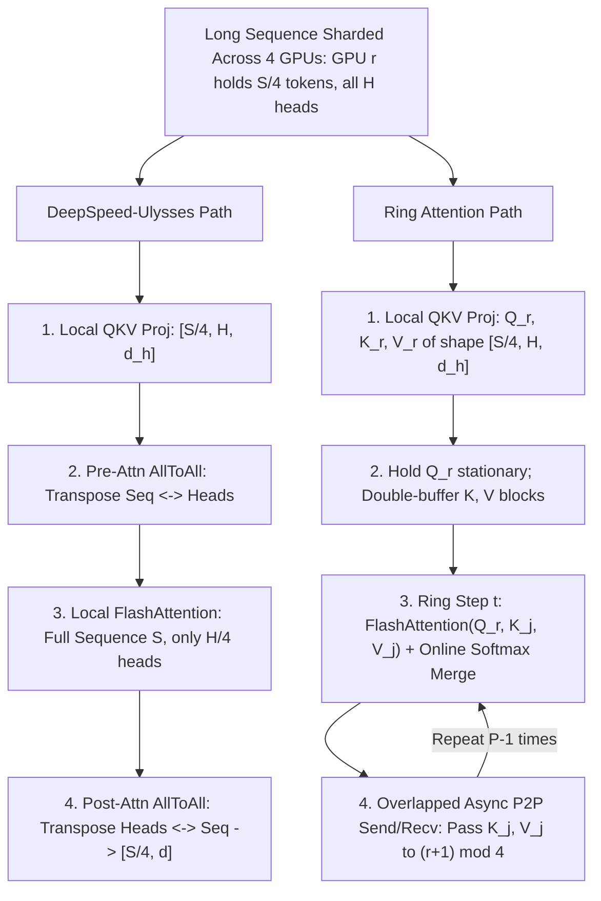
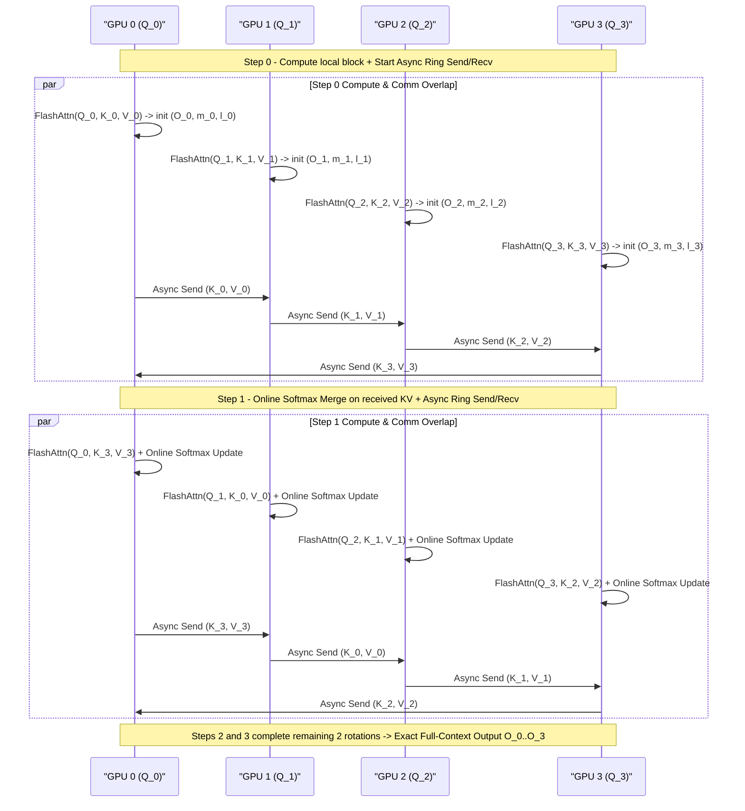

# 04. Specialized Parallelism: Expert Parallelism (EP) & Sequence Parallelism (SP)

[Previous: Intra-Layer & Inter-Layer Parallelism](./03-intra-and-inter-layer-parallelism.md) | [Stage 7 Index](./README.md) | [Next: Collective Communication (NCCL)](./05-collective-communication-nccl.md)

Sparse multi-expert models and million-token prompts break standard layer-splitting strategies, either wasting matrix-math hardware on tiny slices or overflowing memory on a single sequence. This guide explains how modern serving engines distribute experts across GPUs and split ultra-long prompts without sacrificing math accuracy or saturating network links.

---

## Core Concepts & Terminology

Every model architecture, communication primitive, and parallelism concept used in this document is defined below in dependency order:

* **Attention Heads ($H, H_{\text{kv}}, d_h$), GQA, Causal Attention, & KV Cache:** Self-attention projects tokens into Queries ($Q$), Keys ($K$), and Values ($V$) across $H$ query heads and $H_{\text{kv}}$ KV heads of dimension $d_h$ (**GQA**, Grouped-Query Attention, shares fewer KV heads across query groups). Under **causal attention**, token $i$ only attends to tokens $\le i$. The **KV cache** stores past $K, V$ vectors in **HBM** (GPU memory).
* **FFN / MLP, Tensor Cores, GEMM, Grouped GEMM, & Arithmetic Intensity:** An **FFN / MLP** is the feedforward block in each Transformer layer. **Tensor Cores** execute matrix-matrix multiplications (**GEMM**) measured in **FLOPs**; **arithmetic intensity** is FLOPs per byte read from memory. **Grouped GEMM** (e.g., `torch._grouped_mm`, CUTLASS) runs many variably sized matrix multiplications together in a single GPU kernel.
* **BF16, FP8, Quantization, & Per-Group Scales:** **BF16** (2 bytes/element) and **FP8** (1 byte/element) are compact floating-point formats. **Quantization** converts BF16 activations into FP8 using **per-group scales** to halve network and memory traffic.
* **Mixture-of-Experts (MoE), Routed/Shared Experts, Router ($W_{\text{gate}}$), & Top-$k$ Routing:** An **MoE** layer replaces one large FFN with $E$ smaller **routed experts** (plus optional always-active **shared experts**). A learned **router** computes gating scores $\text{softmax}(X W_{\text{gate}})$ and routes each token only to its **top-$k$** experts, keeping active FLOPs low despite massive total parameter counts.
* **Data Parallelism (DP), Tensor Parallelism (TP), & Pipeline Parallelism (PP):** **DP** assigns independent user requests to each GPU (zero shared KV cache); **TP** shards weight matrices inside layers across GPUs via `AllReduce`; **PP** assigns different layers to different GPUs.
* **Multi-Head Latent Attention (MLA):** An attention design (e.g., DeepSeek-V2/V3) that compresses Keys and Values into a single low-rank latent vector ($d_c = 512$) per token rather than storing separate KV heads.
* **Collectives (`AllReduce`, `AllGather`, `AllToAll`, `AllToAllv`, P2P `Send/Recv`) & NVSHMEM:** **`AllGather`** collects shards from all GPUs; **`AllToAll`** performs a personalized exchange where every GPU sends a distinct chunk to every peer (**`AllToAllv`** handles variable-length chunks); **Async P2P `Send/Recv`** transfers buffers between two specific GPUs on a background stream. **NVSHMEM** enables GPU-initiated direct memory transfers (e.g., DeepEP kernels).
* **Interconnects (NVLink, NVSwitch, PCIe, InfiniBand NDR, Fat-Tree, RDMA, Bisection Bandwidth):** **NVLink / NVSwitch** connect GPUs inside a server node; **PCIe** is the slower motherboard bus; **InfiniBand (IB) NDR** links separate nodes via **RDMA** (Remote Direct Memory Access) switches (often in a **Fat-Tree** topology). **Bisection bandwidth** is the total bandwidth across the narrowest cut dividing a network in half.
* **Expert Parallelism (EP), Dispatch/Combine, Capacity Factor, Stragglers, & Dual-Batch Overlap:** **EP** places $E / N_{\text{EP}}$ complete experts on each of $N_{\text{EP}}$ GPUs and routes tokens via two `AllToAll` collectives (**Dispatch** and **Combine**). **Routing skew** (hot experts) creates **stragglers** that stall peers at the Combine barrier. A **Capacity Factor ($C$)** caps tokens per expert by dropping excess tokens, whereas **dropless inference** uses `AllToAllv` to process 100% of tokens. **Dual-batch overlap** splits a batch into two micro-batches so one computes while the other communicates.
* **Context / Sequence Parallelism (CP / SP), Prefill, & Chunked Prefill:** Splits long input sequences ($S$) into $P$ chunks of length $S/P$ across $P$ GPUs during **Prefill** (or **Chunked Prefill**) so activations and KV cache fit in HBM.
* **DeepSpeed-Ulysses:** An SP algorithm that uses `AllToAll` to transpose tensors from *sequence-sharded* ($[B, S/P, H, d_h]$) to *head-sharded* ($[B, S, H/P, d_h]$), runs standard local **FlashAttention**, and transposes back—capped at $P \le H_{\text{kv}}$ unless KV heads are replicated.
* **Ring Attention, Online Softmax, Double Buffering, Zig-Zag Partitioning, & USP:** **Ring Attention** keeps query chunks $Q^{(r)}$ stationary and rotates $(K, V)$ chunks around a GPU ring via overlapped P2P `Send/Recv` into a **double buffer** (two alternating buffers so transfer and compute do not collide). **Online Softmax** incrementally merges local attention tiles using running row-wise max ($m_r$) and log-sum-exp ($l_r$) rescaling. **Zig-Zag partitioning** pairs front and back chunks $(C_r, C_{2P-1-r})$ on each GPU to balance causal FLOPs. **USP** (Unified Sequence Parallelism) combines Ulysses intra-node with Ring Attention inter-node.

---

## 1. Expert Parallelism (EP) for Mixture-of-Experts (MoE)

### 1.1 Why Standard Tensor Parallelism Fails for Frontier MoE Models

Modern frontier MoE models (e.g., Mixtral-8x22B, DeepSeek-V3 671B with 256 routed experts + 1 shared expert, Qwen3-MoE) activate only $k$ out of $E$ experts per token (e.g., $k = 8$ out of $E = 256$). While **total parameters** are huge (requiring multi-GPU or multi-node VRAM), **active FLOPs per token** are small.

If you apply pure **Tensor Parallelism ($\text{TP} = 8$ or $16$)** to an MoE layer:
1. Each expert's FFN intermediate dimension $d_{\text{expert}}$ is already small (e.g., $d_{\text{expert}} = 2048$ in DeepSeek-V3 vs. $18{,}432$ in dense 70B). Sharding $2048$ across $16$ GPUs leaves tiny $[B_{\text{tok}}, 128]$ matrices—producing **catastrophically low GEMM efficiency** and wasted Tensor Core utilization.
2. Worse, during decode at batch size $B$, each GPU still executes $2 \times L$ `AllReduce` barriers per layer while reading weights for *multiple* sparsely activated experts.

**Expert Parallelism (EP)** solves this by partitioning the $E$ experts **across $N_{\text{EP}}$ GPUs** without slicing individual expert weight matrices along $d_{\text{expert}}$:
* Each GPU rank $r \in \{0, \dots, N_{\text{EP}}-1\}$ holds $E / N_{\text{EP}}$ complete experts (e.g., for $E = 256, N_{\text{EP}} = 64$, each GPU holds $4$ full experts).
* Instead of keeping tokens stationary and splitting each expert's weights across GPUs (which produces tiny, inefficient matrix slices), **tokens dynamically travel across the network to whichever GPUs hold their selected experts**, execute full-width matrix multiplications locally, and return via two `AllToAll` collectives per MoE layer.

### 1.2 Token Dispatch & Combine Lifecycle (`AllToAll`)

Consider a batch of $T$ tokens on each DP/attention rank (with hidden dimension $d$ and top-$k$ routing):

1. **Local Gate & Routing Metadata:** Each GPU computes router logits $g = \text{softmax}(X W_{\text{gate}})$ and selects top-$k$ experts $(e_{i,1}, \dots, e_{i,k})$ with gating weights $(w_{i,1}, \dots, w_{i,k})$ for every local token $i \in \{1, \dots, T\}$.
2. **Metadata Exchange (`AllGather` or small `AllToAll`):** Ranks exchange per-rank token destination counts `send_counts[r]` so every GPU knows how many variable-length tokens it will receive from each peer (required for `ncclAllToAllv` / dynamic buffer allocation, unless fixed capacity padding is used).
3. **Token Permute & Dispatch (`AllToAll` #1):**
   * Each rank packs tokens contiguous by destination GPU rank (like sorting a tensor by `dest_rank` so each peer's slice is contiguous in memory, duplicating token $i$ up to $k$ times—once for each selected expert on a distinct rank, or deduplicating per destination node in hierarchical node-limited routing!).
   * Executes `AllToAll` (specifically `AllToAllv` for variable counts, analogous to `torch.distributed.all_to_all_single` with uneven splits) to route token hidden states $[T \cdot k, d]$ across the $N_{\text{EP}}$ GPUs.
4. **Local Grouped GEMM (Expert Execution):**
   * Each GPU receives all tokens assigned to its local $E/N_{\text{EP}}$ experts from across the entire cluster and runs a single **Grouped GEMM** (`torch._grouped_mm` / CUTLASS Grouped GEMM)—which executes many differently sized `[n_tokens_e, d] @ [d, d_expert]` matrix multiplications in a single GPU kernel launch rather than looping in Python.
   * Because tokens from $N_{\text{EP}}$ different GPUs are pooled together, each expert receives $N_{\text{EP}}\times$ more tokens per batch—raising GEMM arithmetic intensity dramatically!
5. **Token Combine (`AllToAll` #2) & Weighted Reduction:**
   * A second `AllToAll` sends computed expert outputs back to their originating GPUs.
   * Each originating GPU multiplies each returned expert output by its gating weight $w_{i,j}$ and sums across $j = 1, \dots, k$ (plus any local shared expert output).

#### Exact Communication Volume per MoE Layer
For $T$ tokens per GPU, hidden dimension $d$, top-$k$ active experts, and element size $b$ bytes (e.g., $b = 1$ byte in FP8 dispatch, $b = 2$ bytes in BF16 combine):
* Assuming uniform routing across $N_{\text{EP}}$ ranks, a fraction $\frac{N_{\text{EP}} - 1}{N_{\text{EP}}}$ of the $T \cdot k$ dispatched activations leave the local GPU:
  $$V_{\text{dispatch}} = T \cdot k \cdot d \cdot b_{\text{dispatch}} \cdot \frac{N_{\text{EP}} - 1}{N_{\text{EP}}}, \qquad V_{\text{combine}} = T \cdot k \cdot d \cdot b_{\text{combine}} \cdot \frac{N_{\text{EP}} - 1}{N_{\text{EP}}}$$
* **Hardware Optimization (FP8 Dispatch):** Because activations are quantized right before the first expert linear layer anyway, engines like DeepSeek-V3 dispatch tokens in **FP8 + per-group scales** ($1\text{ byte/elem}$ instead of $2\text{ bytes}$), cutting `AllToAll` #1 network bandwidth by **50%**, while combining outputs in BF16 for summation precision.

### 1.3 Load Imbalance, Capacity Factor, and Stragglers

Unlike dense TP where every GPU performs identical FLOPs, EP suffers from **dynamic routing skew**:
* **The Straggler Problem:** If a hot expert (e.g., punctuation/syntax expert) on GPU 3 receives $40\%$ of all tokens in a batch while GPU 7 receives $2\%$, **all $N_{\text{EP}} - 1$ GPUs stall** at the `AllToAll` #2 combine barrier waiting for GPU 3!
* **Capacity Factor (Dropping) vs. Dropless (`AllToAllv`):**
  * *Fixed Capacity ($C$):* Caps tokens per expert at $C \cdot \frac{T \cdot k}{E}$ ($C \in [1.0, 1.5]$). Guarantees deterministic buffer sizes and fixed latency, **but drops tokens** when exceeded—degrading model accuracy unpredictably in production.
  * *Dropless Inference (Standard in vLLM/SGLang):* Uses dynamic `AllToAllv` (or NVSHMEM P2P kernels like DeepEP) to process 100% of routed tokens without dropping.
* **Production Mitigations:** (1) **Redundant Hot-Expert Replication:** Duplicate the top-$m$ hottest experts (tracked via rolling exponential moving average of router counts) onto multiple GPUs and split traffic among replicas; (2) **Node-Limited Routing:** Constrain top-$k$ routing during training (e.g., DeepSeek-V3 restricts each token to at most $M = 4$ nodes out of $N_{\text{nodes}}$) so `AllToAll` traffic stays localized; (3) **Shared Expert Overlap:** Run dense shared experts on the GPU simultaneously while `AllToAll` #1 is in flight on an RDMA stream.

### 1.4 Hybrid Parallelism: `DP (Attention) + EP (MoE)` vs. `TP + EP`

How should Attention and MoE layers be combined across $G$ GPUs?

1. **Classic `TP + EP` (or Pure `TP` on Attention, `EP` on MoE):**
   * Attention uses `TP` (say $\text{TP} = 8$ inside a node) so KV cache is split $8\times$, while MoE uses $\text{EP} = 8$ (or $\text{EP} = 64$ across nodes).
   * **Problem during Decode:** Under `TP = 8` for Attention, all $8$ GPUs process the *same* batch of $B$ requests (or replicate KV heads when $H_{\text{kv}} < \text{TP}$). Specifically, for **Multi-Head Latent Attention (MLA)** (DeepSeek-V2/V3), there is only **1 compressed latent KV vector** ($d_c = 512$) per token! Sharding MLA across $\text{TP} = 8$ forces you to **replicate the compressed KV cache $8\times$** across all 8 GPUs!

2. **Modern `DP (Attention) + EP (MoE)` (DeepSeek-V3 / SGLang Wide-EP Architecture):**
   * Run **Data Parallelism ($\text{DP} = G$)** for the Attention layers: each GPU handles *different* user requests ($B/G$ requests per GPU), holding **zero duplicated KV cache** (100% distinct KV entries per GPU)!
   * At the MoE boundary, switch seamlessly to **Expert Parallelism ($\text{EP} = G$)** via `AllToAll` dispatch/combine across all $G$ GPUs (often spanning $32$ to $128$ H100/H800 GPUs).
   * To eliminate `AllToAll` latency stalls, **Dual-Batch / Two-Microbatch Overlap** splits the local batch into two halves ($B_A, B_B$): while micro-batch $B_A$ is waiting on `AllToAll` network transfer, the GPU executes Attention/Shared-Expert compute for micro-batch $B_B$!

---

## 2. Sequence / Context Parallelism (SP) for Ultra-Long Contexts

When serving ultra-long context lengths ($S = 128\text{k}$ to $2\text{M}$ tokens), **neither TP nor PP** solves the single-request activation and KV cache memory explosion during Prefill:
* At $S = 1\text{M}$ tokens in Llama-3-70B, attention activations and the KV cache ($320\text{ GB}$ just for KV in BF16!) far exceed a single GPU's HBM—and even with $\text{TP}=8$, $H_{\text{kv}} = 8$ limits TP scaling beyond $8$ GPUs!
* **Context / Sequence Parallelism (CP / SP)** splits the sequence dimension $S$ into $P$ chunks of length $S/P$ across $P$ GPUs. The hard engineering challenge is **Self-Attention**, where every query token in chunk $i$ must attend to **every key/value token in all chunks $0 \dots i$**.

Two dominant algorithms solve cross-chunk attention: **DeepSpeed-Ulysses** and **Ring Attention**.

### 2.1 DeepSpeed-Ulysses (`AllToAll` Head-Switch)

**DeepSpeed-Ulysses** (Jacobs et al., 2023) avoids writing custom distributed attention math completely by **transposing the sharding axis across GPUs**—analogous to calling `tensor.transpose(1, 2)` across machines—switching from *sequence-sharded* to *head-sharded* right before FlashAttention:

1. **Sequence-Sharded Input:** Each of the $P$ GPUs holds a local sequence shard of length $S/P$, shape `[B, S/P, d]`, and computes local Q, K, V projections independently (`nn.Linear` operates token-by-token, so it needs no cross-GPU communication):
   $$Q^{(r)}, K^{(r)}, V^{(r)} \in \mathbb{R}^{B \times (S/P) \times H \times d_h}$$
2. **Pre-Attention `AllToAll` (Sequence-Split $\to$ Head-Split):**
   * Execute `AllToAll` on $Q, K, V$ across the $P$ GPUs: each GPU splits its `[B, S/P, H, d_h]` tensor into $P$ head-groups of size $H/P$ and sends group $j$ to GPU $j$, while receiving the remaining sequence chunks for its own $H/P$ heads. In PyTorch terms, this is a distributed tensor transpose swapping the sequence dimension with the head dimension.
   * Each GPU transitions from holding *(part of sequence, all $H$ heads)* to holding ***(entire sequence $S$, only $H/P$ heads)***:
     $$Q_{\text{head}}^{(r)}, K_{\text{head}}^{(r)}, V_{\text{head}}^{(r)} \in \mathbb{R}^{B \times S \times (H/P) \times d_h}$$
3. **Local Exact FlashAttention:** Because each GPU now possesses the **full sequence $S$** for its $H/P$ heads, it runs standard single-GPU FlashAttention-2/3 locally (just like `F.scaled_dot_product_attention`) with **zero custom distributed attention kernels** and native causal masking!
4. **Post-Attention `AllToAll` (Head-Split $\to$ Sequence-Split):**
   * Execute one more `AllToAll` on the attention output $O_{\text{head}}^{(r)} \in \mathbb{R}^{B \times S \times (H/P) \times d_h}$ to switch back to sequence-sharded layout $[B, S/P, d]$ for the Row/MLP layers.

#### Exact Communication Volume & Hard Constraint
* **Communication Volume per GPU per Layer:**
  Let $M_{\text{seq}} = B \cdot S \cdot d \cdot b$ bytes be the size of one full activation tensor ($d = H \cdot d_h$). Across $4$ `AllToAll` calls ($Q, K, V$ pre-attention + $O$ post-attention; or $2 + 2\frac{H_{\text{kv}}}{H}$ for GQA):
  $$V_{\text{Ulysses}} = \left(2 + 2\frac{H_{\text{kv}}}{H}\right) \cdot \frac{P - 1}{P} \cdot \frac{M_{\text{seq}}}{P}$$
  Notice the crucial $\mathbf{1/P}$ scaling per link: as $P$ increases, the bytes sent *per GPU* actually **decrease**! (Total aggregate cluster traffic stays $O(S)$, distributed across $P$ links).
* **Hard Architectural Limitation ($P \le H_{\text{kv}}$):** Ulysses **cannot scale beyond the number of attention heads** (specifically $H_{\text{kv}}$ for KV unless KV heads are replicated prior to `AllToAll`). For a GQA model with $H_{\text{kv}} = 8$, Ulysses hits a hard wall at $P = 8$ GPUs!

### 2.2 Ring Attention (Overlapped P2P KV Ring + Online Softmax)

**Ring Attention** (Liu et al., 2023) keeps **queries $Q^{(r)} \in \mathbb{R}^{B \times (S/P) \times H \times d_h}$ stationary** on GPU $r$ and circulates the $K, V$ blocks in a **logical ring** across all $P$ GPUs using asynchronous point-to-point `Send`/`Recv` overlapped with FlashAttention compute.

#### Mathematical Mechanics (Blockwise Online Softmax)
Why can't each GPU just compute `softmax(Q_r @ K_j.T) @ V_j` on each chunk and average the results? Because `softmax` normalizes by $\sum_j \exp(\cdot)$ across the **entire** sequence—you cannot know the true denominator until you have seen every $K_j$ chunk! **Online Softmax** solves this by tracking a running maximum $m_r$ and running exponential sum $l_r$ so previous partial outputs can be mathematically rescaled whenever a new chunk arrives with a larger maximum score.

Suppose GPU $r$ holds local query chunk $Q^{(r)}$ and receives block $K^{(j)}, V^{(j)}$ at ring step $t$:
1. **Local Tile Attention:** GPU $r$ runs FlashAttention on $(Q^{(r)}, K^{(j)}, V^{(j)})$ to obtain local block output $\tilde{O}_{r,j}$, local row-wise max $m_{r,j}$, and local log-sum-exp denominator $l_{r,j} = \sum \exp(S_{r,j} - m_{r,j})$.
2. **Exact Online Softmax Merge:** GPU $r$ updates its running accumulators $(O_r, m_r, l_r)$ using exact FlashAttention rescaling:
   $$m_{\text{new}} = \max(m_r, m_{r,j}), \qquad l_{\text{new}} = e^{m_r - m_{\text{new}}} l_r + e^{m_{r,j} - m_{\text{new}}} l_{r,j}$$
   $$O_r \leftarrow \frac{e^{m_r - m_{\text{new}}} l_r \cdot O_r + e^{m_{r,j} - m_{\text{new}}} l_{r,j} \cdot \tilde{O}_{r,j}}{l_{\text{new}}}$$
3. **Simultaneous Async P2P Ring Rotation:** *While* GPU $r$'s Tensor Cores are computing attention on $(Q^{(r)}, K^{(j)}, V^{(j)})$, its CUDA communication stream asynchronously sends $(K^{(j)}, V^{(j)})$ to rank $(r+1) \bmod P$ and receives $(K^{(j-1)}, V^{(j-1)})$ from rank $(r-1) \bmod P$ into a **double buffer**.
4. After $P$ ring steps, every GPU has attended over all $P$ KV chunks and holds the exact final output $O_r$.

#### Causal Masking Load Imbalance & Zig-Zag (Striped) Ring Attention
Naive contiguous sequence splitting causes severe **causal load imbalance**:
* Under causal attention, token $i$ only attends to tokens $\le i$.
* GPU $0$ (holding tokens $0 \dots \frac{S}{P}-1$) skips $P-1$ future KV blocks (doing $\frac{1}{P^2}$ of total FLOPs), while GPU $P-1$ (holding the end of the prompt) attends to **all $P$ KV blocks** (doing $\frac{2P-1}{P^2}$ of total FLOPs—up to $(2P-1)\times$ more work than GPU 0!).
* **Fix — Zig-Zag (Symmetric) Partitioning:** Split the sequence into $2P$ chunks $\{C_0, C_1, \dots, C_{2P-1}\}$ and assign GPU $r$ a **front + back pair** $(C_r, C_{2P-1-r})$! Every GPU's total causal attention area sums to the **exact same constant** $\frac{1}{P} \cdot \frac{S^2}{2}$, restoring $100\%$ balanced compute and compute/comm overlap across all $P$ GPUs.

#### Compute-Communication Overlap Condition
At each of the $P - 1$ ring steps, GPU $r$ transfers $K^{(j)}, V^{(j)}$ of size $2 \cdot B \cdot (S/P) \cdot H_{\text{kv}} \cdot d_h \cdot b$ bytes over interconnect bandwidth $BW_{\text{link}}$, while performing $4 \cdot B \cdot (S/P)^2 \cdot H \cdot d_h$ FLOPs (or $2\times$ under causal masking) at Tensor Core throughput $F_{\text{peak}}$:
$$T_{\text{comm}} \le T_{\text{comp}} \iff \frac{2 \cdot B (S/P) H_{\text{kv}} d_h b}{BW_{\text{link}}} \le \frac{2 \cdot B (S/P)^2 H d_h}{F_{\text{peak}}} \implies \frac{S}{P} \ge \frac{F_{\text{peak}}}{BW_{\text{link}}} \cdot \frac{H_{\text{kv}}}{H} \cdot b$$

**Concrete H100 Calculation:**
* $F_{\text{peak}} = 989\text{ TFLOP/s}$, NVLink $BW_{\text{link}} = 450\text{ GB/s}$ unidirectional, BF16 $b = 2\text{ B}$, GQA $H_{\text{kv}}/H = 1/8$:
  $$\frac{S}{P} \ge \frac{989 \times 10^{12}}{450 \times 10^9} \cdot \frac{1}{8} \cdot 2 \approx \mathbf{550\text{ tokens/GPU}}$$
* Over InfiniBand NDR ($BW_{\text{link}} = 50\text{ GB/s}$): $\frac{S}{P} \ge 4{,}945\text{ tokens/GPU}$. Thus, for long-context prefill ($S/P \ge 8\text{k}$), **Ring Attention achieves near-100% communication hiding even across InfiniBand nodes**!

---

## 3. Communication Volume & Interconnect Comparison

| Parallelism Strategy | Collective / Mechanism | Bytes Moved per GPU per Layer | Hard Scaling Constraint | Ideal Interconnect |
| :--- | :--- | :--- | :--- | :--- |
| **Expert Parallelism (EP)** | $2\times$ `AllToAllv` (Dispatch + Combine) | $2 \cdot T k d b_{\text{avg}} \frac{N_{\text{EP}}-1}{N_{\text{EP}}}$ (non-overlapped if single batch) | Load skew / hot experts; small batch latency | NVLink/NVSwitch (decode) or IB NDR w/ dual-batch overlap |
| **DeepSpeed-Ulysses (SP)** | $4\times$ `AllToAll` (Q, K, V, O head-switch) | $(2 + 2\frac{H_{\text{kv}}}{H}) \frac{P-1}{P} \frac{B S d b}{P}$ | **$P \le H_{\text{kv}}$** (cannot scale past KV head count without replication) | High-bisection NVLink / Fat-Tree IB (cannot hide `AllToAll` inside attention) |
| **Ring Attention (CP)** | $(P-1)\times$ async P2P `Send/Recv` of $(K, V)$ | $2 (P - 1) \cdot B \frac{S}{P} H_{\text{kv}} d_h b$ (total, **overlapped** with compute) | Requires local chunk $S/P \gtrsim 550\text{--}5\text{k}$ tokens to hide comm; **prefill/chunked-prefill only** | Tolerates **PCIe & cross-node InfiniBand** (ring topology matches P2P links) |
| **Unified Hybrid (USP)** | **Ulysses $\times$ Ring 2D Mesh** | Ulysses inside NVLink node ($P_U \le H_{\text{kv}}$); Ring across nodes ($P_R$) | Eliminates both Ulysses head limit and cross-node `AllToAll` bottleneck | NVLink intra-node + InfiniBand inter-node |

---

## 4. Architecture & Execution Diagrams

### 4.1 Ring Attention (P2P KV Ring) vs. DeepSpeed-Ulysses (`AllToAll` Head-Switch)

### 4.2 Overlapped Ring Attention Compute and P2P KV Rotation (4 GPUs)

---

[Previous: Intra-Layer & Inter-Layer Parallelism](./03-intra-and-inter-layer-parallelism.md) | [Stage 7 Index](./README.md) | [Next: Collective Communication (NCCL)](./05-collective-communication-nccl.md)
