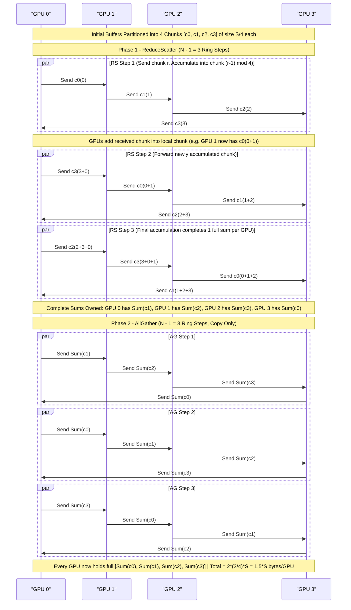

# 05. Collective Communication (NCCL)

[Previous: Specialized Parallelism (EP & SP)](./04-specialized-parallelism-ep-and-sp.md) | [Stage 7 Index](./README.md) | [Complete Syllabus](../../syllabus.md)

Splitting a model across multiple GPUs means those chips must constantly exchange partial results over wires and switches. This guide breaks down the physics of GPU-to-GPU communication, the exact data movement of every collective operation, and why hardware wiring dictates which parallelism strategy works in production.

---

## Core Concepts & Terminology

Every hardware component, networking protocol, and collective communication primitive referenced in this document is defined below in dependency order:

* **Rank ($N$ Ranks), Tensor, BF16, HBM, & SM:** A **rank** is an individual GPU process in a group of $N$ participating GPUs. A **tensor** is a multi-dimensional array of numbers (here stored in **BF16**, 2 bytes per number). **HBM** (High-Bandwidth Memory) is the GPU's fast on-package memory; an **SM** (Streaming Multiprocessor) is a GPU compute core cluster.
* **Prefill, Decode, & ITL:** **Prefill** processes the prompt in parallel (moving large megabyte-scale tensors); **Decode** generates one token at a time (moving tiny kilobyte-scale tensors); **ITL** (Inter-Token Latency) is the real-world time between consecutive generated tokens.
* **Egress, Ingress, & Unidirectional vs. Bidirectional Bandwidth:** **Egress** is data leaving a GPU; **ingress** is data arriving at a GPU. **Unidirectional bandwidth** ($BW_{\text{link}}$, in GB/s) is the one-way transfer rate; **bidirectional bandwidth** is send + receive combined.
* **Hockney $\alpha\text{--}\beta$ Performance Model ($\alpha_{\text{lat}}, k_{\text{steps}}, V_{\text{link}}$):** Models communication time as $k_{\text{steps}} \cdot \alpha_{\text{lat}} + V_{\text{link}} / BW_{\text{link}}$, separating **latency-bound** small messages (governed by per-hop handshake latency $\alpha_{\text{lat}}$ and sequential step count $k_{\text{steps}}$) from **bandwidth-bound** large messages (governed by bytes transmitted $V_{\text{link}}$ divided by $BW_{\text{link}}$).
* **NCCL & Collective Primitives (`ReduceScatter`, `AllGather`, `AllReduce`, `AllToAll`, `Broadcast`):** **NCCL** (NVIDIA Collective Communications Library) coordinates multi-GPU data exchanges:
  * **`ReduceScatter`**: Sums tensors element-wise across all $N$ ranks and leaves each rank $r$ with only its unique $1/N$ reduced slice.
  * **`AllGather`**: Collects unique $1/N$ slices from all ranks so every rank holds the full concatenated tensor.
  * **`AllReduce`**: Sums tensors across all $N$ ranks and gives every rank the full sum (bandwidth-optimal Ring `AllReduce` = `ReduceScatter` + `AllGather`).
  * **`AllToAll` (and `AllToAllv`)**: Personalized exchange where each rank sends a distinct chunk to every other rank (`AllToAllv` supports variable chunk sizes), with zero reduction math.
  * **`Broadcast`**: Copies a tensor from one root rank to all other $N-1$ ranks.
* **Algorithm Bandwidth (`algbw`) vs. Bus Bandwidth (`busbw`):** **`algbw`** ($S / t$) divides tensor size by elapsed time; **`busbw`** scales `algbw` by $2\frac{N-1}{N}$ (for `AllReduce`) to reflect actual link bytes moved, enabling fair comparison against raw hardware bandwidth.
* **Full Bisection Bandwidth, Root Complex, & NUMA (QPI/UPI):** **Full bisection bandwidth** means any half of the GPUs can talk to the other half simultaneously at full link speed. A **PCIe root complex** connects motherboard PCIe slots to a CPU; **NUMA** (Non-Uniform Memory Access) over **QPI/UPI** refers to slower cross-socket links between two CPUs on one server board.
* **NCCL Algorithms (Ring, Double Binary Tree, NVLS / SHARP):** **Ring** passes chunks sequentially around a loop ($2(N-1)$ steps for `AllReduce`), optimal for large messages. **Double Binary Tree** uses two complementary spanning trees ($2\log_2 N$ steps), optimal for small messages and multi-node clusters. **NVLS (NVLink SHARP)** uses **SHARP** (Scalable Hierarchical Aggregation and Reduction Protocol) **ALUs** (Arithmetic Logic Units) inside **NVSwitch ASICs** (custom switch chips) to sum vectors in-flight and **multicast** (one-to-many simultaneous send) the result in 1 hop.
* **Oneshot / Twoshot P2P `AllReduce` & `cudaIpcMemHandle`:** Custom GPU kernels (in vLLM / TRT-LLM) that bypass NCCL for tiny decode tensors by mapping peer buffers via **`cudaIpcMemHandle`** (CUDA Inter-Process Communication) so a single SM kernel reads peers directly over NVLink.
* **NCCL Protocols (LL, LL128, Simple):** **LL** (Low Latency) packs 4B data + 4B polling flag into 8B atomic writes (50% link efficiency, lowest latency); **LL128** packs 120B data + 8B flag into 128B packets (93.75% efficiency); **Simple** sends full chunks with a separate **memory fence** (ordering barrier) for ~100% efficiency on large tensors.
* **Interconnect Fabrics (PCIe, NVLink, InfiniBand NDR, GPUDirect RDMA, RoCEv2):** **PCIe Gen4/Gen5 x16** are standard motherboard lanes. **NVLink 4.0/5.0 + NVSwitch** are ultra-fast intra-node GPU fabrics (inside SXM/HGX/DGX servers, up to 72 GPUs in Blackwell NVL72). **InfiniBand (IB) NDR (400 Gbps)** uses **GPUDirect RDMA** so a **NIC** (Network Interface Card) reads/writes GPU HBM directly across nodes. **RoCEv2 (400 GbE)** is Ethernet RDMA, sensitive to **ECN** (Explicit Congestion Notification) and **PFC** (Priority Flow Control) under `AllToAll` bursts.
* **Parallelism Strategies (TP, PP, DP, EP, SP):** **TP** (Tensor Parallelism), **PP** (Pipeline Parallelism), **DP** (Data Parallelism), **EP** (Expert Parallelism), and **SP** (Sequence Parallelism) are the multi-GPU model-splitting patterns covered in Topics 3–4.

---

## 1. The Physics of Distributed Collectives: Hockney Model

Every collective operation across $N$ GPUs moving a tensor of size $S$ bytes is bounded by two fundamental physical parameters (the **Hockney $\alpha\text{--}\beta$ performance model**):
$$T_{\text{comm}}(S, N) = k_{\text{steps}}(N) \cdot \alpha_{\text{lat}} + \frac{V_{\text{link}}(S, N)}{BW_{\text{link}}}$$
where:
* **$\alpha_{\text{lat}}$ (Per-hop latency):** Kernel launch + synchronization + wire propagation + protocol handshake latency ($\sim 1\text{--}3\,\mu\text{s}$ over NVLink, $\sim 5\text{--}15\,\mu\text{s}$ over PCIe or RDMA InfiniBand).
* **$BW_{\text{link}}$ (Unidirectional link bandwidth per GPU):** Effective payload bandwidth per rank ($25\text{--}50\text{ GB/s}$ PCIe, $450\text{ GB/s}$ NVLink 4.0, $50\text{ GB/s}$ IB NDR).
* **$k_{\text{steps}}(N)$:** Number of sequential communication steps (governs **small-message latency-bound decode**, e.g., $S = 16\text{ KB}$).
* **$V_{\text{link}}(S, N)$:** Total bytes transmitted by each GPU over its egress link (governs **large-message bandwidth-bound prefill / AllToAll**, e.g., $S = 128\text{ MB}$).

Understanding the exact split between **latency-bound ($S \to \text{KB}$)** and **bandwidth-bound ($S \to \text{MB}$)** collectives explains nearly every distributed LLM serving bottleneck. Just as downloading a 1 KB JSON API response is dominated by network round-trip handshake time ($\alpha_{\text{lat}}$) while downloading a 10 GB dataset is dominated by link speed ($BW_{\text{link}}$), a tiny $16\text{ KB}$ decode `AllReduce` spends almost all its time on $k_{\text{steps}} \cdot \alpha_{\text{lat}}$, whereas a $128\text{ MB}$ prefill `AllReduce` spends almost all its time on $V_{\text{link}} / BW_{\text{link}}$. Think of sending a single-page letter versus shipping a 10-ton freight container: the letter's delivery time is dominated by fixed postal handling and routing hops ($k_{\text{steps}} \cdot \alpha_{\text{lat}}$), whereas the freight container's time is dominated by highway capacity ($V_{\text{link}} / BW_{\text{link}}$). In PyTorch `torch.distributed`, calling `dist.all_reduce` during decode moves a tiny `16 KB` tensor (a letter), whereas calling it during long-context prefill moves tens of megabytes (a freight container).

---

## 2. NCCL Primitives & Exact Data Movement Formulas

Let $N$ be the number of participating ranks and $S$ be the tensor byte size (specifically, the size of the full input tensor on each rank for `AllReduce`/`ReduceScatter`/`Broadcast`/`AllToAll`, or the size of the full *reconstructed* output tensor for `AllGather`).

### 2.1 `ReduceScatter`
* **Semantics:** Think of `ReduceScatter` as `sum(tensors, dim=0)` followed by `torch.chunk(..., N)[rank]`. Each rank $r$ starts with a buffer of size $S$ bytes partitioned into $N$ chunks of size $S / N$. It sums element-wise across all ranks, leaving **only chunk $r$** of size $S / N$ (reduced) on rank $r$.
* **Optimal Ring Data Movement:**
  In a logical ring of $N$ GPUs, it takes $N - 1$ sequential ring steps; in each step, every GPU sends one chunk of size $S / N$ bytes to its right neighbor and accumulates the chunk received from its left neighbor.
  $$V_{\text{ReduceScatter}} = (N - 1) \cdot \frac{S}{N} = \mathbf{\frac{N - 1}{N} S \text{ bytes}}$$

### 2.2 `AllGather`
* **Semantics:** Think of `AllGather` as `torch.cat([shard_0, ..., shard_{N-1}])` replicated onto every GPU. Each rank $r$ starts with a unique shard of size $S / N$ bytes. After the collective, every rank holds the complete concatenated buffer of size $S$ bytes.
* **Optimal Ring Data Movement:**
  Takes $N - 1$ ring steps; each step forwards one chunk of size $S / N$ bytes around the ring without reduction.
  $$V_{\text{AllGather}} = (N - 1) \cdot \frac{S}{N} = \mathbf{\frac{N - 1}{N} S \text{ bytes}}$$

### 2.3 `AllReduce`
* **Semantics:** Each rank $r$ starts with a buffer of size $S$ bytes. After the collective, every rank holds the element-wise reduction (e.g., `SUM`) of all $N$ buffers, also of size $S$ bytes.
* **Optimal Ring Data Movement (`ReduceScatter` + `AllGather`):**
  A bandwidth-optimal Ring `AllReduce` executes **1 `ReduceScatter` phase** ($N-1$ steps) followed immediately by **1 `AllGather` phase** ($N-1$ steps), totaling $2(N - 1)$ steps:
  $$V_{\text{AllReduce}} = \frac{N - 1}{N} S + \frac{N - 1}{N} S = \mathbf{2 \frac{N - 1}{N} S \text{ bytes}}$$
  As $N$ grows, per-GPU traffic approaches $2S$ bytes regardless of $N$—making Ring `AllReduce` **bandwidth-optimal**!
  * *Bus Bandwidth (`busbw`) vs. Algorithm Bandwidth (`algbw`):* NCCL benchmarks report $\text{algbw} = S / t$ and $\text{busbw} = \text{algbw} \cdot 2\frac{N-1}{N}$. Only $\text{busbw}$ should be compared against raw hardware link bandwidth!

### 2.4 `AllToAll` (and `AllToAllv`)
* **Semantics:** Personalized all-to-all exchange. Each rank $r$ starts with $S$ bytes divided into $N$ distinct chunks $[X_{r,0}, \dots, X_{r,N-1}]$ of size $S/N$ each, and sends chunk $X_{r, j}$ exclusively to rank $j$.
* **Exact Data Movement:**
  Rank $r$ keeps its own local slice $X_{r,r}$ ($S/N$ bytes) in local memory and transmits the remaining $N - 1$ slices over the fabric:
  $$V_{\text{AllToAll}} = \mathbf{\frac{N - 1}{N} S \text{ bytes}}$$
  *Crucial Caveat:* Unlike `AllReduce`, `AllToAll` performs **zero in-network reduction** and requires **full bisection bandwidth**! If $N$ GPUs share a bottlenecked switch or PCIe root complex, `AllToAll` suffers severe congestion because $N(N-1)$ flows cross the fabric simultaneously.

### 2.5 `Broadcast`
* **Semantics:** One root rank holds $S$ bytes and replicates it identically to all other $N - 1$ ranks.
* **Data Movement & Latency:**
  * Naive star/linear send from root costs $(N-1)S$ egress bytes on root (catastrophic bottleneck).
  * **Tree / Pipelined Ring Broadcast:** Pipelining $K$ chunks over a ring or binary tree moves $\approx S + \frac{N-1}{K} S \to \mathbf{S \text{ bytes}}$ per link in $O(\log N)$ latency steps (tree) or $N-1$ pipeline steps (ring).

### 2.6 Summary Table of NCCL Primitives

| Primitive | Input per Rank | Output per Rank | Bytes Sent per GPU ($V_{\text{link}}$) | Sequential Steps (Ring / Tree) | Primary LLM Inference Role |
| :--- | :---: | :---: | :---: | :---: | :--- |
| **`ReduceScatter`** | $S$ | $S / N$ | $\frac{N-1}{N} S$ | $N - 1$ (Ring) | End of Row-Parallel Linear in Megatron Sequence Parallelism |
| **`AllGather`** | $S / N$ | $S$ | $\frac{N-1}{N} S$ | $N - 1$ (Ring) | Start of Col-Parallel Linear in SP; MoE metadata gather |
| **`AllReduce`** | $S$ | $S$ | $2 \frac{N-1}{N} S$ | $2(N-1)$ (Ring) / $2\log_2 N$ (Tree) | TP synchronization after Attention $W_O$ & MLP $W_2$ |
| **`AllToAll`** | $S$ | $S$ | $\frac{N-1}{N} S$ (uniform) | $N - 1$ (Direct P2P / Mesh) | MoE Expert Parallelism dispatch/combine; Ulysses SP |
| **`Broadcast`** | $S$ (root) | $S$ (all) | $\sim S$ (pipelined) | $O(\log_2 N)$ (Tree) | Weight distribution, control metadata, rank-0 sampling sync |

---

## 3. NCCL Algorithms & Protocols: Ring vs. Tree vs. NVLS

NCCL dynamically selects both an **Algorithm** (topology schedule) and a **Protocol** (synchronization/buffering mode) based on tensor byte size $S$, rank count $N$, and detected NVSwitch/IB hardware.

### 3.1 Algorithms: Ring vs. Tree vs. NVLS (NVLink SHARP)

1. **Ring Algorithm:**
   * **Mechanism:** $N$ GPUs arranged in a unidirectional/bidirectional ring.
   * **Latency Steps:** $2(N - 1)$ for `AllReduce` (grows **linearly** with $N$: $14$ hops for $N=8$, $126$ hops for $N=64$!).
   * **Bandwidth:** Optimal $2\frac{N-1}{N} S$ bytes per GPU.
   * **Best Regime:** **Large messages ($S \ge \text{several MB}$)** where bandwidth dominates latency (e.g., long-context Prefill `AllReduce`).

2. **Double Binary Tree Algorithm:**
   * **Mechanism:** Constructs two complementary spanning trees (so leaf nodes of Tree 1 are internal nodes of Tree 2, keeping all GPU links busy) with a `Reduce` up-pass to root followed by a `Broadcast` down-pass.
   * **Latency Steps:** **$2 \log_2 N$** (grows **logarithmically** with $N$: only $6$ hops for $N=8$, $12$ hops for $N=64$!).
   * **Bandwidth:** Slightly less link-balanced at small $N$ than Ring, though asymptotically $2S$.
   * **Best Regime:** **Small-to-medium messages ($S \le 256\text{ KB}$)** and **multi-node clusters**, where $O(\log N)$ latency beats Ring's $O(N)$ hop count!

3. **NVLS (NVLink SHARP — Hardware In-Switch Reduction):**
   * **Availability:** Hopper/Blackwell HGX/DGX nodes equipped with **NVSwitch 3.0 / 4.0** (which include embedded **SHARP** arithmetic ALUs directly inside the NVSwitch ASICs).
   * **Mechanism:** Instead of GPUs passing chunks around a software ring or tree:
     1. Every GPU sends its $S$ bytes **directly in one shot** into the NVSwitch fabric (`Multicast` / `Reduce` to switch).
     2. The **NVSwitch hardware ASIC sums all $N$ vectors in flight** inside the switch silicon.
     3. The NVSwitch **multicasts** the exact reduced $S$-byte result back to all $N$ GPUs simultaneously!
   * **Data Movement:** Per-GPU link traffic drops from $2\frac{N-1}{N}S$ ($\approx 1.75S$ at $N=8$) down to **$1\times S$ egress + $1\times S$ ingress** (nearly **2x higher effective algorithm bandwidth** and **1-hop latency**!).
   * **Custom Oneshot / Twoshot AllReduce (vLLM / TRT-LLM):** For tiny decode tensors ($S \le 256\text{ KB}$) even without NVLS, inference engines bypass NCCL entirely and run custom **P2P Direct NVLink `AllReduce` kernels** (every GPU reads all peers' buffers via `cudaIpcMemHandle` / NVLink load/store instructions in a **single SM kernel**, eliminating ring hop latency down to $\sim 1.5\text{--}3\,\mu\text{s}$!).

### 3.2 NCCL Transport Protocols: LL vs. LL128 vs. Simple

| NCCL Protocol | Synchronization Mechanism | Effective Link Utilization | Per-Hop Latency | Selected For |
| :--- | :--- | :---: | :---: | :--- |
| **LL (Low Latency)** | Embeds 4-byte data + 4-byte flag together in 8-byte atomic writes (polling flag, zero memory barriers) | **50%** (half the bits are sync flags) | Lowest ($\sim 1\,\mu\text{s}$) | Tiny decode tensors ($S \lesssim 32\text{ KB}$) |
| **LL128 (Low Latency 128B)** | Uses 128-byte NVLink/PCIe cache-line packets (120B payload + 8B flag) | **93.75%** ($15/16$) | Very Low ($\sim 1.5\text{--}2\,\mu\text{s}$) | Small-to-medium tensors over NVLink ($32\text{ KB} \text{--} 1\text{ MB}$) |
| **Simple** | Full chunk transfer + separate memory fence / flag notification | **~100%** | Higher ($\sim 4\text{--}10\,\mu\text{s}$) | Large prefill / weight transfers ($S \ge 1\text{ MB}$) |

---

## 4. Interconnect Topology Impact on Per-Token ITL Latency

### 4.1 Hardware Fabric Specifications

| Interconnect Fabric | Scope | Unidirectional BW (per GPU) | Typical Latency ($\alpha_{\text{lat}}$) | Notes |
| :--- | :--- | :---: | :---: | :--- |
| **PCIe Gen4 x16** | Intra-node (CPU-routed / PCIe switch) | $31.5\text{ GB/s}$ ($\sim 25\text{ GB/s}$ eff.) | $10\text{--}20\,\mu\text{s}$ | Often crosses NUMA/CPU root complex if P2P disabled |
| **PCIe Gen5 x16** | Intra-node | $63.0\text{ GB/s}$ ($\sim 52\text{ GB/s}$ eff.) | $8\text{--}15\,\mu\text{s}$ | High `AllReduce` hop penalty; weak for $\text{TP}=8$ decode |
| **NVLink 4.0 + NVSwitch (H100 SXM)** | Intra-node (8 GPUs all-to-all) | **$450\text{ GB/s}$** ($900\text{ GB/s}$ bidir) | **$1\text{--}3\,\mu\text{s}$** | Non-blocking full bisection + NVLS hardware SHARP |
| **NVLink 5.0 + NVSwitch (B200)** | Intra-node (up to 72 GPUs NVL72) | **$900\text{ GB/s}$** ($1.8\text{ TB/s}$ bidir) | **$1\text{--}2\,\mu\text{s}$** | Extends single-domain TP/EP across 72 Blackwell GPUs |
| **InfiniBand NDR (400 Gbps)** | Inter-node (GPUDirect RDMA) | **$50\text{ GB/s}$** | **$5\text{--}15\,\mu\text{s}$** (NIC + switch hops) | Essential for multi-node PP, Ring Attn, and wide EP |
| **RoCEv2 (400 GbE)** | Inter-node (Ethernet RDMA) | $50\text{ GB/s}$ | $10\text{--}30\,\mu\text{s}$ | Sensitive to ECN/PFC congestion under `AllToAll` bursts |

### 4.2 Quantitative Calculation: Why TP Over PCIe/IB Destroys Decode ITL

Consider serving **Llama-3-70B** ($L = 80$ layers, $d = 8192$, BF16) at batch size $B = 1$ across $\text{TP} = 8$ GPUs:
* **Payload per `AllReduce`:** $S = B \cdot d \cdot 2\text{ bytes} = 1 \cdot 8192 \cdot 2 = \mathbf{16\text{ KB}}$. This is tiny—smaller than a single L1 CPU cache!
* **Number of `AllReduce` barriers per generated token:** $2 \times L = \mathbf{160}$ (one after Attention `O_proj`, one after MLP `Down_proj` in each of the 80 layers).
* **HBM weight read time per token (compute/HBM baseline on 8x H100):**
  Each GPU reads $140\text{ GB} / 8 = 17.5\text{ GB}$ at $3.35\text{ TB/s} \implies T_{\text{compute+HBM}} \approx \mathbf{5.2\text{ ms}}$. Because $S = 16\text{ KB}$ is so small, bandwidth transfer time is negligible; total communication time is dominated almost entirely by **network round-trip latency** ($\alpha_{\text{lat}}$) repeated 160 times per token.

Now evaluate `AllReduce` overhead across three topologies (assuming 160 barriers):

1. **8x H100 SXM (NVLink 4.0 + Custom Oneshot/NVLS):**
   * Per-`AllReduce` latency $\approx 3\text{--}5\,\mu\text{s}$ (at $16\text{ KB}$, bandwidth time $\frac{16\text{ KB}}{450\text{ GB/s}} = 0.035\,\mu\text{s}$ is negligible—**100% latency-bound!**).
   * Total TP communication overhead per token: $160 \times 4\,\mu\text{s} \approx \mathbf{0.64\text{ ms}}$ ($\sim 11\%$ overhead).
   * **Total ITL:** $5.2 + 0.64 \approx \mathbf{5.84\text{ ms}}$ ($\sim 171\text{ tokens/s}$).

2. **8x H100 PCIe Gen5 (No NVLink, Ring over PCIe Switches/Root Complex):**
   * Standard NCCL Ring `AllReduce` requires $2(N-1) = 14$ sequential hops! At $\sim 10\,\mu\text{s}$ per PCIe hop (or $25\,\mu\text{s}$ across NUMA QPI/UPI CPU socket hops):
   * Per-`AllReduce` latency $\approx 40\text{--}120\,\mu\text{s}$ (Tree reduces hops to $6$, still $\sim 35\text{--}70\,\mu\text{s}$).
   * Total TP communication overhead per token: $160 \times 60\,\mu\text{s} \approx \mathbf{9.6\text{ ms}}$ (up to $20\text{ ms}$ across dual-socket NUMA!).
   * **Total ITL:** $5.2 + 9.6 = \mathbf{14.8\text{ ms}}$ (communication consumes **65% of every token**, completely erasing multi-GPU latency gains—PCIe nodes should prefer **PP** or **TP=2/4 within same root complex**!).

3. **8 GPUs Across 2 Nodes Over InfiniBand NDR (Cross-Node TP=8):**
   * Even with GPUDirect RDMA Tree `AllReduce`, cross-node IB switch hops + PCIe-to-NIC traversals add $\sim 25\text{--}50\,\mu\text{s}$ per `AllReduce`.
   * $160 \times 35\,\mu\text{s} \approx \mathbf{5.6\text{ ms}}$ pure network stall per token (doubling ITL), and worse under network jitter/tail latency.
   * **Production Rule of Thumb:** Never span **TP** across node boundaries (unless using rack-scale NVLink domains like GB200 NVL72). Keep **TP strictly inside NVLink/NVSwitch domains**, and scale **across nodes** using **Pipeline Parallelism (PP)**, **Data Parallelism (DP)**, **Ring Attention**, or **overlapped MoE Expert Parallelism (EP)**.

---

## 5. Collective Transformations & Ring Execution Diagrams

### 5.1 Comparing `AllReduce` (`ReduceScatter` + `AllGather`) and `AllToAll`

```mermaid
flowchart TD
    subgraph AR ["AllReduce via ReduceScatter + AllGather (4 GPUs, Tensor Size S)"]
        AR_In["Initial State: Every GPU r holds full partial vector [A_r, B_r, C_r, D_r] (S bytes)"]
        AR_RS["Phase 1: ReduceScatter (Moves (N-1)/N * S bytes) -> Each GPU holds 1/4th reduced sum"]
        AR_Mid["GPU 0: Sum(A) | GPU 1: Sum(B) | GPU 2: Sum(C) | GPU 3: Sum(D)"]
        AR_AG["Phase 2: AllGather (Moves (N-1)/N * S bytes) -> Broadcasts each 1/4th sum to all"]
        AR_Out["Final State: Every GPU holds full [Sum(A), Sum(B), Sum(C), Sum(D)] (2*(N-1)/N * S total)"]
        AR_In --> AR_RS --> AR_Mid --> AR_AG --> AR_Out
    end

    subgraph A2A ["AllToAll Personalized Exchange (4 GPUs, Tensor Size S)"]
        A2A_In["Initial State: GPU r holds chunks destined for each peer [X_r0, X_r1, X_r2, X_r3]"]
        A2A_Ex["Single Direct Exchange (Moves (N-1)/N * S bytes, Zero Reduction Math)"]
        A2A_Out["Final State: GPU j holds [X_0j, X_1j, X_2j, X_3j] (Transpose of Ranks x Chunks)"]
        A2A_In --> A2A_Ex --> A2A_Out
    end
```

### 5.2 Ring `AllReduce` Step-by-Step Execution Across 4 GPUs

---

[Previous: Specialized Parallelism (EP & SP)](./04-specialized-parallelism-ep-and-sp.md) | [Stage 7 Index](./README.md) | [Complete Syllabus](../../syllabus.md)
