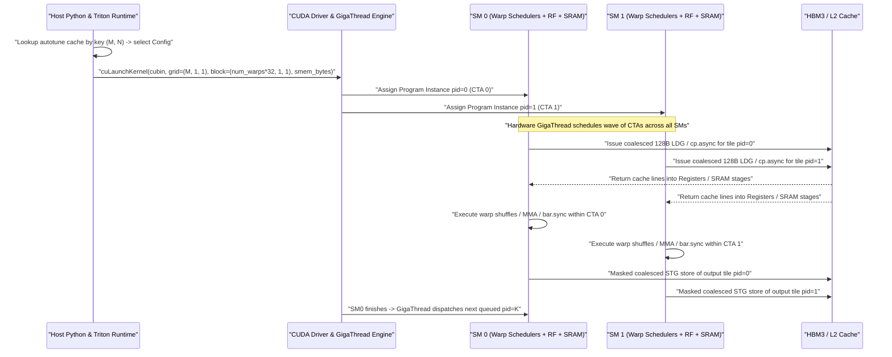

# 01 — Triton Programming Model

[Stage 8 Index](./README.md) | [Next: Kernel Memory Optimization](./02-kernel-memory-optimization.md)

---

This document explains how **Triton** lets engineers write fast GPU programs for Large Language Model (LLM) inference in Python by operating on rectangular blocks of data rather than individual threads. Before diving into code and compiler internals, the section below defines every hardware, compiler, and inference term used throughout this guide in dependency order.

## Core Concepts & Terminology

### 1. GPU Hardware & Memory Hierarchy
* **GPU (Graphics Processing Unit) & SM (Streaming Multiprocessor):** A GPU contains dozens to over a hundred independent compute units called **Streaming Multiprocessors (SMs)** (e.g., 132 SMs on an NVIDIA H100). Each SM contains arithmetic units, warp schedulers, registers, and fast on-chip memory.
* **Kernel:** A function compiled to execute in parallel on a GPU across many workers.
* **HBM (High Bandwidth Memory, e.g., HBM3 / HBM3e):** The GPU's large off-chip main memory (e.g., 80 GB on an H100). It offers high capacity and bandwidth (~3.35 TB/s on H100) but takes ~400–800 clock cycles to return data.
* **L2 Cache & L1 Cache:** Hardware-managed memory caches that store recently used HBM data. The **L2 cache** (~50 MB on H100) is shared across all SMs; the **L1 cache** is small and private to a single SM.
* **SRAM (Static Random-Access Memory) / Shared Memory (`__shared__`):** Fast, programmer-managed on-chip memory (~20–30 cycles latency) located inside each SM (physically unified with the L1 cache).
* **Registers & Register File (RF):** The fastest, smallest storage on a GPU (0-cycle access), private to each thread inside an SM. If a kernel uses too many registers (exceeding the 255-register-per-thread limit), excess variables **spill** into slow off-chip HBM ("local memory").
* **Cache Line (128B) & Memory Coalescing:** GPU memory controllers fetch HBM data in aligned 128-byte **cache lines** (and 32-byte sectors). **Coalescing** occurs when adjacent threads request adjacent memory addresses so their requests merge into the fewest possible cache-line transfers.
* **Virtual Memory Pointer, Stride, & Page Fault:** A **pointer** holds a virtual memory address. **Stride** is the number of elements to skip in memory to move by 1 step along a tensor dimension. Reading or writing outside mapped virtual memory pages causes a **page fault** (a CUDA `illegal memory access` error).

### 2. GPU Execution Models (CUDA SIMT vs. Triton SPMD)
* **Thread & Warp:** A **thread** is the smallest sequential execution unit on a GPU. A **warp** is a group of 32 threads that execute the exact same instruction simultaneously in lockstep.
* **Thread Block / CTA (Cooperative Thread Array):** A group of warps (up to 1,024 threads) assigned together to one SM so they can share SRAM and synchronize.
* **CUDA C++ & SIMT (Single Instruction, Multiple Threads):** NVIDIA's C++-based GPU programming model. In **SIMT**, the programmer writes code for a single scalar thread (`threadIdx` inside a block `blockIdx`), and hardware groups 32 threads into a warp.
* **Control Flow Divergence:** In SIMT, if threads within the same warp take different `if/else` branches, hardware executes both paths sequentially with non-matching threads masked off, reducing efficiency.
* **Synchronization Barriers (`__syncthreads()`, `bar.sync`, `mbarrier`):** Instructions that pause all warps in a CTA until every warp reaches the barrier, ensuring SRAM writes are visible before reads.
* **Warp Shuffle (`__shfl_xor_sync`, `shfl.sync.bfly`):** A fast hardware instruction that exchanges register values directly between threads in the *same* warp without using SRAM.
* **Bank Conflicts & XOR Swizzling:** SRAM is split into 32 independent 4-byte **banks**. If multiple threads in a warp access different addresses in the same bank simultaneously, hardware serializes them (**bank conflict**). **XOR swizzling** permutes column indices using bitwise XOR so concurrent accesses hit distinct banks.
* **SPMD (Single Program, Multiple Data) & Program Instance (`tl.program_id`):** An execution model where independent workers run the same program on different data slices. In **Triton**, each worker is a **Program Instance** (compiled to a CTA) identified by `tl.program_id(axis)` (analogous to CUDA's `blockIdx`).
* **Triton, `@triton.jit`, Tile (`tl.tensor`), & `tl.constexpr`:** **Triton** is a Python GPU language and compiler (`@triton.jit` marks a kernel for compilation). Instead of scalar threads, Triton variables are multi-dimensional rectangular data blocks called **tiles** (`tl.tensor`) whose dimensions must be compile-time power-of-two constants (`tl.constexpr`).

### 3. Number Formats, Hardware Units & Memory Instructions
* **Precision Formats (`FP32`, `FP16`, `BF16`, `FP8`, `int32`, `int64`):**
  * `FP32` (32-bit float, 4 bytes): Standard single precision used for accurate accumulation.
  * `FP16` / `BF16` (16-bit float, 2 bytes): Half-precision formats used for LLM weights and activations (`BF16` keeps FP32's wide numeric range).
  * `FP8` (8-bit float, 1 byte): Ultra-compact format for high-throughput inference.
  * `int32` / `int64`: 32-bit and 64-bit signed integers used for indices and pointer math.
* **Tensor Cores & MMA (`wmma`, `mma.sync`, `wgmma`, `nvidia_mma`, `tl.dot`):** Dedicated matrix-math hardware inside each SM that executes fast Matrix Multiply-Accumulate (**MMA**) instructions on tiles (`tl.dot` in Triton).
* **Vectorized Loads/Stores (`LDG.E.128`, `STG`) & Predicated Loads (`@P0 LDG.E`, `SEL`):** **Vectorized** instructions load or store 128 bits (16 bytes) per thread in one instruction instead of multiple narrow loads. **Predicated** loads (`mask=` in Triton) suppress HBM transactions for out-of-bounds lanes, and `SEL` (select) fills masked registers with a safe fallback value (`other=`).
* **Asynchronous Prefetching (`cp.async`, TMA, `num_stages`):** Hardware copy engines (`cp.async` on Ampere, **TMA — Tensor Memory Accelerator** on Hopper) that stream tiles from HBM into circular SRAM ring buffers (`num_stages` deep) in the background while SMs compute on earlier tiles.
* **PTX Cache Modifiers (`.ca`, `.cg`) & Eviction Policies (`evict_first`, `evict_last`):** Low-level hints controlling whether loads cache in L1+L2 (`.ca`) or L2-only (`.cg`), and whether streaming data is marked for early L2 eviction (`evict_first`) to protect reusable data (`evict_last`).

### 4. Compiler Stack, Autotuning & LLM Inference Concepts
* **Triton Compilation Pipeline (`AST`, `SSA`, `TTIR`, `TTGIR`, `LLVM IR`, `PTX`, `SASS`, `CUTLASS`):**
  * **AST (Abstract Syntax Tree):** Tree structure of the Python kernel code.
  * **SSA (Static Single Assignment):** Compiler form where each variable is assigned once.
  * **TTIR (Triton IR):** Hardware-agnostic tile-level intermediate representation.
  * **TTGIR (Triton GPU IR):** GPU-specific IR that assigns register/SRAM layouts (`#triton_gpu.blocked`, `#triton_gpu.shared`, `#triton_gpu.nvidia_mma`, `#triton_gpu.dot_op`), inserts `bar.sync`, and schedules `cp.async`.
  * **LLVM IR & NVVM / NVPTX:** Low-level compiler IR lowered into **PTX** (NVIDIA's hardware-independent virtual assembly).
  * **SASS (`ptxas` / Cubin):** Native SM machine code assembled by `ptxas`. **CUTLASS** is NVIDIA's hand-tuned C++ template library for matrix math.
* **Launch Grid, `cuLaunchKernel`, & GigaThread Engine:** Launching a kernel via `cuLaunchKernel` specifies a 1D/2D/3D **grid** of program instances, which the GPU's **GigaThread Engine** dispatches in waves across SMs.
* **L2 Cache Swizzling (`tl.swizzle2d`, `GROUP_SIZE_M`):** Reordering 2D grid indices so SMs execute a compact square of output tiles concurrently, maximizing shared L2 cache hits.
* **Autotuning (`@triton.autotune`, `BLOCK_SIZE`, `num_warps`, `num_stages`):** Benchmarking candidate tile sizes (`BLOCK_SIZE`), warps per CTA (`num_warps`), and pipeline stages (`num_stages`) on first run for a given input shape and caching the fastest configuration.
* **GEMM & Arithmetic Intensity:** **GEMM** is General Matrix Multiplication ($C = A \times B$). **Arithmetic Intensity** is FLOPs performed per byte moved from memory; **memory-bandwidth-bound** kernels wait on HBM transfers, while **launch-latency-bound** kernels wait on CPU kernel dispatch.
* **LLM Inference Kernels (`RMSNorm`, `Residual Add`, `RoPE`, `KV Cache`, `PagedAttention`, `SwiGLU`, `Softmax`):**
  * **RMSNorm & Residual Add:** Normalizing hidden activations by their root-mean-square magnitude and adding the skip-connection ($h = x + r$).
  * **RoPE (Rotary Position Embedding):** Encoding token positions by rotating query/key vectors.
  * **KV Cache & PagedAttention:** Caching past Key/Value vectors across tokens; **PagedAttention** stores them in fixed-size non-contiguous memory blocks.
  * **SwiGLU & Softmax:** **SwiGLU** is a gated feed-forward activation; **Softmax** converts raw scores (logits) into probabilities.

---

## 1. Block-Level Programming: SPMD Over Program Instances vs. CUDA SIMT

In native CUDA C++, engineers write kernels using the **SIMT (Single Instruction, Multiple Threads)** model at **scalar thread granularity**. Every instruction is written from the perspective of a single thread (`threadIdx.x`, `threadIdx.y`, `threadIdx.z`) inside a thread block (`blockIdx.x`, `blockDim.x`). To perform a high-throughput tile operation—such as loading a 2D block of activations, reducing across a row, or feeding Tensor Cores—the CUDA programmer must manually:

1. Compute per-thread global coordinates and vector alignments.
2. Allocate `__shared__` memory arrays and compute padded/swizzled intra-block indices to avoid SRAM bank conflicts.
3. Insert explicit `__syncthreads()` barriers between producer stores and consumer loads.
4. Implement warp-level shuffle reductions (`__shfl_xor_sync`) followed by cross-warp shared-memory reductions.

**Triton** elevates the programming abstraction by one level while retaining bare-metal control over HBM traffic and kernel fusion. Triton uses **block-level SPMD (Single Program, Multiple Data)** execution over **program instances** (tiles), not individual threads:

* **In CUDA (SIMT):** Each execution instance is a *scalar thread*; variables in the kernel hold scalar registers (`float`, `half`, `float4`), and parallelism across a tile is explicitly indexed by `threadIdx`.
* **In Triton (Block-Level SPMD):** Each execution instance is an entire **Program Instance** (which compiles down to a CUDA Thread Block / Cooperative Thread Array, or CTA). Variables inside a Triton kernel are **multi-dimensional register/SRAM tiles** (`tl.tensor`) whose shapes must be compile-time powers of two (`tl.constexpr`).

| Architectural Dimension | CUDA C++ (Thread-Level SIMT) | Triton (Block-Level SPMD) |
| --- | --- | --- |
| **Unit of Kernel Logic** | Single scalar thread (`threadIdx`) | Entire tile / CTA (`tl.program_id`) |
| **Primary Data Type** | Scalars / short vectors (`float`, `float4`) | Power-of-two N-D tensor tiles (`[BLOCK_M, BLOCK_N]`) |
| **Memory Coalescing** | Manual thread-to-address mapping | Compiler-synthesized blocked layouts (`#triton_gpu.blocked`) |
| **SRAM & Bank Conflicts** | Manual `__shared__` allocation + XOR swizzling | Compiler-managed SRAM buffers & layout conversions |
| **Synchronization** | Explicit `__syncthreads()`, `bar.sync`, `mbarrier` | Implicitly inserted by TTGIR lowering passes |
| **Tensor Core MMA** | Explicit `wmma` / `mma.sync` / `wgmma` fragments | Single `tl.dot(a, b)` lowered to `nvidia_mma` |
| **Control Flow Divergence** | Per-thread warp divergence masks | Uniform across tile; elementwise masking via `tl.where` / `mask=` |

Because there is **no `threadIdx` concept in Triton user code**, a Triton programmer cannot accidentally introduce intra-warp control-flow divergence inside a tile or mis-index a shared-memory bank. Instead, the programmer expresses **what tile of data** each program instance owns and **what mathematical operations** transform that tile; the Triton compiler decides *which* of the `num_warps * 32` hardware threads inside the CTA hold which elements in registers, how to stage them through SRAM, and when to emit `bar.sync`.

### Impact on LLM Inference Engineering

LLM inference kernels outside standard dense GEMMs—such as **fused RMSNorm + Residual Add + FP8 Quantization**, **fused RoPE + KV-Cache scatter**, **PagedAttention decode**, and **fused SwiGLU**—are overwhelmingly **memory-bandwidth-bound** or **launch-latency-bound**. Achieving 80–90% of theoretical HBM3/HBM3e bandwidth in pure CUDA requires hundreds of lines of boilerplate for vectorized loads, warp reductions, and architecture-specific `cp.async` pipelines. Triton lets an inference engineer express the exact fused HBM access pattern in ~30 lines of Python while generating SASS competitive with hand-tuned CUTLASS/CUDA C++.

---

## 2. `tl.program_id` and Launch Grid Mapping

When launching a Triton kernel from Python, you specify a **launch grid**—a 1D, 2D, or 3D tuple `(grid_x, grid_y, grid_z)` (or a `lambda meta: (...)` callable evaluated against autotuned `BLOCK_SIZE` metadata). Inside the kernel, `tl.program_id(axis)` returns the zero-based integer index of the current program instance along `axis` (`0`, `1`, or `2`), directly analogous to CUDA's `blockIdx.x`, `blockIdx.y`, and `blockIdx.z`.

```python
pid_m = tl.program_id(axis=0)  # analogous to blockIdx.x
pid_n = tl.program_id(axis=1)  # analogous to blockIdx.y
pid_b = tl.program_id(axis=2)  # analogous to blockIdx.z
```

### Grid Mapping Strategies in Inference Kernels

1. **1D Row-Per-Program Mapping (Norms, Softmax, RoPE, Elementwise):**
   For a hidden activation tensor of shape $[M, N]$ where $M = B \cdot T$ (batch $\times$ sequence tokens) and $N = d_{\text{model}}$, a reduction kernel maps one program instance per token row:
   $$\text{grid} = (M,)$$
   `row_idx = tl.program_id(0)`. If $N$ fits in SRAM/registers (typical LLM $d_{\text{model}} \in [2048, 8192]$), the entire row is loaded in one vectorized tile of size `BLOCK_N = triton.next_power_of_2(N)`. If $N$ is huge (e.g., vocabulary logits $V = 128,256$ or $151,936$ in fused Cross-Entropy / Top-K sampling), the kernel loops in chunks of `BLOCK_N` inside the single program instance.

2. **2D L2-Cache-Friendly Grouped Mapping (GEMM / Linear Projections):**
   In a naive 2D grid `(cdiv(M, BLOCK_M), cdiv(N, BLOCK_N))`, CUDA dispatches CTAs sequentially along `blockIdx.x` (rows) or `blockIdx.y`. If row 0 spans 64 horizontal output tiles before advancing to row 1, the GPU reads the entire $B$ matrix (`[K, N]`) before reusing any tile of $A$, thrashing the L2 cache (~50 MB on H100).
   Instead, Triton kernels group `GROUP_SIZE_M` rows together (`tl.swizzle2d` or manual group indexing):

   ```python
   pid = tl.program_id(axis=0)
   num_pid_m = tl.cdiv(M, BLOCK_M)
   num_pid_n = tl.cdiv(N, BLOCK_N)
   num_pid_in_group = GROUP_SIZE_M * num_pid_n
   group_id = pid // num_pid_in_group
   first_pid_m = group_id * GROUP_SIZE_M
   group_size_m = min(num_pid_m - first_pid_m, GROUP_SIZE_M)
   pid_m = first_pid_m + ((pid % num_pid_in_group) % group_size_m)
   pid_n = (pid % num_pid_in_group) // group_size_m
   ```

   Executing a `GROUP_SIZE_M x GROUP_SIZE_M` square of output tiles concurrently on the SMs maximizes shared L2 cache hit rates on both $A$ and $B$ tiles, boosting effective HBM efficiency by 15–30%.

---

## 3. Multi-Dimensional Pointer Arithmetic (`offs`, Strides)

Unlike C arrays or PyTorch tensors where indexing is abstracted behind `tensor[i, j]`, **Triton operates directly on tensors of raw virtual memory pointers**. Every pointer arithmetic expression produces a tile of addresses (`tl.tensor` of `tl.pointer_type`).

### Constructing Address Tiles with `tl.arange` and Strides

Consider a 2D activation tensor `X` of shape `(M, N)` with memory strides `(stride_xm, stride_xn)` (obtained in Python via `X.stride(0), X.stride(1)`—in *elements*, not bytes). Note that in PyTorch, a slice or transposed view can have arbitrary non-unit strides (`stride_xm != N`, or `stride_xn != 1`).

Inside a Triton kernel:

```python
row_id = tl.program_id(0)
# 1D index vector: [0, 1, 2, ..., BLOCK_N - 1]
col_offs = tl.arange(0, BLOCK_N)
# Scalar base pointer shifted to the start of row_id, broadcast across col_offs
x_ptrs = X_ptr + row_id * stride_xm + col_offs * stride_xn
```

For a **2D tile** of shape `[BLOCK_M, BLOCK_N]` (e.g., loading a $K$-block from a Paged KV Cache or GEMM matrix):

```python
offs_m = pid_m * BLOCK_M + tl.arange(0, BLOCK_M)  # shape: [BLOCK_M]
offs_n = pid_n * BLOCK_N + tl.arange(0, BLOCK_N)  # shape: [BLOCK_N]

# Outer broadcast using [:, None] and [None, :] -> shape: [BLOCK_M, BLOCK_N]
ptrs = Base_ptr + (offs_m[:, None] * stride_m + offs_n[None, :] * stride_n)
```

### Critical Edge Case: `int32` Pointer Offset Overflow

By default, `tl.arange(0, BLOCK)` produces `tl.int32` values (range $[-2^{31}, 2^{31}-1]$, max $\approx 2.14 \times 10^9$). In large-context LLM inference:

* Suppose a KV Cache tensor has shape `[num_blocks=16384, num_kv_heads=8, block_size=16, head_dim=128]` and `stride_block = 8 * 16 * 128 = 16,384`. Total elements = $268,435,456$ (fits in `int32`).
* Now suppose a batched prefill activation or huge KV pool exceeds $2^{31}$ elements (e.g., 16 GB in BF16 = $8 \times 10^9$ elements!). Computing `row_id * stride_xm` in `int32` silently **wraps around to a negative offset**, causing an illegal memory access or silent data corruption!

**Rule:** Always cast large row/batch indices or strides to `tl.int64` before multiplication (`row_id.to(tl.int64) * stride_xm`) when tensors can exceed $2^{31}$ elements, while keeping the inner contiguous `tl.arange(0, BLOCK_N)` in `int32` where safe or casting if needed (note: 64-bit integer multiplication on GPU uses emulated/multi-cycle IMAD instructions vs. single-cycle 32-bit `IMAD`, so only upcast outer strides).

### `tl.make_block_ptr` (Structured Block Pointers)

Triton also provides `tl.make_block_ptr` for regular strided 2D+ tensors, which encapsulates `base`, `shape`, `strides`, `offsets`, `block_shape`, and `order`:

```python
a_block_ptr = tl.make_block_ptr(
    base=A_ptr,
    shape=(M, K),
    strides=(stride_am, stride_ak),
    offsets=(pid_m * BLOCK_M, 0),
    block_shape=(BLOCK_M, BLOCK_K),
    order=(1, 0),  # inner dimension 1 (K) is contiguous in memory
)
```

`tl.make_block_ptr` enables two major compiler optimizations:
1. Automatic boundary checking via `boundary_check=(0, 1)` and `padding_option="zero"` without manual mask broadcasts.
2. Direct lowering on Hopper (SM90) to **TMA (Tensor Memory Accelerator)** hardware descriptors (`cp.async.bulk.tensor.2d`), offloading address generation and bounds clamping from SM registers to dedicated silicon.

---

## 4. Boundary Masks (`mask=...`, `other=0.0`) and Cache Hints

Because Triton tile dimensions (`BLOCK_M`, `BLOCK_N`) **must be powers of two**, real-world LLM dimensions routinely misalign with tile sizes:
* Qwen2.5-7B hidden size: $d_{\text{model}} = 3584$ (requires `BLOCK_N = 4096`, leaving $512$ padded lanes!).
* Llama-3-8B / 70B vocabulary: $V = 128,256$ (requires `BLOCK_V = 131072` or chunked loop where the final chunk has partial valid elements).
* Variable batch/sequence lengths $M = \sum_{r} L_r$ in continuous batching (arbitrary integer).

Loading or storing out-of-bounds lanes without a mask causes CUDA `illegal memory access` faults (if crossing a virtual memory page boundary) or silently overwrites adjacent tensors in the PyTorch caching allocator!

### Masking Mechanics and `other` Neutral Values

Every `tl.load` and `tl.store` accepts a boolean mask tensor of the exact same shape as the pointer tile:

```python
mask = col_offs < N
x = tl.load(x_ptrs, mask=mask, other=0.0)
```

* **Hardware behavior of `mask=False`:** On NVIDIA GPUs, `tl.load` lowers to a predicated load (`@P0 LDG.E ...`) or masked `cp.async` with size 0. Masked-off lanes **do not issue HBM transactions** and **never fault**.
* **Critical role of `other=...`:** When `mask=False`, the destination register for that lane would otherwise remain uninitialized garbage (or whatever stale value sat in that register from a previous loop iteration!). Supplying `other=...` emits a register `SEL` (select) or initializes the register with the exact neutral identity element for the subsequent reduction:
  * **Sum / Mean / RMSNorm ($\sum x_i^2$):** `other=0.0` ensures padded lanes contribute $0^2 = 0$ to the sum, while the final division uses the true runtime `N` (not `BLOCK_N`).
  * **Softmax ($\max_i x_i$ and $\sum e^{x_i - m}$):** `other=-float("inf")`! If you mistakenly set `other=0.0` in Softmax when all valid logits are negative (e.g., $[-5.0, -3.0, -8.0]$), the padded `0.0` lanes win the `tl.max`, corrupting `m`, and $e^{0.0 - m} = 1.0$ corrupts the normalizer $\ell$!
  * **Product reductions:** `other=1.0`.
* **Stores:** `tl.store(y_ptrs, y, mask=mask)` suppresses the write transaction completely for out-of-bounds lanes.

### Memory Cache Modifiers and Eviction Policies

`tl.load` and `tl.store` expose PTX-level cache hints crucial for LLM decode bandwidth:

* `cache_modifier=".ca"` (Cache at all levels: L1 + L2) — default for reusable tensors like weights or shared queries.
* `cache_modifier=".cg"` (Cache at global level: L2 only, bypass L1) — avoids thrashing the tiny per-SM L1 cache (e.g., streaming large KV caches).
* `eviction_policy="evict_first"` — marks streaming activation reads as lowest L2 priority so they do not evict hot model weights or shared prefix KV blocks from the 50 MB L2 cache (`evict_last`).

---

## 5. Compiler-Managed SRAM Layout & Coalescing

How does Triton translate a high-level tile expression like `tl.sum(x * x, axis=1)` or `tl.dot(a, b)` into warp-synchronous SASS without the programmer ever specifying `threadIdx` or `__shared__`? The secret lies in **TTGIR (Triton GPU Intermediate Representation)** layout attributes attached to every tensor SSA value.

### The Core TTGIR Layout Encodings

1. **`#triton_gpu.blocked<{sizePerThread, threadsPerWarp, warpsPerCTA, order}>`**:
   Describes how a logical N-D tensor is partitioned across the threads of a CTA in **registers**.
   * `order = [1, 0]`: dimension 1 (columns) varies fastest across adjacent threads in a warp (`lane_id = 0..31`).
   * `sizePerThread = [1, 4]` (for BF16/FP32) or `[1, 8]` (for FP16/BF16 = 16 bytes): each thread holds 4 or 8 contiguous column elements in registers, causing the compiler to emit a single **128-bit vectorized coalesced load (`LDG.E.128`)** per warp!
   * `threadsPerWarp = [1, 32]`: all 32 lanes of a warp span consecutive columns along `order[0]`, guaranteeing that one warp requests a single aligned **128-byte cache line** from HBM.
   * `warpsPerCTA = [4, 1]`: 4 warps in the CTA process 4 distinct rows concurrently with zero cross-warp communication needed for row-wise reductions!

2. **`#triton_gpu.shared<{vec, perPhase, maxPhase, order}>`**:
   Describes how a tile resides in **Shared Memory (SRAM)**. When `num_stages >= 2` or when a layout conversion cannot be done purely in registers, Triton allocates SRAM and automatically calculates **XOR swizzling parameters (`perPhase`, `maxPhase`, `vec`)** so bank conflicts are eliminated during both HBM->SRAM (`cp.async`) and SRAM->Register (`ldmatrix`) transfers.

3. **`#triton_gpu.nvidia_mma` & `#triton_gpu.dot_op`**:
   Hardware-mandated register fragment layouts required by Tensor Core instructions (`mma.sync.aligned.m16n8k16` on Ampere/Ada, or `wgmma.mma_async.m64nNk16` on Hopper).

### Automatic Layout Conversion & Barrier Insertion

Whenever an operation produces a tensor in Layout A (e.g., `#blocked` after a coalesced load) and the consumer requires Layout B (e.g., `#dot_op` for `tl.dot`, or transposed `#blocked` for a column reduction):

* **Same-warp / cheap permutation:** Lowered directly to intra-warp register shuffles (`shfl.sync.bfly` for reductions like `tl.sum` or `tl.max`).
* **Cross-warp permutation (e.g., `warpsPerCTA = [1, 4]` doing a row reduction across 4 warps):** The compiler allocates a small Shared Memory scratchpad, emits `STS` (store to shared), inserts `bar.sync` (`__syncthreads()`), and loads back / reduces across the 4 warp representatives.
* **Dead-code & redundant barrier elimination:** Subsequent TTGIR passes coalesce adjacent layout conversions and minimize `bar.sync` barriers.

### Triton Compilation Pipeline

```mermaid
flowchart LR
    A["Python Kernel AST (@triton.jit)"] -->|"AST Visitor + constexpr Specialization"| B["Triton IR / TTIR (Device-Agnostic Tile SSA)"]
    B -->|"Target-Independent Opts (CSE, Inlining, Licm)"| C["Triton GPU IR / TTGIR (Blocked, Shared, MMA Layouts)"]
    C -->|"Coalescing, Swizzling, cp.async Pipelining, Barrier Insertion"| D["LLVM IR (NVVM Intrinsics, Explicit Thread/Warp Mapping)"]
    D -->|"LLVM NVPTX Backend"| E["PTX Virtual ISA (Hardware-Independent Assembly)"]
    E -->|"ptxas Assembler (Reg Alloc, Instr Scheduling)"| F["SASS Binary Cubin (Native SM Machine Code)"]
```



---

## 6. `@triton.autotune` Over `BLOCK_SIZE`, `num_warps`, and `num_stages`

Optimal kernel hyperparameters vary dramatically across GPU generations (A100 vs. L40S vs. H100 vs. B200) and input shapes (`N = 2048` vs. `N = 8192`). Hardcoding tile sizes leaves 20–50% performance on the table. Triton's `@triton.autotune` decorator benchmarks a list of `triton.Config` candidates on the target silicon at first invocation for each distinct shape key, caches the fastest configuration in memory/disk, and dispatches it with zero runtime overhead thereafter.

```python
@triton.autotune(
    configs=[
        triton.Config({"BLOCK_N": 1024}, num_warps=4, num_stages=2),
        triton.Config({"BLOCK_N": 2048}, num_warps=8, num_stages=3),
        triton.Config({"BLOCK_N": 4096}, num_warps=8, num_stages=4),
    ],
    key=["N"],  # Re-autotune only when hidden dimension N changes
)
```

### Physical Meaning and Trade-Offs of Each Knob

1. **`BLOCK_SIZE` (`BLOCK_M`, `BLOCK_N`, `BLOCK_K`):**
   * **Governs:** Arithmetic intensity (data reuse in registers/SRAM), vectorization width, and tail padding waste.
   * **Too small:** Poor latency hiding, low arithmetic intensity (in GEMM/Attention), excessive loop iterations, or too many CTAs causing scheduler overhead.
   * **Too large:** Register file overflow (spilling to HBM local memory!), SRAM capacity exhaustion (dropping active CTAs per SM to 1), or tail waste when $N \ll \text{BLOCK\_N}$.

2. **`num_warps` (Warps per CTA; `threads_per_block = num_warps * 32`):**
   * **Governs:** Intra-CTA concurrency and reduction latency.
   * **Trade-off:** More warps per CTA (e.g., 8 or 16 warps = 256 or 512 threads) hide instruction/memory latency within a single block and speed up parallel elementwise ops. However, each CTA consumes a fixed SMEM allocation and shares the SM's 65,536-register pool (`65536 / (num_warps * 32)` max registers per thread if 1 CTA/SM, or fewer for 2+ CTAs/SM). For small rows (`N <= 1024`), `num_warps=4` avoids wasting threads on cross-warp barrier reductions; for `N >= 4096`, `num_warps=8` or `16` saturates HBM issue queues.

3. **`num_stages` (Software Pipelining Ring-Buffer Depth):**
   * **Governs:** How many loop tiles ahead the compiler prefetches asynchronously from HBM into circular Shared Memory buffers using `cp.async` (Ampere+) or TMA (Hopper+).
   * **`num_stages=1`:** Synchronous load -> stall ~500 cycles waiting for HBM -> compute -> repeat.
   * **`num_stages=3` or `4`:** While the Tensor Cores / ALUs compute on tile $k$, `cp.async` engines are simultaneously streaming tiles $k+1$ and $k+2$ from HBM into separate SRAM ring buffers, completely hiding HBM latency.
   * **Cost:** Multiplies Shared Memory consumption by `num_stages`:
     $$\text{SMEM}_{\text{bytes}} \approx \text{num\_stages} \times \text{TileBytes}$$
     On H100 (228 KB max SMEM/SM), if a GEMM tile is 64 KB (`BLOCK_M=128, BLOCK_N=128, BLOCK_K=64` in FP16), `num_stages=3` requires $192\text{ KB}$ (fits 1 CTA/SM), whereas `num_stages=4` requires $256\text{ KB}$ (> 228 KB, causing compilation failure or silent stage fallback!).

### Program Grid Dispatch onto GPU SMs



---

## 7. Concrete Annotated Kernel: Fused Residual Add + RMSNorm in Triton

Below is a complete, production-grade Triton kernel implementing **Fused Residual Add + RMSNorm**:

$$h_i = x_i + r_i, \qquad y_i = \frac{h_i}{\sqrt{\frac{1}{N}\sum_{j=0}^{N-1} h_{j}^2 + \epsilon}} \cdot \gamma_i$$

Notice how this single kernel replaces two separate PyTorch kernels (`add` + `rms_norm`), writes the updated residual `h` back cleanly (if needed for the next Transformer layer), accumulates variance in `tl.float32` to prevent BF16/FP16 precision collapse, and handles arbitrary non-power-of-two `N`.

```python
import torch
import triton
import triton.language as tl


@triton.autotune(
    configs=[
        triton.Config({}, num_warps=4, num_stages=1),
        triton.Config({}, num_warps=8, num_stages=1),
        triton.Config({}, num_warps=16, num_stages=1),
    ],
    key=["N", "BLOCK_N"],
)
@triton.jit
def fused_add_rmsnorm_kernel(
    X_ptr,          # [M, N] input activation (BF16/FP16)
    R_ptr,          # [M, N] residual stream input/output (BF16/FP16)
    W_ptr,          # [N]    RMSNorm gamma weight (BF16/FP16)
    Y_ptr,          # [M, N] normalized output (BF16/FP16)
    stride_xm,      # row stride of X in elements
    stride_rm,      # row stride of R in elements
    stride_ym,      # row stride of Y in elements
    N,              # true hidden dimension (need not be power of 2)
    eps,            # numerical stability epsilon (e.g., 1e-5 or 1e-6)
    BLOCK_N: tl.constexpr,  # compile-time power-of-2 tile width >= N
):
    # 1. SPMD Program ID: 1 program instance (CTA) owns exactly 1 token row.
    #    Cast to int64 to avoid int32 pointer overflow when M * stride > 2^31.
    row_id = tl.program_id(axis=0).to(tl.int64)

    # 2. Vector of column offsets [0, 1, ..., BLOCK_N - 1] in registers.
    col_offs = tl.arange(0, BLOCK_N)
    #    Boundary mask prevents OOB page faults when N is not a power of 2 (e.g., 3584).
    mask = col_offs < N

    # 3. Multi-dimensional pointer tiles for this row.
    x_ptrs = X_ptr + row_id * stride_xm + col_offs
    r_ptrs = R_ptr + row_id * stride_rm + col_offs
    y_ptrs = Y_ptr + row_id * stride_ym + col_offs
    w_ptrs = W_ptr + col_offs

    # 4. Coalesced, vectorized 128-bit loads from HBM into registers.
    #    other=0.0 ensures masked lanes never inject NaN/garbage into variance sum.
    #    Upcast to FP32 immediately in registers for accumulation precision.
    x = tl.load(x_ptrs, mask=mask, other=0.0).to(tl.float32)
    r = tl.load(r_ptrs, mask=mask, other=0.0).to(tl.float32)

    # 5. Fused residual addition completely in registers (zero intermediate HBM write).
    h = x + r

    #    Store updated residual stream back to HBM for the next Transformer block.
    tl.store(r_ptrs, h.to(R_ptr.dtype.element_ty), mask=mask)

    # 6. Compute mean square across axis=0 (the row vector in this CTA).
    #    Compiler lowers tl.sum to warp shuffles (shfl.sync.bfly) + minimal SMEM sync.
    #    Masked lanes have h=0.0 -> h*h=0.0, so sum is exact; divide by true N, not BLOCK_N!
    sum_sq = tl.sum(h * h, axis=0)
    inv_rms = tl.rsqrt(sum_sq / N + eps)

    # 7. Load norm weights (broadcast across token rows -> hits L2 cache).
    w = tl.load(w_ptrs, mask=mask, other=0.0).to(tl.float32)

    # 8. Normalize, scale, cast back to output dtype (e.g., BF16), and masked store.
    y = (h * inv_rms) * w
    tl.store(y_ptrs, y.to(Y_ptr.dtype.element_ty), mask=mask)


def fused_add_rmsnorm(
    x: torch.Tensor,
    residual: torch.Tensor,
    weight: torch.Tensor,
    eps: float = 1e-6,
) -> torch.Tensor:
    assert x.is_cuda and residual.is_cuda and weight.is_cuda
    assert x.shape == residual.shape
    M, N = x.shape
    assert weight.shape == (N,)
    # Assume innermost dimension is contiguous (stride(-1) == 1) for coalescing
    assert x.stride(-1) == 1 and residual.stride(-1) == 1

    y = torch.empty_like(x)
    # Next power of 2 >= N (e.g., N=3584 -> BLOCK_N=4096)
    BLOCK_N = triton.next_power_of_2(N)

    # Launch grid: M independent program instances
    grid = (M,)
    fused_add_rmsnorm_kernel[grid](
        x, residual, weight, y,
        x.stride(0), residual.stride(0), y.stride(0),
        N=N, eps=eps, BLOCK_N=BLOCK_N,
    )
    return y
```

### Why This Kernel Works at Hardware Peak

* **Register Residency:** `x`, `r`, and `h` remain live in the SM register file from load to final store. For `BLOCK_N = 4096` and `num_warps = 8` (256 threads), each thread holds $4096 / 256 = 16$ elements ($16 \times 4\text{ B} = 64$ bytes = 16 FP32 registers per array), well within the 255-register-per-thread limit, guaranteeing zero spilling to HBM local memory.
* **HBM Bandwidth Math:** Unfused PyTorch (`residual += x`, then `rmsnorm(residual)`) reads/writes $6 \text{ bytes/elem}$ for `add` + $4 \text{ bytes/elem}$ for `rmsnorm` = $10\text{ B/elem}$ (or $12\text{ B/elem}$ if two-pass variance). This fused Triton kernel reads `x` (2B), reads `r` (2B), writes `r` (2B), writes `y` (2B) = **$8\text{ B/elem}$** in a single kernel launch (if `r` does not need to be mutated in-place, e.g., final norm, it drops to **$6\text{ B/elem}$**, a 1.67x–2x speedup!).
* **Tail & Precision Safety:** `mask = col_offs < N` + `other=0.0` + `/ N` guarantees mathematical equivalence to FP32 reference PyTorch regardless of whether `N` is a power of two.

---

## Navigation

* **Index:** [Stage 8 Overview](./README.md)
* **Next:** [02 — Kernel Memory Optimization](./02-kernel-memory-optimization.md)
