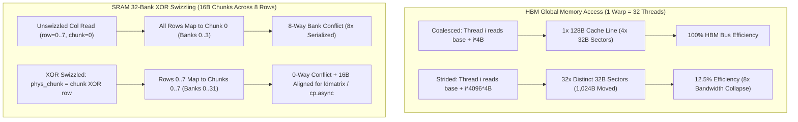
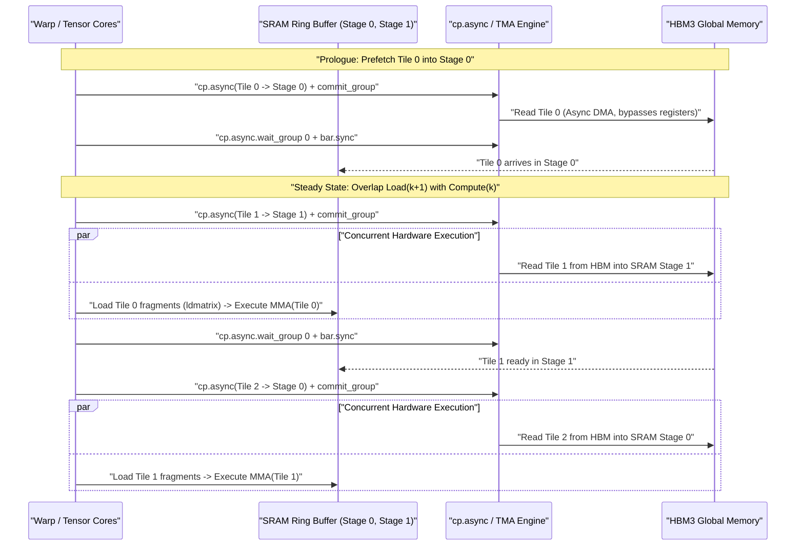

# 02 — Kernel Memory Optimization

[Previous: Triton Programming Model](./01-triton-programming-model.md) | [Stage 8 Index](./README.md) | [Next: Operator Fusion & CUDA Graphs](./03-operator-fusion-and-cuda-graphs.md)

---

This guide explains how data moves between a GPU's off-chip memory and its compute units, and how memory layout choices determine the speed of Large Language Model (LLM) inference. Every hardware unit, memory tier, instruction, and optimization term used below is defined in dependency order before its first use.

## Core Concepts & Terminology

### 1. GPU Compute & Execution Basics
* **GPU & SM (Streaming Multiprocessor):** A GPU contains many independent compute engines called **Streaming Multiprocessors (SMs)** (e.g., 132 SMs on an NVIDIA H100). Each SM has arithmetic units, warp schedulers, registers, and on-chip memory.
* **Thread, Warp, SIMT, & CTA (Thread Block):** A **thread** is a single sequential instruction stream. A **warp** is 32 threads executing the same instruction in lockstep (**SIMT — Single Instruction, Multiple Threads**). Multiple warps form a **Thread Block / CTA (Cooperative Thread Array)** scheduled onto one SM.
* **Tensor Cores & MMA (`mma.sync`, `FMA`, `ldmatrix`):** **Tensor Cores** are specialized SM hardware units that perform fast Matrix Multiply-Accumulate (**MMA**) operations (`mma.sync`), whereas standard CUDA cores perform scalar Fused Multiply-Add (**FMA**). `ldmatrix` is a warp-level instruction that loads matrix tiles from on-chip memory into Tensor Core registers.
* **Precision Formats (`FP32`, `FP16`, `BF16`, `FP8`, `INT8`, `uint4`):** `FP32` (4 bytes) is standard single-precision float; `FP16` and `BF16` (2 bytes) are half-precision floats (`BF16` preserves FP32's wide range); `FP8` and `INT8` (1 byte) are compact 8-bit formats. In CUDA C++, `uint4` is a 16-byte (128-bit) vector type, and `__nv_bfloat162` / `float2` pack two values together.

### 2. GPU Memory Hierarchy & Bandwidth Physics
* **HBM (High Bandwidth Memory, e.g., HBM3):** The GPU's large off-chip main memory (e.g., 80 GB, ~3.35 TB/s bandwidth on H100), which has a long ~400–800 clock-cycle round-trip latency.
* **L2 Cache & L1 Cache:** Hardware-managed caches that store recently accessed HBM data. **L2** is shared across all SMs; **L1** is small and private to each SM.
* **SRAM (Static Random-Access Memory) / Shared Memory (`smem`):** Fast, programmer-managed on-chip memory (~20–30 cycles latency, up to 228 KB/SM on H100) physically unified with the L1 cache. Accessed via `LDS` (Load Shared) and `STS` (Store Shared) instructions.
* **Register File, Occupancy, & Register Spilling (`Local Memory`, `LDL`, `STL`, `lmem`):** **Registers** are 0-cycle on-chip storage private to each thread (65,536 32-bit registers per SM, max 255/thread). **Occupancy** is the ratio of active warps on an SM to its hardware maximum. If a kernel exceeds the per-thread register limit (or caps set by `__launch_bounds__` / `-maxrregcount`), the **`ptxas`** compiler **spills** variables to **Local Memory (`lmem`)** via `LDL`/`STL` instructions—which physically live in slow off-chip HBM.
* **GEMM, Arithmetic Intensity, & Ridge Point:** **GEMM** is General Matrix Multiplication ($C = A \times B$). **Arithmetic Intensity** is FLOPs (floating-point operations) performed per byte transferred from memory. The **Ridge Point** ($\text{Peak Compute} / \text{Peak Bandwidth}$, ~295 FLOPs/Byte for BF16 on H100) is the threshold separating memory-bandwidth-bound kernels from compute-bound kernels.
* **Autoregressive Decode, KV Cache, PagedAttention, FlashDecoding, & ITL / TPOT:** During LLM text generation (**decode**), the model generates one token at a time, reading model weights and cached Key/Value vectors (**KV Cache**) from past tokens. **ITL (Inter-Token Latency)** / **TPOT (Time Per Output Token)** measures the time per generated token. **PagedAttention** stores the KV cache in fixed-size blocks; **FlashDecoding** splits attention over those blocks across SMs.

### 3. Memory Transactions, Coalescing, & Bank Conflicts
* **128B Cache Line, 32B Memory Sector, Stride, & Coalescing:** Memory controllers fetch HBM in **32-byte sectors** and **128-byte cache lines**. **Stride** is the element step between consecutive accesses. When a warp's **Load/Store Unit (LSU)** executes a global load (`LDG`) or store (`STG`), **coalescing** merges adjacent thread addresses into the minimum number of 32B sectors / 128B lines.
* **Vectorized Loads (`ld.global.v4.b32` / `LDG.E.128`), MLP, & MIO Queue:** A **128-bit vectorized load** fetches 16 bytes per thread in one instruction, increasing **Memory-Level Parallelism (MLP)** (bytes in flight) while consuming fewer slots in the LSU's **Memory Input/Output (MIO)** queue. It requires 16-byte address alignment (`addr % 16 == 0`), otherwise hardware raises `CUDA_ERROR_MISALIGNED_ADDRESS`.
* **2D SRAM Tiling:** Loading small rectangular sub-matrices ($B_M \times B_K$, $B_K \times B_N$) from HBM into SRAM once and reusing them across many MMA operations to amplify arithmetic intensity.
* **Shared Memory Bank Conflicts (32 Banks) & XOR Swizzling:** SRAM is divided into **32 independent 4-byte banks**. Reading the exact same word broadcasts cleanly (**multicast**), and reading 32 distinct banks takes 1 cycle. If $k$ threads read *different* words in the *same* bank, hardware serializes them into $k$ passes (**$k$-way bank conflict**). **XOR swizzling** permutes column coordinates with a bitwise XOR of the row index to eliminate conflicts while keeping 16-byte alignment.

### 4. Asynchronous Data Movement & Pipelining
* **DMA (Direct Memory Access), `cp.async`, `commit_group`, & `wait_group`:** `cp.async` is an Ampere+ hardware copy instruction that transfers data directly from HBM/L2 into SRAM (like a **DMA** engine), bypassing registers. Batches are tracked with `cp.async.commit_group` and synchronized with `cp.async.wait_group N`.
* **TMA (Tensor Memory Accelerator) & `mbarrier`:** Hopper's dedicated hardware unit (`cp.async.bulk.tensor`) where a single thread transfers an entire multi-dimensional tile between HBM and SRAM with automatic bounds checking and swizzling, signaling completion via a hardware **`mbarrier`** object.
* **Software Pipelining (`num_stages = S`):** Allocating a circular ring buffer of $S$ tile slots in SRAM so `cp.async`/TMA prefetches future tiles from HBM concurrently while Tensor Cores compute on the current tile.

---

## 1. The GPU Memory Physics Bottleneck in LLM Inference

On an NVIDIA H100 SXM5, Tensor Cores deliver **989 TFLOP/s** in BF16/FP16, while HBM3 delivers **3.35 TB/s** (~$3.35 \times 10^{12}$ bytes/s). Dividing these two numbers yields a **ridge point** of $\sim 295\text{ FLOPs/Byte}$. Yet during autoregressive LLM decode (`batch_size=1..16`), loading weights and KV-cache tensors executes roughly **1 to 16 FLOPs per byte moved**—two orders of magnitude below the compute roof.

Because decode is fundamentally governed by bytes moved across the HBM–L2–SM interface, even a minor memory-layout flaw inside a kernel—an uncoalesced stride, a 16-way shared memory bank conflict, scalar 16-bit loads, or silent register spilling—immediately translates into linear latency inflation (higher ITL / TPOT) and wasted GPU fleet spend.

---

## 2. Coalesced HBM Reads & Writes (128B Cache Lines & 32B Sectors)

GPU memory controllers do not fetch individual 2-byte (`bf16`) or 4-byte (`fp32`) words from HBM. Hardware executes memory transactions in fixed spatial units:

* **L1 Cache Line:** **128 bytes**, aligned to 128-byte virtual address boundaries (`addr & ~127`).
* **L2 / HBM Memory Sector:** **32 bytes** (4 sectors per 128B cache line). On modern NVIDIA architectures (Volta through Blackwell), L1 misses forward only the touched **32-byte sectors** to L2/HBM, whereas an L1-cached hit serves the full 128-byte line.

When a **Warp** (32 threads executing in lockstep SIMT) executes a global load (`LDG`) or store (`STG`), the Load/Store Unit (LSU) inspects the 32 virtual addresses generated across `lane_id = 0..31` and **coalesces** addresses falling into the same 32B sectors / 128B cache lines into the minimum number of memory transactions.

### Quantitative Comparison: Coalesced vs. Strided Access

Assume a warp loads one **FP32 (4-byte)** value per thread (128 bytes of useful data total):

1. **Optimal Coalesced Access (`stride = 1`):**
   * Thread $t \in [0, 31]$ reads `base + t * 4` (aligned to 128B).
   * All 32 addresses fall inside **1 single 128-byte cache line** (4 contiguous 32B sectors).
   * Total transferred = $128\text{ B}$. **Bus utilization = $128 / 128 = 100\%$**.

2. **Misaligned Coalesced Access (offset by +4 bytes):**
   * Thread 0 reads `base + 4`, Thread 31 reads `base + 128`.
   * Spans 2 cache lines (5 sectors of 32B = $160\text{ B}$).
   * **Bus utilization = $128 / 160 = 80\%$**.

3. **Strided Access (Column-Major Read of Row-Major Matrix, `stride = 4096`):**
   * Thread $t$ reads `base + t * 4096 * 4`.
   * Every single thread hits a **distinct 128B cache line** and a **distinct 32B sector**.
   * Hardware issues **32 separate 32B sector transactions** = $32 \times 32\text{ B} = 1,024\text{ B}$ transferred from HBM (or $32 \times 128\text{ B} = 4,096\text{ B}$ if L1 allocates full lines!).
   * Useful data = $128\text{ B}$. **Effective HBM bandwidth collapses to $128 / 1,024 = 12.5\%$** (and for BF16 2-byte reads, $64 / 1,024 = \mathbf{6.25\%}$—a **16x slowdown**!).

### LLM Inference Failure Mode: Transposed KV Cache Layout

In PagedAttention or custom FlashDecoding kernels, if the KV cache is stored as `[num_blocks, block_size, num_kv_heads, head_dim]` vs. `[num_blocks, num_kv_heads, head_dim, block_size]`, choosing which axis is `stride == 1` dictates coalescing. During attention $Q K^T$, warps dot a query vector with multiple token keys across `head_dim`. If `head_dim` is innermost (`stride = 1`), 32 lanes read contiguous elements of a single token's $K$ vector -> 100% coalesced. Conversely, if `block_size` is innermost and a warp reads across `head_dim` without staging through SRAM, accesses become strided and bandwidth drops by 8x–16x.

---

## 3. Explicit SRAM (Shared Memory) Tiling

Each GPU Streaming Multiprocessor (SM) contains a fast, programmer-managed **on-chip SRAM** (Shared Memory, physically unified with the L1 data cache):

* **NVIDIA A100:** 192 KB unified L1/SMEM per SM (up to 164 KB configurable as SMEM).
* **NVIDIA H100:** 256 KB unified L1/SMEM per SM (up to **228 KB** configurable as SMEM).
* **Latency & Bandwidth:** SRAM delivers ~20–30 cycles latency and an aggregate on-chip bandwidth exceeding **19–33 TB/s** across the GPU—roughly **6x–10x faster** than HBM3 (3.35 TB/s, ~400–800 cycles latency).

### Tiling Physics: Amplifying Arithmetic Intensity

Suppose we compute a GEMM $C = A \times B$ where $A \in \mathbb{R}^{M \times K}$, $B \in \mathbb{R}^{K \times N}$ in BF16 (2 bytes/element). Without SRAM tiling, computing each element $C_{i,j}$ reads $K$ elements of $A$ and $K$ elements of $B$ directly from HBM:
$$\text{Total HBM reads} \approx M N (2K) \cdot 2\text{ B} \implies I_{\text{naive}} = \frac{2MNK}{4MNK} = 0.5\text{ FLOPs/Byte}$$

With **2D SRAM Tiling**, a Thread Block (CTA) loads a tile $A_{\text{tile}} \in \mathbb{R}^{B_M \times B_K}$ and $B_{\text{tile}} \in \mathbb{R}^{B_K \times B_N}$ into Shared Memory once, performs all outer-product MMA operations in registers/Tensor Cores, and accumulates into register-resident $C_{\text{tile}} \in \mathbb{R}^{B_M \times B_N}$:

* **FLOPs per K-step:** $2 \cdot B_M \cdot B_N \cdot B_K$
* **HBM bytes loaded per K-step:** $(B_M B_K + B_K B_N) \cdot 2\text{ B}$
* **Tile Arithmetic Intensity:**
  $$I_{\text{tiled}} = \frac{2 B_M B_N B_K}{2 B_K (B_M + B_N)} = \frac{B_M B_N}{B_M + B_N}\text{ FLOPs/Byte}$$

For $B_M = 128, B_N = 128$, $I_{\text{tiled}} = \frac{16384}{256} = 64\text{ FLOPs/Byte}$ (128x amplification over naive execution), and for $B_M = 256, B_N = 256$ (or FP8 1-byte operands), $I_{\text{tiled}}$ exceeds **256–512 FLOPs/Byte**, crossing the H100 Tensor Core ridge point!

---

## 4. Shared Memory Bank Conflicts & XOR Swizzling Layouts

While SRAM is orders of magnitude faster than HBM, poorly structured access patterns inside a warp trigger **Shared Memory Bank Conflicts**, quietly degrading throughput by up to 32x.

### Hardware Bank Architecture

NVIDIA Shared Memory is physically organized into **32 independent memory banks**, each **4 bytes (32 bits) wide**. Successive 4-byte words map round-robin across banks:
$$\text{bank\_id} = \left\lfloor \frac{\text{byte\_offset}}{4} \right\rfloor \bmod 32$$

In a single cycle, each of the 32 banks can service **one 32-bit read or write**:
* **0-way conflict (1 cycle):** All 32 threads in a warp access 32 *distinct* banks, OR multiple threads read the **exact same 32-bit word** (hardware **multicast/broadcast**).
* **$k$-way bank conflict ($k$ cycles):** $k$ threads in the same warp access *different* 32-bit words that happen to fall in the *same* bank. Hardware serializes the warp's `LDS` / `STS` instruction into $k$ sequential replay passes!

*(Note: For 64-bit `LDS.64` or 128-bit `LDS.128` / `ldmatrix`, the warp executes over 2 or 4 phases of 16 or 8 threads; conflicts are evaluated within each hardware transaction phase.)*

### Classic Failure Mode: 32-Stride Transpose Conflict

Suppose a CTA stores a $32 \times 32$ `float32` tile `smem[32][32]` in SRAM:
* Row access `smem[row][lane_id]`: thread `lane_id` accesses bank `(row * 32 + lane_id) % 32 = lane_id` -> **32 distinct banks -> 0 conflicts**.
* Column access `smem[lane_id][col]`: thread `lane_id` accesses bank `(lane_id * 32 + col) % 32 = col` -> **ALL 32 threads hit bank `col` -> 32-way bank conflict (32x slowdown!)**.

### Fix 1 (Naive): Row Padding (`smem[32][33]`)
Adding 1 padding float per row shifts `col` bank by `+1` per row, making columns conflict-free. **Why production LLM kernels (CUTLASS, FlashAttention, Triton) avoid padding:**
1. Wastes SRAM capacity (reducing `num_stages` or occupancy).
2. **Breaks 16-byte (128-bit) alignment** on odd rows (`33 * 4 = 132` bytes is not divisible by 16!), preventing vectorized `cp.async.cg.shared.global.L2::128B` (which requires 16-byte alignment) and Tensor Core `ldmatrix` instructions!

### Fix 2 (Production): XOR Swizzling Layouts

**XOR Swizzling** permutes the column coordinate within each row using a bitwise XOR with the row index, preserving **100% 16-byte vector alignment** and **zero wasted SRAM bytes**, while guaranteeing **0-way bank conflicts** for both row-wise (`cp.async` / `STS.128`) and column-wise / matrix-fragment (`ldmatrix`) reads.

Consider an $8 \times 8$ tile of **16-byte (128-bit) chunks** (where each chunk spans 4 consecutive 4-byte banks, e.g., $8 \text{ BF16 elements} = 16\text{ B} = 4\text{ banks}$, so 8 chunks across a row = $64\text{ BF16 elements} = 128\text{ B} = 32\text{ banks}$):

$$\text{phys\_chunk\_col} = \text{logical\_chunk\_col} \oplus (\text{row} \bmod 8)$$

Look at what happens across rows `0..7` for `logical_chunk_col = 0`:
* Row 0: physical chunk `0 ^ 0 = 0` -> Banks `0..3`
* Row 1: physical chunk `0 ^ 1 = 1` -> Banks `4..7`
* Row 2: physical chunk `0 ^ 2 = 2` -> Banks `8..11`
* ...
* Row 7: physical chunk `0 ^ 7 = 7` -> Banks `28..31`

Because $\oplus$ is a **bijection** on $\{0..7\}$:
1. **Row-wise `cp.async` (16-byte write along `logical_chunk_col = 0..7` for a fixed `row`):** Every `logical_chunk_col` maps to a distinct `phys_chunk_col`, spanning all 32 banks cleanly -> **0 bank conflicts**, 16-byte aligned!
2. **Column-wise / `ldmatrix` read (8 threads reading `row = 0..7` at fixed `logical_chunk_col`):** Each row maps to a distinct physical chunk (4 banks each) -> **0 bank conflicts**!



---

## 5. Vectorized Loads (`ld.global.v4.b32` / 128-Bit Loads)

Even when 32 threads read contiguous memory, issuing narrow scalar loads (`LDG.E.U16` for BF16 or `LDG.E.32` for FP32) limits throughput for two hardware reasons:
1. **Instruction Issue & LSU Queue Saturation:** An SM warp scheduler can only issue 1–2 instructions per cycle, and the Load/Store Unit has a finite Memory Input/Output (MIO) queue depth. Loading 4096 BF16 elements per CTA via 16-bit scalar loads requires 8x more instructions and 8x more scoreboard tracking slots than 128-bit loads!
2. **Memory-Level Parallelism (MLP):** A single **128-bit vectorized load** (`ld.global.v4.b32`, or `LDG.E.128` in SASS) loads **16 bytes per thread**—that is **4 FP32 elements**, **8 BF16/FP16 elements**, or **16 FP8/INT8 elements**—in a single instruction. Across a 32-thread warp, one `LDG.E.128` requests $32 \times 16 = 512\text{ bytes}$ (4 full 128B cache lines) in flight simultaneously.

### CUDA C++ Vectorized Load Pattern & Alignment Rule

```cpp
// Requires: reinterpret_cast<uintptr_t>(x) % 16 == 0 and N % 8 == 0
__global__ void scale_bf16_vec128(const __nv_bfloat16* __restrict__ x,
                                  __nv_bfloat16* __restrict__ y,
                                  float scale, int N) {
    int idx = (blockIdx.x * blockDim.x + threadIdx.x) * 8;
    if (idx + 7 < N) {
        // Compiles directly to LDG.E.128 (PTX: ld.global.v4.b32)
        uint4 vec = *reinterpret_cast<const uint4*>(x + idx);
        __nv_bfloat162* bf2 = reinterpret_cast<__nv_bfloat162*>(&vec);
        #pragma unroll
        for (int i = 0; i < 4; ++i) {
            float2 f = __bfloat1622float2(bf2[i]);
            f.x *= scale;
            f.y *= scale;
            bf2[i] = __float22bfloat162_rn(f);
        }
        // Compiles directly to STG.E.128 (PTX: st.global.v4.b32)
        *reinterpret_cast<uint4*>(y + idx) = vec;
    }
}
```

**Strict Alignment Constraint:** `ld.global.v4.b32` hardware-traps with `CUDA_ERROR_MISALIGNED_ADDRESS` if the pointer is not 16-byte aligned (`addr % 16 != 0`). When handling arbitrary tensor offsets (e.g., sliced batch rows where `N` is odd), production kernels use a scalar prologue up to the first 16-byte boundary, a `uint4` main loop, and a scalar/predicated epilogue—or rely on Triton's compiler, which automatically emits `LDG.E.128` when `BLOCK_N` and base pointers satisfy alignment, falling back to `LDG.E.64` / `LDG.E.32` when required.

---

## 6. Register Pressure & Spilling to Local Memory

Registers are the fastest storage tier on a GPU (**0-cycle access latency** via direct instruction operand encoding, ~80+ TB/s aggregate bandwidth per GPU). On Ampere (A100) and Hopper (H100), each SM houses a **256 KB Register File** consisting of **65,536 32-bit registers**, shared dynamically among all active warps resident on that SM, with a hard architectural cap of **255 registers per thread**.

### Occupancy Math from Register Pressure

Suppose a kernel compiles to $R_{\text{thread}}$ 32-bit registers per thread, and each CTA launches $W_{\text{CTA}}$ warps ($32 \cdot W_{\text{CTA}}$ threads). The hardware allocates registers per warp (rounded up to allocation granularity, e.g., 256 registers/warp on Hopper):

$$\text{Max Active Warps per SM} = \left\lfloor \frac{65,536}{R_{\text{thread}} \times 32} \right\rfloor$$

* $R_{\text{thread}} = 32 \implies 65536 / 1024 = 64$ warps/SM (**100% theoretical occupancy** on H100).
* $R_{\text{thread}} = 64 \implies 65536 / 2048 = 32$ warps/SM (**50% occupancy**).
* $R_{\text{thread}} = 128 \implies 65536 / 4096 = 16$ warps/SM (**25% occupancy**).
* $R_{\text{thread}} = 255 \implies 65536 / 8192 = 8$ warps/SM (**12.5% occupancy**, max 1 CTA of 8 warps/SM).

### Silent Performance Killer: Register Spilling to Local Memory

What happens when an aggressively unrolled kernel (e.g., an oversized FlashAttention accumulator tile `BLOCK_M=128, BLOCK_N=128` in FP32) requires **more than 255 registers per thread** (or exceeds the limit forced by `__launch_bounds__` / `-maxrregcount`)?

The `ptxas` compiler **spills** excess live variables into **CUDA Local Memory (`LDL` / `STL` instructions)**. Despite the reassuring name "Local", **Local Memory physically resides in off-chip HBM** (cached in L1/L2, with per-thread interleaved addressing)!

**Why spilling destroys inference latency:**
1. Every spilled register read/write converts a 0-cycle operand into an `LDL`/`STL` memory instruction.
2. If the working set exceeds the tiny L1/L2 cache or triggers evictions, spills generate **extra HBM read/write traffic**, directly stealing bandwidth from model weights and KV cache!
3. You can detect spilling immediately at compile time via `nvcc --ptxas-options=-v` (`spill stores`, `spill loads` > 0 bytes) or in Triton via `kernel.asm["ptx"]` / Nsight Compute (`lmem` traffic).

---

## 7. Asynchronous Global-to-Shared Prefetching (`cp.async` & Multi-Stage Pipelining)

Prior to Ampere (SM80), moving a tile from HBM into Shared Memory required two separate steps through the **Register File**:
1. `LDG` (`HBM -> Registers`) — consumes registers and stalls the warp until HBM returns.
2. `STS` (`Registers -> SRAM`) — burns extra issue cycles.

### Ampere `cp.async` & Hopper TMA Hardware Bypass

Ampere introduced `cp.async` (`cp.async.ca.shared.global` / `cp.async.cg.shared.global`), allowing a warp to trigger an **asynchronous direct DMA-like copy `HBM -> L2 -> SRAM`**, completely bypassing the SM Register File!

* **Zero register footprint** for in-flight tile transfers.
* **Non-blocking execution:** The warp issues `cp.async` for tile $k+1$, tags the batch with `cp.async.commit_group`, and immediately continues executing math (`mma.sync` / `FMA`) on tile $k$ already sitting in SRAM.
* **Selective wait:** `cp.async.wait_group N` pauses the warp only if more than $N$ committed async groups remain unfinished (`wait_group 0` waits for all; `wait_group 1` waits until all but the newest 1 group are done).

On **Hopper (SM90)**, the **Tensor Memory Accelerator (TMA)** (`cp.async.bulk.tensor`) takes this further: a **single thread** in a warpgroup issues one TMA descriptor instruction to transfer an entire multi-dimensional tile (up to tens of KB) with hardware-computed bounds clamping, automatic XOR swizzling, and `mbarrier` completion signaling—freeing all other threads to compute.

### Multi-Stage Software Pipelining Math (`num_stages = S`)

To completely hide HBM round-trip latency $L_{\text{HBM}}$ (in cycles) behind tile compute duration $T_{\text{compute}}$ (cycles per K-tile), we allocate a circular ring buffer of $S$ stages in Shared Memory:

$$S \ge 1 + \left\lceil \frac{L_{\text{HBM}}}{T_{\text{compute}}} \right\rceil$$

* **Prologue:** Issue `cp.async` for stages $0, 1, \dots, S-2$ ahead of the main loop.
* **Steady-state iteration $k$:**
  1. `cp.async.wait_group (S - 2)` -> guarantees tile $k$ has arrived in SRAM buffer `k % S`.
  2. `__syncthreads()` -> ensures all warps see tile $k$ before reading.
  3. Compute Tensor Core MMA on SRAM stage `k % S` **concurrently** while hardware DMA streams tile $k + S - 1$ into SRAM stage `(k + S - 1) % S`!

### Double-Buffered (`S = 2`) & Multi-Stage Software Pipelining Timeline



---

## Navigation

* **Previous:** [01 — Triton Programming Model](./01-triton-programming-model.md)
* **Index:** [Stage 8 Overview](./README.md)
* **Next:** [03 — Operator Fusion & CUDA Graphs](./03-operator-fusion-and-cuda-graphs.md)
