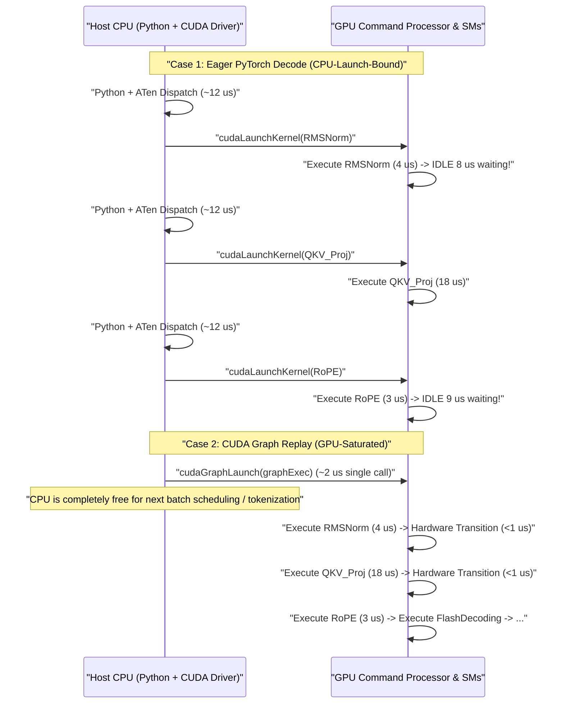

# 03 — Operator Fusion & CUDA Graphs

[Previous: Kernel Memory Optimization](./02-kernel-memory-optimization.md) | [Stage 8 Index](./README.md) | [Next: Exact Attention Algorithms](./04-exact-attention-algorithms-flashattention.md)

---

## 1. The Dual Tax of Eager Transformer Execution

In a modern Transformer block (e.g., Llama-3, Qwen2.5, Mistral), the dense matrix multiplications (`QKV`, `O_proj`, `Gate/Up`, `Down`) perform >99% of the arithmetic FLOPs. Yet when you profile an unfused PyTorch decode step (`batch_size=1..16`), the **non-GEMM memory-bound operations** (`Residual Add`, `RMSNorm`, `RoPE`, `KV Cache Scatter`, `SiLU * Gate`, `Dynamic FP8/INT8 Quantization`) frequently consume **30% to 60% of total wall-clock latency**.

This tax comes from two distinct physical sources:

1. **Intermediate HBM Materialization:** Every unfused PyTorch operator reads its inputs from off-chip HBM, computes a trivial arithmetic operation in registers, and writes the full intermediate tensor back out to HBM—only for the next kernel milliseconds or microseconds later to read that exact same tensor right back from HBM.
2. **CPU Kernel Launch Overhead:** Every individual kernel invocation incurs ~5–20 µs of CPU/driver dispatch overhead (plus Python/ATen overhead if running eagerly). Across an 80-layer model issuing 500–800 tiny kernels per decode step, CPU dispatch alone injects milliseconds of pure idle GPU bubbles.

**Operator Fusion** eliminates (1) and reduces kernel count; **CUDA Graphs** eliminate (2).

---

## 2. Kernel Fusion: Eliminating Intermediate HBM Materialization

### Case Study A: Fused `Residual Add + RMSNorm + Dynamic FP8/INT8 Quantization`

Consider the pre-linear normalization pipeline entering every Attention or MLP block in an FP8/W8A8-quantized LLM. Assume $M = B \cdot T$ tokens, hidden dimension $d = 8192$, activations `x` and `residual` in **BF16 (2 bytes/elem)**, quantized output `q_out` in **FP8/INT8 (1 byte/elem)**, and per-token dynamic scale `scale` in **FP32** ($4 / 8192 \approx 0.0005\text{ B/elem}$, negligible).

#### Unfused PyTorch Execution (4 Separate Kernel Launches)
1. **Kernel 1 (`Residual Add`):** $h = x + r$
   * Reads `x` (2B) + reads `r` (2B) + writes updated `h` (2B) = **6 bytes/elem**.
2. **Kernel 2 (`RMSNorm`):** $\hat{h} = \frac{h}{\text{rms}(h)} \odot \gamma$
   * Reads `h` (2B) + writes `h_norm` (2B) = **4 bytes/elem** (note: `gamma` is shared across all $M$ rows and hits L2 cache).
3. **Kernel 3 (`AbsMax Reduction`):** $s_m = \max_j |\hat{h}_{m,j}| / Q_{\max}$
   * Reads `h_norm` (2B) + writes `scale` (~0B) = **2 bytes/elem**.
4. **Kernel 4 (`Quantize & Cast`):** $q = \text{clamp}(\text{round}(\hat{h} / s))$
   * Reads `h_norm` (2B) + writes `q_out` (1B) = **3 bytes/elem**.

**Total Unfused HBM Traffic:** $6 + 4 + 2 + 3 = \mathbf{15\text{ bytes/elem}}$ across **4 HBM round-trips** and **4 kernel launches**.

#### Fused Single-Pass Kernel (1 Kernel Launch)
A single CTA owns one token row $m$ of length $d$ (`BLOCK_N = 8192`):
1. Load `x` (2B) and `r` (2B) once into registers (`LDG.E.128`).
2. Compute `h = x + r` in FP32 registers; write updated residual `h` (2B) back to HBM once (`STG.E.128`) for the next layer.
3. Compute `sum(h * h)` via warp-shuffle reductions (`shfl.sync.bfly`) -> `inv_rms = rsqrt(mean_sq + eps)` in registers.
4. Load `gamma` (L2 cached), compute `h_norm = h * inv_rms * gamma` **completely in registers**.
5. Compute row `amax = max(abs(h_norm))` via warp-shuffle reduction in registers -> `scale = amax / 448.0` (for FP8 E4M3).
6. Quantize `q = (h_norm / scale).to(fp8)` in registers and write `q_out` (1B) + `scale` to HBM once!

**Total Fused HBM Traffic:** $2 + 2 + 2 + 1 = \mathbf{7\text{ bytes/elem}}$ across **1 kernel launch** (and **5 bytes/elem** if the residual tensor is not written back, e.g., before the final LM head).

$$\text{Traffic Reduction} = \frac{15}{7} = \mathbf{2.14\times\text{ fewer HBM bytes}} \quad (\text{and } \mathbf{4\times\text{ fewer launches}})$$

### Case Study B: Fused `SiLU * Gate` (SwiGLU Activation)

Modern LLMs (Llama, Qwen, Gemma) use gated MLPs:
$$\text{SwiGLU}(x) = \left(\text{SiLU}(x W_{\text{gate}}) \odot (x W_{\text{up}})\right) W_{\text{down}}, \qquad \text{SiLU}(z) = \frac{z}{1 + e^{-z}}$$

When `W_gate` and `W_up` are concatenated horizontally into a single `[d, 2 * d_ff]` projection producing `[M, 2 * d_ff]`:
* **Unfused:** `silu(gate)` reads `gate` (2B) + writes `tmp` (2B) = 4B; `mul(tmp, up)` reads `tmp` (2B) + reads `up` (2B) + writes `out` (2B) = 6B -> **10 bytes per output element** (5B per input element).
* **Fused `silu_and_mul`:** Reads `gate` (2B) + `up` (2B), computes `gate * sigmoid(gate) * up` in FP32 registers (`MUFU.EX2`), writes `out` (2B) -> **6 bytes per output element** (**1.67x bandwidth reduction**, and **4 bytes/elem** if fused with subsequent FP8 quantization of `out`!).

```mermaid
flowchart TD
    subgraph Unfused["Unfused Pipeline: 15 Bytes/Elem + 4 Launches"]
        U0["HBM: x (2B) + r (2B)"] -->|"Read 4B"| U1["Kernel 1: Add"]
        U1 -->|"Write h (2B) to HBM"| U2["HBM: h"]
        U2 -->|"Read h (2B)"| U3["Kernel 2: RMSNorm"]
        U3 -->|"Write h_norm (2B) to HBM"| U4["HBM: h_norm"]
        U4 -->|"Read h_norm (2B)"| U5["Kernel 3: Row AbsMax"]
        U5 -->|"Read h_norm (2B) Again"| U6["Kernel 4: FP8 Cast"]
        U6 -->|"Write q (1B) to HBM"| U7["HBM: q_out"]
    end

    subgraph Fused["Fused Single-Pass Kernel: 7 Bytes/Elem + 1 Launch"]
        F0["HBM: x (2B) + r (2B)"] -->|"Single Coalesced Read (4B)"| F1["Registers: h = x + r"]
        F1 -->|"Write Updated Residual (2B)"| F2["HBM: r_out"]
        F1 -->|"Warp Shuffle Sum-Sq + Norm"| F3["Registers: h_norm"]
        F3 -->|"Warp Shuffle AbsMax + FP8 Scale"| F4["Registers: q_fp8"]
        F4 -->|"Single Coalesced Write (1B)"| F5["HBM: q_out"]
    end
```



---

## 3. Horizontal vs. Vertical Fusion

Compiler passes (such as `torch.compile` / TorchInductor, XLA, TensorRT) and hand-written inference engines classify kernel fusion along two orthogonal graph axes:

| Property | Vertical (Producer-Consumer) Fusion | Horizontal (Sibling / Parallel) Fusion |
| --- | --- | --- |
| **Graph Topology** | Sequential chain: $A \rightarrow B \rightarrow C$ | Independent parallel branches sharing an input or uniform op: $X \rightarrow B_1, X \rightarrow B_2, \dots$ |
| **Primary Hardware Benefit** | Eliminates intermediate HBM reads/writes between producer and consumer | Eliminates redundant input HBM reads, increases GEMM $N$-dimension arithmetic intensity, cures SM wave quantization |
| **LLM Inference Examples** | `Add -> RMSNorm -> FP8 Quant`; `RoPE -> KV Cache Scatter`; `QK^T -> Softmax -> PV` (FlashAttention); `GEMM -> Bias -> Activation` (epilogue fusion) | Merging `Q, K, V` projections into one `W_qkv` GEMM; merging `W_gate` + `W_up` into `W_gate_up` GEMM; Grouped GEMM across MoE experts or multi-LoRA adapters |
| **Hard Structural Limits** | Breaks across **global cross-CTA reductions** (when reduction axis exceeds 1 CTA), incompatible tile layouts (e.g., GEMM output `[M, N]` followed by reduction across `M`), or register/SMEM overflow | Requires identical weights/activations or Grouped GEMM pointer indirection; excessive concatenation can reduce per-branch L2 locality if combined $N$ explodes |

### Why Horizontal `QKV` & `Gate/Up` Fusion Matters Physically

Consider `batch_size = 1` decode on Llama-3-8B ($d = 4096$, GQA 8 KV heads $\implies d_Q = 4096, d_K = 1024, d_V = 1024$):
* **Separate `Q`, `K`, `V` GEMVs:** Launches 3 kernels. Reads input activation `x` ($1 \times 4096 \times 2\text{ B} = 8\text{ KB}$) 3 times, pays 3 launch overheads, and `K_proj` / `V_proj` have tiny $N = 1024$ output dimensions—if each CTA computes 128 columns, `K_proj` launches only $1024 / 128 = 8$ CTAs across an **132-SM H100** (**94% of SMs sit completely idle!**).
* **Horizontally Fused `QKV` GEMM (`[1, 4096] @ [4096, 6144]`):** Reads `x` once, issues 1 kernel launch, and spawns $6144 / 128 = 48$ CTAs (or split-K CTAs across all 132 SMs), saturating HBM bandwidth in a single wave.

---

## 4. CUDA Graph Capture (`cudaStreamBeginCapture` / `torch.cuda.CUDAGraph`)

### Anatomy of the CPU Kernel Launch Bottleneck

When PyTorch executes a model eagerly, the GPU does not autonomously run a loop over layers. For **every single kernel**, the host CPU must traverse a long software and hardware path:
1. Python interpreter executes method call (~2–5 µs).
2. PyTorch ATen dispatcher resolves dtype, device, strides, and autograd/allocator metadata (~3–10 µs).
3. CUDA Runtime calls `cudaLaunchKernel` -> CUDA Driver constructs a GPU **command packet (QMD — Queue Meta Data)** inside host pinned pushbuffer memory and rings a PCIe MMIO doorbell (~3–5 µs).
4. GPU Front-End (Pusher / Host Interface) fetches the QMD over PCIe and dispatches the grid to GigaThread.

**Total CPU launch latency per kernel:** **~5–20 µs** (and often 20–40 µs in uncompiled Python).

Now compute the decode math for an 80-layer model (e.g., Llama-3-70B on $4\times$ or $8\times$ H100 TP):
* Each Transformer layer executes ~6–8 kernels (`AllReduce` + `Add+RMSNorm` + `QKV` + `RoPE` + `FlashDecoding` + `O_proj` + `AllReduce` + `Add+RMSNorm` + `GateUp` + `SwiGLU` + `Down`).
* Across 80 layers: $\sim 600$ kernels per generated token.
* Pure CPU launch overhead: $600 \times 12\text{ µs} = \mathbf{7.2\text{ ms}}$!
* Meanwhile, actual GPU compute/HBM execution time for `batch_size = 1` on $8\times$ H100 TP is only **~4–6 ms**!

When GPU kernel duration ($T_{\text{gpu}} \approx 5\text{ µs}$) is shorter than CPU launch interval ($T_{\text{cpu}} \approx 12\text{ µs}$), the GPU executes a burst of 5 µs, then **sits completely idle for 7 µs** waiting for the CPU to push the next kernel! This makes the entire cluster **CPU-launch-bound** rather than HBM-bandwidth-bound.

### How CUDA Graphs Work Under the Hood

A **CUDA Graph** separates *work definition* from *work submission*. Instead of launching kernels one by one, you record an entire DAG of CUDA operations (kernels, `cudaMemcpyAsync`, `cudaMemsetAsync`, NCCL collectives, stream events) into a driver-compiled executable object (`cudaGraphExec_t`), and replay all 600 kernels with **one single CPU call** (`cudaGraphLaunch`).

#### Lifecycle in CUDA C++ / PyTorch (`torch.cuda.CUDAGraph`)

1. **Warmup (Pre-Capture):** Run 2–3 eager forward passes on a non-default side `torch.cuda.Stream`. This guarantees cuBLAS handles, Triton JIT compilations, NCCL communicators, and PyTorch caching-allocator memory blocks are already initialized (since `cudaMalloc` or dynamic host-device sync inside capture is illegal!).
2. **Capture (`cudaStreamBeginCapture`):** Switch the stream into capture mode. Calls to `cudaLaunchKernel` do **not** ring the GPU doorbell; instead, the CUDA driver intercepts every kernel pointer, grid/block dimension, shared memory size, argument buffer, and event dependency (`cudaStreamWaitEvent` / `cudaEventRecord`), building an in-memory DAG (`cudaGraph_t`).
3. **Instantiation (`cudaGraphInstantiate`):** Compiles `cudaGraph_t` into `cudaGraphExec_t`, pre-validating kernel parameters and pre-populating GPU hardware command pushbuffers in pinned/device memory.
4. **Replay (`cudaGraphLaunch` / `graph.replay()`):** CPU writes a single launch command (~1–3 µs). The GPU Host Interface streams all 600 kernel QMDs back-to-back with **sub-microsecond inter-kernel hardware transitions (~0.5–1.5 µs)** and **zero CPU involvement**!

```python
import torch

# 1. Pre-allocate static input/output device buffers (fixed virtual addresses)
static_input_ids = torch.zeros((batch_size,), dtype=torch.long, device="cuda")
static_positions = torch.zeros((batch_size,), dtype=torch.long, device="cuda")
static_logits = torch.empty((batch_size, vocab_size), dtype=torch.bfloat16, device="cuda")

# 2. Warmup on a side stream (essential for cuBLAS / Triton / allocator stability)
s = torch.cuda.Stream()
s.wait_stream(torch.cuda.current_stream())
with torch.cuda.stream(s):
    for _ in range(3):
        _ = model.decode_step(static_input_ids, static_positions)
torch.cuda.current_stream().wait_stream(s)

# 3. Capture the CUDA Graph
g = torch.cuda.CUDAGraph()
with torch.cuda.graph(g):
    static_logits.copy_(model.decode_step(static_input_ids, static_positions))

# 4. Runtime Inference Loop (Zero Python/ATen/Driver launch overhead!)
def run_decode(new_token_ids: torch.Tensor, new_positions: torch.Tensor) -> torch.Tensor:
    # Copy dynamic data INTO the fixed GPU addresses before replay
    static_input_ids.copy_(new_token_ids)
    static_positions.copy_(new_positions)
    g.replay()  # Single cudaGraphLaunch (~2 us CPU time for entire 80-layer model!)
    return static_logits
```

### Eager Launch-Bound Decode vs. Single-Call `cudaGraphLaunch`



---

## 5. Static-Shape Constraints, Batch Bucketing & Padding

Because `cudaGraphInstantiate` freezes **every virtual memory pointer, tensor stride, grid dimension, and scalar kernel argument** into hardware pushbuffers at capture time, a captured CUDA Graph has strict runtime invariants:

### What Breaks CUDA Graph Capture or Replay
1. **CPU-GPU Synchronization inside capture:** Calling `tensor.item()`, `.cpu()`, `torch.nonzero()`, or host-side dynamic `if seq_len > threshold:` throws `cudaErrorStreamCaptureUnsupported`.
2. **Dynamic memory allocation (`cudaMalloc` / `cudaFree`):** All intermediate activations must reside at the exact virtual addresses recorded during capture (PyTorch handles this via a private `graph_pool_handle()`).
3. **Changing tensor shapes / batch sizes:** If `batch_size` changes from `7` to `12`, the GEMM grid dimensions `(cdiv(M, BLOCK_M), ...)` and kernel scalar arguments `M=7` are stale inside `cudaGraphExec_t`.

### Production Mitigation Strategies in Serving Engines (vLLM, SGLang, TensorRT-LLM)

1. **Pre-Allocated Static Metadata Buffers:**
   In PagedAttention decode, every iteration has different `block_tables` and `context_lens` values. Instead of reallocating those tensors, the engine allocates fixed max-capacity GPU buffers (`static_block_tables[MAX_BATCH, MAX_BLOCKS]`, `static_seq_lens[MAX_BATCH]`) and copies the current step's values into them via `cudaMemcpyAsync` prior to `g.replay()`. The *addresses* stay constant; only the *contents* inside HBM change.

2. **Batch Size Bucketing & Padding:**
   Continuous batching produces arbitrary active batch sizes $b \in [1, B_{\max}]$ on every step. Capturing a separate graph for every integer $1..512$ would waste gigabytes of VRAM on graph descriptors and activation pools. Instead, engines capture discrete **buckets**:
   * **Fine granularity at small batches** (where padding waste is proportionally largest): e.g., `[1, 2, 4, 8, 12, 16, 24, 32]`.
   * **Coarser granularity at large batches** (e.g., steps of 16 or 32 up to `max_num_seqs = 256` or `512`).
   * At runtime, an active batch of $b = 13$ tokens is padded with $3$ dummy tokens (pointing to a dummy scratch KV block) up to bucket $B = 16$, and `graphs[16].replay()` is executed.
   * **Shared Memory Pool (`torch.cuda.graph_pool_handle()`):** All bucketed graphs share the **same** PyTorch private memory pool (managed by the largest bucket $B_{\max}$ first, then smaller buckets reuse the already-reserved virtual addresses), keeping activation VRAM overhead near zero!

3. **Piecewise / Hybrid CUDA Graphs (Chunked Prefill & Dynamic Attention):**
   When variable-length prefill tokens or complex FlashInfer workspace planning cannot fit cleanly inside a single static graph, engines like vLLM v1 / SGLang use **piecewise CUDA Graphs**: linear projections, norms, and MLPs are captured into static graphs per token-count bucket, while the dynamic Attention dispatch runs eagerly (or via a separate updated kernel node) between graph segments—retaining ~85–90% of the launch-overhead savings without sacrificing arbitrary sequence-length flexibility.

---

## Navigation

* **Previous:** [02 — Kernel Memory Optimization](./02-kernel-memory-optimization.md)
* **Index:** [Stage 8 Overview](./README.md)
* **Next:** [04 — Exact Attention Algorithms (FlashAttention)](./04-exact-attention-algorithms-flashattention.md)
