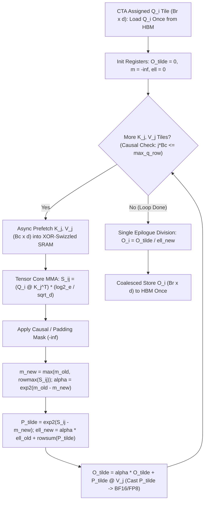
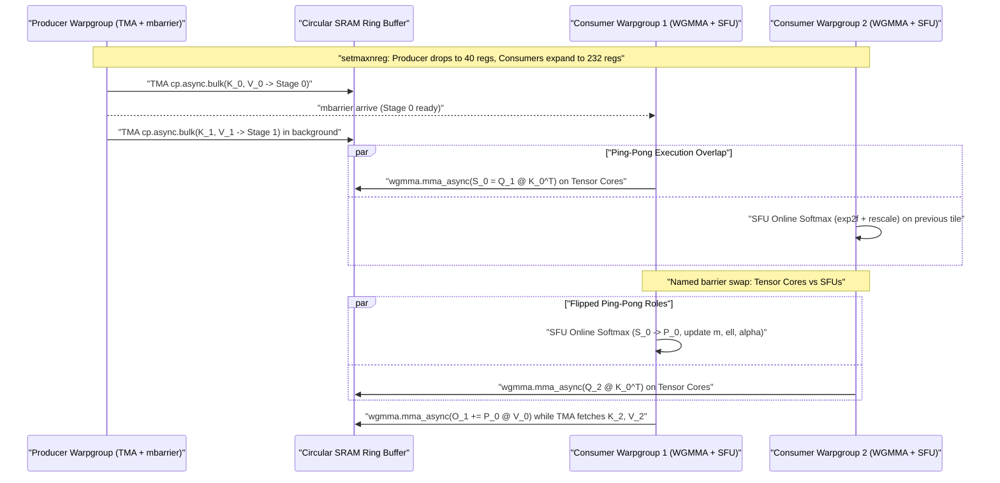

# 04 — Exact Attention Algorithms (FlashAttention-1, 2 & 3)

[Previous: Operator Fusion & CUDA Graphs](./03-operator-fusion-and-cuda-graphs.md) | [Stage 8 Index](./README.md) | [Next: Profiling & Roofline Analysis](./05-profiling-and-roofline-analysis.md)

---

## 1. Why Standard Attention Materializes $O(N^2)$ HBM Matrices

For a single attention head with sequence length $N$ and head dimension $d$ (e.g., $d = 128$), scaled dot-product attention computes:

$$S = \frac{Q K^T}{\sqrt{d}} \in \mathbb{R}^{N \times N}, \qquad P = \text{softmax}(S_{\text{masked}}) \in \mathbb{R}^{N \times N}, \qquad O = P V \in \mathbb{R}^{N \times d}$$

where $Q, K, V, O \in \mathbb{R}^{N \times d}$. Although the inputs and outputs are strictly $O(Nd)$ in size, a **standard unfused PyTorch implementation** executes a sequence of distinct kernels (`bmm` -> `mask` -> `softmax` -> `bmm`), forcing the $N \times N$ score matrices $S$ and $P$ to be materialized in off-chip HBM:

1. **Kernel 1 (`QK^T` GEMM):** Reads $Q, K$ ($2Nd$ elements), **writes $S$ ($N^2$ elements) to HBM**.
2. **Kernel 2 (Scale & Causal Mask):** Reads $S$ ($N^2$), applies $1/\sqrt{d}$ and $-\infty$ causal upper triangle, **writes masked $S$ ($N^2$) to HBM**.
3. **Kernel 3 (3-Pass Safe Softmax):**
   * Pass 3a: Reads $S$ ($N^2$), computes row maxima $m \in \mathbb{R}^N$.
   * Pass 3b: Reads $S$ ($N^2$) + $m$, computes $\exp(S - m)$ and row sums $\ell \in \mathbb{R}^N$.
   * Pass 3c: Divides by $\ell$, **writes $P$ ($N^2$ elements) to HBM**.
4. **Kernel 4 (`PV` GEMM):** **Reads $P$ ($N^2$)** and $V$ ($Nd$) from HBM, writes $O$ ($Nd$).

### Concrete Long-Context HBM Failure Math

Consider prefill on a 32-head model (e.g., Llama-3-8B) at context length $N = 65,536$ in BF16 (2 bytes/element), even for `batch_size = 1`:

$$\text{Memory}(S) = B \cdot H \cdot N^2 \cdot 2\text{ B} = 1 \times 32 \times (65,536)^2 \times 2\text{ B} = \mathbf{274.88\text{ GiB}}$$

A single attention matrix $S$ (plus $P$) requires **>274 GiB**—instantly crashing an 80 GB H100 with an Out-Of-Memory (OOM) error! Even at $N = 8,192$ ($4.29\text{ GiB}$ per matrix), writing and reading $S$ and $P$ across 4–6 passes transfers **~25+ GiB over HBM** for just $2 \cdot (2 N^2 d) = 1.1\text{ TFLOPs}$ of actual math (an Arithmetic Intensity of ~40 FLOPs/Byte, far below H100's 295 FLOPs/Byte ridge point). Standard attention is simultaneously **VRAM-capacity-bound** and **HBM-bandwidth-bound**.

---

## 2. Online Softmax: Single-Pass Streaming Exactness

To avoid materializing $S$ and $P$ in HBM, we must tile $Q, K, V$ inside on-chip **SRAM (Shared Memory)** and never write $N \times N$ intermediates back to HBM. The central mathematical obstacle is **Softmax normalization**:

$$\text{softmax}(x_i) = \frac{e^{x_i - m(x)}}{\sum_{k=1}^{N} e^{x_k - m(x)}}, \qquad m(x) = \max_{1 \le k \le N} x_k$$

Subtracting the global row maximum $m(x)$ ("safe softmax") is mandatory in FP16/BF16/FP32 to prevent $\exp(x_i)$ from overflowing to `inf` (e.g., $e^{89} > \text{FLT\_MAX}$ in FP32, $e^{11.1} > \text{HALF\_MAX}$ in FP16). Naively, computing $m(x)$ requires seeing **all $N$ columns** before computing $\exp(x_k - m(x))$, and seeing all $\exp$ terms before dividing by $\ell(x)$—a 3-pass dependency across the entire sequence!

**Online Softmax** (Milakov & Gimelshein, 2018; extended to $O = PV$ by Dao et al., 2022) proves that both the normalizer $\ell(x)$ and the weighted output $O$ can be computed **exactly in a single streaming pass** over column tiles $j = 1, 2, \dots, T_c$.

### Exact Recurrence Equations

Partition a score row $S_i \in \mathbb{R}^N$ into $T_c$ column blocks $[S_i^{(1)}, S_i^{(2)}, \dots, S_i^{(T_c)}]$, each of width $B_c$, paired with corresponding value blocks $V^{(j)} \in \mathbb{R}^{B_c \times d}$.

Initialize running state for query tile $Q_i \in \mathbb{R}^{B_r \times d}$ in **registers**:
$$m_i^{(0)} = -\infty \in \mathbb{R}^{B_r}, \qquad \ell_i^{(0)} = 0 \in \mathbb{R}^{B_r}, \qquad \tilde{O}_i^{(0)} = \mathbf{0} \in \mathbb{R}^{B_r \times d}$$

For each incoming Key/Value tile $j = 1 \dots T_c$:

1. **Compute local tile scores (in SRAM/Tensor Cores):**
   $$S_{ij} = \frac{Q_i K_j^T}{\sqrt{d}} \in \mathbb{R}^{B_r \times B_c}$$
   *(Apply causal mask $-\infty$ to upper-triangular invalid positions inside $S_{ij}$).*

2. **Compute local tile row-max and update global running max:**
   $$\tilde{m}_{ij} = \text{rowmax}(S_{ij}), \qquad m_i^{\text{new}} = \max\left(m_i^{\text{old}}, \; \tilde{m}_{ij}\right)$$

3. **Compute rescaling factor $\alpha$ for previously accumulated statistics:**
   $$\alpha = \exp\left(m_i^{\text{old}} - m_i^{\text{new}}\right) \in (0, 1]^{B_r}$$
   Because $m_i^{\text{new}} \ge m_i^{\text{old}}$, the exponent is always $\le 0$, guaranteeing $\alpha \in (0, 1]$ with **zero overflow risk**!

4. **Compute local unnormalized probabilities shifted by the *new* max:**
   $$\tilde{P}_{ij} = \exp\left(S_{ij} - m_i^{\text{new}}\right) \in \mathbb{R}^{B_r \times B_c}$$

5. **Rescale and update running sum $\ell_i$:**
   $$\ell_i^{\text{new}} = \alpha \cdot \ell_i^{\text{old}} + \text{rowsum}(\tilde{P}_{ij})$$

6. **Rescale and accumulate unnormalized output $\tilde{O}_i$ (FlashAttention-2 deferred normalization):**
   $$\tilde{O}_i^{\text{new}} = \text{diag}(\alpha) \cdot \tilde{O}_i^{\text{old}} + \tilde{P}_{ij} V_j$$

### Proof of Exactness

By induction, after step $j$, $m_i^{(j)}$ equals the exact max over columns $1 \dots j B_c$, $\ell_i^{(j)} = \sum_{c=1}^{j B_c} e^{S_{i,c} - m_i^{(j)}}$, and $\tilde{O}_i^{(j)} = \sum_{c=1}^{j B_c} e^{S_{i,c} - m_i^{(j)}} V_c$. When step $j+1$ arrives with new max $m_i^{(j+1)}$:
$$\alpha \cdot \tilde{O}_i^{(j)} = e^{m_i^{(j)} - m_i^{(j+1)}} \sum_{c=1}^{j B_c} e^{S_{i,c} - m_i^{(j)}} V_c = \sum_{c=1}^{j B_c} e^{S_{i,c} - m_i^{(j+1)}} V_c$$
Adding $\tilde{P}_{i,j+1} V_{j+1}$ yields the exact unnormalized sum shifted to $m_i^{(j+1)}$. After the final tile $T_c$, **a single division** produces the exact attention output:
$$O_i = \text{diag}\left(\ell_i^{(T_c)}\right)^{-1} \tilde{O}_i^{(T_c)}$$

---

## 3. FlashAttention-1 vs. FlashAttention-2: Tiling & Loop Order

Both FlashAttention-1 and FlashAttention-2 achieve **$O(N)$ HBM memory** (only $Q, K, V, O$, and logsumexp $L = m + \ln \ell$ for training, or zero $L$ in inference!). However, **FlashAttention-1 achieved only ~25–40% of A100 Tensor Core peak**, whereas **FlashAttention-2 doubled throughput to ~70–75% of theoretical peak** through three critical architectural redesigns.

### Loop-Order Inversion: Outer-$K,V$ (FA-1) vs. Outer-$Q$ (FA-2)

* **FlashAttention-1 (Outer loop over $K_j, V_j$; Inner loop over $Q_i$):**
  * Each CTA loaded $K_j, V_j$ into SRAM once and iterated over all $Q_i$ blocks.
  * **Fatal flaw:** Every inner-loop iteration had to load $Q_i, O_i, m_i, \ell_i$ from HBM, update $O_i, m_i, \ell_i$, and **write $O_i, m_i, \ell_i$ back out to HBM** before moving to $Q_{i+1}$! That caused $O(N^2 / B_c)$ extra HBM reads/writes of $O$!
  * Moreover, parallelizing across $(B, H)$ only yielded $B \times H$ CTAs—starving an 108-SM A100 or 132-SM H100 whenever $B \cdot H < 108$.

* **FlashAttention-2 (Outer loop over $Q_i$ across CTAs; Inner loop over $K_j, V_j$):**
  * Each CTA is assigned one query tile $Q_i \in \mathbb{R}^{B_r \times d}$ (parallelized across $B \times H \times \lceil N / B_r \rceil$ independent CTAs—thousands of blocks!).
  * $Q_i$ is loaded from HBM **once** into SRAM/registers and stays pinned for the entire inner loop.
  * The accumulator $\tilde{O}_i$ and online softmax stats $(m_i, \ell_i)$ remain **100% resident in SM registers** across all $K_j, V_j$ iterations, and $O_i$ is written to HBM **exactly once** at the very end!

### Cutting Non-Matmul FLOPs & Shared Memory Synchronization

On modern GPUs (A100/H100), Tensor Core MMA throughput is **16x higher** than FP32 CUDA Core / SFU throughput (e.g., on H100: 989 TFLOP/s BF16 MMA vs. 67 TFLOP/s FP32 vs. ~16 TFLOP/s SFU `MUFU.EX2`). Therefore, every non-matmul operation (`exp`, `max`, `sum`, rescaling `O`) threatens to bottleneck the entire kernel. FA-2 optimizes this in three ways:
1. **Unnormalized Accumulator:** FA-1 divided $\tilde{O}_i$ by $\ell_i$ inside every inner iteration (`O = diag(ell_new)^-1 * (...)`). FA-2 keeps $\tilde{O}_i$ unnormalized, multiplying only by $\alpha$ inside the loop and performing **one single division by $\ell_i$** at the epilogue.
2. **Base-2 Exponential (`exp2f`):** Replaces natural $\exp(x)$ with $2^{x \cdot \log_2 e}$, folding $\frac{\log_2 e}{\sqrt{d}}$ into a single scalar multiply and executing hardware single-instruction `MUFU.EX2`.
3. **Split-Q Warp Partitioning (vs. FA-1 Split-K):** FA-1 split $K_j$ across 4 warps inside a CTA, forcing warps to write partial $PV$ slices to SRAM, `bar.sync`, and read/sum them on every iteration. **FA-2 splits $Q_i$ across warps** (e.g., 4 warps each own $B_r / 4 = 32$ rows of $Q_i$, reading the *same* shared $K_j, V_j$ in SRAM). Every warp owns independent rows of $O_i$ with **zero cross-warp SRAM writes or reductions**!

*(Inference Note — **FlashDecoding**: During autoregressive decode, $N_Q = 1$, so outer-$Q$ parallelism collapses to only $B \times H$ CTAs. FlashDecoding splits the long KV context $N_{\text{KV}}$ across multiple CTAs along the sequence axis—Split-KV—computing partial $(O_i^{(s)}, m_i^{(s)}, \ell_i^{(s)})$ in parallel across all 132 SMs, followed by a tiny logsumexp-weighted reduction kernel.)*

---

## 4. FlashAttention-3 on Hopper (H100/H200)

Despite FA-2's improvements, benchmarking FA-2 on an **NVIDIA H100 SXM5** reveals only **~35% Tensor Core utilization (~350 TFLOP/s out of 989 TFLOP/s BF16 peak)** and even worse scaling in FP8. Why?
1. **Synchronous MMA–Softmax Serialization:** In FA-2, all warps alternate synchronously: compute `QK^T` -> stall Tensor Cores while warps execute SFU `exp2f` -> compute `PV` -> stall Tensor Cores while waiting for `cp.async` KV tiles.
2. **Unused Hopper Silicon:** FA-2 uses Ampere `cp.async` + `mma.sync` rather than Hopper's asynchronous **TMA (Tensor Memory Accelerator)** and **WGMMA (Warpgroup Matrix Multiply-Accumulate, `wgmma.mma_async`)**.

**FlashAttention-3** (Shah et al., 2024) re-architects the kernel natively around three Hopper hardware innovations, achieving **75–85% utilization (~740–840 TFLOP/s in BF16 and >1.2 PFLOP/s in FP8)**.

### 1. Warp-Specialization (Producer-Consumer Architecture)

Instead of all warps doing identical work (homogeneous SIMT/SPMD), FA-3 partitions a 384-thread CTA into **3 specialized Warpgroups** (128 threads = 4 warps per warpgroup):

* **1 Producer Warpgroup (128 threads):**
  * Issues zero math instructions! Runs a lightweight loop issuing **TMA `cp.async.bulk.tensor`** commands to pull $K_j, V_j$ tiles from HBM into circular SRAM ring buffers, synchronized via hardware **`mbarrier`** objects (`mbarrier.arrive.expect_tx`).
  * Uses Hopper's dynamic register reallocation instruction **`setmaxnreg.dec.sync.aligned`** to drop its register budget to just **~24–40 registers/thread**, **donating the freed registers to the Consumer warpgroups**!

* **2 Consumer Warpgroups (256 threads):**
  * Use **`setmaxnreg.inc.sync.aligned`** to claim up to **232–240 registers/thread**, eliminating spilling while holding huge $O_i$ FP32 accumulators.
  * Wait on TMA `mbarrier` parity bits, then issue **`wgmma.mma_async`** directly against SRAM descriptors for $K_j, V_j$ (no `ldmatrix` into registers needed for $B$-operands!).

### 2. Asynchronous Ping-Pong Overlap of WGMMA and Softmax

Because `wgmma.mma_async` runs asynchronously on the Tensor Core pipeline while the warpgroup's CUDA/SFU cores are free, FA-3 uses **2 Consumer Warpgroups in an interleaved Ping-Pong schedule** (enforced via `bar.sync` / named barriers):

* **Phase A:** Consumer Warpgroup 1 occupies the Tensor Cores (`wgmma` for $Q K_j^T$ and $P V_j$), while Consumer Warpgroup 2 concurrently runs the SFU-heavy Online Softmax (`MUFU.EX2`, `FADD`, `FMUL`) on its own $Q$ tile!
* **Phase B:** Roles swap—Warpgroup 2 runs `wgmma` on Tensor Cores while Warpgroup 1 executes Softmax on SFUs!

Furthermore, within a single warpgroup, **intra-warpgroup pipelining** overlaps `wgmma` for $P_{j} V_{j}$ (step $j$) simultaneously with `exp2f` softmax for $S_{j+1}$ (step $j+1$), hiding ~15–25% non-matmul SFU latency completely behind Tensor Core execution.

### 3. Block-Wise FP8 Incoherent Processing via Hadamard Transforms

Hopper's FP8 Tensor Cores (`e4m3`) double peak FLOP/s from 989 TFLOP/s (BF16) to **1,979 TFLOP/s**. However, naively running FlashAttention in FP8 causes severe perplexity degradation:
* FP8 E4M3 has only **3 mantissa bits** ($\sim 12.5\%$ quantization step) and narrow dynamic range ($\max = 448$).
* Transformer $Q, K, V$ activations exhibit **structured channel-wise outliers** (specific head dimensions having 10x–50x larger magnitude than neighboring dimensions). A per-tensor or per-block scale factor dictated by one outlier crushes normal values into zero/subnormals.
* In addition, `wgmma` in FP8 requires $K$-contiguous (`[d, B_c]`) layout for $V$ in `P @ V`, requiring an in-SRAM transpose of $V$ (performed seamlessly by TMA or register permutation / `stmatrix`).

FlashAttention-3 solves FP8 accuracy loss with two techniques:
1. **Block-Wise Quantization Scaling:** Instead of a single global scale for the entire tensor, each SRAM tile $(Q_i, K_j, V_j)$ carries its own per-block FP32 descaling factor applied cleanly in registers during the $Q K^T$ and $P V$ epilogues.
2. **Incoherent Processing via Randomized Hadamard Transform:** Before quantizing $Q$ and $K$ to FP8, multiply both by a randomized orthogonal Hadamard matrix $H = D \cdot H_d$ (where $H_d$ is the normalized Walsh-Hadamard matrix with entries $\pm 1/\sqrt{d}$ and $D$ is a diagonal matrix of random Rademacher signs $\pm 1$):
   $$\tilde{Q} = Q H, \qquad \tilde{K} = K H$$
   Because $H$ is orthogonal ($H H^T = I$), the exact dot products are **mathematically invariant**:
   $$\tilde{Q} \tilde{K}^T = (Q H)(K H)^T = Q (H H^T) K^T = Q K^T$$
   Physically, multiplying by $H$ smears outlier spikes uniformly across all $d$ coordinates (reducing outlier peak magnitude by $\approx O(\sqrt{d})$, e.g., $\sim 11\times$ for $d=128$). Crucially, the **Fast Walsh-Hadamard Transform (FWHT)** executes in $O(d \log d)$ additions/subtractions using butterfly warp shuffles (`shfl.sync.bfly`) inside registers without any $d \times d$ matrix multiply—cutting FP8 attention RMSE by **~2.6x** while preserving **>1.2 PFLOP/s** on H100!

---

## Navigation

* **Previous:** [03 — Operator Fusion & CUDA Graphs](./03-operator-fusion-and-cuda-graphs.md)
* **Index:** [Stage 8 Overview](./README.md)
* **Next:** [05 — Profiling & Roofline Analysis](./05-profiling-and-roofline-analysis.md)
