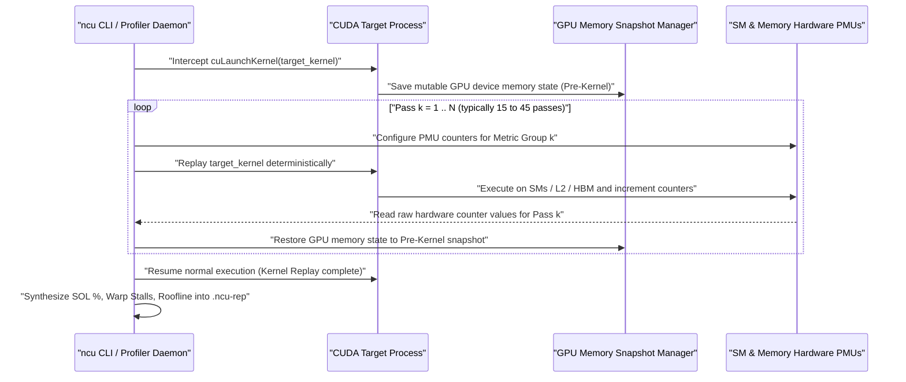
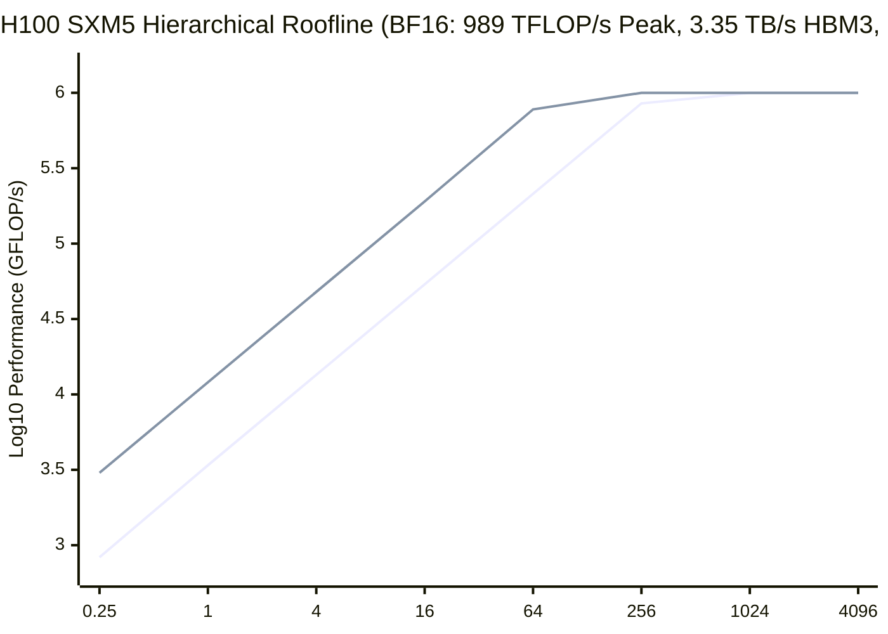
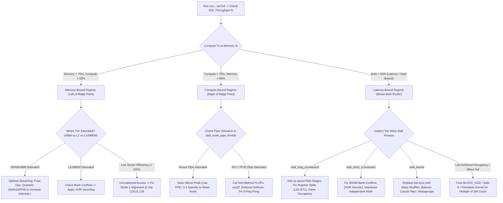

# 05 — Profiling & Roofline Analysis

[Previous: Exact Attention Algorithms](./04-exact-attention-algorithms-flashattention.md) | [Stage 8 Index](./README.md)

---

This guide explains how to measure a GPU kernel's hardware efficiency using NVIDIA's profiling tools and the **Roofline Model**, turning performance bottlenecks from guesswork into exact engineering fixes. Every profiling tool, hardware counter, stall metric, and Roofline term used below is defined in dependency order before its first use.

## Core Concepts & Terminology

### 1. Profiling Tools & Hardware Measurement
* **Nsight Systems (`nsys`) vs. Nsight Compute (`ncu`):** **`nsys`** is a system-wide timeline profiler (microseconds to seconds) for CPU threads, kernel launch gaps, CUDA Streams, and PCIe/NVLink transfers. **`ncu`** is a single-kernel microarchitectural profiler that inspects hardware counters inside the GPU.
* **PMU (Hardware Performance Monitoring Unit), Counter Multiplexing, & Kernel Replay:** **PMUs** are physical event counters inside each **SM (Streaming Multiprocessor)**, cache, and memory controller. Because an SM has only 8–32 physical counter slots, `ncu` collects hundreds of metrics via **Kernel Replay**: it snapshots GPU memory, re-runs the kernel 15–45+ times with different counter groups, and restores memory between passes.

### 2. GPU Execution, Memory Tiers, & Instructions
* **Warp, CTA (Thread Block), Warp Scheduler, & PC (Program Counter):** A **warp** is 32 threads executing together; a **CTA** is a thread block on one SM. Each cycle, an SM's **Warp Scheduler** checks each warp's **PC** (current instruction address) and picks an **eligible** (ready) warp to issue, or logs why it is **stalled**.
* **GPU Memory Tiers (`HBM/DRAM`, `L2`, `L1/TEX`, `SRAM`, `Local Memory`):** Off-chip **HBM/DRAM** (~3.35 TB/s, ~500 cycles latency), shared **L2 Cache** (~12 TB/s), per-SM **L1/TEX Cache & Shared Memory (SRAM)** (~30+ TB/s, ~25 cycles, 32 banks), and **Local Memory (`lmem`)** (off-chip HBM used when thread registers spill).
* **SM Compute Pipelines (`Tensor Pipe`, `FP32 FMA`, `INT32`, `SFU / XU`, `LSU`):** **Tensor Cores** (`HMMA`/`GMMA`) execute matrix math; **FP32 `FMA`** and **INT32** run scalar float/integer math; **SFU / XU** (Special Function Unit) runs `exp2f` (`MUFU.EX2`) and reciprocal square root (`RSQ`); **LSU** (Load/Store Unit) handles memory ops.
* **Key Instructions & Techniques (`LDG.E.128`, `LDL`/`STL`, `LDS`, `ldmatrix`, `SHFL`, `S2R`, `cp.async`, `TMA`, `bar.sync`, `mbarrier`, `XOR Swizzling`):** 128-bit global load (`LDG.E.128`), register spill load/store (`LDL`/`STL`), shared memory load (`LDS`, `ldmatrix`), warp shuffle (`SHFL`), special register read (`S2R`), async HBM-to-SRAM DMA (`cp.async`, Hopper **TMA**), barriers (`bar.sync`, `mbarrier`), and bank-conflict-free **XOR swizzling**.

### 3. SpeedOfLight, Warp Stalls, Occupancy & Wave Effects
* **SpeedOfLight (`SOL`), `Compute (SM) %`, & `Memory %`:** `ncu`'s top-level summary showing the kernel's peak utilization across SM compute pipelines (`sm__throughput...`) and memory subsystems (`gpu__compute_memory_throughput...`).
* **Critical Warp Stall Reasons (`Warp State Statistics`):**
  * **`stall_long_scoreboard`:** Warp is waiting for a slow off-SM load (`LDG` to L2/HBM, or `LDL` register spill).
  * **`stall_math_pipe_throttle`:** Operands are ready, but the target math unit (Tensor Core, FP32, or SFU) is 100% busy.
  * **`stall_barrier`:** Warp is waiting at `__syncthreads()` / `bar.sync` / `mbarrier` for sibling warps in its CTA.
  * **`stall_short_scoreboard`:** Warp is waiting on a fast SM-local op (`LDS`/`ldmatrix`, L1 hit, `SHFL`, `S2R`), often spiked by SRAM bank conflicts.
* **Theoretical vs. Achieved Occupancy, Little's Law, & ILP:** **Theoretical occupancy** is the max fraction of SM warp slots a kernel's CTA/register/SRAM footprint allows; **achieved occupancy** (`sm__warps_active...`) is the time-averaged active fraction. By **Little's Law** ($\text{Concurrency} = \text{Bandwidth} \times \text{Latency}$), kernels with high **ILP (Instruction-Level Parallelism)** and `LDG.E.128` saturate HBM at just 25–50% occupancy.
* **Wave Quantization, Persistent Kernels, & Split-K:** Launching a CTA grid that is not a multiple of the GPU's SM count (e.g., 133 CTAs on 132 SMs) leaves SMs idle in the final wave (**tail effect**). **Persistent Kernels** (1 CTA/SM pulling from a work queue) and **Split-K** (splitting matrix reduction across CTAs) eliminate tail waves.

### 4. Roofline Model & LLM Inference Regimes
* **Roofline Model, Arithmetic Intensity ($I$), Ridge Point ($I^*$), & Hierarchical Roofline:** Plots $I = \text{FLOPs} / \text{Bytes}$ against performance $P = \min(P_{\text{peak}}, \text{BW}_{\text{peak}} \times I)$ on a log-log chart. The **Ridge Point** ($I^* = P_{\text{peak}} / \text{BW}_{\text{peak}}$) separates the memory-bound slope from the compute-bound plateau. **Hierarchical Roofline** plots separate roofs for HBM (`dram__bytes.sum`), L2 (`lts__t_bytes.sum`), and L1/SMEM (`l1tex__t_bytes.sum`) using SASS FLOP counters (`FADD`, `FMUL`, `FFMA`, `TensorOps`) and `gpu__time_duration.sum`.
* **LLM Regimes & Fixes (`Prefill GEMM`, `Decode GEMV`, `W4A16`/`FP8`, `2:4 Sparsity`, `Operator Fusion`, `Split-Q`, `FA-3 Ping-Pong`):** **Prefill GEMM** is compute-bound; **Decode GEMV** is HBM-bound. **W4A16/FP8 quantization** and **Operator Fusion** raise $I$; **2:4 Sparsity** doubles Tensor Core peak via 50% structured pruning; **Split-Q** and **FlashAttention-3 Ping-Pong** cut barriers and overlap WGMMA with SFU Softmax.

---

## 1. NVIDIA Nsight Compute (`ncu --set full`) Mechanics

When optimizing an LLM inference pipeline, you use two complementary NVIDIA tools at different time scales:
* **Nsight Systems (`nsys`):** System-wide timeline profiler (microseconds to seconds). Captures CPU Python/C++ threads, CUDA driver launch calls, stream concurrency, PCIe/NVLink transfers, and inter-kernel launch gaps—ideal for diagnosing CUDA Graph opportunities and host-device synchronization stalls.
* **Nsight Compute (`ncu`):** Single-kernel microarchitectural profiler. Intercepts individual CUDA kernels and queries the GPU's **Hardware Performance Monitoring Units (PMUs)** inside every SM, L1/TEX cache, L2 slice, and HBM controller to report exact cycle counts, warp stall distributions, bank conflicts, and Roofline utilization.

### Production CLI Invocation

Never profile an entire 100-token autoregressive generation loop with `--set full`—each profiled kernel replays dozens of times. Isolate the exact target kernel invocation after warmup:

```bash
# Profile 1 launch of a specific Triton/CUDA kernel after skipping warmup iterations
ncu --set full \
    --kernel-name "regex:fused_add_rmsnorm.*" \
    --launch-skip 5 \
    --launch-count 1 \
    --target-processes all \
    -o rmsnorm_profile \
    python bench_kernel.py
```

* `--set full`: Collects all built-in metric sections (`SpeedOfLight`, `SpeedOfLight_RooflineChart`, `MemoryWorkloadAnalysis`, `ComputeWorkloadAnalysis`, `SchedulerStats`, `WarpStateStats`, `Occupancy`, `SourceCounters`).
* **Exporting CSV/CLI summary headlessly:** `ncu --import rmsnorm_profile.ncu-rep --page details` or `--csv --metrics ...`.

### Why `ncu` Replays Kernels: Hardware PMU Counter Multiplexing

An NVIDIA SM contains only a small, fixed number of physical PMU counter registers (typically 8–32 hardware event counters active simultaneously per pass). Yet `--set full` collects **hundreds of distinct hardware metrics** (DRAM sectors read/written, L2 hit rate, Tensor Core pipe cycles, 15+ warp stall reasons, shared bank conflicts).

To measure all of them without interference, `ncu` uses **Kernel Replay** (default):
1. Before launching the target kernel, `ncu` snapshots all mutable GPU device memory pages touched by (or potentially touched by) the kernel into a save buffer (or host/pinned RAM).
2. `ncu` launches the kernel Pass 1 with PMU Group 1 armed, reads counters, **restores mutated GPU memory** to the exact pre-kernel state, and re-launches Pass 2 with PMU Group 2 armed—repeating **15 to 45+ replay passes**.
3. **Critical Caveat:** Do **not** read wall-clock timestamps from an `ncu` capture as end-to-end serving latency; `ncu` serializes streams and injects replay overhead. However, the **per-pass SM cycle counts (`gpc__cycles_elapsed`), throughput percentages, and Roofline FLOPs/Bytes** are exact physical hardware measurements!



---

## 2. Reading SpeedOfLight (`SOL`): Memory vs. Compute Throughput

The first panel in any `ncu` report is **GPU Speed Of Light Throughput (SOL)**, reporting two summary percentages relative to the target GPU's sustained hardware peak:

1. **`Compute (SM) Throughput [%]`** (`sm__throughput.avg.pct_of_peak_sustained_elapsed`):
   The maximum utilization across all SM execution pipelines (Tensor Core `HMMA`/`GMMA`, FP32 `FMA`, INT32, SFU `XU`, Load/Store issue).
2. **`Memory Throughput [%]`** (`gpu__compute_memory_throughput.avg.pct_of_peak_sustained_elapsed`):
   The maximum utilization across all tiers of the GPU memory subsystem (`DRAM/HBM Bandwidth %`, `L2 Cache Throughput %`, and `L1/TEX / Shared Memory Throughput %`).

### Interpreting the Four SOL Quadrants

| `Compute (SM) %` | `Memory %` | Physical Regime | Typical LLM Kernel & Diagnostic Action |
| --- | --- | --- | --- |
| **Low (< 50%)** | **High (> 75%)** | **Memory-Bound** | Decode GEMV, RMSNorm, RoPE, Softmax. Inspect `Memory Workload Analysis` to check whether **DRAM/HBM** is saturated (optimal for streaming!) vs. **L1/SMEM** (bank conflicts!) vs. **L2**. |
| **High (> 75%)** | **Low (< 60%)** | **Compute-Bound** | Large-batch Prefill GEMM, FlashAttention-3. Check `Compute Workload Analysis` -> verify **Tensor Pipe** is the active limiter, not FP32/SFU (`exp2f` throttling). |
| **High (> 75%)** | **High (> 75%)** | **Balanced / Ridge-Point** | Optimal medium-batch GEMM or heavily tiled Attention. Near theoretical hardware maximum. |
| **Low (< 50%)** | **Low (< 50%)** | **Latency / Stall-Bound!** | Small grid / SM wave under-utilization, excessive `__syncthreads()`, uncoalesced serialized memory stalls, or register spilling. **Do not guess—inspect `Warp State Statistics` immediately.** |

---

## 3. Warp Stall Reasons (`Warp State Statistics`)

On every clock cycle, an SM Warp Scheduler inspects all resident warps allocated to its partition. A warp is either **Eligible** (ready to issue an instruction), **Issued** (one eligible warp is picked per cycle), or **Stalled** (blocked on a hardware dependency). Nsight Compute samples PC (Program Counter) stall reasons via `smsp__pcsamp_warps_issue_stalled_*` and reports average cycles per instruction spent in each stall state.

Understanding the **four critical stall reasons** turns kernel optimization from guesswork into deterministic engineering:

### 1. `stall_long_scoreboard` (Long-Scoreboard / Global Memory Wait)
* **Hardware Meaning:** The warp attempted to execute an instruction whose source register is still waiting for a **variable-latency off-SM memory load** (`LDG` hitting L2 or HBM, or a register spill `LDL` from Local Memory) to return.
* **Root Causes in LLM Kernels:**
  * Synchronous global loads without `cp.async` / TMA multi-stage prefetching (`num_stages = 1`).
  * Low occupancy (too few active warps per SM to cover ~400–800 cycles of HBM latency).
  * Uncoalesced reads (32x sector replays stretching return time) or register spilling (`LDL`/`STL`).
* **Concrete Fixes:** Enable multi-stage software pipelining (`num_stages = 3..4`), use 128-bit vectorized loads (`LDG.E.128`) with coalesced `stride = 1`, reduce register count below 255 to eliminate spills, or increase `num_warps` / active CTAs per SM.

### 2. `stall_math_pipe_throttle` (Execution Pipeline Saturated)
* **Hardware Meaning:** The warp's next instruction is ready (all operands in registers), **but the target math execution unit is already 100% busy** servicing previous warps' instructions.
* **Critical Nuance (Good vs. Bad Throttle):**
  * **Healthy Throttle:** If Tensor Cores (`HMMA` / `GMMA`) are at 85–95% utilization in a GEMM or FlashAttention kernel, high `stall_math_pipe_throttle` means you have **successfully saturated the compute silicon**!
  * **Pathological Throttle:** In attention or activation kernels, if `stall_math_pipe_throttle` is caused by the **SFU / XU (`MUFU.EX2`, `RSQ`)** or **FP32 pipe** while Tensor Cores sit idle, your non-matmul operations (e.g., Softmax `exp()`, FP32 rescaling, or `int64` address math) are bottlenecking the kernel!
* **Concrete Fixes (when pathological):** Use `exp2f` instead of `expf`, hoist invariant divisions (`1/sqrt(d)`), defer Softmax division to the epilogue (FA-2), overlap SFU with WGMMA across warpgroups (FA-3 Ping-Pong), or keep inner offsets `int32`.

### 3. `stall_barrier` (CTA Synchronization Wait)
* **Hardware Meaning:** The warp reached a thread-block barrier (`__syncthreads()`, `bar.sync`, or Hopper `mbarrier` wait) and is idling until sibling warps in the same CTA arrive.
* **Root Causes:**
  * Warp work imbalance (e.g., in causal FlashAttention, Warp 0 hits the causal mask early and finishes while Warp 3 processes full $K$-tiles).
  * Too many barriers inside inner loops (e.g., cross-warp SMEM reductions on every step instead of Split-Q or warp shuffles).
  * Producer-Consumer rate mismatch in warp-specialized kernels (Producer TMA warps outpace Consumers or vice versa).
* **Concrete Fixes:** Replace CTA-wide `__syncthreads()` reductions with intra-warp `__shfl_xor_sync`, switch from Split-K to Split-Q across warps (eliminating barriers), or rebalance Producer/Consumer warpgroup ratios.

### 4. `stall_short_scoreboard` (Shared Memory / Short-Latency Wait)
* **Hardware Meaning:** The warp is waiting for a **fixed/short-latency SM-local operation**—primarily a Shared Memory load (`LDS`, `ldmatrix`), L1 cache hit, warp shuffle (`SHFL`), or special register read (`S2R`).
* **Root Causes:**
  * **Shared Memory Bank Conflicts!** A 16-way or 32-way bank conflict stretches a ~25-cycle SRAM load into 400+ cycles, masquerading as a huge `stall_short_scoreboard` spike!
  * Lack of instruction interleaving (issuing `LDS` immediately followed on the very next instruction by `FMA`/`MMA` on that register, exposing the 20–30 cycle SRAM latency).
* **Concrete Fixes:** Apply **XOR swizzling** to SRAM layouts (verify via `l1tex__data_bank_conflicts_pipe_lsu_mem_shared_op_ld.sum` in `ncu` dropping to 0), and unroll/interleave independent math between `ldmatrix` and `mma`.

---

## 4. Occupancy vs. Latency Hiding & Wave Quantization

### Theoretical vs. Achieved Occupancy

* **Theoretical Occupancy:** The maximum percentage of hardware warp slots per SM (e.g., 64 warps/SM on Hopper H100 / Ampere A100; 48 warps/SM on GA102/Ada) that *can* reside concurrently given the kernel's resource footprint:
  $$\text{Occupancy}_{\text{theo}} = \frac{\min\left(W_{\max}, \; C_{\max} \cdot W_{\text{CTA}}, \; \left\lfloor \frac{\text{SMEM}_{\max}}{\text{SMEM}_{\text{CTA}}} \right\rfloor \cdot W_{\text{CTA}}, \; \left\lfloor \frac{R_{\max}}{R_{\text{thread}} \cdot 32} \right\rfloor\right)}{W_{\max}}$$
* **Achieved Occupancy (`sm__warps_active.avg.pct_of_peak_sustained_active`):** The actual time-averaged active warps observed during execution. Even with 100% theoretical occupancy, achieved occupancy crashes if the grid is too small or suffers from tail imbalance.

### Debunking the "100% Occupancy" Myth (Little's Law)

A pervasive misconception among beginners is that maximizing occupancy to 100% maximizes speed. **In reality, top-performing GEMM and FlashAttention-3 kernels routinely run at 25% to 50% occupancy (16–32 warps/SM)!**

By **Little's Law** applied to an SM's memory pipeline, the bytes (or independent requests) in flight required to saturate HBM bandwidth is:
$$\text{Required Concurrency} = \text{Bandwidth}_{\text{SM}} \times \text{Latency}_{\text{HBM}}$$

Consider an H100 SM:
* Total GPU HBM3 bandwidth = $3,350\text{ GB/s}$ across $132\text{ SMs} \implies \approx 25.4\text{ GB/s per SM}$.
* At $1.83\text{ GHz}$ SM clock, that is $\approx \mathbf{13.9\text{ bytes/cycle per SM}}$.
* With $L_{\text{HBM}} \approx 500\text{ cycles}$, each SM needs **$13.9 \times 500 \approx 6,950\text{ bytes}$ (~54 cache lines)** in flight simultaneously to hide HBM latency completely.
* If a kernel achieves concurrency via **Instruction-Level Parallelism (ILP)** and **128-bit vectorized loads (`LDG.E.128`)**: a single warp of 32 threads issuing one `LDG.E.128` puts $32 \times 16 = 512\text{ bytes}$ in flight! Just **14 warps per SM (~22% occupancy)**—or even **4–8 warps** issuing 2–4 independent prefetches via `cp.async`—saturates the entire HBM pipe!
* Meanwhile, forcing 100% occupancy caps registers at 32/thread, shrinking tile sizes ($B_M, B_N$), slashing Arithmetic Intensity, and causing register spills.

### Wave Quantization (Tail Effects)

An NVIDIA H100 SXM5 has **132 SMs**. Suppose a kernel launches $G$ CTAs where 1 CTA fits per SM:
* Launching $G = 132$ CTAs executes in **1 full wave** (**100% SM utilization**).
* Launching $G = 133$ CTAs forces **2 waves**: Wave 1 runs 132 CTAs; Wave 2 runs **1 single CTA while 131 SMs sit completely idle!** Average SM utilization plummets to $133 / (2 \times 132) = \mathbf{50.4\%}$—nearly a **2x latency penalty** for 1 extra block!

This is why production Triton/CUDA kernels tune `BLOCK_M`/`BLOCK_N` or use **Persistent Kernels** (launching exactly `132` worker CTAs that dynamically pull tiles from an atomic work queue) and **Split-K** to ensure total grid size is an integer multiple of the SM count.

---

## 5. Empirical Roofline Plotting & Hierarchical Roofs

The **Roofline Model** (Williams et al., 2009) plots a kernel's empirical **Arithmetic Intensity** ($I$, x-axis) against **Attainable Performance** ($P$, y-axis) on a **log-log scale**, bounded by the physical silicon ceilings of the GPU.

### Exact Roofline Equations & H100 Concrete Numbers

1. **Arithmetic Intensity ($I$):**
   $$I = \frac{\text{Total Useful FLOPs}}{\text{Total Bytes Transferred (at tier } \tau\text{)}} \quad \left[\frac{\text{FLOPs}}{\text{Byte}}\right]$$
2. **Attainable Performance Ceiling ($P_{\text{roof}}(I)$):**
   $$P_{\text{roof}}(I) = \min\left(P_{\text{peak}}, \; \text{BW}_{\text{peak}} \times I\right)$$
3. **Ridge Point ($I^*$):** The critical intensity separating the **Memory-Bound slope** from the **Compute-Bound plateau**:
   $$I^* = \frac{P_{\text{peak}}}{\text{BW}_{\text{peak}}}$$

For an **NVIDIA H100 SXM5** ($3.35\text{ TB/s}$ HBM3, $\sim 12\text{ TB/s}$ L2 sustained bandwidth):

| Compute Unit / Precision | Peak Compute ($P_{\text{peak}}$) | HBM3 Ridge Point ($I^*_{\text{HBM}}$) | L2 Ridge Point ($I^*_{\text{L2}}$) |
| --- | --- | --- | --- |
| **FP32 CUDA Cores** | $67\text{ TFLOP/s}$ | $67 / 3.35 = \mathbf{20.0\text{ FLOP/B}}$ | $67 / 12 \approx \mathbf{5.6\text{ FLOP/B}}$ |
| **FP16 / BF16 Tensor Cores** | $989\text{ TFLOP/s}$ | $989 / 3.35 = \mathbf{295.2\text{ FLOP/B}}$ | $989 / 12 \approx \mathbf{82.4\text{ FLOP/B}}$ |
| **FP8 Tensor Cores** | $1,979\text{ TFLOP/s}$ | $1,979 / 3.35 = \mathbf{590.7\text{ FLOP/B}}$ | $1,979 / 12 \approx \mathbf{164.9\text{ FLOP/B}}$ |

### Hierarchical Roofline (HBM + L2 + L1/SMEM)

A single HBM Roofline can mislead engineers when a kernel exhibits high L2 cache reuse (e.g., reading a small weight matrix across many tokens, or FlashDecoding reading shared queries). If you divide FLOPs only by `dram__bytes.sum`, a kernel might appear **above** the HBM Roofline—which is physically possible because those bytes were served by the faster **L2 Cache (~12 TB/s)** or **L1/SMEM (~30+ TB/s)**!

Therefore, Nsight Compute's `--section SpeedOfLight_RooflineChart` (and `HierarchicalRoofline`) plots **three nested bandwidth ceilings** on the same chart using tier-specific Arithmetic Intensities:
* $I_{\text{HBM}} = \text{FLOPs} / \text{HBM Bytes}$ (`dram__bytes.sum`) vs. HBM3 Roof ($3.35\text{ TB/s}$).
* $I_{\text{L2}} = \text{FLOPs} / \text{L2 Bytes}$ (`lts__t_bytes.sum`) vs. L2 Roof ($\sim 12\text{ TB/s}$).
* $I_{\text{L1}} = \text{FLOPs} / \text{L1/SMEM Bytes}$ (`l1tex__t_bytes.sum`) vs. L1/SMEM Roof ($\sim 30+\text{ TB/s}$).

If $P_{\text{achieved}}$ sits far below the **HBM roof** at $I_{\text{HBM}} < I^*$, you have HBM inefficiency (uncoalesced reads, stalls, low wave occupancy). If $I_{\text{HBM}}$ sits on the HBM roof, the **only** way to go faster is to move right along the x-axis (increase $I$ via **quantization W4A16/FP8** or **operator fusion**!).

### Log-Log H100 Hierarchical Roofline Chart (BF16 Tensor Core Peak)

*(Axes plotted on $\log_{10}$ scale: x-axis shows Arithmetic Intensity $I \in [0.25, 4096]$ FLOPs/Byte; y-axis shows $\log_{10}(\text{GFLOP/s})$ where $3.0 = 1\text{ TFLOP/s}$, $4.0 = 10\text{ TFLOP/s}$, $5.0 = 100\text{ TFLOP/s}$, $6.0 = 1,000\text{ TFLOP/s}$.)*



*Lower line = HBM3 Roof ($3.35\text{ TB/s}$, Ridge at $I^* = 295\text{ FLOP/B}$, BF16 Decode GEMV sits near $I \approx 1..8$, Prefill GEMM / FA-3 sits at $I \ge 300$). Upper line = L2 Cache Roof ($\sim 12\text{ TB/s}$, Ridge at $I^* = 82\text{ FLOP/B}$).*

### Extracting Roofline Coordinates from Nsight Compute

```bash
# Collect exact FLOPs and DRAM/L2 bytes for empirical Roofline plotting
ncu --metrics \
  sm__sass_thread_inst_executed_op_fadd_pred_on.sum,\
  sm__sass_thread_inst_executed_op_fmul_pred_on.sum,\
  sm__sass_thread_inst_executed_op_ffma_pred_on.sum,\
  sm__ops_path_tensor_src_bf16_dst_fp32.sum,\
  dram__bytes.sum,\
  lts__t_bytes.sum,\
  gpu__time_duration.sum \
  --csv python bench_kernel.py > roofline_raw.csv
```

From the CSV output:
$$\text{Total FLOPs} = \text{FADD} + \text{FMUL} + 2 \cdot \text{FFMA} + \text{TensorOps}$$
$$I_{\text{HBM}} = \frac{\text{Total FLOPs}}{\text{dram\_\_bytes.sum}}, \qquad P_{\text{empirical}} = \frac{\text{Total FLOPs}}{\text{gpu\_\_time\_duration.sum (seconds)} \times 10^{9}}\text{ [GFLOP/s]}$$

---

## 6. End-to-End Bottleneck Diagnosis Decision Flow



---

## Navigation

* **Previous:** [04 — Exact Attention Algorithms (FlashAttention)](./04-exact-attention-algorithms-flashattention.md)
* **Index:** [Stage 8 Overview](./README.md)
* **Curriculum:** [Complete Syllabus](../../syllabus.md)
