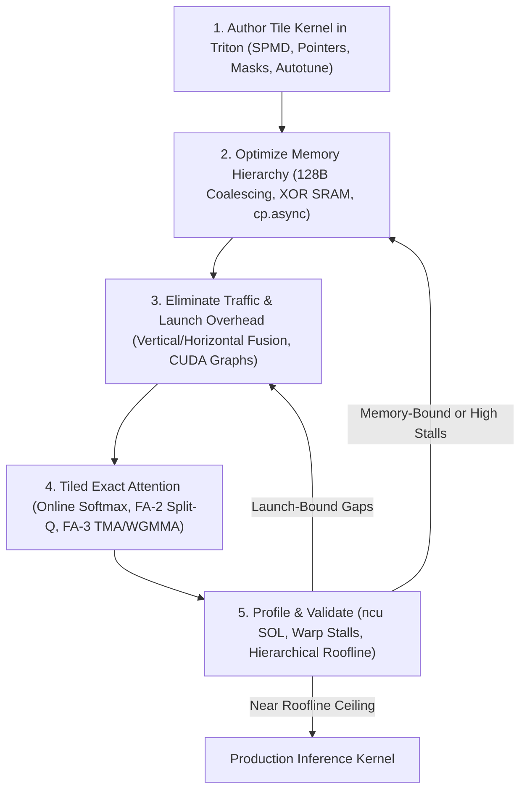

# Stage 8: Kernel-Level Optimization

[Back to Project Overview](../../README.md) | [Complete Syllabus](../../syllabus.md)

**Phase 3: Kernels, Advanced Parallelism & Distributed Systems**

---

## Stage Overview

High-level serving engines (vLLM, SGLang, TensorRT-LLM) only realize the theoretical limits of GPU silicon when the underlying compute and memory kernels eliminate wasted HBM traffic, hardware pipeline bubbles, and CPU dispatch latency. In LLM inference, **decode** is overwhelmingly limited by HBM memory bandwidth and kernel-launch overhead, whereas **prefill** is limited by Tensor Core throughput and attention's $O(N^2)$ scaling.

Stage 8 descends from serving-engine abstractions directly to the **GPU Streaming Multiprocessor (SM)**, **Warp Scheduler**, **Shared Memory (SRAM)**, and **CUDA Driver/Runtime** boundary. It establishes the theoretical and empirical foundations required to author custom fused kernels in Triton, engineer bank-conflict-free memory pipelines, eliminate launch overhead via CUDA Graphs, understand exact tiled attention from FlashAttention-1 through Hopper FlashAttention-3, and diagnose hardware bottlenecks quantitatively using NVIDIA Nsight Compute and hierarchical Roofline modeling.

### End-to-End Optimization Loop

---

## Topic Index

| # | Topic | Core Technical Concepts |
| --- | --- | --- |
| **01** | [**Triton Programming Model**](./01-triton-programming-model.md) | Block-level SPMD execution, `tl.program_id`, 2D/3D stride pointer arithmetic, boundary masks & neutral padding (`other`), compiler-managed TTGIR SRAM layouts & coalescing, `@triton.autotune` (`BLOCK_SIZE`, `num_warps`, `num_stages`), annotated fused RMSNorm kernel |
| **02** | [**Kernel Memory Optimization**](./02-kernel-memory-optimization.md) | 128B cache lines & 32B sectors, coalesced vs. strided HBM access, explicit SRAM tiling, 32-bank Shared Memory physics & XOR swizzling, 128-bit vectorized loads (`ld.global.v4.b32`), register pressure & HBM local-memory spilling, `cp.async` & TMA multi-stage software pipelining |
| **03** | [**Operator Fusion & CUDA Graphs**](./03-operator-fusion-and-cuda-graphs.md) | HBM byte-traffic reduction via kernel fusion (`Residual + RMSNorm + FP8/INT8 Quant`, `SwiGLU`), horizontal vs. vertical fusion, CPU launch overhead physics (~5–20 µs/kernel), `cudaStreamBeginCapture` / `torch.cuda.CUDAGraph`, static-shape constraints, batch bucketing & padding |
| **04** | [**Exact Attention Algorithms**](./04-exact-attention-algorithms-flashattention.md) | Why standard attention materializes $O(N^2)$ HBM intermediates, single-pass Online Softmax ($m, \ell, \alpha$), FlashAttention-1 vs. FlashAttention-2 outer-$Q$ tiling, FlashAttention-3 Hopper warp-specialization (TMA Producers, WGMMA Consumers, Ping-Pong softmax overlap), FP8 Hadamard incoherent processing |
| **05** | [**Profiling & Roofline Analysis**](./05-profiling-and-roofline-analysis.md) | `ncu --set full` kernel replay mechanics, SpeedOfLight (`Memory Throughput %` vs. `Compute (SM) Throughput %`), Warp Stall Reasons (`long_scoreboard`, `math_pipe_throttle`, `barrier`, `short_scoreboard`), occupancy vs. latency hiding & wave quantization, empirical H100 Roofline plotting |

---

## Navigation

* **Up:** [Phase 3 Overview & Project Documentation](../../README.md) | [Complete Syllabus (Stage 8)](../../syllabus.md#stage-8-kernel-level-optimization)
* **Previous Stage:** [← Stage 7: Speculative Decoding & Advanced Parallelism](../stage-07/README.md)
* **Start Reading:** [01 — Triton Programming Model](./01-triton-programming-model.md)
* **Next Stage:** [Stage 9: Distributed & Disaggregated Inference →](../stage-09/README.md)
