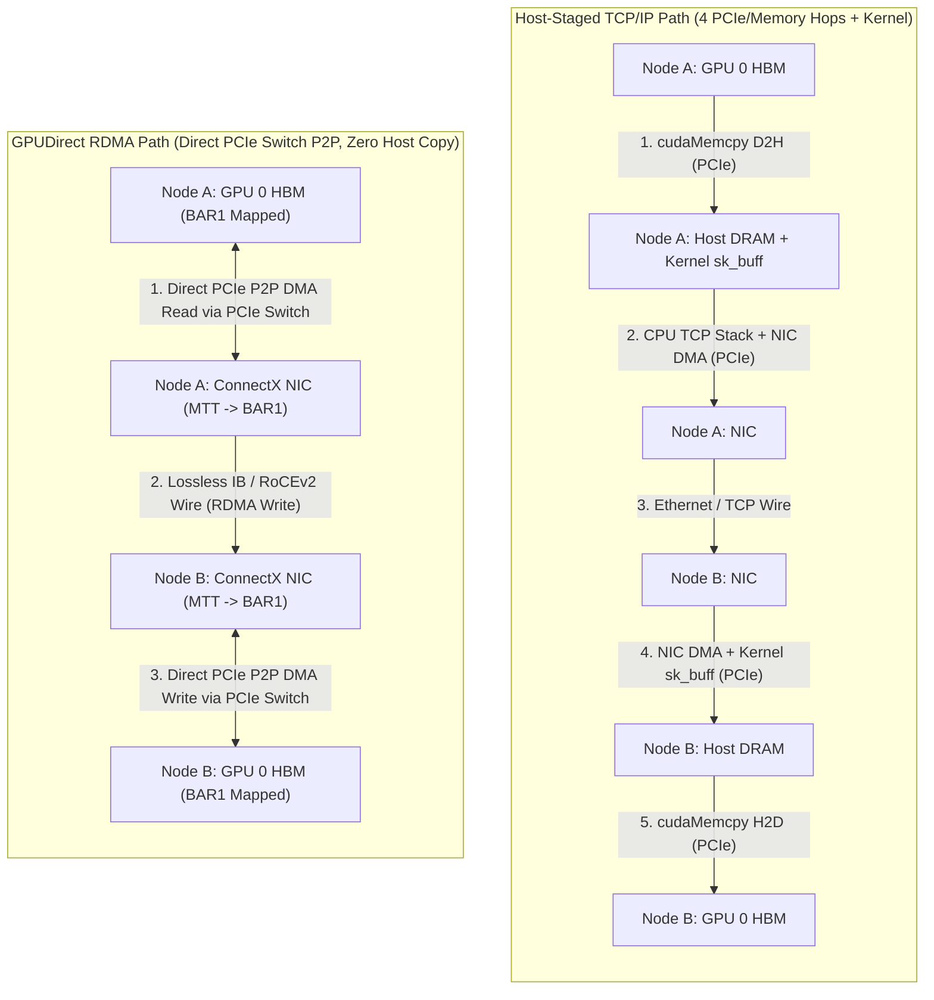
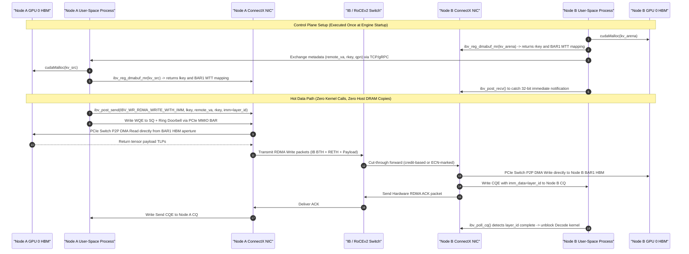

# 01 — High-Speed Network Fabrics

> **Navigation:** [Stage 9 Index](./README.md) | **Next:** [02 — Disaggregated Prefill/Decode Architecture](./02-disaggregated-prefill-decode-architecture.md)

Running large AI models across many graphics processors requires moving huge amounts of data between chips and servers at microsecond speeds. This document explains the physical interconnects, lossless networking protocols, and zero-copy software mechanisms that keep multi-GPU inference fast and predictable.

---

## Core Concepts & Terminology

Every hardware component, networking protocol, and software primitive used in this document is defined below in dependency order:

### 1. LLM Inference & Latency Metrics
* **LLM (Large Language Model) & Inference:** An AI model trained to predict text one piece at a time; *inference* is running the trained model to answer user prompts.
* **Token:** A small unit of text (roughly three-quarters of an English word) processed or generated by the model.
* **Transformer Layer, Hidden Dimension ($H$), & Activation Tensor:** Modern LLMs stack dozens of identical *Transformer layers* (e.g., 80 layers). Inside each layer, every token is represented as a vector of $H$ numbers, and a batch of these vectors forms an *activation tensor* passed from one operation to the next.
* **FP16 (16-bit Floating Point):** A compact number format using 2 bytes per value (half the size of standard 32-bit floats) to speed up AI math and cut memory/network traffic.
* **Prefill & Decode (Autoregressive Generation):** Inference has two phases. *Prefill* processes all tokens of the user's input prompt in parallel. *Decode* then generates output one token at a time, feeding each newly created token back as input for the next step (*autoregressive*).
* **KV Cache (Key-Value Cache):** Intermediate attention vectors (*Keys* and *Values*) computed for every prior token and saved in memory so the model does not have to recompute them on every Decode step.
* **TTFT, ITL, SLO, & P99:** **TTFT (Time to First Token)** is the delay from sending a prompt until the first output token arrives. **ITL (Inter-Token Latency)** is the delay between consecutive output tokens during Decode. An **SLO (Service Level Objective)** is a strict latency target, commonly measured at **P99** (the 99th percentile—meaning 99% of requests must finish faster than the target).

### 2. GPU Compute, Memory, & Multi-GPU Execution
* **GPU, SM, Tensor Core, & HBM:** A **GPU (Graphics Processing Unit)** executes thousands of operations in parallel across compute units called **SMs (Streaming Multiprocessors)**. Inside each SM, **Tensor Cores** are specialized circuits for fast matrix multiplication. **HBM (High Bandwidth Memory)** is ultra-fast stacked memory packaged directly beside the GPU chip.
* **Compute-Bound vs. Memory-Bound vs. Communication-Bound:** A workload is *compute-bound* when arithmetic speed limits performance, *memory-bound* when reading/writing HBM limits performance, and *communication-bound* when moving data between GPUs or servers limits performance.
* **Tensor Parallelism (TP) & Mixture-of-Experts (MoE):** **TP** splits each layer's weight matrices across multiple GPUs so they compute parts of every layer in parallel. **MoE** routes each token to only a few specialized sub-networks ("experts") distributed across different GPUs.
* **Collectives (`AllReduce`, `ReduceScatter`, `AllGather`, `AllToAll`):** Coordinated multi-GPU communication operations. `AllReduce` sums partial tensors from every GPU and gives the identical total back to all GPUs (often implemented as `ReduceScatter`—summing and splitting chunks—followed by `AllGather`, which collects all chunks). `AllToAll` exchanges distinct data slices between every pair of GPUs.
* **Disaggregated Prefill/Decode:** Separating the Prefill and Decode phases onto different GPU pools so they do not interfere with each other, transferring the computed KV Cache from the Prefill pool to the Decode pool over the network.

### 3. Hardware Buses, PCIe, & Intra-Node GPU Fabrics
* **PCIe (Peripheral Component Interconnect Express, Gen5 x16):** The standard motherboard expansion bus connecting CPUs, GPUs, and network cards. A *Gen5 x16* slot provides 16 high-speed lanes (64 GB/s in each direction, or 128 GB/s bidirectional).
* **CPU Root Complex, NUMA, UPI/xGMI, & IOMMU:** The **Root Complex** is the CPU hardware block that manages PCIe traffic. Multi-socket servers use **NUMA (Non-Uniform Memory Access)**, where each CPU socket has local **Host DRAM (DDR5)** and connects to other sockets over **UPI** (Intel) or **xGMI** (AMD) links. The **IOMMU** translates device memory addresses into physical RAM addresses.
* **TLP, BAR / BAR1, MMIO, & ACS:** PCIe devices communicate using **TLPs (Transaction Layer Packets)**. A GPU exposes its HBM to other PCIe devices through a memory window called **BAR1 (Base Address Register 1)**. **MMIO (Memory-Mapped I/O)** lets software write to hardware control registers as if they were normal memory addresses. **ACS (Access Control Services)** is a PCIe isolation feature that forces peer-to-peer device packets up to the CPU Root Complex for security checks—which can severely slow GPU-to-NIC transfers if left enabled.
* **NVLink (4.0 / 5.0) & NVSwitch (Gen3 / Gen4):** NVIDIA's proprietary high-speed GPU-to-GPU interconnect (much faster than PCIe). **NVSwitch** is a dedicated switch chip inside a server or rack that connects all GPUs directly to one another.
* **GB200 NVL72 & `NVLink C2C`:** A rack-scale system linking 72 Blackwell GPUs through NVSwitch Gen4 chips into one shared memory address space, using `NVLink C2C` (chip-to-chip) to connect Grace CPUs and Blackwell GPUs.
* **SHARP (Scalable Hierarchical Aggregation and Reduction Protocol):** Hardware logic embedded inside NVSwitch chips that sums `AllReduce` tensors in flight inside the switch, cutting link traffic in half.

### 4. Network Physical Layer & Data Center Topologies
* **NIC (Network Interface Card) & Switch ASIC:** A **NIC** is the hardware adapter (e.g., NVIDIA ConnectX) that connects a server to a network. A **Switch ASIC** is the custom silicon chip inside a network switch that forwards packets at wire speed.
* **SerDes, PAM4, Line Rate, FEC, & Goodput:** **SerDes** (Serializer/Deserializer) converts parallel on-chip data into high-speed serial signals over copper or fiber. **PAM4** encodes 2 bits per electrical/optical pulse. **Line rate** is the raw physical bit rate; **FEC (Forward Error Correction)** adds redundant bits so bit errors are fixed without resending packets; **goodput** is the actual usable application data rate left after FEC and packet headers.
* **Leaf/Spine Topology, Rail-Optimized Topology, Bisection Bandwidth, & Oversubscription:** Large clusters use two switch tiers: **Leaf** switches connect directly to servers, and **Spine** switches interconnect the Leaf switches. In a **rail-optimized topology**, NIC $i$ of every 8-GPU server plugs into Leaf Switch $i$ ("Rail $i$"), so GPU $i$ on Node A talks to GPU $i$ on Node B in a single switch hop without touching Spine switches. **Bisection bandwidth** is the total bandwidth across the worst-case split of a network; **oversubscription** means Spine uplinks have less total bandwidth than server downlinks.

### 5. Lossy vs. Lossless Protocols (TCP/IP, InfiniBand, RoCEv2)
* **TCP/IP, POSIX Sockets (`send`/`recv`), Syscall, `sk_buff`, Interrupt, & DMA:** **TCP/IP** is the standard operating-system network stack. Applications using **POSIX sockets** (`send`/`recv`) must trap into the OS kernel (**syscall**), copy data into kernel **`sk_buff`** structures, and handle CPU **interrupts**. **DMA (Direct Memory Access)** is hardware capability allowing a NIC to read or write memory directly without the CPU copying bytes.
* **InfiniBand (IB — HDR, NDR, XDR), Virtual Lanes (VL), & Credit-Based Flow Control (`FCP`, `FCCL`, `CT`):** **InfiniBand** is a lossless high-performance fabric (HDR = 200 Gbps, NDR = 400 Gbps, XDR = 800 Gbps). Links are divided into independent logical channels called **Virtual Lanes (VLs)**. **Credit-based flow control** prevents buffer overflow: the receiver advertises available 64-byte buffer credits (`FCCL`) via link-layer **Flow Control Packets (`FCP`)**, and the sender tracks credits transmitted (`CT`) and pauses before overflowing the receiver.
* **RoCEv2 (RDMA over Converged Ethernet v2), UDP/IP, CoS, DSCP/TC, Go-Back-N, BDP, & RTT:** **RoCEv2** wraps InfiniBand transport packets inside standard **UDP/IP** Ethernet frames (UDP port 4791) so RDMA can run on Ethernet switches. **CoS** (Class of Service) and **DSCP/TC** (Traffic Class) tag packets by priority. Standard Ethernet is *lossy*—if a switch buffer overflows, packets drop and ConnectX NICs trigger **Go-Back-N** recovery, discarding and resending entire windows of in-flight packets. **RTT (Round-Trip Time)** is the time for a signal to go to a receiver and back; **BDP (Bandwidth-Delay Product)** is $\text{link rate} \times \text{RTT}$ (the amount of data "in flight" on the wire).
* **PFC (Priority Flow Control — IEEE 802.1Qbb), `XOFF`/`XON`, HoL Blocking, & PFC Deadlock:** **PFC** makes Ethernet lossless per priority queue by sending a `PAUSE` frame when a switch buffer exceeds an **`XOFF`** watermark (resuming below **`XON`**). If a slow receiver pauses a switch port, that pause can cascade backward and stall unrelated healthy flows (**Head-of-Line / HoL Blocking**), or form a cyclic freeze (**PFC Deadlock**).
* **ECN, WRED, DCQCN, CNP, & Elephant vs. Mice Flows:** **ECN (Explicit Congestion Notification)** lets switches mark IP headers (`CE = 11`) when queues grow between `K_min` and `K_max` (using **WRED**, Weighted Random Early Detection) *before* buffers overflow. **DCQCN** uses these marks: the receiver NIC sends a **CNP (Congestion Notification Packet)** back to the sender NIC, which slows its hardware transmission rate before PFC ever triggers. **Elephant flows** are huge bulk transfers (like KV caches), while **mice flows** are tiny latency-critical messages.

### 6. RDMA Verbs, Kernel-Bypass, & GPUDirect RDMA
* **RDMA (Remote Direct Memory Access) & Kernel-Bypass:** A mechanism allowing one server's NIC to read or write another server's memory directly, bypassing the OS kernel (**kernel-bypass**) and remote CPU on every transfer.
* **`libibverbs`, PD, `ibv_reg_mr`, `ibv_reg_dmabuf_mr`, `mlock`/`pin_user_pages`, MTT, `lkey`, & `rkey`:** `libibverbs` is the standard Linux C library for RDMA. A **PD (Protection Domain)** isolates a process's RDMA resources. **Memory registration** (`ibv_reg_mr` or `ibv_reg_dmabuf_mr`) pins virtual memory pages in physical RAM (`mlock` / `pin_user_pages`) so the OS cannot move them, writes the virtual-to-physical mapping into the NIC's **MTT (Memory Translation Table)**, and returns an **`lkey`** (authorizing local NIC DMA) and **`rkey`** (shared with remote peers to authorize remote RDMA access).
* **QP (SQ, RQ), CQ, WQE, CQE, `ibv_post_send`, `ibv_post_recv`, `ibv_poll_cq`, Doorbell, & UAR:** A **Queue Pair (QP)** pairs a **Send Queue (SQ)** and **Receive Queue (RQ)** ring buffer, and a **Completion Queue (CQ)** records finished operations. Software writes a **WQE (Work Queue Element)** describing a transfer into the SQ (`ibv_post_send`) and rings the NIC's **Doorbell** via an MMIO write to the **UAR (User Access Region)**. The NIC executes the DMA transfer and writes a **CQE (Completion Queue Element)** into the CQ, which the app checks via `ibv_poll_cq`.
* **One-Sided vs. Two-Sided Verbs (`IBV_WR_SEND`, `RDMA_WRITE`, `RDMA_WRITE_WITH_IMM`, `RDMA_READ`) & IBGDA:** Two-sided `IBV_WR_SEND` consumes a pre-posted receive buffer (`ibv_post_recv`) on the target. One-sided `RDMA_WRITE` and `RDMA_READ` write to or read from a remote address using `rkey` with **zero remote CPU involvement**; `RDMA_WRITE_WITH_IMM` adds a 32-bit immediate value delivered to the target's CQ. **IBGDA (InfiniBand GPUDirect Async)** lets GPU threads build WQEs and ring NIC doorbells directly without the host CPU.
* **GPUDirect RDMA (GDR), Host-Staged Bouncing, `cudaMalloc`, `cudaMemcpy`, `nvidia-peermem`, & `dma-buf`:** Without GDR, transferring GPU memory over a network requires **host-staged bouncing** (`cudaMemcpy` from GPU HBM to Host DRAM, then NIC DMA, and the reverse on the receiver). **GDR** uses `nvidia-peermem` or Linux `dma-buf` to expose the GPU's PCIe BAR1 addresses to the NIC so the NIC DMAs directly to and from GPU HBM.

---

## 1. Interconnect Physics & LLM Sensitivity

In single-GPU PyTorch inference, execution speed is governed by how fast the GPU can multiply matrices (compute-bound during Prefill) or stream model weights from HBM into Tensor Cores (memory-bound during Decode). Distributed LLM inference changes this bottleneck completely: it turns GPU execution into a **communication-bound systems problem**. 

Consider what happens in a PyTorch model using Tensor Parallelism (`TP=8`) across 8 GPUs. Each Transformer layer splits its attention and MLP weight matrices across the 8 GPUs, so each GPU computes a partial output tensor of shape `[B, H]`. Before any GPU can execute the next LayerNorm or residual connection, all 8 GPUs must sum their partial `[B, H]` tensors via an `AllReduce` collective—a hard synchronization barrier. With 2 `AllReduce` barriers per Transformer layer, an 80-layer model executes **160 synchronization barriers per generated token**. Similarly, Mixture-of-Experts (MoE) models execute two `AllToAll` collectives per layer to route tokens to experts on remote GPUs, and disaggregated Prefill/Decode clusters must transfer 10+ GB of KV Cache across servers in milliseconds. In all three cases, the network interconnect—not the Tensor Core—dictates Time to First Token (TTFT) and Inter-Token Latency (ITL).

Every network transfer across a fabric incurs three additive latency components:

$$T_{\text{transfer}}(B) = T_{\text{sw\_ctrl}} + T_{\text{wire}} + T_{\text{serialization}} = T_{\text{sw\_ctrl}} + \sum_{\text{hops}} t_{\text{hop}} + \frac{B}{\text{BW}_{\text{effective}}}$$

Where:
* $T_{\text{sw\_ctrl}}$: Software stack, kernel driver, and doorbell submission overhead—analogous to the Python-to-C++ dispatch overhead when launching many tiny CUDA kernels, except here it is the time spent handing a buffer to the network hardware (~10–40 µs for Linux TCP/IP sockets; ~0.8–2.0 µs for user-space RDMA verbs; ~0.1–0.5 µs for GPU-initiated load/store or IBGDA).
* $t_{\text{hop}}$: Physical propagation delay (~5 ns/meter as light or electrical pulses travel through fiber/copper) plus switch ASIC cut-through latency (~100–250 ns per InfiniBand switch hop; ~300–600 ns per Ethernet switch hop to inspect packet headers and forward them).
* $\text{BW}_{\text{effective}}$: Serialization bandwidth—the physical line rate multiplied by protocol efficiency (after subtracting FEC error-correction bits, packet framing headers, and PCIe overhead). Pushing $B$ bytes onto the wire takes $B / \text{BW}_{\text{effective}}$ seconds.

### Why Standard TCP/IP Fails for Distributed Inference

Consider an autoregressive Decode step on an 80-layer model with hidden dimension $H = 8192$ at batch size $B = 32$ in FP16 ($2\text{ bytes}$). Each `AllReduce` exchanges an activation tensor of shape `[32, 8192]` containing $32 \times 8192 \times 2 = 524,288\text{ bytes} = 512\text{ KB}$. Using a ring `ReduceScatter` + `AllGather` algorithm, each GPU effectively sends and receives $\approx 2 \times 512\text{ KB}$ per barrier. Across 160 `AllReduce` barriers per token:
* Over **NVLink 4.0** (450 GB/s unidirectional, <1 µs latency): $160 \times (\sim 1.5\,\mu\text{s} + \frac{2 \times 512\text{ KB}}{450\text{ GB/s}}) \approx 0.6\text{ ms}$ total communication per generated token.
* Over **TCP/IP 100GbE** (~12 GB/s, ~25 µs kernel socket latency, CPU copy jitter): $160 \times (\sim 25\,\mu\text{s} + 85\,\mu\text{s}) \approx 17.6\text{ ms}$—and with P99 TCP congestion/retransmission jitter, communication alone exceeds an entire 30 ms ITL SLO before any GPU matrix math is even counted.

---

## 2. Intra-Node Fabrics: NVLink & NVSwitch

Inside a single GPU server (or rack-scale coherent domain), NVIDIA NVLink and NVSwitch replace PCIe for GPU-to-GPU communication. Standard PCIe is a general-purpose motherboard bus designed to connect a CPU to SSDs, network cards, and GPUs; its 64 GB/s unidirectional bandwidth (Gen5 x16) is far too narrow for 160 `AllReduce` barriers per token, and routing GPU-to-GPU traffic through a PCIe tree introduces contention. NVLink solves this by giving each GPU dedicated high-speed point-to-point serial links that bypass the CPU and PCIe bus entirely.

### Link-Level Architecture & Generations

| Fabric Generation | GPU Architecture | Links per GPU | Per-Link Bandwidth (Bidirectional) | Aggregate Unidirectional BW / GPU | Aggregate Bidirectional BW / GPU | Switching Silicon & Domain Scale |
| :--- | :--- | :--- | :--- | :--- | :--- | :--- |
| **PCIe Gen5 x16** *(Baseline)* | H100 / B200 host link | 1 slot (16 lanes) | 128 GB/s (64 GB/s each way) | 64 GB/s | 128 GB/s | PCIe Switch / CPU Root Complex |
| **NVLink 4.0** | Hopper (H100 / H200) | 18 links | 50 GB/s (25 GB/s each way) | **450 GB/s** | **900 GB/s** | **NVSwitch Gen3** (8 GPUs/node, 7.2 TB/s agg.) |
| **NVLink 5.0** | Blackwell (B200 / GB200) | 18 links | 100 GB/s (50 GB/s each way) | **900 GB/s** | **1,800 GB/s** | **NVSwitch Gen4** (up to 72 GPUs in GB200 NVL72, 130 TB/s agg.) |

### NVSwitch All-to-All Topology & SHARP

In an HGX H100 8-GPU baseboard, GPUs are **not** connected directly in a point-to-point mesh (which would split the 18 links unevenly across 7 peers, giving only ~2–3 links between any pair of GPUs). Instead, all 18 NVLink 4.0 links from each GPU connect into **4 NVSwitch Gen3 ASICs** (4–5 links per GPU to each switch), creating a non-blocking crossbar fabric:
1. **Non-Blocking Bisection Bandwidth:** Any GPU can communicate with any other GPU at full **450 GB/s unidirectional (900 GB/s bidirectional)** simultaneously—yielding 3.6 TB/s unidirectional (7.2 TB/s bidirectional) bisection bandwidth across the 8-GPU domain. In PyTorch terms, `torch.distributed.all_gather` or `all_to_all` across 8 GPUs experiences uniform, contention-free bandwidth regardless of which GPU talks to which.
2. **In-Network Reduction (SHARP — Scalable Hierarchical Aggregation and Reduction Protocol):** In a standard ring-based `AllReduce` (`ReduceScatter` + `AllGather`), each GPU must send its partial tensor and then receive the summed chunks, meaning each byte traverses the interconnect roughly twice. NVSwitch Gen3 and Gen4 eliminate that second pass by embedding arithmetic logic units (ALUs) directly inside the switch silicon. For Tensor Parallelism `AllReduce`, each GPU sends its partial `[B, H]` tensor once to the NVSwitch; the switch sums the vectors in-flight as packets arrive and multicasts the final summed tensor back—cutting traffic across the links in half and reducing collective latency by ~30–40%.
3. **NVLink 5.0 & Rack-Scale Coherent Domains (GB200 NVL72):** Blackwell doubles per-lane SerDes signaling to 200G PAM4 (100 GB/s bidirectional per NVLink 5.0 port, **1,800 GB/s** per GPU). In an NVL72 rack, 18 compute trays (72 B200 GPUs) connect via passive copper backplane cartridges to 9 NVSwitch trays. Every GPU shares a unified memory address space (`NVLink C2C` + GPU-to-GPU load/store semantics), so a CUDA kernel on GPU 0 can directly read or write a tensor in GPU 71's HBM using standard memory pointers—enabling **TP=72 or EP=72** completely inside the NVLink fabric without ever packaging data into InfiniBand or Ethernet network packets.

---

## 3. Inter-Node Lossless Fabrics: InfiniBand (NDR & XDR)

Once model parallelism, MoE Expert Parallelism, or Disaggregated KV Cache transport crosses server boundaries (beyond the 8-GPU node or 72-GPU NVL72 rack), traffic moves onto an external switched network fabric. **InfiniBand (IB)** is built from the ground up as a lossless, hardware-offloaded fabric designed specifically for high-performance computing rather than general office/internet traffic.

### Line Rates & Multi-Rail Server Topologies

| InfiniBand Generation | Modulation & Lane Width | Raw Line Rate | Effective Goodput (after 256b/257b & headers) | Typical NIC | 8-GPU Node Aggregate (1 NIC/GPU) |
| :--- | :--- | :--- | :--- | :--- | :--- |
| **HDR** | 4x 50G PAM4 | 200 Gbps (25 GB/s) | ~23.5 GB/s | ConnectX-6 | 1.6 Tbps (200 GB/s) |
| **NDR** | 4x 100G PAM4 | **400 Gbps (50 GB/s)** | **~46–48 GB/s** | ConnectX-7 | **3.2 Tbps (~380 GB/s)** |
| **XDR** | 4x 200G PAM4 | **800 Gbps (100 GB/s)** | **~93–96 GB/s** | ConnectX-8 | **6.4 Tbps (~760 GB/s)** |

**Rail-Optimized Topology:** In multi-node GPU clusters, an 8-GPU server has 8 NICs, where NIC $i$ shares a local PCIe Gen5 switch with GPU $i$. If all 8 NICs plugged into a single top-of-rack switch, cross-node traffic between GPU 0 on Node A and GPU 0 on Node B would compete with all other GPUs and often traverse upper-tier Spine switches. Instead, in a rail-optimized topology, NIC $i$ of every server connects to **Leaf Switch $i$ (Rail $i$)**. As a result, same-rank transfers—such as Pipeline Parallelism stage-to-stage sends, `AllReduce` across nodes on rank $i$, or KV cache transfers from Prefill GPU $i$ to Decode GPU $i$—traverse **only a single Leaf switch** (1 hop, ~200 ns switch latency, zero spine oversubscription). Cross-rank traffic ($i \to j$, such as MoE `AllToAll`) either routes over the Spine switches or stays within the node via NVLink before exiting on the target rail.

### Credit-Based Flow Control (Lossless Guarantee)

Standard Ethernet networks handle congestion by letting switch buffers fill up and silently dropping excess packets, relying on the sender's OS to notice the missing packet milliseconds later and retransmit it—a mechanism that works fine for web browsing but causes severe tail-latency spikes when 8 GPUs are waiting on a synchronized `AllReduce`. InfiniBand **never drops packets due to buffer overflow**. Instead, every physical link is split into independent logical channels (**Virtual Lanes, VLs**, e.g., VL0–VL7) that run hardware **credit-based flow control** at the Data Link Layer:

1. **Buffer Credit Allocation:** The downstream switch port or NIC divides its ingress RX buffer for a given VL into 64-byte **credit units**. Suppose the RX buffer holds $C_{\text{max}} = 2048$ credits ($128\text{ KB}$).
2. **FCCL Advertisement:** As the receiver drains packets from its RX buffer, it continuously sends tiny link-layer **Flow Control Packets (`FCP`)** upstream containing `FCCL` (Flow Control Credit Limit = cumulative credits processed + available buffer).
3. **Transmission Gating:** The upstream sender maintains `CT` (Credits Transmitted). Before transmitting a packet of $k$ 64-byte units, the hardware checks:
   $$CT + k \le FCCL$$
   If the check fails (meaning the receiver's buffer does not have enough free space), the upstream link layer **pauses transmission** on that VL for microseconds until new `FCCL` updates arrive—without affecting other Virtual Lanes.
4. **Why This Matters for Inference:** Zero buffer drops mean zero timeout-based retransmissions. In RoCEv2 or TCP, a single dropped 4 KB RDMA packet triggers a Go-Back-N recovery stall (typically 50–500 µs, or milliseconds if a hardware timer fires), causing catastrophic P99 ITL spikes across synchronized GPUs waiting on a collective barrier.

---

## 4. Converged Ethernet Fabrics: RoCEv2 & Congestion Tuning

While InfiniBand delivers deterministic lossless performance out of the box, many cloud providers and enterprises standardize on Ethernet switches for cost, vendor diversity, and operational familiarity. **RoCEv2 (RDMA over Converged Ethernet v2)** bridges this gap by encapsulating the InfiniBand transport layer inside standard UDP/IP packets (`UDP destination port 4791`), allowing RDMA over commodity L3 spine-leaf Ethernet switches:

```text
+-------------+-----------+-----------+----------------------+-------------+------+-----+
| Ethernet L2 |  IPv4/L3  | UDP (L4)  |  IB BTH / RETH / Imm |  Payload    | ICRC | FCS |
|  (14-18 B)  |  (20 B)   |  (8 B)    |     (12 - 28 B)      | (up to 4KB) |(4 B) |(4 B)|
+-------------+-----------+-----------+----------------------+-------------+------+-----+
```

Because standard Ethernet is inherently **lossy** (switches drop packets when egress queues fill), running RoCEv2 without tuning collapses performance: ConnectX NICs default to **Go-Back-N** retransmission on packet loss, discarding entire windows of in-flight packets even if only a single 4 KB packet was dropped. Achieving InfiniBand-like tail latency on RoCEv2 requires tightly coordinated **PFC + ECN + DCQCN** tuning—combining an emergency brake (PFC) with adaptive cruise control (ECN + DCQCN).

### 1. PFC (Priority Flow Control — IEEE 802.1Qbb)

PFC provides link-level losslessness per Traffic Class (CoS queue, typically Queue 3 or 4 reserved for RDMA), acting as an emergency brake when a switch buffer is about to overflow:
* Each switch ingress port maintains an `XOFF` watermark and an `XON` watermark inside its shared buffer pool.
* When queue depth exceeds `XOFF`, the switch transmits an Ethernet **PFC PAUSE** frame upstream specifying the pause quanta (up to 65,535 bit-times) for that specific CoS priority only—leaving TCP/SSH/control queues unpaused. Once the queue drains below `XON`, transmission resumes.
* **Headroom Sizing Requirement:** `Buffer_Size - XOFF` must exceed the **Bandwidth-Delay Product (BDP)** of the link plus switch/NIC pipeline reaction time so in-flight bytes already on the wire when `PAUSE` is sent do not overflow the buffer. At 400 Gbps across a 100 m fiber link (~500 ns RTT + ~300 ns ASIC reaction = ~800 ns), in-flight bytes are $50\text{ GB/s} \times 800\text{ ns} = 40\text{ KB}$, requiring ~100–150 KB headroom per port.
* **Failure Modes of PFC:** Because PFC halts *all* flows on a priority queue at a given port, relying on it during normal traffic causes severe collateral damage:
  * **Head-of-Line (HoL) Blocking / Congestion Spreading:** A slow receiver (e.g., a stalled Decode GPU) pauses its leaf switch port; the leaf switch fills and pauses the spine port; the spine pauses unrelated healthy Prefill nodes sharing that CoS queue.
  * **PFC Deadlock:** Cyclic buffer dependencies across spine-leaf loops permanently freeze all traffic on that priority class.

### 2. ECN (Explicit Congestion Notification) & DCQCN

To prevent PFC from ever firing during normal operation, **DCQCN (Data Center Quantized Congestion Notification)** throttles senders *proactively* using ECN—acting as adaptive cruise control before the buffer reaches `XOFF`:

```text
Ingress/Egress Switch Queue Depth:
0 --------[ K_min ]--------[ K_max ]--------[ PFC_XOFF ]--------[ Buffer Drop ]
             |                |                   |
        Probabilistic     100% ECN           Hard PAUSE
         ECN Marking       Marking           (Last Resort)
```

1. **Switch Marking (WRED + ECN):** When egress queue occupancy sits between `K_min` and `K_max`, the switch randomly marks the IP header's ECN field to `CE = 11` (Congestion Experienced) with probability scaling linearly up to `P_max` (typically 10–20%); above `K_max`, 100% of packets are marked. Crucially, `K_max < PFC_XOFF` so congestion signaling happens well before any pause frame is needed!
2. **Receiver Notification (CNP):** When the destination NIC sees `CE = 11`, it generates a **CNP (Congestion Notification Packet)** back to the source NIC (rate-limited to one CNP per flow every e.g. 50 µs to avoid control storms).
3. **Sender NIC Hardware Rate Limiting:** The source NIC hardware immediately cuts the Queue Pair's injection rate multiplicatively ($\alpha$-weighted reduction) and gradually recovers rate via an internal timer + byte counter (Additive Increase)—all in NIC hardware without waking the CPU.
4. **Tuning Imperative for LLM Inference:** Disaggregated KV cache transfers are *elephant flows* (100 MB–10 GB bursts at 400 Gbps that easily saturate switch buffers), while MoE `AllToAll` and control metadata are *mice flows* (tiny, latency-critical messages). Proper RoCEv2 deployment separates RDMA control/small collectives onto a distinct DSCP/TC from bulk KV transfers, or configures aggressive `K_min`/`K_max` thresholds (~5–15% of buffer) so DCQCN converges before PFC pauses cascade and stall mice flows.

---

## 5. RDMA Verbs & Zero-Copy Kernel-Bypass (`libibverbs`)

In standard Python/PyTorch networking over POSIX sockets (`send`/`recv`), every transfer traps into the OS kernel via a syscall, copies the tensor's bytes across kernel `sk_buff` structures, traverses the CPU-executed TCP/IP stack (computing checksums and managing congestion windows), acquires socket locks, and triggers hardware interrupts on the receiving CPU. **RDMA** eliminates this entire software tax by splitting the **Control Plane** (slow setup, kernel-mediated) from the **Data Plane** (fast execution, 100% user-space hardware access).

### Control Path (Setup Once, Not Per Request)

1. **`ibv_open_device` / `ibv_alloc_pd`:** Opens the ConnectX NIC and allocates a Protection Domain (`PD`) isolating resources for this process.
2. **`ibv_reg_mr` (Memory Registration):** Pins virtual memory pages (`mlock` / `pin_user_pages`) so the OS virtual memory manager cannot swap or relocate them while the NIC is reading them, programs the virtual-to-physical address translation into the NIC's **MTT (Memory Translation Table)**, and returns:
   * `lkey` (Local Key): Authorizes the local NIC to DMA read/write this buffer.
   * `rkey` (Remote Key): Shared out-of-band with remote peers to authorize one-sided RDMA access.
3. **`ibv_create_cq` & `ibv_create_qp`:** Allocates memory-mapped ring buffers in user-space RAM (or GPU memory) that both the application and NIC hardware can read/write directly:
   * **SQ (Send Queue)** & **RQ (Receive Queue)** forming a **Queue Pair (`QP`)**.
   * **CQ (Completion Queue)** where the NIC writes completion status entries.

### Data Path (Zero-Copy Kernel Bypass)

Once the `QP` is transitioned to `IBV_QPS_RTS` (Ready to Send), the OS kernel is **never invoked** during data transfers—similar to how a pre-allocated CUDA stream lets PyTorch enqueue GPU work asynchronously without OS intervention:

1. User-space application (or GPU thread via IBGDA) constructs a **WQE (Work Queue Element)**—a small descriptor specifying `[opcode, local_addr, length, lkey, remote_addr, rkey]`—directly in the SQ ring buffer.
2. Application calls `ibv_post_send()`, which writes the WQE and rings the NIC **Doorbell** via a single uncached PCIe MMIO write to the NIC's `UAR` (User Access Region) BAR page—notifying the NIC hardware that new work is ready.
3. NIC's hardware DMA engine reads the WQE, fetches the tensor payload directly from memory via `lkey`, packetizes it, and transmits it onto the wire.
4. Upon receiving the hardware `ACK`, the NIC DMAs a 64-byte **CQE (Completion Queue Element)** into the `CQ`. The application polls `ibv_poll_cq()` in user space with zero OS interrupts.

### One-Sided vs. Two-Sided Verbs

| Verb Opcode (`ibv_post_send`) | Semantics | Target CPU Involvement | Primary Inference Use Case |
| :--- | :--- | :--- | :--- |
| **`IBV_WR_SEND`** | Two-sided: consumes a pre-posted WQE from target's `RQ`. | Target must pre-post `ibv_post_recv` and poll `CQ`. | Control messages, metadata exchange (`rkey` / block lists). |
| **`IBV_WR_RDMA_WRITE`** | One-sided: writes directly into target virtual address using `rkey`. | **Zero** (target CPU/GPU completely unaware until polled via flag). | Streaming KV cache blocks; DeepEP/NVSHMEM token dispatch. |
| **`IBV_WR_RDMA_WRITE_WITH_IMM`** | One-sided write + delivers a 32-bit `imm_data` value into target's `CQ` (consumes 1 `RQ` entry). | Minimal (target polls `CQ` to learn *which* layer/request completed). | Layer-wise KV transfer completion notifications. |
| **`IBV_WR_RDMA_READ`** | One-sided: pulls data from remote address using `rkey` into local buffer. | **Zero** on remote side. | Pull-based KV cache retrieval from Mooncake / Prefill staging. |

---

## 6. GPUDirect RDMA (GDR)

Even with kernel-bypass RDMA, a naive multi-node PyTorch transfer still hits a wall if the NIC can only access Host CPU RAM. Without GPUDirect RDMA, sending a tensor from GPU 0 on Node A to GPU 0 on Node B requires **host-staged bouncing**:
1. `cudaMemcpyDeviceToHost` copies the tensor from GPU HBM across the PCIe bus into pinned Host DRAM.
2. Node A's NIC DMAs the tensor from Host DRAM back across PCIe and out to the network wire.
3. Node B's NIC DMAs the incoming tensor across PCIe into Node B Host DRAM.
4. `cudaMemcpyHostToDevice` copies from Node B Host DRAM across PCIe into Node B GPU HBM.

This wastes **2x PCIe round-trips**, saturates scarce host DDR5 memory bandwidth (only ~200–400 GB/s shared across all 8 GPUs and CPUs), and injects host CPU cache coherency and `cudaMemcpy` synchronization latency.

### Hardware Mechanics of GPUDirect RDMA

**GPUDirect RDMA** eliminates Host DRAM from the data path entirely by allowing the ConnectX NIC's PCIe DMA engine to read from and write directly to **GPU HBM** via the GPU's PCIe **BAR1 (Base Address Register 1)** aperture—a window of PCIe bus addresses mapped directly to GPU HBM:

1. **Memory Mapping (`nvidia-peermem` or Linux `dma-buf`):** When `ibv_reg_mr` (or `ibv_reg_dmabuf_mr` on modern Linux kernels $\ge 5.12$ without out-of-tree `nvidia-peermem`) is called on a `cudaMalloc` pointer (such as a `torch.Tensor.data_ptr()`), the NVIDIA kernel driver exposes the physical PCIe BAR1 bus addresses backing those GPU HBM pages to the InfiniBand core driver, which programs them into the NIC's MTT.
2. **PCIe Peer-to-Peer (P2P) Topology (Critical Hardware Detail):**
   * **Optimal (Single PCIe Switch):** GPU $i$ and NIC $i$ sit beneath the **same PCIe Gen5 Switch** (e.g., Broadcom PEX89000). When NIC $i$ issues a PCIe Memory Read/Write TLP targeting GPU $i$'s BAR1 address, the PCIe Switch routes the TLP directly between its downstream ports—**never touching the CPU Root Complex or Host DRAM**. Full ~55–60 GB/s PCIe Gen5 P2P bandwidth is achieved at ~1.5 µs latency.
   * **Sub-Optimal (Root Complex / Cross-Socket):** If NIC and GPU sit on different CPU PCIe Root Complexes (or different NUMA sockets), P2P TLPs must traverse the CPU Root Complex and inter-socket UPI/xGMI fabric. Many server CPUs degrade P2P throughput by 30–70% across Root Complexes, and **PCIe ACS (Access Control Services)** must be disabled in BIOS/kernel (`pci=realloc`, `setpci`)—otherwise ACS forces every P2P TLP upstream to the CPU Root Complex for IOMMU security checks, silently crippling GDR bandwidth.




### End-to-End GPUDirect RDMA Write Trace

The following sequence traces a zero-copy `IBV_WR_RDMA_WRITE_WITH_IMM` transferring a KV cache tensor directly from GPU 0 HBM on Node A to GPU 0 HBM on Node B:



---

> **Navigation:** [Stage 9 Index](./README.md) | **Next:** [02 — Disaggregated Prefill/Decode Architecture](./02-disaggregated-prefill-decode-architecture.md)
