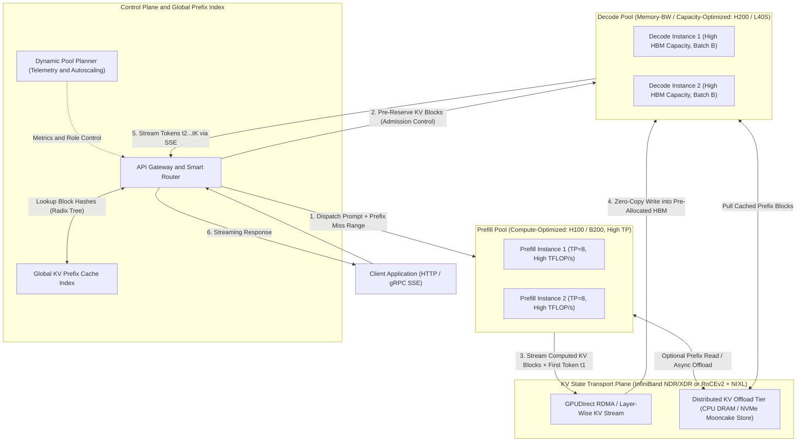
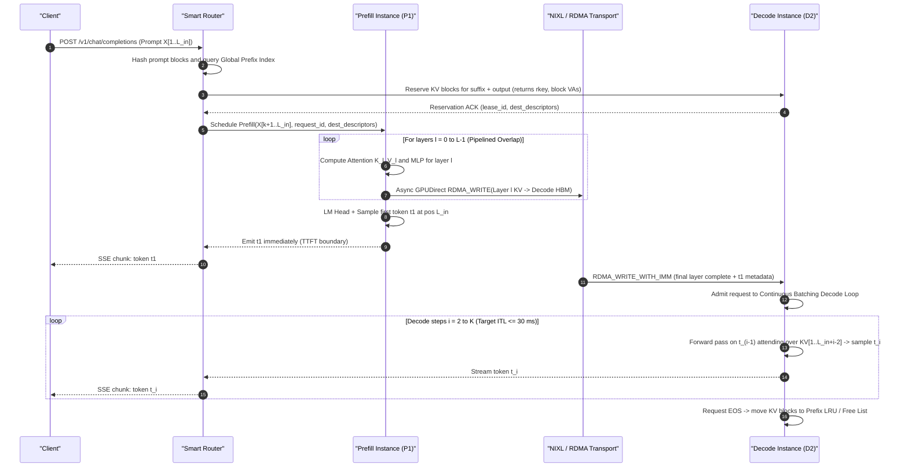

# 02 — Disaggregated Architecture (Prefill/Decode Disaggregation)

> **Navigation:** [Prev: 01 — High-Speed Network Fabrics](./01-high-speed-network-fabrics.md) | [Stage 9 Index](./README.md) | **Next:** [03 — KV State Transport](./03-kv-state-transport.md)

Serving large language models efficiently is hard because processing a user's prompt and generating the reply place completely opposite demands on GPU hardware. This document explains why running both steps on the same GPUs causes latency spikes and hardware waste, and how separating them into dedicated pools solves the problem.

---

## Core Concepts & Terminology

Every inference concept, hardware metric, and distributed-systems term used in this document is defined below in dependency order:

### 1. LLM Serving & Request Lifecycle
* **Token, Prompt ($L_{\text{in}}$), Output ($L_{\text{out}}$), `EOS`, & `max_tokens`:** A *token* is a small piece of text. A user sends a prompt of length $L_{\text{in}}$ tokens, and the model generates $L_{\text{out}}$ output tokens until it emits a special stop token (**`EOS`**, End of Sequence) or hits the **`max_tokens`** limit.
* **Prefill vs. Decode (Autoregressive) & Co-Location:** *Prefill* processes all $L_{\text{in}}$ prompt tokens in parallel to produce the first output token ($t_1$). *Decode* then generates one output token per step, feeding each new token back as input for the next step (*autoregressive*). **Co-location** means running both Prefill and Decode on the exact same GPUs.
* **KV Cache (Key-Value Cache):** Intermediate attention vectors (*Keys* and *Values*) computed for every processed token and saved in GPU memory so Decode does not recompute the prompt on every step.
* **LM Head & Logits:** At the end of a forward pass, the **LM Head** projects the final hidden vector into vocabulary scores called **logits**, from which the next token is sampled.
* **Continuous Batching & Head-of-Line Blocking:** Early serving engines (**vLLM**, **TensorRT-LLM**, **TGI**) used static batches, where short requests waited for long requests to finish (*head-of-line blocking*). **Continuous Batching** (iteration-level scheduling) adds newly arrived requests and removes finished ones at every single token step.
* **Chunked Prefill (`max_num_batched_tokens`):** A scheduling technique (e.g., *Sarathi-Serve*) that splits a long prompt into smaller chunks capped by `max_num_batched_tokens` and mixes one chunk into each Decode step to bound single-step stalls.

### 2. Compute Roofline, Hardware SKUs, & Latency SLOs
* **GEMM, GEMV, Arithmetic Intensity, & Roofline Profile:** **GEMM** (General Matrix-Matrix Multiply, used in Prefill) performs many math operations per byte read from memory (**high arithmetic intensity**, $\text{FLOPs}/\text{Byte}$), making it limited by **Tensor Core** compute speed (`TFLOP/s`). **GEMV** (Matrix-Vector / Skinny GEMM, used in Decode) performs very few operations per byte loaded (**low arithmetic intensity**), making it limited by **HBM (High Bandwidth Memory)** transfer speed (`TB/s`) and capacity (`GB`). A **Roofline profile** plots this transition between memory-bound and compute-bound execution.
* **FP8 / FP4, HBM3 / HBM3e, GDDR6, VRAM, & KV OOM:** **FP8** and **FP4** are compact 8-bit and 4-bit floating-point formats that shrink memory usage and boost Tensor Core throughput. **VRAM** (Video RAM) is GPU memory—implemented as ultra-fast stacked **HBM3/HBM3e** on `H100`/`H200`/`B200`/`MI300X` GPUs, or cheaper **GDDR6** on `L40S` GPUs. **KV OOM** (Out of Memory) occurs when active KV caches exhaust available VRAM.
* **TTFT, ITL, TPOT, SLO, Goodput, & MFU:** **TTFT (Time to First Token)** is prompt-to-first-token latency; **ITL (Inter-Token Latency)** and **TPOT (Time Per Output Token)** measure the delay between consecutive output tokens. An **SLO (Service Level Objective)** is a target latency bound (e.g., P99 ITL $\le 30\text{ ms}$). **Goodput** is the maximum requests per second (**RPS**) that satisfy *both* TTFT and ITL SLOs. **MFU (Model FLOPs Utilization)** is the fraction of peak theoretical GPU FLOP/s achieved.
* **Parallelism: TP, PP, DP, & `AllReduce`:** **Tensor Parallelism (TP)** splits each layer's weight matrices across GPUs, requiring `AllReduce` synchronization barriers every layer. **Pipeline Parallelism (PP)** places different layers on different GPUs. **Data Parallelism (DP)** runs independent model replicas on separate GPUs.
* **RAG (Retrieval-Augmented Generation):** A workload pattern that injects long retrieved documents into prompts, creating very high $L_{\text{in}}$ relative to $L_{\text{out}}$.

### 3. Disaggregation, KV Storage, & Distributed Control
* **Prefill/Decode (P/D) Disaggregation:** Splitting an inference cluster into a compute-optimized **Prefill Pool** and a memory-bandwidth/capacity-optimized **Decode Pool**, connected by a high-speed network fabric. Landmark systems include **DistServe**, **Splitwise**, **Mooncake**, and **NVIDIA Dynamo + NIXL**.
* **NIXL, UCX, GPUDirect RDMA, GPUDirect Storage (GDS), POSIX, `rkey`, & `remote_va`:** **NIXL** (NVIDIA Inference Transfer Library) is an asynchronous data-movement API unifying **UCX** (an HPC transport framework), **GPUDirect RDMA** (direct GPU-to-GPU network transfers bypassing host RAM), **NVLink** (high-speed intra-node GPU interconnect), **GPUDirect Storage** (direct NVMe SSD-to-GPU transfers), and **POSIX** file I/O. An RDMA **`rkey`** (remote key) and **`remote_va`** (remote virtual address) authorize a remote GPU/NIC to write directly into pre-allocated memory.
* **PagedAttention, Prefix Cache, Radix Tree, & LRU:** **PagedAttention** divides the KV cache into fixed-size non-contiguous blocks (e.g., 16 or 64 tokens). A **Prefix Cache** stores and reuses KV blocks for repeated prompt prefixes (e.g., system prompts), indexed via a **Radix Tree** (a prefix trie) and evicted using **LRU (Least Recently Used)** ordering.
* **HTTP/gRPC, SSE, RPC, Admission Control, TTL Lease, & XID:** Clients connect via **HTTP/gRPC** and receive streaming tokens via **SSE (Server-Sent Events)**. Internal nodes coordinate via lightweight **RPCs (Remote Procedure Calls)**. **Admission Control** reserves destination KV blocks before Prefill begins; a **TTL (Time-To-Live) lease** automatically reclaims orphaned blocks if a Prefill worker crashes (e.g., via a fatal NVIDIA **XID** GPU hardware error).

---

## 1. The Co-Location Pathology: Physics of TTFT vs. ITL Interference

In traditional LLM serving engines (early vLLM, TensorRT-LLM, TGI), **Prefill** and **Decode** execute **co-located** on the exact same GPU instances. While Continuous Batching eliminates head-of-line request blocking at the batch level, co-locating two fundamentally opposite physical regimes on shared silicon creates severe SLO violations, poor hardware utilization, and rigid parallelism compromises. **Prefill/Decode (P/D) Disaggregation** physically separates the inference cluster into two specialized pools—a **Prefill Pool** and a **Decode Pool**—connected over a high-speed KV Cache transport fabric.

Every LLM request consists of two sequential computational phases with opposite Roofline profiles:

| Phase | Dominant Operation | Arithmetic Intensity ($\text{FLOPs}/\text{Byte}$) | Hardware Bottleneck | Primary SLO Metric |
| :--- | :--- | :--- | :--- | :--- |
| **Prefill** | Large Matrix-Matrix Multiply (GEMM) over $L_{\text{in}}$ tokens | High ($\propto L_{\text{in}}$, often $> 200\text{ FLOP/B}$) | **Tensor Core Compute (`TFLOP/s`)** | **TTFT** (Time to First Token) |
| **Decode** | Matrix-Vector / Skinny GEMM (GEMV) + KV Cache streaming | Low ($\approx B$ for weights, $\approx 1$ for KV cache) | **HBM Bandwidth (`TB/s`) & Capacity (`GB`)** | **ITL / TPOT** (Inter-Token Latency) |

### Why Co-Location Breaks Under Production Traffic

#### 1. Prefill Bursts Stall Ongoing Decodes (ITL Spikes)
In an iteration-level scheduler without disaggregation, whenever a new prompt of length $L_{\text{in}} = 4,096$ arrives, the engine must either:
* **Prefill-Prioritizing Scheduling (vLLM default):** Pause all 64 ongoing decode requests for one iteration to run the 4,096-token prefill forward pass. On an 8x H100 node running Llama-3.1-70B FP8, a pure decode step at $B=64$ takes **~22 ms**, whereas a 4,096-token prefill forward pass takes **~140 ms**. Every single one of those 64 active streaming users experiences a **140 ms generation freeze**—shattering a 30 ms P99 ITL SLO.
* **Chunked Prefill (Sarathi-Serve):** Splits the 4,096-token prompt into smaller chunks (e.g., `max_num_batched_tokens = 512`) piggybacked onto decode steps. While this bounds the stall, piggybacking a 512-token prefill chunk onto a 64-token decode batch *still* shifts the iteration from memory-bound GEMV (~22 ms) to compute-heavy GEMM (~45–55 ms) for 8 consecutive steps! Thus, **chunked prefill trades catastrophic ITL spikes for chronic ITL inflation and degraded TTFT** (since the prompt now waits across 8 decode cycles).

#### 2. Asymmetric Parallelism & Silicon Mismatch
Co-location forces a single static parallelism strategy $(TP, PP)$ and a single GPU SKU for both phases:
* **Tensor Parallelism (TP) Mismatch:** Prefill wants **high TP** (e.g., $TP = 8$ inside an NVLink domain) to split prompt GEMMs across maximum Tensor Cores and minimize single-request TTFT. Conversely, Decode at moderate batch sizes suffers diminishing returns from high TP because 160 `AllReduce` barriers per token add interconnect latency and duplicate KV reads/launch overhead—Decode often achieves higher **tokens/s per dollar** with lower TP ($TP = 2$ or $TP = 4$) + higher Data Parallelism or Pipeline Parallelism.
* **Hardware SKU Mismatch:**
  * **Prefill Pool:** Needs extreme FP8/FP4 Tensor Core density (`H100 SXM` at 1,979 FP8 TFLOP/s, `B200` at 9,000 FP8 TFLOP/s) and requires very little KV VRAM because prompt KV state is transient—only kept long enough to transfer to Decode!
  * **Decode Pool:** Needs massive **HBM capacity** and **HBM bandwidth per dollar** to hold huge concurrent KV caches ($B \in [64, 512]$) without hitting KV OOM (`H200` with 141 GB HBM3e @ 4.8 TB/s, `L40S` with 48 GB GDDR6 at ~1/3 the hourly cost of H100 for smaller/quantized models, or `MI300X` with 192 GB HBM3 @ 5.3 TB/s).

#### 3. Coupled Scaling Failure
When prompt lengths suddenly double (e.g., RAG document upload burst), a co-located cluster cannot scale Prefill FLOP/s independently without also paying for idle Decode memory/instances, and vice versa when output generation bursts occur.

---

## 2. Physical Disaggregation & Landmark Architectures

Disaggregating Prefill and Decode decouples the serving graph into specialized pools coordinated by a lightweight control plane and a high-throughput RDMA KV transport plane.

| Architecture | Core Innovation | KV Transport & Storage Tiering | Scheduling & Parallelism Strategy |
| :--- | :--- | :--- | :--- |
| **DistServe** *(OSDI '24)* | First formalization of P/D disaggregation optimizing **Goodput** (max RPS satisfying both TTFT & ITL SLOs). | Direct GPU-to-GPU KV transfer over NVLink (intra-node) or InfiniBand RDMA (inter-node). | Independently searches optimal $(TP_P, PP_P)$ for Prefill and $(TP_D, PP_D)$ for Decode; places P and D to avoid inter-node KV saturation. |
| **Splitwise** *(ISCA '24)* | Heterogeneous cluster orchestration mixing **Prompt (H100)**, **Token (A100/L40S)**, and **Mixed** overflow pools. | **Layer-by-layer pipelined KV transfer** overlapping prefill MLP/next-layer compute with RDMA transmission. | Dynamically routes overflow traffic to a small mixed pool when P/D demand shifts sharply. |
| **Mooncake** *(Kimi / FAST '25)* | **KVCache-centric architecture**: treats a cluster-wide distributed KV cache pool as the primary scheduling substrate. | **Mooncake Transfer Engine (TE)** across multi-NIC RDMA, CPU DRAM, and NVMe SSDs (`Mooncake Store`). | **Conductor** scheduler checks global KV prefix reuse first, routes prefill only for cache misses, and performs **early rejection** before prefill if Decode SLO cannot be met. |
| **NVIDIA Dynamo + NIXL** | Production modular inference OS combining **Smart Router**, **Planner**, and **NIXL** transport library. | **NIXL** abstracts UCX, GPUDirect RDMA, NVLink, GPUDirect Storage, and POSIX under one async API. | **KV-aware Radix Router** directs requests to Prefill/Decode nodes with warmest prefix overlap; Planner dynamically switches node roles between P and D. |

### Heterogeneous Hardware Assignment Pattern

In production disaggregated deployments for a 70B–405B FP8 model:
* **Prefill Pool:** `8x H100 SXM` or `8x B200` nodes configured at `TP=8`, small KV cache reservation (only ~15–20% of VRAM needed for in-flight prefill chunks + hot system-prompt prefixes), maximum Tensor Core MFU (~55–70%).
* **Decode Pool:** `8x H200 SXM` (141 GB HBM3e/GPU) configured at `TP=4` (two independent Decode instances per node) or `L40S` nodes for quantized 8B–70B models, allocating ~70–75% of VRAM to PagedAttention KV Cache blocks to support massive batch sizes ($B = 128\text{–}512$) and high prefix retention.

---

## 3. Disaggregated Cluster Topology & Request Lifecycle

### Step-by-Step End-to-End Request Lifecycle

Understanding the **exact token-index boundary** between Prefill and Decode prevents subtle off-by-one bugs and duplicated computation:

1. **Admission & Prefix Cache Lookup (Smart Router):**
   * Client sends prompt tokens $X = [x_1, x_2, \dots, x_{L_{\text{in}}}]$.
   * Router hashes prompt chunks (e.g., 16-token or 64-token blocks) and queries the **Global KV Prefix Index** (Radix Tree). Suppose tokens $[x_1 \dots x_k]$ already exist in Decode Instance $D_2$'s VRAM (or Mooncake Store).
   * Router selects:
     * **Decode Instance ($D_2$):** Based on prefix hit affinity, free KV block count $\ge \lceil (L_{\text{in}} + L_{\text{max\_out}}) / \text{block\_size} \rceil$, and current batch headroom under ITL SLO.
     * **Prefill Instance ($P_1$):** Based on lowest pending prefill token queue ($Q_P$) and local prefix hit.
2. **Pre-Allocation / KV Reservation:**
   * Router (or $P_1$) sends a lightweight metadata RPC to $D_2$ reserving the exact destination KV block slots for tokens $[x_{k+1} \dots x_{L_{\text{in}}}]$ (plus initial decode slots) and receives $D_2$'s RDMA target descriptors (`remote_va`, `rkey`).
   * *Why reserve before prefill?* If $D_2$ is out of KV memory, rejecting or re-routing **before** $P_1$ burns Tensor Core FLOPs prevents wasted compute (Mooncake's early rejection principle).
3. **Prefill Execution & First-Token Generation ($t_1$):**
   * $P_1$ runs the forward pass across uncached suffix tokens $[x_{k+1} \dots x_{L_{\text{in}}}]$, producing KV tensors $K_l, V_l$ for every layer $l \in [0, L-1]$.
   * At the final layer for position $L_{\text{in}}$, $P_1$ projects logits through the LM Head and samples the **first output token $t_1$**.
   * *Critical Note:* $t_1$'s own KV vectors have **not** been computed yet! $P_1$ immediately sends $t_1$ back to the Client/Router (completing **TTFT**) and ensures KV for $[x_1 \dots x_{L_{\text{in}}}]$ is transferred to $D_2$.
4. **KV State Transfer (`P1 -> D2`):**
   * Over GPUDirect RDMA (often pipelined layer-by-layer during step 3), $P_1$ writes the KV blocks for $[x_{k+1} \dots x_{L_{\text{in}}}]$ directly into $D_2$'s reserved GPU HBM pages, followed by an RDMA completion signal / immediate data notification containing `request_id` and sampled token ID $t_1$.
5. **Decode Admission & Autoregressive Loop:**
   * $D_2$ wakes up the request in its Continuous Batching scheduler at the next iteration boundary.
   * On $D_2$'s **first decode step**, $D_2$ feeds token $t_1$ as input at position $L_{\text{in}} + 1$, attends over the transferred KV cache $[x_1 \dots x_{L_{\text{in}}}]$, stores $t_1$'s newly computed KV pair, and samples token **$t_2$**.
   * Subsequent steps produce $t_3, \dots, t_K$ at steady ITL cadence until `EOS` or `max_tokens`.
6. **Completion & KV Retention:**
   * Upon completion, $D_2$ retains the prompt's KV blocks in its local **LRU Prefix Cache** (and optionally async-offloads them to Mooncake CPU/NVMe Store) before recycling blocks for future requests.

---

## 4. Failure Modes & Production Edge Cases

Disaggregating state across two node pools introduces distributed systems failure modes absent in single-node serving:

### 1. Decode KV OOM & Backpressure Deadlock
* **Symptom:** Prefill finishes computing KV tensors and blocks waiting for a Decode instance to accept the transfer; meanwhile Decode instances are 100% full of active sequences waiting to finish generating, causing Prefill GPU VRAM to fill with stranded KV caches.
* **Mitigation:**
  * **Pre-Allocation with Timeout Leases:** Never start Prefill until Decode confirms block reservation.
  * **KV Preemption / CPU Offload Fallback:** If Decode hits 98% KV capacity due to unexpectedly long output generations, Decode evicts lowest-priority prefix cache blocks or pauses/swaps a low-priority decode request to CPU DRAM over PCIe rather than stalling incoming RDMA transfers.
  * **Early Rejection:** Reject excess arrivals at the Router with HTTP `429 / 503` when projected Decode memory saturation exceeds a safety threshold (e.g., 90%).

### 2. Orphaned Reservations (Prefill Crash After Reservation)
* **Symptom:** Decode reserves 2,000 KV blocks for a 32k-token request, then the Prefill worker OOMs or experiences an XID GPU reset before completing the RDMA transfer. Those 2,000 blocks leak permanently on Decode.
* **Mitigation:** Every KV reservation carries a strict **TTL lease** (e.g., `max(5s, 2 * estimated_prefill_time)`). If the RDMA completion notification does not arrive before the lease expires, Decode's block manager automatically reclaims the reserved blocks.

### 3. RDMA Transfer Timeout / QP Error Mid-Stream
* **Symptom:** A link flap, PFC pause timeout, or Decode node preemption breaks an active RDMA Queue Pair while layer 42 of 80 is in flight.
* **Mitigation:**
  * **Prefill-Side Retry to Peer Decode:** If Prefill still holds the computed KV blocks in a short-lived local staging ring, the Router selects a healthy backup Decode instance $D_3$ and re-executes the KV transfer without recomputing Prefill.
  * **Stateless Prefill Recompute:** If Prefill already evicted the blocks, the Router transparently retries the request on another `(Prefill, Decode)` pair (prior to emitting $t_1$ to the client).

### 4. Prefix Cache Coherence & Asymmetric Caching
* **Symptom:** Decode $D_2$ holds a warm prefix `[x_1 .. x_k]` in VRAM, but Prefill $P_1$ does **not** have it. To compute attention for `[x_{k+1} .. x_{L_in}]`, $P_1$ needs the KV cache of `[x_1 .. x_k]`!
* **Mitigation (3 Architectural Patterns):**
  1. **Pull Prefix from Decode/Mooncake to Prefill:** $P_1$ `RDMA_READ`s the cached prefix KV blocks from $D_2$ (or Mooncake Store) before running attention on the suffix (only efficient when $k \gg L_{\text{in}} - k$ and network BW is high).
  2. **Shared Distributed KV Store:** Both $P$ and $D$ pull/push prefix blocks to a central DRAM/NVMe RDMA store (Mooncake).
  3. **Prefix-Only Prefill Recompute vs. Selective Routing:** If $k$ is small relative to network transfer cost, recomputing $k$ on $P_1$ at 1,979 TFLOP/s may be faster than fetching over the network; for massive prefixes ($k > 8,192$), the Router uses **Prefix-Aware Sticky Routing** or pulls from Mooncake Store.

---

> **Navigation:** [Prev: 01 — High-Speed Network Fabrics](./01-high-speed-network-fabrics.md) | [Stage 9 Index](./README.md) | **Next:** [03 — KV State Transport](./03-kv-state-transport.md)
