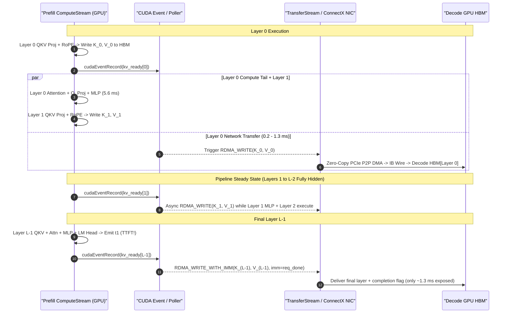
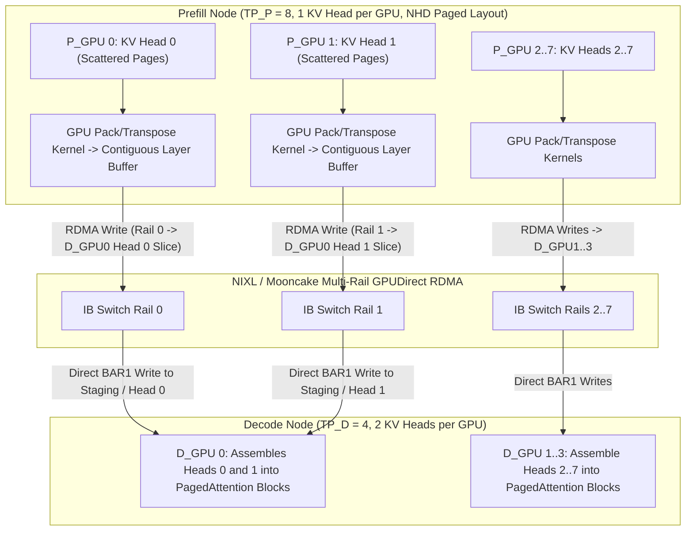

# 03 — KV State Transport

> **Navigation:** [Prev: 02 — Disaggregated Prefill/Decode Architecture](./02-disaggregated-prefill-decode-architecture.md) | [Stage 9 Index](./README.md) | **Next:** [04 — Distributed MoE Systems Engineering](./04-distributed-moe-systems-engineering.md)

When prompt processing (Prefill) and token generation (Decode) run on separate servers, the intermediate attention state computed during Prefill must be moved across the network before Decode can generate the second token. This document explains the math, transport software, pipelining techniques, and GPU memory layouts needed to move gigabytes of state in milliseconds.

---

## Core Concepts & Terminology

Every model parameter, networking primitive, and GPU memory mechanism used in this document is defined below in dependency order:

### 1. Model & Attention State Fundamentals
* **Prefill, Decode, TTFT, & KV Cache:** *Prefill* processes all prompt tokens in parallel and outputs the first token (completing **TTFT**, Time to First Token). *Decode* generates subsequent tokens one by one. The **KV (Key-Value) Cache** stores the Key and Value attention vectors for all processed tokens so Decode does not recompute them.
* **Transformer Layer Components ($L_{\text{layers}}$, QKV Proj, RoPE, FlashAttention, FFN/MLP):** An LLM stacks $L_{\text{layers}}$ Transformer layers. Each layer computes Query, Key, and Value vectors (**QKV Projection**), applies positional rotation (**RoPE**, Rotary Position Embedding) to $Q$ and $K$, computes attention (**FlashAttention**), and finishes with a feed-forward network (**FFN/MLP**: `Gate + Up + Down` projections, which consumes ~65–75% of the layer's math operations or **FLOPs**).
* **GQA (Grouped-Query Attention) & MLA (Multi-Head Latent Attention):** **GQA** reduces KV cache size by sharing $n_{\text{kv\_heads}}$ Key/Value heads (each of dimension $d_{\text{head}}$) across multiple Query heads. **MLA** (used in DeepSeek-V3) compresses Keys and Values into a single compact latent vector of size $d_c + d_R$ per token.
* **BF16 / FP16 vs. FP8:** **BF16/FP16** store each number in 2 bytes; **FP8** uses 1 byte, cutting KV cache memory and network bytes in half.

### 2. Hardware Buses, Fabrics, & RDMA Primitives
* **NIC, 400G NDR, 100GbE, & Multi-Rail Striping:** A **NIC** is a server's network adapter (e.g., 400 Gbps InfiniBand **NDR** at ~48 GB/s effective speed, or 100 Gbps Ethernet **100GbE**). **Multi-rail striping** splits one large transfer across all 8 NICs on an 8-GPU server in parallel (~384 GB/s aggregate).
* **PCIe, BAR1, `MaxReadReqSize`, QPI/UPI, NVMe-oF, CXL, & SRAM:** **PCIe** is the motherboard bus linking CPUs, GPUs, and NICs; **BAR1** is the PCIe address window exposing GPU HBM to the NIC; **`MaxReadReqSize`** is a PCIe hardware limit on single read transaction sizes. **QPI/UPI** are inter-socket CPU links (crossing them slows PCIe transfers). **NVMe-oF** (NVMe over Fabrics) and **CXL** connect remote SSDs/DRAM; **SRAM** is fast on-chip memory (used inside the NIC to cache address translations).
* **RDMA, `libibverbs`, `ibv_reg_mr`, `ibv_reg_dmabuf_mr`, `nvidia-peermem`, `dma-buf`, & MTT:** **RDMA** lets a NIC read/write remote memory directly, bypassing the OS kernel. **`libibverbs`** is the Linux RDMA library. **Memory registration** (`ibv_reg_mr` or modern `ibv_reg_dmabuf_mr` via `nvidia-peermem`/`dma-buf`) pins GPU pages and writes their physical BAR1 addresses into the NIC's **MTT (Memory Translation Table)**, returning **`lkey`** (local access key) and **`rkey`** (remote access key).
* **WQE, SQ, `ibv_post_send`, Doorbell Batching, `ibv_sge`, & `max_sge`:** Software submits **WQEs (Work Queue Elements)** to a **Send Queue (SQ)** via `ibv_post_send` and rings the NIC's **Doorbell**. **Doorbell batching** chains many WQEs and rings the doorbell once. An **`ibv_sge` (Scatter-Gather Element)** lets one WQE describe up to `max_sge` non-contiguous memory chunks.
* **One-Sided Verbs (`RDMA_WRITE`, `RDMA_WRITE_WITH_IMM`, `RDMA_READ`):** `RDMA_WRITE` pushes data into a remote virtual address (`remote_va`) using `rkey` with zero remote CPU involvement (`WITH_IMM` adds a 32-bit notification flag). `RDMA_READ` pulls data from a remote peer.

### 3. Transport Middleware & GPU Pipelining
* **NCCL / `PyNccl`:** NVIDIA's collective communication library; it assumes a fixed group of GPUs where one node failure tears down the communicator.
* **NIXL, UCX (`UCT`, `UCP`, `rc_mlx5`, `dc_mlx5`, `cuda_ipc`, `gdr_copy`, `RNDV`), & Mooncake TE:** **NIXL** (NVIDIA Inference Transfer Library) provides dynamic point-to-point agents (`nixlAgent`) and async transfer lists (`nixlXferDescList`) over pluggable backends like **UCX**, **GPUDirect RDMA**, **GPUDirect Storage (GDS)**, and **NVSHMEM** (GPU-initiated RDMA). **UCX** splits into **`UCT`** (hardware transports: `rc_mlx5` Reliable Connected, `dc_mlx5` Dynamically Connected to avoid $O(N^2)$ Queue Pairs, `cuda_ipc` NVLink, `gdr_copy` BAR mapping) and **`UCP`** (chooses **Eager** inline copy for $<8\text{ KB}$ or zero-copy **Rendezvous `RNDV`** for bulk tensors). **Mooncake TE** is a C++ RDMA/NVMe-oF transfer engine with topology-aware multi-rail routing.
* **CUDA Streams & Events (`ComputeStream`, `TransferStream`, `cudaEventRecord`, `cudaStreamWaitEvent`):** **CUDA Streams** are independent queues of GPU operations. Recording a `cudaEventRecord` on `ComputeStream` and waiting on it via `cudaStreamWaitEvent` on `TransferStream` synchronizes data transfers with compute entirely on the GPU without blocking the host CPU.

### 4. PagedAttention Layouts, TP Resharding, & CUDA VMM
* **PagedAttention, NHD vs. HND Layouts, & Triton/CUDA Staging Kernel:** **PagedAttention** stores KV cache in fixed-size virtual blocks (`block_size` tokens). **NHD** layout (`[num_blocks, 2, num_layers, ...]`) scatters each layer's data across thousands of blocks; **HND** layout (`[num_layers, 2, num_blocks, ...]`) groups blocks by layer first. A lightweight **Triton/CUDA kernel** can pack scattered blocks into a contiguous GPU **staging buffer** in ~15–20 µs so RDMA sends one bulk write.
* **Asymmetric Tensor Parallelism ($TP_P \neq TP_D$) & GQA Head Deduplication:** Prefill often uses more GPUs per instance ($TP_P = 8$) than Decode ($TP_D = 4$). Transport must map each Prefill GPU's KV heads into the right head slices on Decode—and when $TP_P > n_{\text{kv\_heads}}$, skip sending duplicate KV head copies held on odd ranks.
* **CUDA VMM (`cudaMalloc`, `cuMemCreate`, `cuMemMap`, 2 MB Granularity) & Static KV Arena:** Instead of registering memory per request, engines allocate one **Static KV Arena** at startup using CUDA Virtual Memory Management (`cuMemCreate` with 2 MB physical pages + `cuMemMap`) and register it once, yielding **0 µs** per-request registration overhead and preventing NIC MTT cache misses.

---

## 1. KV Cache Volume Math & Fabric Bandwidth Budget

The physical separation of Prefill and Decode introduces a mandatory data movement step between computing the prompt's representations and generating the second token: **KV State Transport**. If implemented naively (host-staged TCP, unpipelined full-context transfer, dynamic `ibv_reg_mr` per request, or 100,000 tiny non-contiguous RDMA writes), KV transport adds hundreds of milliseconds to TTFT and destroys the benefits of disaggregation.

For a standard Grouped-Query Attention (GQA) Transformer, the total KV state generated by a prompt of length $S$ tokens is:

$$\text{Bytes}_{\text{KV}}(S) = 2 \times L_{\text{layers}} \times n_{\text{kv\_heads}} \times d_{\text{head}} \times S \times b_{\text{dtype}}$$

Where the factor of $2$ accounts for $K$ and $V$, and $b_{\text{dtype}}$ is $2\text{ bytes}$ for FP16/BF16 or $1\text{ byte}$ for FP8.

### Concrete Sizing Examples (BF16 vs. FP8)

| Model | $L_{\text{layers}}$ | $n_{\text{kv\_heads}}$ | $d_{\text{head}}$ | KV Bytes / Token (BF16) | KV at $S=8\text{k}$ | KV at $S=32\text{k}$ | Unpipelined Transfer @ 400G (1 NIC, 48 GB/s) | Pipelined Multi-Rail @ 8x 400G (384 GB/s) |
| :--- | :--- | :--- | :--- | :--- | :--- | :--- | :--- | :--- |
| **Llama-3.1-8B** | 32 | 8 | 128 | 128 KB | 1.0 GB | 4.0 GB | 83 ms ($32\text{k}$) | ~10.4 ms ($32\text{k}$) |
| **Llama-3.1-70B** | 80 | 8 | 128 | **320 KB** | **2.5 GB** | **10.0 GB** | **208 ms** ($32\text{k}$) | **~26.0 ms** ($32\text{k}$) |
| **Llama-3.1-405B** | 126 | 8 | 128 | 504 KB | 3.94 GB | 15.75 GB | 328 ms ($32\text{k}$) | ~41.0 ms ($32\text{k}$) |
| **DeepSeek-V3 (MLA)** | 61 | $d_c + d_R = 576$ *(latent)* | — | **~70 KB** *(BF16)* | **547 MB** | **2.19 GB** | **45.6 ms** ($32\text{k}$) | **~5.7 ms** ($32\text{k}$) |

*Engineering Insight:* Even with 8x 400G InfiniBand NDR rails (384 GB/s aggregate), an unpipelined 10 GB KV transfer for Llama-3.1-70B at 32k context takes **26 ms** (and **208 ms** over a single 400G NIC—or **833 ms** over 100GbE!). This makes **multi-rail striping**, **FP8 KV quantization**, and **layer-wise compute/communication overlap** mandatory.

---

## 2. Transport Middleware Stacks: NIXL, UCX, and Mooncake TE

Production inference engines avoid raw `libibverbs` boilerplate in favor of specialized high-performance transport abstractions:

### 1. NVIDIA NIXL (NVIDIA Inference Transfer Library)
Designed specifically as the unified data plane for disaggregated inference (NVIDIA Dynamo, vLLM, TensorRT-LLM):
* **Unified Point-to-Point Abstraction:** Unlike NCCL (which requires collective world-group initialization where a single node failure tears down the communicator), NIXL uses **asymmetric, dynamic point-to-point agents** (`nixlAgent`). Nodes join/leave dynamically without global barriers.
* **Heterogeneous Backend Plugins:** Exposes a single non-blocking descriptor API (`nixlXferDescList`) over pluggable backends:
  * **UCX / Libfabric** for InfiniBand and RoCEv2 GPUDirect RDMA.
  * **NVLink / NVSHMEM** for intra-node or GB200 NVL72 memory-semantic copies.
  * **GPUDirect Storage (GDS) / POSIX / S3** for tiered KV offloading to NVMe SSDs or object storage.
* **Asynchronous Handle Model:** `createXferReq` -> `postXferReq` -> non-blocking `getXferStatus` polling, enabling seamless overlap with CUDA streams.

### 2. UCX (Unified Communication X)
A mature HPC transport framework used under the hood by NIXL, vLLM (`PyNccl`/UCX connectors), and SGLang:
* **Layered Architecture:**
  * `UCT` (Transport Layer): Direct hardware drivers (`rc_mlx5` Reliable Connected IB, `dc_mlx5` Dynamically Connected IB for massive cluster scaling without $O(N^2)$ QPs, `cuda_ipc` NVLink, `gdr_copy` low-latency PCIe BAR mapping).
  * `UCP` (Protocol Layer): Automatically selects **Eager Protocol** (inline copy for tiny metadata $< 8\text{ KB}$) vs. **Rendezvous (`RNDV`) Protocol** (zero-copy `RDMA_WRITE`/`RDMA_READ` for bulk KV tensors) and handles multi-rail striping across multiple NICs.

### 3. Mooncake Transfer Engine (TE)
Open-source C++ engine built directly over `libibverbs`, NVMe-oF, and CXL/DRAM for Kimi's Mooncake architecture:
* **Batch Non-Contiguous Scatter-Gather:** Optimized to transfer hundreds of discontinuous PagedAttention blocks in a single call via hardware **doorbell batching** (chaining WQEs in the SQ and ringing the NIC doorbell once).
* **Topology-Aware Multi-Rail Routing:** Automatically binds GPU memory buffers to their PCIe-local NIC (avoiding cross-socket QPI/UPI penalties) and balances KV traffic across healthy NICs with automatic failover if a single rail degrades.

---

## 3. Push vs. Pull Transfer Models

Disaggregated engines choose between two fundamental RDMA transfer directions:

### Push Model (Prefill-Initiated `IBV_WR_RDMA_WRITE`)
1. Decode pre-allocates destination KV blocks and sends `(rkey, dest_VAs[])` to Prefill.
2. As Prefill computes KV tensors, Prefill pushes them directly into Decode's HBM via `RDMA_WRITE` (with `IMM` notification upon completion).

* **Advantages:**
  * **Enables Layer-Wise Streaming:** Prefill can transmit layer $l$'s KV blocks immediately after layer $l$ attention finishes—overlapping network transfer with layers $l+1 \dots L-1$ prefill compute.
  * **Zero Decode Compute Stall:** Decode GPUs do not waste SM/CPU cycles issuing reads; tokens simply materialize in Decode HBM via NIC DMA.
* **Disadvantages:**
  * **Coupled Admission:** Prefill must know *which* Decode instance and *which* physical block VAs to write to *before* prefill starts (or buffer locally until assigned).
  * **Prefill Head-of-Line Risk:** If the target Decode node stalls or drops a link mid-prefill, Prefill's TX queues back up.

### Pull Model (Decode-Initiated `IBV_WR_RDMA_READ`)
1. Prefill writes computed KV blocks into a local registered buffer (or offloads to a distributed CPU/NVMe Mooncake Store) and publishes `(rkey, src_VAs[])` metadata to the Router/Index.
2. When a Decode node is ready to admit the request into its batch, Decode issues `RDMA_READ` to pull the KV blocks into its local HBM.

* **Advantages:**
  * **Strict Temporal Decoupling:** Prefill finishes, optionally stages KV in cheap host DRAM/Mooncake Store, and immediately frees GPU HBM for the next prompt—even if all Decode GPUs are temporarily saturated.
  * **Native Multi-Consumer Prefix Reuse:** Multiple Decode replicas can `RDMA_READ` shared system-prompt KV blocks from a central DRAM cache without coordinating push destinations.
* **Disadvantages:**
  * **Harder Layer-Wise Overlap:** Decode cannot easily start pulling layer $l$ unless Prefill explicitly signals per-layer readiness via shared memory/atomic flags.
  * **Higher Protocol Latency:** `RDMA_READ` requires a full network round-trip (`Read Request` $\to$ `Read Response`) and consumes remote PCIe Read completion credits (typically slower/more sensitive to PCIe MaxReadReqSize than posted `RDMA_WRITE`s).

---

## 4. Layer-Wise Pipelined KV Streaming

In a standard Transformer layer $l$, the attention projections compute $K_l$ and $V_l$ **before** FlashAttention finishes, and **long before** the layer's heavy FFN/MLP (`Gate + Up + Down` projections, which consume ~65–75% of layer FLOPs!) begins.

**Layer-wise pipelining** exploits this intra-layer structure to hide ~95–99% of KV transfer latency behind Prefill compute:

1. **Dual-Stream Architecture:** Prefill runs layer computations on `ComputeStream` and transfers on `TransferStream` (or a dedicated CPU RDMA poller / GPU-initiated NVSHMEM kernel).
2. **Per-Layer Signaling:** Immediately after the $K_l, V_l$ writeback kernel (and RoPE on $K_l$) completes on `ComputeStream`, the engine records a lightweight `cudaEventRecord(kv_ready[l], ComputeStream)`.
3. **Concurrent Execution:** `TransferStream` waits on `kv_ready[l]` (via `cudaStreamWaitEvent`, zero CPU blocking!) and triggers the non-blocking NIXL / `RDMA_WRITE` for layer $l$'s KV blocks while `ComputeStream` proceeds uninterrupted with Attention output projection, MLP of layer $l$, and layers $l+1 \dots L-1$.
4. **Exposed Critical-Path Latency:**
   Let $T_{\text{comp}}(l)$ be the compute time of one layer (MLP + next Attention) and $T_{\text{comm}}(l) = \frac{\text{Bytes}_{\text{KV}}(l)}{\text{BW}_{\text{eff}}}$ be the RDMA transfer time of one layer's KV slice. The exposed network latency added to TTFT is:

   $$T_{\text{exposed\_kv}} = \sum_{l=0}^{L-2} \max\!\Big(0,\; T_{\text{comm}}(l) - T_{\text{comp}}(l)\Big) + T_{\text{comm}}(L-1)$$

   *Numerical Check (Llama-3.1-70B, $S=16,384$, TP=8 on H100 + 8x 400G IB):*
   * Total prefill compute time $\approx 450\text{ ms} \implies T_{\text{comp}}(l) \approx 5.6\text{ ms/layer}$.
   * Total KV size $= 5.0\text{ GB} \implies 64\text{ MB/layer}$. Over 8x 400G NICs (384 GB/s), $T_{\text{comm}}(l) \approx 0.17\text{ ms/layer} \ll 5.6\text{ ms/layer}$!
   * Even over a *single* 400G NIC (48 GB/s), $T_{\text{comm}}(l) \approx 1.33\text{ ms/layer} < 5.6\text{ ms/layer}$!
   * **Result:** Layers $0 \dots 78$ are **100% hidden** ($T_{\text{exposed}} = 0$), and only the final layer $L-1$ ($0.17\text{ ms}$ to $1.33\text{ ms}$) sits on the TTFT critical path—cutting exposed transport overhead from **104 ms down to 1.3 ms**!

---

## 5. Paged-Block Scatter-Gather vs. Contiguous Layout & TP Resharding

Transferring KV caches in production is rarely a single contiguous `memcpy`. Two structural complexities arise: **PagedAttention fragmentation** and **asymmetric Tensor Parallelism ($TP_P \neq TP_D$)**.

### Problem A: PagedAttention Memory Layout & Scatter-Gather Explosion

Inference engines allocate KV cache in fixed-size virtual pages (e.g., `block_size = 16` tokens). Two common physical tensor layouts exist:

1. **NHD (Block-First / Interleaved):** `[num_blocks, 2, num_layers, num_kv_heads_local, block_size, head_dim]`
   * In NHD, a single layer's KV slice for a 32k-token prompt (`2,048` blocks) is **scattered across 2,048 non-contiguous memory islands**, and even inside one block, layer $l$ is separated from layer $l+1$ by tiny strides.
   * Issuing `80 layers * 2 (K,V) * 2,048 blocks = 327,680` separate RDMA Work Requests (`ibv_post_send`) per request overflows hardware Send Queue depths (typically 1K–16K WQEs) and stalls on NIC WQE processing limits (~10–50M WQEs/s -> ~6–30 ms of pure WQE bottleneck!).
2. **HND / Layer-First Layout:** `[num_layers, 2, num_blocks, num_kv_heads_local, block_size, head_dim]`
   * Grouping by `[layer, K/V]` keeps all blocks of layer $l$ inside one contiguous block-pool slice, allowing contiguous blocks (which occur frequently during single-prompt prefill!) to be coalesced into **1–16 large SGE (`ibv_sge`) segments** per layer.

#### Scatter-Gather (`ibv_sge`) vs. GPU Contiguous Staging Buffer
When blocks are non-contiguous (e.g., fragmented prefix allocation or NHD layout):
* **Hardware Scatter-Gather (`ibv_sge`):** A single WQE accepts an array of `sge_list[]` pointers (up to `max_sge` $\approx 16\text{–}30$ entries per WQE on ConnectX-7). Works well when fragmentation is low (runs of consecutive block IDs), eliminating extra GPU copies.
* **GPU Gather/Pack Staging Kernel (Preferred for High Fragmentation or Layout Transposition):** A lightweight Triton/CUDA kernel gathers scattered PagedAttention blocks for layer $l$ into a pre-allocated **contiguous GPU staging buffer** (`64 MB` ping-pong ring). Because HBM3/HBM3e bandwidth is **3.35–4.8 TB/s**, packing 64 MB inside GPU HBM takes only **~15–20 µs**—while collapsing 2,048 scattered RDMA writes into **1 single bulk `RDMA_WRITE`** at full 48 GB/s wire speed! Decode runs the inverse scatter kernel on arrival (or writes directly if pre-transposed).

### Problem B: Asymmetric Tensor Parallelism ($TP_P \neq TP_D$) & GQA Resharding

In disaggregated clusters, Prefill often runs at $TP_P = 8$ while Decode runs at $TP_D = 4$ or $TP_D = 2$ (or even $TP_D = 8$ with a different head/page layout). Consider a model with **$n_{\text{kv\_heads}} = 8$** (like Llama-3.1-70B):

* **Case 1: Head Aggregation ($TP_P = 8 \to TP_D = 4$)**
  * On Prefill ($TP_P=8$), each GPU holds $8 / 8 = 1$ KV head (`head_0` on P_GPU0, `head_1` on P_GPU1, etc.).
  * On Decode ($TP_D=4$), each GPU holds $8 / 4 = 2$ KV heads (`head_0, head_1` on D_GPU0; `head_2, head_3` on D_GPU1, etc.).
  * **Transport Mapping:** Both `P_GPU0` and `P_GPU1` transfer their single head into **distinct head-slice offsets** inside `D_GPU0`'s target buffer!
  * **Crucial Layout Requirement:** For `P_GPU0` and `P_GPU1` to write directly into `D_GPU0`'s blocks without an intermediate copy, `num_kv_heads_local` must be an outer dimension relative to `(block_size, head_dim)`—i.e. `[layer, 2, head_local, block_id, block_size, head_dim]` or `[layer, 2, block_id, head_local, block_size, head_dim]` where `P_GPU0` writes at stride offset `head=0` and `P_GPU1` writes at stride offset `head=1`. If `block_id` is outer and `head_local` is inner, `P_GPU0` and `P_GPU1` interleave inside every block, making direct RDMA without Decode-side scatter/transpose require 1 WQE per block—so a GPU staging transpose is vastly faster.

* **Case 2: GQA Head Deduplication ($TP_P > n_{\text{kv\_heads}}$, e.g., $TP_P = 8, n_{\text{kv\_heads}} = 4 \to TP_D = 4$)**
  * When $TP_P = 8$ and $n_{\text{kv\_heads}} = 4$, Prefill GPUs `(0,1)`, `(2,3)`, `(4,5)`, `(6,7)` hold **identical replicated copies** of KV heads `0, 1, 2, 3`.
  * A naive transport layer transfers all 8 shards—wasting **50% of RDMA bandwidth**!
  * Topology-aware transport (NIXL / Mooncake) designates **only even ranks** (`P_GPU0, P_GPU2, P_GPU4, P_GPU6`) as senders—cutting KV transport bytes in half with zero extra compute!

---

## 6. Memory Registration (`ibv_reg_mr`) Overhead & Mitigation

Calling `ibv_reg_mr()` on GPU memory is **prohibitively expensive on the inference hot path**:

1. **Kernel Trap & Page Pinning:** Enters the Linux kernel, locks virtual address ranges, queries `nvidia-peermem` / `dma-buf` for physical BAR1 mappings across all 2 MB / 64 KB GPU pages.
2. **NIC MTT Programming:** Sends PCIe commands to write thousands of Memory Translation Table entries into the ConnectX NIC's on-board SRAM/cache.
3. **Latency Cost:** Registering a single 100 MB buffer takes **~500 µs to 5 ms** (and registering 100 separate 1 MB tensors can exceed **50 ms**), completely serializing request execution.

### Production Mitigations

1. **Static KV Arena Pre-Registration (Mandatory):**
   * At engine startup, allocate the entire KV Cache pool as a **single contiguous virtual arena** (e.g., 60 GB via `cudaMalloc` or `cuMemCreate` + `cuMemMap`) plus a small fixed pool of **contiguously aligned Staging Buffers** (e.g., $4 \times 128\text{ MB}$).
   * Call `ibv_reg_dmabuf_mr()` (or `ibv_reg_mr()` via NIXL `registerMem`) **once at boot**, caching the resulting `(lkey, rkey)` pair for the entire process lifetime.
   * **Per-Request Registration Overhead:** **0 µs**. Every PagedAttention block ID `b` simply maps to `base_va + b * block_bytes` using the same pre-registered `rkey`/`lkey`.
2. **Large Page / 2 MB Contiguous Physical Allocations:**
   * Using CUDA VMM (`cuMemCreate` with 2 MB physical granularity) minimizes the number of MTT entries cached on the ConnectX NIC—preventing **MTT cache misses** inside the NIC hardware when randomly scattering across a 100 GB KV arena.
3. **Peer Memory Handle Caching (`rkey` Exchange Once):**
   * Rather than exchanging `rkey` metadata per request, Prefill and Decode agents exchange their static arena `(base_va, rkey, block_stride)` descriptors once during cluster handshake. Per-request control messages only carry compact arrays of integer **Block IDs** (e.g., `[104, 105, 819, ...]`), keeping control RPCs under 1–2 KB.

---

> **Navigation:** [Prev: 02 — Disaggregated Prefill/Decode Architecture](./02-disaggregated-prefill-decode-architecture.md) | [Stage 9 Index](./README.md) | **Next:** [04 — Distributed MoE Systems Engineering](./04-distributed-moe-systems-engineering.md)
