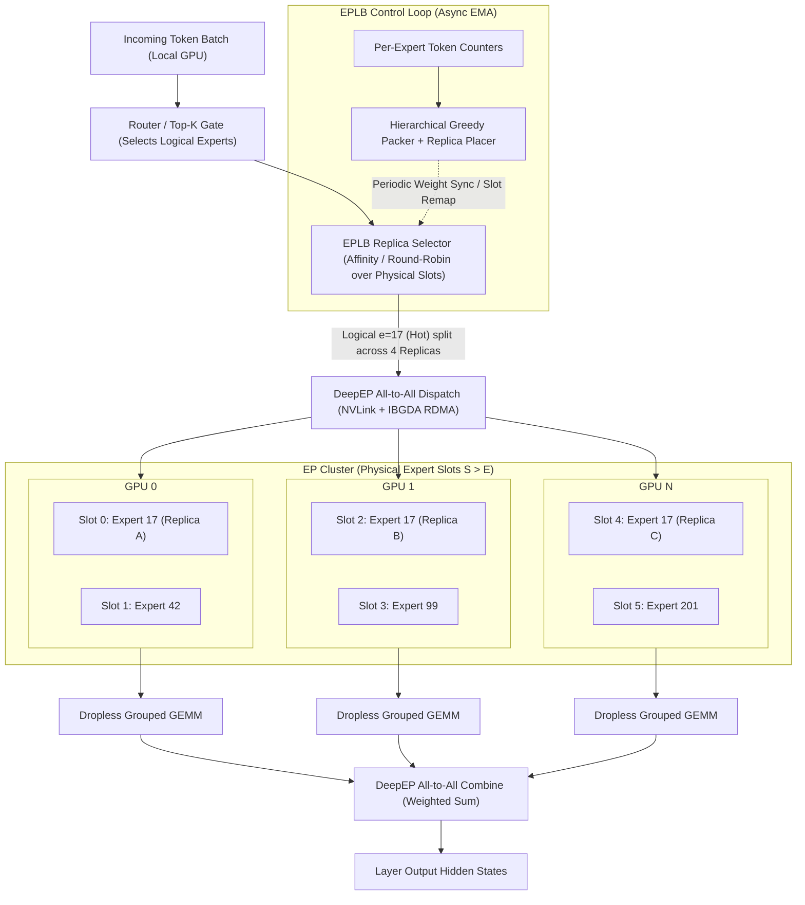
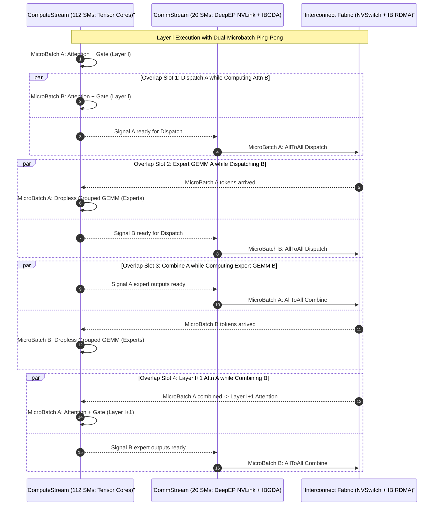

# 04 — Distributed MoE Systems Engineering

> **Navigation:** [Prev: 03 — KV State Transport](./03-kv-state-transport.md) | [Stage 9 Index](./README.md) | **Next:** [05 — Cluster Sizing & P/D Ratio](./05-cluster-sizing-and-pd-ratio.md)

Modern frontier AI models save compute by activating only a small fraction of their neural network weights for each word they process, spreading specialized sub-networks across dozens of GPUs. This document explains how GPUs route tokens across the network to those sub-networks without stalling on slow CPUs, uneven traffic spikes, or idle compute cores.

---

## Core Concepts & Terminology

Every model architecture detail, GPU kernel technique, and networking primitive used in this document is defined below in dependency order:

### 1. Mixture-of-Experts (MoE) & Parallelism
* **Mixture-of-Experts (MoE), Routed Experts ($E$), & Top-$K$ Gating:** Instead of one giant feed-forward network (FFN) per layer, an MoE layer has $E$ smaller **routed experts** (e.g., 256). A small **gating network** (`Softmax(W_g x_i)`) scores each token $x_i$ and activates only the top-$k$ experts (e.g., $k=8$), keeping per-token math (**FLOPs**) low despite huge total parameter counts.
* **SwiGLU FFN (`Gate + Up` $\to$ `SiLU` $\to$ `Down`) & Residual Connection:** Each expert is a neural-network block that applies `Gate` and `Up` linear projections, a `SiLU` activation, and a `Down` projection. A **residual connection** adds the layer's original input directly to its output.
* **Data Parallelism (DP), Tensor Parallelism (TP), & Expert Parallelism (EP, $N_{\text{EP}}$):** **DP** runs independent attention batches on different GPUs; **TP** splits matrices across GPUs; **EP** shards the $E$ experts across $N_{\text{EP}}$ GPUs ($E / N_{\text{EP}}$ experts per GPU) because 256+ experts exceed a single server's **HBM** (High Bandwidth Memory).
* **FP8, BF16, FP32, & Scale Factors:** **FP8** (1 byte/number) halves token size compared to **BF16** (2 bytes/number) using small per-block **scale factors**; final weighted sums often use **FP32** (4 bytes) or BF16 for numerical accuracy.

### 2. All-to-All Communication & DeepEP Kernels
* **`All-to-All` Dispatch & Combine:** Because a token's top-$k$ experts may live on any GPU, **Dispatch** sends each token over the network to the GPUs hosting its chosen experts, and **Combine** returns the expert outputs to the originating GPU for weighted summation.
* **Why `ncclAlltoAll` / `ncclAlltoAllv` Stalls:** NVIDIA's standard collective library (**NCCL**) provides `ncclAlltoAllv` for variable-size exchanges, but it requires the host CPU to know exact peer token counts in advance—forcing an extra `AllGather` + GPU-to-CPU `cudaMemcpy` synchronization stall before communication can start.
* **DeepEP, Node-Limited Routing, NVLink, & RDMA:** **DeepEP** (DeepSeek Expert Parallelism) replaces NCCL with two GPU-native kernels. In Prefill, it exploits **node-limited routing** (capping each token to at most $M$ server nodes) to send **at most 1 copy** per target node over inter-node **RDMA** (direct NIC-to-memory network transfers), then broadcasts locally inside the node over ultra-fast **NVLink**.
* **IBGDA (InfiniBand GPUDirect Async), NVSHMEM, `RDMA Put`, WQE, Doorbell, & PCIe MMIO:** In low-latency Decode, DeepEP uses **IBGDA** via **NVSHMEM**: GPU **SMs** (Streaming Multiprocessors) write RDMA work descriptors (**WQEs**) and ring the NIC's **Doorbell** directly via **PCIe MMIO** (Memory-Mapped I/O), bypassing the host CPU completely to write tokens directly into remote GPU memory (`RDMA Put`).

### 3. Load Skew, Capacity Factor, & Dropless Kernels
* **Auxiliary Load-Balancing Loss, Zipfian Skew, & Straggler:** Training uses an *auxiliary load-balancing loss* to encourage even expert usage, but real inference traffic exhibits **Zipfian skew** (a few "hot" experts receive most tokens—e.g., code or JSON boilerplate). Because `All-to-All Combine` is a synchronous barrier, all GPUs wait on the slowest **straggler** GPU.
* **Capacity Factor ($CF$), Token Dropping, & Padding Waste:** Early MoE systems capped each expert's buffer at $CF \times \text{average load}$. Small $CF$ silently **drops** excess tokens (corrupting inference outputs); large $CF$ **pads** tensors with zeros (wasting HBM, network bandwidth, and FLOPs).
* **Dropless MoE, MegaBlocks, `cub::DeviceScan::ExclusiveSum`, & Grouped GEMM:** **Dropless MoE** (e.g., *MegaBlocks*) avoids dropping and padding. A fast GPU prefix sum (`ExclusiveSum`) computes contiguous offsets to pack tokens by local expert ID (`gather`/`scatter`), and a single persistent **Grouped GEMM** kernel (in **CUTLASS** or **Triton**) executes variable-height matrix multiplications `(M_e, N, K)` across SMs, rounding `M_e` only up to the **Tensor Core** tile multiple.

### 4. Expert Replication & Compute/Communication Overlap
* **EPLB (Expert Parallelism Load Balancer), Logical Experts ($E$) vs. Physical Slots ($S > E$), EMA, & LPT Bin Packing:** **EPLB** eliminates stragglers without dropping tokens by provisioning extra **physical expert slots** ($S > E$), tracking hot experts via an **EMA (Exponential Moving Average)** of token counts, replicating hot experts across GPUs, and balancing slots via **LPT (Longest-Processing-Time-First)** bin packing.
* **MFU & Dual-Microbatch Ping-Pong (Two-Batch Overlap / TBO):** **MFU (Model FLOPs Utilization)** drops when Tensor Cores sit idle during `All-to-All`. **TBO** splits a batch into Micro-Batch A and B across **`ComputeStream`** and **`CommStream`** so one micro-batch computes Attention/GEMM while the other transfers over the network.
* **CUDA Green Contexts, `sm_count`, `CUDA_DEVICE_MAX_CONNECTIONS`, & `cudaStreamWaitEvent`:** **CUDA Green Contexts** (or explicit `sm_count` grid limits) reserve dedicated SMs for `CommStream` so GEMM does not starve communication. Setting `CUDA_DEVICE_MAX_CONNECTIONS >= 8` prevents CUDA from serializing `ComputeStream` and `CommStream` onto one hardware queue, while `cudaStreamWaitEvent` synchronizes them on the GPU.

---

## 1. Expert Parallelism & All-to-All Mechanics

Frontier Mixture-of-Experts (MoE) architectures—such as DeepSeek-V3 (671B total parameters, 37B active, 256 routed experts, top-$k = 8$), Qwen3-235B-A22B, and Mixtral-8x22B—decouple model capacity (total parameter count) from per-token FLOPs. However, running 671B parameters in FP8 (~671 GB of weights alone, before KV Cache and activations) exceeds the HBM of a single 8x H100 server (640 GB total), requiring multi-node deployment.

While Attention can use Data Parallelism (DP) or Tensor Parallelism (TP), replicating 256 experts on every node wastes massive HBM and forces skinny memory-bound GEMVs during Decode. **Expert Parallelism (EP)** shards the $E$ routed experts across $N_{\text{EP}}$ GPUs ($E / N_{\text{EP}}$ experts per GPU), transforming the FFN block into a **dynamic, data-dependent `All-to-All` distributed routing problem**.

In an MoE layer with $E$ routed experts distributed across $N_{\text{EP}}$ GPUs (typically $N_{\text{EP}} = 16, 32, 64,$ or up to $320$ in large-scale deployments), each GPU processes a local batch of $T_{\text{local}}$ tokens from its Attention/DP group.

### The 4-Stage Distributed MoE Execution Cycle

1. **Gating / Top-$K$ Routing:**
   Each GPU computes gating logits $s_i = \text{Softmax}(W_g x_i)$ and selects the top-$k$ expert IDs $\{e_{i,1}, \dots, e_{i,k}\}$ and weights $\{g_{i,1}, \dots, g_{i,k}\}$ for every local token $x_i \in \mathbb{R}^H$.
2. **`All-to-All` Dispatch:**
   Each GPU scatters its $T_{\text{local}}$ tokens to the remote GPUs hosting the selected experts.
   * **Traffic Volume:** Without deduplication, each token of size $H \cdot b_{\text{dtype}}$ bytes is sent up to $k$ times—yielding $T_{\text{local}} \cdot k \cdot H \cdot b_{\text{dtype}}$ bytes transmitted per GPU per layer. (FP8 quantization of hidden states *before* Dispatch cuts this wire volume by **50%** relative to BF16: e.g., $H=7168 \implies 7\text{ KB/token}$ in FP8 + ~128 B scale factors).
3. **Local Grouped GEMM (Expert FFN):**
   Each GPU executes SwiGLU FFN (`Gate + Up` $\to$ SiLU $\to$ `Down`) across all tokens received for each of its $E / N_{\text{EP}}$ local experts.
4. **`All-to-All` Combine:**
   Each GPU sends the computed expert output vectors back to the originating GPU, which performs the weighted reduction:
   $$y_i = \sum_{j=1}^{k} g_{i,j} \cdot \text{Expert}_{e_{i,j}}(x_i)$$

### Why Standard `ncclAlltoAll` Fails & How DeepEP-Style Kernels Solve It

Using generic `ncclAlltoAll` / `ncclAlltoAllv` for MoE inference introduces crippling bottlenecks:
* **Metadata Synchronization Stall:** In MoE, the number of tokens routed to each peer GPU varies dynamically every step. `ncclAlltoAllv` requires the host CPU to know exact `sendcounts`/`recvcounts` up front—forcing an extra `AllGather` + GPU-to-CPU `cudaMemcpy` synchronization stall before `AlltoAll` can even launch!
* **Lack of Node-Level Deduplication:** If 3 of a token's top-8 experts live on Node 4, naive token-level `AlltoAll` sends 3 identical copies of that token across the slow InfiniBand fabric to Node 4.
* **Host Launch & Ring Latency:** NCCL kernel launch + host proxy threads add ~15–30 µs per collective, intolerable during Decode (where $60\text{ layers} \times 2\text{ collectives} = 120$ barriers would burn 3.6+ ms just on launch jitter).

**DeepEP (DeepSeek Expert Parallelism)** replaces NCCL with two purpose-built GPU-native communication kernels:

1. **High-Throughput Kernel (Prefill & Large-Batch):**
   * **Hierarchical Two-Level Routing (NVLink + RDMA):** Instead of sending $k$ copies over InfiniBand, a GPU sends **at most 1 copy** of token $x_i$ over RDMA to each distinct target **node** (DeepSeek-V3 enforces *node-limited routing*, capping each token to at most $M = 4$ nodes out of 8+ nodes!). Once the single copy arrives at the target node's receiving GPU, **NVLink (450–900 GB/s)** broadcasts it locally to all peer GPUs on that node hosting the other selected experts. This reduces inter-node RDMA bandwidth by **$2\times\text{–}4\times$**.
   * **Zero Host Sync:** Token counts are exchanged via asymmetric RDMA atomics directly in GPU memory without CPU involvement.

2. **Low-Latency Kernel (Decode, Small Batch):**
   * Uses **IBGDA (InfiniBand GPUDirect Async)** via NVSHMEM: GPU SMs construct RDMA WQEs and ring ConnectX NIC doorbells **directly from CUDA threads** via PCIe MMIO, completely bypassing the host CPU!
   * Writes FP8-quantized tokens directly into pre-allocated asymmetric per-expert receive slots on remote GPUs (`RDMA Put` + atomic counter increment), eliminating intermediate staging copies and achieving **~150–200 µs** end-to-end `All-to-All` latency across 32–64 GPUs.
   * **Combine Quantization / Precision:** Combine returns BF16 (or FP32-accumulated) vectors to preserve numerical accuracy during the final weighted sum.

---

## 2. Expert Load Imbalance & Straggler Physics

Because `All-to-All Combine` is a **synchronous barrier**, every GPU in the EP group must wait until the slowest GPU finishes its local Expert GEMMs:

$$T_{\text{MoE\_step}} = T_{\text{dispatch}} + \max_{r \in \{0 \dots N_{\text{EP}}-1\}} T_{\text{GEMM}}(r) + T_{\text{combine}}$$

In theory, auxiliary load-balancing loss during training encourages uniform routing ($\bar{n} = \frac{k \cdot T}{E}$ tokens per expert). In **real inference traffic**, routing exhibits severe **heavy-tailed Zipfian skew**:
* **Domain & Token Clustering:** Code repositories, JSON schemas, multilingual prompts, or repetitive boilerplate trigger specific specialized experts repeatedly. A single batch of 256 requests might send 40% of tokens to just 10% of experts.
* **Straggler Amplification:**
  * In **Prefill** ($T_{\text{global}} = 32,768$, $E = 256$, $k=8 \implies$ mean $1,024$ tokens/expert): If a "hot" GPU receives $4\times$ average load ($4,096$ tokens on its local experts while peers receive $600$), those $N_{\text{EP}}-1$ peer GPUs sit **75% idle** waiting at the Combine barrier.
  * In **Decode** ($B = 64$ per GPU): A GPU holding cold experts may receive $0\text{–}2$ tokens (purely memory-bandwidth-bound on weight reads, loading only 1–2 experts from HBM), while a GPU holding multiple hot experts receives tokens hitting **all** its local experts, forcing full HBM reads of every local expert matrix and inflating ITL by $2\times\text{–}3\times$.

---

## 3. Capacity Factor: Token Dropping vs. Dropless Kernels (MegaBlocks)

Historically, distributed MoE training (GShard, Switch Transformer) bounded straggler variance using a static **Capacity Factor ($CF$)**:

$$\text{Capacity}_{\text{expert}} = \left\lceil CF \cdot \frac{k \cdot T_{\text{global}}}{E} \right\rceil$$

### Why Fixed Capacity Factor Fails in Production Inference

* **Token Dropping ($CF = 1.0\text{–}1.25$):** Any tokens routed to expert $e$ beyond $\text{Capacity}_{\text{expert}}$ are silently **dropped** (their expert output is zeroed, passing only the residual connection). While this caps max GEMM time and allows static fixed-shape tensors, dropping tokens during inference causes **non-deterministic accuracy degradation** (a request's output changes depending on what other tenants' prompts happen to share the batch!). In reasoning and code generation, dropping even 2% of tokens can corrupt syntax or math derivations.
* **Padding Waste ($CF \ge 2.0$):** Setting $CF$ high enough to avoid drops forces every expert tensor to be padded with zeros up to $\text{Capacity}_{\text{expert}}$, wasting $2\times$ HBM capacity, $2\times$ PCIe/IB transfer volume, and $2\times$ Tensor Core FLOPs multiplying zeros.

### Dropless MoE Kernels (MegaBlocks & Grouped GEMM)

Production inference engines eliminate Capacity Factor entirely using **Dropless MoE execution**:

1. **Prefix-Sum Permutation (`gather` / `scatter`):**
   Given dynamic per-expert token counts $[c_0, c_1, \dots, c_{E_{\text{local}}-1}]$, a fast GPU `cub::DeviceScan::ExclusiveSum` computes exact contiguous start offsets `offsets[e]`. Tokens are permuted in HBM into a dense, **zero-padding** packed buffer sorted by local expert ID.
2. **Variable-Length Grouped GEMM (MegaBlocks / CUTLASS `GroupedGemm` / Triton):**
   Instead of launching $E_{\text{local}}$ separate small GEMM kernels (which incurs huge launch overhead) or padding to uniform shapes, a **single persistent Grouped GEMM kernel** schedules variable numbers of thread-block tiles `(M_e, N, K)` across the GPU's SMs—where `M_e = c_e` is the exact token count of expert $e$ rounded up only to the Tensor Core tile multiple (e.g., 16 or 64)!
   * **Zero tokens dropped** (exact mathematical equivalence to unbatched inference).
   * **Zero wasted inter-node communication** (only actual routed tokens traverse the fabric).
   * **Trade-off:** Output buffers must be sized for worst-case local accumulation (or dynamically bound by total local batch $\sum c_e \le k \cdot T_{\text{global}}$), and extreme load skew still creates stragglers—which must be solved via **Expert Replication**.

---

## 4. Redundant Replication of Hot Experts (EPLB)

To eliminate stragglers *without* dropping tokens, systems like DeepSeek-V3 deploy **EPLB (Expert Parallelism Load Balancer)**—decoupling **logical experts** ($E$) from **physical expert slots** ($S > E$):

### How EPLB Works

1. **Over-Provisioned Physical Slots:**
   Suppose a model has $E = 256$ logical experts distributed across $N_{\text{EP}} = 64$ GPUs. Instead of placing strictly $256 / 64 = 4$ experts per GPU, we allocate **$S = 320$ physical slots** (5 slots per GPU = 25% redundant capacity).
2. **Workload Telemetry (EMA Load Tracking):**
   The serving engine tracks an Exponential Moving Average (EMA) of token counts $w_e$ routed to each logical expert $e \in [0, 255]$ over a sliding window (e.g., every 100–1,000 steps or minutes).
3. **Redundant Replica Allocation:**
   Hot experts receive multiple physical replicas proportional to their load. For example, if Expert `e=17` receives $4\times$ average traffic, EPLB allocates **4 physical replicas** of `e=17` across 4 different GPUs/nodes, reducing per-replica load to $1\times$.
4. **Hierarchical Bin-Packing (Node-Level $\to$ GPU-Level):**
   EPLB solves a two-stage balanced partitioning problem:
   * *Stage 1 (Inter-Node):* Packs groups of logical experts onto nodes so total node traffic is balanced and co-activated experts stay co-located to exploit node-limited routing.
   * *Stage 2 (Intra-Node):* Replicates hottest experts within/across nodes and assigns physical slots to individual GPUs using greedy Longest-Processing-Time-First (LPT) bin packing so every GPU has nearly identical expected token count $\sum_{s \in \text{GPU}_r} \mathbb{E}[c_s]$.
5. **Replica Selection During Dispatch:**
   When a token routes to logical expert `e=17`, the Dispatch kernel deterministically (by source GPU rank affinity—preferring an intra-node replica if one exists!—or round-robin/hash modulo `num_replicas`) picks one of the physical replicas, balancing both **compute load** and **inter-node RDMA traffic**.



---

## 5. Compute / Communication Overlap: Dual-Microbatch Ping-Pong

Even with DeepEP and EPLB, `All-to-All Dispatch` and `All-to-All Combine` over an inter-node fabric take significant wall-clock time (~30–50% of an unpipelined layer step). In naive sequential execution:

```text
[ Attention ] -> [ AllToAll Dispatch (Tensor Cores IDLE!) ] -> [ Expert GEMM ] -> [ AllToAll Combine (Tensor Cores IDLE!) ]
```

During both `Dispatch` and `Combine`, **100% of Tensor Cores sit idle**, tanking Model FLOPs Utilization (MFU).

### Dual-Microbatch Ping-Pong Pipeline (Two-Batch Overlap / TBO)

As pioneered in **DeepSeek-V3** (and adopted in SGLang/vLLM TBO), the incoming batch of tokens is split along the batch/sequence dimension into **two independent micro-batches: Micro-Batch A and Micro-Batch B**, executed concurrently across two CUDA streams (`ComputeStream` and `CommStream`):

1. **Stage 1 (Prefill/Decode Start):** `ComputeStream` executes **Attention** for Micro-Batch A.
2. **Stage 2 (Ping):** `CommStream` launches **`All-to-All Dispatch` for Micro-Batch A** over NVLink/RDMA **simultaneously while** `ComputeStream` executes **Attention for Micro-Batch B**.
3. **Stage 3 (Pong):** Once A's Dispatch arrives, `ComputeStream` executes **Expert Grouped GEMM for Micro-Batch A** **simultaneously while** `CommStream` launches **`All-to-All Dispatch` for Micro-Batch B**.
4. **Stage 4 (Pipeline Steady State):** `CommStream` launches **`All-to-All Combine` for Micro-Batch A** (plus Layer $l+1$ Attention for A once combined) **simultaneously while** `ComputeStream` executes **Expert Grouped GEMM for Micro-Batch B**!

### Hardware Constraints for True Overlap

* **SM Partitioning (Avoiding Kernel Starvation):** DeepEP communication kernels still require a small number of GPU SMs (typically 16–24 SMs out of 132 on an H100) to execute FP8 packing, NVLink copies, and RDMA doorbell ringing. If the concurrent Grouped GEMM grabs all 132 SMs, the communication kernel stalls waiting for SM slots—destroying overlap! Production engines cap GEMM SM occupancy (via **CUDA Green Contexts** or explicit `sm_count` grid limits in CUTLASS/Triton, e.g., reserving 20 SMs for `CommStream` and 112 SMs for `ComputeStream`).
* **Stream Serialization Prevention (`CUDA_DEVICE_MAX_CONNECTIONS`):** Setting `CUDA_DEVICE_MAX_CONNECTIONS=1` (used in training to preserve strict AllReduce order) serializes separate CUDA streams onto a single hardware work queue, **breaking overlap**. Disaggregated/MoE inference requires multi-connection queues (`>= 8`) or explicit CUDA events (`cudaStreamWaitEvent`) between `ComputeStream` and `CommStream`.
* **Attention-Before-MoE Weight & Activation Trade-off:** Splitting into two micro-batches halves the GEMM $M$-dimension per micro-batch; therefore TBO improves throughput during **Prefill** and **large-batch Decode** ($B \ge 64$), where halving $M$ still keeps Tensor Cores saturated, while at tiny batch sizes ($B \le 8$) single-batch low-latency `IBGDA` is preferred to avoid doubling GEMM weight reads from HBM!



---

> **Navigation:** [Prev: 03 — KV State Transport](./03-kv-state-transport.md) | [Stage 9 Index](./README.md) | **Next:** [05 — Cluster Sizing & P/D Ratio](./05-cluster-sizing-and-pd-ratio.md)
